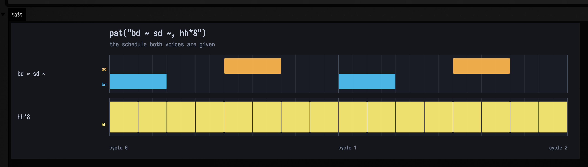

# Sound: from a pattern to something you can hear

`pat("bd ~ sd ~")` is a schedule. It says *kick, rest, snare, rest* and it says exactly
when — but a schedule makes no sound. Something has to turn each event into samples.

Field has **three** things that turn a *pattern's* events into samples, offline, with no audio device
and no realtime engine, and they sound nothing alike. One is a tiny synthesiser that ships in the
source tree. The second is the genuine Tidal drum library, if you happen to have it. The third is a
**Faust program compiled at runtime and played polyphonically** — a pattern's notes become
`freq`/`gate`/`gain` writes on a bank of voices, scheduled to the sample. This page follows one
pattern all the way down the **first two**, and — because this is the whole point — **every audio
figure below says which of them produced it.** The third has its own depth, in
[Faust: a box that is a signal processor](faust.md#a-pattern-plays-it); it is here in the
count because the count is the thing that keeps going stale.

Three is the count of *pattern voices*, and it is worth being exact about that, because this page has
now had that number wrong twice. Its first draft said Field had two things that make a sound at all —
it has [six](sound_paths.md). The correction then said the other four were "none of them driven by a
pattern", which was true when it was written and stopped being true when Faust gained a voice bank.
[Making a sound in Field: every path there is](sound_paths.md) maps all six and helps you pick; this
page is the depth on the two pattern voices that predate Faust.

Some of the audio figures elsewhere in these docs are the first voice below — a third of the
published corpus, not all of it. This page's first draft said all of them, on the strength of a
KDoc comment. See [what this means for the audio
elsewhere](#what-this-means-for-the-audio-elsewhere-in-these-docs) for the measurement that
refuted it.

---

## The path

| stage | what it is | where |
| --- | --- | --- |
| `pat("bd ~ sd ~")` | mini-notation parsed into a `PatPattern<String>` | [Patterns & Rhythm](pattern_language.md) |
| `.events(arc)` | the schedule, as values with rational spans | `PatPattern` |
| `showPatRoll` | those events drawn | `PatPianoRollGallery.kt` |
| `patVoice` → `patRenderStereo` | **the stand-in**: one oscillator per event | `PatSoundDocs.kt` |
| `DirtSampleLibrary` → `patRenderStereoDirt` | **real samples**, mixed into a buffer | `DirtRender.kt` |
| `WavFloatArrayWriter` | a 16-bit PCM WAV, or bytes into a box's output | `WavFloatArrayWriter.kt` |
| `patTranscribe` | **back the other way**: the buffer heard as pitched notes, and a `pat("…")` string that re-renders | `PatTranscription.kt` |
| `patTranscribeAuto` | the same, with the register estimated instead of declared | `PatTranscription.kt` |
| `showPatTranscriptionOf` | notated against recovered, overlaid on one MIDI axis | `PatTranscriptionGallery.kt` |

The pattern language itself is documented on [its own page](pattern_language.md) and this one
does not restate it. What matters here is only that a pattern is a *function from a query to
a list of events*, and that both voices below consume exactly the same list.

The last two rows run the path backwards, which is newer and worth one paragraph. `patTranscribe`
takes a finite buffer and returns pitched note events plus the mini-notation that reproduces them, so
the output of analysis is the same kind of object as the input to synthesis. On a notated scale it
recovers 15 of 16 notes with a median pitch error of 0.3 cents *(observed; the asserted floors are 14
notes and 3.0 cents)*; on three of the corpus cases it
returns *exactly* the notated integer sequence, and re-rendering that notation and transcribing it
again returns the same notes. It is monophonic and says so: a triad is reported as `POLYPHONIC` and
named as nothing rather than reported as its loudest note, while a sawtooth's full harmonic stack is
not refused, because timbre is not polyphony. The single parameter that matters is the register you
declare — it sets the analysis window and therefore the shortest note that can be resolved, and on
identical audio the difference between declaring it and not is onset recall 0.91 against 0.03. If you
cannot declare one, call `patTranscribeAuto`, which estimates it from a cheap wide first pass. Over the
twelve cases where a register *can* be declared, estimating it is about as good as being told —
mean onset recall 0.720 against 0.748 — and far better than leaving the wide default in place, which
scores 0.538 *(all three observed, not asserted; only their ordering is)*. It also refuses rather than
transcribing when the first pass says the material is not one line.

The loop closes all the way round, and the last hop is the one worth knowing about. Feeding the emitted
notation back through the renderer and listening again — notation → sound → notation → sound, every hop
a real Field path — **5 of 10 re-renderable corpus cases reproduce their own note sequence**. The other
five are exactly the cases whose first hearing was already incomplete, so the fourth hop works as a
validity check on the third rather than as a separate accuracy number. Every case is also classified by
what it *did* rather than how it scored: 4 recovered exactly, 4 within tolerance, 5 refused with a
reason, and **0 confidently wrong**. Read that last count precisely, because it is a statement about
warnings rather than about correctness: every wrong output now carries a warning naming where it is
wrong, and a case with any warning classifies as refused. So the claim is that nothing is wrong
*silently* — which is the property that matters, since a plausible parseable wrong answer gets believed
where a flagged one does not — and not that nothing is wrong.

The floors behind these figures are asserted; the figures themselves are measurements. The mechanism, the
full measurement tables and the several things this got wrong before it got them right are in
`dev_docs/pitch_transcription_roundtrip.md`, which also marks which figures are ratchets; the runnable
version is the
[pitch_transcription_roundtrip](agent_transcripts.md) starting point.

---

## The events, before anything makes a sound

One kick-and-snare and eight hats, stacked. Two cycles.

```diffstatic_runner {data-lang=kotlin screenshot="assets/sound_render_path/the-beat-roll.png" wait="2" capture="box" open-outputs="true" name="sound-doc-beat-roll"}
:::static
// The pattern the two A/B figures below render. Nothing here is audio yet — these are
// the events, and both voices are handed exactly this list.
showPatRollOf(
    "bd ~ sd ~" to pat("bd ~ sd ~"),
    "hh*8" to pat("hh*8"),
    title = "pat(\"bd ~ sd ~, hh*8\")",
    subtitle = "the schedule both voices are given",
    cycles = 2,
)
:::fold open the output pane
displayOpen("main")
:::endfold
```



Ten events a cycle — the two `~` are rests and produce nothing at all — at exact rational
positions. Nothing so far has an opinion about what a kick drum sounds like.

---

## The stand-in voice

`patVoice` is that opinion, and it is a deliberately small one: **one oscillator, one
one-pole lowpass, one exponential-decay envelope**, per event. Pitch comes from the event's
value when it parses as a MIDI number, and otherwise from a drum map with five entries in it:

| token | what `patVoice` plays |
| --- | --- |
| `bd`, `kick` | 62 Hz sine |
| `sd`, `snare` | 190 Hz noise |
| `cp`, `clap` | 900 Hz noise |
| `hh`, `hat` | 6200 Hz noise |
| `oh` | 4200 Hz noise |
| anything else | `baseHz`, the voice's own default |

`showPatAudio(pattern)` renders through it and drops an audio player into the box's output.
Here is the beat:

```diffstatic_runner {data-lang=kotlin audio="assets/sound_render_path/beat-stand-in.wav" audio-spec="beat-stand-in" audio-renderer="afield.four.synth.SoundRenderPathDocs" embed=true hidden=true name="sound-doc-beat-stand-in"}
// showPatAudio(pat("bd ~ sd ~, hh*8") with gain(0.9))
// offline-rendered through patVoice by SoundRenderPathDocs — listen below
```

**Voice: the stand-in synth (`patVoice`).** No sample library was used.

That is not a drum machine. It is a sine and some filtered white noise, arranged in the shape
of a drum machine. Which is worth being blunt about, because it is the **default**, and the
reason it is the default is good: it needs no assets. It renders identically on a clean
checkout, in CI, on a machine that has never heard of SuperCollider, and it is deterministic,
so a committed `.wav` regenerates byte-stably. A figure that always works and sounds
approximate beats a figure that sounds right on one laptop.

It is also honest about being a *measurement* target rather than a musical one:
`PatSoundDocs`' scenes verify pitch, onset count, stereo decorrelation and swing ratios
against the rendered audio, and a plain sine is a much easier thing to measure a pitch in
than a sampled kick.

---

## The real samples

`DirtRender` (`src/jvmMain/kotlin/afield/four/synth/DirtRender.kt`) is the other half.
`DirtSamples.kt` could already play the genuine Tidal sample set, but only **live** —
`playDirt` needs `respondAhead`, a clock and an audio device, none of which exist in a docs
build or a headless box. `patRenderStereoDirt` mixes the same library straight into a buffer.

The same beat, the same ten events a cycle, the same `gain` / `pan` / `speed` annotations:

```diffstatic_runner {data-lang=kotlin audio="assets/sound_render_path/beat-dirt.wav" audio-spec="beat-dirt" audio-renderer="afield.four.synth.SoundRenderPathDocs" embed=true hidden=true name="sound-doc-beat-dirt"}
// showDirtAudio(pat("bd ~ sd ~, hh*8") with gain(0.9))
// offline-rendered from the Dirt-Samples quark by SoundRenderPathDocs — listen below
```

**Voice: real Dirt-Samples one-shots, every token matched.**

Two details do most of the work in making that sound like drums rather than like a sampler
being triggered:

* **Hits are one-shots.** A sample plays to its natural end rather than being gated by the
  length of the arc that triggered it. That is what SuperDirt does, and it is the reason a
  snare sounds like a snare instead of a click — an eighth-note arc is far shorter than the
  snare's tail.
* **Only events with an onset trigger.** A fragment carried over from a previous query arc is
  a continuation, not a new hit; re-triggering it would flam.

### How the library is found

`DirtRender.dirtSampleRoot()` probes, in order:

1. `$FIELD_DIRT_SAMPLES`, if set and non-blank — the documented override;
2. `~/Library/Application Support/SuperCollider/downloaded-quarks/Dirt-Samples` (macOS);
3. `~/.local/share/SuperCollider/downloaded-quarks/Dirt-Samples` (Linux);
4. `~/Dirt-Samples`.

Dirt-Samples ships as a SuperCollider *quark*, so anybody who has ever run Tidal already has
it at one of those — which is the whole reason to auto-discover rather than ask you for a
path. It is deliberately **not vendored**: roughly 400MB of third-party audio with mixed
per-folder licensing has no business inside this repository. The probe is not cached, so
setting `FIELD_DIRT_SAMPLES` and rendering in the same session gets you what you asked for.

---

## Two fallbacks, at different granularities

This is the part most worth reading twice, because the two are easy to confuse and they mean
very different things.

**No library on this machine — the whole render falls back.** `patRenderStereoDirt` returns
the `patRenderStereo` render, *exactly* — same samples, not an approximation — and
`DirtRenderResult.usedSamples` is `false`. Nothing breaks and no figure fails to generate;
the caller is simply told, and can be honest.

**Library present, one token missing from it — only that event falls back.** A pattern of
MIDI note numbers, or one naming a drum Dirt has never heard of, must not go silent just
because the library loaded successfully. The unrecognised events are voiced by `patVoice` and
mixed on top of the sampled ones, and `DirtRenderResult.unmatched` names them.

`pat("bd zzzznotadrum bd hh")` is the second case, deliberately: `bd` and `hh` are in every
Dirt install and `zzzznotadrum` is in none. You can hear the seam — three sampled drums and
one square-wave blip, in one bar.

```diffstatic_runner {data-lang=kotlin audio="assets/sound_render_path/per-event-fallback.wav" audio-spec="per-event-fallback" audio-renderer="afield.four.synth.SoundRenderPathDocs" embed=true hidden=true name="sound-doc-per-event-fallback"}
// showDirtAudio(pat("bd zzzznotadrum bd hh") with gain(0.9),
//               voice = patVoice(wave = PatWave.SQUARE, baseHz = 330.0, ...))
// offline-rendered by SoundRenderPathDocs — listen below
```

**Voice: real Dirt-Samples where the library had the token, the stand-in synth per event where it did not.**

`describe()` prints exactly which, which is what a demo box should say out loud:

```diffstatic {data-lang=text}
Dirt samples: bd hh — synth voice for zzzznotadrum
```

and for the whole-render fallback, the same call names the override rather than failing
quietly:

```diffstatic {data-lang=text}
synth voice (no Dirt-Samples found; set FIELD_DIRT_SAMPLES to use real samples)
```

---

## What this means for the audio elsewhere in these docs

`DirtRender`'s KDoc says that "every audio figure in the documentation" uses `patVoice`.
**That is not true.** The audit described at the bottom of this page sweeps every published
clip and measures each one; the corpus is fifteen clips across four pages, and it breaks down
like this:

| how many | family | where |
| --- | --- | --- |
| 5 | the stand-in synth (`patVoice`) | 3 on [Patterns & Rhythm](pattern_language.md), 1 here, 1 on [Sound paths](sound_paths.md) |
| 1 | real Dirt-Samples one-shots | here |
| 1 | real samples + the stand-in per unmatched event | here |
| 7 | a **DoughDSP primitive** on a real signal | 6 on [DoughDSP Sound Examples](dough_dsp_sound.md), 1 on [Sound paths](sound_paths.md) |
| 1 | a **Faust** program compiled at runtime | [Sound paths](sound_paths.md) |

So a majority of the published corpus never touches `patVoice` at all — and "stand-in" is the
wrong word for that majority twice over. `DoughDspSoundDocs` runs a plate reverb, a phaser, a
resonant lowpass and a soft clipper on real signals; a plate reverb ringing down is not
standing in for anything, it *is* the thing that page is about.

Where the stand-in genuinely is the voice — the five clips in the first row — the reason is
the one given above: it needs no assets, so the figure regenerates anywhere, and its claims
can be measured in the audio rather than asserted in a caption. That is a good default, and
worth saying out loud rather than leaving to be inferred.

One more piece of audio ships with the site, and a sweep for "figures" misses it: the
homepage banner loop carries a 49.5-second soundtrack. No reader ever hears it — the player
sets `muted` and exposes no controls — so it is published bytes rather than published sound.
It is also the only audio here that no code can regenerate.

---

## Getting real drums in your own box

Install the quark (`Quarks.install("Dirt-Samples")` in SuperCollider, or clone
[tidalcycles/Dirt-Samples](https://github.com/tidalcycles/Dirt-Samples)) and then change one
call:

```diffstatic {data-lang=kotlin}
// the stand-in
showPatAudio(pat("bd ~ sd ~, hh*8") with gain(0.9))

// the real thing — same shape, same annotations
val played = showDirtAudio(pat("bd ~ sd ~, hh*8") with gain(0.9))
println(played.describe())          // say which voice you actually got
```

Both put a player in the box's output. `showPatAudio` hands back the rendered
`PatSoundDocs.Stereo` so you can plot or measure it as well as listen to it;
`showDirtAudio` hands back a `DirtRenderResult`, which carries the same audio in `.audio`
plus `usedSamples`, `matched` and `unmatched`. Print `describe()` and the box tells you
which voice it found rather than leaving you to guess from the sound.

If you want to be sure, force it:

```diffstatic {data-lang=bash}
FIELD_DIRT_SAMPLES=/path/to/Dirt-Samples ./field.sh
```

A loadable Field document with all of this side by side is committed at
`public/docs/assets/sound_render_path/`. Open `public/docs/assets` as the workspace and
`sound_render_path` as the document, then play box 1 and box 2 back to back.

---

## The provenance claim is checked, not just written

Every sentence on this page in the form *"Voice: …"* is a machine-readable claim.

`SoundRenderPathDocs` declares a `Voice` per figure, and a build guard then reads *this file*, pairs each
audio fence with its figure, and requires:

* every fence names a figure the renderer knows, and every figure appears on the page once;
* the figure's declared label appears verbatim beside its fence — so the prose and the code
  cannot drift apart in silence;
* **the committed `.wav` is decoded and correlated against a stand-in render of the same
  pattern.** A figure claiming the stand-in must match it (measured 1.0000). A figure claiming
  samples must not (measured 0.0565 and 0.1588 for the sample-backed events of the two above);
  and a mixed figure's fallback events must be audibly present in it (measured 0.8074).

The correlation needs no sample library, which is the reason it is worth having: a build
machine with no 400MB third-party download can still catch the day a "real drums" figure
quietly becomes bursts of white noise. Which, at that point, is the one thing nobody would
notice by reading the page.

### And the same question, asked of every clip in the docs

`DocsAudioProvenance` widens all of that to the whole corpus, and runs on every build. It sweeps every
page for `audio=` fences, re-renders each asset through the *same* `renderWav(name, path)` contract the
docs build drives over the backdoor, and correlates the result against the committed bytes. Three
assertions:

* **nothing ships unclassified** — the fence count is pinned, so a new clip fails the build
  until somebody states which family it belongs to;
* **every committed clip still matches what its producer renders today** — all fifteen
  currently score 1.0000, bit-stable through peak normalisation and 16-bit quantisation;
* **the list of audio that cannot be re-derived is pinned by key and by reason**, so it
  cannot quietly become a place to put problems. It has one entry, the banner loop.

??? aside "Why the middle assertion is there"
    Two published figures had already had to be repaired by hand once, in `56b124131`, after the code
    that produced them changed underneath them — caught by a person running an audit manually. This is
    that audit, in the build.

The corpus audit prints its whole table:
`run_field_tests.py --id synth.docs.audio.provenance`.
