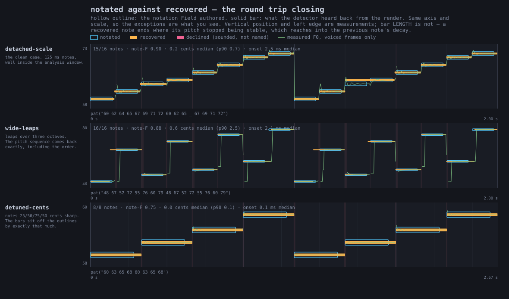
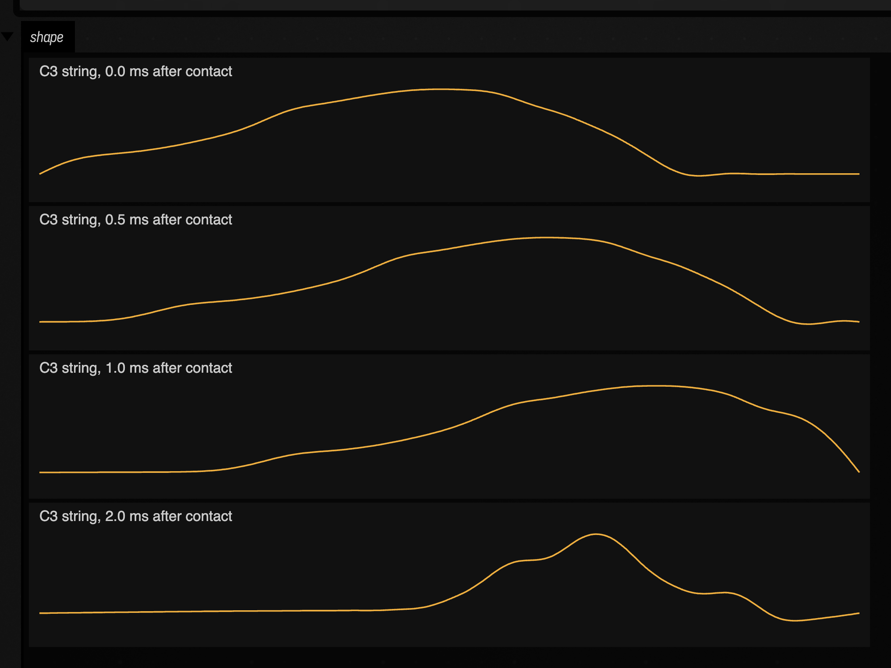
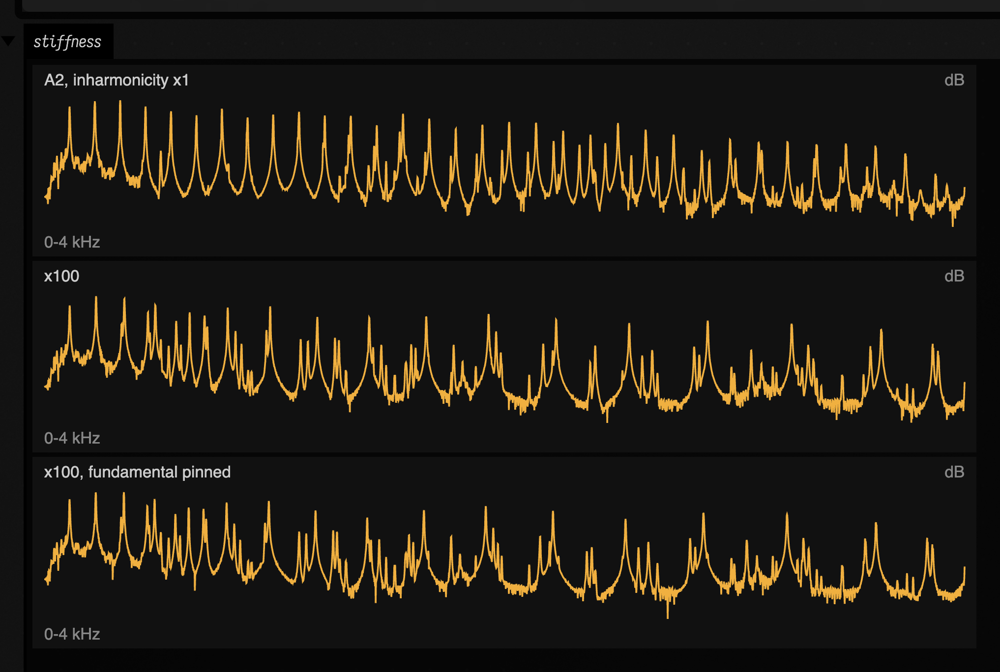
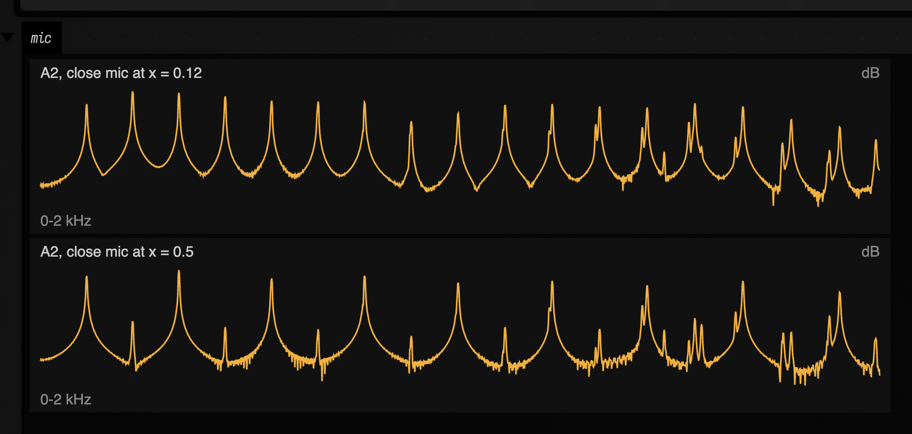
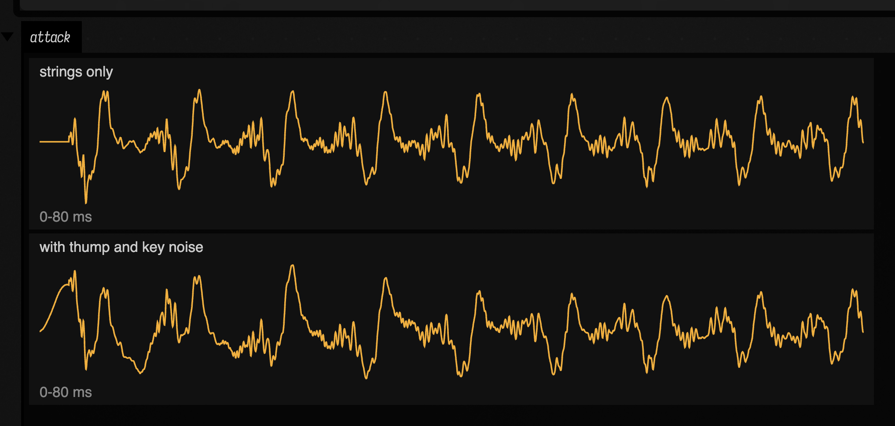
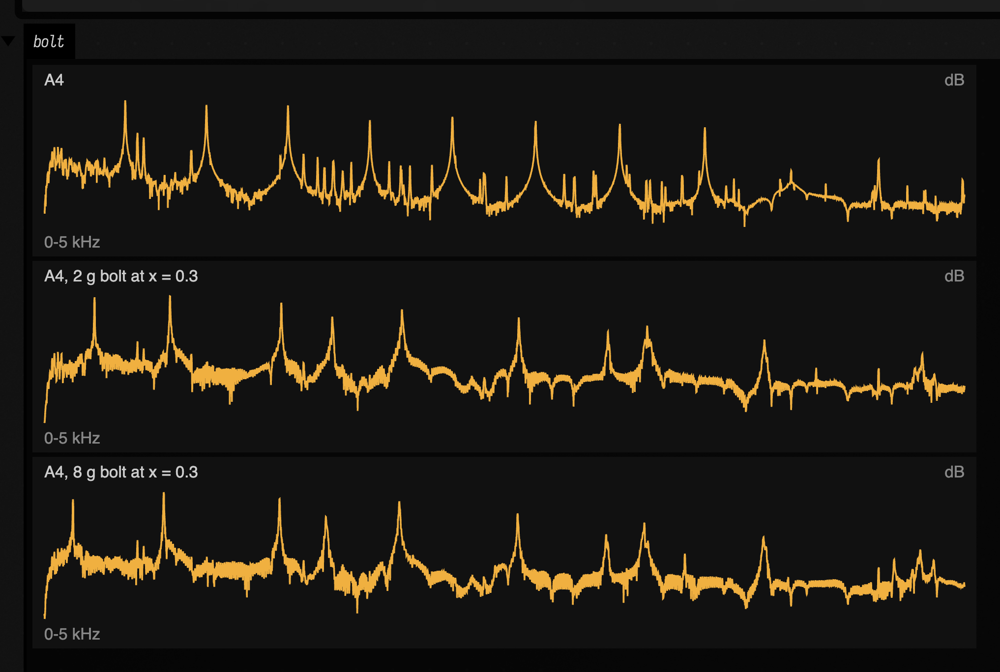

# Sound: from a pattern to something you can hear

Boxes make sound too. Write `pat("bd ~ sd ~")` in one and you have a beat: kick, rest, snare,
rest, round and round. This page follows that one line until you can hear it — first through a
small synthesiser built into Field, then through real drum samples — and then runs the path
backwards, from a recording to a pattern you can play again.

A pattern is a schedule: it says what happens and exactly when. To hear it, we need something to
turn its events into samples. Nothing on this page needs an audio device for rendering; each clip
is a file you can play here, with a caption naming the voice that made it.

Other pages cover the other voices. A pattern can play a
[Faust program](faust.md#a-pattern-plays-it) as a polyphonic instrument, or be placed in space with
[`patSpatial`](pat_spatial.md), which places each sound with Steam Audio.
[How to make sound in Field](sound_paths.md) lists every way Field makes sound and helps you pick
one.

You can listen to the clips here before setting anything up. To make a pattern of your own, follow
the stand-in voice first; [Getting real drums in your own box](#getting-real-drums-in-your-own-box)
then shows how to use samples.

See also [Field from your phone](mobile_controllers.md), which puts the controls of a running
document within reach of a phone browser.

---

## The path

A pattern does not make sound by itself. You ask it for the events in a stretch of time — say,
the first two cycles — and it hands back a list: each value with the exact moment it starts and
stops. Everything else on this page takes that list and does something with it. These are the
calls you will meet, in the order the sections use them:

| call | what it does |
| --- | --- |
| `pat("bd ~ sd ~")` | turns the mini-notation into a pattern ([Patterns & Rhythm](pattern_language.md)) |
| `showPatRollOf(...)` | draws a pattern's events as a piano roll, before anything is heard |
| `showPatAudio(...)` | plays the events through **the stand-in**, a small built-in synth (`patVoice`) |
| `showDirtAudio(...)` | plays them through **real drum samples** from Tidal's Dirt-Samples |
| `patTranscribe` | goes **back the other way**: hears a recording as notes and writes a `pat("…")` you can play again |
| `patTranscribeAuto` | the same, guessing the pitch range instead of being told it |

Both voices below play the same list, so you can hear what changes when you change the sound
source. For more on writing patterns, see [Patterns & Rhythm](pattern_language.md).


## The events, before anything makes a sound

`showPatRollOf` takes a few labelled patterns and draws each one as its own lane, time running
left to right. Here a kick-and-snare lane sits over a lane of eight hats, for two cycles. Each
block is one event; the gaps in the top lane are the rests.

```diffstatic_runner {data-lang=kotlin screenshot="assets/sound_render_path/the-beat-roll.png" wait="2" capture="box" open-outputs="true" name="sound-doc-beat-roll"}
:::static
// The pattern the two A/B figures below render. Nothing here is audio yet — these are
// the events, and both voices are handed exactly this list.
showPatRollOf(
    "bd ~ sd ~" to pat("bd ~ sd ~"),
    "hh*8" to pat("hh*8"),
    title = "pat(\"bd ~ sd ~, hh*8\")",
    subtitle = "the schedule both voices are given",
    cycles = 2,
)
:::fold open the output pane
displayOpen("main")
:::endfold
```


Ten events a cycle — the two `~` are rests and produce nothing at all — at exact rational
positions. Nothing so far has an opinion about what a kick drum sounds like.

---

## The stand-in voice

`patVoice` gives each event a simple sound: an oscillator, a one-pole lowpass and an exponential
decay envelope. An event containing a MIDI number supplies its pitch; named drums use this small
map:

<div class="field-reference" data-code-lang="kotlin" markdown>

| Pattern example | What the stand-in plays |
| --- | --- |
| `pat("bd ~ kick ~")` | Both names select a 62 Hz sine voice. This is a deterministic kick stand-in, not a recording from a sample library. |
| `pat("~ sd ~ snare")` | Both names select the 190 Hz noise voice. |
| `pat("cp ~ clap ~")` | Both names select the 900 Hz noise voice. The higher noise setting distinguishes claps from the snare stand-in. |
| `pat("hh*8")` | `hh` and `hat` select the 6200 Hz noise voice. |
| `pat("~ oh ~ oh")` | Selects the 4200 Hz noise voice. It gives the open-hat token a different sound from `hh`. |
| `pat("custom ~")` | An unrecognised token uses the voice’s `baseHz`. Use Dirt rendering when a token is meant to name an actual sample. |

</div>

`showPatAudio(pattern)` renders through it and drops an audio player into the box's output.
Here is the beat:

```diffstatic_runner {data-lang=kotlin audio="assets/sound_render_path/beat-stand-in.wav" audio-spec="beat-stand-in" audio-renderer="afield.audio.synth.SoundRenderPathDocs" embed=true hidden=true name="sound-doc-beat-stand-in"}
// showPatAudio(pat("bd ~ sd ~, hh*8") with gain(0.9))
// offline-rendered through patVoice by SoundRenderPathDocs — listen below
```

**Voice: the stand-in synth (`patVoice`).** No sample library was used.

This little stand-in uses a sine wave and filtered white noise to sketch the sounds of a drum
machine. It needs nothing installed and sounds the same each time you run it.

---

## The real samples

To hear the same pattern with Tidal's Dirt-Samples, use `patRenderStereoDirt` to render the
samples into a buffer. For live playback, `playDirt` uses `respondAhead`, a clock and an audio
device.

The same beat, the same ten events a cycle, the same `gain` / `pan` / `speed` annotations:

```diffstatic_runner {data-lang=kotlin audio="assets/sound_render_path/beat-dirt.wav" audio-spec="beat-dirt" audio-renderer="afield.audio.synth.SoundRenderPathDocs" embed=true hidden=true name="sound-doc-beat-dirt"}
// showDirtAudio(pat("bd ~ sd ~, hh*8") with gain(0.9))
// offline-rendered from the Dirt-Samples quark by SoundRenderPathDocs — listen below
```

**Voice: real Dirt-Samples one-shots, every token matched.**

Two details determine how the samples follow the pattern:

* **Hits are one-shots.** A sample plays to its natural end rather than being gated by the
  length of the arc that triggered it. That is what SuperDirt does, and it is the reason a
  snare sounds like a snare instead of a click: an eighth-note arc is far shorter than the
  snare's tail.
* **Only events with an onset trigger.** A fragment carried over from a previous query arc is
  a continuation, not a new hit; re-triggering it would flam.

### How the library is found

If you have run Tidal, you already have Dirt-Samples and Field finds it by itself. If not,
`./gradlew fetchDocsDirtSamples` downloads the few folders these docs use (see
[Getting real drums in your own box](#getting-real-drums-in-your-own-box)). Field does not include
the library itself.

To point Field at a copy somewhere else, set `FIELD_DIRT_SAMPLES`; it takes effect on the next
render, with no restart. Field looks in these places, in order:

1. `$FIELD_DIRT_SAMPLES`, if set and non-blank — the documented override;
2. `~/Library/Application Support/SuperCollider/downloaded-quarks/Dirt-Samples` (macOS);
3. `~/.local/share/SuperCollider/downloaded-quarks/Dirt-Samples` (Linux);
4. `~/Dirt-Samples`.

---

## When samples are missing

**No library on this machine: you hear the stand-in.** `showDirtAudio` plays exactly what
`showPatAudio` would, and its result says so (`usedSamples` is `false`). Nothing breaks. Install
the library as described [above](#how-the-library-is-found) to hear real drums.

**Library present, one token missing from it: only that event uses the stand-in.** A pattern of
MIDI note numbers, or one naming a drum Dirt has never heard of, must not go silent just
because the library loaded successfully. The unrecognised events are voiced by `patVoice` and
mixed on top of the sampled ones, and `DirtRenderResult.unmatched` names them.

`pat("bd zzzznotadrum bd hh")` is the second case: `bd` and `hh` are in every
Dirt install and `zzzznotadrum` is in none. You can hear where the join falls: three sampled
drums and one square-wave blip, in one bar.

```diffstatic_runner {data-lang=kotlin audio="assets/sound_render_path/per-event-fallback.wav" audio-spec="per-event-fallback" audio-renderer="afield.audio.synth.SoundRenderPathDocs" embed=true hidden=true name="sound-doc-per-event-fallback"}
/*
showDirtAudio(pat("bd zzzznotadrum bd hh") with gain(0.9),
              voice = patVoice(wave = PatWave.SQUARE, baseHz = 330.0, ...))
offline-rendered by SoundRenderPathDocs — listen below
*/
```

**Voice: real Dirt-Samples where the library had the token, the stand-in synth per event where it did not.**

`describe()` names exactly which, in one line a demo box can print:

```diffstatic {data-lang=text}
Dirt samples: bd hh — synth voice for zzzznotadrum
```

and for the whole-render fallback, the same call names the override rather than failing
silently:

```diffstatic {data-lang=text}
synth voice (no Dirt-Samples found; set FIELD_DIRT_SAMPLES to use real samples)
```

---

## See also

* [Patterns & Rhythm](pattern_language.md) — writing patterns, with Dirt-Samples drums on its cards.
* [DoughDSP Sound Examples](dough_dsp_sound.md) — effects on real signals.
* [Faust](faust.md#what-it-sounds-like-at-eight-voices-and-at-one) — a pattern playing a Faust instrument.
* [Subharmonic Synthesis](subharmonic_sound.md) — a new tone under a bassline, drums and film dialogue.
* [A pattern in space](pat_spatial.md) — a pattern rendered binaurally through Steam Audio.
* [How to make sound in Field](sound_paths.md#one-buffer-three-paths) and
  [Boolean network music examples](boolean_network_music_examples.md) — more patterns on real Tidal samples.

---

## Getting real drums in your own box

Install the quark (`Quarks.install("Dirt-Samples")` in SuperCollider, or clone
[tidalcycles/Dirt-Samples](https://github.com/tidalcycles/Dirt-Samples)) and then change one
call. Without either, `./gradlew fetchDocsDirtSamples` downloads just the folders these docs use
(`arpy`, `bd`, `click`, `cp`, `hh`, `perc`, `sd`, `sn`, about 6 MB), and the library is found
there too, after any full install:

```diffstatic {data-lang=kotlin}
// the stand-in
showPatAudio(pat("bd ~ sd ~, hh*8") with gain(0.9))

// the real thing — same shape, same annotations
val played = showDirtAudio(pat("bd ~ sd ~, hh*8") with gain(0.9))
println(played.describe()) // say which voice you actually got
```

Both put a player in the box's output. `showPatAudio` hands back the rendered
`PatSoundDocs.Stereo` so you can plot or measure it as well as listen to it;
`showDirtAudio` hands back a `DirtRenderResult`, which carries the same audio in `.audio`
plus `usedSamples`, `matched` and `unmatched`. Print `describe()` and the box tells you
which voice it found rather than leaving you to guess from the sound.

If you want to be sure, force it:

```diffstatic {data-lang=bash}
FIELD_DIRT_SAMPLES=/path/to/Dirt-Samples ./field.sh
```

The [`sound_render_path`](agent_transcripts.md#sound_render_path) starting point has all of this
side by side. Open it from the welcome screen, then play box 1 and box 2 back to back.

---

## From audio back to a pattern

`patTranscribe` takes a finite audio buffer and finds pitched note events. It also returns
mini-notation you can feed back to the renderer, so you can listen to what the analysis recovered.

The transcriber is for one melodic line. It reports a triad as `POLYPHONIC` rather than choosing
its loudest note, while accepting the harmonics of a single sawtooth as one note.

The **register you declare** sets the analysis window and therefore the shortest note that can be
resolved. In one test on identical audio, onset recall was 0.91 with the register declared and
0.03 without it. If you cannot declare one, call
`patTranscribeAuto`, which estimates it from a cheap wide first pass; estimating is about as good
as being told, and much better than leaving the wide default in place. It refuses rather than
transcribing when the first pass says the material is not one line.

Check the warnings and listen back before relying on a transcription.

To try it, open the [`pitch_transcription_roundtrip`](agent_transcripts.md#pitch_transcription_roundtrip) starting point.

### What that looks like

Every panel below plots the notation you wrote as a **hollow outline** and what the detector heard back
out of the render as a **solid bar**, on one shared MIDI axis, so the exceptions are the only thing you
have to look at. Vertical position and left edge are measurements; bar *length* is not, because a
recovered note ends where its pitch stopped being stable, and that reaches into the previous note's
decay.

The clean case first: a stepped scale, wide leaps over three octaves, and a run detuned by 25/50/75/50
cents. The bars sit on the outlines, and in the third panel they sit off them by exactly the detuning.



Finding where each note starts is the harder part. The detector uses two clues and combines them:
a jump in loudness, and a change of pitch. Each fails where the other works. A smooth legato line
has no loudness jumps but clear pitch changes; a line that plays each pitch twice has a loudness
jump at every note but no pitch change at half of them. In the figure below, the left panel is the
legato line and the right panel the repeated pitches; combining the two clues finds most note
starts in both:


A **refusal** looks like this. Three simultaneous pitches gives 0 of 12 notes, a `POLYPHONIC`
verdict and `pat("~")`: the outlines have no bars in them at all, which is the correct answer. The same audio at 31 ms per
note recovers 23 of 32 when it is *told* its register and 0 of 32 when it is not, because the analysis
window is then longer than the notes; the output is again `pat("~")` rather than a plausible parseable
wrong one:


??? aside "Agents: regenerating the transcription figures"
    The three figures above come from the `synth.pat.transcription` smoke test:

    ```diffstatic {data-lang=bash}
    PAT_TRANSCRIPTION_DIR=/tmp/pat-transcription python3 tools/run_field_tests.py --id synth.pat.transcription
    ```


---

## A physically modelled piano

`Piano` is a physically modelled grand piano: a felt hammer strikes a set of stiff strings, the
strings push on a bridge, and the bridge drives a soundboard and a room. It is a
port of Peter Cooper's [coopiano](https://github.com/peterc/coopiano) (MIT licence), and the
reference entry is [`Piano`](reference/synthesis.md#piano-kt-piano). This section follows one
phrase through it, from the pattern that starts the notes to the speaker. Then we'll move the
microphone close to the strings, prepare the piano and play other sounds through it.

### Starting notes: patterns and MIDI

A piano plays whatever a pattern names. Atoms are note names (`c4` is middle C) or MIDI numbers,
and `,` stacks a chord:

```diffstatic {data-lang=kotlin}
val piano = Piano()
piano.play(pat("<[a2,e3] [f2,c3]> [e4 a4 c5 e5]"), cycles = 8, cps = 0.8)
audio(piano, gain = 1f)
```

[`play`](reference/synthesis.md#piano-kt--piano--play) also takes a `MidiClip`, with its sustain pedal, and [`noteOn(midi, velocity)`](reference/synthesis.md#piano-kt--piano--noteon) /
[`noteOff(midi)`](reference/synthesis.md#piano-kt--piano--noteoff) start and stop single notes. None of these make a sound themselves: each one puts a
note, stamped with the sample it should start on, into a queue the piano reads while it renders.

### Every control is a Param

Each control is a `Param`, so it takes a number, a slider or a whole signal graph. A slider writes
the Param's base value; an oscillator replaces it with a signal read every sample:

```diffstatic {data-lang=kotlin}
val pedal = Param(0f)
slider("pedal", 0.0, 1.0, initialValue = 0.0, channel = "pedal", onUpdate = { pedal.base = it.toFloat() })
val stiffness = Param(1f).modulate(SineOsc(freq = Param(110f)) * 0.9f)
val piano = Piano(pedal = pedal, inharmonicity = stiffness)
```

The same piano can play a pattern with the pedal on a slider and its strings' stiffness swinging
110 times a second.

### Where it runs

`audio(piano)` hands the piano to `FieldAudioEngine`, which owns a thread of its own that fills the
sound card's buffers. Everything the piano remembers between samples — every string mode, every
damper, the sympathetic strings, the soundboard and the room — lives on that thread and is touched
nowhere else. Code in a box, a slider, or the frame loop only queues notes and sets Params. That is
why moving a slider never clicks: the piano reads the new value on its own thread, at the next
sample.

Starting a note is the expensive part: the hammer is simulated against every mode of every string,
which takes a few milliseconds for a bass note. Worker threads do that work up to a second before
the note's sample, so a scheduled bass chord costs the audio thread nothing. A note played "now",
from a MIDI keyboard, starts as soon as its strike is ready, at most 30 ms later. On an M-series
laptop the worst 128-frame block after a six-note bass chord takes 4.8 ms with the workers and
over 30 ms without them. Either way the output is the same, sample for sample.

Two pianos play side by side with `+`:

```diffstatic {data-lang=kotlin}
val piano = Piano()
val piano2 = Piano(voicing = PianoVoicing(inharmonicityScale = 3.0), room = Param(0f))
piano.play(pat("[a2,e3] ~"), cycles = 8, cps = 0.5)
piano2.play(pat("~ [e5 a5]"), cycles = 8, cps = 0.5)
audio(piano + piano2, gain = 0.7f)
```

`piano + piano2` makes a launch bundle. `audio(...)` turns each piano into its own patch on the
engine, so each keeps its own strings and soundboard.

### Inside: hammer, strings, soundboard

When a note starts, the piano simulates the hammer against the string. The hammer is a mass on a
nonlinear felt spring; it touches the string for one to four milliseconds (about 2 ms for A4 at
velocity 0.5, 3.7 ms for A1) and leaves behind the string's state. That state becomes a bank of a
few hundred decaying oscillators, one per string mode and polarization — 186 for A4, over a
thousand for A1, where three strings each carry fifty or more partials.

Real piano strings are stiff, so their partials run sharp of whole multiples of the fundamental by
`sqrt(1 + B·n²)`. `inharmonicity` multiplies `B`. The bridge sums every mode's push into one force.
That force drives the soundboard, a synthesised stereo impulse response built from many decaying
modes. The bridge is split into four regions along the keyboard, and each key feeds the nearest two.
Each region's board starts out with the same modes but excites them differently and sits at its own
place in the stereo image, so the bass is to the left and the treble to the right, as the player
hears it: A1 comes out 6.6 dB louder on the left, and C7 5.6 dB louder on the right.
[`PianoVoicing(boardSpread = 0.0, boardPositionDepth = 0.0)`](reference/synthesis.md#pianomodel-kt-pianovoicing) gives one shared board for every key. The
force also drives 88 sympathetic strings tuned to the keyboard. With the pedal down their dampers
lift and they ring in answer to the notes you play.

The phrase through one shared board; the first clip in the next section is the same phrase through
the four regions:

```diffstatic_runner {data-lang=kotlin audio="assets/sound_piano/piano-shared-board.wav" audio-spec="piano-shared-board" audio-renderer="afield.audio.synth.PianoDocs" embed=true hidden=true name="sound-doc-piano-shared-board"}
// Piano(voicing = PianoVoicing(boardSpread = 0.0, boardPositionDepth = 0.0))
```

Every one of those stages can be heard, and the mode bank can be drawn. Here is one C3 string, struck
at velocity 0.8, at four moments after the hammer leaves it:

```diffstatic_runner {data-lang=kotlin screenshot="assets/sound_piano/string-shape.png" wait="2" capture="box" open-outputs="true" name="sound-doc-piano-string"}
display(
    "shape",
    [0.0, 0.0005, 0.001, 0.002].joinToString("") { t ->
        pianoPlotSvg(
            pianoStringShape(48, 0.8, t, points = 300),
            "C3 string, %.1f ms after contact".format(t * 1000),
            height = 110,
        )
    },
)
:::fold open the output pane
displayOpen("shape")
:::endfold
```



### Stiffness you can hear

Inharmonicity has no range. At ×1 the 10th partial of A2 sits at 1106 Hz; at ×100 it moves to
1929 Hz, nearly ten semitones sharp, and the note becomes a bell. A negative value folds the
stretch the other way, pulling the upper partials flat (728 Hz at ×−100) instead of failing. Set
`pinFundamental = Param(1f)` and the fundamental stays where it is at ×1, so stiffness changes the
timbre and not the pitch. The spectra below are A2 at ×1, ×100 and ×100 pinned, from 0.3 s after
the strike:

```diffstatic_runner {data-lang=kotlin screenshot="assets/sound_piano/stiffness-spectra.png" wait="2" capture="box" open-outputs="true" name="sound-doc-piano-stiffness"}
fun spectrum(s: Float, pin: Float, title: String): String {
    val r = pianoRender(
        1.2,
        Piano(sampleRate = 44_100, room = Param(0f), inharmonicity = Param(s), pinFundamental = Param(pin)),
    ) {
        noteOn(45, 0.7, 0)
    }
    return pianoPlotSvg(
        pianoSpectrumDb(r.mono, startSample = 13_230, fftSize = 32_768).copyOfRange(0, 2_970),
        title,
        height = 130,
        xLabel = "0-4 kHz",
        yLabel = "dB",
    )
}
display(
    "stiffness",
    spectrum(1f, 0f, "A2, inharmonicity x1") +
        spectrum(100f, 0f, "x100") +
        spectrum(100f, 1f, "x100, fundamental pinned"),
)
:::fold open the output pane
displayOpen("stiffness")
:::endfold
```



The phrase at ×1, then at ×100, then at ×100 pinned, then at ×−100 pinned:

```diffstatic_runner {data-lang=kotlin audio="assets/sound_piano/piano-board.wav" audio-spec="piano-board" audio-renderer="afield.audio.synth.PianoDocs" embed=true hidden=true name="sound-doc-piano-board"}
// Piano() playing the phrase, offline-rendered by PianoDocs
```

```diffstatic_runner {data-lang=kotlin audio="assets/sound_piano/piano-stiff-100.wav" audio-spec="piano-stiff-100" audio-renderer="afield.audio.synth.PianoDocs" embed=true hidden=true name="sound-doc-piano-stiff-100"}
// Piano(inharmonicity = Param(100f))
```

```diffstatic_runner {data-lang=kotlin audio="assets/sound_piano/piano-stiff-100-pinned.wav" audio-spec="piano-stiff-100-pinned" audio-renderer="afield.audio.synth.PianoDocs" embed=true hidden=true name="sound-doc-piano-stiff-100-pinned"}
// Piano(inharmonicity = Param(100f), pinFundamental = Param(1f))
```

```diffstatic_runner {data-lang=kotlin audio="assets/sound_piano/piano-stiff-negative.wav" audio-spec="piano-stiff-negative" audio-renderer="afield.audio.synth.PianoDocs" embed=true hidden=true name="sound-doc-piano-stiff-negative"}
// Piano(inharmonicity = Param(-100f), pinFundamental = Param(1f))
```

No value of any control produces a NaN: negative, enormous, infinite and NaN inputs, and
audio-rate oscillators on all of them at once, are tested to give finite output. A NaN input is read
as the control's default; anything else is used as given.

### A close-mic'd piano

From the audience you hear the soundboard. Put a microphone a few centimetres above the strings and
you also hear the strings themselves, the felt hitting them and the keys knocking on the keybed.
These six controls shape that close sound; each is a Param:

| control | what it does | default |
| --- | --- | --- |
| `dry` | 0 is the soundboard; 1 is the microphone on the strings alone; in between mixes them | 0 |
| `micPosition` | where along the string the microphone sits, 0 at the far end, 1 at the bridge | 0.12 |
| `thump` | the hammer's thud, made from this strike's own hammer force ringing two wooden body modes | 0 |
| `keyNoise` | the key bottoming on the keybed after the strike, and a click when it returns | 0 |
| `damperNoise` | the felt landing on a ringing string when you let a key go | 1 |
| `room` | the room reverb; 0 turns it off | 0.3 |

The microphone hears each mode in proportion to how much the string moves under it, `sin(nπx)`
for partial `n` at position `x`. At the middle of the string (`micPosition = 0.5`) every even
partial is at a node and drops out — partial 2 of A2 falls by more than 100 dB — so the note goes
hollow and clarinet-like. Near the end it hears every partial. Move it while a note rings and the
timbre sweeps. These spectra are A2, the microphone at 0.12 and at 0.5:

```diffstatic_runner {data-lang=kotlin screenshot="assets/sound_piano/mic-position-spectra.png" wait="2" capture="box" open-outputs="true" name="sound-doc-piano-mic-position"}
fun heard(x: Float): String {
    val r = pianoRender(1.2, Piano(sampleRate = 44_100, room = Param(0f), dry = Param(1f), micPosition = Param(x))) {
        noteOn(45, 0.7, 0)
    }
    return pianoPlotSvg(
        pianoSpectrumDb(r.mono, startSample = 13_230, fftSize = 32_768).copyOfRange(0, 1_485),
        "A2, close mic at x = $x",
        height = 130,
        xLabel = "0-2 kHz",
        yLabel = "dB",
    )
}
display("mic", heard(0.12f) + heard(0.5f))
:::fold open the output pane
displayOpen("mic")
:::endfold
```



The mechanism noises come from the strike itself. The thump is the hammer's force against the
string — a pulse as long as the contact, shorter and sharper for a harder hammer or a higher note —
ringing a low wooden body. The key noise follows a few milliseconds after the hammer leaves. Here
are the first 80 ms of A2 through the close microphone, without and then with `thump` and
`keyNoise` at 1:

```diffstatic_runner {data-lang=kotlin screenshot="assets/sound_piano/close-mic-attack.png" wait="2" capture="box" open-outputs="true" name="sound-doc-piano-attack"}
fun attack(level: Float, title: String): String {
    val r = pianoRender(
        0.08,
        Piano(sampleRate = 44_100, room = Param(0f), dry = Param(1f), thump = Param(level), keyNoise = Param(level)),
    ) {
        noteOn(45, 0.9, 0)
    }
    return pianoPlotSvg(r.mono.map { it.toDouble() }.toDoubleArray(), title, height = 130, xLabel = "0-80 ms")
}
display("attack", attack(0f, "strings only") + attack(1f, "with thump and key noise"))
:::fold open the output pane
displayOpen("attack")
:::endfold
```



The phrase from before through the close microphone at 0.08, room off, with thump and key noise
up and damper noise doubled; then the microphone at the middle of the strings; then the microphone
drifting along the strings while the stiffness swings at 180 Hz with the fundamental pinned:

```diffstatic_runner {data-lang=kotlin audio="assets/sound_piano/piano-close.wav" audio-spec="piano-close" audio-renderer="afield.audio.synth.PianoDocs" embed=true hidden=true name="sound-doc-piano-close"}
// Piano(dry = Param(1f), room = Param(0f), micPosition = Param(0.08f), thump = Param(1f), keyNoise = Param(1f),
// damperNoise = Param(2f))
```

```diffstatic_runner {data-lang=kotlin audio="assets/sound_piano/piano-close-middle.wav" audio-spec="piano-close-middle" audio-renderer="afield.audio.synth.PianoDocs" embed=true hidden=true name="sound-doc-piano-close-middle"}
// Piano(dry = Param(1f), room = Param(0f), micPosition = Param(0.5f), thump = Param(1f), keyNoise = Param(1f))
```

```diffstatic_runner {data-lang=kotlin audio="assets/sound_piano/piano-close-moving.wav" audio-spec="piano-close-moving" audio-renderer="afield.audio.synth.PianoDocs" embed=true hidden=true name="sound-doc-piano-close-moving"}
// micPosition = Param(0.25f).modulate(SineOsc(freq = Param(0.4f)) * 0.2f), inharmonicity swinging at 180 Hz
```

Against the soundboard version of the same phrase, the close microphone at 0.08 moves the
spectral centroid from 760 Hz to 1040 Hz, puts 5.5 dB more energy between 2 and 5 kHz, and makes
the first 40 ms of each note 5.6 dB louder against what follows (6.0 dB against 0.4 dB), which is
the thump and the key.

The microphone is read every 32 samples, so a `micPosition` oscillator above about 700 Hz is heard
as steps; stiffness and decay are applied every sample.

### Rendering offline and plotting

Every clip and plot above was made without an audio device. `pianoRender(seconds, piano) { ... }`
runs the same code the engine runs, as fast as it can, and returns the samples;
`showPianoAudio(render)` puts a player in the box, and `pianoSpectrumDb` and `pianoPlotSvg` draw
what you hear:

```diffstatic {data-lang=kotlin}
val r = pianoRender(6.0, Piano(dry = Param(1f), thump = Param(1f))) {
    play(pat("[a2,e3] [e4 a4 c5 e5]"), cycles = 4, cps = 0.8, startFrame = 0)
}
showPianoAudio(r, "close")
display(
    "spectrum",
    pianoPlotSvg(
        pianoSpectrumDb(r.mono, startSample = 22_050).copyOfRange(0, 1_860),
        "close mic",
        xLabel = "Hz",
        yLabel = "dB",
    ),
)
```

Eight seconds of A4 render in about one second. The
[`physical_piano`](agent_transcripts.md#physical_piano) starting point has these boxes, a live one
with sliders, and a close-mic one with sliders for every control above.

### Preparing the piano

John Cage put bolts, screws, rubber and felt between the strings and called the result a prepared
piano. `preparations` does the same. Each `PianoPreparation` sits on a range of keys at a point
along the strings, and it acts on each mode by how much that mode moves there, the `sin(nπx)` the
microphone uses:

```diffstatic {data-lang=kotlin}
val piano = Piano(
    preparations = [
        PianoPreparation.bolt(52..72, at = 0.28, grams = 4.0),
        PianoPreparation.rubber(36..51, at = 0.13, amount = 25.0),
        PianoPreparation.rattle(73..88, at = 0.2, level = 0.8, gapMm = 0.1),
    ],
)
piano.play(pat("<[a2,e3] [f2,c3]> [e4 a4 c5 e5]"), cycles = 8, cps = 0.8)
audio(piano, gain = 1f)
```

| control | what it does | default |
| --- | --- | --- |
| `position` | where it sits, 0 at the far end of the string, 1 at the bridge | 0.25 |
| `mass` | grams added there: the partials that move under it fall, each by its own amount | 0 |
| `damping` | loss added there, per second at a mode's loudest point: rubber or felt | 0 |
| `rattle` | a loose object that buzzes when the string catches it | 0 |
| `gap` | how much play the rattling object has, in millimetres | 0.05 |
| `tone` | the rattling object's own ring, in hertz | 3200 |

Every one is a Param, so a bolt can slide along the string while it rings. `string` puts the
preparation on one of a key's two or three strings (0, 1 or 2) instead of all of them, the way a
screw wedged between two strings leaves the third alone.

A bolt is heavy against a treble string and light against a bass one. A4's string weighs 2.2 g, so
a 2 g bolt 30% of the way along it moves its first three partials from 440, 881 and 1323 Hz to 273,
678 and 1283 Hz. They are no longer a harmonic series, and the note sounds like a gong. An 8 g bolt
moves them to 155, 645 and 1272 Hz. A partial with a node under the bolt does not move at all.

A bolt this heavy does more than lower each partial: the partials' shapes along the string mix, and
the string's modes are computed again with the bolt on it. Each one falls, but never below the
unprepared partial beneath it, so the second partial of the 8 g bolt stays above 440 Hz. Adding
more weight pushes the lowest partial further down, toward a string stopped at the bolt. The mixing
also changes how loudly each partial reaches the bridge and the microphones. The spectra are A4
without a bolt, with 2 g and with 8 g at `x = 0.3`:

```diffstatic_runner {data-lang=kotlin screenshot="assets/sound_piano/bolt-spectra.png" wait="2" capture="box" open-outputs="true" name="sound-doc-piano-bolt"}
fun spectrum(grams: Double, title: String): String {
    val bolt = PianoPreparation.bolt(69..69, at = 0.3, grams = grams)
    val r = pianoRender(1.2, Piano(sampleRate = 44_100, room = Param(0f), preparations = [bolt])) { noteOn(69, 0.7, 0) }
    return pianoPlotSvg(
        pianoSpectrumDb(r.mono, startSample = 13_230, fftSize = 32_768).copyOfRange(0, 3_715),
        title,
        height = 130,
        xLabel = "0-5 kHz",
        yLabel = "dB",
    )
}
display(
    "bolt",
    spectrum(0.0, "A4") + spectrum(2.0, "A4, 2 g bolt at x = 0.3") + spectrum(8.0, "A4, 8 g bolt at x = 0.3"),
)
:::fold open the output pane
displayOpen("bolt")
:::endfold
```



Rubber does the opposite of a bolt. It leaves the pitch alone and drains the modes that move under
it: at `amount = 25` a mode at its antinode falls by 60 dB in about 0.3 s, a short wooden note,
while a mode with a node at the rubber rings as before. A negative amount cancels the
string's own losses, down to a mode that never decays. The rattle is a loose object with `gap` of
play: the string throws it about, and each time the string catches it, it rings at `tone`. A loud
note buzzes, and once the note has decayed until it swings less than the gap, the buzz stops. On A2
struck hard, a 2 mm gap is still buzzing at 1.5 s and has stopped by 3.6 s; a 0.05 mm gap is still
buzzing at 3.6 s.

The phrase with the preparations above; then with one 3 g bolt sliding back and forth along every
string, from 8% to 52% of the way; then with a loose nut on the bass strings:

```diffstatic_runner {data-lang=kotlin audio="assets/sound_piano/piano-prepared.wav" audio-spec="piano-prepared" audio-renderer="afield.audio.synth.PianoDocs" embed=true hidden=true name="sound-doc-piano-prepared"}
// Piano(preparations = bolts on 52..72, rubber on 36..51, a rattle on 73..88)
```

```diffstatic_runner {data-lang=kotlin audio="assets/sound_piano/piano-sliding-bolt.wav" audio-spec="piano-sliding-bolt" audio-renderer="afield.audio.synth.PianoDocs" embed=true hidden=true name="sound-doc-piano-sliding-bolt"}
// PianoPreparation(21..108, position = Param(0.3f).modulate(SineOsc(freq = Param(0.3f)) * 0.22f), mass = Param(3f))
```

```diffstatic_runner {data-lang=kotlin audio="assets/sound_piano/piano-rattle.wav" audio-spec="piano-rattle" audio-renderer="afield.audio.synth.PianoDocs" embed=true hidden=true name="sound-doc-piano-rattle"}
// PianoPreparation.rattle(40..57, at = 0.15, level = 1.0, gapMm = 0.5)
```

A preparation's position, mass and damping are read every 32 samples, and the rattle every sample.
The heaviest mass on each string is solved exactly over its lowest 48 partials, again every 128
samples while it moves. Any other masses on the same string, and the partials above the 48th, move
each by its own amount. The hammer meets the string as if it were unprepared, because its contact
lasts only one to four milliseconds; the strike is then carried over into the prepared string's
modes. The sympathetic strings are retuned every 256 samples.

### More than one microphone

`mics` replaces the single close microphone with any number of them, each a [`PianoMic`](reference/synthesis.md#pianopreparation-kt-pianomic) with its own
`position`, `pan` and `gain`, all Params. A studio records a grand with a pair, one near the hammers
and one further along the strings, panned apart:

```diffstatic {data-lang=kotlin}
val piano = Piano(
    dry = Param(1f),
    room = Param(0.12f),
    mics = [
        PianoMic(position = Param(0.08f), pan = Param(-0.8f)),
        PianoMic(position = Param(0.33f), pan = Param(0.8f)),
    ],
)
```

The two hear different partials: with one microphone at 0.5 and one at 0.12, partial 2 of A2 is
64 dB under partial 1 in the left channel and 18 dB over it in the right. `string` gives a
microphone one string of each note to listen to. A4's three strings are tuned slightly apart, so
together they beat: over two seconds its level rises and falls by 17 dB through one microphone on
all three, and by 13 dB through one on string 0 alone. Two single-string microphones on strings 0
and 2, panned apart, send each string to its own speaker, and the two strings beat in the room
rather than in one channel. The pair above, on the phrase:

```diffstatic_runner {data-lang=kotlin audio="assets/sound_piano/piano-mic-pair.wav" audio-spec="piano-mic-pair" audio-renderer="afield.audio.synth.PianoDocs" embed=true hidden=true name="sound-doc-piano-mic-pair"}
// mics = [PianoMic(Param(0.08f), pan = Param(-0.8f)), PianoMic(Param(0.33f), pan = Param(0.8f))]
```

The close microphones also hear the sympathetic strings, so with the pedal down, the strings that
answer a note are in the close sound too.

### The soft pedal and the sostenuto

`unaCorda` is the soft pedal. Down, it shifts the action so each hammer misses one string of a
three-string note and meets the other two with softer felt. E4 comes out 1.4 dB quieter, with 3.3 dB
less of its energy above 2 kHz. It is read at each strike, like `hardness`, so a pedal moved while a
note rings changes the next note, not that one.

`sostenuto` is the middle pedal. Pressed, it holds up the dampers of the keys that are down at that
moment, and only those, until it is let go. Notes played afterwards are damped as usual when they
are released. Hold a bass chord, press it, and play staccato above it:

```diffstatic {data-lang=kotlin}
val piano = Piano()
piano.noteOn(36, 0.7, atFrame = 0)
piano.noteOn(43, 0.7, atFrame = 0)
piano.sostenutoEvent(1.0, atFrame = 4_800)
piano.noteOff(36, atFrame = 9_600)
piano.noteOff(43, atFrame = 9_600)
piano.play(pat("[c5 e5 g5 c6]*2"), cycles = 2, cps = 0.5, legato = 0.15)
audio(piano, gain = 1f)
```

Both take a Param (`unaCorda = Param(1f)`) or controller events ([`sostenutoEvent`](reference/synthesis.md#piano-kt--piano--sostenutoevent),
`unaCordaEvent`), and `play(clip)` plays a MIDI file's CC 66 and CC 67 along with its sustain pedal.
The phrase with the soft pedal down:

```diffstatic_runner {data-lang=kotlin audio="assets/sound_piano/piano-una-corda.wav" audio-spec="piano-una-corda" audio-renderer="afield.audio.synth.PianoDocs" embed=true hidden=true name="sound-doc-piano-una-corda"}
// Piano(unaCorda = Param(1f))
```

### Playing other sounds through the piano

`bridgeInput` pushes any signal into the bridge, as a transducer fixed to the soundboard would. The
soundboard sounds it, and every string with its damper up answers it. A full-scale sine on it is
4 dB louder than a mezzo-forte note. With the pedal down, the strings go on ringing after the input
stops, 33 dB louder than with the pedal up.

Any `Signal` goes in through a Param. `toMono()` turns a stereo source, such as the Dirt sampler, a
Faust patch or another piano, into one:

```diffstatic {data-lang=kotlin}
val player = Piano(dry = Param(1f), room = Param(0f))
player.play(pat("<[a2,e3] [f2,c3]> [e4 a4 c5 e5]"), cycles = 8, cps = 0.8)
val resonator = Piano(
    pedal = Param(1f),
    coupling = Param(6f),
    soundboard = Param(0.5f),
    room = Param(0.35f),
    bridgeInput = Param(0f).modulate(player.toMono() * 4f),
)
audio(resonator, gain = 1f)
```

`coupling` sets how loudly the strings answer. Here the phrase from a close-mic'd piano goes into a
second piano with its pedal down, and the second piano's strings keep sounding the harmony after
each chord:

```diffstatic_runner {data-lang=kotlin audio="assets/sound_piano/piano-through-piano.wav" audio-spec="piano-through-piano" audio-renderer="afield.audio.synth.PianoDocs" embed=true hidden=true name="sound-doc-piano-through-piano"}
// Piano(pedal = Param(1f), coupling = Param(6f), bridgeInput = Param(0f).modulate(player.toMono() * 4f))
```

The answering strings are the 88 keys' sympathetic strings, 16 partials each, and they carry the
preparations: a bolted key's strings answer at the bolted pitches, and a rubber-wedged key barely
answers at all. A prepared piano with its pedal down rings in its own tuning. The same phrase, played
into the prepared piano from the start of this section with its pedal down:

```diffstatic_runner {data-lang=kotlin audio="assets/sound_piano/piano-through-prepared.wav" audio-spec="piano-through-prepared" audio-renderer="afield.audio.synth.PianoDocs" embed=true hidden=true name="sound-doc-piano-through-prepared"}
// Piano(pedal = Param(1f), coupling = Param(6f), preparations = PREPARED, bridgeInput =
// Param(0f).modulate(player.toMono() * 4f))
```

### Rendering a MIDI file

`pianoRenderMidi` plays a `.mid` file, or a `MidiClip`, through a piano and writes the WAV in one
call, with three seconds afterwards for the strings and room to ring out:

```diffstatic {data-lang=kotlin}
val midi = java.io.File("/tmp/prelude.mid")
pianoRenderMidi(midi, java.io.File("/tmp/prelude.wav"))
pianoRenderMidi(
    readMidiClip(midi),
    java.io.File("/tmp/prelude-prepared.wav"),
    piano = Piano(sampleRate = 48_000, preparations = [PianoPreparation.bolt(48..72, at = 0.3, grams = 3.0)]),
)
```

The sustain, sostenuto and soft pedals in the file are played. It renders as fast as the machine
allows, about eight times real time for one held note.

### Limitations and what's next

What the piano does not do yet:

- **The felt is coopiano's.** The hammer's nonlinearity is the model's power-law felt spring and
  nothing more: no felt hysteresis or wear.
- **Only one mass per string is solved exactly.** A second bolt on the same string, and the
  partials above the 48th, move each by its own amount. Rubber damps each mode without mixing them.
- **A dense bass chord is still heavy to ring.** Six bass notes are about six and a half thousand
  modes, close to 5 ms of work per 128-frame block on an M-series laptop: more than a 128-frame
  buffer at 48 kHz allows (2.7 ms), so the live engine needs a larger buffer for them. The four
  board regions add about 60% to the board's cost; eight seconds of A4 render in about 1.6 s.

Where it could go next:

- **Felt and preparations that touch the strike**: a hammer hitting a screw, felt between hammer and
  string.
- **Several masses on one string solved together**, for two bolts that pull against each other.

<a id="what-a-voice-caption-promises"></a>

??? aside "Agents: where the \"Voice:\" captions come from"
    The *"Voice: …"* captions on this page are written by the docs build, not by hand. A clip
    captioned as the stand-in has to match a fresh synth render, and one captioned as real samples
    has to *not* match one. That shows an asset did not come from the synth; it does not show it
    came from the Tidal library specifically. `run_field_tests.py --id synth.docs.audio.provenance`
    prints the table; the method and figures are in `dev_docs/DOCS_AUDIO_PROVENANCE_AGREEMENT.md`.

## API reference

Implementation and parameter details for the helpers used above:

- [`SineOsc`](reference/synthesis.md#oscillators-kt-sineosc)
