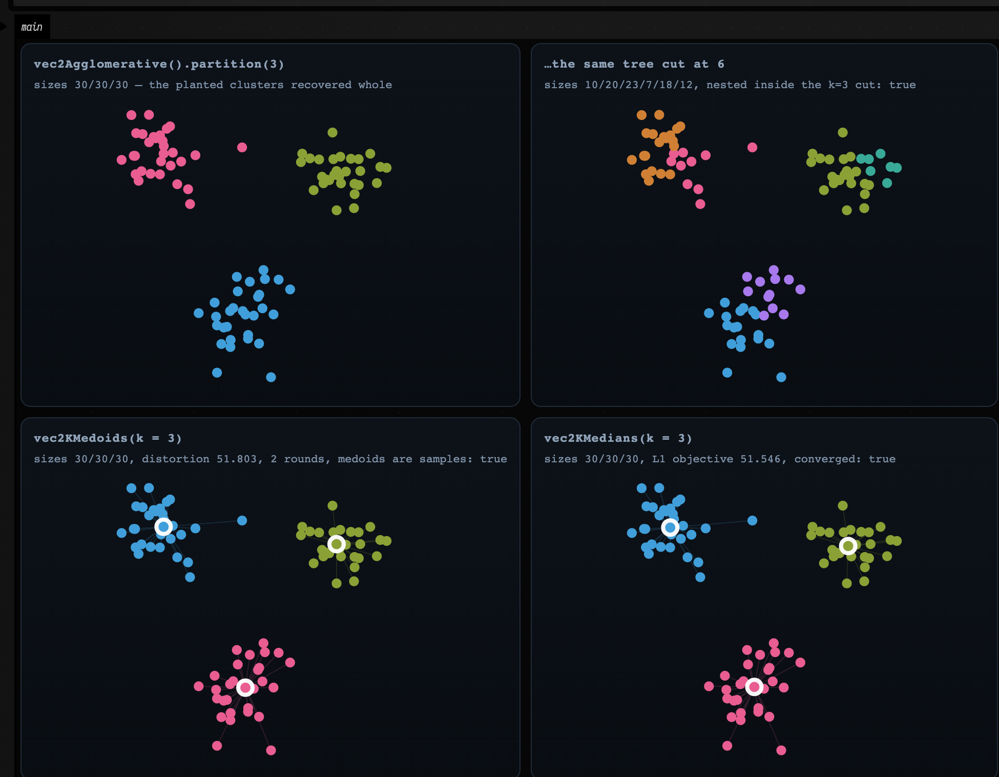

# Points into structure — Voronoi, Apollonius, contours and clusters

*Every public declaration used below is listed, with its KDoc, in the codebase reference:
[Graphics](reference/graphics.md) and [Data](reference/data.md).*

You have a bag of points. That is the least structured thing in graphics, and almost everything
interesting you can do with it is some form of the same question: **who owns which part of the
plane, and where are the seams?**

Field answers that question four different ways, and they have been sitting in `afield.stdlib`
undocumented for a long time. This page is a worked example of all four:

- **Delaunay triangulation and its Voronoi dual** — the classical answer, exact, JTS-backed.
- **Apollonius (multiplicatively weighted Voronoi)** — the same question with the points given
  *sizes*, where the answer stops being made of straight lines.
- **Marching squares** — the seam of a *field* rather than of a point set, extracted as drawable
  geometry.
- **Clustering** — partitioning the cloud instead of the plane.

## First, where the family actually lives

Worth a table up front, because the filenames are misleading and one of them is actively so:

| what you want | where it is | notes |
|---|---|---|
| 2D Delaunay, 2D Voronoi, 2D convex hull | `graph_connectivity.kt` | `vec2DelaunayGraph`, `vec2DelaunayTriangles`, `vec2VoronoiDiagram`, `vec2VoronoiDualGraph`, `vec2ConvexHull`. JTS-backed and exact. See also [Neighbors & Graphs](graph_connectivity_examples.md) |
| 2D weighted (Apollonius) Voronoi | `dirichlet.kt` | `CircularDirichlet`. Pure Kotlin. **Not** Poisson-disc sampling, despite the name |
| **3D** Voronoi, **3D** weighted Voronoi | `voronoi.kt` | `voronoi3d`, `CircularDirichlet3d`. `voronoi.kt` has no 2D anything and no Delaunay at all |
| marching squares → polylines and `FLine`s | `contours.kt` | `generateIsoContours`, `generateSmoothIsoContours`, `pointEdgeScalarField2D` |
| clustering | `clustering.kt` | agglomerative (7 linkages), k-medoids, k-medians. **There is no k-means in Field**, on purpose — see below |
| any of the above → `FLine` | `spatial_field.kt` | `toFLine`/`toFLines` per result type, plus `showPlane` / `showPlaneGrid` |

That last row is new, and it is what makes this page possible. Every partitioner above answers with
*structure* — vertex rings, circular arcs, triangle index triples, integer labels — and none of them
answered with geometry. Until now the only way to look at a Voronoi diagram was to write the `FLine`
loop by hand, which is literally what
[graph_connectivity_examples.md](graph_connectivity_examples.md) does, twice. `spatial_field.kt` is
the missing hop, and it is the plane counterpart of `mesh_field.kt` in
[Meshes & 3D Geometry](mesh_examples.md).

## Delaunay, and the Voronoi dual

Start with the classical pair, because they are the same object seen twice. Given *n* sites:

- the **Voronoi diagram** cuts the plane into one cell per site, every point in a cell being nearer
  to that site than to any other;
- the **Delaunay triangulation** joins two sites exactly when their cells share an edge.

Each determines the other, which is why `vec2VoronoiDualGraph(points)` is, in the source, one line
that returns `vec2DelaunayGraph(points)`.

```diffstatic_runner {data-lang=kotlin screenshot="assets/spatial_geometry_examples/delaunay_dual.png" wait="3.0" capture="box" open-outputs="true" w="1040" h="980" padding="14"}
:::static
// A jittered lattice: structured enough that you can see the answer is right, irregular enough
// that the triangulation has something to decide.
val rng = java.util.Random(17)
val sites = (0 until 54).map { i ->
    vec((i % 9) * 44.0 + rng.nextDouble() * 22.0, (i / 9) * 44.0 + rng.nextDouble() * 22.0)
}

val delaunay = vec2DelaunayGraph(sites)          // a PointGraph: index pairs
val triangles = vec2DelaunayTriangles(sites)     // List<Triple<Int, Int, Int>>: the faces
val voronoi = vec2VoronoiDiagram(sites)          // one VoronoiCell per site, each a vertex ring
val hull = vec2ConvexHull(sites)                 // ConvexHull2D: hullPoints + hullIndices

// Euler's formula pins both counts exactly, so this is an assertion and not an observation:
// a triangulation of n points with h of them on the convex hull has 2n - 2 - h triangles and
// 3n - 3 - h edges. Nothing else is a valid triangulation.
val n = sites.size
val h = hull.hullIndices.size
val trianglesExpected = 2 * n - 2 - h
val edgesExpected = 3 * n - 3 - h

// The cells of the h hull sites are *unbounded*, and JTS returns them clipped to a generous
// envelope rather than to anything you asked for: measured here, the cell vertices span
// -423..799 in x while the sites only span 7..369. Fit a figure to that and the diagram
// collapses into a speck. So pin the window explicitly and let showPlaneGrid cut the rest.
val window = Rect(
    sites.minOf { it.x.toDouble() } - 18.0, sites.minOf { it.y.toDouble() } - 18.0,
    sites.maxOf { it.x.toDouble() } - sites.minOf { it.x.toDouble() } + 36.0,
    sites.maxOf { it.y.toDouble() } - sites.minOf { it.y.toDouble() } + 36.0,
)
val bounded = voronoi.cells.count { c ->
    c.vertices.size >= 3 && c.vertices.all {
        it.x >= window.x && it.x <= window.x + window.w && it.y >= window.y && it.y <= window.y + window.h
    }
}
:::fold draw the three panels
val cloud = pointCloudFLine(sites, color = vec(1.0, 1.0, 1.0, 0.9), pointSize = 1.1)
val frame = window.toFLine(color = vec(0.35, 0.44, 0.56, 0.55), thickness = 1.0)
val hullLine = polylineFrom(hull.hullPoints, 0, closed = true).also {
    it.color = vec(1.0, 0.78, 0.36, 0.85)
    it.thickness = 2.0
}

showPlaneGrid(
    "vec2DelaunayTriangles — the faces\n${triangles.size} triangles, expected 2n-2-h = $trianglesExpected" to
        listOf(frame, delaunayTrianglesToFLine(sites, triangles, color = vec(0.55, 0.70, 0.88, 0.6)), cloud),
    "vec2VoronoiDiagram — the dual\n${voronoi.cells.size} cells for $n sites, $bounded of them wholly inside this window" to
        listOf(frame, *voronoi.toFLines(palette = okhslSet(n, 0.7, 0.62, 0.9f), thickness = 1.2).toTypedArray(), cloud),
    "both, plus vec2ConvexHull\n${delaunay.edges.size} Delaunay edges, expected 3n-3-h = $edgesExpected; $h sites on the hull" to
        listOf(
            frame,
            delaunay.toFLine(sites, color = vec(0.45, 0.58, 0.75, 0.6), thickness = 1.0),
            *voronoi.toFLines(color = vec(0.62, 0.92, 1.0, 0.62), thickness = 1.1).toTypedArray(),
            hullLine,
            cloud,
        ),
    columns = 2,
    cellWidth = 430,
    cellHeight = 280,
    window = window,
)
:::endfold
```


Read the captions. The triangulation reports **97 triangles** against Euler's **2·54 − 2 − 9 = 97**,
and **150 edges** against **3·54 − 3 − 9 = 150**, with **9 sites on the hull**. Those are not
approximations — a planar triangulation of a given point set has exactly that many faces and edges or
it is not a triangulation, so the two numbers are a complete structural check on the result. The
third panel is the duality itself: every Delaunay edge crosses exactly one Voronoi edge, and crosses
it at right angles, because a Voronoi edge *is* the perpendicular bisector of the two sites it
separates. Every Voronoi vertex sits at the circumcentre of one Delaunay triangle.

Two properties worth knowing before you build on this:

- **The cells on the hull are unbounded**, and JTS clips them to a bounding envelope rather than
  returning infinite rings — a generous one. Here the cell vertices span **−423 … 799** in *x* while
  the sites only span **7 … 369**, so a figure fitted to the cells collapses the diagram into a speck
  in the middle. That is why the fence pins its own `window` and draws it: `showPlaneGrid` clips to
  the frame, and the caption reports how many cells are wholly inside it (**28 of 54**). A boundary
  cell's vertex ring is real geometry, but its *area* is an artefact of the clip, not of the sites.
- **`VoronoiCell.vertices` is the ring, not a polygon object.** `polylineFrom(cell.vertices, closed =
  true)` — or `VoronoiDiagram.toFLines()`, which does it for you and drops the empty cells JTS
  returns for a duplicated site.

`vec2DelaunayGraph` is one of a family — Gabriel, Urquhart, relative-neighbourhood, β-skeleton, kNN,
minimum spanning tree — all sharing `PointGraph` and all comparable in one drawing. That comparison
is [its own page](graph_connectivity_examples.md); `PointGraph.toFLine(points)` is the bridge it was
missing.

## When the bisector is a circle

Now give each site a *weight* and ask the same question. `CircularDirichlet` minimises

```diffstatic {data-lang=kotlin}
score_i(x) = |x - p_i|² / w_i²
```

which is the **multiplicatively weighted** or **Apollonius** diagram: a site with twice the weight
claims points twice as far away. This is the model you want whenever the sites are not
interchangeable — cities of different populations, cell nuclei of different sizes, sound sources of
different loudness, brush marks of different pressure.

The consequence is geometric and it is not a detail. Setting `score_i(x) = score_j(x)` for two sites
gives, after clearing denominators, the equation of a **circle** — the Apollonius circle of the two
points in the ratio `w_i : w_j`. It degenerates to a straight line only when `w_i = w_j`. So a
weighted Voronoi cell is **not a polygon**, its boundary is made of circular arcs, and the API says
so rather than flattening it for you:

```diffstatic {data-lang=kotlin}
val diagram = CircularDirichlet.build(sites)     // sites are Vec3 of (x, y, weight)
val cell = diagram[0]                            // a CellBoundary
cell.pieces                                      // ArcPiece | LinePiece, angularly sorted
piece.support                                    // SupportCircle(center, radius) or SupportLine
piece.samplePoint()                              // a point known to be on this boundary
piece.toPolyline(maxChordError = 0.02f, clip = box)
```

```diffstatic_runner {data-lang=kotlin screenshot="assets/spatial_geometry_examples/apollonius.png" wait="3.0" capture="box" open-outputs="true" w="1040" h="980" padding="14"}
:::static
// Sites are (x, y, weight). Same five positions in all three panels; only the weights change.
val positions = listOf(
    vec(0.0, 0.0), vec(2.2, 0.3), vec(0.9, 2.0), vec(-1.4, 1.1), vec(1.1, -1.6),
)
val clip = CircularDirichlet.Aabb(vec(-3.4, -3.4), vec(4.6, 4.6))

fun diagramOf(weights: List<Double>) =
    CircularDirichlet.build(positions.mapIndexed { i, p -> vec(p.x, p.y, weights[i]) })

val equal = diagramOf(List(5) { 1.0 })
val mixed = diagramOf(listOf(1.0, 1.35, 0.8, 1.1, 1.6))
val swallowed = diagramOf(listOf(1.0, 2.6, 1.0, 1.0, 1.0))

// With equal weights every bisector must degenerate to a straight line. Count them: this is the
// claim "a line only when the weights match", checked rather than asserted in prose.
fun arcCount(d: CircularDirichlet.Diagram) =
    d.cells.sumOf { c -> c.pieces.count { it is CircularDirichlet.ArcPiece } }
fun lineCount(d: CircularDirichlet.Diagram) =
    d.cells.sumOf { c -> c.pieces.count { it is CircularDirichlet.LinePiece } }

// A full-sweep arc is a *complete circle*: that cell is a disc, entirely enclosed by one neighbour.
fun fullCircles(d: CircularDirichlet.Diagram) = d.cells.sumOf { c ->
    c.pieces.count { it is CircularDirichlet.ArcPiece && it.sweepAngle > 6.283 }
}
// …and a cell bounded by exactly one full circle is a cell that has been entirely enclosed.
fun enclosedCells(d: CircularDirichlet.Diagram) = d.cells.count { c ->
    c.pieces.size == 1 && (c.pieces[0] as? CircularDirichlet.ArcPiece)?.let { it.sweepAngle > 6.283 } == true
}
:::fold draw the three diagrams
val palette = okhslSet(5, saturation = 0.8, lightness = 0.66)
val cloud = pointCloudFLine(positions, color = vec(1.0, 1.0, 1.0, 0.95), pointSize = 1.6)

fun panel(d: CircularDirichlet.Diagram) =
    d.toFLines(clip = clip, maxChordError = 0.01f, palette = palette, thickness = 1.6) + cloud

showPlaneGrid(
    "equal weights — a plain Voronoi diagram\n${lineCount(equal)} straight bisectors, ${arcCount(equal)} arcs" to panel(equal),
    "weights 1.0 / 1.35 / 0.8 / 1.1 / 1.6\n${arcCount(mixed)} arcs, ${lineCount(mixed)} straight" to panel(mixed),
    "one site at weight 2.6\n${fullCircles(swallowed)} pieces are COMPLETE circles; ${enclosedCells(swallowed)} cells wholly enclosed" to panel(swallowed),
    columns = 2,
    cellWidth = 430,
    cellHeight = 280,
)
:::endfold
```


The middle panel is the point of the family — those are arcs, they bulge *away* from the heavier
site, and no amount of polygon machinery will produce them. The captions carry the check: at equal
weights the diagram reports **16 straight bisectors and 0 arcs**, and at mixed weights **18 arcs and
0 straight**. Not "mostly" either way — the type of every piece is decided by an exact equality of
weights, so the counts are all-or-nothing. Neither count is 20, the number of ordered site pairs: a
bisector only becomes a boundary *piece* of a cell where it is actually the nearest tie, and with five
sites several of the twenty pairs never surface.

The third panel is the case that will bite you if you assume a cell is a ring. Raise one site to
weight 2.6 and it does not merely take a larger share: **two** of its light neighbours end up
*entirely enclosed*, and their cells are complete discs bounded by a single full-sweep arc. The heavy
site's own cell is then the region **outside** those two discs — which is why the diagram reports four
full-circle pieces, two belonging to the enclosed cells and two to the cell enclosing them — and it is
a cell with holes, not a polygon, and not even simply connected.

That is why `CellBoundary.toFLines(...)` returns **one `FLine` per piece rather than one per cell**.
Joining them into a single path would be a lie about the topology. It is also why the analytic answer
is worth checking, and does check out: for two sites at `p_i`, `p_j` with weight ratio `k = w_j/w_i`,
the Apollonius circle is centred at `(k² p_i − p_j) / (k² − 1)`, and
`SpatialGeometryTest.aHeavySiteSwallowsItsNeighbourIntoACompleteDisc` asserts exactly that against
`arc.support.center`.

Three things to know about the implementation, stated plainly because the KDoc does:

- **It is aimed at modest site counts.** The construction is triple-nested over the sites — every
  bisector is intersected against every other, and each candidate piece is kept only if a midpoint
  sample really is on the cell boundary. Dozens of sites, not thousands.
- **Unbounded pieces need a clip.** `LinePiece.toPolyline` throws without an `Aabb`, because a line
  running to infinity cannot be flattened. Clipping an *arc* can also cut it into several runs, which
  is why `ArcPiece.toPolylines` exists and returns a list.
- **All weights must be strictly positive.** `build` requires it.

There is a 3D counterpart, `CircularDirichlet3d` in `voronoi.kt`, where the bisector becomes a
*sphere* and a cell's boundary is made of `SpherePatch3`/`PlanePatch3`. It is explicitly
approximate — it extracts patches by clipping a sampled surface mesh with the weighted score
predicate, and its KDoc says it "prefers stable, wound boundary loops over exact symbolic patch
topology". The exact 3D construction is the *unweighted* one, below.

## A field, and the seam through it

The other kind of seam is a level set. `contours.kt` marches a `ScalarField2D` — a plain
`(Double, Double) -> Double` — on a grid and stitches the crossings into polylines.

The reason this belongs on the same page as Voronoi is that the two are the same idea at different
resolutions: a Voronoi diagram *is* the set of ties in `argmin_i |x − p_i|`, and marching squares
finds the ties in any scalar you like. Which also means you can get a soft, blobby Voronoi by
contouring a difference of distances, and a hard one by triangulating.

```diffstatic_runner {data-lang=kotlin screenshot="assets/spatial_geometry_examples/contours.png" wait="3.0" capture="box" open-outputs="true" w="1040" h="980" padding="14"}
:::static
// Six sites; the field is "how much nearer is the closest site than the second closest", which is
// zero exactly on the Voronoi seams and grows into the middle of each cell.
val sites = listOf(
    vec(-1.6, -0.9), vec(1.4, -1.2), vec(2.0, 1.1), vec(-0.2, 1.7), vec(-2.1, 0.9), vec(0.4, -0.1),
)
val gap: ScalarField2D = { x, y ->
    val d = sites.map { s -> kotlin.math.hypot(x - s.x, y - s.y) }.sorted()
    d[1] - d[0]
}

// This field is NON-NEGATIVE: it touches zero exactly on the seams and is positive everywhere else.
// Marching squares finds *sign changes*, so iso = 0.0 finds nothing at all — measured, 0 contours,
// and correctly so. A small positive level instead traces each cell shrunk inwards by that margin,
// and raising it shrinks them further. That is the useful knob.
val levels = listOf(0.05, 0.35, 0.8, 1.4)
val byLevel = levels.map { iso -> iso to generateIsoContours(gap, -3.4, 3.4, -2.9, 2.9, 120, 120, iso) }
val atZero = generateIsoContours(gap, -3.4, 3.4, -2.9, 2.9, 120, 120, 0.0)

// A completely different use of the same machinery: pointEdgeScalarField2D turns an FLine into a
// signed field whose zero set is a tube around it, so contouring at 0.0 outlines a stroke.
val stroke = fline {
    moveTo(-2.4, 1.2); cubicTo(-1.0, -2.2, 1.2, 2.4, 2.6, -1.0)
}
val outline = generateSmoothIsoContours(stroke, radius = 0.55, spatialStep = 0.05)
val fat = generateSmoothIsoContours(stroke, radius = 0.55, spatialStep = 0.05, iso = -0.28)
:::fold draw the levels and the tube
fun contourLines(contours: List<List<Vec2>>, color: Vec4, thickness: Double) =
    contours.filter { it.size >= 2 }.map { c ->
        polylineFrom(c, 0, closed = isoContourClosed(c, -3.4, 3.4, -2.9, 2.9, boundaryEpsilon = 0.05)).also {
            it.color = color; it.thickness = thickness
        }
    }

val siteDots = pointCloudFLine(sites, color = vec(1.0, 1.0, 1.0, 0.9), pointSize = 1.4)
val ramp = okhslSet(levels.size, saturation = 0.82, lightness = 0.66, startHue = 0.55f)

val stacked = byLevel.flatMapIndexed { i, (_, contours) ->
    contourLines(contours, ramp[i], 1.5 - i * 0.15)
} + siteDots

showPlaneGrid(
    "iso 0.05 — the cells, minus a hairline\n${byLevel[0].second.size} contours, ${byLevel[0].second.sumOf { it.size }} points; at iso 0.0 exactly: ${atZero.size}" to
        (contourLines(byLevel[0].second, vec(0.62, 0.9, 1.0, 0.85), 1.6) + siteDots),
    "iso 0.05 / 0.35 / 0.8 / 1.4 together\ncells shrinking inwards: ${byLevel.map { it.second.size }.joinToString("/")} contours" to stacked,
    "generateSmoothIsoContours on an FLine\ntube radius 0.55 and 0.83, ${outline.size} + ${fat.size} outlines" to listOf(
        stroke.also { it.color = vec(1.0, 1.0, 1.0, 0.30); it.thickness = 1.0 },
        *fat.map { it.also { f -> f.color = vec(0.98, 0.55, 0.42, 0.55); f.thickness = 1.3 } }.toTypedArray(),
        *outline.map { it.also { f -> f.color = vec(1.0, 0.82, 0.42, 0.95); f.thickness = 1.6 } }.toTypedArray(),
    ),
    columns = 2,
    cellWidth = 430,
    cellHeight = 280,
)
:::endfold
```


The left panel is the sanity check and it comes with a lesson attached. Contouring `d₂ − d₁` at a
*small positive* level recovers the Voronoi diagram of the six sites — **15 contours, 868 points** —
from an entirely different algorithm than the panel two sections up. Contouring it at **exactly zero
finds nothing: 0 contours**, and that is the right answer, not a bug. Marching squares locates *sign
changes*, and `d₂ − d₁` is non-negative by construction: over that window its range is
`1.6e-8 … 2.0`. It *touches* zero along the seams and never crosses. A level set that a field only
grazes is invisible to a marcher, and the fix is not a smaller epsilon — it is to ask a question the
field can answer. Every distance-gap, every absolute value, every `min`-of-distances field has this
property, so it is worth internalising once.

Ask for 0.05 and you get each cell shrunk inwards by that margin, which is a *better* picture anyway.
The middle panel is the payoff: raise the level further and the cells shrink with **rounded** corners,
because the field is smooth where three cells meet. That is a tessellation you cannot get by clipping
half-planes at any tolerance. The contour count drops from 15 to 6 as the level rises, because at 0.05
several cells still run out of the sampling window and arrive as open runs, while by 0.35 all six are
closed loops entirely inside it.

The right panel is the other entry point. `pointEdgeScalarField2D` builds a field from points and
edges — or straight from an `FLine`, sampling its cubics — as the union of weighted discs and
capsules, signed so that `iso = 0.0` is the tube boundary. `generateSmoothIsoContours` then fits cubic
splines through the marched polylines, so what comes back is a smooth outline of a stroke and not a
staircase. Raising the radius or lowering `iso` fattens it. Both `pointRadius`/`edgeRadius` and the
per-point/per-edge `pointWeights`/`edgeWeights` are separate knobs, so a stroke can taper.

### The two things the marcher gets right, and the one it does not

Marching squares has exactly two decisions in it, and both of them are places where a plausible
implementation is quietly wrong. This one gets both right — as of writing this page, because
documenting it is what found them.

**A sample exactly at the iso level.** The natural test for "does this grid edge carry a crossing" is
a strict sign change on both ends. It is also wrong: a sample landing *precisely* on `iso` is then
neither inside nor outside, and the crossing on **every** edge out of that corner is suppressed. This
is not exotic — it is what a symmetric field on a symmetric grid does constantly.

```diffstatic_runner {data-lang=kotlin screenshot="assets/spatial_geometry_examples/grid_corner.png" wait="3.0" capture="box" open-outputs="true" w="1040" h="980" padding="14"}
:::static
// Three inputs whose exact answer you already know, each arranged so that grid samples land ON the
// iso level. Before the fix in this branch, the first returned an empty list and the third came back
// severed into four disconnected arcs.
val plane: ScalarField2D = { x, _ -> x }                              // zero set: the y axis
val circle: ScalarField2D = { x, y -> kotlin.math.hypot(x, y) - 1.0 } // zero set: the unit circle

// nx = 4 over [-1, 1] puts a whole column of samples exactly on x = 0.
val planeContours = generateIsoContours(plane, -1.0, 1.0, -1.0, 1.0, 4, 4, 0.0)

// nx = 16 over [-2, 2] puts the circle exactly through the grid corners at (+-1, 0) and (0, +-1).
val aligned = generateIsoContours(circle, -2.0, 2.0, -2.0, 2.0, 16, 16, 0.0)

// f = x*y at iso 0 is the two axes crossing — the ambiguous saddle cell, in its purest form.
val saddle: ScalarField2D = { x, y -> x * y }
val branches = generateIsoContours(saddle, -1.05, 1.03, -1.02, 1.07, 8, 8, 0.0)

fun perimeter(loop: List<Vec2>): Double {
    var total = 0.0
    for (i in loop.indices) {
        val a = loop[i]; val b = loop[(i + 1) % loop.size]
        total += kotlin.math.hypot((a.x - b.x).toDouble(), (a.y - b.y).toDouble())
    }
    return total
}
:::fold draw the three cases, each over its own sampling grid
// One helper: the sampling grid as faint lines, so you can SEE which samples the level set runs
// through. That is the whole subject of this figure.
fun gridLines(x0: Double, x1: Double, y0: Double, y1: Double, nx: Int, ny: Int) = fline {
    for (i in 0..nx) { val x = x0 + (x1 - x0) * i / nx; moveTo(x, y0); lineTo(x, y1) }
    for (j in 0..ny) { val y = y0 + (y1 - y0) * j / ny; moveTo(x0, y); lineTo(x1, y) }
    color = vec(0.34, 0.42, 0.54, 0.55)
    thickness = 0.8
}

// …and the contours, dot per marched crossing, closed only if they really are loops.
fun dotted(
    contours: List<List<Vec2>>, x0: Double, x1: Double, y0: Double, y1: Double,
    colors: List<Vec4>, eps: Double,
) = contours.mapIndexed { i, c ->
    polylineFrom(c, 0, closed = isoContourClosed(c, x0, x1, y0, y1, eps)).also {
        it.color = colors[i % colors.size]; it.thickness = 2.2
        it.pointed = true; it.pointSize = 1.1
    }
}

val warm = listOf(vec(1.0, 0.78, 0.36, 0.95), vec(0.62, 0.92, 1.0, 0.95),
                  vec(0.98, 0.55, 0.62, 0.95), vec(0.6, 1.0, 0.72, 0.95))

showPlaneGrid(
    "f(x,y) = x at iso 0, grid aligned on x = 0\n${planeContours.size} contour of ${planeContours.sumOf { it.size }} points (was 0 contours)" to
        (listOf(gridLines(-1.0, 1.0, -1.0, 1.0, 4, 4)) + dotted(planeContours, -1.0, 1.0, -1.0, 1.0, warm, 0.4)),
    "unit circle at nx = 16, aligned\n1 loop of ${aligned[0].size} points, perimeter %.4f vs 2pi = %.4f (was 4 arcs)".format(perimeter(aligned[0]), 2 * PI) to
        (listOf(gridLines(-2.0, 2.0, -2.0, 2.0, 16, 16)) + dotted(aligned, -2.0, 2.0, -2.0, 2.0, warm, 0.2)),
    "f = x*y at iso 0 — the saddle cell\n${branches.size} branches of ${branches.map { it.size }.joinToString(" and ")} points" to
        (listOf(gridLines(-1.05, 1.03, -1.02, 1.07, 8, 8)) + dotted(branches, -1.05, 1.03, -1.02, 1.07, warm, 0.2)),
    columns = 2,
    cellWidth = 430,
    cellHeight = 280,
)
:::endfold
```


The captions carry the before-and-after. `f(x, y) = x` at `iso = 0` on a grid with an even cell count
used to return **no contour at all** — the zero set is a straight line down the middle of the domain
and the marcher returned an empty list. The unit circle at `nx = 16` used to come back as **four
disconnected 6-point arcs**, severed at exactly the four points where it passes through a grid
corner. Both now return the right thing: one 5-point line and one closed 28-point loop whose
perimeter is within a percent of 2π.

The fix is the convention `marchingCubes` in `mesh_sdf.kt` already used, one dimension down: a corner
is inside iff its sample is **strictly below** `iso`, so "exactly at `iso`" is a definite side rather
than a third state, and the crossing parameter is then clamped a thousandth of a cell off the
endpoints so that the several edges out of such a corner do not all interpolate onto the corner
itself. With `inside` two-valued, an odd number of crossings around a cell becomes impossible, which
is worth stating as an invariant rather than handling as a "rare degenerate case".

**The saddle cell.** When the four corners alternate inside/outside there are four crossings and two
ways to pair them, and the two choices give *different topology* — either the inside region is
connected through the middle of the cell or the outside one is. Picking arbitrarily means two cells
sharing an edge can disagree, and the contour tears there. The resolution is the **asymptotic
decider**: the cell's bilinear interpolant has exactly one saddle, at value
`(s₀s₂ − s₁s₃) / (s₀ + s₂ − s₁ − s₃)` with every `s` measured from `iso`, and whichever diagonal pair
of corners shares a side with that saddle is the pair the centre connects. It is a pure function of
the cell's own four corner values, so the neighbour always agrees.

The third panel is the visible consequence. `x·y = 0` is the two axes crossing, and a marcher cannot
draw an X — at the saddle cell it has to join the four crossings in pairs, so the zero set comes back
as two right-angled branches meeting at the origin rather than as two straight lines. Because the
field is symmetric under swapping *x* and *y*, the two branches have to be the same length, and they
are: **9 points each**. The arbitrary pairing gave 8 and 10.

**What is still rough:** the segment stitcher joins crossings by proximity and is O(*m*²) in the
number of segments, so a very high grid resolution gets expensive. `marchingCubes` avoids this
entirely by keying shared vertices on grid-edge identity; the 2D marcher does not, yet.

## Partitioning the cloud instead of the plane

The last family asks the question the other way round: not "which part of the plane belongs to which
point" but "which points belong together".

**There is no k-means in Field, and that is deliberate.** Every algorithm in `clustering.kt` returns
either a *hierarchy* or a centre that is meaningful for the data it summarises. A **medoid** is one of
your own samples — the actual document, the actual frame, the actual brush mark. A **median** is
coordinate-wise robust. A k-means centroid is neither, and on a cloud with one outlier it is the one
that moves. The three doors:

```diffstatic {data-lang=kotlin}
val tree = vec2Agglomerative(points, AgglomerativeLinkage.WARD)  // the whole merge hierarchy
tree.partition(k)                     // cut it at k clusters -> ClusterLayer
tree.partitionByHeight(h)             // …or at a merge distance
tree.layers(2..6)                     // …or at several k at once

vec2KMedoids(points, k, KMedoidsOptions(randomSeed = 11L))   // centres ARE samples
vec2KMedians(points, k, KMediansOptions(randomSeed = 11L))   // L1 Lloyd, robust centres
```

Each of `Float`, `Vec2`, `Vec3` and `Vec4` has all three (`floatKMedoids`, `vec3Agglomerative`, …),
and every result converts to a `ClusterLayer` — a name plus one integer label per sample — which is
the currency the visualisers take.

```diffstatic_runner {data-lang=kotlin screenshot="assets/spatial_geometry_examples/clustering.png" wait="3.0" capture="box" open-outputs="true" w="1040" h="980" padding="14"}
:::static
// Three planted Gaussian blobs, 30 points each, so the right answer is known: [30, 30, 30].
val rng = java.util.Random(3)
val centres = listOf(vec(0.0, 0.0), vec(3.0, 0.2), vec(1.4, 2.6))
val points = centres.flatMap { c ->
    List(30) { vec(c.x + rng.nextGaussian() * 0.35, c.y + rng.nextGaussian() * 0.35) }
}

val tree = vec2Agglomerative(points)                                  // Ward linkage by default
val cut3 = tree.partition(3)
val cut6 = tree.partition(6)

val medoids = vec2KMedoids(points, 3, KMedoidsOptions(randomSeed = 11L))
val medians = vec2KMedians(points, 3, KMediansOptions(randomSeed = 11L))

// A medoid is an actual input sample; check it rather than trust it.
val medoidsAreSamples = medoids.medoids.all { m -> points.any { it.x == m.x && it.y == m.y } }
// A finer cut of the merge tree refines a coarser one: every k=6 cluster lies inside one k=3 cluster.
val nested = (0 until cut6.clusterCount).all { fine ->
    cut6.indices(fine).map { cut3.labels[it] }.toSet().size == 1
}
:::fold draw the four partitions
fun sizes(layer: ClusterLayer) =
    (0 until layer.clusterCount).map { layer.indices(it).size }.joinToString("/")

showPlaneGrid(
    "vec2Agglomerative().partition(3)\nsizes ${sizes(cut3)} — the planted clusters recovered whole" to
        cut3.toFLines(points, drawSpokes = false, pointSize = 1.6),
    "…the same tree cut at 6\nsizes ${sizes(cut6)}, nested inside the k=3 cut: $nested" to
        cut6.toFLines(points, drawSpokes = false, pointSize = 1.6),
    "vec2KMedoids(k = 3)\nsizes ${medoids.clusterSizes.joinToString("/")}, distortion %.3f, %d rounds, medoids are samples: %s"
        .format(medoids.distortion, medoids.iterations, medoidsAreSamples) to
        medoids.asLayer().toFLines(points, centers = medoids.medoids, pointSize = 1.6),
    "vec2KMedians(k = 3)\nsizes ${medians.clusterSizes.joinToString("/")}, L1 objective %.3f, converged: %s"
        .format(medians.objective, medians.converged) to
        medians.asLayer().toFLines(points, centers = medians.centers, pointSize = 1.6),
    columns = 2,
    cellWidth = 430,
    cellHeight = 280,
)
:::endfold
```



All four find the planted structure — **30/30/30** three times over — which on well-separated blobs
is the least a clustering algorithm can do, and is exactly why it makes a good figure: you can see
whether the *colours* are right. The interesting numbers are the ones that distinguish the methods.
The k=6 cut is **nested inside** the k=3 cut, which is the property that makes a hierarchy worth
having: you can change your mind about *k* after the fact, for free, without re-running anything.
K-medoids converged in **2 rounds** with a distortion of **51.803**, and every one of its three
medoids is an actual input point. K-medians reaches a slightly lower L1 objective (**51.546**),
because a median is free to sit *between* samples — which is the trade: a medoid you can point at,
against a centre that fits marginally better.

Two things worth knowing:

- **`vec2KMedoids` used to throw.** Smile 5's `KMedoids` is CLARANS and floors an internal
  `maxNeighbor` at `min(100, k·(n−k))`, reachable through no option, then rejects any value above
  *n* — so for `k ≥ 2` the call failed for every sample count below about a hundred, with
  `IllegalArgumentException: Too large maxNeighbor: 100`. Two of the old `KMedoidsOptions` fields
  were inert for the same reason. It is now the alternating algorithm implemented in `clustering.kt`
  next to the k-medians that was already there, with D²-weighted seeding and `runs` restarts, so a
  `randomSeed` makes it reproducible and the figure above is stable.
- **It is O(n²) in memory**, because it precomputes the full distance matrix. Fine for the thousands;
  not for the millions.

There is also a `visualizeVec2ClusterLayers3D(points, layers)` (and `Vec3`/`Float` siblings, and
`tree.visualizeVec2(2..6)`) which stacks several `ClusterLayer`s along one axis into a *3D* drawing
of the hierarchy — the whole ladder of *k* at once, for `threeLines(...)` rather than a flat figure.
It returns `FLine`s keyed `"cluster-points"`, `"cluster-points-halo"`, `"cluster-centers"`,
`"cluster-centers-halo"`, `"cluster-links"`, `"cluster-guides"`.

## Up one dimension

`voronoi.kt` does the exact unweighted construction in **3D**, by half-space clipping: for each site,
intersect the bisector half-space against every other site's, plus six clip planes, and keep the
polyhedron. `voronoi3d(points)` returns a `VoronoiLattice` of `VoronoiCell3`s, each a list of
`VoronoiFace`s with a `polygon` and the neighbour it faces.

```diffstatic {data-lang=kotlin}
val lattice = voronoi3d(sites)              // or Voronoi3d.build(sites, tolerance, clipPadding)
lattice[7].faces                            // List<VoronoiFace>
face.neighborSite                           // null for a clip-box face
face.polygon                                // wound CCW along face.plane.normal
cell.bounded                                // false if any face is a clip face or touches the box
```

What makes this worth a paragraph on a page about seams is **how face membership is decided**,
because it is the same problem the 2D marcher's exact-iso corner is, wearing different clothes. The
obvious rule — a corner is on a face if it is within some tolerance of that face's plane — is wrong
where four or more bisectors nearly meet, which happens whenever five sites are near-cospherical, and
that is common: about a third of the interior cells of a 72-site random lattice have such a corner.
The genuine corners near such a cluster are separated by *less* than any tolerance scaled off the
point cloud, so every face passing near the cluster claims every corner in it. The measured symptom
was a **T-junction** — a 4.5 × 10⁻³-long edge listed by four faces, and the two long edges radiating
from its ends listed by one each — which is a hairline crack in any mesh built from those faces, and
no weld tolerance repairs it, because the defect is a face claiming a corner that is not on it.

Membership is now **combinatorial**: a corner records which three planes produced it, and a face's
polygon is exactly the corners recording that plane — the incidence information the distance test was
trying to recover from geometry. A second pass adds a plane that passes through a corner within that
corner's *own* uncertainty (from a first-order error bound on Cramer's rule), which is what handles
exactly symmetric input, where seven bisectors really do meet at each corner of a cubic lattice cell.

**And honestly, the residual.** This is a `Float` clipper and the guarantee is not absolute. On the
sweep that ratcheted the fix: **4 of 465 bounded cells** and **12 of 447 clipped cells** still fail
the strict closure check — every edge walked by exactly two faces in opposite directions. Those
counts are pinned with `<=` in `VoronoiFaceTopologyTest`, so they can improve but cannot regress
silently. Cell volumes tile the clip box to 1 × 10⁻⁴ relative, and cells of a cubic lattice come out
as exact unit cubes. If you are building a mesh from the faces, use
`VoronoiCell3.toTriMesh(shrink)` / `VoronoiLattice.toTriMesh(...)` from
[Meshes & 3D Geometry](mesh_examples.md), which is where the pictures of 3D cells live and where the
bridge does its own repair.

## Recipes

| you want | the call |
|---|---|
| the Voronoi cells of some points | `vec2VoronoiDiagram(points).toFLines()` |
| the Delaunay triangulation | `vec2DelaunayGraph(points).toFLine(points)` |
| its faces, not its edges | `delaunayTrianglesToFLine(points, vec2DelaunayTriangles(points))` |
| the outline of a point set | `polylineFrom(vec2ConvexHull(points).hullPoints, closed = true)` |
| Voronoi with sites of different importance | `CircularDirichlet.build(sites).toFLines(clip = box)` |
| …one cell of it, as arcs you can inspect | `diagram[i].pieces.map { it.support }` |
| soft, rounded Voronoi cells | contour `d₂ − d₁` at a *positive* iso level (zero finds nothing) |
| the level set of any 2D function | `generateIsoContours(field, xMin, xMax, yMin, yMax, nx, ny, iso)` |
| …by cell size instead of cell count | `generateIsoContoursWithStep(field, …, spatialStep, iso)` |
| a smooth outline around an `FLine` | `generateSmoothIsoContours(line, radius, spatialStep)` |
| …that tapers | pass `pointWeights` / `edgeWeights` |
| is this contour a loop or does it run off the edge? | `isoContourClosed(contour, xMin, xMax, yMin, yMax, eps)` |
| contours of an image | `img.luma().isoContourFLines(iso)` — see [Imaging](imaging_examples.md) |
| clusters, without committing to *k* | `vec2Agglomerative(points)` then `partition(k)` |
| clusters whose centres are real samples | `vec2KMedoids(points, k, KMedoidsOptions(randomSeed = 1L))` |
| clusters robust to an outlier | `vec2KMedians(points, k, …)` |
| the whole *k* ladder in one 3D drawing | `tree.visualizeVec2(2..6)` |
| a cluster assignment drawn flat | `layer.toFLines(points, centers)` |
| 3D Voronoi cells | `voronoi3d(sites)`, then `toTriMesh` from [mesh_examples](mesh_examples.md) |
| any of it, side by side with captions | `showPlaneGrid("title\ncaption" to lines, …)` |

## Where the pictures come from

Every figure on this page is the output of the `diffstatic_runner` fence above it, executed by the
docs build inside a real Field box — there are no committed captures and no hand-drawn diagrams here.

That is worth stating precisely, because "the docs build was green" is *not* evidence that a figure
matches the code. A fence is re-executed only when the build decides its capture is stale, and that
decision comes from a fixed digest list — `RUNNER_DIGEST_SOURCE_FILES` in `public/docs_hooks.py` —
which covers the runner's own machinery and **no stdlib source at all**. Edit `contours.kt` or
`clustering.kt` and every digest is unchanged, so an incremental build is a cache hit and these
fences do not run. Every figure here was generated with `FIELD_DOCS_RUNNER_MODE=always`, which
bypasses the cache, and that is the only way to be sure. `dev_docs/docs_capture_staleness.md` has the
details.

What guards the *claims* rather than the pictures is
`src/jvmTest/kotlin/afield/stdlib/SpatialGeometryTest.kt` — 21 tests over four files that had none
between them, including the Euler counts, the Apollonius circle's analytic centre, the score-tie
invariant on every weighted cell boundary, and both of the marching-squares regressions above.

## Reference

| | |
|---|---|
| **2D Delaunay / Voronoi / hull** | `vec2DelaunayGraph`, `vec2DelaunayTriangles`, `vec2VoronoiDiagram`, `vec2VoronoiDualGraph`, `VoronoiDiagram`, `VoronoiCell`, `cellForSite`, `vec2ConvexHull`, `vec2ConvexHullGraph`, `ConvexHull2D`, `PointGraph`, `GraphEdge`, `neighbors`, `degree` |
| **weighted 2D (Apollonius)** | `CircularDirichlet`, `build`, `Diagram`, `CellBoundary`, `EdgePiece`, `ArcPiece`, `LinePiece`, `SupportingCurve`, `SupportCircle`, `SupportLine`, `Aabb`, `samplePoint`, `toPolyline`, `toPolylines`, `pointAt`, `parameterOf` |
| **3D Voronoi** | `voronoi3d`, `Voronoi3d`, `VoronoiLattice`, `VoronoiCell3`, `VoronoiFace`, `Plane3`, `Aabb3`, `CircularDirichlet3d`, `CircularDirichletDiagram3`, `CircularDirichletCell3`, `WeightedSite3`, `SupportSphere3`, `SupportPlane3`, `SpherePatch3`, `PlanePatch3` |
| **marching squares** | `ScalarField2D`, `generateIsoContours`, `generateIsoContoursWithStep`, `smoothIsoContours`, `generateSmoothIsoContours`, `pointEdgeScalarField2D`, `isoContourClosed`, `Img.asScalarField2D`, `Img.isoContourFLines` |
| **clustering** | `AgglomerativeLinkage`, `floatAgglomerative`, `vec2Agglomerative`, `vec3Agglomerative`, `vec4Agglomerative`, `AgglomerativeClustering`, `partition`, `partitionByHeight`, `layers`, `defaultLayers`, `tree`, `heights`, `MedoidDistance`, `KMedoidsOptions`, `KMedoidsResult`, `floatKMedoids`, `vec2KMedoids`, `vec3KMedoids`, `vec4KMedoids`, `KMediansOptions`, `KMediansResult`, `floatKMedians`, `vec2KMedians`, `vec3KMedians`, `vec4KMedians`, `ClusterLayer`, `asLayer`, `indices`, `clusterCount` |
| **Field integration** | `pointCloudFLine`, `PointGraph.toFLine`, `delaunayTrianglesToFLine`, `VoronoiDiagram.toFLines`, `CircularDirichlet.Diagram.toFLines`, `CircularDirichlet.CellBoundary.toFLines`, `ClusterLayer.toFLines`, `planeFigureHtml`, `showPlane`, `showPlaneGrid`, `visualizeVec2ClusterLayers3D`, `visualizeVec3ClusterLayers3D`, `visualizeFloatClusterLayers3D`, `ClusterLayerVizOptions` |

Source: `src/jvmMain/kotlin/afield/stdlib/contours.kt`, `dirichlet.kt`, `voronoi.kt`,
`clustering.kt`, `spatial_field.kt`, and the JTS-backed corner of `graph_connectivity.kt`.
