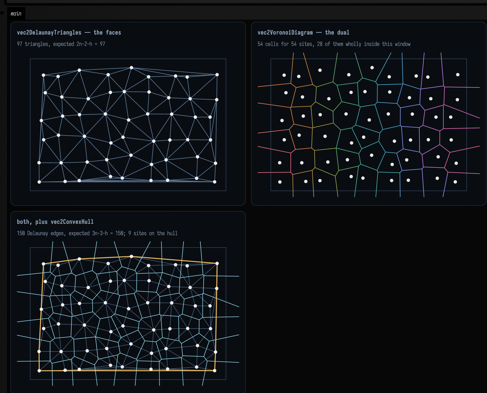
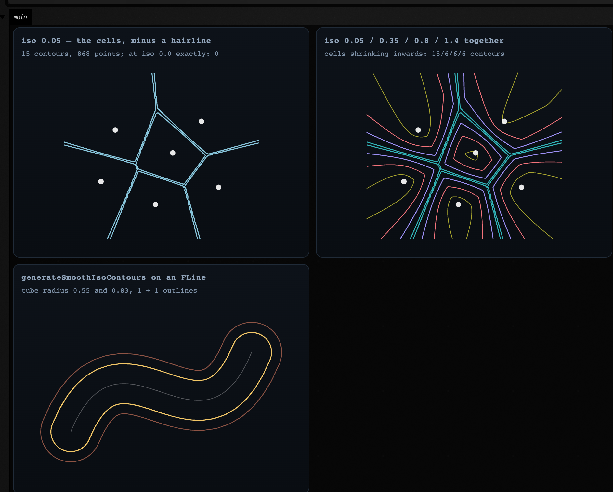

# Points into structure — Voronoi, Apollonius, contours and clusters

*Every public declaration used below is listed, with its KDoc, in the codebase reference:
[Graphics](reference/graphics.md) and [Data](reference/data.md).*

You have a bag of points. That is the least structured thing in graphics, and almost everything
interesting you can do with it is some form of the same question: **who owns which part of the
plane, and where are the seams?**

Field answers that question four different ways, all of them in `afield.stdlib`. This page is a
worked example of all four:

- **Delaunay triangulation and its Voronoi dual** — the classical answer, exact, JTS-backed.
- **Apollonius (multiplicatively weighted Voronoi)** — the same question with the points given
  *sizes*, where the answer stops being made of straight lines.
- **Marching squares** — the seam of a *field* rather than of a point set, extracted as drawable
  geometry.
- **Clustering** — partitioning the cloud instead of the plane.

## Where the family lives

The filenames are misleading, and one of them is actively so:

<div class="field-data-table" markdown>

| what you want | where it is | notes |
|---|---|---|
| 2D Delaunay, 2D Voronoi, 2D convex hull | `graph_connectivity.kt` | `vec2DelaunayGraph`, `vec2DelaunayTriangles`, `vec2VoronoiDiagram`, `vec2VoronoiDualGraph`, `vec2ConvexHull`. JTS-backed and exact. See also [Neighbors & Graphs](graph_connectivity_examples.md) |
| 2D weighted (Apollonius) Voronoi | `dirichlet.kt` | `CircularDirichlet`. Pure Kotlin. **Not** Poisson-disc sampling, despite the name |
| **3D** Voronoi, **3D** weighted Voronoi | `voronoi.kt` | `voronoi3d`, `CircularDirichlet3d`. `voronoi.kt` has no 2D anything and no Delaunay at all |
| marching squares → polylines and `FLine`s | `contours.kt` | `generateIsoContours`, `generateSmoothIsoContours`, `pointEdgeScalarField2D` |
| clustering | `clustering.kt` | agglomerative (7 linkages), k-medoids, k-medians. **There is no k-means in Field** — see below for why |
| any of the above → `FLine` | `spatial_field.kt` | `toFLine`/`toFLines` per result type, plus `showPlane` / `showPlaneGrid` |

</div>

That last row is the one that makes the rest drawable. Every partitioner above answers with
*structure* — vertex rings, circular arcs, triangle index triples, integer labels — rather than with
geometry, and `spatial_field.kt` is the hop from one to the other. It is the plane counterpart of
`mesh_field.kt` in [Meshes & 3D Geometry](mesh_examples.md).

## Delaunay, and the Voronoi dual

Start with the classical pair, because they are the same object seen twice. Given *n* sites:

- the **Voronoi diagram** cuts the plane into one cell per site, every point in a cell being nearer
  to that site than to any other;
- the **Delaunay triangulation** joins two sites exactly when their cells share an edge.

Each determines the other, which is why `vec2VoronoiDualGraph(points)` is, in the source, one line
that returns `vec2DelaunayGraph(points)`.

```diffstatic_runner {data-lang=kotlin screenshot="assets/spatial_geometry_examples/delaunay_dual.png" wait="3.0" capture="box" open-outputs="true" w="1040" h="980" padding="14"}
:::static
// A jittered lattice: structured enough that you can see the answer is right, irregular enough
// that the triangulation has something to decide.
val rng = java.util.Random(17)
val sites = (0 until 54).map { i ->
    vec((i % 9) * 44.0 + rng.nextDouble() * 22.0, (i / 9) * 44.0 + rng.nextDouble() * 22.0)
}

val delaunay = vec2DelaunayGraph(sites)          // a PointGraph: index pairs
val triangles = vec2DelaunayTriangles(sites)     // List<Triple<Int, Int, Int>>: the faces
val voronoi = vec2VoronoiDiagram(sites)          // one VoronoiCell per site, each a vertex ring
val hull = vec2ConvexHull(sites)                 // ConvexHull2D: hullPoints + hullIndices

// Euler's formula pins both counts exactly, so this is an assertion and not an observation:
// a triangulation of n points with h of them on the convex hull has 2n - 2 - h triangles and
// 3n - 3 - h edges. Nothing else is a valid triangulation.
val n = sites.size
val h = hull.hullIndices.size
val trianglesExpected = 2 * n - 2 - h
val edgesExpected = 3 * n - 3 - h

// The cells of the h hull sites are *unbounded*, and JTS returns them clipped to a generous
// envelope rather than to anything you asked for: measured here, the cell vertices span
// -423..799 in x while the sites only span 7..369. Fit a figure to that and the diagram
// collapses into a speck. So pin the window explicitly and let showPlaneGrid cut the rest.
val window = Rect(
    sites.minOf { it.x.toDouble() } - 18.0, sites.minOf { it.y.toDouble() } - 18.0,
    sites.maxOf { it.x.toDouble() } - sites.minOf { it.x.toDouble() } + 36.0,
    sites.maxOf { it.y.toDouble() } - sites.minOf { it.y.toDouble() } + 36.0,
)
val bounded = voronoi.cells.count { c ->
    c.vertices.size >= 3 && c.vertices.all {
        it.x >= window.x && it.x <= window.x + window.w && it.y >= window.y && it.y <= window.y + window.h
    }
}
:::fold draw the three panels
val cloud = pointCloudFLine(sites, color = vec(1.0, 1.0, 1.0, 0.9), pointSize = 1.1)
val frame = window.toFLine(color = vec(0.35, 0.44, 0.56, 0.55), thickness = 1.0)
val hullLine = polylineFrom(hull.hullPoints, 0, closed = true).also {
    it.color = vec(1.0, 0.78, 0.36, 0.85)
    it.thickness = 2.0
}

showPlaneGrid(
    "vec2DelaunayTriangles — the faces\n${triangles.size} triangles, expected 2n-2-h = $trianglesExpected" to
        listOf(frame, delaunayTrianglesToFLine(sites, triangles, color = vec(0.55, 0.70, 0.88, 0.6)), cloud),
    "vec2VoronoiDiagram — the dual\n${voronoi.cells.size} cells for $n sites, $bounded of them wholly inside this window" to
        listOf(frame, *voronoi.toFLines(palette = okhslSet(n, 0.7, 0.62, 0.9f), thickness = 1.2).toTypedArray(), cloud),
    "both, plus vec2ConvexHull\n${delaunay.edges.size} Delaunay edges, expected 3n-3-h = $edgesExpected; $h sites on the hull" to
        listOf(
            frame,
            delaunay.toFLine(sites, color = vec(0.45, 0.58, 0.75, 0.6), thickness = 1.0),
            *voronoi.toFLines(color = vec(0.62, 0.92, 1.0, 0.62), thickness = 1.1).toTypedArray(),
            hullLine,
            cloud,
        ),
    columns = 2,
    cellWidth = 430,
    cellHeight = 280,
    window = window,
)
:::endfold
```



Read the captions. The triangulation reports **97 triangles** against Euler's **2·54 − 2 − 9 = 97**,
and **150 edges** against **3·54 − 3 − 9 = 150**, with **9 sites on the hull**. Those are not
approximations: a planar triangulation of a given point set has exactly that many faces and edges or
it is not a triangulation, so the two numbers are a complete structural check on the result. The
third panel is the duality itself: every Delaunay edge crosses exactly one Voronoi edge, and crosses
it at right angles, because a Voronoi edge *is* the perpendicular bisector of the two sites it
separates. Every Voronoi vertex sits at the circumcentre of one Delaunay triangle.

Two properties to know before you build on this:

- **The cells on the hull are unbounded**, and JTS clips them to a bounding envelope rather than
  returning infinite rings, a generous one. Here the cell vertices span **−423 … 799** in *x* while
  the sites only span **7 … 369**, so a figure fitted to the cells collapses the diagram into a speck
  in the middle. That is why the fence pins its own `window` and draws it: `showPlaneGrid` clips to
  the frame, and the caption reports how many cells are wholly inside it (**28 of 54**). A boundary
  cell's vertex ring is real geometry, but its *area* is an artefact of the clip, not of the sites.
- **`VoronoiCell.vertices` is the ring, not a polygon object.** `polylineFrom(cell.vertices, closed =
  true)` — or `VoronoiDiagram.toFLines()`, which does it for you and drops the empty cells JTS
  returns for a duplicated site.

`vec2DelaunayGraph` is one of a family — Gabriel, Urquhart, relative-neighbourhood, β-skeleton, kNN,
minimum spanning tree — all sharing `PointGraph` and all comparable in one drawing. That comparison
is [its own page](graph_connectivity_examples.md); `PointGraph.toFLine(points)` draws any of them.

## When the bisector is a circle

Now give each site a *weight* and ask the same question. `CircularDirichlet` minimises

```diffstatic {data-lang=kotlin}
score_i(x) = |x - p_i|² / w_i²
```

which is the **multiplicatively weighted** or **Apollonius** diagram: a site with twice the weight
claims points twice as far away. This is the model you want whenever the sites are not
interchangeable: cities of different populations, cell nuclei of different sizes, sound sources of
different loudness, brush marks of different pressure.

The consequence is geometric. Setting `score_i(x) = score_j(x)` for two sites
gives, after clearing denominators, the equation of a **circle**, the Apollonius circle of the two
points in the ratio `w_i : w_j`. It degenerates to a straight line only when `w_i = w_j`. So a
weighted Voronoi cell is **not a polygon**, its boundary is made of circular arcs, and the API says
so rather than flattening it for you:

```diffstatic {data-lang=kotlin}
val diagram = CircularDirichlet.build(sites)     // sites are Vec3 of (x, y, weight)
val cell = diagram[0]                            // a CellBoundary
cell.pieces                                      // ArcPiece | LinePiece, angularly sorted
piece.support                                    // SupportCircle(center, radius) or SupportLine
piece.samplePoint()                              // a point known to be on this boundary
piece.toPolyline(maxChordError = 0.02f, clip = box)
```

```diffstatic_runner {data-lang=kotlin screenshot="assets/spatial_geometry_examples/apollonius.png" wait="3.0" capture="box" open-outputs="true" w="1040" h="980" padding="14"}
:::static
// Sites are (x, y, weight). Same five positions in all three panels; only the weights change.
val positions = listOf(
    vec(0.0, 0.0), vec(2.2, 0.3), vec(0.9, 2.0), vec(-1.4, 1.1), vec(1.1, -1.6),
)
val clip = CircularDirichlet.Aabb(vec(-3.4, -3.4), vec(4.6, 4.6))

fun diagramOf(weights: List<Double>) =
    CircularDirichlet.build(positions.mapIndexed { i, p -> vec(p.x, p.y, weights[i]) })

val equal = diagramOf(List(5) { 1.0 })
val mixed = diagramOf(listOf(1.0, 1.35, 0.8, 1.1, 1.6))
val swallowed = diagramOf(listOf(1.0, 2.6, 1.0, 1.0, 1.0))

// With equal weights every bisector degenerates to a straight line: a line only when the weights
// match. These two counts go into the captions below.
fun arcCount(d: CircularDirichlet.Diagram) =
    d.cells.sumOf { c -> c.pieces.count { it is CircularDirichlet.ArcPiece } }
fun lineCount(d: CircularDirichlet.Diagram) =
    d.cells.sumOf { c -> c.pieces.count { it is CircularDirichlet.LinePiece } }

// A full-sweep arc is a *complete circle*: that cell is a disc, entirely enclosed by one neighbour.
fun fullCircles(d: CircularDirichlet.Diagram) = d.cells.sumOf { c ->
    c.pieces.count { it is CircularDirichlet.ArcPiece && it.sweepAngle > 6.283 }
}
// …and a cell bounded by exactly one full circle is a cell that has been entirely enclosed.
fun enclosedCells(d: CircularDirichlet.Diagram) = d.cells.count { c ->
    c.pieces.size == 1 && (c.pieces[0] as? CircularDirichlet.ArcPiece)?.let { it.sweepAngle > 6.283 } == true
}
:::fold draw the three diagrams
val palette = okhslSet(5, saturation = 0.8, lightness = 0.66)
val cloud = pointCloudFLine(positions, color = vec(1.0, 1.0, 1.0, 0.95), pointSize = 1.6)

fun panel(d: CircularDirichlet.Diagram) =
    d.toFLines(clip = clip, maxChordError = 0.01f, palette = palette, thickness = 1.6) + cloud

showPlaneGrid(
    "equal weights — a plain Voronoi diagram\n${lineCount(equal)} straight bisectors, ${arcCount(equal)} arcs" to panel(equal),
    "weights 1.0 / 1.35 / 0.8 / 1.1 / 1.6\n${arcCount(mixed)} arcs, ${lineCount(mixed)} straight" to panel(mixed),
    "one site at weight 2.6\n${fullCircles(swallowed)} pieces are COMPLETE circles; ${enclosedCells(swallowed)} cells wholly enclosed" to panel(swallowed),
    columns = 2,
    cellWidth = 430,
    cellHeight = 280,
)
:::endfold
```


In the middle panel those are arcs: they bulge *away* from the heavier site, and no amount of
polygon machinery will produce them. The captions carry the check: at equal weights the diagram
reports **16 straight bisectors and 0 arcs**, and at mixed weights **18 arcs and 0 straight**. Not "mostly" either way: the type of every piece is decided by an exact equality of
weights, so the counts are all-or-nothing. Neither count is 20, the number of ordered site pairs: a
bisector only becomes a boundary *piece* of a cell where it is actually the nearest tie, and with five
sites several of the twenty pairs never surface.

The third panel shows a cell that is not a ring at all. Raise one site to
weight 2.6 and it does not merely take a larger share: **two** of its light neighbours end up
*entirely enclosed*, and their cells are complete discs bounded by a single full-sweep arc. The heavy
site's own cell is then the region **outside** those two discs, which is why the diagram reports four
full-circle pieces, two belonging to the enclosed cells and two to the cell enclosing them. It is a
cell with holes, not a polygon, and not even simply connected.

That is why `CellBoundary.toFLines(...)` returns **one `FLine` per piece rather than one per cell**.
Joining them into a single path would be a lie about the topology. There is a closed form for the
support: for two sites at `p_i`, `p_j` with weight ratio `k = w_j/w_i`, the Apollonius circle is
centred at `(k² p_i − p_j) / (k² − 1)`, and that is asserted against `arc.support.center` on every
build.

### Sweeping one site's weight

Three still panels at three weights cannot show the bisector becoming a circle; the transition is
between them. Here is the same construction with one number swept: site 1's weight, from 1.0 up to
2.7 and back, eight seconds there and back.

Watch three things. First, only the edges that **touch site 1** bow. A bisector between two sites of
*equal* weight stays exactly straight however heavy their neighbour gets, which is why the caption
reports both counts and why they trade against each other as the weight climbs (`8 arcs / 10
straight` at weight 1.12, `12 arcs / 6 straight` by 2.02), and every arc bulges *away* from the
heavy site.

Second, those counts do not drift; they **jump**. The bulge grows until two of the light neighbours'
cells pinch shut into complete discs (`enclosed` goes from 0 to 2 somewhere between weight 2.02 and
2.45), and the total piece count *falls* when that happens, because a swallowed cell needs one
full-sweep circle where it used to need several arcs and a line. The topology of the diagram is
changing, not just its shape.

Third, on the way back down the discs re-open and the arcs flatten, and at exactly 1.0 the whole
diagram snaps back to straight lines. The snap is in the geometry, not in the drawing: the type of
every boundary piece is decided by an *exact* equality of weights, so it is discontinuous there while
the picture around it moves smoothly.

The sweep below is an `animate { }` reading `AnimationClock`, Field's frame model, described in
[Frames and the animation loop](animation_time_model.md). Writing the sweep against the clock rather
than against `frameNumber` is what makes the recorded clip identical on every build.

```diffstatic_runner {data-lang=kotlin video="assets/spatial_geometry_examples/apollonius_sweep.mp4" capture="box" open-outputs="true" wait-output="true" wait-output-kind="display" execution="launch" duration="8" fps="20" timeout="240" w="760" embed=true name="apollonius-weight-sweep" alt="an Apollonius diagram of five sites with one site's weight rising from 1.0 to 2.7 and falling back, its straight bisectors bowing into circular arcs that grow until two neighbouring cells pinch shut into complete discs, then re-open and flatten"}
:::static
:::fold the same five sites, a fixed window, the palette, and the clock
val positions = listOf(
    vec(0.0, 0.0), vec(2.2, 0.3), vec(0.9, 2.0), vec(-1.4, 1.1), vec(1.1, -1.6),
)
val clip = CircularDirichlet.Aabb(vec(-3.4, -3.4), vec(4.6, 4.6))
// A FIXED window, not the default fit-to-contents. Left to fit each frame's own bounds the picture
// would rescale as the arcs swell, and the sweep would appear to stand still — the same trap that
// makes an auto-ranging heatmap of a WFC collapse look like it is going nowhere.
val window = Rect(-3.4, -3.4, 8.0, 8.0)
val palette = okhslSet(5, saturation = 0.8, lightness = 0.66)
val cloud = pointCloudFLine(positions, color = vec(1.0, 1.0, 1.0, 0.95), pointSize = 1.6)
val heavy = 1              // the site whose weight is swept; the other four stay at 1.0
// The recorder makes AnimationClock exactly frameIndex / fps, so matching this to the fence's
// duration produces one complete, repeatable there-and-back sweep.
val sweepSeconds = 8.0
val started = AnimationClock.nowSeconds()
:::endfold

// The line that turns elapsed time into the swept parameter — the one line worth reading, and the one
// you would change. A triangle ramp rather than a saw, so the clip runs out to 2.7 and back to 1.0
// and loops with no jump at the seam.
fun weightAt(elapsed: Double): Double {
    val phase = (elapsed / sweepSeconds) % 1.0
    return 1.0 + 1.7 * (1.0 - abs(1.0 - 2.0 * phase))          // 1.0 -> 2.7 -> 1.0
}

animate {
    val w = weightAt(AnimationClock.nowSeconds() - started)
    val diagram = CircularDirichlet.build(
        positions.mapIndexed { i, p -> vec(p.x, p.y, if (i == heavy) w else 1.0) }
    )
    val arcs = diagram.cells.sumOf { c -> c.pieces.count { it is CircularDirichlet.ArcPiece } }
    val straight = diagram.cells.sumOf { c -> c.pieces.count { it is CircularDirichlet.LinePiece } }
    // A cell bounded by one full-sweep arc is a cell that has been entirely swallowed.
    val enclosed = diagram.cells.count { c ->
        c.pieces.size == 1 &&
            (c.pieces[0] as? CircularDirichlet.ArcPiece)?.let { it.sweepAngle > 6.283 } == true
    }
    showPlane(
        // 0.005 rather than the stills' 0.01: a swallowed cell is a whole circle at this scale, and a
        // coarser chord error makes it visibly a dodecagon.
        diagram.toFLines(clip = clip, maxChordError = 0.005f, palette = palette, thickness = 1.6) + cloud,
        title = "site 1 weight %.2f".format(w),
        caption = "$arcs arcs, $straight straight, enclosed $enclosed",
        width = 660,
        height = 660,
        window = window,
    )
}
```

Three things to know about the implementation:

- **It is aimed at modest site counts.** The construction is triple-nested over the sites — every
  bisector is intersected against every other, and each candidate piece is kept only if a midpoint
  sample really is on the cell boundary. Dozens of sites, not thousands.
- **Unbounded pieces need a clip.** `LinePiece.toPolyline` throws without an `Aabb`, because a line
  running to infinity cannot be flattened. Clipping an *arc* can also cut it into several runs, which
  is why `ArcPiece.toPolylines` exists and returns a list.
- **All weights must be strictly positive.** `build` requires it.

There is a 3D counterpart, `CircularDirichlet3d` in `voronoi.kt`, where the bisector becomes a
*sphere* and a cell's boundary is made of `SpherePatch3`/`PlanePatch3`. It is explicitly
approximate: it extracts patches by clipping a sampled surface mesh with the weighted score
predicate, and its KDoc says it "prefers stable, wound boundary loops over exact symbolic patch
topology". The exact 3D construction is the *unweighted* one, below.

## A field, and the seam through it

The other kind of seam is a level set. `contours.kt` marches a `ScalarField2D` — a plain
`(Double, Double) -> Double` — on a grid and stitches the crossings into polylines.

The reason this belongs on the same page as Voronoi is that the two are the same idea at different
resolutions: a Voronoi diagram *is* the set of ties in `argmin_i |x − p_i|`, and marching squares
finds the ties in any scalar you like. Which also means you can get a soft, blobby Voronoi by
contouring a difference of distances, and a hard one by triangulating.

```diffstatic_runner {data-lang=kotlin screenshot="assets/spatial_geometry_examples/contours.png" wait="3.0" capture="box" open-outputs="true" w="1040" h="980" padding="14"}
:::static
// Six sites; the field is "how much nearer is the closest site than the second closest", which is
// zero exactly on the Voronoi seams and grows into the middle of each cell.
val sites = listOf(
    vec(-1.6, -0.9), vec(1.4, -1.2), vec(2.0, 1.1), vec(-0.2, 1.7), vec(-2.1, 0.9), vec(0.4, -0.1),
)
val gap: ScalarField2D = { x, y ->
    val d = sites.map { s -> kotlin.math.hypot(x - s.x, y - s.y) }.sorted()
    d[1] - d[0]
}

// This field is NON-NEGATIVE: it touches zero exactly on the seams and is positive everywhere else.
// Marching squares finds *sign changes*, so iso = 0.0 finds nothing at all — measured, 0 contours,
// and correctly so. A small positive level instead traces each cell shrunk inwards by that margin,
// and raising it shrinks them further. That is the useful knob.
val levels = listOf(0.05, 0.35, 0.8, 1.4)
val byLevel = levels.map { iso -> iso to generateIsoContours(gap, -3.4, 3.4, -2.9, 2.9, 120, 120, iso) }
val atZero = generateIsoContours(gap, -3.4, 3.4, -2.9, 2.9, 120, 120, 0.0)

// A completely different use of the same machinery: pointEdgeScalarField2D turns an FLine into a
// signed field whose zero set is a tube around it, so contouring at 0.0 outlines a stroke.
val stroke = fline {
    moveTo(-2.4, 1.2); cubicTo(-1.0, -2.2, 1.2, 2.4, 2.6, -1.0)
}
val outline = generateSmoothIsoContours(stroke, radius = 0.55, spatialStep = 0.05)
val fat = generateSmoothIsoContours(stroke, radius = 0.55, spatialStep = 0.05, iso = -0.28)
:::fold draw the levels and the tube
fun contourLines(contours: List<List<Vec2>>, color: Vec4, thickness: Double) =
    contours.filter { it.size >= 2 }.map { c ->
        polylineFrom(c, 0, closed = isoContourClosed(c, -3.4, 3.4, -2.9, 2.9, boundaryEpsilon = 0.05)).also {
            it.color = color; it.thickness = thickness
        }
    }

val siteDots = pointCloudFLine(sites, color = vec(1.0, 1.0, 1.0, 0.9), pointSize = 1.4)
val ramp = okhslSet(levels.size, saturation = 0.82, lightness = 0.66, startHue = 0.55f)

val stacked = byLevel.flatMapIndexed { i, (_, contours) ->
    contourLines(contours, ramp[i], 1.5 - i * 0.15)
} + siteDots

showPlaneGrid(
    "iso 0.05 — the cells, minus a hairline\n${byLevel[0].second.size} contours, ${byLevel[0].second.sumOf { it.size }} points; at iso 0.0 exactly: ${atZero.size}" to
        (contourLines(byLevel[0].second, vec(0.62, 0.9, 1.0, 0.85), 1.6) + siteDots),
    "iso 0.05 / 0.35 / 0.8 / 1.4 together\ncells shrinking inwards: ${byLevel.map { it.second.size }.joinToString("/")} contours" to stacked,
    "generateSmoothIsoContours on an FLine\ntube radius 0.55 and 0.83, ${outline.size} + ${fat.size} outlines" to listOf(
        stroke.also { it.color = vec(1.0, 1.0, 1.0, 0.30); it.thickness = 1.0 },
        *fat.map { it.also { f -> f.color = vec(0.98, 0.55, 0.42, 0.55); f.thickness = 1.3 } }.toTypedArray(),
        *outline.map { it.also { f -> f.color = vec(1.0, 0.82, 0.42, 0.95); f.thickness = 1.6 } }.toTypedArray(),
    ),
    columns = 2,
    cellWidth = 430,
    cellHeight = 280,
)
:::endfold
```



The left panel contours `d₂ − d₁` at a *small positive* level, which recovers the Voronoi diagram of
the six sites — **15 contours, 868 points** — from an entirely different algorithm than the panel two
sections up. Contour the same field at **exactly zero** and you get nothing: **0 contours**, and that
is correct. Marching squares locates *sign changes*, and `d₂ − d₁` is non-negative by construction
(over that window its range is `1.6e-8 … 2.0`), so it touches zero along the seams and never crosses.
A level set a field only grazes is invisible to a marcher, and a smaller epsilon will not rescue it.
Every distance-gap, every absolute value, every `min`-of-distances field behaves this way, so ask a
question the field can answer instead.

At 0.05 each cell comes back shrunk inwards by that margin. Raise the level further, as the middle
panel does, and the cells shrink with **rounded** corners, because the field is smooth where three
cells meet — a tessellation you cannot get by clipping half-planes at any tolerance. The contour count
drops from 15 to 6 as the level rises: at 0.05 several cells still run out of the sampling window and
arrive as open runs, while by 0.35 all six are closed loops entirely inside it.

The right panel is the other entry point. `pointEdgeScalarField2D` builds a field from points and
edges — or straight from an `FLine`, sampling its cubics — as the union of weighted discs and
capsules, signed so that `iso = 0.0` is the tube boundary. `generateSmoothIsoContours` then fits cubic
splines through the marched polylines, so what comes back is a smooth outline of a stroke and not a
staircase. Raising the radius or lowering `iso` fattens it, and `pointRadius`/`edgeRadius` are
separate knobs.

To make a stroke *taper*, pass a `pointWeight` callback: `(nodeIndex, point) -> Double`, a multiplier
on the radius, where `nodeIndex` is the *fractional* drawing-instruction index of each flattened
sample: integral at a `moveTo`/`lineTo` and interpolated across a `cubicTo`, the same quantity
`FLine.uniform_linearize` hands the renderer to look up per-node colour. `line.isoWeights()` builds
one for you out of `isoWeight` properties set on the nodes themselves, treating the nodes that set it
as keyframes and ramping linearly between them. An edge's capsule always takes the *minimum* of its
two endpoints' weights: a capsule has one radius for its whole length and so cannot taper, the taper
is the union of densely sampled discs, and the minimum keeps a capsule from bulging out past the thin
end it is feeding into.

### Two decisions inside the marcher, and one rough edge

Marching squares has exactly two decisions in it, and both are places where a plausible
implementation is wrong without saying so.

**A sample exactly at the iso level.** The natural test for "does this grid edge carry a crossing" is
a strict sign change on both ends. It is also wrong: a sample landing *precisely* on `iso` is then
neither inside nor outside, and the crossing on **every** edge out of that corner is suppressed. This
is not exotic; it is what a symmetric field on a symmetric grid does constantly.

```diffstatic_runner {data-lang=kotlin screenshot="assets/spatial_geometry_examples/grid_corner.png" wait="3.0" capture="box" open-outputs="true" w="1040" h="980" padding="14"}
:::static
// Three inputs whose exact answer you already know, each arranged so that grid samples land ON the
// iso level. Before the fix in this branch, the first returned an empty list and the third came back
// severed into four disconnected arcs.
val plane: ScalarField2D = { x, _ -> x }                              // zero set: the y axis
val circle: ScalarField2D = { x, y -> kotlin.math.hypot(x, y) - 1.0 } // zero set: the unit circle

// nx = 4 over [-1, 1] puts a whole column of samples exactly on x = 0.
val planeContours = generateIsoContours(plane, -1.0, 1.0, -1.0, 1.0, 4, 4, 0.0)

// nx = 16 over [-2, 2] puts the circle exactly through the grid corners at (+-1, 0) and (0, +-1).
val aligned = generateIsoContours(circle, -2.0, 2.0, -2.0, 2.0, 16, 16, 0.0)

// f = x*y at iso 0 is the two axes crossing — the ambiguous saddle cell, in its purest form.
val saddle: ScalarField2D = { x, y -> x * y }
val branches = generateIsoContours(saddle, -1.05, 1.03, -1.02, 1.07, 8, 8, 0.0)

fun perimeter(loop: List<Vec2>): Double {
    var total = 0.0
    for (i in loop.indices) {
        val a = loop[i]; val b = loop[(i + 1) % loop.size]
        total += kotlin.math.hypot((a.x - b.x).toDouble(), (a.y - b.y).toDouble())
    }
    return total
}
:::fold draw the three cases, each over its own sampling grid
// One helper: the sampling grid as faint lines, so you can SEE which samples the level set runs
// through. That is the whole subject of this figure.
fun gridLines(x0: Double, x1: Double, y0: Double, y1: Double, nx: Int, ny: Int) = fline {
    for (i in 0..nx) { val x = x0 + (x1 - x0) * i / nx; moveTo(x, y0); lineTo(x, y1) }
    for (j in 0..ny) { val y = y0 + (y1 - y0) * j / ny; moveTo(x0, y); lineTo(x1, y) }
    color = vec(0.34, 0.42, 0.54, 0.55)
    thickness = 0.8
}

// …and the contours, dot per marched crossing, closed only if they really are loops.
fun dotted(
    contours: List<List<Vec2>>, x0: Double, x1: Double, y0: Double, y1: Double,
    colors: List<Vec4>, eps: Double,
) = contours.mapIndexed { i, c ->
    polylineFrom(c, 0, closed = isoContourClosed(c, x0, x1, y0, y1, eps)).also {
        it.color = colors[i % colors.size]; it.thickness = 2.2
        it.pointed = true; it.pointSize = 1.1
    }
}

val warm = listOf(vec(1.0, 0.78, 0.36, 0.95), vec(0.62, 0.92, 1.0, 0.95),
                  vec(0.98, 0.55, 0.62, 0.95), vec(0.6, 1.0, 0.72, 0.95))

showPlaneGrid(
    "f(x,y) = x at iso 0, grid aligned on x = 0\n${planeContours.size} contour of ${planeContours.sumOf { it.size }} points (was 0 contours)" to
        (listOf(gridLines(-1.0, 1.0, -1.0, 1.0, 4, 4)) + dotted(planeContours, -1.0, 1.0, -1.0, 1.0, warm, 0.4)),
    "unit circle at nx = 16, aligned\n1 loop of ${aligned[0].size} points, perimeter %.4f vs 2pi = %.4f (was 4 arcs)".format(perimeter(aligned[0]), 2 * PI) to
        (listOf(gridLines(-2.0, 2.0, -2.0, 2.0, 16, 16)) + dotted(aligned, -2.0, 2.0, -2.0, 2.0, warm, 0.2)),
    "f = x*y at iso 0 — the saddle cell\n${branches.size} branches of ${branches.map { it.size }.joinToString(" and ")} points" to
        (listOf(gridLines(-1.05, 1.03, -1.02, 1.07, 8, 8)) + dotted(branches, -1.05, 1.03, -1.02, 1.07, warm, 0.2)),
    columns = 2,
    cellWidth = 430,
    cellHeight = 280,
)
:::endfold
```


The parenthesised numbers in the captions are what the strict test returns. `f(x, y) = x` at
`iso = 0` on a grid with an even cell count puts a whole column of samples on the level, and a strict
test gives **no contour at all**; the unit circle at `nx = 16` passes exactly through a grid corner
at each of the four axis points, and a strict test severs it into **four disconnected 6-point arcs**.
Here they come back as one 5-point line and one closed 28-point loop whose perimeter is within a
percent of 2π.

The convention that gets there is the one `marchingCubes` in `mesh_sdf.kt` uses, one dimension down:
a corner is inside iff its sample is **strictly below** `iso`, so "exactly at `iso`" is a definite
side rather than a third state, and the crossing parameter is then clamped a thousandth of a cell off
the endpoints so that the several edges out of such a corner do not all interpolate onto the corner
itself. With `inside` two-valued, an odd number of crossings around a cell is impossible, an
invariant rather than a rare degenerate case to handle.

**The saddle cell.** When the four corners alternate inside/outside there are four crossings and two
ways to pair them, and the two choices give *different topology*: either the inside region is
connected through the middle of the cell or the outside one is. Picking arbitrarily means two cells
sharing an edge can disagree, and the contour tears there. The resolution is the **asymptotic
decider**: the cell's bilinear interpolant has exactly one saddle, at value
`(s₀s₂ − s₁s₃) / (s₀ + s₂ − s₁ − s₃)` with every `s` measured from `iso`, and whichever diagonal pair
of corners shares a side with that saddle is the pair the centre connects. It is a pure function of
the cell's own four corner values, so the neighbour always agrees, which is the property the
stitcher needs, and the one an arbitrary pairing cannot give.

The third panel is the case where the decider has nothing to say. `x·y = 0` is the two axes
crossing, and a marcher cannot draw an X, so at the saddle cell it joins the four crossings in pairs
and the zero set comes back as two right-angled branches meeting at the origin. But `x·y` is *itself*
bilinear, so the cell's interpolant reproduces it exactly and the saddle value is exactly `iso`. Both
pairings are equally correct, and the decider is looking at a numerator that is zero in exact
arithmetic and ±10⁻²⁰ in doubles, which is to say at rounding. The tie is broken deterministically
instead, and `nx = 8` gives **8 and 10** points. The two branches should not be equal: the sampling
window is `[-1.05, 1.03] × [-1.02, 1.07]`, so the origin sits at cell `(4.04, 3.90)` and the two arms
of the X are cut by the grid at different places.

Where the decider *does* earn its keep is any cell whose saddle value is genuinely off `iso`, and what
it reads there is the corner **magnitudes**, not their signs. Give one cell the values
`(−3, +1, −3, +1)`: the saddle is at `−1`, on the same side as the `−3` diagonal, so those two corners
join through the centre and the crossings cut the two `+1` corners off. Now keep the same sign pattern
and swap which diagonal is the deep one, `(−1, +3, −1, +3)`. Exactly the same corners are inside, but
the saddle is now `+1`, the *outside* is what joins, and the cuts must move to the other diagonal. An
implementation that looked only at which corners are inside would answer both the same way, drawing
long diagonals across one of the two cells where the decider draws short corner elbows.

There is a matching invariant in the other direction:
**negating every corner value must leave the crossing exactly where it was.** `{f = 0}` and
`{−f = 0}` are the same set of points, so a marcher that moved the curve would be reporting two
different answers for one curve. It works out because the two flips cancel: negation swaps which
corners are inside *and* flips the sign of the saddle value, and the decider compares the two. Both
properties are asserted, with a control arm confirming that a strict-sign-change marcher fails the
first.

Both halves of that, the decision and the tie, fit in one figure, because a single cell with four
prescribed corner values is a complete input to `generateIsoContours`.

```diffstatic_runner {data-lang=kotlin screenshot="assets/spatial_geometry_examples/saddle_decider.png" wait="3.0" capture="box" open-outputs="true" w="1040" h="980" padding="14"}
:::static
// A field whose four corner samples are prescribed, on a 1x1 grid: the decider is then the only
// thing under test. v0 bottom-left, v1 bottom-right, v2 top-right, v3 top-left.
fun oneCell(v: List<Double>): ScalarField2D =
    { x, y -> if (x < 0.5) (if (y < 0.5) v[0] else v[3]) else (if (y < 0.5) v[1] else v[2]) }

// The value the decider looks at: the cell's bilinear interpolant has exactly one saddle, and this
// is it. Its SIGN says which diagonal pair of corners the centre of the cell belongs to.
fun saddleValue(v: List<Double>, iso: Double = 0.0): Double {
    val s = v.map { it - iso }
    return (s[0] * s[2] - s[1] * s[3]) / (s[0] + s[2] - s[1] - s[3])
}

// Same sign pattern in both, but the DEEP diagonal moves. That is what the decider reads.
val deepInside = listOf(-3.0, 1.0, -3.0, 1.0)   // saddle -1: the inside joins through the centre
val deepOutside = listOf(-1.0, 3.0, -1.0, 3.0)  // saddle +1: the outside joins, so the cuts move

val insideCut = generateIsoContours(oneCell(deepInside), 0.0, 1.0, 0.0, 1.0, 1, 1, 0.0)
val outsideCut = generateIsoContours(oneCell(deepOutside), 0.0, 1.0, 0.0, 1.0, 1, 1, 0.0)

// The other-direction invariant: {f = 0} and {-f = 0} are the same set of points, so negating every
// corner value must NOT move the crossing. It cancels — negation swaps inside/outside AND flips the
// saddle's sign, and the decider compares the two.
fun cutCentres(cuts: List<List<Vec2>>) = cuts.map { c ->
    "%.2f,%.2f".format((c[0].x + c[1].x) / 2.0, (c[0].y + c[1].y) / 2.0)
}.sorted()
val negationIsInvariant = listOf(deepInside, deepOutside).all { v ->
    cutCentres(generateIsoContours(oneCell(v), 0.0, 1.0, 0.0, 1.0, 1, 1, 0.0)) ==
        cutCentres(generateIsoContours(oneCell(v.map { -it }), 0.0, 1.0, 0.0, 1.0, 1, 1, 0.0))
}

// f = x*y is the tie, and it is the common case rather than the exotic one: the field is ITSELF
// bilinear, so the cell's interpolant reproduces it and the saddle value is exactly iso. Locate the
// saddle cell at a given resolution and report the numerator that is supposed to decide it.
fun tieNumerator(nx: Int): Double {
    val dx = (1.03 - -1.05) / nx
    val dy = (1.07 - -1.02) / nx
    for (i in 0 until nx) for (j in 0 until nx) {
        val a = -1.05 + i * dx; val c = a + dx
        val b = -1.02 + j * dy; val d = b + dy
        val v = listOf(a * b, c * b, c * d, a * d)
        val alternates = (v[0] < 0) != (v[1] < 0) && (v[1] < 0) != (v[2] < 0) && (v[2] < 0) != (v[3] < 0)
        if (alternates) return v[0] * v[2] - v[1] * v[3]
    }
    return Double.NaN
}

val saddleField: ScalarField2D = { x, y -> x * y }
val tie8 = generateIsoContours(saddleField, -1.05, 1.03, -1.02, 1.07, 8, 8, 0.0)
val tie32 = generateIsoContours(saddleField, -1.05, 1.03, -1.02, 1.07, 32, 32, 0.0)
:::fold draw the cell, its corners by sign, and the crossing it chose
val insideColor = vec(0.42, 0.72, 1.0, 0.95)    // strictly below iso — inside
val outsideColor = vec(1.0, 0.62, 0.36, 0.95)   // at or above iso — outside
val cutColor = vec(0.6, 1.0, 0.72, 0.95)

fun cellFigure(v: List<Double>, cuts: List<List<Vec2>>): List<FLine> {
    val out = ArrayList<FLine>()
    out += fline {
        moveTo(0.0, 0.0); lineTo(1.0, 0.0); lineTo(1.0, 1.0); lineTo(0.0, 1.0); lineTo(0.0, 0.0)
        color = vec(0.34, 0.42, 0.54, 0.7)
        thickness = 1.0
    }
    val corners = listOf(vec(0.0, 0.0), vec(1.0, 0.0), vec(1.0, 1.0), vec(0.0, 1.0))
    corners.forEachIndexed { i, p ->
        out += pointCloudFLine(
            listOf(p),
            color = if (v[i] < 0.0) insideColor else outsideColor,
            pointSize = 3.0,
        )
    }
    cuts.forEach { c ->
        out += polylineFrom(c, 0, closed = false).also {
            it.color = cutColor; it.thickness = 3.2; it.pointed = true; it.pointSize = 1.4
        }
    }
    return out
}

fun gridLines(x0: Double, x1: Double, y0: Double, y1: Double, n: Int) = fline {
    for (i in 0..n) { val x = x0 + (x1 - x0) * i / n; moveTo(x, y0); lineTo(x, y1) }
    for (j in 0..n) { val y = y0 + (y1 - y0) * j / n; moveTo(x0, y); lineTo(x1, y) }
    color = vec(0.34, 0.42, 0.54, 0.45)
    thickness = 0.7
}

fun branchLines(contours: List<List<Vec2>>): List<FLine> {
    val palette = listOf(vec(1.0, 0.78, 0.36, 0.95), vec(0.62, 0.92, 1.0, 0.95))
    return contours.mapIndexed { i, c ->
        polylineFrom(c, 0, closed = false).also {
            it.color = palette[i % palette.size]; it.thickness = 2.4
            it.pointed = true; it.pointSize = 1.1
        }
    }
}

fun sizes(contours: List<List<Vec2>>) = contours.map { it.size }.joinToString(" and ")

// Captions stay short: showPlaneGrid lays the cards out on `max-content`, so a long
// single-line caption widens the card past the docs screenshot's ~1100 CSS px crop and gets cut off.
showPlaneGrid(
    "−3 / +1 / −3 / +1   deep inside\nsaddle ${"%+.3f".format(saddleValue(deepInside))} — cuts isolate the shallow pair" to
        cellFigure(deepInside, insideCut),
    "−1 / +3 / −1 / +3   deep outside\nsaddle ${"%+.3f".format(saddleValue(deepOutside))} — same signs, other diagonal" to
        cellFigure(deepOutside, outsideCut),
    "f = x·y at nx = 8 — a genuine tie\nnumerator ${"%+.1e".format(tieNumerator(8))} = zero; ${sizes(tie8)} points" to
        (listOf(gridLines(-1.05, 1.03, -1.02, 1.07, 8)) + branchLines(tie8)),
    "…at nx = 32, same tie, same pairing\nnumerator ${"%+.1e".format(tieNumerator(32))}; ${sizes(tie32)} points" to
        (listOf(gridLines(-1.05, 1.03, -1.02, 1.07, 32)) + branchLines(tie32)),
    columns = 2,
    cellWidth = 430,
    cellHeight = 260,
)
println("negating every corner value leaves the crossing put: $negationIsInvariant")
:::endfold
```


The top row is the decider working. **The two cells have the
same sign pattern**, the same two corners inside in both, and the crossings still land on
opposite diagonals, because all that changed is which diagonal is the *deep* one and therefore which
side of `iso` the saddle falls on. Nothing but the four corner values went in, so nothing but the four
corner values can have decided it: that is the property that lets two cells sharing an edge agree
about the crossing on it, and the one a fixed pairing cannot promise.

The box also prints the invariant from the other side: negating *every* corner value leaves the
crossing exactly where it was. It has to, because `{f = 0}` and `{−f = 0}` are the same curve. And
it does: negation flips which corners are inside *and* the sign of the saddle, and the decider
compares the two.

The bottom row is the decider having nothing to say. Read the
numerators in the captions: `-1.7e-21` and `0.0` are both *zero*, so the saddle is exactly on `iso`,
the level set through that cell is an X meeting at a point, and both pairings are equally correct.
Left to the numerator's sign the pairing would be decided by which way a multiplication rounded, and
would flip with grid resolution, and on a numerator of ±10⁻²¹ between two runs of the same code on
the same input. The two panels agree because the tie is settled by `SADDLE_TIE_RELATIVE_EPSILON`
instead.

**What is still rough:** the segment stitcher joins crossings by proximity and is O(*m*²) in the
number of segments, so a very high grid resolution gets expensive. `marchingCubes` avoids this
entirely by keying shared vertices on grid-edge identity; the 2D marcher does not, yet.

### Sweep the level through the saddle

Everything above argues about a single cell. The reason that cell matters is what happens to the
*whole* level set when the iso level crosses a saddle, and no still can show it, because the event is
a change of topology at one particular level.

Two Gaussian bumps, then, and one number swept: the iso level, from 0.18 up to 0.78 and back. The col
between the two peaks sits at **0.391** (the box computes it as `field(0.0, 0.0)` rather than taking
it on trust) and is marked in orange. Below it there is **one** contour enclosing both peaks; above
it there are **two**, one per peak; and the changeover is a single frame in which the marcher is looking
at a cell whose four corners give it no unambiguous answer. Each contour is coloured by its index, so
the merge is visible as a colour vanishing, not just as a number in the caption changing.

```diffstatic_runner {data-lang=kotlin video="assets/spatial_geometry_examples/iso_sweep.mp4" capture="box" open-outputs="true" wait-output="true" wait-output-kind="display" execution="launch" duration="8" fps="20" timeout="240" w="760" embed=true name="iso-level-sweep" alt="the level set of two Gaussian bumps as the iso level sweeps from 0.18 to 0.78 and back: one large loop enclosing both peaks pinches at the saddle marked in orange and separates into two loops, one per peak, then rejoins on the way back down"}
:::static
:::fold two Gaussian bumps, the sampling window, the palette, and the clock
val field: ScalarField2D = { x, y ->
    exp(-((x - 1.4) * (x - 1.4) + y * y) / 1.2) + exp(-((x + 1.4) * (x + 1.4) + y * y) / 1.2)
}
// The sampled rectangle, and a FIXED display window so the picture does not rescale as the loops
// shrink — the contours would otherwise stay the same size on screen and the sweep would look still.
val x0 = -3.2; val x1 = 3.2; val y0 = -1.9; val y1 = 1.9
val window = Rect(-3.0, -1.7, 6.0, 3.4)
val peakDots = pointCloudFLine(
    listOf(vec(1.4, 0.0), vec(-1.4, 0.0)), color = vec(1.0, 1.0, 1.0, 0.85), pointSize = 1.4,
)
val saddleDot = pointCloudFLine(
    listOf(vec(0.0, 0.0)), color = vec(1.0, 0.72, 0.32, 0.98), pointSize = 1.9,
)
val byIndex = listOf(vec(0.42, 0.80, 1.0, 0.95), vec(1.0, 0.45, 0.62, 0.95))
// Match the eight-second fence: offline capture advances this clock by exactly 1 / fps per frame.
val sweepSeconds = 8.0
val started = AnimationClock.nowSeconds()
:::endfold

// The saddle level is the field's own value at the col between the peaks.
val saddle = field(0.0, 0.0)

// The line that turns elapsed time into the swept parameter. A triangle ramp over a range that
// straddles `saddle` with room either side, so the topology change happens twice per loop, once each
// way.
fun isoAt(elapsed: Double): Double {
    val phase = (elapsed / sweepSeconds) % 1.0
    return 0.18 + 0.60 * (1.0 - abs(1.0 - 2.0 * phase))        // 0.18 -> 0.78 -> 0.18
}

animate {
    val iso = isoAt(AnimationClock.nowSeconds() - started)
    // This resolution controls geometry cost and detail; capture speed cannot stretch the sweep.
    val contours = generateIsoContours(field, x0, x1, y0, y1, 100, 60, iso).filter { it.size >= 2 }
    val lines = contours.mapIndexed { i, c ->
        polylineFrom(c, 0, closed = isoContourClosed(c, x0, x1, y0, y1, boundaryEpsilon = 0.05)).also {
            it.color = byIndex[i % byIndex.size]
            it.thickness = 2.0
        }
    }
    showPlane(
        lines + peakDots + saddleDot,
        title = "iso %.3f — %d contour(s)".format(iso, contours.size),
        caption = if (iso > saddle) "above the saddle %.3f — one loop per peak".format(saddle)
        else "below the saddle %.3f — one loop around both".format(saddle),
        width = 660,
        height = 374,
        window = window,
    )
}
```

## Partitioning the cloud instead of the plane

The last family asks the question the other way round: not "which part of the plane belongs to which
point" but "which points belong together".

**There is no k-means in Field, and that is deliberate.** Every algorithm in `clustering.kt` returns
either a *hierarchy* or a centre that is meaningful for the data it summarises. A **medoid** is one of
your own samples: the actual document, the actual frame, the actual brush mark. A **median** is
coordinate-wise robust. A k-means centroid is neither, and on a cloud with one outlier it is the one
that moves. The three doors:

```diffstatic {data-lang=kotlin}
val tree = vec2Agglomerative(points, AgglomerativeLinkage.WARD)  // the whole merge hierarchy
tree.partition(k)                     // cut it at k clusters -> ClusterLayer
tree.partitionByHeight(h)             // …or at a merge distance
tree.layers(2..6)                     // …or at several k at once

vec2KMedoids(points, k, KMedoidsOptions(randomSeed = 11L))   // centres ARE samples
vec2KMedians(points, k, KMediansOptions(randomSeed = 11L))   // L1 Lloyd, robust centres
```

Each of `Float`, `Vec2`, `Vec3` and `Vec4` has all three (`floatKMedoids`, `vec3Agglomerative`, …),
and every result converts to a `ClusterLayer`, a name plus one integer label per sample, which is
the currency the visualisers take.

A comparison needs data that can tell the things compared *apart*, and three well-separated Gaussian
blobs cannot: every strategy below recovers them exactly, to four significant figures. So here is a
cloud with exactly **one** thing wrong with it: three tight blobs of 28 points, and a
single 85th point sitting nine units away from all of them. Nothing else is unusual. Watch what each
strategy does with that one point.

```diffstatic_runner {data-lang=kotlin screenshot="assets/spatial_geometry_examples/clustering.png" wait="3.0" capture="box" open-outputs="true" w="1040" h="1080" padding="14"}
:::fold plant three tight blobs of 28 — and one lone stray nine units out
// Three tight Gaussian blobs, 28 points each, centres 2.4 apart. Then one stray, far from all three.
// The only interesting thing about this cloud is that 85th point.
val rng = java.util.Random(7)
val blobCentres = listOf(vec(0.0, 0.0), vec(2.4, 0.2), vec(1.2, 2.2))
val blobs = blobCentres.flatMap { c ->
    List(28) { vec(c.x + rng.nextGaussian() * 0.30, c.y + rng.nextGaussian() * 0.30) }
}
val stray = vec(9.0, 8.0)
// NOT `blobs + stray`: in Field, `List<Vec2> + Vec2` is `FLineGeometry`'s elementwise operator and
// TRANSLATES all 84 points by (9, 8) rather than appending an 85th. `+ listOf(stray)` is worse still
// — that overload zips two equal-length lists. Append explicitly.
val points = buildList { addAll(blobs); add(stray) }
val window = Rect(-1.4, -1.4, 11.2, 10.2)   // shared by all four panels, so they are comparable
:::endfold
:::static
// Four strategies, one question: partition these 85 points into three groups.
val tree = vec2Agglomerative(points)     // Ward: minimises within-cluster sum of SQUARES
val cut3 = tree.partition(3)
val cut6 = tree.partition(6)
val medoids = vec2KMedoids(points, 3, KMedoidsOptions(randomSeed = 11L))  // centres ARE samples
val medians = vec2KMedians(points, 3, KMediansOptions(randomSeed = 11L))  // L1 Lloyd

// One ruler for all of them: score ANY partition by the objective k-medians optimises — the sum of
// |dx| + |dy| from each point to its own cluster's median. That makes the four answers comparable.
fun l1Of(labels: IntArray, k: Int) = (0 until k).sumOf { c ->
    val mem = points.indices.filter { labels[it] == c }
    val mx = mem.map { points[it].x }.sorted()[mem.size / 2]
    val my = mem.map { points[it].y }.sorted()[mem.size / 2]
    mem.sumOf { (abs(points[it].x - mx) + abs(points[it].y - my)).toDouble() }
}
fun sizes(layer: ClusterLayer) = (0 until layer.clusterCount).map { layer.indices(it).size }.sorted()

// THE DISCRIMINATORS. Every one of these is boring on well-separated blobs and decisive here.
val wardSpendsAClusterOnTheStray = sizes(cut3).first() == 1        // [1, 28, 56]
val medoidsKeepEveryBlobWhole = medoids.clusterSizes.min() >= 28   // [28, 28, 29]
val wardCostsThisMuchMore = l1Of(cut3.labels, 3) / medians.objective  // 1.86x, not 1.00x

// …and the invariants that hold whatever the data, which is why they are the backbone.
val medoidsAreSamples = medoids.medoids.all { m -> points.any { it.x == m.x && it.y == m.y } }
val nested = (0 until cut6.clusterCount).all { fine ->
    cut6.indices(fine).map { cut3.labels[it] }.toSet().size == 1
}
val mediansBeatMedoids = medians.objective < medoids.distortion
:::fold draw the four partitions
// Only the FIRST newline splits a panel label into title + caption; later ones render as spaces, and
// the grid's max-content columns are sized by the longest caption. So: one short caption line each.
showPlaneGrid(
    "vec2Agglomerative().partition(3)\nsizes ${sizes(cut3).joinToString("/")} — L1 %.3f. one stray, one whole cluster"
        .format(l1Of(cut3.labels, 3)) to
        cut3.toFLines(points, drawSpokes = false, pointSize = 1.6),
    "…the SAME tree, cut at 6\nsizes ${sizes(cut6).joinToString("/")} — nested: $nested. the blobs are back"
        to cut6.toFLines(points, drawSpokes = false, pointSize = 1.6),
    "vec2KMedoids(k = 3)\nsizes ${medoids.clusterSizes.toList().sorted().joinToString("/")} — distortion %.3f. samples: %s"
        .format(medoids.distortion, medoidsAreSamples) to
        medoids.asLayer().toFLines(points, centers = medoids.medoids, pointSize = 1.6),
    "vec2KMedians(k = 3)\nsizes ${medians.clusterSizes.toList().sorted().joinToString("/")} — L1 %.3f. Ward's cut costs %.2fx"
        .format(medians.objective, wardCostsThisMuchMore) to
        medians.asLayer().toFLines(points, centers = medians.centers, pointSize = 1.6),
    columns = 2,
    cellWidth = 430,
    cellHeight = 352,
    window = window,
)
:::endfold
```


**The four strategies do not agree, and each disagreement is the reason you would pick that strategy.**

**Ward spends a whole cluster on one point.** The k=3 cut is **1 / 28 / 56**: the stray alone, one blob
intact, and *two genuine blobs merged into one*. That is the objective doing its job. Agglomerative
Ward merges whichever pair raises the within-cluster sum of squares least, and merging clusters of
`n₁`, `n₂` whose centroids are `d` apart costs `n₁n₂/(n₁+n₂) · d²`. Merging two 28-point blobs 2.408
apart costs `14 · 5.80 = 81.2`. Absorbing the stray into its nearest blob (9.72 away) costs
`28/29 · 94.5 = 91.2`. **91.2 > 81.2**, so the stray stays out and two real clusters pay for it. The
whole mechanism is that one *squaring*: a point three times further away is nine times as expensive.

That prediction is testable, and it holds: the threshold should sit at `d = √(81.2 / 0.966) = 9.17`,
and moving the stray inward, the cut flips from `1 / 28 / 56` to `28 / 28 / 29` between
**d = 8.32 and d = 9.72**, the two sampled distances that bracket 9.17; that bracket is asserted.

**k-medoids and k-medians both shrug the stray off, and they are the right answer here.** Both minimise
a sum of *distances*, so that point costs 9.72 rather than 94.5, and absorbing it as one eccentric
member of the nearest blob is obviously cheaper than tearing a real blob apart. Both return
**28 / 28 / 29**, both recover all three planted blobs whole, and every medoid is still one of your own
samples. Scored on one ruler, the L1 objective in the code above, Ward's cut costs **103.113** where
k-medians reaches **55.383**: **1.86×** as much.

**The hierarchy is still the only one of the four you can argue with after the fact.** Cut the *same
tree* at 6 and you get **1 / 11 / 12 / 16 / 17 / 28**: the stray is a singleton,
and the two blobs Ward merged at k=3 are separate again. Every planted blob is a union of k=6 clusters
even though the k=3 cut cut across them. That cost nothing (no re-run, no re-seed, no new random
number) because the finer cut is **nested** inside the coarser one. Which is the trade the family is
really offering: k-medoids and k-medians give a better answer to the question you asked, and the
hierarchy lets you discover you asked the wrong question.

Two more things:

- **`vec2KMedoids` is Field's own, not Smile's.** Smile 5's `KMedoids` is CLARANS and floors an
  internal `maxNeighbor` at `min(100, k·(n−k))`, reachable through no option, then rejects any value
  above *n*, so for `k ≥ 2` it throws `IllegalArgumentException: Too large maxNeighbor: 100` for
  every sample count below about a hundred. `clustering.kt` implements the alternating algorithm
  instead, beside its k-medians, with D²-weighted seeding and `runs` restarts, so a `randomSeed`
  makes it reproducible.
- **It is O(n²) in memory**, because it precomputes the full distance matrix. Fine for the thousands;
  not for the millions.

### The linkage is the model

One stray point was enough to separate the three *algorithms*. It is not enough to separate the seven
`AgglomerativeLinkage` values, because all seven agree that a lone far point is its own cluster. What
they disagree about is what a cluster is at all, and seeing that needs a shape rather than an
outlier.

Two long parallel bands with a narrow gap and a few stragglers in it is the standard discriminator,
because it separates the two rival definitions of "cluster". One is *connectivity*: a set of things
each close to **something** in the set, which follows an elongated shape wherever it goes. The other
is *compactness*: a set of things all close to **each other**, which prefers a blob and will break an
elongated shape rather than accept it. Single linkage is the first; complete, Ward and the averages are
the second.

```diffstatic_runner {data-lang=kotlin screenshot="assets/spatial_geometry_examples/linkages.png" wait="3.0" capture="box" open-outputs="true" w="1040" h="980" padding="14"}
:::static
// Two long bands with a narrow gap, plus three stragglers sitting in the gap — a chain waiting to
// happen. n = 83, and there is no "right" answer, which is the point.
val rng = java.util.Random(23)
val band = { y0: Double -> (0 until 40).map { i -> vec(i * 0.25 + rng.nextDouble() * 0.1, y0 + rng.nextDouble() * 0.28) } }
val bridge = listOf(vec(4.4, 0.62), vec(4.9, 0.78), vec(5.4, 0.95))
// NB `flatten()`, not `+`: on List<Vec2> the plus operator is *elementwise vector addition*, so
// `band(0.0) + bridge` is an IllegalArgumentException about mismatched list sizes, not a concat.
val banded = listOf(band(0.0), band(1.5), bridge).flatten()

// Every linkage, cut at the same k. The ONLY thing that varies between panels is the linkage.
val cuts = AgglomerativeLinkage.entries.map { linkage ->
    linkage to vec2Agglomerative(banded, linkage).partition(3)
}

// The discriminator, as a number rather than an impression: how big is the largest cluster? A
// chaining linkage swallows nearly everything into one, and leaves singletons behind.
val largest = cuts.associate { (l, cut) ->
    l to (0 until cut.clusterCount).maxOf { cut.indices(it).size }
}
val singletons = cuts.associate { (l, cut) ->
    l to (0 until cut.clusterCount).count { cut.indices(it).size == 1 }
}

// Single linkage's notorious failure mode is chaining across a gap. Does it happen HERE? Drop to
// k = 2 and read the largest cluster: 82-ish would mean the chain crossed the gap through the
// stragglers, 43 means it did not and the two bands survived. Measure rather than assume.
val singleAtTwo = vec2Agglomerative(banded, AgglomerativeLinkage.SINGLE).partition(2)
val singleAtTwoLargest = (0 until singleAtTwo.clusterCount).maxOf { singleAtTwo.indices(it).size }
:::fold draw the input and all seven cuts
fun panel(cut: ClusterLayer) = cut.toFLines(banded, drawSpokes = false, pointSize = 1.5)

val inputPanel = listOf(pointCloudFLine(banded, color = vec(1.0, 1.0, 1.0, 0.85), pointSize = 1.5))
val frame = Rect(-0.4, -0.4, 10.6, 2.6)

showPlaneGrid(
    "the input — 83 points, k = 3\ntwo bands of 40 plus 3 stragglers in the gap" to inputPanel,
    *cuts.map { (linkage, cut) ->
        // The k=2 note rides on SINGLE's own caption, so the number the prose quotes is visible in
        // the figure rather than only in a printed line the screenshot crop may not reach.
        val extra = if (linkage == AgglomerativeLinkage.SINGLE)
            "; at k=2, $singleAtTwoLargest" else ""
        "$linkage\nlargest cluster ${largest[linkage]} of 83, ${singletons[linkage]} singleton(s)$extra" to panel(cut)
    }.toTypedArray(),
    columns = 2,
    cellWidth = 430,
    cellHeight = 132,
    window = frame,
)
println("SINGLE at k=2: largest cluster $singleAtTwoLargest of ${banded.size} — the chain crossed the gap")
:::endfold
```


**`SINGLE` is the only one of the seven that finds the bands**, which is the opposite of single
linkage's reputation. It returns one band of 40, the other band plus two of the stragglers as 42,
and the remaining straggler as a singleton. Every other linkage ignores the gap entirely and cuts
*both* bands into three vertical slabs (pink, green, blue left to right) because for a compactness
criterion a 10-by-0.3 band is not a cluster at all, and three slabs are rounder than two bands.

A pixel census of two 780 x 40 strips through the `SINGLE` panel, one along each band, finds 9230
pixels of one hue in the upper strip and 9064 of a *different* hue in the lower, with nothing else
above noise, and 232 pixels of a third hue on the straggler. The same two strips through the `WARD` panel find all
three hues in *both*: 3251 / 2676 / 1827 above and 3211 / 1957 / 1387 below. One linkage put a colour
per band; the other put every colour in every band.

Neither is the better setting. They answer different questions, and the gap in this data is
narrower than the bands are long, so "close" genuinely means two different things here.

The figure also declines to show the failure it was set up for. Single linkage's notorious weakness
is *chaining*: a thin bridge of points lets it merge two groups that are nowhere near each other.
This data has a bridge, three stragglers sitting in the gap, so the expected result is that
dropping to `k = 2` lets the chain across and swallows everything. **It does not.** The number after
the semicolon in `SINGLE`'s caption is the largest cluster at `k = 2`, and it is **43**, not 82: the
third straggler joins the band it was already nearest, and the two bands stay apart.

Chaining needs a condition this data does not meet: the bridge has to be *denser than the groups it
bridges*. Along a band the nearest-neighbour spacing is
about 0.25; the shortest hop from a straggler to the far band is about 0.55. Single linkage merges the
cheapest pair available at every step, so every within-band link is consumed long before any
gap-crossing one, and there is no `k` at which the chain wins. Chaining is not a property of single
linkage alone; it is a property of single linkage *and* a bridge sampled finely enough.

The practical reading: reach for `WARD` (the default) when you want compact groups of similar size,
`SINGLE` when you are looking for connected filaments and *want* to follow them, `COMPLETE` when one
outlier must not be allowed to merge two real groups, and `AVERAGE` when you have no opinion.
`CENTROID` and `MEDIAN` can produce *inversions* (a merge at a lower height than one of its children),
so a dendrogram drawn from them is not monotone; that is a property of the method, not of this
implementation.

There is also a `visualizeVec2ClusterLayers3D(points, layers)` (and `Vec3`/`Float` siblings, and
`tree.visualizeVec2(2..6)`) which stacks several `ClusterLayer`s along one axis into a *3D* drawing
of the hierarchy: the whole ladder of *k* at once, for `threeLines(...)` rather than a flat figure.
It returns `FLine`s keyed `"cluster-points"`, `"cluster-points-halo"`, `"cluster-centers"`,
`"cluster-centers-halo"`, `"cluster-links"`, `"cluster-guides"`.

## Up one dimension

`voronoi.kt` does the exact unweighted construction in **3D**, by half-space clipping: for each site,
intersect the bisector half-space against every other site's, plus six clip planes, and keep the
polyhedron. `voronoi3d(points)` returns a `VoronoiLattice` of `VoronoiCell3`s, each a list of
`VoronoiFace`s with a `polygon` and the neighbour it faces.

```diffstatic {data-lang=kotlin}
val lattice = voronoi3d(sites)              // or Voronoi3d.build(sites, tolerance, clipPadding)
lattice[7].faces                            // List<VoronoiFace>
face.neighborSite                           // null for a clip-box face
face.polygon                                // wound CCW along face.plane.normal
cell.bounded                                // false if any face is a clip face or touches the box
```

**And it is a different object from the 2D diagram, not a generalisation of it.** The two live in
different files and the names do not warn you: a plane slice through a 3D Voronoi diagram is **not**
the 2D Voronoi diagram of the sites projected onto that plane. The slice's cells are bounded by the
bisectors of *3D* distances, so a site far above or below the slice plane still owns territory in it, and two sites that look adjacent from above may not
share a face at all. If what you want is the flat thing, you want
[`graph_connectivity.kt`](graph_connectivity_examples.md) and `vec2VoronoiDiagram`, JTS-backed and
exact, not this file.

```diffstatic_runner {data-lang=kotlin screenshot="assets/spatial_geometry_examples/voronoi3d_slice.png" wait="3.0" capture="box" open-outputs="true" w="1040" h="980" padding="14"}
:::static
// 48 sites in a 3-cube, and the 3D diagram of them. The 3-cube is chosen so that the cubic lattice
// below — 4x4x4 sites one unit apart — occupies exactly the same window, and all three panels of the
// figure can therefore share one scale.
val rng = java.util.Random(11)
val sites3 = List(48) { vec(rng.nextDouble() * 3.0, rng.nextDouble() * 3.0, rng.nextDouble() * 3.0) }
val lattice = voronoi3d(sites3)

// Every cell must contain its own site — the defining property, and cheap to check: the site is on
// the inside of every one of the cell's face planes.
val siteInsideOwnCell = lattice.cells.all { cell ->
    cell.faces.all { f ->
        val n = f.plane.normal
        n.x * cell.site.x + n.y * cell.site.y + n.z * cell.site.z <= f.plane.d + 1e-3f
    }
}

// A cubic lattice is the case with an answer known in advance: 4x4x4 sites one unit apart, so the
// eight interior cells must be exact unit cubes — six faces each — and any plane through one of them
// must cut it in a 1x1 square. z = 1.2 is chosen to pass through the middle of the lower layer of
// them rather than along the boundary between layers, which z = 1.5 would.
val cubic = (0 until 4).flatMap { i -> (0 until 4).flatMap { j -> (0 until 4).map { k ->
    vec(i.toDouble(), j.toDouble(), k.toDouble())
} } }
val cubicLattice = voronoi3d(cubic)
val interiorCubes = cubicLattice.cells.count { c -> c.bounded && c.faces.size == 6 }

// …and the 2D diagram of the same sites, flattened. Different object, and the picture says so.
val flattened = sites3.map { vec(it.x.toDouble(), it.y.toDouble()) }
val flat2d = vec2VoronoiDiagram(flattened)
:::fold slice each 3D cell with the plane z = 5, and draw
// A convex polygon meets a plane in at most one segment: walk its edges, keep the two crossings.
fun sliceOf(cell: VoronoiCell3, z0: Double): FLine? {
    val segments = ArrayList<Pair<Vec2, Vec2>>()
    for (face in cell.faces) {
        val poly = face.polygon
        if (poly.size < 3) continue
        val hits = ArrayList<Vec2>()
        for (i in poly.indices) {
            val a = poly[i]
            val b = poly[(i + 1) % poly.size]
            val za = a.z.toDouble()
            val zb = b.z.toDouble()
            if ((za < z0) == (zb < z0)) continue
            val t = (z0 - za) / (zb - za)
            hits += vec(a.x + t * (b.x - a.x), a.y + t * (b.y - a.y))
        }
        if (hits.size == 2) segments += hits[0] to hits[1]
    }
    if (segments.isEmpty()) return null
    return fline {
        segments.forEach { (a, b) -> moveTo(a.x.toDouble(), a.y.toDouble()); lineTo(b.x.toDouble(), b.y.toDouble()) }
        thickness = 1.6
    }
}

// Bounded cells only. An unbounded cell's clip-box faces are as large as the clip box (which is
// `clipPadding * scale + 1` on every side, so much larger than the sites), and slicing them draws
// rays across the whole panel that say nothing about the tiling.
fun sliceLines(l: VoronoiLattice, z0: Double, palette: List<Vec4>): List<FLine> =
    l.cells.filter { it.bounded }.mapIndexedNotNull { i, cell ->
        sliceOf(cell, z0)?.also { it.color = palette[i % palette.size] }
    }

// The measured version of "the slice is a square grid": every slice of an interior cube must have a
// 1x1 bounding box. Stating it as a number rather than an adjective is the only way it is a check.
fun sliceIsUnitSquare(cell: VoronoiCell3, z0: Double): Boolean {
    val line = sliceOf(cell, z0) ?: return false
    val b = line.fast2DBounds()
    return abs(b.w - 1.0) < 1e-3 && abs(b.h - 1.0) < 1e-3
}
val cubicSliceCells = cubicLattice.cells.filter { it.bounded && sliceOf(it, 1.2) != null }
val allUnitSquares = cubicSliceCells.isNotEmpty() && cubicSliceCells.all { sliceIsUnitSquare(it, 1.2) }

val warm = okhslSet(9, saturation = 0.72, lightness = 0.66)
val cool = okhslSet(9, saturation = 0.5, lightness = 0.72)

val sliced = sliceLines(lattice, 1.5, warm)
val cubicSlice = sliceLines(cubicLattice, 1.2, cool)

val flatLines = listOf(
    flat2d.toFLines(),
    listOf(pointCloudFLine(flattened, color = vec(1.0, 0.9, 0.5, 0.9), pointSize = 1.6)),
).flatten()
// One window for all three panels, so they are directly comparable and no stray clip-box line can
// set the scale.
val sliceWindow = Rect(-0.25, -0.25, 3.5, 3.5)

showPlaneGrid(
    "voronoi3d(48 sites), sliced at z = 1.5\n${sliced.size} bounded cells meet the plane, of ${lattice.cells.size}" to
        sliced,
    "vec2VoronoiDiagram, same sites flattened\n${flat2d.cells.size} cells — a different partition" to
        flatLines,
    "4x4x4 unit cubic lattice, sliced at z = 1.2\n${cubicSlice.size} slices, each a 1x1 square: $allUnitSquares" to
        cubicSlice,
    columns = 2,
    cellWidth = 430,
    cellHeight = 300,
    window = sliceWindow,
)
println("every cell contains its own site: $siteInsideOwnCell")
println("interior cells that are bounded six-face cubes: $interiorCubes of ${cubicLattice.cells.size}")
:::endfold
```


Put the top two panels side by side and the point makes itself: same 48 points, same square, two
different partitions, and neither is a distortion of the other. Both are correct; they answer
different questions. The counts are the other half of it: only the *bounded* cells are drawn in the
slice, because an unbounded cell's clip-box faces are as big as the clip box and slicing them draws
rays across the whole panel that say nothing about the tiling.

The third panel has an answer known in advance: 4 × 4 × 4 sites one unit apart, whose eight interior
cells must be exact unit cubes, so a plane through them must cut 1 × 1 squares. The caption reports
that as a measured boolean, every slice's bounding box within 10⁻³ of 1 × 1. Only the cells the
plane actually passes through are drawn, and `z = 1.2` rather than `1.5`, because `1.5` is exactly
the boundary between two layers of cells and would slice them degenerately.

**How face membership is decided** is the 2D marcher's exact-iso corner wearing different clothes.
The obvious rule (a corner is on a face if it is within some tolerance of that face's plane) is wrong
where four or more bisectors nearly meet, which happens whenever five sites are near-cospherical, and
that is common: about a third of the interior cells of a 72-site random lattice have such a corner.
The genuine corners near such a cluster are separated by *less* than any tolerance scaled off the
point cloud, so every face passing near the cluster claims every corner in it. What that produces is
a **T-junction**: a 4.5 × 10⁻³-long edge listed by four faces, and the two long edges radiating from
its ends listed by one each. That is a hairline crack in any mesh built from those faces, and no weld
tolerance repairs it, because the defect is a face claiming a corner that is not on it.

Membership is instead **combinatorial**: a corner records which three planes produced it, and a face's
polygon is exactly the corners recording that plane, the incidence information the distance test was
trying to recover from geometry. A second pass adds a plane that passes through a corner within that
corner's *own* uncertainty (from a first-order error bound on Cramer's rule), which is what handles
exactly symmetric input, where seven bisectors really do meet at each corner of a cubic lattice cell.

**The residual.** This is a `Float` clipper and the guarantee is not absolute. Over a sweep,
**4 of 465 bounded cells** and **12 of 447 clipped cells** fail the strict closure check: every edge
walked by exactly two faces in opposite directions. Those counts are pinned with `<=`, so they can
improve but cannot regress silently. Cell volumes tile the clip box to 1 × 10⁻⁴ relative, and cells
of a cubic lattice come out as exact unit cubes. If you are building a mesh from the faces, use
`VoronoiCell3.toTriMesh(shrink)` / `VoronoiLattice.toTriMesh(...)` from
[Meshes & 3D Geometry](mesh_examples.md), which is where the pictures of 3D cells live and where the
bridge does its own repair.

## Recipes

<div class="field-data-table" markdown>

<div data-code-lang="kotlin" markdown>

| Task | Call | What to expect |
| --- | --- | --- |
| the Voronoi cells of some points | `vec2VoronoiDiagram(points).toFLines()` | Partitions the plane by nearest site and converts the cell boundaries to line geometry. |
| the Delaunay triangulation | `vec2DelaunayGraph(points).toFLine(points)` | Builds Delaunay adjacency and draws its edges. Use the triangle helper when the faces themselves matter. |
| its faces, not its edges | `delaunayTrianglesToFLine(points, vec2DelaunayTriangles(points))` | Converts triangulation faces into line geometry. The input points remain the coordinate source for the indexed triangles. |
| the outline of a point set | `polylineFrom(vec2ConvexHull(points).hullPoints, closed = true)` | Finds the convex envelope and closes it as a polyline. Concavities in the original point set are not retained. |
| Voronoi with sites of different importance | `CircularDirichlet.build(sites).toFLines(clip = box)` | Builds multiplicatively weighted cells with curved boundaries. A clip box makes unbounded cells drawable. |
| …one cell of it, as arcs you can inspect | `diagram[i].pieces.map { it.support }` | Exposes the supporting circle or line for each boundary piece. This preserves analytic geometry before tessellation. |
| soft, rounded Voronoi cells | contour `d₂ − d₁` at a *positive* iso level (zero finds nothing) | Contours the gap between the two nearest-site distances. A positive level gives rounded inset cells; zero has no interior band to extract. |
| the level set of any 2D function | `generateIsoContours(field, xMin, xMax, yMin, yMax, nx, ny, iso)` | Samples a scalar field on an nx by ny grid and extracts the chosen level. Bounds and sample density determine the visible region and detail. |
| …by cell size instead of cell count | `generateIsoContoursWithStep(field, …, spatialStep, iso)` | Sets contour resolution by world-space sample spacing. Smaller steps cost more field evaluations. |
| a smooth outline around an `FLine` | `generateSmoothIsoContours(line, radius, spatialStep)` | Builds a smooth influence field around a line and contours it. Radius controls the outline’s reach and spatial step controls sampling. |
| …that tapers | set `here.isoWeight` as you build, then pass `pointWeight = line.isoWeights()` | Uses node weights to vary the contour’s local influence. Store them while authoring the line so the weight callback can recover them. |
| …tapered by something other than a node property | pass any `pointWeight = { nodeIndex, p -> … }` | Supplies an arbitrary per-node weighting rule. Use it when the width comes from a computation rather than a stored property. |
| is this contour a loop or does it run off the edge? | `isoContourClosed(contour, xMin, xMax, yMin, yMax, eps)` | Checks whether a contour closes away from the sampled domain boundary. Use the epsilon in the same coordinate units as the contour. |
| contours of an image | `img.luma().isoContourFLines(iso)` — see [Imaging](imaging_examples.md) | Extracts a brightness level from an image. Convert colour images to luma when one scalar field is intended. |
| clusters, without committing to *k* | `vec2Agglomerative(points)` then `partition(k)` | Builds a hierarchy once, then cuts it into k groups. Reuse the hierarchy to compare several cluster counts. |
| clusters whose centres are real samples | `vec2KMedoids(points, k, KMedoidsOptions(randomSeed = 1L))` | Uses actual observations as cluster representatives. Set the seed to reproduce a stochastic initialization. |
| clusters robust to an outlier | `vec2KMedians(points, k, …)` | Uses coordinate-wise medians as cluster centres. This reduces sensitivity to a few extreme observations compared with means. |
| the whole *k* ladder in one 3D drawing | `tree.visualizeVec2(2..6)` | Draws several cuts of a clustering hierarchy in one 3D view. The requested range selects which cluster counts appear. |
| a cluster assignment drawn flat | `layer.toFLines(points, centers)` | Converts assignments and optional centres into a planar drawing. Keep the assignments aligned with the supplied point list. |
| 3D Voronoi cells | `voronoi3d(sites)`, then `toTriMesh` from [mesh_examples](mesh_examples.md) | Builds volumetric cells around the sites. Convert cell surfaces to meshes only when surface drawing or mesh processing is the next step. |
| any of it, side by side with captions | `showPlaneGrid("title\ncaption" to lines, …)` | Displays several planar drawings with captions. Use the captions to explain what differs between cases. |

</div>

</div>

??? aside "How these figures are captured"
    The numbers the figures above carry are asserted in
    `src/jvmTest/kotlin/afield/stdlib/SpatialGeometryTest.kt`.

    A `diffstatic_runner` fence is re-executed only when the build decides its capture is out of
    date, and that decision comes from a fixed digest list (`RUNNER_DIGEST_SOURCE_FILES` in
    `public/docs_hooks.py`) which covers the runner's own machinery and no stdlib source at all. So
    editing `contours.kt` leaves every digest unchanged and an incremental build is a cache hit.
    These figures were generated with `FIELD_DOCS_RUNNER_MODE=always`, which forces them;
    `dev_docs/docs_capture_staleness.md` has the rest.

## Reference

<div data-code-lang="kotlin" markdown>

### 2D Delaunay / Voronoi / hull

Connect unweighted sites or partition the plane by nearest site. Delaunay supplies neighbour relations; Voronoi supplies cells; the hull encloses the point set.

<div class="field-reference" data-code-lang="kotlin" markdown>

| Entry point | Behavior |
| --- | --- |
| `fun vec2DelaunayGraph(points: List<Vec2>, options: GraphConnectivityOptions = GraphConnectivityOptions()): PointGraph` | Compute a full Delaunay triangulation for 2D points using JTS. [API](reference/graphics.md#graph-connectivity-kt). |
| `fun vec2DelaunayTriangles(points: List<Vec2>): List<Triple<Int, Int, Int>>` | Compute triangles from Delaunay triangulation. [API](reference/graphics.md#graph-connectivity-kt). |
| `fun vec2VoronoiDiagram(points: List<Vec2>, options: GraphConnectivityOptions = GraphConnectivityOptions()): VoronoiDiagram` | Compute a Voronoi diagram for 2D points using JTS. [API](reference/graphics.md#graph-connectivity-kt). |
| `fun vec2VoronoiDualGraph(points: List<Vec2>, options: GraphConnectivityOptions = GraphConnectivityOptions()): PointGraph` | Compute the dual graph of a Voronoi diagram (equivalent to Delaunay triangulation). [API](reference/graphics.md#graph-connectivity-kt). |
| `VoronoiDiagram` | Represents a Voronoi diagram computed from a set of points. [API](reference/graphics.md#graph-connectivity-kt). |
| `VoronoiCell` | Represents a Voronoi cell in the Voronoi diagram. [API](reference/graphics.md#graph-connectivity-kt). |
| `fun cellForSite(siteIndex: Int): VoronoiCell?` | Get the Voronoi cell for a specific site point. [API](reference/graphics.md#graph-connectivity-kt). |
| `fun vec2ConvexHull(points: List<Vec2>): ConvexHull2D` | Compute the convex hull of 2D points using JTS. [API](reference/graphics.md#graph-connectivity-kt). |
| `fun vec2ConvexHullGraph(points: List<Vec2>, options: GraphConnectivityOptions = GraphConnectivityOptions()): PointGraph` | Compute a graph connecting convex hull points in order. [API](reference/graphics.md#graph-connectivity-kt). |
| `ConvexHull2D` | Represents a convex hull of a point set. [API](reference/graphics.md#graph-connectivity-kt). |
| `PointGraph` | Represents a graph computed from a set of points. [API](reference/graphics.md#graph-connectivity-kt). |
| `GraphEdge` | Represents an edge between two points in a graph. [API](reference/graphics.md#graph-connectivity-kt). |
| `fun neighbors(pointIndex: Int): List<Int>` | Get all neighbors of a point. [API](reference/graphics.md#graph-connectivity-kt). |
| `fun degree(pointIndex: Int): Int` | Get the degree (number of neighbors) of a point. [API](reference/graphics.md#graph-connectivity-kt). |

</div>

### Weighted 2D (Apollonius)

Partition the plane using weighted sites. Boundaries can be circular arcs, so sample them to polylines when a drawing or downstream algorithm needs straight segments.

<div class="field-reference" data-code-lang="kotlin" markdown>

| Entry point | Behavior |
| --- | --- |
| `CircularDirichlet` | Builds a multiplicatively weighted planar Voronoi diagram. Unequal weights produce circular-arc boundaries rather than only straight edges. |
| `CircularDirichlet.build(sites)` | Constructs the diagram from weighted sites. Inspect individual cell boundary pieces before sampling them for drawing. |
| `CircularDirichlet.Diagram` | Holds the computed cell boundaries in `cells`. Each cell identifies its site and carries the pieces surrounding that site. |
| `CircularDirichlet.CellBoundary` | Holds the boundary pieces surrounding one site’s cell. The pieces may be arcs or straight lines, including unbounded pieces. |
| `CircularDirichlet.EdgePiece` | Describes one boundary segment, its supporting curve and neighbouring site. A missing corner denotes a naturally unbounded edge or a full circle. |
| `CircularDirichlet.ArcPiece` | Restricts a supporting circle to a counter-clockwise angular interval in radians. Tessellate with a positive chord-error bound when a polyline is required. |
| `CircularDirichlet.LinePiece` | Restricts a supporting line to the cell’s boundary interval. Supply a clip box when converting unbounded geometry to a finite drawing. |
| `CircularDirichlet.SupportingCurve` | Provides a continuous curve beneath a boundary piece. Use `pointAt` and `parameterOf` to move between geometric points and curve parameters. |
| `CircularDirichlet.SupportCircle` | Represents a circle by centre and radius. Its parameter is angle in radians and `pointAt` evaluates that angle. |
| `CircularDirichlet.SupportLine` | Represents an infinite line with a point, unit direction and line equation. Its parameter measures displacement along the direction. |
| `CircularDirichlet.Aabb` | Defines an axis-aligned clipping box for boundary sampling. Use it to make infinite pieces finite before drawing. |
| `piece.samplePoint()` | Returns a representative point on the boundary piece. It is useful for inspecting which supporting curve a piece belongs to. |
| `piece.toPolyline(maxChordError, clip)` | Samples one boundary piece with bounded chord error. For a clipped arc that splits into several disconnected parts, use `toPolylines` instead. |
| `arc.toPolylines(maxChordError, clip)` | Returns all disconnected polyline parts created by clipping an arc. The chord-error bound must be positive. |
| `support.pointAt(parameter)` | Evaluates the supporting circle or line. Circle parameters are radians; line parameters are distance along its unit direction. |
| `support.parameterOf(point)` | Maps a point to the supporting curve’s parameter. Circles use wrapped angle and lines use projection onto their direction. |

</div>

### 3D Voronoi

Partition space into volumetric cells. Keep the cell and face structure when inspecting neighbours, and convert to a mesh only for surface operations or display.

<div class="field-reference" data-code-lang="kotlin" markdown>

| Entry point | Behavior |
| --- | --- |
| `fun voronoi3d(l: List<Vec3>): VoronoiLattice` | The 3D Voronoi diagram of `l`, with the default tolerance and a generous clip box. [API](reference/graphics.md#voronoi-kt). |
| `Voronoi3d` | The unweighted 3-D clipper, with its knobs exposed — `voronoi3d` is this with the defaults. [API](reference/graphics.md#voronoi-kt). |
| `VoronoiLattice` | One cell per input site, in input order, plus the box they were all clipped against. [API](reference/graphics.md#voronoi-kt). |
| `VoronoiCell3` | The convex polyhedron of points nearer to `site` than to any other site, intersected with the lattice's clip box. [API](reference/graphics.md#voronoi-kt). |
| `VoronoiFace` | One face of a [`VoronoiCell3`](reference/graphics.md#voronoi-kt-voronoicell3): the plane it lies in, and the cell's corners that lie on it. [API](reference/graphics.md#voronoi-kt). |
| `Plane3` | The plane `normal · x = d`. [API](reference/graphics.md#voronoi-kt). |
| `Aabb3` | An axis-aligned box; by convention `min` is componentwise `<=` `max`. The clipper's own window. [API](reference/graphics.md#voronoi-kt). |
| `CircularDirichlet3d` | The multiplicatively weighted diagram, by sampling and contouring rather than by exact construction. [API](reference/graphics.md#voronoi-kt). |
| `CircularDirichletDiagram3` | One weighted cell per input site, in input order, plus the box they were all clipped against. [API](reference/graphics.md#voronoi-kt). |
| `CircularDirichletCell3` | One weighted cell, as the collection of boundary patches that fence it in. [API](reference/graphics.md#voronoi-kt). |
| `WeightedSite3` | A site with an influence radius: distance to it is measured as `|x − position| / weight`. [API](reference/graphics.md#voronoi-kt). |
| `SupportSphere3` | An Apollonius sphere: the locus where two differently-weighted sites are equidistant. [API](reference/graphics.md#voronoi-kt). |
| `SupportPlane3` | The ordinary perpendicular bisector plane, which is what a weighted bisector degenerates to when the two weights are equal (within the build tolerance). [API](reference/graphics.md#voronoi-kt). |
| `SpherePatch3` | A patch of an Apollonius sphere. [API](reference/graphics.md#voronoi-kt). |
| `PlanePatch3` | A patch of an ordinary bisector plane, between two equally-weighted sites. [API](reference/graphics.md#voronoi-kt). |

</div>

### Marching squares

Extract level curves from a two-dimensional scalar field.

<div class="field-reference" data-code-lang="kotlin" markdown>

| Entry point | Behavior |
| --- | --- |
| `ScalarField2D` | A scalar function of x and y sampled by the contour routines. Choose an iso value to extract its level curves. |
| `fun generateIsoContours(field: ScalarField2D, xMin: Double, xMax: Double, yMin: Double, yMax: Double, nx: Int, ny: Int, iso: Double): List<List<Vec2>>` | Generate iso-contours for a scalar field using marching squares. [API](reference/graphics.md#contours-kt). |
| `fun generateIsoContoursWithStep(field: ScalarField2D, xMin: Double, xMax: Double, yMin: Double, yMax: Double, spatialStep: Double, value: Double): List<List<Vec2>>` | Convenience overload taking approximate spatial resolution instead of nx, ny. [API](reference/graphics.md#contours-kt). |
| `fun smoothIsoContours(contours: List<List<Vec2>>, xMin: Double, xMax: Double, yMin: Double, yMax: Double, tension: Float = 1f, boundaryEpsilon: Double = 1e-6): List<FLine>` | Smooth marching-squares polylines into cubic curves. [API](reference/graphics.md#contours-kt). |
| `fun generateSmoothIsoContours(line: FLine, pointRadius: Double, edgeRadius: Double, spatialStep: Double, iso: Double = 0.0, padding: Double? = null, samplesPerCubic: Int = 24, pointWeight: FLinePointWeight? = null, tension: Float = 1f, boundaryEpsilon: Double = spatialStep * 0.75): List<FLine>` | The whole `FLine` in, smooth outline out path. See [`FLinePointWeight`](reference/graphics.md#contours-kt-flinepointweight) and `FLine.isoWeights` to taper it. [API](reference/graphics.md#contours-kt). |
| `fun pointEdgeScalarField2D(line: FLine, pointRadius: Double, edgeRadius: Double, samplesPerCubic: Int = 24, pointWeight: FLinePointWeight? = null): ScalarField2D` | Flatten a 2D `FLine` into a point/edge graph and build the union-of-discs-and-capsules field around it. See [`FLinePointWeight`](reference/graphics.md#contours-kt-flinepointweight) and `FLine.isoWeights` for the taper. [API](reference/graphics.md#contours-kt). |
| `fun isoContourClosed(contour: List<Vec2>, xMin: Double, xMax: Double, yMin: Double, yMax: Double, boundaryEpsilon: Double = 1e-6): Boolean` | Does this marching-squares contour close on itself, or does it run out of the sampling window? [API](reference/graphics.md#contours-kt). |
| `fun Img.asScalarField2D(border: Border = Border.CLAMP): ScalarField2D` | Adapt this 1-channel image to the `ScalarField2D` that `contours.kt` marches — the image becomes a bilinearly-interpolated continuous field over `[0, width-1] x [0, height-1]`. [API](reference/imaging.md#imaging-field-kt). |
| `fun Img.isoContourFLines(iso: Double, cells: Int = max(width, height), z: Number = 0): List<FLine>` | Extract smooth iso-contours at `iso` through Field's existing marching-squares extractor and return them as `FLine`s. Unlike `toContourFLines` (which traces the pixel boundary of a binary mask) this interpolates between samples, so the contour is sub-pixel smooth — the right tool for a distance transform, a blurred response or a height field. [API](reference/imaging.md#imaging-field-kt). |

</div>

### Clustering

Partition observations into groups. Hierarchical linkage gives nested cuts; medoids choose representative observations; medians fit coordinate-wise centres.

<div class="field-reference" data-code-lang="kotlin" markdown>

| Entry point | Behavior |
| --- | --- |
| `AgglomerativeLinkage` | How the distance between two *clusters* is defined, which is the whole content of a hierarchical clustering — the point distances are the same either way. [API](reference/data.md#clustering-kt). |
| `fun floatAgglomerative(values: List<Float>, linkage: AgglomerativeLinkage = AgglomerativeLinkage.WARD): AgglomerativeClustering` | Hierarchical clustering of one-dimensional values: build the whole merge tree now, choose where to cut later. [API](reference/data.md#clustering-kt). |
| `fun vec2Agglomerative(points: List<Vec2>, linkage: AgglomerativeLinkage = AgglomerativeLinkage.WARD): AgglomerativeClustering` | Hierarchical clustering of 2-D points: build the whole merge tree now, choose where to cut later. [API](reference/data.md#clustering-kt). |
| `fun vec3Agglomerative(points: List<Vec3>, linkage: AgglomerativeLinkage = AgglomerativeLinkage.WARD): AgglomerativeClustering` | Hierarchical clustering of 3-D points: build the whole merge tree now, choose where to cut later. [API](reference/data.md#clustering-kt). |
| `fun vec4Agglomerative(points: List<Vec4>, linkage: AgglomerativeLinkage = AgglomerativeLinkage.WARD): AgglomerativeClustering` | Hierarchical clustering of 4-D points: build the whole merge tree now, choose where to cut later. [API](reference/data.md#clustering-kt). |
| `AgglomerativeClustering` | A whole merge hierarchy, not one clustering — the answer the `…Agglomerative` functions return. [API](reference/data.md#clustering-kt). |
| `fun partition(k: Int, name: String = "k=$k"): ClusterLayer` | Cut the hierarchy into exactly `k` clusters. `k` must be within `1..sampleCount`. [API](reference/data.md#clustering-kt). |
| `fun partitionByHeight(height: Double, name: String = "h=$height"): ClusterLayer` | Cut every branch taller than `height`, letting the data decide how many clusters that is. [API](reference/data.md#clustering-kt). |
| `fun layers(kValues: Iterable<Int>): List<ClusterLayer>` | One [`ClusterLayer`](reference/data.md#clustering-kt-clusterlayer) per requested `k`, ready to stack in a `visualize…` call. [API](reference/data.md#clustering-kt). |
| `fun defaultLayers(maxK: Int = 6): List<ClusterLayer>` | Cuts at `2..maxK`, clamped to what the data can support — a sensible stack with no arguments. [API](reference/data.md#clustering-kt). |
| `val tree: Array<IntArray>` | The merge tree, one `[left, right]` pair per merge in merge order. [API](reference/data.md#clustering-kt). |
| `val heights: DoubleArray` | The dissimilarity at which each merge happened, parallel to `tree` — the y-axis of a dendrogram and the scale `partitionByHeight` cuts on. [API](reference/data.md#clustering-kt). |
| `MedoidDistance` | The metric the `…KMedoids` family assigns and re-medoids with. [API](reference/data.md#clustering-kt). |
| `KMedoidsOptions` | How the `…KMedoids` functions run. [API](reference/data.md#clustering-kt). |
| `KMedoidsResult` | What a `…KMedoids` call found: the labels, the medoids themselves, and enough to judge whether to believe them. [API](reference/data.md#clustering-kt). |
| `fun floatKMedoids(values: List<Float>, k: Int, options: KMedoidsOptions = KMedoidsOptions()): KMedoidsResult<Float>` | Partition one-dimensional values into `k` clusters, each summarised by one of your own samples. [API](reference/data.md#clustering-kt). |
| `fun vec2KMedoids(points: List<Vec2>, k: Int, options: KMedoidsOptions = KMedoidsOptions()): KMedoidsResult<Vec2>` | Partition 2-D points into `k` clusters, each summarised by one of your own samples. [API](reference/data.md#clustering-kt). |
| `fun vec3KMedoids(points: List<Vec3>, k: Int, options: KMedoidsOptions = KMedoidsOptions()): KMedoidsResult<Vec3>` | Partition 3-D points into `k` clusters, each summarised by one of your own samples. [API](reference/data.md#clustering-kt). |
| `fun vec4KMedoids(points: List<Vec4>, k: Int, options: KMedoidsOptions = KMedoidsOptions()): KMedoidsResult<Vec4>` | Partition 4-D points into `k` clusters, each summarised by one of your own samples. [API](reference/data.md#clustering-kt). |
| `KMediansOptions` | How the `…KMedians` functions run. [API](reference/data.md#clustering-kt). |
| `KMediansResult` | What a `…KMedians` call found. [API](reference/data.md#clustering-kt). |
| `fun floatKMedians(values: List<Float>, k: Int, options: KMediansOptions = KMediansOptions()): KMediansResult<Float>` | Partition one-dimensional values into `k` clusters around coordinate-wise medians (Lloyd's algorithm on L1). [API](reference/data.md#clustering-kt). |
| `fun vec2KMedians(points: List<Vec2>, k: Int, options: KMediansOptions = KMediansOptions()): KMediansResult<Vec2>` | Partition 2-D points into `k` clusters around coordinate-wise medians (Lloyd's algorithm on L1). [API](reference/data.md#clustering-kt). |
| `fun vec3KMedians(points: List<Vec3>, k: Int, options: KMediansOptions = KMediansOptions()): KMediansResult<Vec3>` | Partition 3-D points into `k` clusters around coordinate-wise medians (Lloyd's algorithm on L1). [API](reference/data.md#clustering-kt). |
| `fun vec4KMedians(points: List<Vec4>, k: Int, options: KMediansOptions = KMediansOptions()): KMediansResult<Vec4>` | Partition 4-D points into `k` clusters around coordinate-wise medians (Lloyd's algorithm on L1). [API](reference/data.md#clustering-kt). |
| `ClusterLayer` | One clustering of one dataset: a label per sample, and a name to draw it under. [API](reference/data.md#clustering-kt). |
| `fun asLayer(name: String = "kmedoids(k=$k)"): ClusterLayer` | This result as a [`ClusterLayer`](reference/data.md#clustering-kt-clusterlayer), so it can be stacked and drawn beside other cuts. [API](reference/data.md#clustering-kt). |
| `fun indices(cluster: Int): IntArray` | Which samples landed in `cluster`, as indices into the original list. Empty for a cluster nothing was assigned to. [API](reference/data.md#clustering-kt). |
| `val clusterCount: Int` | Highest label plus one — so an unused index in the middle still counts, and this is the length a palette needs rather than the number of non-empty clusters. [API](reference/data.md#clustering-kt). |

</div>

### Field integration

Convert graphs, cells or clusters into Field drawings and interactive views.

<div class="field-reference" data-code-lang="kotlin" markdown>

| Entry point | Behavior |
| --- | --- |
| `fun pointCloudFLine(points: List<Vec2>, color: Vec4 = vec(1.0, 1.0, 1.0, 0.85), pointSize: Double = 1.2, z: Number = 0): FLine` | The points themselves as one dot-drawn `FLine` — the layer every other figure here sits on top of. [API](reference/graphics.md#spatial-field-kt). |
| `fun PointGraph.toFLine(points: List<Vec2>, color: Vec4 = vec(0.55, 0.68, 0.82, 0.55), thickness: Double = 1.4, z: Number = 0): FLine` | Every edge of this graph as one `FLine`, with `points` supplying the positions. [API](reference/graphics.md#spatial-field-kt). |
| `fun delaunayTrianglesToFLine(points: List<Vec2>, triangles: List<Triple<Int, Int, Int>>, color: Vec4 = vec(0.62, 0.74, 0.88, 0.45), thickness: Double = 1.2, filled: Boolean = false, z: Number = 0): FLine` | The triangles of a triangulation as one `FLine` of closed triangle outlines. [API](reference/graphics.md#spatial-field-kt). |
| `fun VoronoiDiagram.toFLines(color: Vec4 = vec(0.72, 0.82, 0.95, 0.7), palette: List<Vec4>? = null, thickness: Double = 1.3, filled: Boolean = false, z: Number = 0): List<FLine>` | One closed `FLine` per Voronoi cell, in cell order. [API](reference/graphics.md#spatial-field-kt). |
| `fun VoronoiDiagram.toFLines(color: Vec4 = vec(0.72, 0.82, 0.95, 0.7), palette: List<Vec4>? = null, thickness: Double = 1.3, filled: Boolean = false, z: Number = 0): List<FLine>` | One closed `FLine` per Voronoi cell, in cell order. [API](reference/graphics.md#spatial-field-kt). |
| `fun CircularDirichlet.CellBoundary.toFLines(clip: CircularDirichlet.Aabb? = null, maxChordError: Float = 0.02f, color: Vec4 = vec(0.8, 0.86, 0.98, 0.8), thickness: Double = 1.4, z: Number = 0): List<FLine>` | The boundary of one multiplicatively-weighted Voronoi cell, tessellated into `FLine`s. [API](reference/graphics.md#spatial-field-kt). |
| `fun ClusterLayer.toFLines(points: List<Vec2>, centers: List<Vec2>? = null, palette: List<Vec4> = okhslSet(maxOf(1, clusterCount), saturation = 0.78, lightness = 0.62), pointSize: Double = 1.3, centerSize: Double = 3.0, drawSpokes: Boolean = true, spokeAlpha: Float = 0.18f, z: Number = 0): List<FLine>` | A cluster assignment drawn over the points it labels: one dot layer per cluster, plus optional spokes from each sample to its cluster's centre. [API](reference/graphics.md#spatial-field-kt). |
| `fun planeFigureHtml(lines: List<FLine>, title: String? = null, caption: String? = null, width: Int = 640, height: Int = 460, padding: Double = 14.0, window: Rect? = null, interactive: Boolean = false): String` | The markup for one titled figure: `lines` fitted into a `width` × `height` frame, rasterised to inline SVG, on the same dark card the rest of Field's inline figures use. [API](reference/graphics.md#spatial-field-kt). |
| `fun Box.showPlane(lines: List<FLine>, channel: String = "main", title: String? = null, caption: String? = null, width: Int = 720, height: Int = 520, padding: Double = 14.0, window: Rect? = null, interactive: Boolean = true)` | Push one plane figure to a box output channel. [API](reference/graphics.md#spatial-field-kt). |
| `fun Box.showPlaneGrid(vararg panels: Pair<String, List<FLine>>, channel: String = "main", columns: Int = 2, cellWidth: Int = 420, cellHeight: Int = -1, padding: Double = 12.0, window: Rect? = null)` | Several plane figures side by side, each titled — the 2D twin of `Box.showMeshGrid`, and the fastest way to see a whole pipeline (sites → triangulation → dual → clipped) side by side. [API](reference/graphics.md#spatial-field-kt). |
| `fun visualizeVec2ClusterLayers3D(points: List<Vec2>, layers: List<ClusterLayer>, options: ClusterLayerVizOptions = ClusterLayerVizOptions()): Map<String, List<FLine>>` | Draw a stack of clusterings of the same 2-D point cloud, one layer per z-plane. [API](reference/data.md#clustering-kt). |
| `fun visualizeVec3ClusterLayers3D(points: List<Vec3>, layers: List<ClusterLayer>, options: ClusterLayerVizOptions = ClusterLayerVizOptions()): Map<String, List<FLine>>` | Draw a stack of clusterings of the same 3-D point cloud as `FLine`s. [API](reference/data.md#clustering-kt). |
| `fun visualizeFloatClusterLayers3D(values: List<Float>, layers: List<ClusterLayer>, options: ClusterLayerVizOptions = ClusterLayerVizOptions()): Map<String, List<FLine>>` | Draw a stack of clusterings of the same one-dimensional data. [API](reference/data.md#clustering-kt). |
| `ClusterLayerVizOptions` | How a stack of [`ClusterLayer`](reference/data.md#clustering-kt-clusterlayer)s is laid out and drawn. [API](reference/data.md#clustering-kt). |

</div>


</div>

Source: `src/jvmMain/kotlin/afield/stdlib/contours.kt`, `dirichlet.kt`, `voronoi.kt`,
`clustering.kt`, `spatial_field.kt`, and the JTS-backed corner of `graph_connectivity.kt`.
