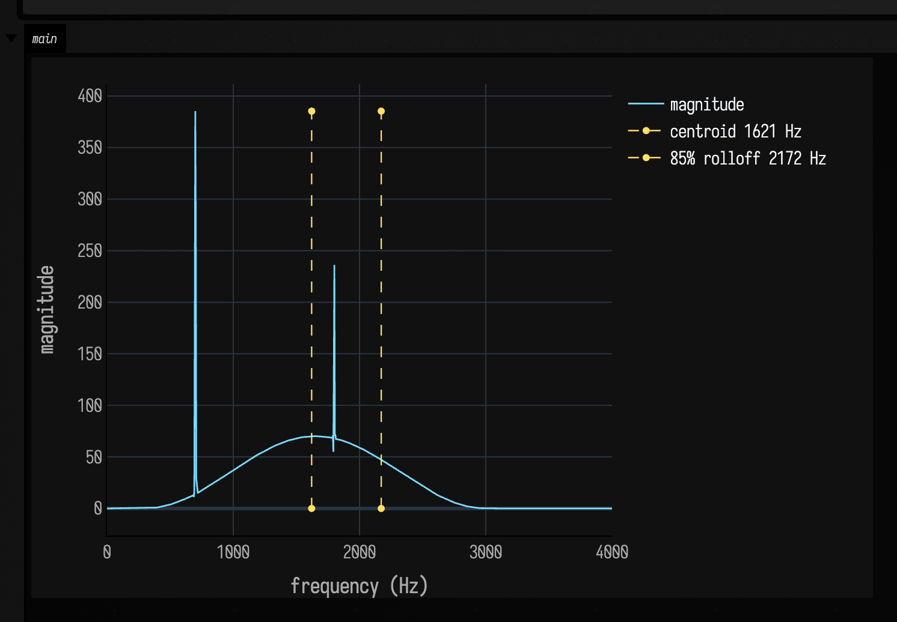
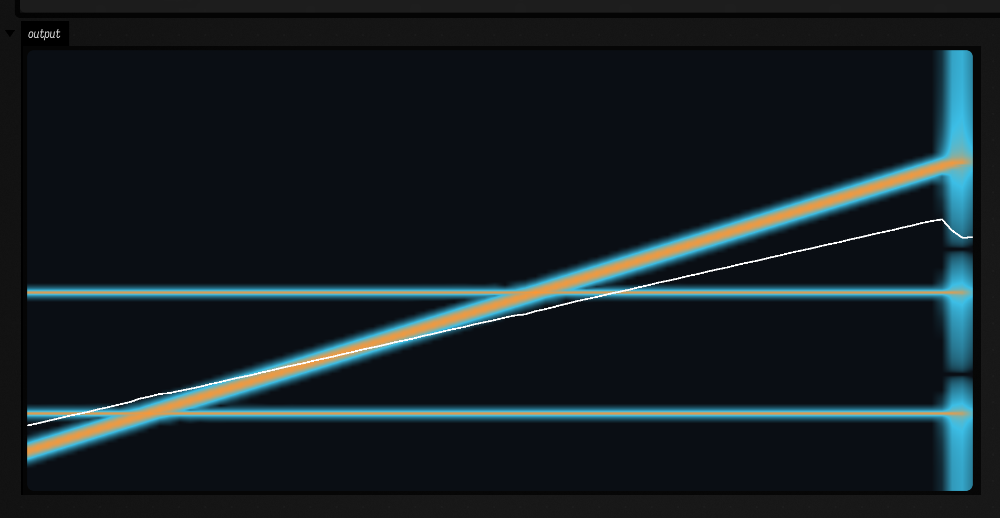
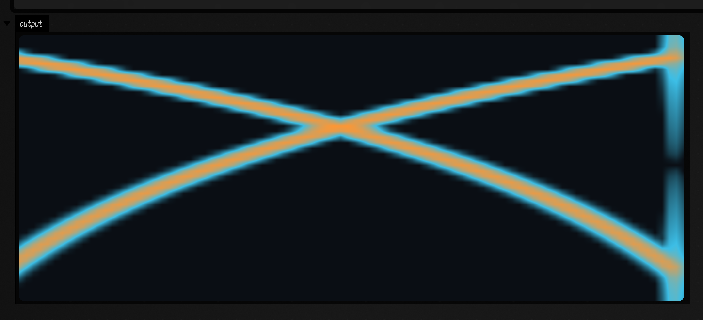
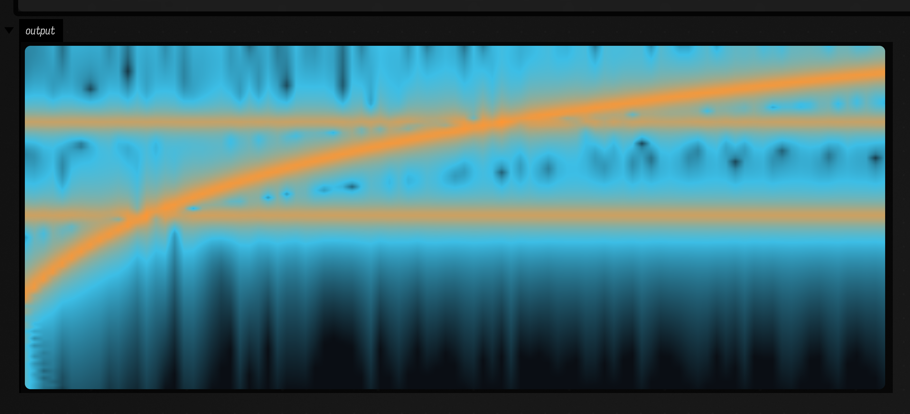
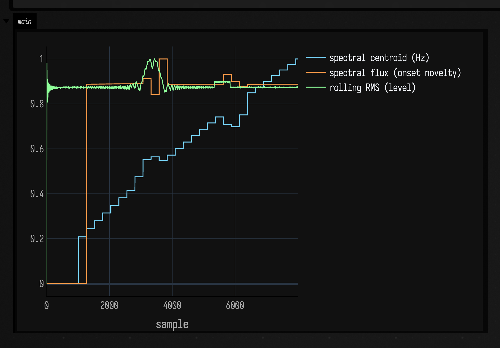

# Spectral examples

*Every public declaration used below is listed, with its KDoc, in the codebase reference: [`spectral.kt`](reference/math.md#spectral-kt). Start from [what's already in the box](reference/index.md).*

The [timeseries toolkit](timeseries_examples.md) works in the time domain: it smooths, gates, and
flags a stream sample by sample. Sometimes the question is what the signal is *made of* — which
frequencies carry the energy, how bright the timbre is, where a chirp is heading. That is the
frequency domain, and `afield.stdlib` has a self-contained family for it: a pure-Kotlin FFT,
analysis windows, a `Spectrum`, a `Spectrogram` (STFT), the classic spectral features, and a
resonator filterbank that analyses frequency without a transform at all.

Nothing here needs an external DSP library or a GPU. The FFT is an iterative Cooley–Tukey radix-2
core with a Bluestein (chirp-z) fallback, so arbitrary non-power-of-two lengths transform exactly.
Forward and inverse both round-trip. Every example below is a live box: it synthesises its own
signal, runs the transform, and paints the result into its own output panel.

## One spectrum

Synthesise a rising chirp plus two steady tones, run a Hann-windowed FFT, and read the shape back
out. `fft(...)` returns a `Spectrum` that knows its sample rate, so bins map to real Hz and the
feature helpers return frequencies you can label.

```diffstatic_runner {data-lang=kotlin screenshot="assets/spectral_examples/one_spectrum.png" wait="1.5" capture="box" open-outputs="true" padding="20"}
:::static
// Synthesise a rising linear chirp + two steady tones, FFT it, draw the one-sided spectrum.
val sampleRate = 8000.0
val n = 2048
val f0 = 300.0; val f1 = 3000.0
val dur = n / sampleRate
val k = (f1 - f0) / dur
val signal = DoubleArray(n) { i ->
    val t = i / sampleRate
    // Rising linear chirp (phase-integrated so instantaneous freq sweeps cleanly) + two tones.
    0.9 * sin(2.0 * PI * (f0 * t + 0.5 * k * t * t)) +
        0.4 * sin(2.0 * PI * 700.0 * t) +
        0.3 * sin(2.0 * PI * 1800.0 * t)
}

val spec = fft(signal, WindowType.HANN, sampleRate)
val mag = spec.magnitudeOneSided()   // bins 0 .. N/2
val freqs = spec.frequencies()       // bin -> Hz
val centroid = spec.centroid()       // magnitude-weighted mean frequency, Hz
val rolloff = spec.rolloff(0.85)     // freq below which 85% of the energy sits
val peak = spec.peakFrequency()      // dominant component, Hz

// One call puts the magnitude curve on screen against real Hz, with the centroid and 85% rolloff
// marked as dashed reference lines. showSignals(...) applies the dark theme + cyan/orange palette.
showSignals(
    "magnitude" to mag.toList(),
    x = freqs.toList(),
    channel = "main",
    xTitle = "frequency (Hz)", yTitle = "magnitude",
    marks = listOf(
        "centroid ${"%.0f".format(centroid)} Hz" to centroid,
        "85% rolloff ${"%.0f".format(rolloff)} Hz" to rolloff,
    ),
)
println("peak=${"%.0f".format(peak)}Hz centroid=${"%.0f".format(centroid)}Hz rolloff=${"%.0f".format(rolloff)}Hz bins=${mag.size}")
```



The one-sided magnitude curve carries dashed reference lines at the spectral centroid and the 85%
rolloff, with the tone/chirp structure laid out across 0 Hz → Nyquist.

## A spectrogram of a chirp

A single spectrum is one slice. An STFT frames the signal, windows each frame, hops forward, and
transforms — giving you a spectrogram: a time × frequency heatmap. The rising chirp becomes a
diagonal ridge, the steady tones stay as horizontal lines, and the per-frame **spectral centroid**
draws a bright trace climbing with the chirp. `Box.showHeatmap(...)` does the drawing: it maps the
`[frame][bin]` matrix through a colormap, bilinear-upsamples it, flips the y-axis, and displays the
resulting PNG in the box's output.

```diffstatic_runner {data-lang=kotlin screenshot="assets/spectral_examples/spectrogram.png" wait="2.5" capture="box" open-outputs="true" padding="20"}
:::static
// --- signal: a rising linear chirp (300 -> 3000 Hz) plus two steady tones (700, 1800 Hz) ---
val sampleRate = 8000.0
val n = 24000                    // 3 s
val f0 = 300.0; val f1 = 3000.0
val dur = n / sampleRate
val k = (f1 - f0) / dur
val signal = DoubleArray(n) { i ->
    val t = i / sampleRate
    // Phase-integrated chirp so the instantaneous frequency f0 + k*t sweeps cleanly below Nyquist.
    0.9 * sin(2.0 * PI * (f0 * t + 0.5 * k * t * t)) +
        0.35 * sin(2.0 * PI * 700.0 * t) +
        0.30 * sin(2.0 * PI * 1800.0 * t)
}

// --- STFT -> magnitude heatmap + spectral-centroid trace ---
val spec = stft(signal, fftSize = 1024, hopSize = 256, window = WindowType.HANN, sampleRate = sampleRate)
val mags = spec.magnitudes()                       // [frame][bin]
val maxMag = spec.maxMagnitude().coerceAtLeast(1e-9)
val centroid = spec.centroidTrace()                // Hz per frame
val nyquist = sampleRate / 2.0

// dB relative to the peak (a useful dynamic range), as a [frame][bin] matrix.
val dB = Array(spec.numFrames) { f ->
    DoubleArray(spec.numBins) { b -> 20.0 * log10((mags[f][b] / maxMag).coerceAtLeast(1e-4)) }
}
// The spectral centroid as a normalized (x, y) overlay: x = time fraction, y = fraction of Nyquist.
val trace = centroid.indices.map { f ->
    (f.toDouble() / (spec.numFrames - 1).coerceAtLeast(1)) to (centroid[f] / nyquist).coerceIn(0.0, 1.0)
}

println("frames=${spec.numFrames} bins=${spec.numBins} centroid ${"%.0f".format(centroid.first())} -> ${"%.0f".format(centroid.last())} Hz")
// One showHeatmap call: transpose [frame][bin] to time × frequency, low frequency at the bottom
// (flipY), the house cyan→orange ramp over a [-80, 0] dB range, with the centroid as a bright overlay.
showHeatmap(dB, colormap = "cyanorange", width = 1800, height = 840, vmin = -80.0, vmax = 0.0,
    transpose = true, flipY = true, overlay = trace, overlayThickness = 3)
```



The diagonal ridge is the chirp, the two flat lines are the 700 Hz and 1800 Hz tones, and the thin
trace is the centroid climbing with the sweep. The STFT produces the `[frame][bin]` magnitudes; one
`showHeatmap` call renders them (cyan→orange over a `[-80, 0]` dB range) and draws the centroid
`overlay`.

## Mel bands — a perceptual, log-frequency view

An FFT's bins are evenly spaced in Hz, so most of them land in the upper octaves, where a fixed
number of Hz is a smaller and smaller musical interval.
The **mel scale** warps frequency logarithmically; `Mel.filterBank(...)` collapses a magnitude
spectrum into a handful of triangular mel bands. Applied per STFT frame it gives a mel-spectrogram.
Here the signal is **two crossing chirps** — one rising, one falling — so they trace an X, curved by
the log warping.

```diffstatic_runner {data-lang=kotlin screenshot="assets/spectral_examples/mel_spectrogram.png" wait="2.5" capture="box" open-outputs="true" padding="20"}
:::static
// --- signal: two crossing chirps, one rising (200 -> 3200 Hz) and one falling (3200 -> 200 Hz) ---
val sampleRate = 8000.0
val n = 24000
val up0 = 200.0; val up1 = 3200.0
val dn0 = 3200.0; val dn1 = 200.0
val dur = n / sampleRate
val ku = (up1 - up0) / dur
val kd = (dn1 - dn0) / dur
val signal = DoubleArray(n) { i ->
    val t = i / sampleRate
    0.7 * sin(2.0 * PI * (up0 * t + 0.5 * ku * t * t)) +
        0.7 * sin(2.0 * PI * (dn0 * t + 0.5 * kd * t * t))
}

// --- STFT -> per-frame mel filter bank -> heatmap ---
val spec = stft(signal, fftSize = 1024, hopSize = 256, window = WindowType.HANN, sampleRate = sampleRate)
val numBands = 48
val mel = Array(spec.numFrames) { Mel.filterBank(spec.magnitude(it), sampleRate, numBands, 0.0, sampleRate / 2.0) }
var maxMel = 1e-9
for (row in mel) for (v in row) if (v > maxMel) maxMel = v

// dB relative to the peak, as a [frame][band] matrix.
val dB = Array(spec.numFrames) { f ->
    DoubleArray(numBands) { b -> 20.0 * log10((mel[f][b] / maxMel).coerceAtLeast(1e-4)) }
}

println("frames=${spec.numFrames} bands=$numBands")
// transpose [frame][band] to time × mel-band, low band at the bottom.
showHeatmap(dB, colormap = "cyanorange", width = 1800, height = 720, vmin = -80.0, vmax = 0.0,
    transpose = true, flipY = true)
```



## A resonator bank — frequency analysis without a transform

An FFT frames the signal and asks *all* frequencies at once, on a fixed linear grid set by the
transform size. A **resonator bank** turns that around: run the signal through a set of complex
one-pole resonators, each tuned to a frequency you pick, and each resonator's running magnitude is
the energy near its frequency. There is no window and no frame blocking; it is a per-sample IIR
filterbank, so it streams. Choosing the frequencies yourself also means you can space them
logarithmically (like the ear) and give each its own time constant. `resonate(...)` runs a fixed
bank offline and hands back the per-hop complex output; `resonatorAlphaHeuristics(...)` computes a
smoothing coefficient per frequency, so high resonators settle faster than low ones.

```diffstatic_runner {data-lang=kotlin screenshot="assets/spectral_examples/resonator_bank.png" wait="2.5" capture="box" open-outputs="true" padding="20"}
:::static
import afield.four.audio.resonate
import afield.four.audio.resonatorAlphaHeuristics

// --- same rising chirp (300 -> 3000 Hz) + two tones (700, 1800 Hz), as a Float signal ---
val sampleRate = 8000f
val n = 24000
val f0 = 300.0; val f1 = 3000.0
val durS = n / sampleRate.toDouble()
val k = (f1 - f0) / durS
val signal = FloatArray(n) { i ->
    val t = i / sampleRate.toDouble()
    (0.9 * sin(2.0 * PI * (f0 * t + 0.5 * k * t * t)) +
        0.35 * sin(2.0 * PI * 700.0 * t) +
        0.30 * sin(2.0 * PI * 1800.0 * t)).toFloat()
}

// --- a bank of complex resonators, log-spaced from 120 Hz to 3900 Hz ---
val numRes = 96
val minHz = 120.0; val maxHz = 3900.0
val freqs = FloatArray(numRes) { i ->
    kotlin.math.exp(ln(minHz) + (ln(maxHz) - ln(minHz)) * i / (numRes - 1)).toFloat()
}
val alphas = resonatorAlphaHeuristics(freqs, sampleRate)  // per-frequency smoothing / time constant
val hop = 256

// resonate returns, per hop slice: numRes real parts then numRes imag parts.
val flat = resonate(signal, sampleRate, freqs, alphas, betas = alphas, hopLength = hop)
val slices = flat.size / (2 * numRes)
fun ampAt(s: Int, kk: Int): Float {
    val base = s * 2 * numRes
    val re = flat[base + kk]; val im = flat[base + numRes + kk]
    return kotlin.math.sqrt(re * re + im * im)
}
var maxA = 1e-9f
for (s in 0 until slices) for (kk in 0 until numRes) { val a = ampAt(s, kk); if (a > maxA) maxA = a }

// dB relative to the peak, as a [slice][resonator] matrix.
val dB = Array(slices) { s ->
    DoubleArray(numRes) { kk -> 20.0 * log10((ampAt(s, kk).toDouble() / maxA).coerceAtLeast(1e-4)) }
}

println("resonators=$numRes slices=$slices freq ${freqs.first().toInt()} -> ${freqs.last().toInt()} Hz")
// transpose [slice][resonator] to time × resonator, low (low-Hz) resonator at the bottom.
showHeatmap(dB, colormap = "cyanorange", width = 1800, height = 720, vmin = -80.0, vmax = 0.0,
    transpose = true, flipY = true)
```



Same chirp ridge and two tone lines as the STFT view, but now on a **log-frequency** axis (the tones
sit closer together up top) and with each band carrying its own time constant instead of one shared
window. Because the bank is recursive and per-sample it also runs live as a streaming analyzer.
`TrackingResonatorBank` goes further: each resonator estimates the phase drift of its own output and
retunes towards the instantaneous frequency whenever its local power clears a dynamic threshold,
falling back to its natural frequency when the partial goes away.

## Streaming features that compose with the filter chain

The spectral features also come as `FloatFilter`s, so they slot straight into the same `then`
chain as the [time-domain filters](timeseries_examples.md). Feed one sample in, get the latest
feature out (held between hops). Here a rising chirp plus a couple of onsets drives three features at
once, and the three traces are drawn stacked in the box's output.

```diffstatic_runner {data-lang=kotlin screenshot="assets/spectral_examples/streaming_features.png" wait="2.0" capture="box" open-outputs="true" padding="20"}
:::static
// --- an input stream: a rising chirp (200 -> 2000 Hz) + a steady tone, with two onset bursts ---
val sampleRate = 8000f
val n = 8000                     // 1 s
val stream = FloatArray(n) { i ->
    val t = i / sampleRate
    val f = 200f + 1800f * (i.toFloat() / n)     // sweep 200 -> 2000 Hz
    var s = 0.6f * sin(2.0 * PI * f * t).toFloat() + 0.25f * sin(2.0 * PI * 900.0 * t).toFloat()
    if (i == n / 3 || i == 2 * n / 3) s += 2.0f   // two sharp onsets for the flux detector
    s
}

// The same `then` chain as the time-domain toolkit: smooth the centroid, track flux and level.
val brightness = EMAFilter(0.1f) then SpectralCentroidFilter(fftSize = 1024, hopSize = 256, sampleRate = sampleRate)
val onset = SpectralFluxFilter(fftSize = 1024, hopSize = 256, sampleRate = sampleRate)
val level = RmsFilter(windowSize = 512)

val cTrace = FloatArray(n); val fTrace = FloatArray(n); val rTrace = FloatArray(n)
for (i in 0 until n) {
    cTrace[i] = brightness(stream[i])   // spectral centroid, Hz
    fTrace[i] = onset(stream[i])        // spectral flux (onset novelty)
    rTrace[i] = level(stream[i])        // rolling RMS
}

// The three features live on very different scales (Hz vs flux vs a 0..1 level), so normalize each
// to compare their shape. One call stacks all three; dark theme + cyan/orange palette applied.
showSignals(
    "spectral centroid (Hz)" to cTrace.toList(),
    "spectral flux (onset novelty)" to fTrace.toList(),
    "rolling RMS (level)" to rTrace.toList(),
    channel = "main",
    xTitle = "sample", normalize = true,
)
println("centroid ${"%.0f".format(cTrace[3000])} -> ${"%.0f".format(cTrace[n - 200])} Hz, flux peak ${"%.3f".format(fTrace.maxOrNull() ?: 0f)}")
```



The smoothed centroid climbs with the chirp, the flux spikes at the two onsets, and the RMS tracks
the overall level. `SpectralCentroidFilter`, `SpectralRolloffFilter`, `SpectralFluxFilter`, and
`RmsFilter` all maintain their own ring buffer and recompute on each hop, so they behave like any
other per-sample filter in the toolkit.

## What else is in the family

- **FFT** — `fft(...)` / `ifft(...)` over `DoubleArray`, `FloatArray`, or `List<Float>`; forward and
  inverse; power-of-two (radix-2) or arbitrary length (Bluestein).
- **Windows** — `WindowType.RECTANGULAR / HANN / HAMMING / BLACKMAN`, via `Windows.make(...)`.
- **`Spectrum`** — magnitude / power / phase / dB, `binFrequency`, `peakFrequency`, and the feature
  shortcuts `centroid()`, `spread()`, `rolloff()`, `flatness()`.
- **`Spectrogram`** — `stft(...)`, `magnitudes()`, `centroidTrace()` / `rolloffTrace()` /
  `fluxTrace()`, plus `istft(...)` for overlap-add reconstruction back to a signal.
- **Features** — `SpectralFeatures.centroid / spread / rolloff / flux / flatness / rms / energy`.
- **Mel** — `Mel.hzToMel`, `Mel.melToHz`, and a triangular `Mel.filterBank(...)` for perceptual /
  log-frequency band energies.
- **Resonator bank** (`afield.four.audio`) — `resonate(...)` / `ResonatorBank` for a fixed complex
  filterbank at frequencies you choose, `trackingResonate(...)` / `TrackingResonatorBank` for
  resonators that lock onto and follow moving partials, with `resonatorAlphaHeuristics(...)` for
  per-frequency time constants.

## Replay the demo

All five examples above are also a loadable transcript. Replay it into a fresh Field with the agent
backdoor and each box computes and draws its own figure with no other setup:

```diffstatic {data-lang=bash}
field_run_transcript dev_docs/agents/transcripts/spectral_examples.yaml
```

Then edit the signal, or swap `WindowType.HANN` for `HAMMING` / `BLACKMAN`, and re-run a box to
watch its figure change. For the time-domain companions, see [Timeseries examples](timeseries_examples.md).
