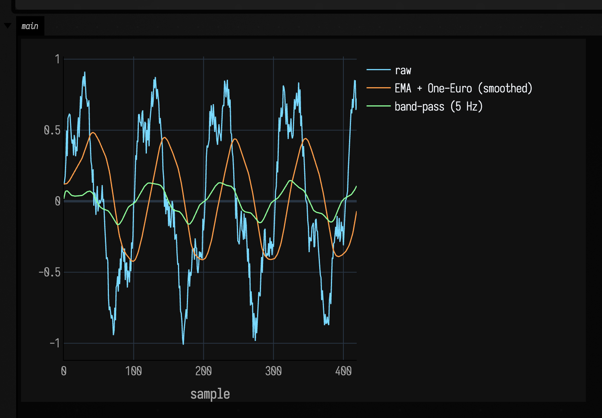
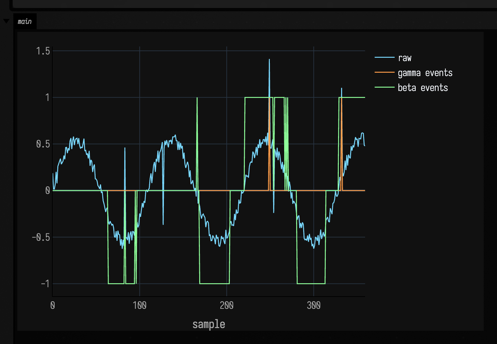
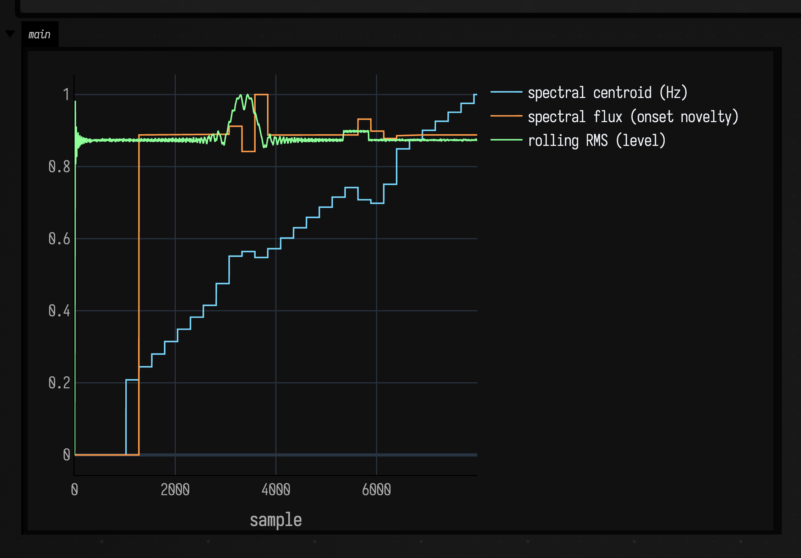
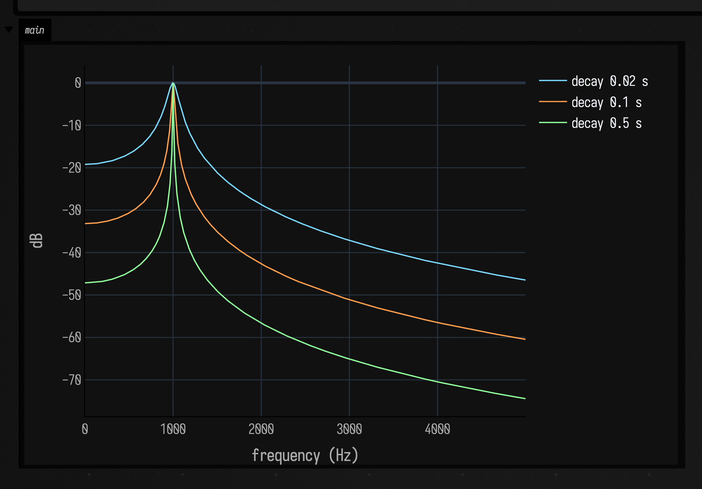
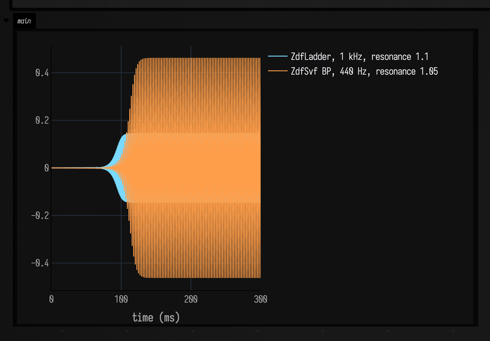
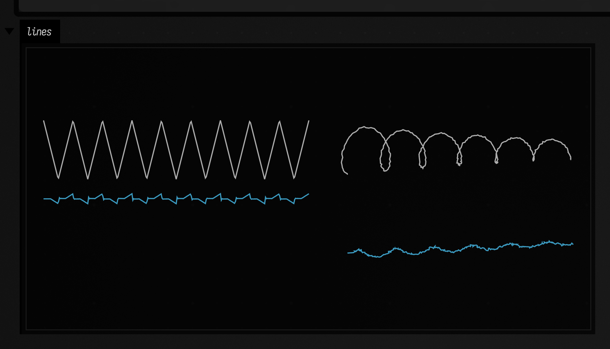

# Signal examples: time and frequency

Signal processing needs pictures. A filter can reveal structure or erase the detail you cared about. An event detector can catch a gesture or promote a random spike. The first two examples here work sample by sample in the time domain and keep the raw stream and the processed stream in the same frame; the rest of the page asks what a signal is *made of*, in frequency.

## Filter chains as layered curves

Stacking three filters is easy; seeing whether the stack helped is not. What you want from a smoothing chain is less junk and the same gesture, and those two are traded against each other.

```diffstatic_runner {data-lang=kotlin screenshot="assets/timeseries_examples/filter_chains.png" wait="1.5" capture="box" open-outputs="true" padding="20"}
:::static
val raw = mutableListOf<Float>()
val smooth = mutableListOf<Float>()
val filtered = mutableListOf<Float>()

val ema = EMAFilter(alpha = 0.08f)
val oneEuro = OneEuroFilter(minCutoff = 1.0f, beta = 0.02f, sampleRate = 120f)
val band = BandPassFilter(frequency = 5f, sampleRate = 120f, q = 0.8f)

for (i in 0 until 420) {
    val t = i / 120f
    val signal =
        (sin(2.0 * PI * 1.2 * t).toFloat() * 0.7f +
            sin(2.0 * PI * 4.7 * t + 0.3).toFloat() * 0.22f +
            (-0.12f + random().toFloat() * 0.24f))
    raw += signal
    val s = oneEuro(ema(signal))
    smooth += s
    filtered += band(s)
}

// One call puts all three streams on one axis — raw, the smoothed chain, and the band-passed
// component each get their own trace (dark theme + cyan/orange palette applied).
showSignals(
    "raw" to raw,
    "EMA + One-Euro (smoothed)" to smooth,
    "band-pass (5 Hz)" to filtered,
    channel = "main",
    xTitle = "sample",
)
```

One `showSignals` call puts all three streams on one axis. Watch the chain order: `band` is applied to `s`, the output of `ema` and `oneEuro`, not to `signal`, so the band-pass sees a stream the two smoothers have already been through.



That order is why the band-pass trace is small and slow: the smoothers upstream removed most of the 4.7 Hz content it is tuned for, so what gets through is a little of the slower 1.2 Hz swing. `BandPassFilter` and `OneEuroFilter` both take `sampleRate = 120f`, so their cutoffs in Hz are right for stored data pushed through in a loop.

## Distribution-aware event flags

Event detectors answer a different question from the filters above: did something noteworthy happen? Both of these fit a distribution to the last `windowSize` samples and fire when the newest one lands in a tail, so nothing fires at all until the window has filled: 64 samples of the 360 here.

```diffstatic_runner {data-lang=kotlin screenshot="assets/timeseries_examples/distribution_events.png" wait="1.5" capture="box" open-outputs="true" padding="20"}
:::static
val gammaEvents = GammaEventDetector(windowSize = 64, tailProbabilityThreshold = 0.03f, influence = 0.15f)
val betaEvents = BetaEventDetector(
    windowSize = 64,
    supportMin = -1f,
    supportMax = 1f,
    lowerTailThreshold = 0.04f,
    upperTailThreshold = 0.04f,
)

val raw = mutableListOf<Float>()
val eg = mutableListOf<Float>()
val eb = mutableListOf<Float>()

for (i in 0 until 360) {
    val t = i / 120f
    var x = (sin(2.0 * PI * 1.1 * t) * 0.55 + (-0.08 + random() * 0.16)).toFloat()
    if (i % 83 == 0) x += 0.95f
    if (i % 127 == 0) x -= 0.8f
    raw += x
    eg += gammaEvents(kotlin.math.abs(x))
    eb += betaEvents(x)
}

// The raw stream and both detectors' verdicts on one axis — the event traces flag their tail
// crossings (beta fires either way, ±1) over the raw motion, so which departures triggered is clear.
showSignals(
    "raw" to raw,
    "gamma events" to eg,
    "beta events" to eb,
    channel = "main",
    xTitle = "sample",
)
```

The stream gets a `+0.95` spike at every 83rd sample and a `-0.8` dip at every 127th, and both detectors report their verdict on the same axis as the signal: `1f` from the gamma detector on the sample that fired, and from the beta detector `+1f` for an upper-tail event and `-1f` for a lower-tail one.



The gamma detector, fed `abs(x)`, marks single samples. The beta detector holds `+1` and `-1` across whole stretches instead, and its window is why: 64 samples is shorter than the 109 the 1.1 Hz sine takes to come round at 120 samples a second, so every fit is a fit over a trend and the trend's own continuation keeps landing in a tail. Give a distribution fit at least one full cycle of any periodic component, or detrend before the detector sees it.

For inline diagnostics of similar live values, continue with [Visualizers](visualizers.md). When you need to estimate a state you can only measure indirectly, see [State estimation](state_estimation_examples.md).

## From time to frequency

Which frequencies carry a signal's energy? How bright is its timbre, or where is a chirp heading?
Field has an FFT, a windowed `Spectrum`, a `Spectrogram` (a short-time FFT, or STFT), spectral
features and a resonator bank. The bank measures frequencies you choose without a transform. You
can transform signals of any length, and none of these tools needs an external library or GPU.

Each example below makes a signal, analyses it and draws the result in the box's output.

## One spectrum

Synthesise a rising chirp plus two steady tones, run a Hann-windowed FFT, and read the shape back
out. `fft(...)` returns a `Spectrum` that knows its sample rate, so bins map to real Hz and the
feature helpers return frequencies you can label.

```diffstatic_runner {data-lang=kotlin screenshot="assets/spectral_examples/one_spectrum.png" wait="1.5" capture="box" open-outputs="true" padding="20"}
:::static
// Synthesise a rising linear chirp + two steady tones, FFT it, draw the one-sided spectrum.
val sampleRate = 8000.0
val n = 2048
val f0 = 300.0
val f1 = 3000.0
val dur = n / sampleRate
val k = (f1 - f0) / dur
val signal =
    DoubleArray(n) { i ->
        val t = i / sampleRate
        // Rising linear chirp (phase-integrated so instantaneous freq sweeps cleanly) + two tones.
        0.9 * sin(2.0 * PI * (f0 * t + 0.5 * k * t * t)) +
            0.4 * sin(2.0 * PI * 700.0 * t) +
            0.3 * sin(2.0 * PI * 1800.0 * t)
    }

val spec = fft(signal, WindowType.HANN, sampleRate)
val mag = spec.magnitudeOneSided() // bins 0 .. N/2
val freqs = spec.frequencies() // bin -> Hz
val centroid = spec.centroid() // magnitude-weighted mean frequency, Hz
val rolloff = spec.rolloff(0.85) // freq below which 85% of the energy sits
val peak = spec.peakFrequency() // dominant component, Hz

// One call puts the magnitude curve on screen against real Hz, with the centroid and 85% rolloff
// marked as dashed reference lines. showSignals(...) applies the dark theme + cyan/orange palette.
showSignals(
    "magnitude" to mag.toList(),
    x = freqs.toList(),
    channel = "main",
    xTitle = "frequency (Hz)",
    yTitle = "magnitude",
    marks = [
        "centroid ${centroid.f0} Hz" to centroid,
        "85% rolloff ${rolloff.f0} Hz" to rolloff,
    ],
)
println(
    "peak=${peak.f0}Hz centroid=${centroid.f0}Hz rolloff=${rolloff.f0}Hz bins=${mag.size}",
)
```

![a cyan magnitude curve on a dark plot, frequency in Hz along the bottom out to 4000 and magnitude up the side to 400. A very narrow spike just under 700 Hz reaches almost the top of the frame; a broad low hump peaks around 70 near 1700 Hz, with a second narrow spike at about 1800 Hz standing on its right shoulder at roughly three-fifths the tall spike's height. Two dashed yellow verticals cross the whole plot, labelled in the legend as the centroid at 1621 Hz and the 85% rolloff at 2172 Hz, and both sit to the right of the tall spike](assets/spectral_examples/one_spectrum.png)

The tall spike is the steady 700 Hz tone, the broad hump is the chirp's energy spread across the
frequencies it swept, and the dashed lines mark the spectral centroid and the 85% rolloff.

## A spectrogram of a chirp

A single spectrum is one slice. An STFT frames the signal, windows each frame, hops forward, and
transforms — giving you a spectrogram: a time × frequency heatmap. The rising chirp becomes a
diagonal ridge, the steady tones stay as horizontal lines, and the per-frame **spectral centroid**
draws a bright trace climbing with the chirp. `showHeatmap(...)` draws the `[frame][bin]` matrix
through a colormap, low frequencies at the bottom, into the box's output.

```diffstatic_runner {data-lang=kotlin screenshot="assets/spectral_examples/spectrogram.png" wait="2.5" capture="box" open-outputs="true" padding="20"}
:::static
// --- signal: a rising linear chirp (300 -> 3000 Hz) plus two steady tones (700, 1800 Hz) ---
val sampleRate = 8000.0
val n = 24000 // 3 s
val f0 = 300.0
val f1 = 3000.0
val dur = n / sampleRate
val k = (f1 - f0) / dur
val signal =
    DoubleArray(n) { i ->
        val t = i / sampleRate
        // Phase-integrated chirp so the instantaneous frequency f0 + k*t sweeps cleanly below Nyquist.
        0.9 * sin(2.0 * PI * (f0 * t + 0.5 * k * t * t)) +
            0.35 * sin(2.0 * PI * 700.0 * t) +
            0.30 * sin(2.0 * PI * 1800.0 * t)
    }

// --- STFT -> magnitude heatmap + spectral-centroid trace ---
val spec = stft(signal, fftSize = 1024, hopSize = 256, window = WindowType.HANN, sampleRate = sampleRate)
val mags = spec.magnitudes() // [frame][bin]
val maxMag = spec.maxMagnitude().coerceAtLeast(1e-9)
val centroid = spec.centroidTrace() // Hz per frame
val nyquist = sampleRate / 2.0

// dB relative to the peak (a useful dynamic range), as a [frame][bin] matrix.
val dB =
    Array(spec.numFrames) { f ->
        DoubleArray(spec.numBins) { b -> 20.0 * log10((mags[f][b] / maxMag).coerceAtLeast(1e-4)) }
    }
// The spectral centroid as a normalized (x, y) overlay: x = time fraction, y = fraction of Nyquist.
val trace =
    centroid.indices.map { f ->
        (f.toDouble() / (spec.numFrames - 1).coerceAtLeast(1)) to (centroid[f] / nyquist).coerceIn(0.0, 1.0)
    }

println(
    "frames=${spec.numFrames} bins=${spec.numBins} centroid ${centroid.first().f0} -> ${centroid.last().f0} Hz",
)
// One showHeatmap call: transpose [frame][bin] to time × frequency, low frequency at the bottom
// (flipY), the house cyan→orange ramp over a [-80, 0] dB range, with the centroid as a bright overlay.
showHeatmap(
    dB,
    colormap = "cyanorange",
    width = 1800,
    height = 840,
    vmin = -80.0,
    vmax = 0.0,
    transpose = true,
    flipY = true,
    overlay = trace,
    overlayThickness = 3,
)
```


The diagonal ridge is the chirp, the two flat lines are the 700 Hz and 1800 Hz tones, and the thin
trace is the centroid climbing with the sweep. The STFT produces the `[frame][bin]` magnitudes; one
`showHeatmap` call renders them (cyan→orange over a `[-80, 0]` dB range) and draws the centroid
`overlay`.

## Mel bands — a perceptual, log-frequency view

An FFT's bins are evenly spaced in Hz, so most of them land in the upper octaves, where a fixed
number of Hz is a smaller and smaller musical interval.
The **mel scale** warps frequency logarithmically; `Mel.filterBank(...)` collapses a magnitude
spectrum into a handful of triangular mel bands. Applied per STFT frame it gives a mel-spectrogram.
Here the signal is **two crossing chirps** — one rising, one falling — so they trace an X, curved by
the log warping.

```diffstatic_runner {data-lang=kotlin screenshot="assets/spectral_examples/mel_spectrogram.png" wait="2.5" capture="box" open-outputs="true" padding="20"}
:::static
// --- signal: two crossing chirps, one rising (200 -> 3200 Hz) and one falling (3200 -> 200 Hz) ---
val sampleRate = 8000.0
val n = 24000
val up0 = 200.0
val up1 = 3200.0
val dn0 = 3200.0
val dn1 = 200.0
val dur = n / sampleRate
val ku = (up1 - up0) / dur
val kd = (dn1 - dn0) / dur
val signal =
    DoubleArray(n) { i ->
        val t = i / sampleRate
        0.7 * sin(2.0 * PI * (up0 * t + 0.5 * ku * t * t)) + 0.7 * sin(2.0 * PI * (dn0 * t + 0.5 * kd * t * t))
    }

// --- STFT -> per-frame mel filter bank -> heatmap ---
val spec = stft(signal, fftSize = 1024, hopSize = 256, window = WindowType.HANN, sampleRate = sampleRate)
val numBands = 48
val mel = Array(spec.numFrames) { Mel.filterBank(spec.magnitude(it), sampleRate, numBands, 0.0, sampleRate / 2.0) }
var maxMel = 1e-9
for (row in mel) for (v in row) if (v > maxMel) maxMel = v

// dB relative to the peak, as a [frame][band] matrix.
val dB =
    Array(spec.numFrames) { f ->
        DoubleArray(numBands) { b -> 20.0 * log10((mel[f][b] / maxMel).coerceAtLeast(1e-4)) }
    }

println("frames=${spec.numFrames} bands=$numBands")
// transpose [frame][band] to time × mel-band, low band at the bottom.
showHeatmap(
    dB,
    colormap = "cyanorange",
    width = 1800,
    height = 720,
    vmin = -80.0,
    vmax = 0.0,
    transpose = true,
    flipY = true,
)
```


## A resonator bank — frequency analysis without a transform

An FFT frames the signal and asks *all* frequencies at once, on a fixed linear grid set by the
transform size. A **resonator bank** turns that around: run the signal through a set of complex
one-pole resonators, each tuned to a frequency you pick, and each resonator's running magnitude is
the energy near its frequency. There is no window and no frame blocking; it is a per-sample IIR
filterbank, so it streams. Choosing the frequencies yourself also means you can space them
logarithmically (like the ear) and give each its own time constant. `resonate(...)` runs a fixed
bank offline and hands back the per-hop complex output; `resonatorAlphaHeuristics(...)` computes a
smoothing coefficient per frequency, so high resonators settle faster than low ones.

```diffstatic_runner {data-lang=kotlin screenshot="assets/spectral_examples/resonator_bank.png" wait="2.5" capture="box" open-outputs="true" padding="20"}
:::static
import afield.audio.engine.resonate
import afield.audio.engine.resonatorAlphaHeuristics

// --- same rising chirp (300 -> 3000 Hz) + two tones (700, 1800 Hz), as a Float signal ---
val sampleRate = 8000f
val n = 24000
val f0 = 300.0
val f1 = 3000.0
val durS = n / sampleRate.toDouble()
val k = (f1 - f0) / durS
val signal =
    FloatArray(n) { i ->
        val t = i / sampleRate.toDouble()
        (0.9 * sin(2.0 * PI * (f0 * t + 0.5 * k * t * t)) +
                0.35 * sin(2.0 * PI * 700.0 * t) +
                0.30 * sin(2.0 * PI * 1800.0 * t))
            .toFloat()
    }

// --- a bank of complex resonators, log-spaced from 120 Hz to 3900 Hz ---
val numRes = 96
val minHz = 120.0
val maxHz = 3900.0
val freqs =
    FloatArray(numRes) { i ->
        kotlin.math.exp(ln(minHz) + (ln(maxHz) - ln(minHz)) * i / (numRes - 1)).toFloat()
    }
val alphas = resonatorAlphaHeuristics(freqs, sampleRate) // per-frequency smoothing / time constant
val hop = 256

// resonate returns, per hop slice: numRes real parts then numRes imag parts.
val flat = resonate(signal, sampleRate, freqs, alphas, betas = alphas, hopLength = hop)
val slices = flat.size / (2 * numRes)
fun ampAt(s: Int, kk: Int): Float {
    val base = s * 2 * numRes
    val re = flat[base + kk]
    val im = flat[base + numRes + kk]
    return kotlin.math.sqrt(re * re + im * im)
}
var maxA = 1e-9f
for (s in 0 until slices) for (kk in 0 until numRes) {
    val a = ampAt(s, kk)
    if (a > maxA) maxA = a
}

// dB relative to the peak, as a [slice][resonator] matrix.
val dB =
    Array(slices) { s ->
        DoubleArray(numRes) { kk -> 20.0 * log10((ampAt(s, kk).toDouble() / maxA).coerceAtLeast(1e-4)) }
    }

println("resonators=$numRes slices=$slices freq ${freqs.first().toInt()} -> ${freqs.last().toInt()} Hz")
// transpose [slice][resonator] to time × resonator, low (low-Hz) resonator at the bottom.
showHeatmap(
    dB,
    colormap = "cyanorange",
    width = 1800,
    height = 720,
    vmin = -80.0,
    vmax = 0.0,
    transpose = true,
    flipY = true,
)
```


Same chirp ridge and two tone lines as the STFT view, but now on a **log-frequency** axis (the tones
sit closer together up top) and with each band carrying its own time constant instead of one shared
window. Because the bank is recursive and per-sample it also runs live as a streaming analyzer.
`TrackingResonatorBank` goes further: each resonator estimates the phase drift of its own output and
retunes towards the instantaneous frequency whenever its local power clears a dynamic threshold,
falling back to its natural frequency when the partial goes away.

## Streaming features that compose with the filter chain

The spectral features also come as `FloatFilter`s, so they slot straight into the same `then`
chain as the [time-domain filters](#filter-chains-as-layered-curves). Feed one sample in, get the latest
feature out (held between hops). Here a rising chirp plus a couple of onsets drives three features at
once, and the three traces are drawn stacked in the box's output.

```diffstatic_runner {data-lang=kotlin screenshot="assets/spectral_examples/streaming_features.png" wait="2.0" capture="box" open-outputs="true" padding="20"}
:::static
// --- an input stream: a rising chirp (200 -> 2000 Hz) + a steady tone, with two onset bursts ---
val sampleRate = 8000f
val n = 8000 // 1 s
val duration = n / sampleRate.toDouble()
val startHz = 200.0
val endHz = 2000.0
val chirpRate = (endHz - startHz) / duration
val stream =
    FloatArray(n) { i ->
        val t = i / sampleRate.toDouble()
        // Integrate frequency: the phase derivative is startHz + chirpRate * t.
        val phase = 2.0 * PI * (startHz * t + 0.5 * chirpRate * t * t)
        var s = 0.6f * sin(phase).toFloat() + 0.25f * sin(2.0 * PI * 900.0 * t).toFloat()
        if (i == n / 3 || i == 2 * n / 3) s += 2.0f // two sharp onsets for the flux detector
        s
    }

// The same `then` chain as the time-domain toolkit: smooth the centroid, track flux and level.
val brightness = EMAFilter(0.1f) then SpectralCentroidFilter(fftSize = 1024, hopSize = 256, sampleRate = sampleRate)
val onset = SpectralFluxFilter(fftSize = 1024, hopSize = 256, sampleRate = sampleRate)
val level = RmsFilter(windowSize = 512)

val cTrace = FloatArray(n)
val fTrace = FloatArray(n)
val rTrace = FloatArray(n)
for (i in 0 until n) {
    cTrace[i] = brightness(stream[i]) // spectral centroid, Hz
    fTrace[i] = onset(stream[i]) // spectral flux (onset novelty)
    rTrace[i] = level(stream[i]) // rolling RMS
}

// The three features live on very different scales (Hz vs flux vs a 0..1 level), so normalize each
// to compare their shape. One call stacks all three; dark theme + cyan/orange palette applied.
showSignals(
    "spectral centroid (Hz)" to cTrace.toList(),
    "spectral flux (onset novelty)" to fTrace.toList(),
    "rolling RMS (level)" to rTrace.toList(),
    channel = "main",
    xTitle = "sample",
    normalize = true,
)
println(
    "centroid ${cTrace[3000].f0} -> ${cTrace[n - 200].f0} Hz, flux peak ${(fTrace.maxOrNull() ?: 0f).f3}",
)
```



The smoothed centroid climbs with the chirp and the RMS tracks the overall level. The flux steps up
as soon as its first window fills and then holds near the top of its range: each injected onset is a
step of a percent or two above that plateau, not a spike, because all three traces are normalized to
`0 … 1` for comparison and the flux never returns to its floor once the signal starts.
`SpectralCentroidFilter`, `SpectralRolloffFilter`, `SpectralFluxFilter`, and
`RmsFilter` all maintain their own ring buffer and recompute on each hop, so they behave like any
other per-sample filter in the toolkit.

## Audio-rate filters from evieve

The filters in `Filters.kt` read every coefficient per sample, so a cutoff can be another `Signal`:
give a `Param` a `mod` and the filter follows it sample by sample. Four of them follow families in
[evieve](https://github.com/steadykammer/evieve), Pete Dowling's GPL-3.0 library of GenExpr code
for Max's gen~. They are written in Kotlin from the methods evieve cites (Zavalishin's *The Art of
VA Filter Design*, Will Pirkle's Korg35 note), not transcribed from it.

- `TptOnePole(cutoff, mode)`: a first-order filter with lowpass, highpass and allpass outputs. Its −3 dB point is exactly `cutoff` up to Nyquist.
- `TiltEQ(pivot, tiltDb)`: lows down and highs up about a pivot, flat at 0 dB.
- `Korg35(cutoff, resonance, mode, drive)`: the MS-20's Sallen-Key filter, 12 dB/octave, with a `tanh` in the feedback loop. It self-oscillates as `resonance` reaches 1.
- `Resonator(freq, decay)`: a tuned two-pole ring whose peak gain stays at 1 whatever the decay.

`impulseResponse(filter, frames)` renders an impulse through a fresh filter. With one second of
response, `fft(...)` gives one bin per hertz, so `magnitudeDbOneSided()` is the filter's response
in dB indexed by frequency, and `showSignals` plots it the way the spectra above are plotted. The
first plot is the Korg35 at 1 kHz; the tiny `amplitude` keeps its `tanh` in its linear range, so the
curve is the small-signal response:

```diffstatic_runner {data-lang=kotlin screenshot="assets/tpt_filters/korg35_response.png" wait="2.0" capture="box" open-outputs="true" padding="20"}
:::static
fun responseDb(filter: SignalProcessor, amplitude: Float = 1f) =
    fft(impulseResponse(filter, 48_000, amplitude = amplitude), 48_000.0).magnitudeDbOneSided().take(5000)

showSignals(
    "resonance 0.1" to responseDb(Korg35(1000.p, 0.1.p), 1e-4f),
    "resonance 0.5" to responseDb(Korg35(1000.p, 0.5.p), 1e-4f),
    "resonance 0.95" to responseDb(Korg35(1000.p, 0.95.p), 1e-4f),
    "highpass, resonance 0.8" to responseDb(Korg35(1000.p, 0.8.p, Korg35Mode.HP), 1e-4f),
    channel = "main",
    xTitle = "frequency (Hz)",
    yTitle = "dB",
)
```


The first-order filters and the tilt, with Field's older impulse-invariant `OnePole` for comparison:

```diffstatic_runner {data-lang=kotlin screenshot="assets/tpt_filters/onepole_response.png" wait="2.0" capture="box" open-outputs="true" padding="20"}
:::static
:::fold responseDb, as above
fun responseDb(filter: SignalProcessor) =
    fft(impulseResponse(filter, 48_000), 48_000.0).magnitudeDbOneSided().take(5000)

:::endfold

showSignals(
    "TptOnePole LP" to responseDb(TptOnePole(1000.p, TptOnePoleMode.LP)),
    "TptOnePole HP" to responseDb(TptOnePole(1000.p, TptOnePoleMode.HP)),
    "OnePole LP" to responseDb(OnePole(1000.p)),
    "TiltEQ −12 dB" to responseDb(TiltEQ(800.p, (-12).p)),
    "TiltEQ +12 dB" to responseDb(TiltEQ(800.p, 12.p)),
    channel = "main",
    xTitle = "frequency (Hz)",
    yTitle = "dB",
)
```


And a `Resonator` at 1 kHz with three decays:

```diffstatic_runner {data-lang=kotlin screenshot="assets/tpt_filters/resonator_response.png" wait="2.0" capture="box" open-outputs="true" padding="20"}
:::static
:::fold responseDb, as above
fun responseDb(filter: SignalProcessor) =
    fft(impulseResponse(filter, 48_000), 48_000.0).magnitudeDbOneSided().take(5000)

:::endfold

showSignals(
    "decay 0.02 s" to responseDb(Resonator(1000.p, 0.02.p)),
    "decay 0.1 s" to responseDb(Resonator(1000.p, 0.1.p)),
    "decay 0.5 s" to responseDb(Resonator(1000.p, 0.5.p)),
    channel = "main",
    xTitle = "frequency (Hz)",
    yTitle = "dB",
)
```



`TptFiltersTest` compares each measured curve with the analog prototype under the prewarped
bilinear transform, at 60 frequencies from 30 Hz to 18 kHz, and the largest difference is about
0.001 dB. For the Korg35 lowpass that prototype is `1/(s² + (2−K)s + 1)` with
`K = 0.01 + 1.98·resonance`.

### Listening

Each clip is four seconds of one signal graph rendered offline. In each one a filter parameter is
driven by an oscillator through `Param.mod`.

A 55 Hz saw through `Korg35` at resonance 0.9 and drive 2. The cutoff sweeps on a 0.5 Hz sine, and a
110 Hz sine also moves it ±250 Hz, which puts sidebands on the resonance:

```diffstatic {data-lang=kotlin}
SawOsc(55.p) /
    Korg35(
        Param(1200f).also { it.mod = SineOsc(0.5.p) * 900f + SineOsc(110.p) * 250f },
        0.9.p,
        drive = 2.p,
    )
```

```diffstatic_runner {data-lang=kotlin audio="assets/tpt_filters/korg35.wav" audio-spec="korg35" audio-renderer="afield.audio.synth.TptFilterDocs" embed=true hidden=true name="tpt-filters-korg35-audio"}
// Offline-rendered by TptFilterDocs.renderWav("korg35").
```

A phaser: a three-saw chord through four `TptOnePole` allpasses, summed with the dry chord, while the
allpass cutoff sweeps between 150 Hz and 1650 Hz:

```diffstatic_runner {data-lang=kotlin audio="assets/tpt_filters/phaser.wav" audio-spec="phaser" audio-renderer="afield.audio.synth.TptFilterDocs" embed=true hidden=true name="tpt-filters-phaser-audio"}
// Offline-rendered by TptFilterDocs.renderWav("phaser").
```

White noise through `TiltEQ`, the tilt swinging between −12 dB and +12 dB every four seconds:

```diffstatic_runner {data-lang=kotlin audio="assets/tpt_filters/tilt.wav" audio-spec="tilt" audio-renderer="afield.audio.synth.TptFilterDocs" embed=true hidden=true name="tpt-filters-tilt-audio"}
// Offline-rendered by TptFilterDocs.renderWav("tilt").
```

White noise through three `Resonator`s near 300 Hz, 750 Hz and 2.1 kHz. Each frequency drifts on its own slow sine:

```diffstatic_runner {data-lang=kotlin audio="assets/tpt_filters/resonator.wav" audio-spec="resonator" audio-renderer="afield.audio.synth.TptFilterDocs" embed=true hidden=true name="tpt-filters-resonator-audio"}
// Offline-rendered by TptFilterDocs.renderWav("resonator").
```

## Saturation without aliasing, and filters that sing

A waveshaper bends a signal through a curve, and a hard bend makes harmonics far above Nyquist.
Sampled naively, those harmonics fold back down as inharmonic tones: the whistle under a driven
`Waveshaper.tanh`. `AdaaShaper` uses *antiderivative anti-aliasing*: instead of the curve's value at
each sample it takes the curve's average along the line from the previous sample to this one, which
is the difference of the curve's antiderivative divided by the difference of the inputs. That
average is a lowpass applied before sampling, so most of what would fold back never does. There is
no oversampling and no extra filter.

- `AdaaShaper(shape, drive, order)`: `AdaaShape.TANH`, `HARD_CLIP` or `CUBIC` (the soft clip
  `x − x³/3`), driven by `drive`. `order = 2` averages twice and suppresses more; `TANH` takes order 1
  only. When two inputs are nearly equal it uses the curve at their midpoint, which is the limit of
  the same quotient, so a slow or constant input passes through cleanly.
- `ZdfLadder(cutoff, resonance, drive, mode)`: a four-pole transistor ladder with a `tanh` inside its
  feedback loop, the loop solved by Newton's method every sample. At `resonance` 1 it begins to
  self-oscillate at exactly `cutoff`; `LP2` and `HP4` are the other outputs.
- `ZdfSvf(mode, cutoff, resonance, drive)`: the state-variable filter with saturating damping. At low
  level it is `SVF`; past `resonance` 1 it oscillates at `cutoff` with an amplitude the saturation holds.
- `Smoother(time, mode)` and `param.smoothed(seconds)`: take the steps out of a control signal.

These follow evieve's saturation and nonlinear-filter code. They are written from the papers it
rests on: Parker, Zavalishin and Le Bivic's continuous-time-convolution paper (DAFx 2016), Bilbao,
Esqueda, Parker and Välimäki's second-order extension (IEEE SPL 2017), and chapter 6 of *The Art of
VA Filter Design*.

A sine swept from 200 Hz to 8 kHz, driven by 6 into `tanh`. The left half of the spectrogram is the
naive `Waveshaper.tanh`, the right half `AdaaShaper`. The odd harmonics climbing in parallel are
wanted. The lines that bounce down off the top edge are aliases. ADAA does not remove them, but in
the right half they are fainter, and the ones that fold furthest down fade out first:

```diffstatic_runner {data-lang=kotlin screenshot="assets/tpt_filters/adaa_spectrogram.png" wait="3.0" capture="box" open-outputs="true" padding="20" scale="1.5"}
:::static
fun sweep() = SineOsc(Param { 200f * 40f.pow((time / 2f).coerceAtMost(1f)) })

fun spectrogramDb(shaper: SignalProcessor): Array<DoubleArray> {
    val samples = renderSignalsOffline(2.0, sweep() / shaper)[0].map { it.toDouble() }.toDoubleArray()
    val spec = stft(samples, fftSize = 2048, hopSize = 512, window = WindowType.HANN, sampleRate = 48_000.0)
    val mags = spec.magnitudes()
    val peak = spec.maxMagnitude()
    return Array(spec.numFrames) { f -> DoubleArray(spec.numBins) { b -> 20.0 * log10((mags[f][b] / peak).coerceAtLeast(1e-5)) } }
}

showHeatmap(
    spectrogramDb(Waveshaper.tanh(6.p)) + spectrogramDb(AdaaShaper(AdaaShape.TANH, 6.p)),
    colormap = "cyanorange",
    channel = "main",
    width = 1600,
    height = 700,
    vmin = -100.0,
    vmax = 0.0,
    transpose = true,
    flipY = true,
)
```


To hear it: the 200 Hz to 8 kHz sweep through `tanh` at drive 6, first naive, then with ADAA. Listen in the last
second, where the aliases fall in pitch as the sweep rises:

```diffstatic_runner {data-lang=kotlin audio="assets/tpt_filters/tanh-naive.wav" audio-spec="tanh-naive" audio-renderer="afield.audio.synth.TptFilterDocs" embed=true hidden=true name="tpt-filters-tanh-naive-audio"}
// Offline-rendered by TptFilterDocs.renderWav("tanh-naive").
```

```diffstatic_runner {data-lang=kotlin audio="assets/tpt_filters/tanh-adaa.wav" audio-spec="tanh-adaa" audio-renderer="afield.audio.synth.TptFilterDocs" embed=true hidden=true name="tpt-filters-tanh-adaa-audio"}
// Offline-rendered by TptFilterDocs.renderWav("tanh-adaa").
```

The same comparison at one frequency, a 4.1 kHz sine at drive 8, for `tanh` and for the hard clip
at both orders. Every peak that is not a multiple of 4.1 kHz is an alias:

```diffstatic_runner {data-lang=kotlin screenshot="assets/tpt_filters/adaa_spectrum.png" wait="2.0" capture="box" open-outputs="true" padding="20"}
:::static
// dB relative to the fundamental, floored at −120. The first 0.1 s is dropped: a shaper's
// history starts at zero, which a running sine never has, and that first sample would show as a
// flat floor under every bin.
fun spectrumDb(shaper: SignalProcessor): List<Double> {
    val out = renderSignalsOffline(1.1, SineOsc(4100.p) / shaper)[0]
    val db = fft(out.copyOfRange(4800, out.size), 48_000.0).magnitudeDbOneSided(floorDb = -200.0)
    return db.map { (it - db[4100]).coerceAtLeast(-120.0) }
}

showSignals(
    "tanh, naive" to spectrumDb(Waveshaper.tanh(8.p)),
    "tanh, ADAA" to spectrumDb(AdaaShaper(AdaaShape.TANH, 8.p)),
    "hard clip, ADAA order 2" to spectrumDb(AdaaShaper(AdaaShape.HARD_CLIP, 8.p, order = 2)),
    channel = "main",
    xTitle = "frequency (Hz)",
    yTitle = "dB",
)
```


`NonlinearTptTest` measures the same signal and sums the power in every bin that is not a
harmonic. Relative to the fundamental, naive `tanh` puts −17 dB there and ADAA `tanh` −25 dB. The
hard clip goes from −15 dB naive to −23 dB at order 1 and −31 dB at order 2. ADAA trades this for
a gentle treble roll-off (about −3 dB at 0.7 × Nyquist for order 1) and a half-sample delay per
order. For bright material that still needs more, oversample as well.

The ladder's small-signal response, measured the same way as the filters above (a `drive` of 0.01
keeps its `tanh` linear for a unit impulse). As resonance rises the peak at 1 kHz sharpens and the
passband sinks, as it does in the circuit:

```diffstatic_runner {data-lang=kotlin screenshot="assets/tpt_filters/zdf_ladder_response.png" wait="2.0" capture="box" open-outputs="true" padding="20"}
:::static
fun responseDb(filter: SignalProcessor) =
    fft(impulseResponse(filter, 48_000), 48_000.0).magnitudeDbOneSided().take(5000)

showSignals(
    "resonance 0" to responseDb(ZdfLadder(1000.p, 0.p, 0.01.p)),
    "resonance 0.5" to responseDb(ZdfLadder(1000.p, 0.5.p, 0.01.p)),
    "resonance 0.9" to responseDb(ZdfLadder(1000.p, 0.9.p, 0.01.p)),
    "HP4, resonance 0.7" to responseDb(ZdfLadder(1000.p, 0.7.p, 0.01.p, ZdfLadderMode.HP4)),
    "ZdfSvf BP, resonance 0.9" to responseDb(ZdfSvf(SVFMode.BP, 1000.p, 0.9.p, 0.01.p)),
    channel = "main",
    xTitle = "frequency (Hz)",
    yTitle = "dB",
)
```


Past `resonance` 1 neither filter needs an input. Both are fed silence here (each mixes in a noise
floor near −120 dB, which is enough to start it), and the plot is the first 25 ms of output. The
oscillation grows from nothing and levels off where the saturation holds it:

```diffstatic_runner {data-lang=kotlin screenshot="assets/tpt_filters/zdf_self_oscillation.png" wait="2.0" capture="box" open-outputs="true" padding="20"}
:::static
fun sing(filter: SignalProcessor) = renderSignalsOffline(0.3, Param(0f) / filter)[0].toList()

val ms = List(14_400) { it / 48.0 }
showSignals(
    "ZdfLadder, 1 kHz, resonance 1.1" to sing(ZdfLadder(1000.p, 1.1.p)),
    "ZdfSvf BP, 440 Hz, resonance 1.05" to sing(ZdfSvf(SVFMode.BP, 440.p, 1.05.p)),
    x = ms,
    channel = "main",
    xTitle = "time (ms)",
)
```



A 55 Hz saw through `ZdfLadder`, the cutoff sweeping slowly while resonance rises from 0.6 to past 1
over four seconds, until the filter's own tone takes over:

```diffstatic {data-lang=kotlin}
SawOsc(55.p) * 0.5f /
    ZdfLadder(
        Param(700f).also { it.mod = SineOsc(0.25.p) * 500f },
        Param { 0.6f + 0.55f * (time / 4f).coerceAtMost(1f) },
        drive = 1.5.p,
    )
```

```diffstatic_runner {data-lang=kotlin audio="assets/tpt_filters/zdf-ladder.wav" audio-spec="zdf-ladder" audio-renderer="afield.audio.synth.TptFilterDocs" embed=true hidden=true name="tpt-filters-zdf-ladder-audio"}
// Offline-rendered by TptFilterDocs.renderWav("zdf-ladder").
```

A self-oscillating `ZdfSvf` band-pass played as an oscillator: faint noise in, its cutoff stepping
through five pitches and smoothed over 40 ms, so each step is a glide:

```diffstatic_runner {data-lang=kotlin audio="assets/tpt_filters/zdf-svf.wav" audio-spec="zdf-svf" audio-renderer="afield.audio.synth.TptFilterDocs" embed=true hidden=true name="tpt-filters-zdf-svf-audio"}
// Offline-rendered by TptFilterDocs.renderWav("zdf-svf").
```

`NonlinearTptTest` checks each filter's small-signal response against its bilinear prototype
(`L⁴/(1 + 4·resonance·L⁴)` with `L = 1/(1+s)` for the ladder, `1/(s² + 2(1 − resonance)s + 1)` for
the SVF lowpass) and checks that each sings within 2 % of its cutoff at 220 Hz, 1 kHz and 5 kHz.

### Smoothing a stepped control

A slider sets a constant `Param`'s value between audio blocks, and a sequencer steps on the sample.
Either one, fed to a cutoff, clicks at every step. `cutoff.smoothed(0.03f)` returns a `Param` that
follows `cutoff` through a `Smoother`: an exponential lag by default, or with `SmootherMode.LINEAR`
a ramp that reaches each new value in exactly that time. A smoother starts at its input's first
value, so it never ramps up from zero when a sound starts. Here a cutoff steps eight times a second:

```diffstatic_runner {data-lang=kotlin screenshot="assets/tpt_filters/smoother.png" wait="2.0" capture="box" open-outputs="true" padding="20"}
:::static
val steps = floatArrayOf(300f, 1200f, 600f, 2400f, 900f)
fun stepped() = SamplesSignal(FloatArray(36_000) { steps[it / 6000 % steps.size] })

fun control(smoother: SignalProcessor?): List<Float> {
    val signal = if (smoother == null) stepped() else stepped() / smoother
    return renderSignalsOffline(0.75, signal)[0].filterIndexed { i, _ -> i % 24 == 0 }
}

val ms = List(1500) { it / 2.0 }
showSignals(
    "stepped" to control(null),
    "Smoother 30 ms" to control(Smoother(0.03.p)),
    "Smoother 60 ms, LINEAR" to control(Smoother(0.06.p, SmootherMode.LINEAR)),
    x = ms,
    channel = "main",
    xTitle = "time (ms)",
    yTitle = "cutoff (Hz)",
)
```


A saw through a ladder whose cutoff steps eight times a second, raw and then through `smoothed(0.03f)`.
The first one clicks on every step:

```diffstatic_runner {data-lang=kotlin audio="assets/tpt_filters/stepped-raw.wav" audio-spec="stepped-raw" audio-renderer="afield.audio.synth.TptFilterDocs" embed=true hidden=true name="tpt-filters-stepped-raw-audio"}
// Offline-rendered by TptFilterDocs.renderWav("stepped-raw").
```

```diffstatic_runner {data-lang=kotlin audio="assets/tpt_filters/stepped-smoothed.wav" audio-spec="stepped-smoothed" audio-renderer="afield.audio.synth.TptFilterDocs" embed=true hidden=true name="tpt-filters-stepped-smoothed-audio"}
// Offline-rendered by TptFilterDocs.renderWav("stepped-smoothed").
```

To play them with sliders, open [`nonlinear_filters`](agent_transcripts.md#nonlinear_filters).

## Linear prediction: a voice's envelope, on anything

Linear predictive coding (LPC) predicts each sample from the few before it:
`x[n] ≈ −(a₁x[n−1] + … + a_p x[n−p])`. The coefficients come from a short frame's autocorrelation
through the Levinson-Durbin recursion, and they describe the frame's spectral envelope: the
all-pole filter `1/A(z)`, with `A(z) = 1 + a₁z⁻¹ + … + a_p z⁻ᵖ`, has exactly that shape. Filtering
the frame by `A(z)` instead removes the envelope and leaves the *residual*, the part that could not
be predicted. For a voice, `1/A(z)` is the vocal tract and the residual is the buzz or breath that
drives it, and the two can be pulled apart and recombined. This is Bishnu Atal's method, and it is
used in the Speak & Spell and in CELP speech codecs for mobile phones.

`Lpc.analyze(frame, order)` fits one frame and returns an `LpcFit`: the polynomial `a`, the
reflection coefficients `k`, the residual power `error`, and `envelopeDb(points)` for plotting.
`Lpc.residual(x, a)` and `Lpc.synthesize(e, a)` are exact inverses of each other.

The voice on this page is synthesized, so it needs no recording: an `Impulse` train at 120 Hz (the
glottal buzz) through a `FormantFilter` held on the vowel "a". The box renders a tenth of a second,
fits two predictors to one frame, and plots their envelopes over the frame's spectrum, all shifted
so their peaks sit at 0 dB:

```diffstatic_runner {data-lang=kotlin screenshot="assets/spectral_examples/lpc_envelope.png" wait="2.0" capture="box" open-outputs="true" padding="20"}
:::static
val voice = Impulse(120.p) * 4f / FormantFilter(0.p) // the vowel "a"
val frame = renderSignalsOffline(0.2, voice)[0].copyOfRange(4096, 4096 + 2048)

val bins = 214 // 0 .. 5 kHz at 48 kHz / 2048
val spectrum =
    fft(DoubleArray(frame.size) { frame[it].toDouble() }, WindowType.HANN, 48_000.0).magnitudeDbOneSided().take(bins)
fun envelope(order: Int) = Lpc.analyze(frame, order).envelopeDb(1025).take(bins)
fun peakAtZero(db: List<Double>) = db.max().let { top -> db.map { it - top } }

showSignals(
    "spectrum of the frame" to peakAtZero(spectrum),
    "LPC order 12" to peakAtZero(envelope(12)),
    "LPC order 52" to peakAtZero(envelope(52)),
    x = List(bins) { it * 48_000.0 / 2048 },
    channel = "main",
    xTitle = "frequency (Hz)",
    yTitle = "dB",
)
```


The spectrum is a comb of harmonics 120 Hz apart. The order-52 envelope runs over their tops and
puts a peak on each of the three formants, near 800 Hz, 1200 Hz and 2900 Hz. Order 12 has only six
pole pairs for the whole band up to 24 kHz, so below 5 kHz it can draw one broad hump and no more.
A rule of thumb for voices is an order of about the sample rate in kHz plus four, which is why the
audio processors below default to 48.

### Listening: the talking synth

Two audio-rate processors track the envelope continuously: every `hop` samples they refit the last
`frameSize` samples, and they filter with a lattice whose reflection coefficients glide from one
fit to the next, so the filter stays stable while it moves.

- `LpcWhiten()` outputs its input's residual.
- `LpcVocoder(modulator)` imposes `modulator`'s envelope on its input. With `whiten = true`
  (the default) it removes the input's own envelope first.

Each clip is five seconds rendered offline. The voice is the impulse train above, with vibrato,
sliding through a-e-i-o-u every 2.5 seconds:

```diffstatic {data-lang=kotlin}
val pitch = Param(120f).also { it.mod = SineOsc(5.p) * 3f + SineOsc(0.2.p) * 15f }
val vowel = Param(0f).also { it.mod = Phasor(0.4.p) * 4f }
val voice = (Impulse(pitch) * 4f + WhiteNoise() * 0.02f) / FormantFilter(vowel)
```

```diffstatic_runner {data-lang=kotlin audio="assets/spectral_examples/lpc_voice.wav" audio-spec="voice" audio-renderer="afield.audio.synth.LpcDocs" embed=true hidden=true name="lpc-voice-audio"}
// Offline-rendered by LpcDocs.renderWav("voice").
```

Its residual, `voice / LpcWhiten()`. The vowels are gone and the buzz is left:

```diffstatic_runner {data-lang=kotlin audio="assets/spectral_examples/lpc_residual.wav" audio-spec="residual" audio-renderer="afield.audio.synth.LpcDocs" embed=true hidden=true name="lpc-residual-audio"}
// Offline-rendered by LpcDocs.renderWav("residual").
```

The voice's envelope on a steady 90 Hz impulse train,
`Impulse(90.p) / LpcVocoder(voice, whiten = false)`. The vowels stay and the vibrato is gone:

```diffstatic_runner {data-lang=kotlin audio="assets/spectral_examples/lpc_robot.wav" audio-spec="robot" audio-renderer="afield.audio.synth.LpcDocs" embed=true hidden=true name="lpc-robot-audio"}
// Offline-rendered by LpcDocs.renderWav("robot").
```

On white noise, a whisper:

```diffstatic_runner {data-lang=kotlin audio="assets/spectral_examples/lpc_whisper.wav" audio-spec="whisper" audio-renderer="afield.audio.synth.LpcDocs" embed=true hidden=true name="lpc-whisper-audio"}
// Offline-rendered by LpcDocs.renderWav("whisper").
```

And on a chord of four saws, whitened first, the talking synth:

```diffstatic {data-lang=kotlin}
(SawOsc(110.p) + SawOsc(138.6.p) + SawOsc(164.8.p) + SawOsc(220.5.p)) / LpcVocoder(voice)
```

```diffstatic_runner {data-lang=kotlin audio="assets/spectral_examples/lpc_talking_synth.wav" audio-spec="talking-synth" audio-renderer="afield.audio.synth.LpcDocs" embed=true hidden=true name="lpc-talking-synth-audio"}
// Offline-rendered by LpcDocs.renderWav("talking-synth").
```

`LpcTest` checks the recursion against a known process: noise through a fourth-order all-pole
filter, fitted at order 4, gives back the filter's coefficients to within 0.02, and residual then
synthesis returns the signal to within 1e-9.

### Predicting a scribble

Linear prediction does not care that its input is sound. Read a drawn stroke's steps,
`p[n+1] − p[n]`, as complex numbers `dx + i·dy`, and a complex predictor learns how the hand turns:
a steady curl is one complex coefficient (rotate the last step by a fixed angle), loops that swell
and shrink need a few more. The stroke's average step, its overall drift, is taken out before the
fit and put back afterwards; pass `removeDrift = false` for a closed or circling stroke, whose
continuation should come back round instead. `stroke.lpc(order, samples)` resamples an `FLine` evenly along its length, fits the
predictor, and returns a `StrokeLpc`:

- `continued(steps)` keeps drawing with no surprises: the predictor's own continuation.
- `resynthesized()` rebuilds the stroke exactly from its residual.
- `drivenBy(other)` runs this stroke's predictor on another stroke's residual.
- `head(points)` and `span(from, until)` refit on part of the stroke; `residualStroke()` draws the
  residual as a stroke.

```diffstatic_runner {data-lang=kotlin screenshot="assets/spectral_examples/lpc_scribble.png" wait="2.0" capture="box" open-outputs="true" padding="20"}
:::static
// A looping stroke whose loops swell and shrink, and a wobbling zigzag.
val loops =
    FLine().also { f ->
        for (i in 0..420) {
            val t = i / 420.0 * 2 * PI * 6
            val r = 45.0 * (1 + 0.3 * sin(t * 0.4))
            val (x, y) = 14.0 * t - r * sin(t) to r * cos(t)
            if (i == 0) f.moveTo(x, y) else f.lineTo(x, y)
        }
    }
val zigzag =
    FLine().also { f ->
        for (i in 0..300) {
            val (x, y) = i * 2.0 to 25.0 * sin(i * 0.35) + 10.0 * sin(i * 0.09)
            if (i == 0) f.moveTo(x, y) else f.lineTo(x, y)
        }
    }

val fit = loops.lpc(order = 8, samples = 300)
val other = zigzag.lpc(order = 8, samples = 300)

lines(
    fit.resampled().also {
        it.color = vec(1.0, 1.0, 1.0, 0.9)
        it.thickness = 1.5
    },
    fit.continued(150, includeStroke = false).also {
        it.color = vec(1.0, 0.6, 0.1, 1.0)
        it.thickness = 2.5
    },
    fit.drivenBy(other, startX = 0.0, startY = 220.0).also {
        it.color = vec(0.3, 0.8, 1.0, 1.0)
        it.thickness = 1.5
    },
    w = 900.0,
    h = 420.0,
    fitToSize = true,
)
println("residual / step energy: loops ${fit.residualRatio.f3}, zigzag ${other.residualRatio.f3}")
```


The white stroke is the input, resampled to 300 points. In orange, `continued(150)` carries on
drawing from its end with nothing but the predictor: the loops keep their shape and go on
shrinking, as the last ones were. In blue, the loops' predictor is driven by the zigzag's residual
instead of its own, so it loops the way the white stroke loops, with the zigzag's lumps. The
printed line gives the residual-to-step energy of each fit: about 0.000 for the loops, which the
predictor reads almost perfectly, and 0.13 for the zigzag.

### How many poles a stroke needs

The strokes above are resampled evenly along their length, which makes two strokes drawn at
different speeds comparable. A stroke built in code from a parameter, or one recorded from a pen,
already has its own timing, and `lpc(..., alongLength = false)` keeps it: the fit then runs over the
stroke's own vertices and `samples` is ignored. Keeping the timing makes the arithmetic exact, so
the order a stroke needs can be read straight off how it was made.

Here the pen is pushed by three wheels: each step is the sum of three arms rotating at different
rates, which is the step sequence a complex predictor of order 3 describes exactly. `head(120)`
refits on the first 120 points only, as if the pen had stopped there, and each order is asked for the
next 180 steps. The faint stroke under the orange one is what the pen really drew:

```diffstatic_runner {data-lang=kotlin screenshot="assets/spectral_examples/lpc_scribble_wheels.png" wait="2.0" capture="box" open-outputs="true" padding="20"}
:::static
// A pen pushed by three wheels: each step is the sum of three rotating arms.
var x = 0.0
var y = 0.0
val wheels =
    FLine().also { f ->
        f.moveTo(x, y)
        for (n in 0 until 300) {
            x += 6.0 * cos(0.21 * n) + 3.5 * cos(-0.52 * n) + 1.5 * cos(0.87 * n)
            y += 6.0 * sin(0.21 * n) + 3.5 * sin(-0.52 * n) + 1.5 * sin(0.87 * n)
            f.lineTo(x, y)
        }
    }

// Fit on the first 120 points at each order, ask for the next 180, and lay the rows side by side.
val drawn =
    [1, 2, 3, 4].mapIndexed { k, order ->
        val whole = wheels.lpc(order = order, removeDrift = false, alongLength = false)
        val head = whole.head(120)
        println("order ${order}: residual / step energy ${head.residualRatio.f3}")
        val shift = vec(k * 130.0, 0.0)
        [
            (whole.resampled() + shift).also {
                it.color = vec(1.0, 1.0, 1.0, 0.2)
                it.thickness = 1.0
            },
            (head.resampled() + shift).also {
                it.color = vec(1.0, 1.0, 1.0, 0.9)
                it.thickness = 1.5
            },
            (head.continued(180, includeStroke = false) + shift).also {
                it.color = vec(1.0, 0.6, 0.1, 1.0)
                it.thickness = 1.5
            },
        ]
    }
lines(drawn.flatten(), w = 900.0, h = 300.0, fitToSize = true)
```


Order 1 knows one wheel and draws a single arc that leaves the figure; order 2 knows two and curls
into a spiral. At order 3 the predictor holds all three wheels, the residual falls to 0.000 (from
0.16 and 0.05), and the continuation goes on drawing the rosette, petal for petal, over the true
one. Order 4 adds a pole with nothing to do and draws the same thing.

A corner is harder. This zigzag turns the same way every 16.7 steps, but each corner is a sudden
change of direction, and a predictor that sees only the last few steps cannot know one is coming:

```diffstatic_runner {data-lang=kotlin screenshot="assets/spectral_examples/lpc_scribble_zigzag.png" wait="2.0" capture="box" open-outputs="true" padding="20"}
:::static
// Nine teeth over 300 steps: a corner every 16.7 steps, the same shape each time.
val zigzag =
    FLine().also { f ->
        for (i in 0..300) {
            val phase = (i / 300.0 * 9) % 1.0
            val (x, y) = i * 1.8 to 60.0 * (if (phase < 0.5) 4 * phase - 1 else 3 - 4 * phase)
            if (i == 0) f.moveTo(x, y) else f.lineTo(x, y)
        }
    }

// Fit the first 180 points at four orders and ask each for the last 120.
val drawn =
    [4, 12, 24, 40].mapIndexed { row, order ->
        val whole = zigzag.lpc(order = order, alongLength = false)
        val head = whole.head(180)
        println("order ${order}: residual / step energy ${head.residualRatio.f3}")
        val shift = vec(0.0, row * 160.0)
        [
            (whole.resampled() + shift).also {
                it.color = vec(1.0, 1.0, 1.0, 0.2)
                it.thickness = 1.0
            },
            (head.resampled() + shift).also {
                it.color = vec(1.0, 1.0, 1.0, 0.9)
                it.thickness = 1.5
            },
            (head.continued(120, includeStroke = false) + shift).also {
                it.color = vec(1.0, 0.6, 0.1, 1.0)
                it.thickness = 2.0
            },
        ]
    }
lines(drawn.flatten(), w = 900.0, h = 520.0, fitToSize = true)
```


At order 4 the continuation goes straight on: the teeth are all surprise, residual 0.14. Order 12
has seen three quarters of a tooth and draws waves that die away. At order 24, more than one tooth
long, the predictor has the zigzag's period, the residual drops to 0.012, and the teeth come back
rounded. At order 40, two teeth and more, it draws them sharp and in step with the real ones (0.005).
A smooth curl needs a pole for each rotation in it; a corner needs enough history to see the last
corner, so the order has to cover the zigzag's period.

### Where prediction holds and where it lets go

Three strokes, each fitted at order 8 on its first 180 points and continued for the 120 steps the
hand actually drew next. The spiral is fitted with `removeDrift = false`, since it circles rather
than travels:

```diffstatic_runner {data-lang=kotlin screenshot="assets/spectral_examples/lpc_scribble_fates.png" wait="2.0" capture="box" open-outputs="true" padding="20"}
:::static
fun stroke(n: Int, at: (Double) -> Pair<Double, Double>) =
    FLine().also { f ->
        for (i in 0..n) {
            val (x, y) = at(i / n.toDouble())
            if (i == 0) f.moveTo(x, y) else f.lineTo(x, y)
        }
    }

// Three strokes of 300 steps; each predictor sees the first 180 points and draws the rest.
val spiral =
    stroke(300) { u ->
        val t = u * 2 * PI * 3.5
        val r = 20.0 * exp(0.12 * t)
        r * cos(t) to r * sin(t)
    }
val fading =
    stroke(300) { u ->
        val t = u * 2 * PI * 6
        val r = 50.0 * exp(-0.025 * t)
        12.0 * t - 0.6 * r * sin(t) to r * cos(t)
    }
val signature =
    stroke(300) { u ->
        val t = u * 2 * PI
        90.0 * t + 50 * sin(3 * t) * (1 - u) to 55.0 * sin(5.3 * t + 2 * sin(1.7 * t)) + 30 * u * u * sin(11 * t)
    }

val drawn =
    [spiral, fading, signature].mapIndexed { k, stroke ->
        val whole = stroke.lpc(order = 8, removeDrift = k != 0, alongLength = false)
        val head = whole.head(180)
        val shift = [vec(0.0, 0.0), vec(330.0, 40.0), vec(330.0, -170.0)][k]
        [
            (whole.resampled() + shift).also {
                it.color = vec(1.0, 1.0, 1.0, 0.2)
                it.thickness = 1.0
            },
            (head.resampled() + shift).also {
                it.color = vec(1.0, 1.0, 1.0, 0.9)
                it.thickness = 1.5
            },
            (head.continued(120, includeStroke = false) + shift).also {
                it.color = vec(1.0, 0.6, 0.1, 1.0)
                it.thickness = 2.5
            },
        ]
    }
lines(drawn.flatten(), w = 900.0, h = 480.0, fitToSize = true)
```


The spiral grows by the same factor every turn, which is one complex coefficient of magnitude a
little over 1: the predictor continues it for two more turns and finishes just inside the true one.
The fading loops shrink by the same factor every turn too, and the continuation lies on top of the
real ending. The signature is smooth, so a step ahead is easy to guess and its fitted residual is as
small as the loops'; but its rhythm never repeats, and the continuation, plausible as a scribble, is
not what the hand did. A low residual says the stroke is smooth. Only the continuation says whether
the predictor has found its rhythm.

### The residual, drawn

`residualStroke()` draws what the predictor could not predict as a stroke of its own: the residual
steps added up from the stroke's first point, with the drift put back. Where the predictor reads
the stroke perfectly it is a straight line along the drift, and each surprise is a kink:

```diffstatic_runner {data-lang=kotlin screenshot="assets/spectral_examples/lpc_scribble_residual.png" wait="2.0" capture="box" open-outputs="true" padding="20"}
:::static
// The zigzag again, and the fading loops with a hand's tremor added.
val tremor = kotlin.random.Random(4)
val zigzag =
    FLine().also { f ->
        for (i in 0..300) {
            val phase = (i / 300.0 * 9) % 1.0
            val (x, y) = i * 1.8 to 60.0 * (if (phase < 0.5) 4 * phase - 1 else 3 - 4 * phase)
            if (i == 0) f.moveTo(x, y) else f.lineTo(x, y)
        }
    }
val shaky =
    FLine().also { f ->
        for (i in 0..300) {
            val t = i / 300.0 * 2 * PI * 6
            val r = 50.0 * exp(-0.025 * t)
            val (x, y) =
                12.0 * t - 0.6 * r * sin(t) + tremor.nextDouble(-1.5, 1.5) to r * cos(t) + tremor.nextDouble(-1.5, 1.5)
            if (i == 0) f.moveTo(x, y) else f.lineTo(x, y)
        }
    }

// Each stroke in white, and below it, in blue, its residual drawn as a stroke of its own.
val drawn =
    [zigzag, shaky].mapIndexed { k, stroke ->
        val fit = stroke.lpc(order = 8, alongLength = false)
        println("residual / step energy ${fit.residualRatio.f3}")
        val shift = vec(k * 620.0, 0.0)
        [
            (fit.resampled() + shift).also {
                it.color = vec(1.0, 1.0, 1.0, 0.9)
                it.thickness = 1.5
            },
            (fit.residualStroke() + shift + vec(0.0, 160.0)).also {
                it.color = vec(0.3, 0.8, 1.0, 1.0)
                it.thickness = 1.5
            },
        ]
    }
lines(drawn.flatten(), w = 900.0, h = 320.0, fitToSize = true)
```



For the zigzag the residual is the corners and nothing else: one kink under each, flat between. For
the shaky loops it is the tremor, with a gentle wave once a loop: with the tremor in the way, the
order-8 fit no longer catches the loops exactly. `drivenBy` feeds exactly this sequence through another stroke's
predictor, which is how the blue stroke in the first scribble figure got the zigzag's lumps.

### The pen carries on

`span(from, until)` refits on any stretch of the stroke. Here a pen loops one way for 200 steps and
then the other way, tighter, for 200 more. At each frame the predictor is refitted on the last 100
points the pen has drawn, and the orange line is where it expects the pen to go next:

```diffstatic_runner {data-lang=kotlin video="assets/spectral_examples/lpc_scribble_pen.mp4" capture="box" open-outputs="true" wait-output="true" wait-output-kind="display" execution="launch" duration="8" fps="20" timeout="300" w="900" embed=true name="lpc-scribble-pen" alt="a white pen stroke drawing loops from left to right, with an orange predicted continuation running ahead of it; after the pen switches to tighter loops turning the other way, the orange line goes wrong for a moment and then loops the new way"}
:::static
// A pen that loops one way for 200 steps, then the other way, tighter, for 200 more.
var x = 0.0
var y = 0.0
var heading = 0.0
val pen =
    FLine().also { f ->
        f.moveTo(x, y)
        for (n in 0 until 400) {
            heading += if (n < 200) 0.3 else -0.45
            x += 2.5 + 6.0 * cos(heading)
            y += 6.0 * sin(heading)
            f.lineTo(x, y)
        }
    }
val fit = pen.lpc(order = 4, alongLength = false)

val seconds = 7.0
val window = 100 // the predictor sees only the last 100 points
val started = AnimationClock.nowSeconds()

loop {
    val t = (AnimationClock.nowSeconds() - started) / seconds
    val n = (20 + t.coerceIn(0.0, 1.0) * 380).toInt()
    val recent = fit.span((n - window).coerceAtLeast(0), n)
    lines(
        fit.head(n).resampled().also {
            it.color = vec(1.0, 1.0, 1.0, 0.9)
            it.thickness = 1.5
        },
        recent.continued(80, includeStroke = false).also {
            it.color = vec(1.0, 0.6, 0.1, 1.0)
            it.thickness = 2.5
        },
        w = 900.0,
        h = 136.0,
        fitToSize = true,
        framing = LinesFraming.fixed(-20.0, -95.0, 1260.0, 190.0),
    )
}
```

While the pen keeps looping one way the orange line runs ahead as more of the same loops. When it
switches, the window holds both kinds of loop, and the prediction is wrong until the window has
filled with the new ones; then it loops the new way. A fit of everything so far (`head`) would take
far longer to change its mind.

### Predicting your own scribble

The drawing layer (++alt+d++) records a freedraw stroke as a point per pen sample, and
[`notation`](drawing_and_notation.md) hands it to box code as an `FLine`. This box continues the latest stroke
drawn by hand and draws the continuation back into the layer in orange; `notation.onStroke` does it
again for every stroke drawn after the box runs:

```diffstatic {data-lang=kotlin}
fun carryOn(drawn: Mark) {
    val fit = drawn.toFLine().lpc(order = 12, alongLength = false)
    val more = fit.continued(200, includeStroke = false)
    notation("continuation") { stroke(more.nodes.map { vec(it.to.x, it.to.y) }, stroke = "#f08c00") }
    println("residual / step energy ${fit.residualRatio.f3}")
}

notation.strokes.lastOrNull { it.handDrawn }?.let { carryOn(it) }
notation.onStroke { carryOn(it) }
```

Keeping the pen's timing (`alongLength = false`) means a stroke drawn fast and slowing down is
continued slowing down. Loops drawn at a steady pace continue best; a stroke with a sharp corner in
its last few points carries on straight, as the zigzag did.

### Ideas for extensions

- **Multipulse and CELP excitation for strokes.** Replace the residual with a few well-placed
  pulses, or entries from a small codebook of residual shapes, and draw a stroke from a handful of
  numbers: a codec for handwriting.
- **Pitch tracking.** A long-term predictor (`x[n] ≈ g·x[n−T]`) beside the short one would find the
  zigzag's period directly, without the forty poles it takes above, and for the voice it would find
  the 120 Hz buzz.
- **Pen pressure.** Excalidraw records pressure along a stroke; predicting it as a third channel
  would continue a stroke's weight as well as its path.
- **A live continuation.** Predict while the pen is still down, from the drawing layer's live
  points, so the tail runs ahead of the hand as in the video.
- **Cross-synthesis between people.** One person's loops driven by another's residual, both drawn
  in the layer.

## Speech: a box that talks

`speak("...")` turns English text into speech with [tiny-voca](https://huggingface.co/n4ze3m/tiny-voca),
a 4.5M-parameter model (Apache-2.0) whose waveform comes from a source-filter synthesizer: a pulse
train at a predicted pitch and a noise signal, each shaped by a filter that changes every 10.7 ms.
The `Speech` it returns is the audio (24 kHz), the start and end of every word and phone, and a few
ways to put those into the rest of Field. On an Apple-silicon Mac it renders about 110 seconds of
speech per second. The first call fetches the model and its pronunciation data, about 27 MB, into
`~/.afield/onnx/models/tiny-voca/`.

```diffstatic_runner {data-lang=kotlin screenshot="assets/spectral_examples/speech_player.png" wait="3.0" capture="box" open-outputs="true" padding="12" timeout="180" name="speech-player" alt="an audio player headed with the voice and word count, over the waveform of a spoken sentence"}
val said = speak("Hello! I am a box in Field, and this is my voice.")
displayAudioSamples(said.samples, said.sampleRate, label = "F2: ${said.words.size} words")
print(said.h)
```

`voice` is `"F2"` or `"M2"`. `speed` scales the speaking rate, `pitch` adds semitones, and
`pitchRange` scales how far the intonation moves (0 is a monotone).

### Word timing

The model decides how long each phone lasts, and `said.words` reports it: each `SpokenWord` has
`start` and `end` in seconds, its `phones`, and whether it carries the main stress. Here the
speech's level with a mark at the start of every word:

```diffstatic_runner {data-lang=kotlin screenshot="assets/spectral_examples/speech_word_timing.png" wait="3.0" capture="box" open-outputs="true" padding="12" timeout="180" name="speech-word-timing" alt="a cyan level curve of a spoken sentence with a dashed yellow mark at the start of each of its nine words"}
val said = speak("Every word arrives with its own start and end.", voice = "M2")
val hop = 240 // 10 ms at 24 kHz
val loudness = (said.samples.size / hop) { i -> said.samples.slice(i * hop until (i + 1) * hop).maxOf { abs(it) } }
showSignals(
    "level" to loudness,
    x = loudness.indices.map { it * 0.01 },
    marks = said.words.map { it.text to it.start },
    channel = "main",
    xTitle = "seconds",
)
said.words.forEach { println("%-8s %.2f s  %s".format(it.text, it.start, it.phones.joinToString(" ") { p -> p.symbol })) }
```

`said.wordAt(t)` and `said.phoneAt(t)` answer "what is being said at t seconds", for an animation or a
notation box that follows the voice.

### Words as a pattern

`said.pattern()` is a one-cycle `PatPattern<String>` whose events are the words, timed as spoken.
Played at `cps = 1 / said.seconds`, it lines up with the voice. Its lambda picks the value of each
event, here a kick for a stressed word and a hat for the rest:

```diffstatic_runner {data-lang=kotlin screenshot="assets/spectral_examples/speech_drums.png" wait="3.0" capture="box" open-outputs="true" padding="12" timeout="180" name="speech-drums" alt="an audio player labelled with the word pattern bd, hh, bd, hh, bd, hh, hh, bd, hh over the waveform of the voice mixed with the drums"}
// Stressed words strike a kick, the rest a hat, exactly on the words.
val said = speak("Speech can play the drums, if you let it.")
val drums = said.pattern { if (it.stressed) "bd" else "hh" }
val beat = patRenderStereo(drums, cycles = 1, cps = 1 / said.seconds, sampleRate = 48_000).mono
val voice = said.resampled(48_000)
val mix = (voice.size) { i -> 0.8f * voice[i] + 0.5f * beat.getOrElse(i) { 0f } }.toFloatArray()
displayAudioSamples(mix, 48_000, label = "words as a pattern: ${drums.events(PatArc(PatQ.ZERO, PatQ.ONE)).map { it.value }}")
```

### Speech is a Signal

`said.signal()` plays the speech once through the signal graph, so it can go through any filter or
effect; returned from a box, it is played by the audio engine on its own thread. `said.sungOn(carrier)`
puts the speech's spectral envelope on another signal with `LpcVocoder` from the section above. On an
`Impulse` whose frequency is a `Param`, the sentence follows any pitch contour you give it:

```diffstatic {data-lang=kotlin}
// The speech's envelope on a pulse whose pitch you choose: a sung contour.
val said = speak("I can sing whatever pitch you give me.", voice = "M2")
val pitch = Param(110f).also { it.mod = SineOsc(0.5.p) * 30f }
said.sungOn(Impulse(pitch)) * 0.5f
```

### Analysing what was said

Because the words come with their phones, a box can find what it said and measure it. This one fits
an order-52 LPC envelope at the middle of the stressed vowel of each word:

```diffstatic_runner {data-lang=kotlin screenshot="assets/spectral_examples/speech_vowels.png" wait="3.0" capture="box" open-outputs="true" padding="12" timeout="180" name="speech-vowels" alt="three LPC envelopes to 5 kHz: speak /iː/ with a low first peak near 350 Hz and a high one above 3 kHz, analyse /æ/ and plot /ɑː/ with their first peaks near 1 kHz"}
// Analyse what was said: the LPC envelope of the stressed vowel in each word.
val said = speak("Speak, analyse, and plot.")
val audio = said.resampled(48_000)
val curves = said.words.mapNotNull { w ->
    val v = w.phones.firstOrNull { it.stress == 1 } ?: return@mapNotNull null
    val mid = ((v.start + v.end) / 2 * 48_000).toInt()
    "${w.text} /${v.symbol}/" to Lpc.analyze(audio.copyOfRange(mid - 1024, mid + 1024), 52).envelopeDb(1025).take(214).toList()
}
showSignals(*curves.toTypedArray(), x = 214 { it * 48_000.0 / 2048 }, channel = "main", xTitle = "frequency (Hz)", yTitle = "dB")
```

The /iː/ of "speak" has its first peak low, near 350 Hz, and the open vowels of "analyse" and
"plot" have theirs near 1 kHz, as the first formant of a voice does.

!!! note
    Text becomes phones through a JVM port of the core of the model's own phonemizer,
    [dizione](https://github.com/n4ze3m/dizione): its dictionary, weak forms of function words, sentence
    stress, and its small neural model for unknown words. Homographs ("read", "live") take the
    dictionary's first reading, and only plain numbers, ordinals and clock times are read out;
    money, dates and units are not.

## What else is in the family

- **FFT** — `fft(...)` / `ifft(...)` over `DoubleArray`, `FloatArray`, or `List<Float>`; forward and
  inverse; power-of-two (radix-2) or arbitrary length (Bluestein).
- **Windows** — `WindowType.RECTANGULAR / HANN / HAMMING / BLACKMAN`, via `Windows.make(...)`.
- **`Spectrum`** — magnitude / power / phase / dB, `binFrequency`, `peakFrequency`, and the feature
  shortcuts `centroid()`, `spread()`, `rolloff()`, `flatness()`.
- **`Spectrogram`** — `stft(...)`, `magnitudes()`, `centroidTrace()` / `rolloffTrace()` /
  `fluxTrace()`, plus `istft(...)` for overlap-add reconstruction back to a signal.
- **Features** — `SpectralFeatures.centroid / spread / rolloff / flux / flatness / rms / energy`.
- **Mel** — `Mel.hzToMel`, `Mel.melToHz`, and a triangular `Mel.filterBank(...)` for perceptual /
  log-frequency band energies.
- **Resonator bank** (`afield.audio.engine`) — `resonate(...)` / `ResonatorBank` for a fixed complex
  filterbank at frequencies you choose, `trackingResonate(...)` / `TrackingResonatorBank` for
  resonators that lock onto and follow moving partials, with `resonatorAlphaHeuristics(...)` for
  per-frequency time constants.
- **Linear prediction** — `Lpc.analyze(...)` / `Lpc.levinsonDurbin(...)` to an `LpcFit` (predictor,
  reflection coefficients, envelope), `Lpc.residual` / `Lpc.synthesize`, `Lpc.quantizeReflection`;
  the audio-rate `LpcWhiten` and `LpcVocoder`; and `FLine.lpc(...)` for strokes.

## Open the examples as a document

Every example on this page is also a starting point: open [`spectral_examples`](agent_transcripts.md#spectral_examples) from the welcome screen
and each box computes and draws its own figure with no other setup.

Then edit the signal, or swap `WindowType.HANN` for `HAMMING` / `BLACKMAN`, and re-run a box to
watch its figure change.

*The public declarations used on this page are listed, with their KDoc, in the codebase reference: [`timeseries.kt`](reference/math.md#timeseries-kt) for the time-domain filters and detectors, [`spectral.kt`](reference/math.md#spectral-kt) for the frequency-domain half. Start from [what's already in the box](reference/index.md).*

## API reference

- Filter implementations: [`Korg35`](reference/synthesis.md#filters-kt-korg35), [`TptOnePole`](reference/synthesis.md#filters-kt-tptonepole), [`TiltEQ`](reference/synthesis.md#filters-kt-tilteq), [`AdaaShaper`](reference/synthesis.md#filters-kt-adaashaper), [`ZdfLadder`](reference/synthesis.md#filters-kt-zdfladder), [`ZdfSvf`](reference/synthesis.md#filters-kt-zdfsvf), [`Smoother`](reference/synthesis.md#filters-kt-smoother).
- Prediction and resynthesis: [`Lpc`](reference/audio.md#lpc-kt-lpc), [`Lpc.analyze`](reference/audio.md#lpc-kt--lpc--analyze), [`LpcVocoder`](reference/audio.md#lpc-kt-lpcvocoder).
