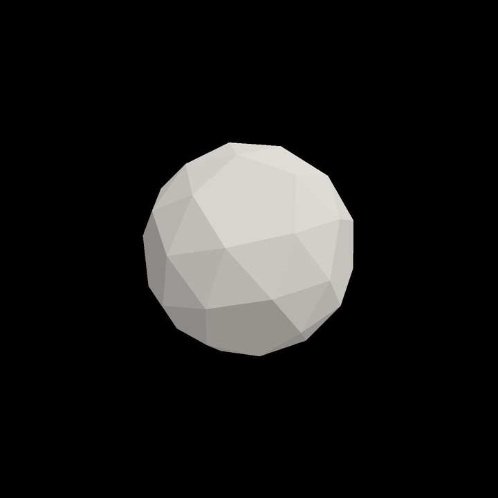
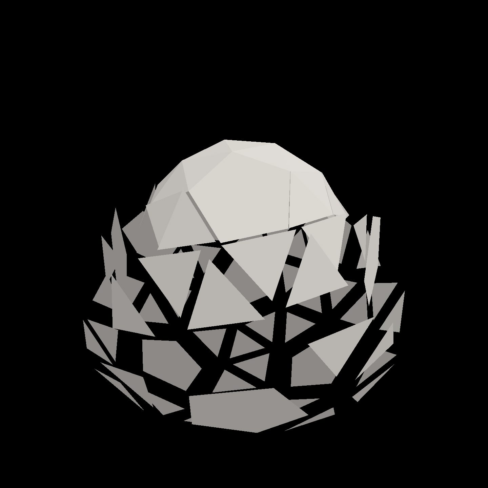
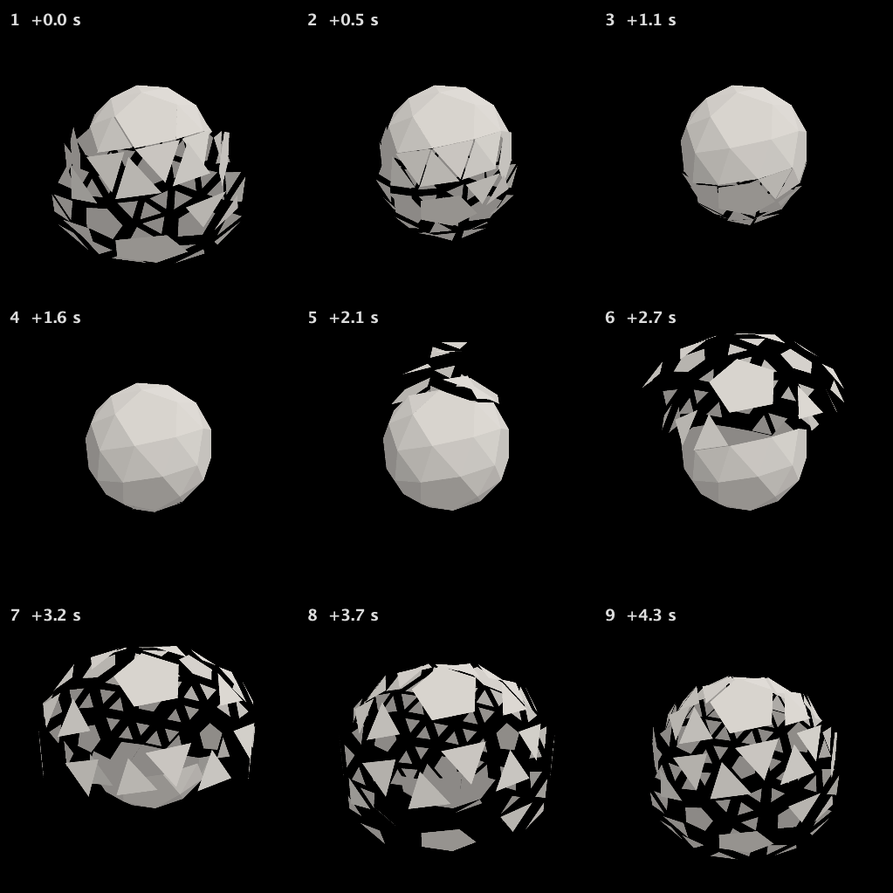
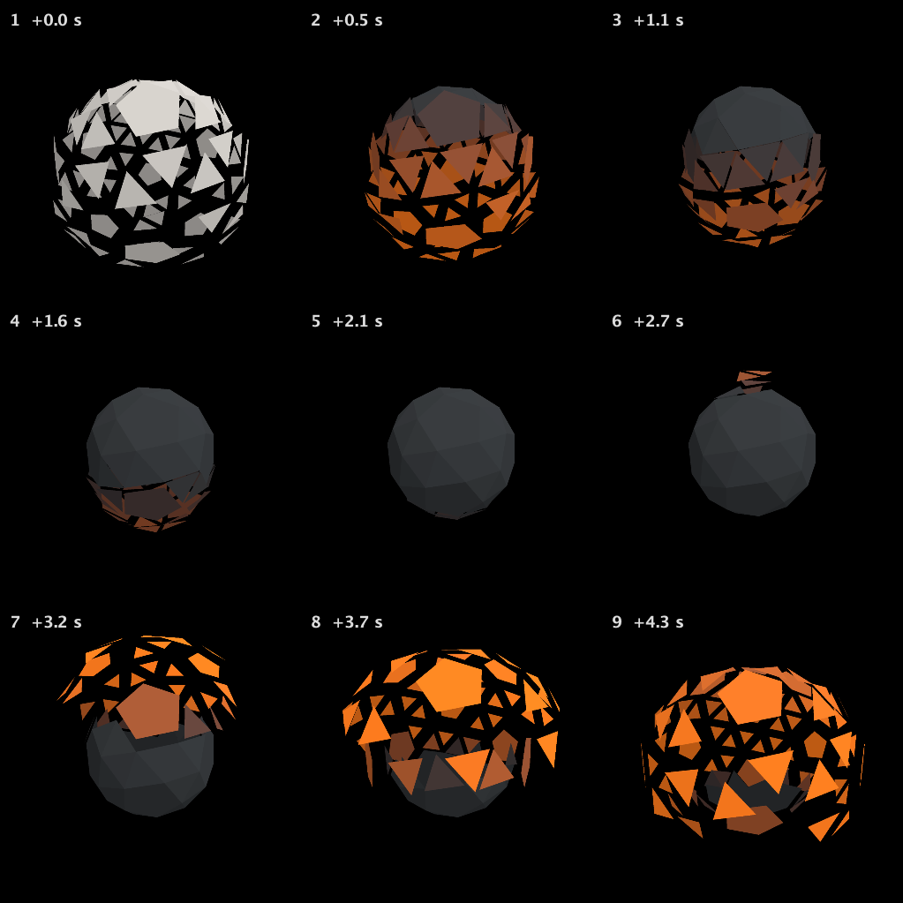
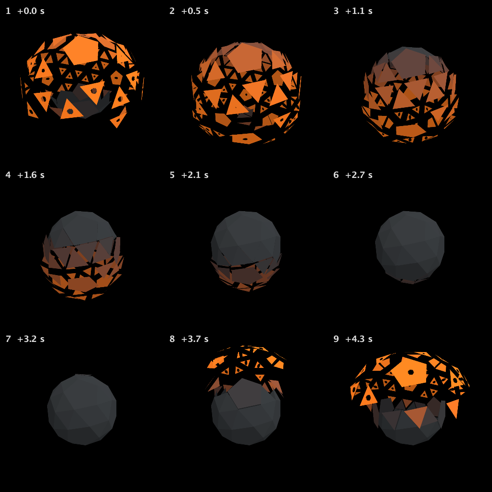
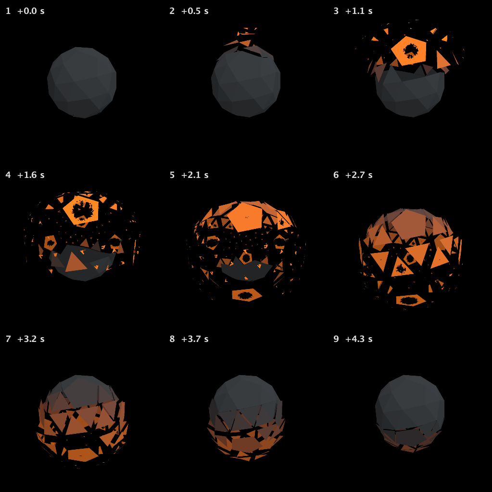
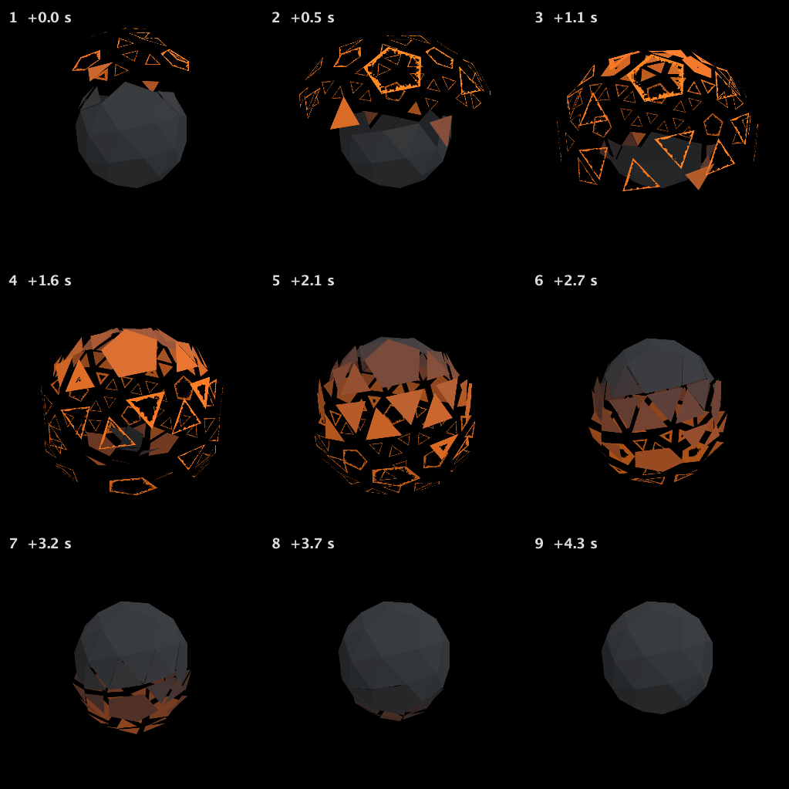
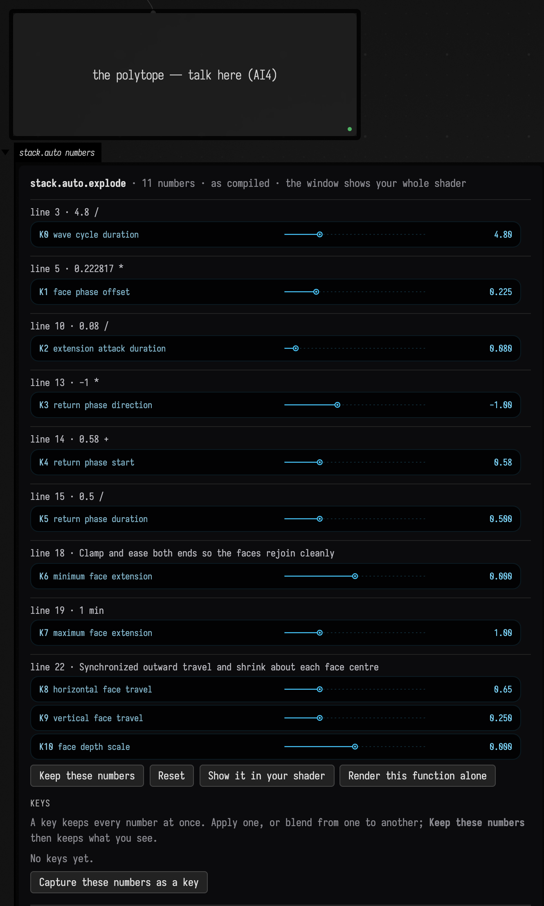
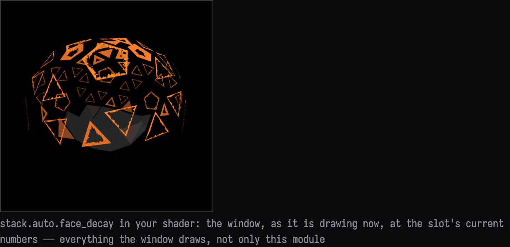
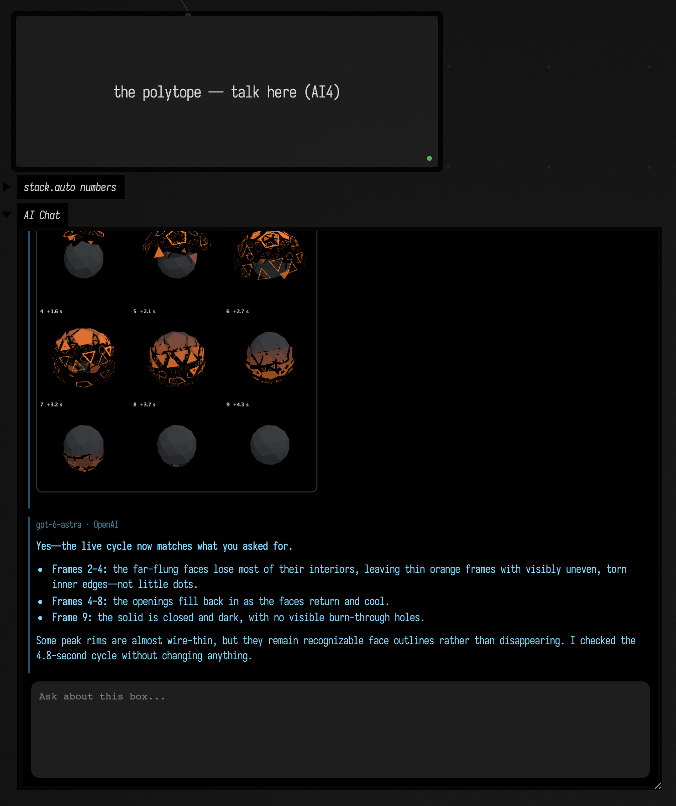

# Talking to the StackSL in your shader

Write your own GLSL, leave a hole in it, and fill the hole by talking. A `{{ stack.auto.name }}` slot
in a vertex or fragment shader is a StackSL program compiled into your shader as a function; AI4,
opened on the box's code, gets tools for each slot. The model reads the lines of your shader that call
the slot, so it knows what the slot's input is and what its output is for. Each edit is bound into the
running shader, written back into your Kotlin, and answered with a picture of your window, drawn by
your whole shader on the GPU. For a slot that moves in time, the picture is a sheet of real frames
across the cycle.

This page follows one recorded conversation from start to finish. A snub dodecahedron, every face its
own, starts whole and grey. Six turns later its faces burst outward in a wave down the solid, glow hot
as they fly, and burn out to ragged frames at the height of the burst:

<video controls loop muted playsinline width="480" src="assets/stackauto_conversation/burst.mp4"></video>

That is the recorded document running in Field, two cycles of its window captured in real time. It
is the same kind of conversation as [Talking a shader into existence](stacksl_conversation.md), with
the StackSL living inside your own graphics code instead of in a window of its own.

## Two slots in one box

The box `polytope_source` builds the mesh in Kotlin and draws it with its own `vertex` and `fragment`
shaders. The vertex shader asks one slot where each face goes:

<!-- stackauto-study-source:starter-vertex -->
```diffstatic {data-lang=glsl}
// explode(vec4(face centre xyz, time)): .x pushes the face out along its normal,
// .y shrinks it about its own centre (0 keeps it whole, 1 shrinks it to a point).
{{ stack.auto.explode }}

void main() {
    vec4 e = explode(vec4(cen, pc.params.x));
    vec3 q = cen + (pos - cen) * (1.0 - clamp(e.y, 0.0, 0.95)) + nrm * e.x;
```
<!-- /stackauto-study-source:starter-vertex -->

and the fragment shader asks another how each face looks:

<!-- stackauto-study-source:starter-fragment -->
```diffstatic {data-lang=glsl}
// face_decay(vec4(place on the face xy, how far the face has flown, time)):
// .rgb is the face's colour; where .a falls below 0.5 the face burns through.
{{ stack.auto.face_decay }}

void main() {
    vec4 d = face_decay(vec4(vLocal.xy * 3.0 + 0.5, vAway, pc.params.x));
    if (d.a < 0.5) discard;
```
<!-- /stackauto-study-source:starter-fragment -->

The comments above each call are the contract. Nothing in StackSL says that `.x` is a push along the
normal or that an `.a` below 0.5 burns through; the host shader decides, and the model reads it there.
The two programs are strings at the end of the box's Kotlin, and both start inert:

<!-- stackauto-study-source:starter-slots -->
```diffstatic {data-lang=kotlin}
// The vertex shader's slot: where each face goes. Talk to it in this box's AI4 chat.
module.explode = """
# (start) every face where it belongs: pushed nowhere, shrunk not at all
[0,0,0,0]
"""

// The fragment shader's slot: each face's colour, and where it burns through.
module.face_decay = """
# (start) one warm grey on every face, nothing burned
[0.75,0.72,0.68,1]
"""
```
<!-- /stackauto-study-source:starter-slots -->



## Start

[Download the starter](assets/stackauto_conversation/stackauto_conversation.zip), the document as
the recording began. Unzip it into your Field workspace, keeping the `stackauto_conversation` folder
intact, and open it. It has two boxes:

| Box | What it is |
| --- | --- |
| **renderer — launch me first** | Opens the window. Select it and choose **Launch Box**. |
| **the polytope — talk here (AI4)** | The mesh, its shaders and the two slots. Run it (**command/ctrl-return**) once the window is open, then press **command/ctrl-4** for AI4 chat. |

Configure an AI provider through Field's welcome page if you have not already; see
[AI features](aiFeatures.md). In a document of your own, any box whose shader has a
`{{ stack.auto.name }}` and whose code sets `module.name = """…"""` gets the same tools in its chat.

## The conversation, step by step

Each turn below is a real AI4 turn, recorded with gpt-6-astra through OpenAI on 2026-09-28 with the
window running. The pictures are the images the tools returned to the model. The first two turns
talk to `explode`, the rest to `face_decay`; both are in the polytope box's one chat.

### 1 · A burst, the top first

> In the explode slot (the vertex shader): make the polytope burst. Every few seconds the faces
> should fly out from the centre and come back together, and faces nearer the top should go first, so
> it reads as a wave passing down the solid rather than everything at once.

The model read the slot guide, inspected the slot, looked up the words it needed (`input y`, `input w`,
`max`, `pow`), and wrote the program with one `EditStackAutoSlot`. The face centre's height is added to
the phase, so higher faces reach the burst first, and a clipped half sine gives a pause between bursts:

<!-- stackauto-study-source:explode-burst -->
```diffstatic {data-lang=stacksl}
# Time phase: one burst every 4.8 seconds
input w
4.8 / 6.283185 *
# Higher face centres lead the phase, so the wave travels downward
input y
1.4 * +
# Positive half-wave eases outward and back; negative half is rest
sin
0 max
2 pow
# Outward travel, preserving each face's size (output y = 0)
0.65 *
[1,0,0,0] *
```
<!-- /stackauto-study-source:explode-burst -->

The edit came back with one frame, which caught the solid at rest. A capture a moment later showed
what the model then described: the top already closed while the lower faces are still out.



### 2 · Open it up: out fast, back slowly

> Still in explode: as a face flies out it should shrink a little, so the solid opens up and you can
> see through it at the height of the burst; whole again when it's back. And make it snappier: out
> fast, back slowly.

This time the model asked the edit for `over: 4.8` and got back nine real frames across one cycle. The
shrink is the output's `.y`, which the host uses to scale each face about its own centre, and the
fast attack and slow return are a `fract` phase shaped by two lines and a `min`:

<!-- stackauto-study-source:explode-shrink -->
```diffstatic {data-lang=stacksl}
# Repeating 4.8-second phase; higher face centres lead the wave
input w
4.8 /
input y
0.222817 *
+
fract
# Fast attack: reach full extension in 0.384 seconds
dup
0.08 /
# Slow return: back home at phase 0.58, then rest
swap
-1 *
0.58 +
0.5 /
min
# Clamp and ease both ends so the faces rejoin cleanly
0 max
1 min
smooth
# Synchronized outward travel and shrink about each face centre
[0.65,0.25,0,0] *
```
<!-- /stackauto-study-source:explode-shrink -->



### 3 · Hot metal, cooling

> Now the face_decay slot (the fragment shader). The faces are plain grey. I'd like them to look like
> hot metal cooling: a dull dark iron at rest, glowing orange where a face has flown far out.

The fragment shader passes in how far each face has flown (`vAway`, the `.x` that `explode` returned)
as the input's `z`. The model normalised it by the burst's 0.65 and blended iron into orange:

<!-- stackauto-study-source:decay-embers -->
```diffstatic {data-lang=stacksl}
# Heat follows actual outward travel, normalized to the burst's 0.65 maximum
input z
0.65 /
0 max
1 min
smooth
# Blend dark iron into incandescent orange; alpha stays one (no burn-through)
[1.355,0.23,-0.037,0] *
[0.045,0.05,0.055,1] +
```
<!-- /stackauto-study-source:decay-embers -->



The first frame is still grey: that picture was taken before the new pipeline was drawing. Edits
now wait for it (see the note at the end).

### 4 · Burning through at the peak

> Still in face_decay: at the height of the burst, let the faces that have flown furthest burn through
> from the inside, with ragged holes, and heal as they come back. Show me it at the moment of the burst.

The model built a distance from each face's middle, roughened it with `fbm`, and let the hole grow with
the face's travel above 68%, writing the result into `.a` for the host's discard.

<!-- stackauto-study-source:decay-burn -->
??? example "face_decay after decay-02 · small round holes"

    ```diffstatic {data-lang=stacksl}
    # Heat follows outward travel
    input z
    0.65 /
    0 max
    1 min
    smooth
    # Preserve dark iron to incandescent orange; build alpha separately
    [1.355,0.23,-0.037,0] *
    [0.045,0.05,0.055,0] +
    # Distance from the interior of each face in the host's local coordinates
    input xy
    0.5 -
    length
    # Stable fine raggedness: no time drift as the opening heals
    input xy
    38 *
    fbm
    0.10 *
    +
    0.015 +
    # Only the furthest-travelled faces burn: growing central hole above 68% travel
    input z
    0.65 /
    0.68 -
    0.32 /
    0 max
    1 min
    smooth
    0.24 *
    -
    # Host discards alpha below 0.5; positive distance retains solid metal
    10 *
    0.5 +
    [0,0,0,1] *
    +
    ```
<!-- /stackauto-study-source:decay-burn -->



It described them as ragged. They are small, neat and round.

### 5 · Ragged frames, not dots

> Those holes are small neat dots. I want them to eat most of each far-flung face at the peak of the
> burst, with torn, uneven edges, so what's left is a ragged frame of glowing metal; still whole when
> the faces are home.

Two patches made the holes far larger and rougher:



Some small faces now vanished instead of leaving a frame, and the model saw why. The slot only knows a
point's place on its face as an offset from the face's centre, and the same distance lands inside a
large pentagon but past the edge of a small triangle. A frame needs the distance to the face's own
edge, which the host never passed in. So it changed the host. It rebuilt the mesh in the box's Kotlin
as fans from each face's centre to its edges, with a new attribute that is 0 at the centre and 1 on the
perimeter, and gave that to the slot as the input's `w` in place of the time the fragment shader no
longer used:

<!-- stackauto-study-source:decay-host -->
```diff {data-lang=glsl}
:::before
// face_decay(vec4(place on the face xy, how far the face has flown, time)):
// .rgb is the face's colour; where .a falls below 0.5 the face burns through.
{{ stack.auto.face_decay }}

void main() {
    vec4 d = face_decay(vec4(vLocal.xy * 3.0 + 0.5, vAway, pc.params.x));
    if (d.a < 0.5) discard;
:::after
// face_decay(vec4(place on the face xy, outward travel, polygon radius)):
// radius is 0 at the face centre and 1 at its actual perimeter, including pentagons.
// .rgb is the face's colour; where .a falls below 0.5 the face burns through.
{{ stack.auto.face_decay }}

void main() {
    vec4 d = face_decay(vec4(vLocal.xy * 3.0 + 0.5, vAway, vRadius));
    if (d.a < 0.5) discard;
```
<!-- /stackauto-study-source:decay-host -->

<!-- stackauto-study-source:decay-mesh -->
??? example "The mesh the model rebuilt, in the box's Kotlin"

    ```diffstatic {data-lang=kotlin}
    // Cancel internal triangulation edges; keep each original polygon's perimeter.
    val boundaries = LinkedHashMap<Int, LinkedHashMap<String, Pair<Int, Int>>>()
    fun pointKey(i: Int) = "${P[3*i]},${P[3*i+1]},${P[3*i+2]}"
    for (t in 0 until mesh.triangleCount) {
        val face = solid.sourceFace(t).value
        val c = centres.getOrPut(face) { FloatArray(4) }
        val edges = boundaries.getOrPut(face) { LinkedHashMap() }
        for (k in 0..2) {
            val i = I[3 * t + k]
            c[0] += P[3 * i]; c[1] += P[3 * i + 1]; c[2] += P[3 * i + 2]; c[3] += 1f
            val j = I[3 * t + (k + 1) % 3]
            val a = pointKey(i); val b = pointKey(j)
            val key = if (a < b) "$a|$b" else "$b|$a"
            if (edges.containsKey(key)) edges.remove(key) else edges[key] = Pair(i, j)
        }
    }
    // Centre-to-perimeter fans give a polygon radius, not a circular mask.
    val fanCount = boundaries.values.sumOf { it.size }
    m.set(3 * fanCount, fanCount) {
        var t = 0
        for ((face, edges) in boundaries) {
            val c = centres.getValue(face)
            val cx = c[0] / c[3]; val cy = c[1] / c[3]; val cz = c[2] / c[3]
            for ((a, b) in edges.values) {
                for (k in 0..2) {
                    if (k == 0) pos.add(cx, cy, cz) else {
                        val i = if (k == 1) a else b
                        pos.add(P[3*i], P[3*i+1], P[3*i+2])
                    }
                    nrm.add(N[3*a], N[3*a+1], N[3*a+2])
                    cen.add(cx, cy, cz)
                    fid.add(face.toFloat())
                    faceRadius.add(if (k == 0) 0f else 1f)
                }
                tri.add(3*t, 3*t+1, 3*t+2)
                t++
            }
        }
    }
    ```
<!-- /stackauto-study-source:decay-mesh -->

and rewrote `face_decay` to eat the face from the centre out while keeping a thin rim at `w` near 1.
A new vertex attribute cannot be added to a mesh that is already drawing, so the change could not take
until the box ran again. The model had no way to run it, and said so:

> The burn is larger and much rougher now, but **this isn't finished**: some small faces disappear
> rather than retaining a ragged glowing frame.
>
> I added a boundary-following correction, but its live mesh update failed, so I can't claim that
> version is working.

### The person runs the box

Running the polytope box rebuilt the mesh, and the window drew the frames.

### 6 · Is it what I asked for?

> I ran the box, so your new mesh is live now. Look at a whole cycle and tell me plainly whether it's
> what I asked for: ragged glowing frames at the burst, whole when home.

The model observed a whole cycle, changed nothing, and answered:



> **Yes—the live cycle now matches what you asked for.**
>
> - **Frames 2–4:** the far-flung faces lose most of their interiors, leaving thin orange frames with
>   visibly uneven, torn inner edges—not little dots.
> - **Frames 4–8:** the openings fill back in as the faces return and cool.
> - **Frame 9:** the solid is closed and dark, with no visible burn-through holes.
>
> Some peak rims are almost wire-thin, but they remain recognizable face outlines rather than
> disappearing.

The final `face_decay`:

<!-- stackauto-study-source:decay-final -->
```diffstatic {data-lang=stacksl}
# Heat follows outward travel
input z
0.65 /
0 max
1 min
smooth
# Dark iron to incandescent orange
[1.355,0.23,-0.037,0] *
[0.045,0.05,0.055,0] +
# Host polygon radius: zero at centre, one at the real perimeter
input w
# Deep, stable tears in the remaining rim
input xy
13 *
fbm
0.42 *
+
0.015 +
# Eat most of the interior while far out; fully heal on return
input z
0.65 /
0.55 -
0.30 /
0 max
1 min
smooth
1.07 *
-
# Keep a narrow outer thread even at the deepest tears
input w
0.975 -
max
# Host discards alpha below 0.5
10 *
0.5 +
[0,0,0,1] *
+
```
<!-- /stackauto-study-source:decay-final -->

## The tools

A box whose code binds a slot has these in its AI4 chat, from
[`afield.stacksl.study`](assets/stackauto_conversation/StackAutoStudyTools.kt):

| Tool | What it does |
| --- | --- |
| `StackAutoSlotGuide` | How to work on a slot, or with `search`, a word looked up in the StackSL words guide. |
| `InspectStackAutoSlot` | The slot's program, the host lines that declare and call it, where the module is drawn, its numbers and what each does, and its history. |
| `EditStackAutoSlot`, `PatchStackAutoSlot` | A new program or a local change: checked against the slot, bound into the running shader, written back into the Kotlin, and answered with a picture. |
| `SetStackAutoNumbers` | Numbers turned through the slot's live block, with no recompile; kept only when asked. |
| `SweepStackAutoNumber` | One number at several values, each in the real shader. |
| `ObserveStackAutoSlot` | The slot as it draws now. |
| `RestoreStackAutoRevision` | An earlier revision made current again. |

Edit, Patch and Observe take `over`, in seconds, and then answer with a numbered sheet of frames
across that long, captured from the window as it draws. The host's time cannot be set from outside,
so the tools wait for it. An edit returns once the new pipeline is drawing and says so with
`boundLive`. Every revision is kept under the box's `studies/`.

The box's card shows both slots' numbers, each named by a fast model from what its line does, with
sliders that turn them live. **Show it in your shader** captures the slot in the window:





More on slots, their numbers and the card is in [StackSL examples](stacksl_examples.md#talking-to-a-slot).

## The saved conversation

Each turn's transcript keeps the request, the tool activity, every image returned to the model, and
its reply:
[1](assets/stackauto_conversation/polytope/explode-01-burst.html) ·
[2](assets/stackauto_conversation/polytope/explode-02-shrink.html) ·
[3](assets/stackauto_conversation/polytope/decay-01-embers.html) ·
[4](assets/stackauto_conversation/polytope/decay-02-burn.html) ·
[5](assets/stackauto_conversation/polytope/decay-03-ragged.html) ·
[6](assets/stackauto_conversation/polytope/decay-04-look.html).

The recorded document ships with Field as `dev_docs/agents/demos/stackauto_conversation_polytope`,
with every revision of both slots, the tool I/O of every turn, and the chat. Copy it into your
workspace rather than opening it in place, since continuing the conversation adds to its history:

```diffstatic {data-lang=bash}
cp -R dev_docs/agents/demos/stackauto_conversation_polytope ~/Documents/AFieldWorkspace/
```

Launch the renderer, run the polytope, and the finished burst plays. The recorded turns are in the
polytope box's AI4 chat. Opening the chat does not call a model.



## Limits

- A slot is one function of your shader. What it can do is bounded by what the host passes in; when
  the slot needs something the host does not give it, the change is to the host, as in turn 5.
- Changes to the mesh, or to what the shaders are given, need the box to run again. The slot tools
  only rebind the slots.
- A sheet is sampled in real time: its frames are as far apart as the window was when they were read
  back, and each is labelled with when it was taken.
- On macOS the shader is translated to Metal, and a function named like one of Metal's types (`decay`,
  `array`) will not build there. A slot with such a name is refused before it is compiled.

??? aside "How this was recorded, and what checks it"

    Each turn went through the `ai-assist` RPC that Field's chat panel sends, with
    `tools/conversation_demo.py record`; the prompts are in the document's `prompts/`, and the run
    before turn 6 is `act … run`, kept in `conversations/decay-03a-run.human.json`. The recording found
    four faults in the slot tools, each fixed before the next turn, which is why turn 1 has one frame
    where the others have sheets, and turn 3's sheet starts with the previous program. The document's
    README lists them.

    The clip and the pictures of Field itself come from `tools/capture_stackauto_conversation.py`, which
    reopens copies of the starter and the recorded document on a Field of its own. It first checks that
    the chat Field restores is byte for byte the one saved. The clip is the window read back as fast as
    it can be, about 12 frames a second, each held until the next was taken.

    `StackAutoConversationExampleTest` compiles every recorded revision of both slots into the box's
    shaders, checks the code holds each slot's final program, and checks the starter holds each slot's
    first revision and the host lines the first Inspect read. `tools/package_stackauto_conversation.py
    --check` holds this page's listings, transcripts, images and download to the recorded session.
