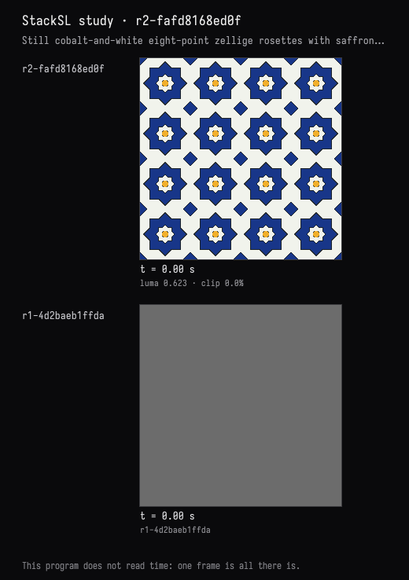
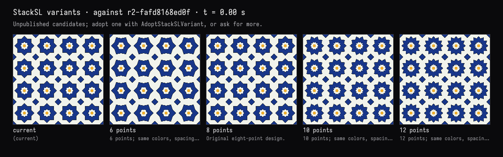
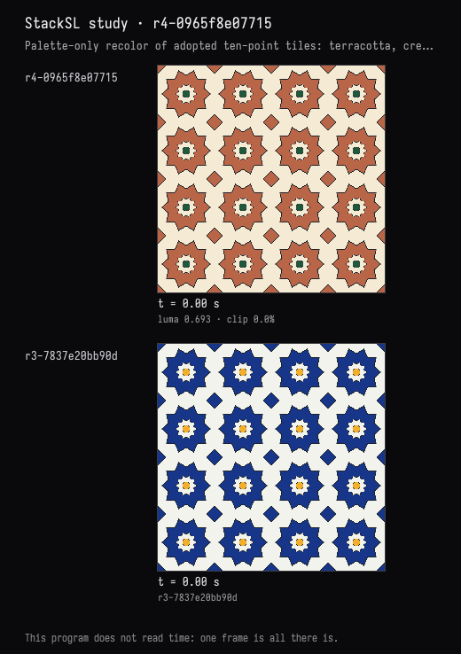
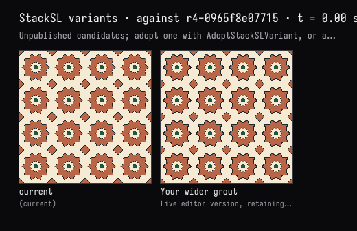
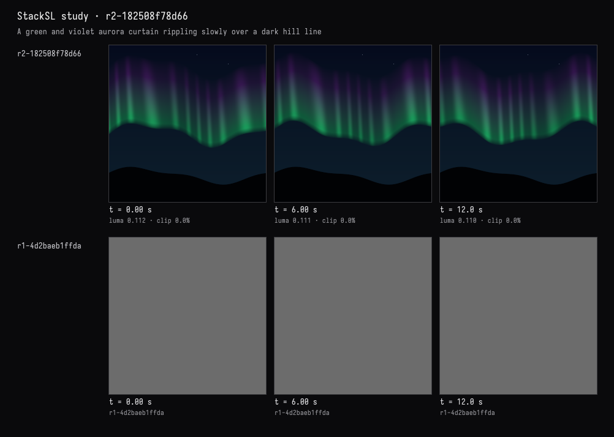
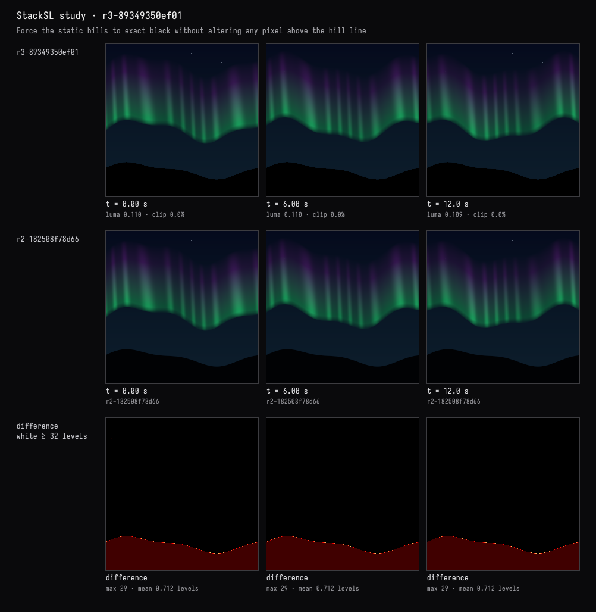
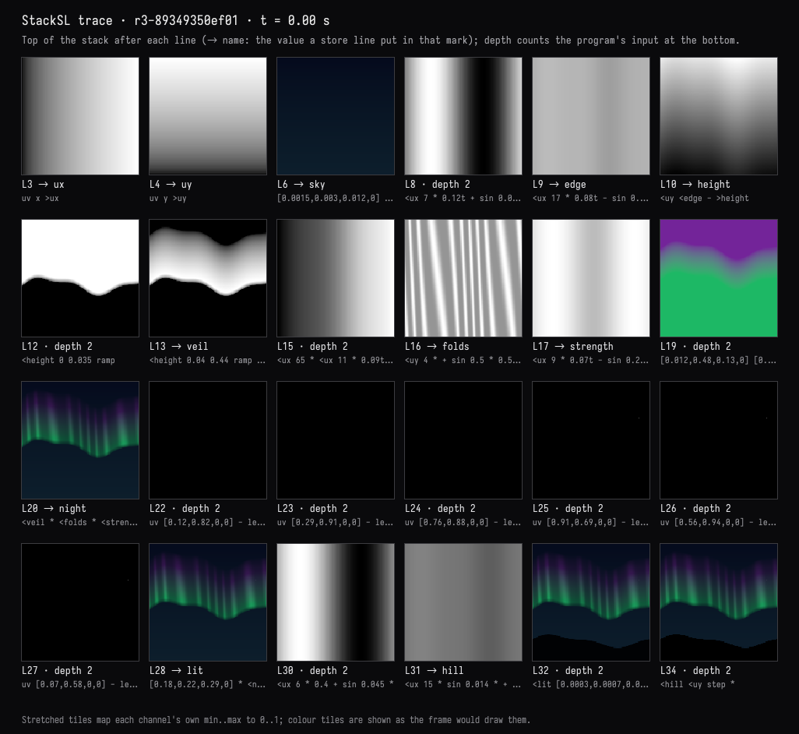
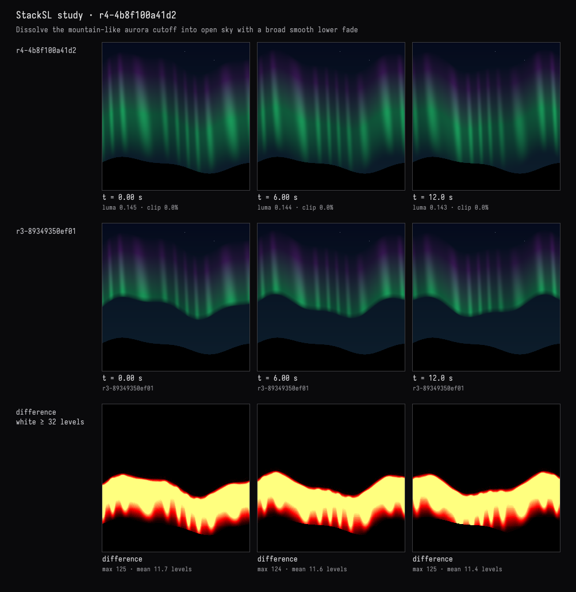
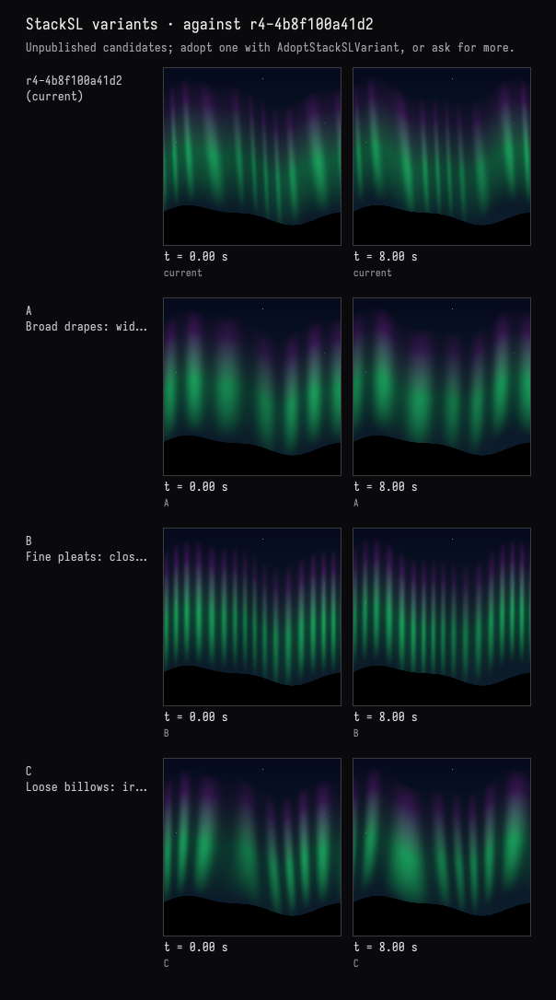
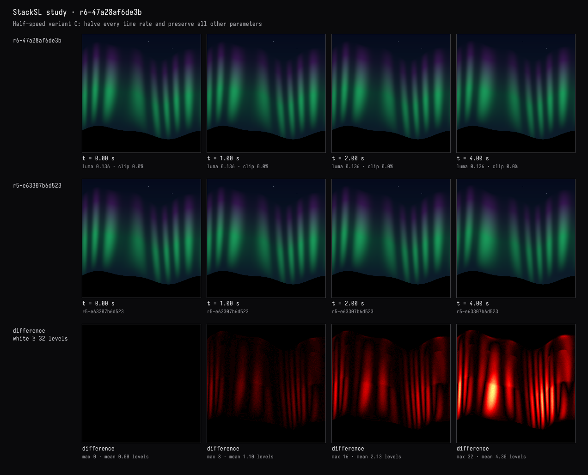

# Talking a shader into existence

Describe a picture in AI4 chat. The model writes it as [StackSL](stacksl_examples.md) in a Field box,
and a window draws the program live while you talk. Before replying, the model looks at the result:
exact frames at chosen times, stage-by-stage traces, variants side by side, and comparisons showing
what an edit left alone. Each accepted change is a saved revision. You can move a slider, adopt a
variant or type into the program yourself, and the model builds on what you did.

This is the StackSL counterpart of [Talking a function into existence](function_conversation.md), and
[Talking a scene into existence](rectsl_conversation.md) does the same for RectSL.
StackSL is one of Field's main languages: a box under a StackSL root is a program, drawn live in
the window above it. Its AI4 chat has tools that check, render, compare and version the program,
and a document can add tools of its own.

## Start

In any document, select a box — press **n** to make one — and choose **Make a StackSL Program** from
the command palette. A root box, **StackSL window**, appears above it and opens a square window; the
box becomes a program, layered noise over slowly drifting coordinates, and draws in it. Select the
program and press **ctrl/command-4** to open AI4 chat. Configure an AI provider through Field's
welcome page if you have not already; see [AI features](aiFeatures.md).

The program box edits its `stackSL` property, and the window follows every edit that compiles; an
edit with an error is marked on its line, and the window keeps the last program that compiled.
Running the box (ctrl/command-return) checks your program in as a revision. The root holds no code:
it is the box whose main language is StackSL, and it opens its window when a program beneath it
starts. Stopping the root, or closing the window, stops the programs in it; running one again reopens
the window, and a program whose window is closed still has its card's WebGL preview. **Set Main
Language: StackSL** on a box you made yourself does the same, and every box beneath it is a program.

The recorded sessions below started from a flat grey.
[Download that starter](assets/stacksl_conversation/stacksl_conversation.zip) to begin from the same
place: unzip it into your Field workspace, keeping the `stacksl_conversation` folder intact, and open
it. It has two boxes:

| Box | What it is |
| --- | --- |
| **StackSL window** | The StackSL root. It holds no code; its window opens when the program starts. |
| **the shader — talk here (AI4)** | The program. Select it and press **ctrl/command-4** to open AI4 chat. |

The program starts as one flat grey:

<!-- stacksl-study-source:starter -->
```diffstatic {data-lang=stacksl}
# A blank page: one flat grey. Describe what you want to see in this box's AI4 chat.
0.15
```
<!-- /stacksl-study-source:starter -->

Try this in the program box's chat:

> Slow ink blooming in water: deep indigo spreading into warm amber, evolving in place rather than
> sliding across the frame.

An accepted edit appears in the program box as StackSL, one stage per line with a comment on each,
and in the window as soon as it is accepted. Completion in the program box offers every word the
compiler accepts, with its stack effect and the cheatsheet's description, and the program's own
definitions and marks. Every StackSL box's chat has the study tools, and each program keeps its own
history under `studies/<box id>/` in its document.

## The window, the card and the GPU

A running program draws a fullscreen triangle in the window above it. Its fragment shader is the
study's template with the program in its `{{ stack.auto.program }}` slot, and time in a push
constant. A new edit that compiles builds a new pipeline and replaces the old one, which is retired
once the frames using it have finished.

The tools render their evidence on the same GPU. Each render draws the candidate program into a
floating-point offscreen target, waits one renderer frame, and reads the pixels back, so the model
sees exact frames at the times it asks for rather than wherever the window's clock has got to. In
the recorded sessions an accepted edit, including its before/after preview, took 0.7–1.3 s; a sheet
of three or four variants at three times took 0.9–2.4 s; a comparison took under 0.7 s.

StackSL also has a CPU interpreter. It is exact but slow: a program built from several octaves of
noise runs at a few thousand pixels per second, so a single variant sheet takes most of a minute.
It renders when there is no window, and every result says which renderer drew it.

The window presents through an sRGB swapchain: the shader writes linear colour, and the display
encodes it. The study encodes its images the same way, so the model and the person judge the same
picture. A raw readback, without that encoding, looks much darker than the window.

The **study card** in the program box's output is the person's side of the study. It shows:

- a WebGL preview of the checked revision, running in the browser, which follows the sliders as you
  move them. The frames the model judged by are in its own replies, so the card does not repeat them;
- a slider for every number in the program, grouped under the line it is on and the comment that
  says what that line does, with a colour swatch for each colour literal, and **Keep these
  numbers** to make the new values a revision. Each slider is labelled with what turning it
  changes — `hem drift speed`, `horizon gradient curve` — and clicking the label selects the number in the
  editor, so you can type over it; clicking a line's heading goes to the line. Those names come from
  Field's fast model, asked once for every number in the program, and given what the compiler
  already knows about each one: the operand it took the number as (`mix amount`, `smoothstep high`,
  `multiply b`), the line it is on, and that line's comment. That operand is exact, but a program
  whose numbers mostly scale and offset reads as a column of `multiplies`. It is what a slider says
  until the names arrive, and it stays on the slider's tooltip. The names are stored with the study,
  by the program's shape, so turning or keeping a number never asks again, and the model's Inspect
  lists each knob by the same name;
- **keys**: **Capture these numbers as a key** keeps every number at once, under a name. A key is a
  keyframe key like any other ([keyframer](keyframer_examples.md)), saved in the study's folder with its
  version history. Click a key to move every slider to it, or choose two and drag **blend** to move
  between them, with the preview following; **Keep these numbers** then makes what you see a
  revision. A key applies to the program it was captured from, with any of its numbers changed, but
  not once the text around them has changed. The model's Inspect lists the keys, and what each
  would change;
- the program's stages, each a small picture of what that line produced — for a line that stores
  into a mark (`>sky`), the value it stored. Click one and the window shows that stage instead of
  the whole program; click it again to go back. With **the window shows the editor's line** ticked,
  the window follows the cursor instead, showing what the line under it leaves on the stack. The
  editor offers the same picture of any line: rest the cursor on it, or open completion there, and
  it appears in the note beside the cursor and at the top of the completion popup;
- any variants the model has offered, each with **Adopt**;
- the revision history, each with **Restore**;
- exports in progress, which can be cancelled;
- **Check in the editor's program** when you have typed an edit you have not run.


This is the program box of the finished aurora session, reopened in Field. Past about 24 numbers,
the remaining lines' sliders wait behind a disclosure.

Clicking the tile of line 29, `[0.18,0.22,0.29,0] * <night + >lit`, holds the window at that
stage: the sky, the curtain and the stars, before lines 31–35 draw the black hill over them.


## The tools

AI4 offers these tools to any conversation opened on a box's `stackSL` property, and each works on
that box's program. They are library code, in
[`afield.lang.stacksl.study`](assets/stacksl_conversation/StackSLStudyTools.kt), registered through
[AI4's tool interface](aiFeatures.md#give-the-ai-a-tool-of-your-own):

| Tool | Purpose |
| --- | --- |
| `StackSLStudyGuide` | How to work on a study — the frame, idioms, traps and style — or the words guide searched for a word. |
| `InspectStackSLStudy` | Read the checked program, any unchecked hand edit, history, warnings, stages, knobs, and the line the person's cursor is on. |
| `EditStackSLStudy` | Replace the whole program: compile, check, activate, and return a preview against the parent. |
| `PatchStackSLStudy` | Exact local text replacements, through the same checks. |
| `SetStackSLNumbers` | Change numbers by knob index, rewritten in place so a time rate stays a time rate. |
| `ObserveStackSLStudy` | Frames at chosen times, with measurements: clipping, NaN, detail, feature size, palette, motion. |
| `TraceStackSLStudy` | What each line produced, as pictures; optionally the stack's values at one point. |
| `KnobsStackSLStudy` | Each number's role, and how much a 10% nudge to it changes the frame. |
| `SweepStackSLNumber` | One number at several values, side by side, without publishing. |
| `TryStackSLVariants` | Up to eight candidate programs beside the current one, without publishing; held for Adopt. |
| `AdoptStackSLVariant` | Publish a held variant as a revision. |
| `RestoreStackSLRevision` | Make an earlier revision current again, as a new revision. |
| `CompareStackSLStudy` | Show that an edit changed only what it should: by colour, by brightness, or by stage. |
| `ExportStackSLStudy` | Render a still or a clip into the document's `files/` folder, in the background. |

Every edit carries the revision and the source hash it was based on. If you type while the model
is preparing an edit, the stale edit is refused and your text stays. A refused or failed edit
changes nothing. The check refuses programs that do not compile, unbalanced definitions, and
`sample`/`prev`: study programs are single-pass over `vec4(uv, hash, seconds)`.

A stage comparison (`mode=stage`) renders both programs only up to a chosen line and compares what
that line produced. A recolour that leaves the field before the palette identical proves it did not
move the geometry. A stage that leaves nothing but the program's input tells two programs apart
from nothing, and the result says so.

### Adding a tool of your own

A document can teach the assistant something more, from a box: register a request class with the
document as its scope, and gate it on the conversation's focus. Run the box and the next turn has
the tool; two documents can each have their own tool of the same name.

<!-- stacksl-study-source:colour-tool -->
```diffstatic {data-lang=kotlin}
import afield.lang.stacksl.study.StackSLStudyShader
import com.fasterxml.jackson.annotation.JsonClassDescription

@JsonClassDescription("The colours a StackSL program types, as the window shows them.")
data class ColoursOfStackSLStudy(val revision: String = "current")

val document = inside.filename
AgentToolExtensions.register(
    ColoursOfStackSLStudy::class.java,
    { it.focus?.document == document && it.focus?.property == "stackSL" },
    scope = document,
) { ctx, _ ->
    val program = ctx.focus!!.box.getPropertyRaw("stackSL", "") as String
    StackSLStudyShader.colourKnobs(program).map { it.hex }
}
```
<!-- /stacksl-study-source:colour-tool -->

The model reads what the handler returns, as JSON: here the program's colour literals as the window
shows them, such as `["#f3bc7c"]`.

## Three recorded sessions

Each session below is a real AI4 conversation with the window running, through OpenAI: the ink
with gpt-6-astra, the tiles and the aurora with gpt-6.1-sol. The pictures are the images the tools
returned to the model. Between turns, a person acted in Field: adopting variants in the card,
keeping a slider value, editing the program by hand.

### Ink in amber water

> Slow ink blooming in water: deep indigo spreading into warm amber, evolving in place rather than
> sliding across the frame.

The model read the guide, wrote the program with one `EditStackSLStudy`, and looked at the window
before replying. Time moves the noise through its fourth dimension (`0.035t >w`), so the bloom
reshapes in place instead of drifting.


> The indigo body reads heavy and flat in the middle. Could you show me a few different ways to give
> it internal structure — lighter veils or threads inside the ink — so I can pick one?

`TryStackSLVariants` rendered three candidates at 0, 8 and 20 seconds in 2.2 s and published
nothing:


The person adopted **B** in the card, then moved the drift-speed slider from `0.035t` to `0.06t`
and kept it. Both became revisions. The next request asked for light in the water with the ink
unchanged, and for proof. The model's patch saves the finished ink as `>original`, builds the
lighting separately, and ends with an exact guard: wherever there is any ink, the original pixel
wins.

<!-- stacksl-study-source:ink-water -->
```diff {data-lang=stacksl}
:::before
# Fine pale threads tracing the folded internal field.
[0.25,0.30,0.50]
<flow fbm4 42 * sin abs 1- 4 pow
<ink 0.45 0.95 ramp smooth * 0.58 * mix
saturate
:::after
# Fine pale threads tracing the folded internal field.
[0.25,0.30,0.50]
<flow fbm4 42 * sin abs 1- 4 pow
<ink 0.45 0.95 ramp smooth * 0.58 * mix
saturate
# Keep the entire original ink rendering, including the user's speed and threads.
>original
# Broad water-light ripples evolve independently, more slowly than the ink.
p 2.4 * 0.014t >w fbm4 >waterNoise
p x 7 * p y 4 * + <waterNoise 5 * + 0.07t + sin 0.5 * 0.5 + >light
# Copper shade to honey light, applied only to clear water.
<original
<water [0.64,0.48,0.34,1] * <water [1.22,1.20,1.10,1] * <light mix
<concentration 0.10 0.28 ramp smooth 1- mix
# Exact guard: every pixel with any ink keeps its original RGBA.
<original <ink 0 > select
saturate
```
<!-- /stacksl-study-source:ink-water -->

Its proof compares the old and new programs at the stage where the ink is finished, at 0, 8, 20
and 40 seconds. The difference column is black: the largest difference is zero.


> That's the one. Export a still and a short clip of it into the document so I can use them
> elsewhere.

The model exported a 2048 × 2048 still at 20 seconds and a 12-second clip starting there, 512 px at
24 fps. Both ran in the background and appeared in the document's `files/` folder. This is the clip:

<video controls loop muted playsinline width="512" src="assets/stacksl_conversation/ink/indigo-amber-clip.mp4"></video>

<!-- stacksl-study-source:ink-final -->
??? example "The complete program · r5-cfb7e379eb87"

    ```diffstatic {data-lang=stacksl}
    # Ink in amber water. Time changes the noise's fourth dimension, never scrolls xy.
    : folds
      >q
      <q fbm4
      <q [7.1,3.8,2.4,0] + fbm4
      vec2 0.5 - 2.8 * <q +
    ;
    # Fixed spatial anchor, slow internal evolution.
    p 3.8 * 0.06t >w >domain
    <domain folds folds >flow
    # Feathered concentration around a stationary central bloom.
    <flow fbm4 0.78 *
    p [1,0.85,0,0] * length 0.92 * - 0.27 + =concentration
    0.28 0.62 ramp smooth >ink
    # Amber water with a gentle falloff toward the edges.
    [0.78,0.40,0.10] [0.42,0.16,0.028] p length 0.85 * mix >water
    # Dilute indigo at the edges, near-black indigo in the pooled pigment.
    <water [0.105,0.095,0.235] <ink 0.0 0.68 ramp smooth mix
    [0.008,0.012,0.060] <ink 0.30 1.0 ramp smooth mix
    # Fine pale threads tracing the folded internal field.
    [0.25,0.30,0.50]
    <flow fbm4 42 * sin abs 1- 4 pow
    <ink 0.45 0.95 ramp smooth * 0.58 * mix
    saturate
    # Keep the entire original ink rendering, including the user's speed and threads.
    >original
    # Broad water-light ripples evolve independently, more slowly than the ink.
    p 2.4 * 0.014t >w fbm4 >waterNoise
    p x 7 * p y 4 * + <waterNoise 5 * + 0.07t + sin 0.5 * 0.5 + >light
    # Copper shade to honey light, applied only to clear water.
    <original
    <water [0.64,0.48,0.34,1] * <water [1.22,1.20,1.10,1] * <light mix
    <concentration 0.10 0.28 ramp smooth 1- mix
    # Exact guard: every pixel with any ink keeps its original RGBA.
    <original <ink 0 > select
    saturate
    ```
<!-- /stacksl-study-source:ink-final -->

### Zellige tiles

> A still image, no animation: a zellige-like tile pattern — eight-fold star rosettes in cobalt and
> white with a little saffron, separated by thin dark grout lines.

The first edit built the pattern from two definitions: `squaremax`, a square's distance field, and
`starfield`, the distance to an eight-point star's edge. A small octagon sits in each rosette's
centre and a diamond where four tiles meet. Everything depends on position only.



> Before we settle on eight: show me what the rosettes look like with 6, 8, 10 and 12 points, side by
> side.

A still program renders once, so the variant sheet is a single row:



The person adopted **10 points** in the card. Next came a recolour in terracotta, cream and deep
green, with the geometry unchanged and a proof. The model changed fifteen numbers in five colour
literals with `SetStackSLNumbers`, and left the comments, which still name cobalt and saffron:

<!-- stacksl-study-source:tiles-recolour -->
```diff {data-lang=stacksl}
:::before
# Cobalt stars in an ivory ground.
[0.009,0.037,0.25,1] [0.88,0.90,0.84,1] -0.002 0.002 <edge smoothstep mix >color

# Fine charcoal grout on the perimeter of every star.
<color [0.012,0.018,0.023,1] 0.006 0.009 <edge abs smoothstep 1 swap - mix >color

# A smaller white star forms the center of each rosette.
<color [0.88,0.90,0.84,1] 0.127 0.130 <star smoothstep 1 swap - mix >color
<color [0.012,0.018,0.023,1] 0.004 0.007 <star 0.129 - abs smoothstep 1 swap - mix >color

# Small saffron octagons at the center, framed with dark grout.
<tile abs x <tile abs y max <tile abs x <tile abs y + 0.707107 * max >octagon
<color [0.012,0.018,0.023,1] 0.067 0.070 <octagon smoothstep 1 swap - mix >color
<color [0.88,0.43,0.025,1] 0.058 0.061 <octagon smoothstep 1 swap - mix >color

# Small cobalt diamonds join the four white interstitial tiles.
<tile abs x <tile abs y + >corner
<color [0.012,0.018,0.023,1] 0.848 0.853 <corner smoothstep mix >color
<color [0.009,0.037,0.25,1] 0.863 0.868 <corner smoothstep mix >color
:::after
# Cobalt stars in an ivory ground.
[0.48,0.13,0.065,1] [0.91,0.82,0.65,1] -0.002 0.002 <edge smoothstep mix >color

# Fine charcoal grout on the perimeter of every star.
<color [0.012,0.018,0.023,1] 0.006 0.009 <edge abs smoothstep 1 swap - mix >color

# A smaller white star forms the center of each rosette.
<color [0.91,0.82,0.65,1] 0.127 0.130 <star smoothstep 1 swap - mix >color
<color [0.012,0.018,0.023,1] 0.004 0.007 <star 0.129 - abs smoothstep 1 swap - mix >color

# Small saffron octagons at the center, framed with dark grout.
<tile abs x <tile abs y max <tile abs x <tile abs y + 0.707107 * max >octagon
<color [0.012,0.018,0.023,1] 0.067 0.070 <octagon smoothstep 1 swap - mix >color
<color [0.015,0.095,0.045,1] 0.058 0.061 <octagon smoothstep 1 swap - mix >color

# Small cobalt diamonds join the four white interstitial tiles.
<tile abs x <tile abs y + >corner
<color [0.012,0.018,0.023,1] 0.848 0.853 <corner smoothstep mix >color
<color [0.48,0.13,0.065,1] 0.863 0.868 <corner smoothstep mix >color
```
<!-- /stacksl-study-source:tiles-recolour -->

For the proof it compared the two revisions at five stages, each a line that ends in a store: the
tile coordinates (`>tile`), the star field (`>star`), the star's edge (`>edge`), the octagon
(`>octagon`) and the corner diamonds (`>corner`). A stage that ends in a store compares the value it
stored, so each of these is the geometry itself, without the colour. All five were identical across
36,864 samples:



Then the person widened the star grout by hand, changing `0.006 0.009 <edge abs smoothstep` to
`0.012 0.015 <edge abs smoothstep`, and did not check it in.

> I thickened the grout myself in the editor. Look at what I changed and keep it — but check the
> small green centres: with the wider grout, are they still readable? Fix them if not.

`InspectStackSLStudy` reported the editor as dirty and returned the person's text. The model named
the change, rendered the editor's version beside the checked-in one, judged the green centres still
readable, and made no edit. The person then pressed **Check in** in the card.



<!-- stacksl-study-source:tiles-final -->
??? example "The complete program · r5-dff520b30859"

    ```diffstatic {data-lang=stacksl}
    # (asked) Still zellige-like tiles: eight-fold cobalt and white rosettes,
    # a little saffron, and thin dark grout. No time-dependent words.
    # (chosen) Four repeats, square/diamond eight-point stars, ivory inset stars.
    : squaremax >point <point abs x <point abs y max ;
    : starfield >point
    <point y <point x atan2 0.6283185307179586 / 0.5 + fract 0.5 - abs 0.6283185307179586 * >angle
    0.3141592653589793 <angle - sin 0.765366865 * <angle sin +
    0.23651136821647611 / <point length * 0.707106781 * ;

    # Repeating coordinates; the two squares make an eight-point silhouette.
    uv 4 * fract 0.5 - >tile
    <tile starfield >star
    <star 0.303 - >edge

    # Cobalt stars in an ivory ground.
    [0.48,0.13,0.065,1] [0.91,0.82,0.65,1] -0.002 0.002 <edge smoothstep mix >color

    # Fine charcoal grout on the perimeter of every star.
    <color [0.012,0.018,0.023,1] 0.012 0.015 <edge abs smoothstep 1 swap - mix >color

    # A smaller white star forms the center of each rosette.
    <color [0.91,0.82,0.65,1] 0.127 0.130 <star smoothstep 1 swap - mix >color
    <color [0.012,0.018,0.023,1] 0.004 0.007 <star 0.129 - abs smoothstep 1 swap - mix >color

    # Small saffron octagons at the center, framed with dark grout.
    <tile abs x <tile abs y max <tile abs x <tile abs y + 0.707107 * max >octagon
    <color [0.012,0.018,0.023,1] 0.067 0.070 <octagon smoothstep 1 swap - mix >color
    <color [0.015,0.095,0.045,1] 0.058 0.061 <octagon smoothstep 1 swap - mix >color

    # Small cobalt diamonds join the four white interstitial tiles.
    <tile abs x <tile abs y + >corner
    <color [0.012,0.018,0.023,1] 0.848 0.853 <corner smoothstep mix >color
    <color [0.48,0.13,0.065,1] 0.863 0.868 <corner smoothstep mix >color
    <color
    ```
<!-- /stacksl-study-source:tiles-final -->

### An aurora over hills

> A night sky over a dark hill line: an aurora curtain of green fading into violet, slowly rippling,
> and a few faint stars.

The model wrote the program with one `EditStackSLStudy` and checked frames at 0, 6 and 12 seconds:



> The hills must stay perfectly still and black. Check whether anything moves below the horizon,
> and if it does, fix it without touching the sky.

The model found the hills already still but blue-black, and patched them to exact black below the
unchanged hill line. Its preview's difference row shows the change confined to the hill:



The model took the lower black band as the hills. Between it and the curtain stayed a broad
blue-black shape, and the person asked about it:

> In the middle, under the curtain, there's a big soft dark mound that reads like a second, nearer
> mountain — with stars in front of it. What is that shape, exactly? Show me what makes it, then make
> it read as open sky.

The model traced the program, one tile per line. Each line that ends in a store shows the value it
stored, named after the arrow, so the trace reads as the program's named parts:



Its answer: the mound was plain sky, outlined by the aurora's abrupt lower cutoff at line 12
(`<height 0 0.035 ramp`), which the trace shows forming before the hills are drawn. It replaced the
cutoff with a broad fade, `-0.28 0.06 <height smoothstep`, so the curtain dissolves into the sky:



> Make the curtain hang more like fabric, with vertical folds. Try two or three versions and I'll
> choose.

The model offered broad drapes, fine pleats and loose billows, at 0 and 8 seconds, and recommended
the billows:



The person adopted **C** in the card.

> I took C in the card. Now slow the whole ripple to about half speed, keeping everything else
> exactly as it is, and show me it really moves about half as much.

The model found the five time rates among the program's knobs and halved them with
`SetStackSLNumbers`:

<!-- stacksl-study-source:aurora-slower -->
```diff {data-lang=stacksl}
:::before
# The curtain's lower edge undulates slowly across the sky.
<ux 7 * 0.12t + sin 0.065 *
<ux 17 * 0.08t - sin 0.022 * + 0.43 + >edge
<uy <edge - >height
# Broad atmospheric lower fade: no mountain-like cutoff beneath the curtain.
-0.28 0.06 <height smoothstep
<height 0.04 0.44 ramp 1 swap - * >veil
# Loose hanging fabric: uneven gathers with billowing lower folds.
<ux 48 * <ux 9 * 0.08t + sin 2.5 * +
<uy 1 swap - dup * <ux 7 * 0.12t + sin * 4 * +
sin 0.5 * 0.5 + 1.6 pow 0.88 * 0.12 + >folds
<ux 9 * 0.07t - sin 0.25 * 0.75 + >strength
:::after
# The curtain's lower edge undulates slowly across the sky.
<ux 7 * 0.06t + sin 0.065 *
<ux 17 * 0.04t - sin 0.022 * + 0.43 + >edge
<uy <edge - >height
# Broad atmospheric lower fade: no mountain-like cutoff beneath the curtain.
-0.28 0.06 <height smoothstep
<height 0.04 0.44 ramp 1 swap - * >veil
# Loose hanging fabric: uneven gathers with billowing lower folds.
<ux 48 * <ux 9 * 0.04t + sin 2.5 * +
<uy 1 swap - dup * <ux 7 * 0.06t + sin * 4 * +
sin 0.5 * 0.5 + 1.6 pow 0.88 * 0.12 + >folds
<ux 9 * 0.035t - sin 0.25 * 0.75 + >strength
```
<!-- /stacksl-study-source:aurora-slower -->

It measured the mean frame-to-frame change over the first two seconds: 1.2076 before and 0.6065
after for the first second (50.2%), 1.2107 and 0.6040 for the second (49.9%). The model said that
this measures image change, not distance travelled, and that the slowed program at 4 seconds
reaches the original's state at 2. Every use of `time` in the program is multiplied by one of those
rates, so that is exact, and the replay test below checks it.



<!-- stacksl-study-source:aurora-final -->
??? example "The complete program · r6-47a28af6de3b"

    ```diffstatic {data-lang=stacksl}
    # (asked) Night sky, dark hills, slowly rippling green-to-violet aurora, faint stars.
    # (chosen) Fine vertical folds, soft upper veil, and perfectly still, pure-black hills.
    uv x >ux
    uv y >uy
    # Midnight blue sky, slightly brighter near the horizon.
    [0.0015,0.003,0.012,0] [0.004,0.013,0.025,0] <uy 1 swap - mix >sky
    # The curtain's lower edge undulates slowly across the sky.
    <ux 7 * 0.06t + sin 0.065 *
    <ux 17 * 0.04t - sin 0.022 * + 0.43 + >edge
    <uy <edge - >height
    # Broad atmospheric lower fade: no mountain-like cutoff beneath the curtain.
    -0.28 0.06 <height smoothstep
    <height 0.04 0.44 ramp 1 swap - * >veil
    # Loose hanging fabric: uneven gathers with billowing lower folds.
    <ux 48 * <ux 9 * 0.04t + sin 2.5 * +
    <uy 1 swap - dup * <ux 7 * 0.06t + sin * 4 * +
    sin 0.5 * 0.5 + 1.6 pow 0.88 * 0.12 + >folds
    <ux 9 * 0.035t - sin 0.25 * 0.75 + >strength
    # Emerald lower curtain grades into a violet upper veil.
    [0.012,0.48,0.13,0] [0.17,0.018,0.32,0] <height 0.05 0.32 ramp mix
    <veil * <folds * <strength * 0.65 * <sky + >night
    # A few fixed, faint stars, softened to tiny pinpoints.
    uv [0.12,0.82,0,0] - length 0 0.002 pulse
    uv [0.29,0.91,0,0] - length 0 0.0016 pulse +
    uv [0.76,0.88,0,0] - length 0 0.002 pulse +
    uv [0.91,0.69,0,0] - length 0 0.0017 pulse +
    uv [0.56,0.94,0,0] - length 0 0.0018 pulse +
    uv [0.07,0.58,0,0] - length 0 0.0017 pulse +
    [0.18,0.22,0.29,0] * <night + >lit
    # An unlit rolling hill line occludes both sky and aurora.
    <ux 6 * 0.4 + sin 0.045 *
    <ux 15 * sin 0.014 * + 0.17 + >hill
    <lit [0.0003,0.0007,0.0012,0] <uy <hill - -0.002 0.002 ramp 1 swap - mix
    # Hard occlusion below the static horizon; sky above remains untouched.
    <hill <uy step *
    ```
<!-- /stacksl-study-source:aurora-final -->

## The saved conversations

Each turn's transcript keeps the request, the tool activity, every image returned to the model, and
its reply. The person's actions between turns are shown where they happened.

| Session | Turns |
| --- | --- |
| Ink in amber water | [An ink bloom](assets/stacksl_conversation/ink/01-bloom.html) · [Three ways to give it structure](assets/stacksl_conversation/ink/02-structure.html) · [Light in the water](assets/stacksl_conversation/ink/03-water.html) · [A still and a clip](assets/stacksl_conversation/ink/04-export.html) |
| Zellige tiles | [Eight-point rosettes](assets/stacksl_conversation/tiles/01-zellige.html) · [Six, eight, ten or twelve points](assets/stacksl_conversation/tiles/02-symmetry.html) · [Recolour](assets/stacksl_conversation/tiles/03-recolour.html) · [The person's grout](assets/stacksl_conversation/tiles/04-grout.html) |
| An aurora over hills | [Night sky and aurora](assets/stacksl_conversation/aurora/01-aurora.html) · [Still, black hills](assets/stacksl_conversation/aurora/02-still-hills.html) · [What is that mound?](assets/stacksl_conversation/aurora/03-mound.html) · [Folds like fabric](assets/stacksl_conversation/aurora/04-folds.html) · [Half speed, measured](assets/stacksl_conversation/aurora/05-slower.html) |

The three documents ship with Field, under `dev_docs/agents/demos/stacksl_conversation_ink`,
`…_tiles` and `…_aurora`. Each holds its revisions, its held variants, the tool I/O of every turn,
and the chat. Copy one into your workspace rather than opening it in place, because continuing the
conversation adds to its history:

```diffstatic {data-lang=bash}
cp -R dev_docs/agents/demos/stacksl_conversation_aurora ~/Documents/AFieldWorkspace/
```

Open the copy: the window opens and draws the finished program, and the program box shows its
card. The recorded turns are in the program box's AI4 chat. Opening the chat does not call a model;
sending a message continues from the last revision.


## Limits

- Study programs are single-pass: `sample`, `prev` and feedback are refused, so ping-pong and
  trail effects from the [StackSL examples](stacksl_examples.md) are out of reach here.
- The evidence is sampled. Frames are exact at the times and sizes asked for; a comparison holds at
  pixel centres and at those times, and a feature narrower than a pixel can fall between samples.
  Motion is measured as image change between frames.
- With the window closed, renders fall back to the CPU interpreter, and a heavy program takes
  minutes to export. The tools report which renderer drew each result.
- The window's clock runs freely. When the model captures the window, it sees whatever moment the
  window is at; tool images are the exact frames.

??? aside "Agents: how the sessions were recorded and tested"

    Each turn went through the `ai-assist` RPC that Field's chat panel sends; the prompts are in each
    document's `prompts/`. The person-side actions clicked the card's Adopt, Keep and Check in
    buttons in a headless browser; for Keep, the slider's value was set first. The tiles grout edit
    wrote the program box's `stackSL` through the property the editor syncs to; no keystrokes were
    simulated. Each action is recorded in `conversations/*.human.json`. Both halves are
    `tools/conversation_demo.py` (`record` and `act`), which keeps the document running between
    invocations. The three screenshots of Field itself come from
    `tools/capture_stacksl_conversation.py`, which reopens a copy of the aurora document and first
    checks that the chat Field restores is byte for byte the one saved; the held stage is a click on
    the stage's tile in the card, in the same browser.

    The ink session was recorded on 2026-09-26, when the tools were a box in each document, before
    they became library code and before the card moved onto the program box, and with a box of
    Kotlin above the program that opened the window. That document has since been rearranged into
    today's two boxes, keeping its revisions and chat. The tiles and aurora sessions were recorded
    again on 2026-10-16 from the blank starting document, with the same prompts, so their tool
    images show what a line that ends in a store stored. The tiles grout prompt names the green
    centres, where the first recording's named green diamonds, because that is where this
    recolour put the green.

    `StackSLConversationExamplesTest` replays all three on the CPU interpreter, a different renderer
    from the GPU the sessions used. Every saved revision must still pass the check, the program box
    must hold `HEAD`, every recorded `CompareStackSLStudy` must give the same verdict again, and each
    person-side action must have produced the revision it records. It also checks the aurora's half
    speed directly: the new program at 2t matches the old one at t. The FIELD_TEST
    `stacksl.study.gpu-agreement` compares GPU renders with the CPU interpreter on six programs,
    hard-checking exact and smooth operations while recording hash-amplified fBm differences as
    sketchy diagnostic evidence; it also times four 256² frames of a five-octave noise program.

    The sessions shown are the third recording: after the GPU path replaced CPU rendering, and after
    the evidence images were given the window's sRGB encoding.
