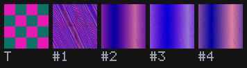

# Evolving a Shader Toward a Picture

Give Field a small picture and it will search for a StackSL program that draws it. The search is genetic programming over the program's words: it mutates, recombines and keeps the programs whose renders look closest to the target, rendering every candidate on the CPU, with no window and no GPU. What you get back is a short StackSL program you can paste into a shader box.

On its own the search finds programs that score better than random ones, and it rarely finds one that actually draws the target. With a language model proposing edits as it goes, it usually does: across twelve test targets it drew 23 of 29 runs almost exactly, where the search alone drew none. [The watchmaker](#the-watchmaker) below is how to switch that on and what it costs.

## Evolve toward a target

`evolveStackSLTowards` runs the search and, beside it, a random control: the same number of programs drawn at random from the same vocabulary, scored the same way. `StackSLTargets` has five built-in 32×32 targets. This box asks for four flat quadrants:

```diffstatic_runner {data-lang=kotlin screenshot="assets/stacksl_evolve/quadrants.png" wait="1.0" wait-output="true" capture="box" embed="true" open-outputs="true" w="1100" timeout="600" name="stacksl-evolve-quadrants"}
:::static
val run = evolveStackSLTowards(StackSLTargets.quadrants(32), budget = 400, selection = Selection.LEXICASE)
print(run.summary())
print(run.best!!.text)

// The program the watchmaker (below) found for the same target, for comparison.
val watchmaker = StackSLProgram.of(
    "[0.05,0.06,0.15] [0.98,0.9,0.1] uv x 0.5 < mix [0.1,0.5,0.95] [0.9,0.1,0.1] uv x 0.5 < mix uv y 0.5 > mix"
)
showImg(run.contactSheet(also = listOf("watchmaker" to watchmaker)),
    caption = "the target, the evolved program, the random control's best, and the watchmaker's (skill %.2f)"
        .format(run.skillOf(watchmaker)))
```

It takes under a minute. `budget` is the number of programs each side gets to render; doubling it roughly doubles the time. The printed line gives both sides' scores as *skill*: 0 is what a flat fill of the target's average colour would score, 1 is an exact match. The contact sheet draws each program at 160 pixels, so you see the program itself rather than an enlarged thumbnail of what the search scored. The last picture is not from this search: it is the program a language model wrote for the same target in [one of the runs below](#the-watchmaker), passed in with `also` and scored the same way by `run.skillOf`.

`run.best!!.text` is the program. It is ordinary StackSL and runs anywhere StackSL runs, including a GPU shader box, and `run.best!!.render()` draws it at 160 pixels.

## Your own picture

`StackSLTarget.of` turns any `Img` into a target, scaling it down to 32×32:

```diffstatic {data-lang=kotlin}
val target = StackSLTarget.of("logo", imgFromFile("/path/to/logo.png"))
val run = evolveStackSLTowards(target, budget = 800, selection = Selection.LEXICASE)
showImg(run.contactSheet())
```

Simple, high-contrast pictures work best: flat shapes, a few colours, structure larger than a few pixels. A photograph is a target the vocabulary has almost no way to draw.

## A search you can steer

`evolveStackSLTowards` runs to its budget and returns. `StackSLEvolution` is the same kind of search held as an object, so you can run some generations, look, change something and carry on. Here it runs 600 renders toward the disc target and shows the leaders:

```diffstatic_runner {data-lang=kotlin screenshot="assets/stacksl_evolve/steer.png" wait="1.0" wait-output="true" capture="box" embed="true" open-outputs="true" w="1100" timeout="600" name="stacksl-evolve-steer"}
:::static
val evolution = StackSLEvolution(StackSLTargets.spot(32), StackSLEvolveSettings.wide())
evolution.runTo(600)
print(evolution.summary())
showImg(evolution.contactSheet(top = 3), caption = "the target and the best programs that score differently, with their skill")
```

Without the model, 600 renders find no disc: the best is a red and green cross on dark stripes, and the population has settled on variants of it. `summary()` prints the best program and a table of where improvements came from.

`StackSLEvolveSettings.wide()` is a larger search than `evolveStackSLTowards`'s: three populations ("islands") of 12 that evolve apart and swap their best every 8 generations, programs up to 48 words, and a schedule that starts at 16 pixels and ends scoring 32-pixel renders by LPIPS plus pixel error over a 3×3 grid of regions. Bigger is not better on its own: at the same budget it draws the targets no more often than `evolveStackSLTowards` does. It is the search the next two sections add to.

The table counts, for each kind of change, how many candidates it offered, how many stayed in a population, and how many took the lead. Between generations you can:

- `evolution.step(10)` or `evolution.runTo(budget)` to carry on;
- `evolution.inject(listOf("p length 0.3 threshold"))` to offer programs of your own, which are scored like any other and kept only if they do well;
- `evolution.configure { it.copy(mu = 20) }` to change the settings;
- `evolution.snapshot()` to save the whole search (settings, populations, history) as data, and `evolution.restore(snapshot)` to go back to it.

## The watchmaker

The search's own changes are blind: swapping `sin` for `fbm` knows nothing about what either word draws. The watchmaker is a language model that does know. Every few generations it is shown the target and the current best programs, rendered, and proposes edits to them and a few programs written from scratch. They are scored like any other candidate. Switch it on with a model and the `watchmaker()` settings:

```diffstatic {data-lang=kotlin}
val evolution = StackSLEvolution(StackSLTargets.checker(32), StackSLEvolveSettings.watchmaker())
evolution.watchmaker = StackSLWatchmaker()
evolution.runTo(1200)
print(evolution.summary())
showImg(evolution.contactSheet())
```

`StackSLWatchmaker()` uses the fast model of whichever AI provider Field is set up with (see [AI features](aiFeatures.md)), or the model named by `AFIELD_AI_WATCHMAKER_MODEL`. `watchmaker()` asks it for 8 programs every 4 generations, and again whenever the best program has not improved for 2.

Each round, the model gets one picture: the target, marked T, and the four best programs that score differently, numbered.



With it come each program's text and scores, including a score for each region of the picture, the target's colours as numbers, and what its previous round's programs did. It replies with one line per program:

```diffstatic {data-lang=text}
0 | uv x 4 * floor uv y 4 * floor + 2 mod [0.9,0.1,0.7] [0.05,0.45,0.4] mix | Rebuilds the checkerboard directly
#2 | ... | ...
```

`0` is a program written from scratch, `#2` an edit of the second program. The reply is checked before anything is rendered: a program that does not compile, reads a texture, or has a definition that does not consume one value and leave one is refused, with the reason passed back to the model in the next round.

Then comes a second look. The model is shown what each of its own programs draws, next to the target, and asked to correct them:


It is the part that matters most. A model that knows exactly what it wants still writes StackSL that draws something else, and it only finds out by seeing the render. P5 above ends `2 mod 1 1 < mix`, which compares two constants, so its mask is the same everywhere and it draws one colour; the second pass replaced it, and put the checkerboards that had the colours the wrong way round into the target's phase. In earlier runs it was the whole first draft that came out blank: `2 mod 1 >` is never true. Both passes' programs are offered to the search, and the search's own mutation and crossover go on refining whatever does well. The two work on each other's programs. On the disc target the model drew the disc at radius 0.25, then 0.26, and the search's jitter of numbers found 0.28, the target's own. On the rings, the model's `p length 16 * floor 2 mod` was jittered to 12.59 by the search, and the model's next edit took it to 12.7. `evolution.improvements` lists every new best program with where it came from.

### How well it works

Each search below had 1,200 renders on each of twelve targets, over two or three seeds. The five built-in targets are the ones the prompt was written against. The seven others (a triangle, diagonal stripes, two discs, a cross, a bullseye, a tilted edge and a sunset with a smooth sky) were written afterwards, and nothing was changed after running them. Resemblance is measured by layout agreement, a score no search optimises (see [below](#what-beating-the-control-means)): 1 is the target exactly, 0 is no better than chance.

| search | built-in five: mean layout | runs above 0.9 | other seven: mean layout | runs above 0.9 |
| --- | --- | --- | --- | --- |
| `evolveStackSLTowards`, lexicase | 0.18 | 0 of 15 | 0.10 | 0 of 14 |
| `wide()`, no model | 0.16 | 0 of 15 | | |
| watchmaker, one pass, every 8 generations | 0.66 | 9 of 15 | | |
| the same with the second look | 0.93 | 12 of 15 | | |
| `watchmaker()` | 0.91 | 13 of 15 | 0.88 | 10 of 14 |
| the model alone, at the same number of calls | 0.67 | 8 of 15 | 0.52 | 2 of 14 |

The last row is the model run with almost no search behind it: one population, one blind change per generation, a round every generation, stopped after 13 or 14 model calls. It draws far less than the model and the search together, at more calls.

These are the seven new targets from one seed: each target, then the best program from the plain search (GP), from the model alone, and from `watchmaker()` (both), each with its layout agreement:

![seven rows on black, one per new target, each showing the target and three results with their layout agreement. The plain search draws arcs, stripes and blocks that resemble none of them. The model alone draws a stepped triangle, diagonal stripes, two squares for the two discs, a checkerboard for the cross, a thin ring with a dot for the bullseye, a stepped edge and a small sun. The search with the watchmaker draws the triangle, stripes, cross, bullseye and tilted edge almost exactly, the sunset with a ring for its sun, and a green smear for the two discs](assets/stacksl_evolve/watchmaker-heldout.png)

The model alone's diagonal stripes look right and score 0.01: they are a quarter of a stripe out of place, and layout agreement compares positions exactly. The two discs are this seed's miss; on the other seed both were drawn (1.00).

What the programs look like is the other half of the result. The plain search's winners are 20 to 30 words that happen to score well. The watchmaker's are what a person would write:

```diffstatic {data-lang=text}
[0.03,0.04,0.12] [1.0,0.82,0.25] p length 0.2785 < mix              # spot
[0.05,0.1,0.55] [0.98,0.9,0.1] uv x 3.005 * fract 0.513 < mix       # bands
p length 12.699 * floor 2 mod 1- white *                           # rings
```

### What it costs

A run of `watchmaker()` at 1,200 renders took 10 to 13 model calls (two per round), about 110,000 to 140,000 input tokens of which about 80% were read from the provider's cache, and 7,000 to 9,000 output tokens. It took 100 to 130 seconds, against about 30 for the search alone. Most of each request is the same on every call (what the job is, the rules of a StackSL program, and the whole [words guide](stacksl_cheatsheet.md)), and only a few hundred words and one small picture change, which is why so much comes from the cache. `evolution.usage` adds it up as the search goes, and `summary()` prints it.

### Where it goes wrong

- **It miscounts.** Seen at 64 pixels, a 4×4 checkerboard is often drawn 5×4 or 6×4. The search's scores catch it, and the correct count usually arrives within a few rounds, but not always.
- **Fine stripes alias.** A program can draw stripes that match the target at 32 pixels and turn to moiré at 128. Look at `contactSheet()` at a large size before trusting a result.
- **A negative scores well.** LPIPS barely tells a picture from its negative, and a search scored by LPIPS alone once kept concentric rings in inverted colours as its best. `wide()` and `watchmaker()` finish with LPIPS plus pixel error for this reason.

## A gradient step on a program's numbers

A program can have the right words and a wrong number: a disc of radius 0.4 where the target's is 0.28. StackSL programs are differentiable in their numbers, so `fit` takes a round of gradient descent (Adam) on them, writes the new numbers back into the program, and offers the result to the search:

```diffstatic_runner {data-lang=kotlin screenshot="assets/stacksl_evolve/fit.png" wait="1.0" wait-output="true" capture="box" embed="true" open-outputs="true" w="1100" timeout="600" name="stacksl-evolve-fit"}
:::static
val evolution = StackSLEvolution(StackSLTargets.spot(32))
val seed = StackSLProgram.of("[1,0.82,0.25] [0.03,0.04,0.12] p length 0.4 threshold mix")
val fitted = evolution.fit(seed, literals = listOf(4), iterations = 30)
print(fitted)
showImg(montage(listOf(
    "target" to evolution.target.raster.toImg().upscaleNearest(5),
    "seed" to seed.render(),
    "fitted" to StackSLProgram.of(fitted.fitted!!).render()
), columns = 3, cellSide = 170), caption = "the disc's radius, moved by gradient descent")
```

`literals = listOf(4)` lets only the fifth word, `0.4`, move. Leave it out and every number in the program may. The gradient goes through the threshold's hard edge by smoothing it slightly while the descent runs, and through LPIPS, which Field also differentiates. It is LPIPS plus pixel error, not LPIPS alone: on its own, LPIPS's indifference to a picture's negative let a descent turn a striped program's colours the wrong way round.

`StackSLEvolveSettings(fitEvery = 4)` takes a step on the leader every four generations. It is off by default because, measured, it did not improve the results: once the words are right, the search's own jitter of numbers gets there too. Use `fit` by hand when you have a program that is nearly right.

## Steering it from the AI chat

The [stacksl_evolve_studio](agent_transcripts.md#stacksl_evolve_studio) starting point puts a search in one box and hands it to the AI chat. Open the box's AI panel and ask, for instance, "evolve toward the target, and bring in the watchmaker when it stalls". The chat can run generations, look at the leaders, propose programs of its own, ask the watchmaker for a round, take a gradient step on a leader, and change the metric, the resolution or the size of the population. `/population` and `/sheet` show the leaders in the chat.

The population belongs to the conversation, the way the canvas does in [AI4 Paints](ai4_painting.md). Rewind the chat to one of your requests and the search goes back to how it was before it, scores and history included; switch branch with `/branch` and the search follows. Every state the conversation has been in is also kept, so you can ask the chat to breed the current population with one from a branch you left: it lists them with `evolve_states` and brings one in with `evolve_crossbreed`.

For your own picture, change the target in the box:

```diffstatic {data-lang=kotlin}
val evolution = stackSLEvolution(StackSLTarget.of("logo", imgFromFile("/path/to/logo.png")))
stackSLEvolveStudio(evolution)
```

## How "close" is measured

The default score is LPIPS, a learned perceptual distance (`Lpips.distance(a, b)` in [`afield.onnx`](reference/machine-learning.md)): both pictures go through the convolution stages of an image-recognition network, and the differences between their features are weighted by a layer trained on people's judgements of which images look alike. It compares edges, blobs and textures, not pixel values. The first time it runs on a machine Field builds the model, which takes about a minute.

`metric = StackSLMetric.PIXEL` scores by average pixel error instead. Here are both on the bands target, 400 renders each:

```diffstatic_runner {data-lang=kotlin screenshot="assets/stacksl_evolve/bands-metrics.png" wait="1.0" wait-output="true" capture="box" embed="true" open-outputs="true" w="1100" timeout="900" name="stacksl-evolve-bands-metrics"}
:::static
val target = StackSLTargets.bands(32)
val pixel = evolveStackSLTowards(target, budget = 400, metric = StackSLMetric.PIXEL)
val lpips = evolveStackSLTowards(target, budget = 400, selection = Selection.LEXICASE)
print("pixel: " + pixel.best!!.text)
print("lpips: " + lpips.best!!.text)

:::fold draw the target and both winners side by side
showImg(
    montage(
        listOf(
            "target" to target.raster.toImg().upscaleNearest(5),
            "pixel error" to pixel.objective.render(pixel.best!!, 160).toImg(),
            "LPIPS" to lpips.objective.render(lpips.best!!, 160).toImg()
        ),
        columns = 3, cellSide = 170
    ),
    caption = "six yellow and blue bands, and the best program found under each score"
)
:::endfold
```

At this seed and budget both searches found stripes. Pixel error's are vertical, too many and in the wrong colours; LPIPS's are diagonal. Neither is the target. One run on one target is an anecdote, which is why the comparisons on this page are across targets and seeds.

What the two scores reward is different. Average pixel error is satisfied first by getting the target's overall colour balance right, and a search finds that long before it finds the layout: a program that draws mostly the background colour scores well against a target that is mostly background, whether or not the shape is there. LPIPS gives no credit for colour balance alone.

`selection = Selection.LEXICASE` matters with LPIPS. LPIPS compares features wherever they are in the picture, so on its own it accepts the right texture in the wrong place. Under lexicase each region of the picture is scored separately, and a program is kept when it is the best on some region, so the search has to get each part right. `StackSLMetric.LPIPS_PIXEL` averages the two scores, which pins colours and catches a negative.

## Options

`evolveStackSLTowards` takes:

| parameter | default | what it does |
| --- | --- | --- |
| `budget` | 600 | programs rendered by each side (search and control) |
| `seed` | 1 | the same seed gives the same program |
| `metric` | `LPIPS` | `PIXEL`, `LPIPS` or `LPIPS_PIXEL` |
| `selection` | `TOURNAMENT` | `LEXICASE` scores each quadrant separately (LPIPS metrics) |
| `genome` | `StackSLGenome()` | the vocabulary and program length, 3 to 24 words |
| `supersample` | 1 | render each candidate at 2× and average down, at four times the cost |

`StackSLEvolveSettings`, for `StackSLEvolution`:

| setting | default | what it does |
| --- | --- | --- |
| `mu`, `lambda` | 12, 24 | programs kept per island, and new ones made per island each generation |
| `islands` | 1 (3 in `wide()`) | populations evolving apart; `migrants` best move round them every `migrateEvery` generations |
| `selection` | `LEXICASE` | how parents are chosen |
| `maxTokens` | 48 | the longest program, definitions included |
| `stages` | one: LPIPS at 32 px on quadrants | the schedule: each `StackSLStage` has `generations`, `dim`, `metric` and `lpipsGrid` (regions per side, 0, 2, 3 or 4) |
| `watchmakerEvery`, `watchmakerOnStall` | 0, 0 (4, 2 in `watchmaker()`) | generations between watchmaker rounds, and generations without improvement before an extra one |
| `proposals`, `parents` | 8, 4 | programs asked for per round, and programs shown |
| `watchmakerRevise` | true | the second look |
| `fitEvery`, `fitIterations` | 0, 16 | generations between gradient steps on the leader, and steps per round |

## What beating the control means

Every result from `evolveStackSLTowards` is reported against the random control at the same budget, because a vocabulary this expressive produces plausible pictures by chance. A search that only matched what random drawing finds would look identical from outside.

!!! note "Beating the control is not resembling the target"
    "Evolution beat the control" means the evolved program **scores** higher under the metric the search optimised. It does not mean the picture looks like the target. Under average pixel error, evolution beat the control on four of five targets while drawing dark diagonal streaks for a yellow disc and a vertical gradient for four quadrants. Look at the contact sheet before believing a score.

Resemblance is checked with a measure no search optimises: each pixel of a render is labelled with the target colour it is nearest, and the labels are compared with the target's own (`StackSLLayout.layoutAgreement`, a Cohen's kappa: 1 is exact, 0 is chance, negative for the target's negative). It is position-exact, so three bands out of phase with the target's six score −0.70 even though they read as bands. The watchmaker is never shown it, and nothing in the search reads it. `StackSLEvolution.layoutOf(program)` computes it for a report.

Without the watchmaker, these are the five built-in targets' best programs at 1,200 renders, against the watchmaker's:

![five rows on black, one per built-in target: the target, then the best picture from evolveStackSLTowards (GP), from wide() without a model, and from the search with the watchmaker (both), each with its layout agreement. GP draws a white disc on blue for the disc, wavy lines for the rings, too many bands, a smear for the checkerboard and quadrants in the wrong colours; wide draws grey rings, fine wavy stripes, very fine stripes, a blurred cross and the same wrong quadrants; both draws all five almost exactly](assets/stacksl_evolve/watchmaker-original.png)

`StackSLEvolveGallery` (the `stacksl.evolve.gallery` smoke test) runs `evolveStackSLTowards` across three targets and two metrics at 700 renders each, and fails if LPIPS with lexicase stops beating its control or stops out-drawing pixel error on `quadrants`. The watchmaker is not in it, since it needs a model.

??? aside "How the watchmaker's figures and numbers were made"
    The comparison table, the two results figures and the watchmaker's pictures come from `afield.examples.stacksl.StackSLWatchmakerTrial`, run with OpenAI's `gpt-6-luna` as the fast model on 2026-10-08, and are committed images rather than runner captures, because a capture would call a paid model on every docs build. The trial saves every round's prompt, both pictures and the raw replies beside its results. To run it again: `run-jvm-main afield.examples.stacksl.StackSLWatchmakerTrial --arg=--budget --arg 1200 --arg=--seeds --arg 1,2,3` through the backdoor (about two hours for all arms), and `--arg=--figure --arg <dir>/trial.json` to draw a figure from the results. The model is not deterministic, so a rerun gives other programs and numbers near these.

    The first live round was told the target's name, `spot`, and drew a disc at once; the name is no longer sent. The one-pass rows were measured before the second look existed, and `wide()` ended in LPIPS alone until the inverted-rings result moved it to LPIPS plus pixel error. Over the 29 runs, that change left the mean layout where it was (0.90 against 0.91), and on the seven new targets it drew 10 of 14 runs above 0.9 where LPIPS alone drew 6.

??? aside "How the score came to be LPIPS"
    The first version of this search (2026-09-06) scored by average pixel error and produced the dark streaks and gradients described above. A home-made structural score (multi-scale SSIM plus colour error) was tried next, on 2026-10-07: it produced a white disc for the disc target and bands for the bands target, but its winner for the rings target was fine stripes that only looked like rings at 32 pixels. It was replaced with LPIPS rather than tuned. LPIPS is a published, learned metric with a reference implementation that Field's export is checked against (`tools/export_lpips_onnx.py`; agreement 1.2×10⁻⁷). Its gradient, which the fit uses, is a second export checked against PyTorch's to about 10⁻⁶.

    The blind search alone, measured on 2026-10-07 at 800 renders, drew `quadrants` (three blocks of four in the right colours) and partly `bands`, `rings` and `checker`, and never drew the disc.

??? aside "Why the targets are made in Kotlin, not taken from the StackSL gallery"
    A gallery still is a picture some StackSL program already makes, so searching for it would be a program-recovery task, and a good score could mean either "the search works" or "it rediscovered a short program from its own vocabulary". The built-in targets are drawn with arithmetic StackSL has no single word for. Each one can still be drawn by a hand-written program of 7 to 19 words, which the smoke test checks, so a target the search fails on is one it could have reached.
