# StackSL examples

`uv fbm palette saturate` is a complete StackSL program: four words, lowered to GLSL. Assign that string to a shader module's slot while the window is up and the picture changes without a teardown. That is the shape the language is built around: short enough to type into something already running, and forgiving enough that a mutation makes a strange image rather than a compile error.

Each section below puts a short program next to the image or clip it renders. The words, their stack signatures and the arity conventions are in the [StackSL cheatsheet](stacksl_cheatsheet.md); driving the language from Kotlin and [mutating it under a search loop](#notes-for-llms-and-genetic-search) come at the end.

StackSL is vector-first: every stack value is a `vec4`. Numbers become `vec4(n)`, swizzles repack into `vec4`, and most operators work component-wise. The compiler emits one callable function:

```diffstatic {data-lang=glsl}
vec4 prefix(vec4 prefix_in) { ... }
```

Named StackSL definitions become GLSL functions whose names start with the same prefix:

```diffstatic {data-lang=glsl}
vec4 prefix_warp(vec4 prefix_in) { ... }
vec4 prefix_paletteMist(vec4 prefix_in) { ... }
```

This keeps generated names out of the global shader namespace. The Field property for source text is `stackSL`; sidecar files use `.stacksl`.

## Rendered gallery

The whole gallery is rendered inside a single Field document: one renderer, one
offscreen target, and one `{{ stack.auto.program }}` fragment slot (see [Kotlin
and template use](#kotlin-and-template-use)). `StackSLGalleryHarness` walks the
program list, re-binds the slot for each one, waits a few frames, and reads the
texture back to a PNG. Each program reaches a fullscreen fragment shader as
`program(vec4(uv, hash, time))`.

The programs are not baked into the harness. Each is an editable box in a
canonical_graphics-style workspace at `assets/stacksl_gallery/`
(`<name>_stackSL_.stacksl` plus a fullscreen `fragment`/`vertex` and the `code`
that binds `module.program = stackSL`). It is one Field document; you can browse
and live-edit the boxes below. Edit a `.stacksl` file and regenerate.

<iframe
  src="/offline.html?file=/field4/assets/stacksl_gallery/metadata.edn"
  title="StackSL gallery workspace"
  style="width:100%; height:560px; border:1px solid #444; border-radius:8px; background:#111;"
  loading="lazy"
  allowfullscreen>
</iframe>

<!--
FIELD_TEST
id: docs.stacksl.gallery
runner: backdoor-box
graphicsContext: true
tags: [docs, stacksl, shaders, graphics]
timeoutSec: 300
execution: launch
waitSec: 45.0
expect:
  allowMissingOutput: true
  image:
    path: /tmp/docs-stacksl-gallery-hero.png
-->
```diffstatic_runner {data-lang=kotlin screenshot="assets/stacksl/_gallery-hero.png" source-image="/tmp/docs-stacksl-gallery-hero.png" wait="45.0" timeout="300" execution="launch" embed=false graphics-context=true name="stacksl-gallery" hidden=true fabricate-scene="stacksl-gallery"}
```

**Normalized coordinates** — the initial stack value, clamped.

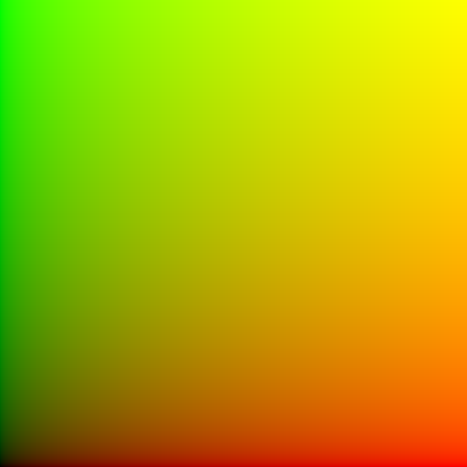

```diffstatic {data-lang=stacksl}
uv saturate
```

**FBM into a cosine palette** — distort coordinates, make a scalar field, color it.

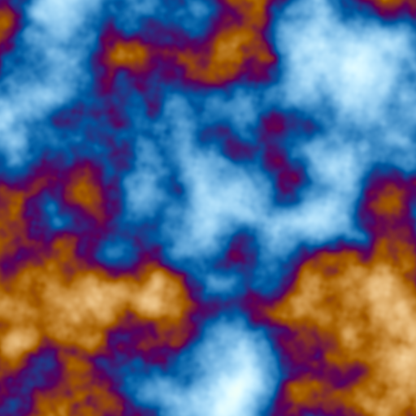

```diffstatic {data-lang=stacksl}
uv 5.0 *
time 0.12 *
+
fbm
palette
saturate
```

**Centered soft ring** — `pulse` around a radius.

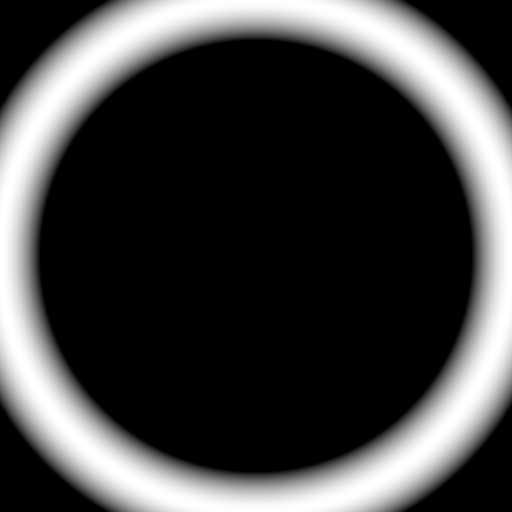

```diffstatic {data-lang=stacksl}
p length 0.5 0.08 pulse white *
```

**Kaleidoscope and twist** — domain transforms stacked before the field.

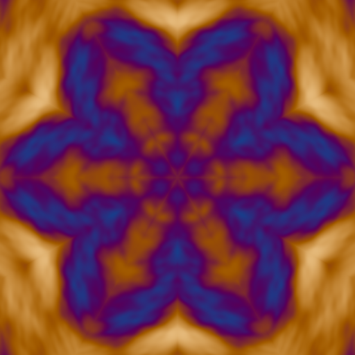

```diffstatic {data-lang=stacksl}
p 6 kaleido
1.7 twist
3.0 *
fbm
palette
saturate
```

**Polar warp through a sigmoid** — rotate in polar space, then shape.

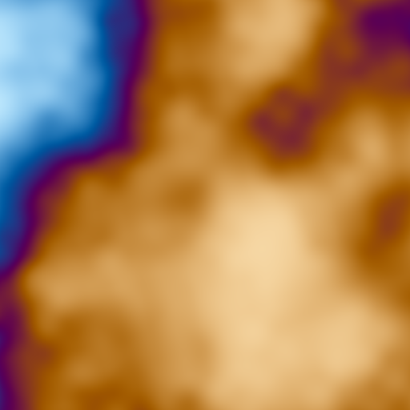

```diffstatic {data-lang=stacksl}
p polar
dup y 0.2t + >y
cart
fbm
sigmoid
palette
```

**Ramp, posterize, bias** — quantized shaping.

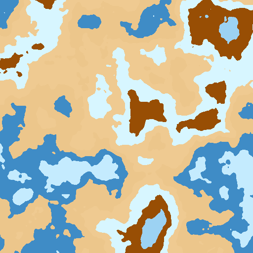

```diffstatic {data-lang=stacksl}
uv 5 * fbm
0.2 0.8 ramp
6 posterize
0.62 bias
palette
```

**Frequency modulation** — a compact phase modulator.

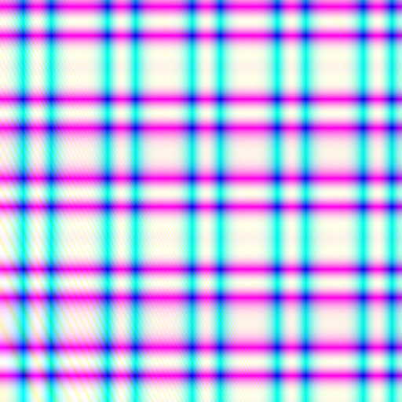

```diffstatic {data-lang=stacksl}
uv 14.0 * time +
fm
palette
```

**Reusable definitions** — `warp` and `field` become prefixed GLSL functions.

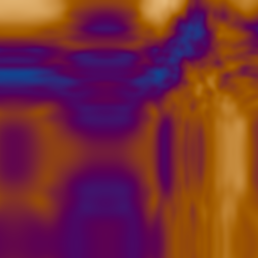

```diffstatic {data-lang=stacksl}
: warp
  uv 6.0 * time + sin
  0.35 *
  uv +
;

: field
  warp fbm
;

field palette saturate
```

**One subroutine, two coordinates** — call `ridge` twice and blend.

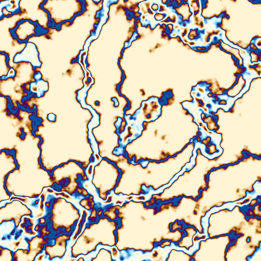

```diffstatic {data-lang=stacksl}
: ridge
  fbm 0.45 0.08 pulse
;

p 5.0 * 0.2t + ridge
p 7.0 * 0.13t - ridge
0.5 * +
palette
```

**Perturb lightness in OKLab** — do the math in a perceptual space, return to RGB.

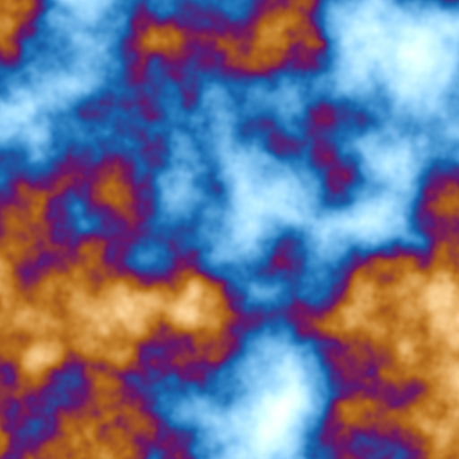

```diffstatic {data-lang=stacksl}
uv 5.0 * fbm palette
rgb2oklab
time sin 0.05 * 0 0 0 vec4
add
oklab2rgb
saturate
```

**RYB paint mixing** — treat the value as red/yellow/blue and convert.


```diffstatic {data-lang=stacksl}
uv 0.5 + ryb saturate
```

**Explicit color grade** — lift/gain/gamma over an FBM palette.

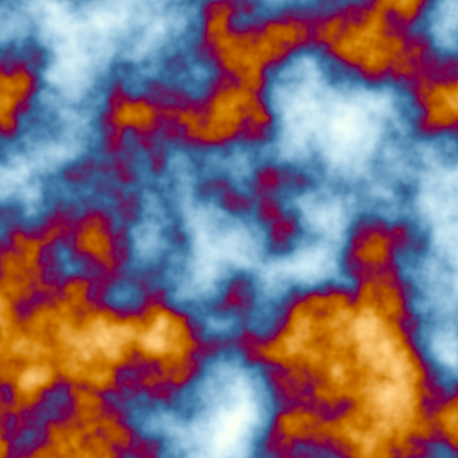

```diffstatic {data-lang=stacksl}
uv 6.0 * fbm palette
0.02 0.00 -0.01 0.0 vec4
1.15 1.05 0.95 1.0 vec4
0.85 0.95 1.10 1.0 vec4
grade
saturate
```

**Directional phasor noise** — `phacelle` builds oriented cellular structure.

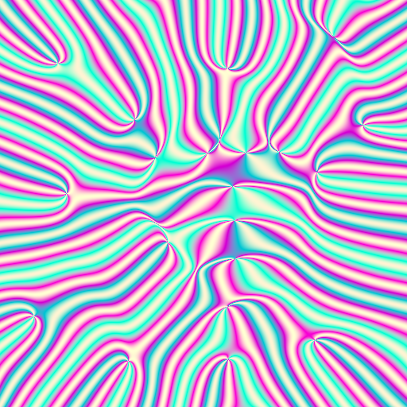

```diffstatic {data-lang=stacksl}
p 40 * phacelle palette saturate
```

**Radial standing waves** — a wave modifier driven by radius.

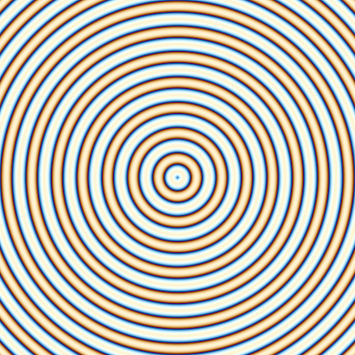

```diffstatic {data-lang=stacksl}
p ]wr14 palette saturate
```

**Mirrored tiling** — `mirror` folds coordinates into a symmetric weave.

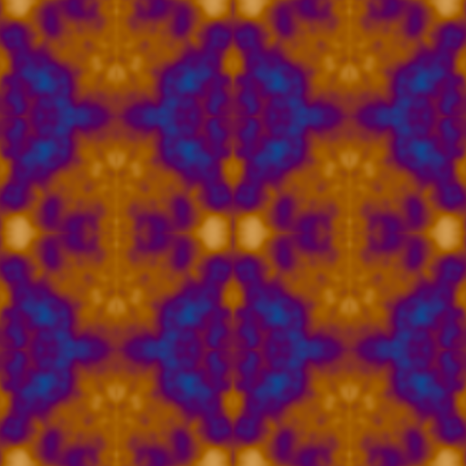

```diffstatic {data-lang=stacksl}
uv 4 * mirror fbm palette saturate
```

**Tiled repetition** — `tile` wraps coordinates into a repeating grid.

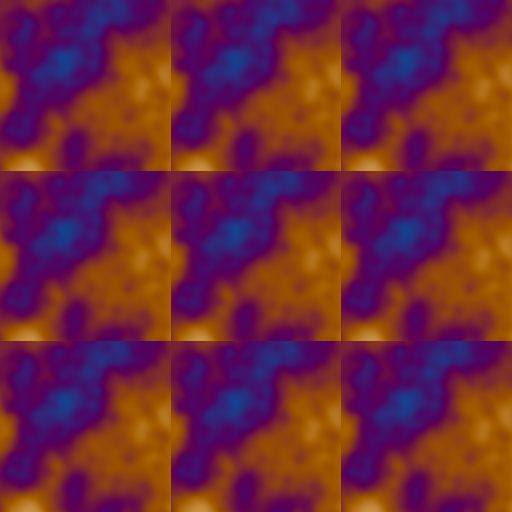

```diffstatic {data-lang=stacksl}
uv 3 tile fbm palette saturate
```

**Hard threshold mask** — a two-tone cut of the noise field.

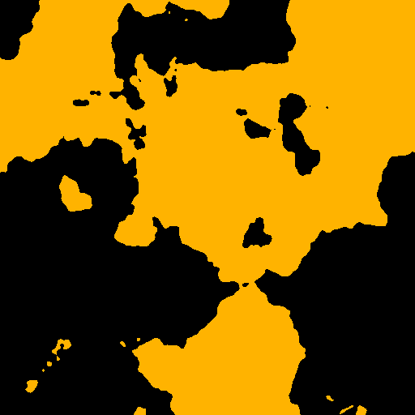

```diffstatic {data-lang=stacksl}
uv 5 * fbm 0.45 threshold orange * saturate
```

**Custom cosine palette** — supply `t a b c d` for your own color scheme.

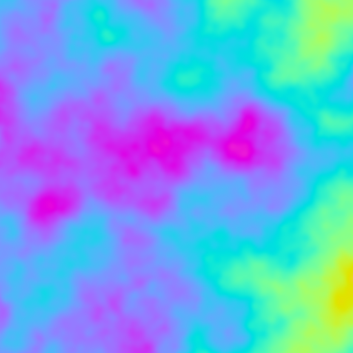

```diffstatic {data-lang=stacksl}
uv 3 * fbm
0.5 0.5 0.5 1 vec4
0.5 0.5 0.5 1 vec4
1.0 1.0 1.0 1 vec4
0.0 0.33 0.67 1 vec4
palette
```

**Sigmoid contrast** — push the field through a logistic S-curve.

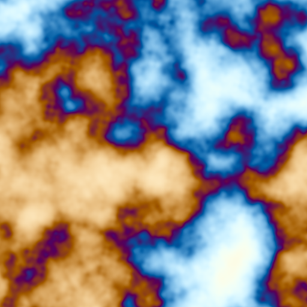

```diffstatic {data-lang=stacksl}
uv 4 * fbm 8 sigmoid palette saturate
```

**Twisted swirl** — rotate coordinates by radius before the field.

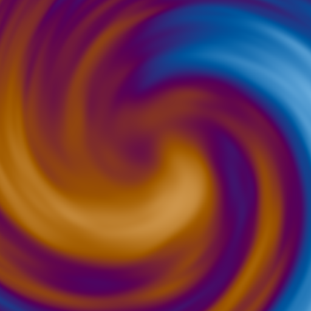

```diffstatic {data-lang=stacksl}
p 5.0 twist fbm palette saturate
```

**Log-spiral flow** — `spiral` twists by radius and log-radius.

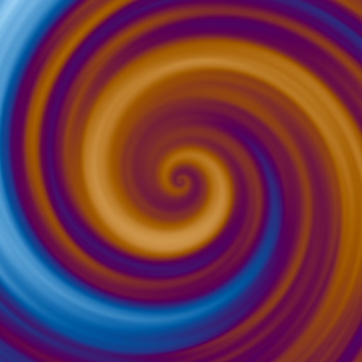

```diffstatic {data-lang=stacksl}
p 3 spiral fbm palette saturate
```

**Single-octave value noise** — `noise` is smoother/blockier than `fbm`.

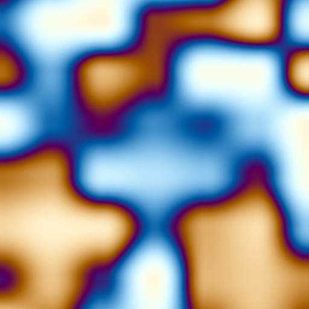

```diffstatic {data-lang=stacksl}
uv 6 * noise palette saturate
```

**Sample-and-hold blocks** — `sh` steps a hashed value across space.

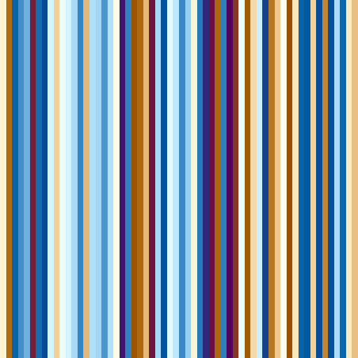

```diffstatic {data-lang=stacksl}
uv 6 * ]sh10 palette saturate
```

**Word references** — `'ridge ... apply` inlines a named word as a value.

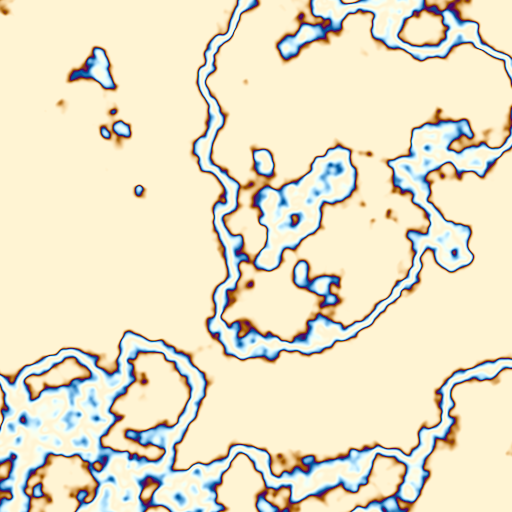

```diffstatic {data-lang=stacksl}
: ridge fbm 0.42 0.08 pulse ;
'ridge p 5 * apply palette saturate
```

**Local marks** — `=c` names a value, reused twice without a definition.

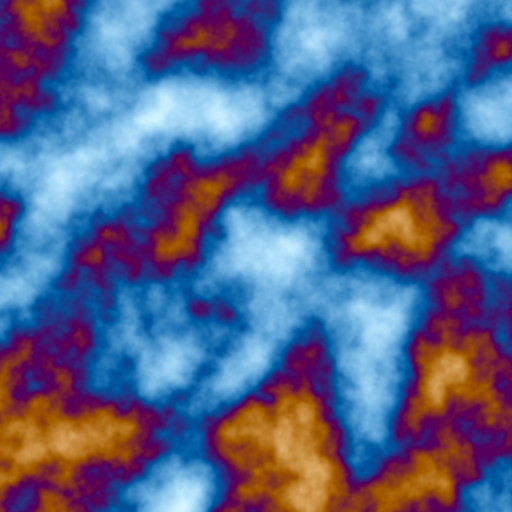

```diffstatic {data-lang=stacksl}
uv 8 * =c
c fbm
c 0.35 + fbm
0.5 mix
palette saturate
```

**Sine stripes** — a plain function of `uv.x` colored by the palette.

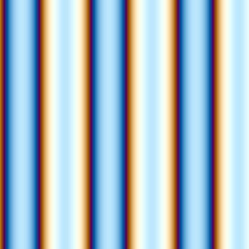

```diffstatic {data-lang=stacksl}
uv x 18 * sin 0.5 + 0.5 * palette saturate
```

**Contrast and tone map** — grade the palette output.

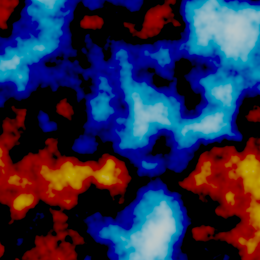

```diffstatic {data-lang=stacksl}
uv 5 * fbm palette 1.7 contrast tonemap saturate
```

## Animated

Time-driven programs read `input.w`, so the same fullscreen harness animates them:
`StackSLGalleryHarness.renderAnimations` sweeps a `time` push constant and encodes
the frames to mp4, one shader build per clip. Mark a workspace box `animate: true`
in its `metadata.yaml` to add it here.

<!--
FIELD_TEST
id: docs.stacksl.animations
runner: backdoor-box
graphicsContext: true
tags: [docs, stacksl, shaders, graphics, video]
timeoutSec: 600
execution: launch
waitSec: 120.0
expect:
  allowMissingOutput: true
  image:
    path: /tmp/docs-stacksl-animations-hero.png
-->
```diffstatic_runner {data-lang=kotlin screenshot="assets/stacksl/_animations-hero.png" source-image="/tmp/docs-stacksl-animations-hero.png" wait="120.0" timeout="600" execution="launch" embed=false graphics-context=true name="stacksl-animations" hidden=true fabricate-scene="stacksl-animations"}
```

**FBM drifting through a palette** — `uv 5.0 * time 0.12 * + fbm palette saturate`

<video src="assets/stacksl/stacksl-fbm-palette.mp4" autoplay loop muted playsinline
       style="width:100%;max-width:512px;border-radius:8px;border:1px solid #333;">
</video>

**Frequency modulation** — `uv 14.0 * time + fm palette`

<video src="assets/stacksl/stacksl-fm-palette.mp4" autoplay loop muted playsinline
       style="width:100%;max-width:512px;border-radius:8px;border:1px solid #333;">
</video>

**Polar rotation** — `p polar ... 0.2t ... cart fbm sigmoid palette`

<video src="assets/stacksl/stacksl-polar-sigmoid.mp4" autoplay loop muted playsinline
       style="width:100%;max-width:512px;border-radius:8px;border:1px solid #333;">
</video>

**Definitions warping over time** — `warp` folds `time` into a sine domain offset

<video src="assets/stacksl/stacksl-definitions.mp4" autoplay loop muted playsinline
       style="width:100%;max-width:512px;border-radius:8px;border:1px solid #333;">
</video>

**Drifting ridges** — one subroutine sampled at two time-shifted coordinates

<video src="assets/stacksl/stacksl-subroutine-ridges.mp4" autoplay loop muted playsinline
       style="width:100%;max-width:512px;border-radius:8px;border:1px solid #333;">
</video>

**Feedback trails (ping-pong)** — the loop *is* the animation. This one samples
the previous frame through `source`, decays it, advects it, and injects a moving
colored band, so the image feeds back into itself each frame. It is the
artificial-life / reaction pattern StackSL is built for; the harness renders it
with a `PingPongRenderToTexture` so the previous frame is available while the
current one is written.

```diffstatic {data-lang=stacksl}
0.0025 0.004 vec2 sample.w
0.94 *
uv y 0.15t fract 0.02 pulse 0.15t palette * 0.8 *
+
saturate
```

<video src="assets/stacksl/stacksl-feedback-trails.mp4" autoplay loop muted playsinline
       style="width:100%;max-width:512px;border-radius:8px;border:1px solid #333;">
</video>

**Diffusion (blur feedback)** — a neighborhood word (`blur`) reads the previous
frame, so each step diffuses the last one while sparse noise is injected and
decays. Reaction and growth are what StackSL's neighborhood fields (`blur`,
`laplace`, `sobel`, `curl`) exist for.

```diffstatic {data-lang=stacksl}
0.004 blur
0.975 *
uv 5 * 0.25t + fbm 0.62 threshold 0.05 *
+
saturate
```

<video src="assets/stacksl/stacksl-diffusion-feedback.mp4" autoplay loop muted playsinline
       style="width:100%;max-width:512px;border-radius:8px;border:1px solid #333;">
</video>

## The input convention

The input vector is usually read as:

| Component | Meaning |
| --- | --- |
| `input.x` | x / u coordinate |
| `input.y` | y / v coordinate |
| `input.z` | z coordinate, hash, seed, or auxiliary state |
| `input.w` | time, frame, or phase |

The stack starts with `input` already on it. You can also push explicit views:

```diffstatic {data-lang=stacksl}
uv      # vec4(input.xy, 0, 1)
p       # vec4(input.xy - 0.5, 0, 1), also: pos, center, centered
time    # vec4(input.w)
hash    # vec4(input.z)
input   # vec4 input exactly
```

Short programs stay valid. If a normal operator needs more values than the stack has, it wraps around and reuses the available values. If the stack is empty, it uses a default value such as `input`, `vec4(0)`, or a neutral color. Creative words such as `palette`, `ema`, `grade`, and `pulse` have short forms that consume one primary value and default the rest.

## Tiny programs

Identity is just the initial stack value:

```diffstatic {data-lang=stacksl}
# returns input
```

Tint the input toward blue:

```diffstatic {data-lang=stacksl}
blue mix
```

Build a normalized coordinate color:

```diffstatic {data-lang=stacksl}
uv saturate
```

Turn time into a grayscale pulse:

```diffstatic {data-lang=stacksl}
time sin 0.5 * 0.5 +
```

## Swizzles and constructors

Swizzles always return a `vec4`.

```diffstatic {data-lang=stacksl}
uv xy       # vec4(v.x, v.y, 0, 1)
input z    # vec4(input.z)
input rgb  # vec4(input.rgb, 1)
```

Constructors consume scalar `.x` components from the stack:

```diffstatic {data-lang=stacksl}
0.2 0.8 vec2
0.2 0.8 time vec3
red hash vec4
```

Stack-selector literals combine swizzles from multiple stack values. The index counts down from the top of stack, so `0` is the top value:

```diffstatic {data-lang=stacksl}
1 2 3 4 [3x,2x,1x,0x]  # vec4(1,2,3,4)
uv prev [1xy,0zw]       # vec4(uv.xy, prev.zw)
```

## FBM into a cosine palette

This is the basic creative-coding move: distort coordinates, make a scalar field, then color it.

```diffstatic {data-lang=stacksl}
uv 5.0 *
time 0.12 *
+
fbm
palette
saturate
```

`palette` can be used with one value. It defaults to a balanced cosine palette. To provide a full palette, put `t a b c d` on the stack before the word:

```diffstatic {data-lang=stacksl}
uv fbm
0.50 0.50 0.50 1.00 vec4
0.50 0.45 0.35 0.00 vec4
1.00 1.00 1.00 1.00 vec4
0.00 0.10 0.20 0.00 vec4
palette
```

## Reusable StackSL definitions

Definitions are written with `: name ... ;`. Inside StackSL, a definition behaves like a word that consumes one `vec4` and pushes one `vec4`. In GLSL, it becomes `prefix_name(vec4 prefix_in)`.

```diffstatic {data-lang=stacksl}
: warp
  uv 8.0 * time + sin
  0.18 *
  uv +
;

: field
  warp fbm
;

field palette contrast tonemap
```

With prefix `fx`, this emits `fx_warp`, `fx_field`, and the root function `fx`.

The compiler also inlines definition calls at their call site before emitting SSA-style GLSL. The named GLSL functions are still emitted, but inlining lets repeated StackSL calls share identical samples and math when their inputs and source constants are the same.

```diffstatic {data-lang=stacksl}
: ring
  0-> 0.982 *
  p length 0.42 0.035 pulse 0.08 *
  +
;

drop
input ring
input ring
+ 0.5 *
dup ->0
palette
saturate
```

## Local named marks

When a phrase gets larger, local marks let you name a value without turning it into a reusable definition. `=name` copies the current top into a mark and leaves the stack alone. After that, bare `name` pushes the marked value.

```diffstatic {data-lang=stacksl}
uv 8 * =coord
coord fbm
coord 0.2t + fbm
0.5 mix
palette
saturate
```

If you want the mark to clear the working stack, use the explicit move/read form:

```diffstatic {data-lang=stacksl}
uv 8 * >coord
<coord fbm
<coord 0.2t + fbm
0.5 mix
palette
saturate
```

Marks are local to the current root program or definition. They are SSA aliases in the generated shader, so they do not create mutable GLSL variables and unused marked values still disappear.

## Ping-pong RTT sampling

Sample words need a texture environment. If the compiler is called with `sampleTextures = listOf("state")`, `sample` reads from `uniform sampler2D state`. Function and helper names are prefixed; sampler names are not, so several StackSL expansions can share the same texture.

```diffstatic {data-lang=stacksl}
uv 0.003 * sample
uv 4.0 * time + fbm palette
0.08 ema
saturate
```

In the short form, `ema` consumes the current value and defaults the previous value to `input` and alpha to `0.08`. For a ping-pong update, the explicit form is usually clearer:

```diffstatic {data-lang=stacksl}
uv 4.0 * time + fbm palette   # current
prev                          # previous at input.xy
0.06                          # alpha
ema
saturate
```

Relative sampling uses the top stack value as an offset:

```diffstatic {data-lang=stacksl}
uv time + sin 0.006 * sample
```

Absolute sampling ignores `input.xy`:

```diffstatic {data-lang=stacksl}
uv 0.5 + sample-abs
```

`gather` returns `textureGather(..., 0)` for small neighborhood probes:

```diffstatic {data-lang=stacksl}
uv 0.002 * gather
luma
```

Sampler dimensions are available from the configured sampler environment. `texelSize` pushes `vec4(1/width, 1/height, 0, 1)` for the first sampler, and `textureSize` pushes `vec4(width, height, 0, 1)`. Numbered variants such as `texelSize1` mirror `sample1`.

```diffstatic {data-lang=stacksl}
uv texelSize gradient.r
```

## Per-pixel store channels

`0->`, `1->`, `2->`, and `3->` read the x/y/z/w channel of the per-point `vec4` store and push it as `vec4(channel)`. In the ping-pong harness, that store aliases the previous output at the current pixel, so `0->` is a compact red-memory read.

`->0`, `->1`, `->2`, and `->3` pop the top value and write its `.x` component into the corresponding output channel. Explicit channel writes win at the end of the generated function; unwritten channels still come from the ordinary top-of-stack `vec4`.

```diffstatic {data-lang=stacksl}
0-> 0.985 *
p length 0.5 0.08 |sh10 pulse
0.08 *
+
dup ->0
dup 0.65 * ->1
dup 0.35 * ->2
saturate
```

## Difference of EMA

`ema-diff` is useful for extracting motion or change energy:

```diffstatic {data-lang=stacksl}
uv 7.0 * time + fbm palette   # current
prev                          # previous state
0.04
ema-diff
abs
saturation
```

For a softer trail:

```diffstatic {data-lang=stacksl}
sample
uv 3.0 * fbm palette
0.025 ema
tonemap
```

## Pulses, rings, and FM

`pulse` can be used as `x pulse`, defaulting center and width:

```diffstatic {data-lang=stacksl}
p length
pulse
white *
```

`length` and `len` measure the `.xy` channels by default. This keeps coordinate idioms like `p length` from accidentally including the `z/w` filler channels of StackSL's `vec4` values. Use `length3` or `length4` when those components should contribute.

With explicit `x center width`:

```diffstatic {data-lang=stacksl}
p length
time sin 0.25 * 0.5 +
0.035
pulse
palette
```

`fm` is a compact phase modulator. In short form it consumes one phase value:

```diffstatic {data-lang=stacksl}
uv 14.0 * time +
fm
palette
```

Explicit form is `phase carrier modulator fm`:

```diffstatic {data-lang=stacksl}
uv x tau * time +
uv y tau * 3.0 *
2.5
fm
palette
```

## Modifiers, ranges, and memories

Number suffixes keep common channel and time products compact:

```diffstatic {data-lang=stacksl}
0.12t        # time * 0.12
0.7r 0.2g +  # channel-weight vectors
```

Range literals spread a scalar interval across RGBA, which is useful when a framebuffer stores four memories:

```diffstatic {data-lang=stacksl}
uv 4.0 * 0.06t + fbm
prev
0.015_0.18
ema
```

Modifiers come in three forms:

```diffstatic {data-lang=stacksl}
0.4c1.8p0.2   # amount * normalized cos(time * 1.8 + 0.2)
0.4s3q8        # amount * sine wave quantized to eight levels
0.5sh4         # amount * sample-and-hold random, 4 buckets per time unit
0.25 |fbm3q6   # top-of-stack as amount, quantized fbm factor
p length ]sh20q4 # top-of-stack as scalar driver, amount is 1
```

Wave modifiers are `c`, `s`, `sq`, `saw`, `tri`, and `pulse`; pulse also supports duty with `d`, as in `0.5pulse3d0.2`. Sample-and-hold is `sh`: it hashes `floor(driver * frequency + phase)` and stays stable inside each bucket. Spatial/noisy modifiers are `sh`, `n`, `j`, `x`, `y`, `cx`, `cy`, `hash`, `rad`, `ang`, `wx`, `wy`, `wr`, `wa`, `grain`, `noise`, and `fbm`. Suffixes can be stacked left-to-right; each later suffix uses the previous suffix result as its driver. The `q` suffix quantizes that result, so `q8` gives eight levels.

Reducers collapse a `vec4` to a scalar splatted back to `vec4`: `average`, `vmin`, `vmax`, and `median`. Bare `min`/`max` are binary GLSL min/max; use `min.1`, `max.1`, `vmin`, or `vmax` when you want an RGBA channel reducer.

```diffstatic {data-lang=stacksl}
prev
dup xy 0.012 * sample
swap zw 0.009 * sample
+ 0.5 *
p ]wr9 0.006 * 0.004c0.17 +
p ]wa7 0.006 * 0.004s0.11 +
vec2 sample
0.65 * +
uv 5.0 * prev 0.4 * + 0.02t + fbm
dup 0.23 + dup 0.37 + dup 0.61 + vec4
0.08 * +
prev 0.006_0.09 ema
dup average 0.015pulse0.23d0.09 + +
mirror saturate
```

## Domain transforms and shapers

Coordinate transforms are normal words, so they can be mixed into short shader phrases without definitions:

```diffstatic {data-lang=stacksl}
p 7 kaleido
1.7 twist
4 tile
fbm
0.35 gain
0.45 0.12 band
palette
saturate
```

`polar` and `cart` use radians in the `.y` lane. That makes polar offsets explicit:

```diffstatic {data-lang=stacksl}
p polar
dup y 0.2t + >y
cart
fbm
sigmoid
palette
```

The scalar shapers are direct. Reach for `smooth`, `sigmoid`, `softplus`, `threshold`, `band`, `ramp`, `posterize`, `bias`, and `gain` when the program is saying "shape this mask" rather than "do generic math".

```diffstatic {data-lang=stacksl}
uv 5 * fbm
0.2 0.8 ramp
6 posterize
0.62 bias
palette
```

## Neighborhood fields

Neighborhood words read the first configured sampler. With one explicit value, that value is treated as the radius and the center is the current input coordinate; with two values, use `center radius word`.

```diffstatic {data-lang=stacksl}
prev
0.002 blur
0.0015 laplace 0.35 * +
p 0.003 sobel 0.2 * +
tonemap
```

For vector-state feedback, `divergence` and `curl` look at the texture's xy channels:

```diffstatic {data-lang=stacksl}
p 0.004 divergence
p 0.004 curl
vec2
0.5 + 0.5 *
```

`gradient` uses luminance. Use channel variants when the scalar field is stored in a specific channel:

```diffstatic {data-lang=stacksl}
uv texelSize gradient.r
```

This is equivalent to a red-channel cross sample followed by `vec4(+x - -x, +y - -y, magnitude, 1)`.

## Color grading

The one-value forms are boring and safe:

```diffstatic {data-lang=stacksl}
uv fbm palette
saturation
contrast
grade
tonemap
```

For explicit grading, use `color lift gain gamma grade`:

```diffstatic {data-lang=stacksl}
uv 6.0 * fbm palette
0.02 0.00 -0.01 0.0 vec4
1.15 1.05 0.95 1.0 vec4
0.85 0.95 1.10 1.0 vec4
grade
saturate
```

Saturation uses `color amount saturation`:

```diffstatic {data-lang=stacksl}
uv fbm palette
0.35
saturation
```

## Color spaces

`ryb` treats the top value as red/yellow/blue channels and converts it to display RGB. `rgb2ryb` is the inverse approximation.

```diffstatic {data-lang=stacksl}
uv 0.5 + ryb
saturate
```

OKLab words use native, linear OKLab values. `rgb2oklab` moves a color into the perceptual working space; `oklab` and `oklab2rgb` convert back to RGB.

```diffstatic {data-lang=stacksl}
red rgb2oklab
blue rgb2oklab
0.5 mix
oklab
saturate
```

You can perturb lightness and chroma in OKLab before returning to RGB:

```diffstatic {data-lang=stacksl}
uv 5.0 * fbm palette
rgb2oklab
time sin 0.05 * 0 0 0 vec4
add
oklab2rgb
saturate
```

## Kotlin and template use

The low-level compiler is in `afield.stacksl`:

```diffstatic {data-lang=kotlin}
import afield.stacksl.StackSLCompileOptions
import afield.stacksl.StackSLCompiler

val result = StackSLCompiler.compile(
    source = stackSL ?: "",
    options = StackSLCompileOptions(
        prefix = "ping",
        entrypoint = "main",
        sampleTextures = listOf("state"),
        externalizeConstants = true
    )
)

if (!result.ok) {
    println(result.diagnostics.joinToString("\n"))
}

val glsl = result.glsl
```

When `externalizeConstants` is true, numeric literals become entries in `result.analysis.danglingWires` and the generated GLSL initializes a `float prefix_wires[...]` array. By default those wires contain the source literal values, but deployment code can provide different values to tune or evolve the generated function.

From a box, the stdlib helper is shorter:

```diffstatic {data-lang=kotlin}
val glsl = stackSLToGlsl(
    prefix = "ping",
    sampleTextures = listOf("otherView"),
    declareSamplers = false
)
```

A fragment shader can splice the result into a ping-pong update:

```diffstatic {data-lang=glsl}
// generated StackSL goes above this line

layout(location = 0) out vec4 outColor;
layout(location = 0) in vec2 uv;
layout(set = 0, binding = 0) uniform sampler2D otherView;

void main() {
    vec4 stackInput = vec4(uv, hash12(uv), time);
    outColor = ping(stackInput);
}
```

If the surrounding shader already declares the sampler uniforms, call the compiler with `declareSamplers = false` and keep the generated helper/function code only. With `sampleTextures = listOf("otherView")`, sample words call helpers with `otherView` directly.

For shader templates using `stack.auto`, the sampler can be selected inline. `{{ stack.auto.foo }}` keeps the default sampler name `source`; `{{ stack.auto.foo@otherView }}` compiles the same generated function but points sample words at `otherView`. This also composes with entrypoint selection: `{{ stack.auto.foo:bar@otherView }}` uses the StackSL word `bar` and its dependencies while sampling `otherView`.

## `stack.auto`: push-constant-style injection

`{{ stack.auto.NAME }}` is the shader-side of live coding. You write a slot in
GLSL and drive it from Kotlin, the same way a push constant is a slot you write
from the host. The difference is that this slot is a whole
`vec4 NAME(vec4 NAME_in)` function whose body is StackSL.

Put the slot in a fullscreen fragment shader:

```diffstatic {data-lang=glsl}
#version 450
layout(location = 0) in vec2 fragUV;
layout(location = 0) out vec4 outColor;

{{ stack.auto.program }}

void main() {
    vec4 stackInput = vec4(fragUV, 0.0, 0.0);
    outColor = vec4(program(stackInput).rgb, 1.0);
}
```

Template expansion emits the `program` function exactly once per stage. Until
Kotlin binds it, the slot expands to `vec4 program(vec4 program_in) { return vec4(0.0); }`,
so an unbound slot still contributes a compilable function.

Every discovered `stack.auto.*` name becomes an assignable property on the
shader module. Assigning it compiles the StackSL first and only swaps the
running shader if that succeeds, so a bad program leaves the previous one in
place and you can type into a running window:

```diffstatic {data-lang=kotlin}
val module = moduleHere { fragment = fullscreenFragment }
val mesh = Mesh()
module += mesh named "fullscreen"
renderer += module

module.program = "uv 4.0 * fbm palette saturate"   // binds and hot-reloads
```

Before, running `uv 4.0 * fbm palette saturate`:

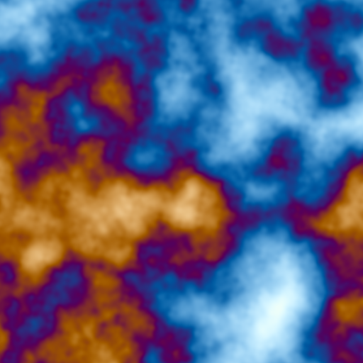

Re-assigning the same slot swaps the function in place, with no new module and no
window teardown:

```diffstatic {data-lang=kotlin}
module.program = "p 6 kaleido fbm palette saturate"
```

After:

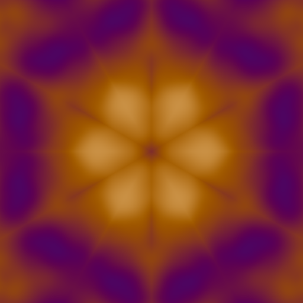

The gallery above is built this way: one module, one slot, re-bound once per
program. A module re-registered under the same name replaces the previous one, so
rebuilding the whole module works as well as rebinding its `stack.auto` body, which
is handy when the surrounding GLSL, not only the StackSL, is what you are editing.

## Volumetric noise

`noise` and `fbm` are two-dimensional. `noise` lowers to
`_noise(input.xy + input.zw * 0.07)` and `fbm` to `_fbm` of the same expression, so a
`vec4` carrying a position and a time is squashed into a plane, and z arrives at one
fourteenth the weight of x: a shear, not a third dimension. Feed it
`vec4(pos.xyz, t)` and you do not get a volume. You get one picture, imprinted at
every depth.

The top row below is the 2D `fbm` sampled at six values of z. It is the same image
six times.

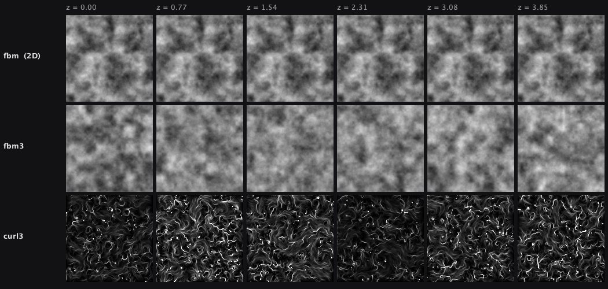

The middle row is `fbm3` over the same six slices: six unrelated fields, which is what
a volume is supposed to look like. Measured as mean absolute difference from the first
slice, the 2D word moves 0.017 → 0.065 across the march, a slow monotonic drift that
is the signature of a pattern sliding sideways, while `fbm3` jumps straight to 0.130
and then sits at ≈0.14, the signature of slices that are simply independent.

The bottom row is `curl3`, drawn by advecting tracers through it. Closed swirls, no
bright knots, no holes: that is what divergence-free looks like. It matters for
particles. A force field with sources and sinks collects your particles into the sinks
and empties the sources; a solenoidal one moves them around forever.

| Word | Stack | What it does |
| --- | --- | --- |
| `noise3` | `coord -- s` | 3D value noise over `coord.xyz`, exactly `0..1`. |
| `noise4` | `coord -- s` | 4D value noise over `coord.xyzw` — a volume that animates in w. |
| `fbm3` | `coord octaves lacunarity gain -- s` | fractal `noise3`. Arities 1..4; defaults 5, 2.0, 0.5. |
| `fbm4` | `coord octaves lacunarity gain -- s` | fractal `noise4`. |
| `curl3` | `coord epsilon octaves -- vec` | divergence-free curl noise; `.xyz` is the vector. |
| `worley3`, `voronoi3` | `coord -- vec` | cellular: `.x` F1, `.y` F2, `.z` F2-F1 (cell walls), `.w` a per-cell constant. |
| `fbmd3` | `coord epsilon octaves -- vec` | `.x` is `fbm3`, `.yzw` its gradient — a surface normal in one word. |
| `warp3` | `coord strength octaves -- s` | domain-warped `fbm3`: filaments and folds instead of clouds. |

Three things this family does that the 2D words do not.

**The range really is `0..1`.** `fbm`'s five octaves have amplitudes summing to
0.96875, not 1, so a raw `fbm` never reaches 1 and the usual `0.5 -` recentre leaves a
constant bias of about -0.031. Used as a force, that bias integrates into a drift
instead of averaging out. `fbm3` accumulates its amplitude sum at run time and divides
by it, so the range is exact for *any* octave count, lacunarity and gain. `fbm` itself
is not renormalised, because that would move every image ever rendered from it.

**No `sin()` in the hashes.** The two 2D hashes differ, and which is which matters.
`hash11`, behind `valueNoise`, is `fract(sin(p * 127.1) * 43758.5453123)`, and `sin`
is not bit-portable between implementations. `hash21`, behind `noise` and `fbm`, has
no `sin` in it at all; it is multiply/add/fract already. What `hash21` cannot be is
three-dimensional. It takes a `vec2`, and *that*, not `sin`, is why the volumetric
family needed its own hashes. Those are multiply/add/fract over 3 and 4 inputs, so
they are exact, and `VolumetricNoiseReference` transcribes them for the CPU, so these
words can be unit-tested without a GPU.

**`curl3` is solenoidal by construction.** It is the curl of a vector potential taken
with central differences at one shared epsilon. Discrete shift operators commute, so
the discrete divergence cancels term for term instead of merely coming out small:
measured 1.8e-7, against 0.58 for the three-independent-channels field people usually
reach for.

A particle force:

```diffstatic {data-lang=stacksl}
input xyz 2.2 * curl3 xyz 0.4 *
```

Cell walls, which `worley3` hands you directly:

```diffstatic {data-lang=stacksl}
input 6 * worley3 z 1- 8 pow
```

A cheap two-octave field for something evaluated per particle per frame:

```diffstatic {data-lang=stacksl}
input 2 fbm3.2
```

## Fitting a program's literals

Every number you type in a StackSL program is a free parameter, and the compiler already knows
where each one came from. `externalizeConstants` lifts each literal into a *wire* and records its
token, line and column; `StackSLWires.lift` makes the wired program runnable on the CPU backend; and
`StackSLFit` descends on an image loss with the **exact** gradient, computed by reverse-mode
automatic differentiation through the emitted GLSL itself.

```diffstatic {data-lang=stacksl}
uv 3.0 * fbm
0.5 0.5 0.5 1 vec4
0.5 0.5 0.5 1 vec4
1.0 1.0 1.0 1 vec4
0.0 0.33 0.67 1 vec4
palette
```

Seventeen numbers, seventeen parameters. Fitted against a target that is the same program with
twelve different palette numbers, eighty Adam steps at 64×64 take about nine seconds and drive the
mean squared error down by 1129×:

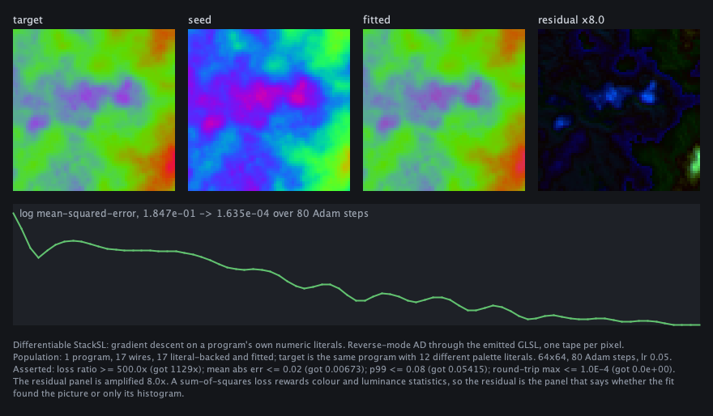

```diffstatic {data-lang=kotlin}
val template = StackSLCpu.stillTemplate()
val target = StackSLCpu.renderProgram(targetProgram, template, 64, 64)
val result = StackSLFit.fit(seedProgram, target, template, dim = 64, iterations = 80)

println(result.fittedProgram)      // StackSL source, with the fitted numbers in place
result.report().forEach(::println) // wire #1  '0.5' at 2:1  0.5 -> 0.59025836
```

The last line is the point. The output of a fit is not a vector, it is a **program** — the fitted
values are written back at the token positions the compiler recorded, so the result is something you
can paste into a `stackSL` box and run on a GPU. Recompiled from scratch through the ordinary
non-wired path, it renders bit-identically to the fitted parameter vector.

**What that figure is, exactly.** It is a *recovery* experiment on **one program and seventeen
wires**: the target was made by the same program with twelve of its numbers changed, so a correct
answer exists and the descent can be scored against it. That is the right first experiment, because
it separates "the gradient is wrong" from "the objective is wrong" — but it is not a claim about
arbitrary images. What is verified broadly is the **gradient**, against central differences over
nine programs and forty-six wires. Fitting a photograph, or any target no StackSL program generated,
is unattempted here, and the paragraphs below are most of the reason why.

Three things to know before fitting anything.

**A `threshold` is a wall.** It lowers to a hard `step`, which carries exactly zero derivative, so
nothing upstream of it can be reached. The same is true of `floor`, `ceil`, `round`, `posterize`,
`hash`, `select` and the comparisons. Of the 325 documentable words, 154 pass a derivative from a
wire upstream of them; most of the rest do not *lack* one, they discard the value — `uv`, `p`,
`time`, `pi`, `drop`, `swap` and the twelve named colours replace what was on the stack.

**A noise frequency, on the other hand, fits fine**, which is not obvious. `fbm` hashes a `floor`ed
lattice *cell index*, and `floor`'s zero derivative means no gradient flows through the hash at
all — only through `fract`'s interpolation weight, which is smooth.

**`saturate` costs you signal.** A clamped pixel sits on a kink, so it contributes nothing to the
gradient. A seed whose image is mostly blown out has almost nothing to descend on.

The loss is a per-pixel sum of squares and rewards exactly that, with no term for structure — so
read the residual panel rather than the loss number. `public/docs/assets/stacksl_fit_demo/` is a
loadable three-box demo of all of this; open the directory as a Field document.

## Built-in vocabulary

Stack and input:

```diffstatic {data-lang=stacksl}
dup drop swap over rot nip tuck
input in uv time t hash h
=name >name <name
```

Math:

```diffstatic {data-lang=stacksl}
+ - * / mod pow min max neg abs floor ceil fract
sqrt inversesqrt exp log sin cos tan asin acos atan atan2
normalize length len length2 len2 length3 len3 length4 len4
sum prod any all x+y xylen rgbnorm
dot cross standoff standoff2 standoff3 mix lerp step smoothstep
lt lte gt gte eq neq and or not
```

Domain:

```diffstatic {data-lang=stacksl}
tile repeat polar cart spiral twist kaleido
```

Creative:

```diffstatic {data-lang=stacksl}
noise perlin fbm pulse fm palette cos-palette
noise3 noise4 fbm3 fbm4 curl3 worley3 voronoi3 fbmd3 warp3
luma saturate clamp mirror smooth sigmoid softplus threshold band ramp posterize bias gain tonemap
ryb ryb2rgb from-ryb rgb2ryb to-ryb
oklab oklab2rgb from-oklab rgb2oklab to-oklab
saturation contrast grade
ema ema-diff diff-ema dema
sample sample0 sample1 sample2 sample3
sample-abs prev state gather gather0 gather1 gather2 gather3
texelSize textureSize
laplace laplacian blur blur5 blur9 sobel gradient gradient.r gradient.g gradient.b gradient.a divergence curl
```

Volumetric noise:

```diffstatic {data-lang=stacksl}
noise3 noise4 fbm3 fbm4 curl3 fbmd3 warp3 worley3 voronoi3
```

Word references:

```diffstatic {data-lang=stacksl}
apply call invoke
```

Constants:

```diffstatic {data-lang=stacksl}
pi tau e
black white gray red green blue cyan magenta yellow orange
```

## Notes for LLMs and genetic search

Prefer short, valid fragments. `uv fbm palette saturate` is better seed material than a long fragile program.

Use definitions to protect useful motifs:

```diffstatic {data-lang=stacksl}
: motif uv 6.0 * time + fbm ;
motif palette
```

Leave dead experiments in the source if you want. The compiler lowers pure expressions through SSA and emits only values that feed the returned top-of-stack color:

```diffstatic {data-lang=stacksl}
1 2 + drop      # computed, then pruned
uv fbm palette  # returned
```

Use `tolerant = true` for mutation runs. Unknown words become no-ops with warnings; strict mode reports them as errors for authoring.

When a program becomes too short, it still returns a valid `vec4`, so mutation makes strange images rather than broken shaders.
