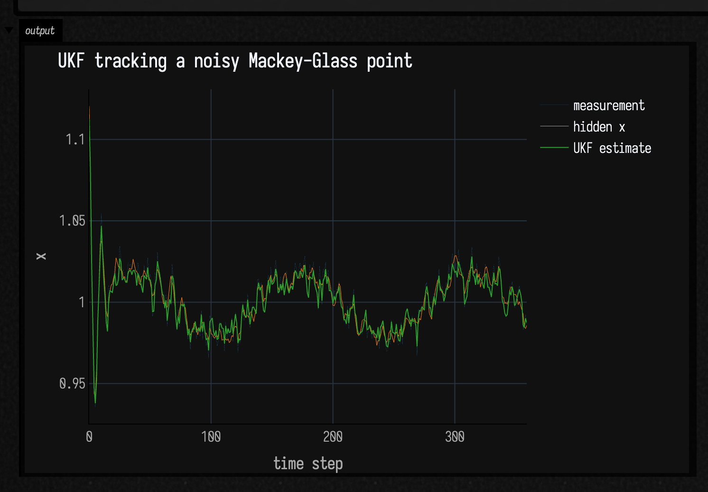
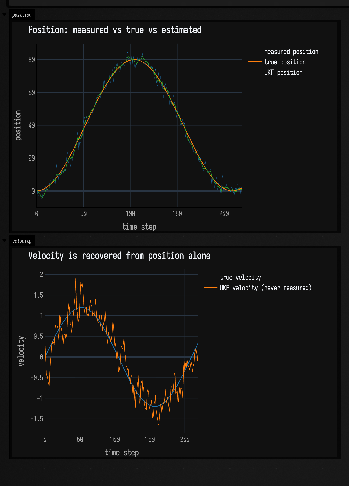
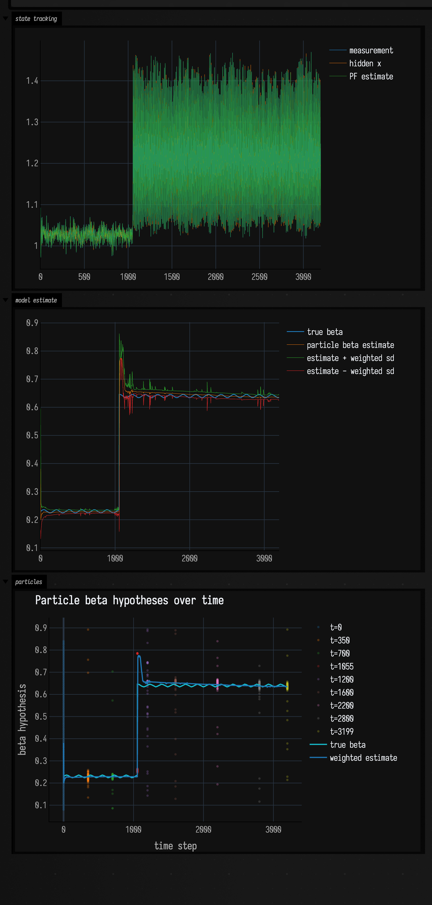

# State estimation: tracking what you cannot measure

*Every public declaration used below is listed, with its KDoc, in the codebase reference: [`pf.kt`](reference/math.md#pf-kt). Start from [what's already in the box](reference/index.md).*

Some quantities you care about are never observed directly. You see a noisy
position but want the velocity; you see one coordinate of a chaotic system but
need its hidden delayed state; you have a measurement but not the model parameter
that produced it. State estimation is the machinery for recovering the hidden
value — and its uncertainty — from a stream of noisy, partial measurements.

`pf.kt` in the standard library gives you two tools for this:

- **`UnscentedKalmanFilter`** — a nonlinear filter for continuous state (up to 3
  dimensions). You hand it your own *transition* and *observation* functions as
  plain Kotlin lambdas; it never asks you to derive a Jacobian by hand the way an
  extended Kalman filter would.
- **`UKFParticleFilter`** — a bank of particles, each carrying its own UKF plus a
  *hypothesis* about the model (an unknown parameter, a discrete mode). It keeps
  several explanations of the data alive at once and lets the measurements decide
  which survive.

These examples use Field's Plotly bridge: a `Plot` goes straight to an output
with `display(plot)`, so the truth, the measurement, and the estimate all land in
the same frame.

## The unscented Kalman filter

### The shape of the API

The filter carries a mean state `x` (a `DoubleArray`) and a covariance `p` (a
`Matrix`, which is just `typealias Matrix = Array<DoubleArray>`). You construct it
with an initial guess and an initial covariance, then alternate two calls:

```diffstatic {data-lang=kotlin}
val ukf = UnscentedKalmanFilter(
    initialState = doubleArrayOf(1.0, 0.96, 0.92),   // your best initial guess
    initialCovariance = diag(0.08, 0.08, 0.08),      // how unsure you are of it
    options = UKFOptions(alpha = 0.55)
)

ukf.predict(processNoise = diag(0.004, 0.004, 0.004)) { state ->
    // where does the state go on its own, over one step?
    advance(state)
}

ukf.update(
    measurement = doubleArrayOf(y),
    measurementNoise = diag(0.05 * 0.05)
) { state ->
    // what would this state look like through your sensor?
    doubleArrayOf(state[0])
}

val estimate = ukf.stateCopy()   // read the mean; covarianceCopy() reads p
```

`predict` pushes the state forward through your `transition` lambda and inflates
the covariance by `processNoise`. `update` corrects the state toward a
`measurement`, trusting it in proportion to `measurementNoise`. The `observe`
lambda maps a full state to what your sensor would report; here it exposes only
`state[0]`, so the filter estimates the other coordinates purely from the dynamics.

Two constraints come straight from `pf.kt`: the **state dimension must be 1–3** and
the **measurement dimension must be 1–3**. Both the state and the measurement can
have their own dimension.

### The `UKFOptions` knobs

`UKFOptions` controls how the filter picks its *sigma points* — the small set of
sample states it propagates through your nonlinear functions to estimate the new
mean and covariance:

| field | default | what it does |
|-------|---------|--------------|
| `alpha` | `0.5` | spread of the sigma points around the mean. Small `alpha` clusters them tight (good for mild nonlinearity); larger `alpha` spreads them out. Must be `> 0`. |
| `beta` | `2.0` | folds prior knowledge of the distribution into the covariance weight. `2.0` is optimal for Gaussians and is almost always the right choice. |
| `kappa` | `0.0` | secondary scaling. Usually left at `0`; raise it if the sigma-point scale `n + λ` would otherwise go non-positive. |
| `jitter` | `1e-9` | tiny diagonal added when a covariance is not quite positive-definite, so the internal Cholesky step stays numerically safe. Must be `> 0`. |

`alpha` is the knob you actually reach for. The examples below use `alpha = 0.55`
and `alpha = 0.9`; if you ever see *"n + lambda must be positive"*, nudge `alpha`
or `kappa` up.

### A tiny helper: `diag`

`Matrix` values are just arrays of arrays, so covariance matrices are easy to
build inline. Every example defines a one-liner for diagonal matrices — there is
no library `diag`, and one line is short enough to keep in the box:

```diffstatic {data-lang=kotlin}
fun diag(vararg values: Double): Matrix =
    Array(values.size) { r -> DoubleArray(values.size) { c -> if (r == c) values[r] else 0.0 } }
```

The Gaussian noise the examples inject comes from the standard-library
`randomGaussian()` (a zero-mean, unit-variance draw).

## Example: tracking a hidden Mackey-Glass point

The smallest useful shape: one hidden point evolves through a nonlinear delayed
map (the Mackey-Glass system), the only measurement is that point plus Gaussian
error, and the UKF predicts the motion then corrects from the scalar measurement.
The state carries three coordinates (the current value and two delayed ones), but
only the first is ever observed.

```diffstatic_runner {data-lang=kotlin screenshot="assets/state_estimation_examples/ukf_mackey_glass.png" wait="1.0" capture="box" open-outputs="true" padding="20"}
:::static
import afield.darkMode
import space.kscience.plotly.*

fun diag(vararg values: Double): Matrix =
    Array(values.size) { r -> DoubleArray(values.size) { c -> if (r == c) values[r] else 0.0 } }

fun mackeyGlassStep(state: DoubleArray, beta: Double = 0.28): DoubleArray {
    val x = state[0].coerceIn(0.02, 3.0)
    val delayed = state[2].coerceIn(0.02, 3.0)
    val dx = beta * delayed / (1.0 + delayed.pow(10.0)) - 0.10 * x
    val next = (x + dx).coerceIn(0.02, 3.0)
    return doubleArrayOf(next, x, state[1])
}

val ukf = UnscentedKalmanFilter(
    initialState = doubleArrayOf(1.00, 0.96, 0.92),
    initialCovariance = diag(0.08, 0.08, 0.08),
    options = UKFOptions(alpha = 0.55)
)

val trueX = mutableListOf<Double>()
val measuredX = mutableListOf<Double>()
val estimatedX = mutableListOf<Double>()
var truth = doubleArrayOf(1.12, 1.05, 0.98)

repeat(360) { i ->
    val forcing = 0.020 * sin(i * 0.045)
    truth = mackeyGlassStep(truth, beta = 0.20 + forcing)
    truth[0] = (truth[0] + 0.003 * randomGaussian()).coerceIn(0.02, 3.0)

    val measurement = truth[0] + 0.006 * randomGaussian()

    ukf.predict(processNoise = diag(0.004, 0.004, 0.004)) { state ->
        mackeyGlassStep(state, beta = 0.20)
    }
    ukf.update(
        measurement = doubleArrayOf(measurement),
        measurementNoise = diag(0.05 * 0.05)
    ) { state ->
        doubleArrayOf(state[0])
    }

    trueX += truth[0]
    measuredX += measurement
    estimatedX += ukf.stateCopy()[0]
}

val sample = trueX.indices.toList()
val plot = Plotly.plot {
    trace {
        name = "measurement"
        x.set(sample)
        y.set(measuredX)
        line.width = 0.1
    }
    trace {
        name = "hidden x"
        x.set(sample)
        y.set(trueX)
        line.width = 0.5
    }
    trace {
        name = "UKF estimate"
        x.set(sample)
        y.set(estimatedX)
        line.width = 1.0
    }
    layout {
        title = "UKF tracking a noisy Mackey-Glass point"
        xaxis {
            title = "time step"
        }
        yaxis {
            title = "x"
        }
    }
}.darkMode()

display(plot)
```



The measurement jitters around the hidden state while the UKF estimate follows
the nonlinear trend without chasing every sample. Note that the observation model
returns only `state[0]` while the filter still carries the delayed coordinates it
needs to predict.

## Example: recovering an unmeasured velocity

The Mackey-Glass filter never observes its delayed coordinates, but they only
matter internally. Here the hidden dimension is the one you want: the state
is `[position, velocity]`, the sensor reports **only a noisy position**, and the
filter has to infer velocity from how the position moves. A constant-velocity
transition (`position += velocity·dt`) plus a little process noise on the velocity
lets the estimate bend to a genuinely curving trajectory.

```diffstatic_runner {data-lang=kotlin screenshot="assets/state_estimation_examples/ukf_velocity_tracker.png" wait="1.0" capture="box" open-outputs="true" padding="20"}
:::static
import afield.darkMode
import space.kscience.plotly.*

fun diag(vararg values: Double): Matrix =
    Array(values.size) { r -> DoubleArray(values.size) { c -> if (r == c) values[r] else 0.0 } }

// State = [position, velocity]. We measure only a noisy position; velocity is
// never observed and must be reconstructed from the dynamics.
val dt = 1.0
val ukf = UnscentedKalmanFilter(
    initialState = doubleArrayOf(0.0, 0.0),
    initialCovariance = diag(1.0, 1.0),
    options = UKFOptions(alpha = 0.9)
)

val truePos = mutableListOf<Double>()
val trueVel = mutableListOf<Double>()
val measuredPos = mutableListOf<Double>()
val estPos = mutableListOf<Double>()
val estVel = mutableListOf<Double>()

var pos = 0.0
repeat(220) { i ->
    // True velocity follows a slow sine, so position curves rather than drifts.
    val vel = 1.2 * sin(i * 0.03)
    pos += vel * dt

    val measurement = pos + 3.0 * randomGaussian()   // noisy POSITION only

    // Constant-velocity model: position advances by velocity, velocity coasts.
    ukf.predict(processNoise = diag(0.01, 0.05)) { s ->
        doubleArrayOf(s[0] + s[1] * dt, s[1])
    }
    ukf.update(
        measurement = doubleArrayOf(measurement),
        measurementNoise = diag(3.0 * 3.0)
    ) { s ->
        doubleArrayOf(s[0])   // the sensor sees position, not velocity
    }

    val x = ukf.stateCopy()
    truePos += pos
    trueVel += vel
    measuredPos += measurement
    estPos += x[0]
    estVel += x[1]
}

val sample = truePos.indices.toList()

val positionPlot = Plotly.plot {
    trace {
        name = "measured position"
        x.set(sample)
        y.set(measuredPos)
        line.width = 0.3
    }
    trace {
        name = "true position"
        x.set(sample)
        y.set(truePos)
        line.width = 1.5
    }
    trace {
        name = "UKF position"
        x.set(sample)
        y.set(estPos)
        line.width = 1.0
    }
    layout {
        title = "Position: measured vs true vs estimated"
        xaxis { title = "time step" }
        yaxis { title = "position" }
    }
}.darkMode()

val velocityPlot = Plotly.plot {
    trace {
        name = "true velocity"
        x.set(sample)
        y.set(trueVel)
        line.width = 1.5
    }
    trace {
        name = "UKF velocity (never measured)"
        x.set(sample)
        y.set(estVel)
        line.width = 1.0
    }
    layout {
        title = "Velocity is recovered from position alone"
        xaxis { title = "time step" }
        yaxis { title = "velocity" }
    }
}.darkMode()

display("position", positionPlot)
display("velocity", velocityPlot)
```



The top panel is the noisy-measurement / clean-estimate comparison. In the bottom
panel the velocity trace tracks the true sine even though velocity is *never
measured*: no amount of smoothing the raw signal could produce it, because velocity
is not in the signal.

## The particle filter: keeping several models alive

The UKF assumes you know the model. When the *system itself* is uncertain (an
unknown parameter, a regime that can switch), reach for `UKFParticleFilter`. Each
particle is a `UKFParticle` pairing a `UnscentedKalmanFilter` with a *hypothesis*
of type `H` and a `logWeight`:

```diffstatic {data-lang=kotlin}
UKFParticle(
    ukf = UnscentedKalmanFilter(/* ... */),
    hypothesis = MackeyGlassHypothesis(beta = 0.3),
    logWeight = 0.0
)
```

The filter's cycle mirrors the UKF's, but every lambda now also receives the
particle's hypothesis, and `processNoise` / `measurementNoise` are *functions* of
the particle so each can carry its own:

- `predict(processNoise, transition, evolveHypothesis)` — advances each particle's
  UKF using `transition(hypothesis, state)`; the optional `evolveHypothesis` lets
  the hypotheses drift or occasionally jump.
- `update(measurement, measurementNoise, observe)` — corrects each UKF and
  reweights particles by how well they explained the measurement.
- `resampleIfNeeded(thresholdFraction, random, roughening)` — when the effective
  sample size drops below a fraction of the population, resamples toward the
  likely particles and (optionally) *roughens* them via `RougheningOptions` so the
  cloud does not collapse to identical clones.
- `estimateMean()` / `estimateCovariance()` read the weighted state; `weights()`
  and `effectiveSampleSize()` expose the particle health; `roughenHypotheses`
  perturbs the discrete/parameter part of each hypothesis.

Here each particle carries a different Mackey-Glass `beta`, the measurements see
the current point plus the two previous ones, and the weights gradually favour the
`beta` whose dynamics explain the data. Partway through, the true `beta` jumps,
and the cloud has to find it again from a population that had already settled.

```diffstatic_runner {data-lang=kotlin screenshot="assets/state_estimation_examples/ukf_particle_filter.png" wait="1.0" capture="box" open-outputs="true" padding="20"}
:::static
import afield.darkMode
import kotlin.random.Random
import space.kscience.plotly.*
import space.kscience.plotly.models.ScatterMode

data class MackeyGlassHypothesis(val beta: Double)
data class ParticleSnapshot(
    val step: Int,
    val beta: List<Double>
)

fun diag(vararg values: Double): Matrix =
    Array(values.size) { r -> DoubleArray(values.size) { c -> if (r == c) values[r] else 0.0 } }

fun mackeyGlassStep(state: DoubleArray, beta: Double): DoubleArray {
    val x = state[0].coerceIn(0.02, 3.0)
    val delayed = state[2].coerceIn(0.02, 3.0)
    val dx = beta * delayed / (1.0 + delayed.pow(10.0)) - 0.10 * x
    val next = (x + dx).coerceIn(0.02, 3.0)
    return doubleArrayOf(next, x, state[1])
}

val rng = Random(31)
val particleCount = 96
val particles = (0 until particleCount).map { i ->
    val beta = 0.08 + 0.76 * i.toDouble() / (particleCount - 1).toDouble()
    UKFParticle(
        ukf = UnscentedKalmanFilter(
            initialState = doubleArrayOf(
                0.80 + 0.18 * rng.nextGaussian(),
                0.80 + 0.18 * rng.nextGaussian(),
                0.80 + 0.18 * rng.nextGaussian()
            ),
            initialCovariance = diag(0.35, 0.35, 0.35),
            options = UKFOptions(alpha = 0.55)
        ),
        hypothesis = MackeyGlassHypothesis(beta),
        logWeight = 0.0
    )
}

val pf = UKFParticleFilter<MackeyGlassHypothesis>(
    initialParticles = particles,
    copyHypothesis = { it.copy() }
)

fun betaEstimate(): Double {
    val weights = pf.weights()
    return pf.particles.indices.sumOf { i -> weights[i] * pf.particles[i].hypothesis.beta }
}

fun betaStdDev(mean: Double): Double {
    val weights = pf.weights()
    val variance = pf.particles.indices.sumOf { i ->
        val d = pf.particles[i].hypothesis.beta - mean
        weights[i] * d * d
    }
    return sqrt(variance)
}

val trueX = mutableListOf<Double>()
val measuredX = mutableListOf<Double>()
val estimatedX = mutableListOf<Double>()
val trueBeta = mutableListOf<Double>()
val estimatedBeta = mutableListOf<Double>()
val betaSigma = mutableListOf<Double>()
val particleSnapshots = mutableListOf<ParticleSnapshot>()
val snapshotSteps = setOf(0, 350, 700, 1055, 1200, 1600, 2200, 2800, 3199)

var truth = doubleArrayOf(1.10, 1.08, 1.05)
var lastMeasurement = truth[1]
var olderMeasurement = truth[2]
repeat(3200) { i ->
    val baseBeta = if (i < 1055) 0.23 else 0.64
    val actualBeta = baseBeta + 0.006 * sin(i * 0.037)

    truth = mackeyGlassStep(truth, actualBeta)
    truth[0] = (truth[0] + 0.006 * rng.nextGaussian()).coerceIn(0.00, 3.0)
    val measurement = truth[0] + 0.006 * rng.nextGaussian()

    pf.predict(
        processNoise = { diag(0.003, 0.003, 0.003) },
        transition = { hypothesis, state ->
            mackeyGlassStep(state, hypothesis.beta)
        },
        evolveHypothesis = { hypothesis ->
            val broadProposalRate = if (i in 980..1240) 0.004 else 0.00025
            val beta = if (rng.nextDouble() < broadProposalRate) {
                0.05 + 0.85 * rng.nextDouble()
            } else {
                hypothesis.beta + 0.0002 * rng.nextGaussian()
            }
            hypothesis.copy(beta = beta.coerceIn(0.0, 1.0))
        }
    )
    pf.update(
        measurement = doubleArrayOf(measurement, lastMeasurement, olderMeasurement),
        measurementNoise = { diag(0.010 * 0.010, 0.014 * 0.014, 0.018 * 0.018) },
        observe = { _, state -> doubleArrayOf(state[0], state[1], state[2]) }
    )

    olderMeasurement = lastMeasurement
    lastMeasurement = measurement

    val resampled = pf.resampleIfNeeded(
        thresholdFraction = 0.55,
        random = rng,
        roughening = RougheningOptions(factor = 0.012, minimumStdDev = 1e-5)
    )
    if (resampled) {
        val centerBeta = betaEstimate()
        pf.roughenHypotheses(rng) { hypothesis, random ->
            val contracted = centerBeta + 0.82 * (hypothesis.beta - centerBeta)
            hypothesis.copy(beta = (contracted + 0.0007 * random.nextGaussian()).coerceIn(0.0, 1.0))
        }
    }

    trueX += truth[0]
    measuredX += measurement
    estimatedX += pf.estimateMean()[0]
    trueBeta += actualBeta
    val betaMean = betaEstimate()
    estimatedBeta += betaMean
    betaSigma += betaStdDev(betaMean)
    if (i in snapshotSteps) {
        particleSnapshots += ParticleSnapshot(
            step = i,
            beta = pf.particles.map { it.hypothesis.beta }
        )
    }
}

val sample = trueX.indices.toList()

val statePlot = Plotly.plot {
    trace {
        name = "measurement"
        x.set(sample)
        y.set(measuredX)
        line.width = 0.75
    }
    trace {
        name = "hidden x"
        x.set(sample)
        y.set(trueX)
        line.width = 0.5
    }
    trace {
        name = "PF estimate"
        x.set(sample)
        y.set(estimatedX)
        line.width = 0.5
    }
}.darkMode()

val betaPlot = Plotly.plot {
    trace {
        name = "true beta"
        x.set(sample)
        y.set(trueBeta)
        line.width = 1.5
    }
    trace {
        name = "particle beta estimate"
        x.set(sample)
        y.set(estimatedBeta)
        line.width = 0.5
    }
    trace {
        name = "estimate + weighted sd"
        x.set(sample)
        y.set(estimatedBeta.indices.map { estimatedBeta[it] + betaSigma[it] })
        line.width = 0.6
    }
    trace {
        name = "estimate - weighted sd"
        x.set(sample)
        y.set(estimatedBeta.indices.map { estimatedBeta[it] - betaSigma[it] })
        line.width = 0.6
    }
}.darkMode()

val particlePlot = Plotly.plot {
    layout {
        title = "Particle beta hypotheses over time"
        xaxis {
            title = "time step"
        }
        yaxis {
            title = "beta hypothesis"
        }
    }
    particleSnapshots.forEach { snapshot ->
        scatter {
            name = "t=${snapshot.step}"
            x.set(List(snapshot.beta.size) { snapshot.step })
            y.set(snapshot.beta)
            mode = ScatterMode.markers
            marker {
                size = 4.0
                opacity = 0.28
            }
        }
    }
    trace {
        name = "true beta"
        x.set(sample)
        y.set(trueBeta)
        line.width = 2.0
    }
    trace {
        name = "weighted estimate"
        x.set(sample)
        y.set(estimatedBeta)
        line.width = 2.0
    }
}.darkMode()

display("state tracking", statePlot)
display("model estimate", betaPlot)
display("particles", particlePlot)
```



The state panel repeats the hidden/measurement/estimate comparison; the beta
panel shows the true `beta`, the weighted particle estimate, and a weighted
one-standard-deviation envelope; the particle panel scatters each hypothesis at
saved time steps, and because the markers are translucent, a bright saturated band
is where the particles have clumped and loose dots are where they have not.
Observing the current point plus the two previous measurements pins the delayed
state coordinates, so a wrong `beta` cannot hide behind a different latent delay.
The broad-proposal rate is raised only around the known transition window: enough
diversity to catch the jump, without repopulating far-away hypotheses once the
estimate has settled.

---

For raw and filtered *signals* rather than these derived quantities, continue with
[Timeseries examples](timeseries_examples.md); for interpolation, keyframes, and
correlation, see [Values over time](interpolants_examples.md).
