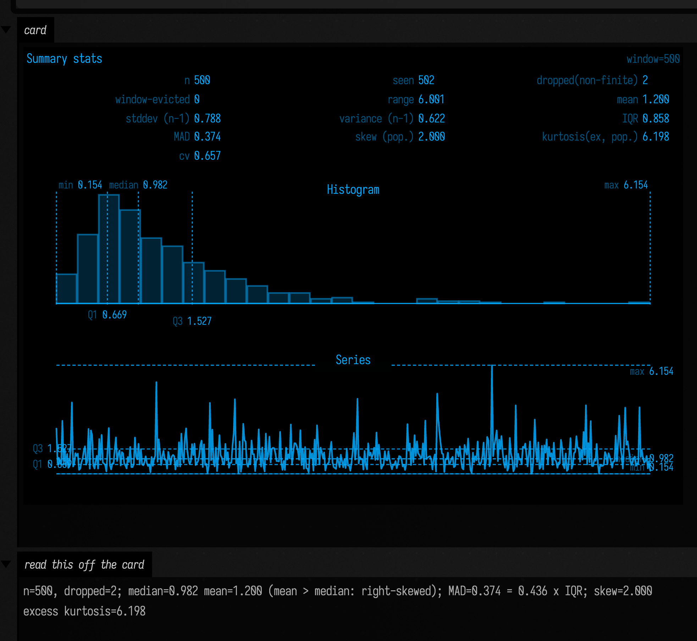
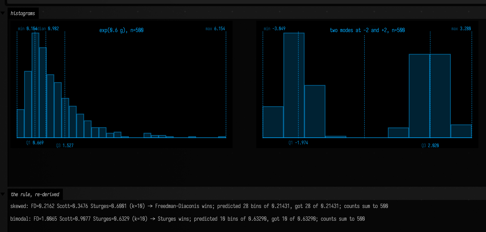
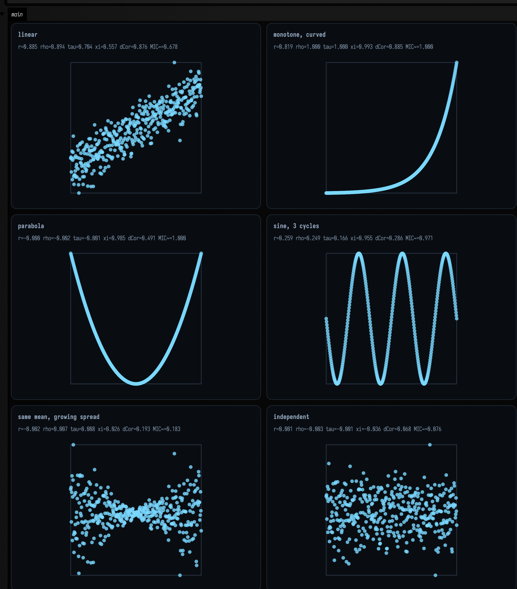
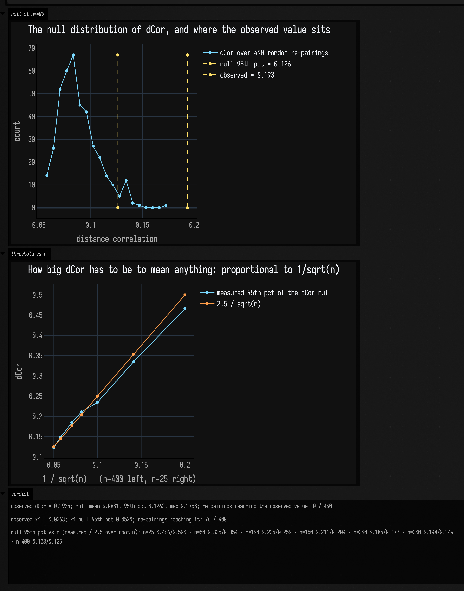
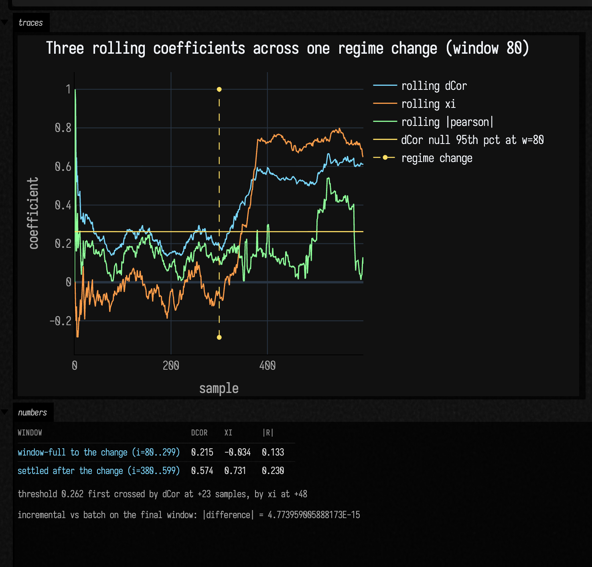
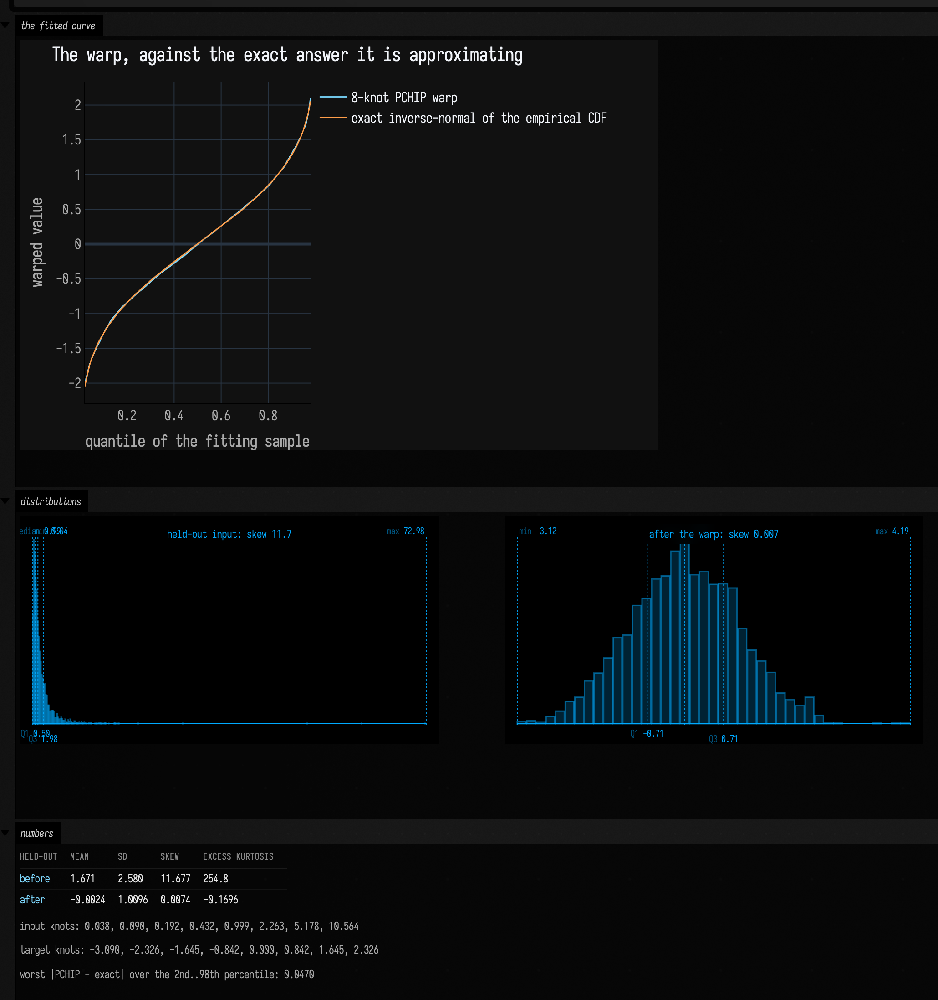

# Which of these signals actually depend on each other?

*Every public declaration used below is listed, with its KDoc, in the codebase reference:
[Math](reference/math.md) and [Data](reference/data.md).*

You have two streams of numbers and one question: **are they related?** Almost every answer Field
can give you lives in three files that had no page until this one —
`afield/stdlib/stats.kt`, `afield/stdlib/correlations.kt` and `afield/stdlib/quantilewarp.kt`,
about 3300 lines between them. This is a worked example of all three, and the argument it makes is
that *"are they related?"* is six different questions with six different answers, and picking the
wrong one is how you miss a relationship that is staring at you.

Some of it is the boring, indispensable half — count, quartiles, IQR, MAD, skew, kurtosis,
histograms, a streaming window of all of it. Some of it is the interesting half — Pearson,
Spearman, Kendall, Chatterjee's xi, distance correlation, a MIC-like grid scan, and rolling
versions of the last two. And one file is the odd one out: `quantilewarp.kt` reshapes a signal's
*distribution* into one you chose, which is what you reach for when the problem is not "are these
related" but "this signal is the wrong shape to work with".

## Where the family actually lives

| what you want | where it is | notes |
|---|---|---|
| count, quartiles, IQR, MAD, variance, skew, excess kurtosis | `stats.kt` | `buildSummaryStats` → `SummaryStats`. Non-finite input is dropped *and counted* |
| a streaming window of all of that | `stats.kt` | `SummaryStatsBuffer`, plus `Vec2`/`Vec3`/`Vec4SummaryStatsBuffer` which add per-component stats, vector length and the pairwise component correlations |
| histograms | `stats.kt` | `buildHistogram` → `Histogram` / `HistogramBin` |
| those, rendered | `stats.kt` | `histogramToSvg`, `seriesPlotToSvg`, `summaryStatsBoxToHtml` — string-interpolated SVG/HTML, no drawing library, cyan-on-black by default |
| **the dependence coefficients** | `correlations.kt` | `StatsDependence.pearson` / `spearman` / `kendallTauB` / `chatterjeeXi` (aliased `xi`) / `distanceCorrelation` / `micTicNaive` |
| dependence over a sliding window | `correlations.kt` | `RollingDistanceCorrelation` (incremental, O(w) per sample), `RollingXiCorrelation` (recomputes, O(w log w) per sample) |
| reshape a distribution into a target | `quantilewarp.kt` | `AdaptiveQuantileWarp`, `QuantileWarpState`, `TargetDistributions`, `inverseStandardNormalCdf`, and matching GLSL for the GPU |

Two things this family is **not**. It is not a statistics library: there are no p-values, no
confidence intervals, no hypothesis tests anywhere in it, and the last section of this page shows
the permutation test you have to write yourself to know whether a number means anything. And
`micTicNaive` is not MICe/TICe — the file's own header comment
(`correlations.kt:31`) is emphatic that it is an equipartition-grid approximation that will not
reproduce published numbers.

If you want the two-fence version of the dependence story next to the interpolants it grew out of,
[Values Over Time](interpolants_examples.md) has it. This page is the family's home.

## The boring half, and exactly how boring it is

`buildSummaryStats` takes any `Iterable<Double>` and hands back seventeen numbers.
`SummaryStatsBuffer` wraps it in a synchronized, capped sliding window you can `add` to sample by
sample, and `summaryHtml()` renders the whole thing — metrics, histogram and series plot — as one
self-contained HTML card.

```diffstatic_runner {data-lang=kotlin screenshot="assets/statistics_examples/summary_card.png" wait="1.5" capture="box" open-outputs="true" w="760" h="640" padding="16"}
:::static
// A deliberately right-skewed signal: exp of a Gaussian, so we know the shape we are asking about.
val rng = java.util.Random(11)
val signal = (0 until 500).map { exp(0.6 * rng.nextGaussian()) }

val buf = SummaryStatsBuffer(maxSize = 500)
buf.addAll(signal)
buf.add(Double.NaN)                   // dropped, and counted, at `add` time
buf.add(Double.POSITIVE_INFINITY)     // likewise: `values` never holds a non-finite number

val s = buf.snapshot()

// Three things the card reports that are easy to misread, pinned here as arithmetic:
//  - MAD is the *median absolute deviation from the median*, unscaled. For a normal sample it is
//    about 0.6745 sigma, not sigma; here the signal is skewed, so it is smaller than the IQR/2.
//  - `range` is max - min, which for a skewed signal is dominated by the single largest sample.
//  - `cv` is sampleStdDev / mean, so it is meaningless the moment the mean crosses zero.
val madOverIqr = s.mad / s.iqr
val note = "n=${s.count}, dropped=${s.droppedCount}; " +
    "median=${"%.3f".format(s.median)}  mean=${"%.3f".format(s.mean)} (mean > median: right-skewed); " +
    "MAD=${"%.3f".format(s.mad)} = ${"%.3f".format(madOverIqr)} x IQR; " +
    "skew=${"%.3f".format(s.skewness)}  excess kurtosis=${"%.3f".format(s.kurtosisExcess)}"
:::fold render the card
display("card", buf.summaryHtml(widthPx = 620, chartHeightPx = 150, decimals = 3))
markdown("read this off the card", "{muted:$note}", width = 620)
:::endfold
```



The card is worth reading closely, because two of its labels are inconsistent and the
inconsistency is in the source, not the rendering. `stddev` and `variance` are the **sample**
(divide by n−1) forms, `stats.kt:1610` and `stats.kt:1611`; `skew` and `kurtosis(ex)` are the
**population** (divide by n) forms, `stats.kt:894`–`stats.kt:903`, with no bias correction. Both
conventions are defensible; having both on one card is a trap. If you are comparing against
another tool, `SummaryStats` matches NumPy and SciPy *exactly* — `q1`/`median`/`q3` are
`numpy.percentile`'s default linear interpolation, `mad` is `median(|y − median(y)|)`,
`sampleStdDev` is `numpy.std(ddof=1)`, and `skewness`/`kurtosisExcess` are `scipy.stats.skew`
and `scipy.stats.kurtosis` at their *default* `bias=True`. That is not a claim about intent: it is
checked to ten decimal places against SciPy 1.15.2 on a deliberately tie-heavy ten-point dataset.

Three more edges, all guarded rather than propagated, so you get a number instead of a NaN:

- one sample: `sampleVariance` is **0.0**, not NaN (`stats.kt:884`);
- two samples: `skewness` is **0.0** — it needs `n > 2` (`stats.kt:894`);
- three samples: `kurtosisExcess` is **0.0** — it needs `n > 3` (`stats.kt:899`).

`SummaryStatsBuffer` keeps two separate drop counters, which is the useful part: `dropped(non-finite)`
counts values it refused, `window-evicted` counts values that aged out of the window. Feed 200
finite samples to a `maxSize = 64` buffer and you get `size=64, samplesSeen=200,
droppedByCapacity=136`.

## Histograms, and the rule that picks the bins

`buildHistogram` chooses its own bin width: the **smallest** of the Freedman–Diaconis, Scott and
Sturges estimates, floored at `range/2000` so the bin count can never exceed 2000
(`stats.kt:1124`–`stats.kt:1133`). "Smallest" means finest, which is usually what you want — and
the fence below re-derives the whole decision from the published `SummaryStats` and predicts the
bin count before asking.

```diffstatic_runner {data-lang=kotlin screenshot="assets/statistics_examples/histogram_rule.png" wait="1.5" capture="box" open-outputs="true" w="1020" h="560" padding="16"}
:::static
val rng = java.util.Random(11)
val skewed = (0 until 500).map { exp(0.6 * rng.nextGaussian()) }

// Two clean modes, 4 apart, each with sd 0.4 — the case the rule handles worst.
val rng2 = java.util.Random(23)
val bimodal = (0 until 500).map { if (it % 2 == 0) -2.0 + 0.4 * rng2.nextGaussian() else 2.0 + 0.4 * rng2.nextGaussian() }

// Re-derive the three candidate widths from the public stats and predict the bin count.
// This shares `quantileSorted` with the implementation, so it checks the *rule selection and the
// rounding* — not the quantiles themselves. Those are checked against SciPy in jvmTest instead.
fun explain(name: String, values: List<Double>): String {
    val s = buildSummaryStats(values)
    val n = s.count
    val range = s.max - s.min
    val cubeRootN = n.toDouble().pow(-1.0 / 3.0)
    val hFd = 2.0 * s.iqr * cubeRootN                                   // Freedman-Diaconis
    val hScott = 3.5 * s.sampleStdDev * cubeRootN                       // Scott
    val kSturges = ceil(ln(n.toDouble()) / ln(2.0) + 1.0).toInt()       // Sturges
    val hSturges = range / kSturges
    val winner = minOf(hFd, hScott, hSturges)
    val which = when (winner) {
        hFd -> "Freedman-Diaconis"
        hScott -> "Scott"
        else -> "Sturges"
    }
    val predicted = Math.round(range / winner).toInt().coerceIn(1, 2000)
    val actual = buildHistogram(values)
    return "$name: FD=${"%.4f".format(hFd)}  Scott=${"%.4f".format(hScott)}  " +
        "Sturges=${"%.4f".format(hSturges)} (k=$kSturges) -> $which wins; " +
        "predicted ${predicted} bins of ${"%.5f".format(range / predicted)}, " +
        "got ${actual.bins.size} of ${"%.5f".format(actual.binWidth)}; counts sum to ${actual.count}"
}

val skewedNote = explain("skewed", skewed)
val bimodalNote = explain("bimodal", bimodal)
:::fold draw both histograms
val svgs = listOf(
    histogramToSvg(buildHistogram(skewed), widthPx = 470, heightPx = 270, padTop = 26, title = "exp(0.6 g), n=500", decimals = 3),
    histogramToSvg(buildHistogram(bimodal), widthPx = 470, heightPx = 270, padTop = 26, title = "two modes at -2 and +2, n=500", decimals = 3),
)
showRow("histograms", svgs)
markdown("the rule, re-derived", """
    {muted:$skewedNote}

    {muted:$bimodalNote}
""", width = 960)
:::endfold
```



Both predictions land: 28 bins of 0.21431 for the skewed signal, 10 bins of 0.63290 for the bimodal
one, and in both cases the bin counts sum back to 500. But look at *which rule won* in each case,
because that is the interesting part. On the skewed signal Freedman–Diaconis is the finest at 0.2162
and it decides. On the bimodal signal FD comes out at **1.0065** and Scott at **0.9077** — both
much coarser — because both are driven by global spread, and here the spread is the *distance
between* the modes (IQR 3.99, sample sd 2.06) rather than the spread within them (0.4). Which leaves
**Sturges** winning at 0.6329, and Sturges is the one rule of the three that looks at nothing but n:
`ceil(log₂ n + 1)` is 10 bins for *any* 500-point sample whatever its shape. So a multi-modal signal
falls back to the crudest of the three estimates and its two obvious modes get about one bin each.
`buildHistogram` takes no bin-count argument (`stats.kt:1096`), so if you need finer bins for a
signal like this, bin it yourself.

## The centrepiece: six questions, six answers

Now the interesting half. Every coefficient in `StatsDependence` takes two equal-length
`DoubleArray`s and returns one number, and they are *not* interchangeable. Six shapes, drawn with
every coefficient underneath, is the whole argument:

```diffstatic_runner {data-lang=kotlin screenshot="assets/statistics_examples/dependence_grid.png" wait="3.0" capture="box" open-outputs="true" w="1010" h="1100" padding="14"}
:::static
val n = 400
val rng = java.util.Random(7)
val x = DoubleArray(n) { it / (n - 1.0) * 2.0 - 1.0 }          // an even sweep of -1..1
val noise = DoubleArray(n) { rng.nextGaussian() }              // ONE noise draw, reused, so the
                                                               // "independent" panel is literally
                                                               // the noise the others are built on
val cases = listOf(
    "linear" to DoubleArray(n) { 0.8 * x[it] + 0.25 * noise[it] },
    "monotone, curved" to DoubleArray(n) { exp(3.0 * x[it]) },
    "parabola" to DoubleArray(n) { x[it] * x[it] },
    "sine, 1.5 cycles" to DoubleArray(n) { sin(3.0 * PI * x[it]) },
    "same mean, growing spread" to DoubleArray(n) { (0.05 + abs(x[it])) * noise[it] },
    "independent" to DoubleArray(n) { noise[it] },
)

fun coefficients(y: DoubleArray): String {
    val d = "%.3f"
    return "r=${d.format(StatsDependence.pearson(x, y))}   " +
        "rho=${d.format(StatsDependence.spearman(x, y))}   " +
        "tau=${d.format(StatsDependence.kendallTauB(x, y))}   " +
        "xi=${d.format(StatsDependence.xi(x, y))}   " +
        "dCor=${d.format(StatsDependence.distanceCorrelation(x, y))}   " +
        "MIC~=${d.format(StatsDependence.micTicNaive(x, y).mic)}"
}
:::fold draw the six panels
// Each panel is min-max rescaled into the unit square so the six share one window; SVG y grows
// downward, so flip it to read the shapes the way the formulas are written.
//
// Two columns because three panels this wide do not fit the capture, and the panels are worth
// more here than a third column would be. A caption longer than `cellWidth` now wraps inside the
// card instead of widening it out of frame — that used to cost you a whole column.
val window = Rect(0.0, 0.0, 1.0, 1.0)
val frame = window.toFLine(color = vec(0.35, 0.44, 0.56, 0.5), thickness = 1.0)

val panels = cases.map { (name, y) ->
    val lo = y.min()
    val hi = y.max()
    val span = (hi - lo).takeIf { it > 1e-12 } ?: 1.0
    val cloud = pointCloudFLine(
        (0 until n).map { i -> vec((x[i] + 1.0) / 2.0, 1.0 - (y[i] - lo) / span) },
        color = vec(0.48, 0.85, 1.0, 0.8),
        pointSize = 1.1,
    )
    "$name\n${coefficients(y)}" to listOf(frame, cloud)
}

showPlaneGrid(*panels.toTypedArray(), columns = 2, cellWidth = 430, cellHeight = 262, window = window)
:::endfold
```



Read the captions across the grid; that table *is* the page.

| shape | `pearson` | `spearman` | `kendallTauB` | `xi` | `distanceCorrelation` | `micTicNaive().mic` |
|---|---|---|---|---|---|---|
| linear | **0.885** | 0.894 | 0.704 | 0.557 | 0.876 | 0.678 |
| monotone, curved (`exp 3x`) | 0.819 | **1.000** | **1.000** | 0.993 | 0.885 | 1.000 |
| parabola | −0.000 | −0.002 | −0.001 | **0.985** | 0.491 | 1.000 |
| sine, 1.5 cycles | 0.259 | 0.249 | 0.166 | **0.955** | 0.286 | 0.971 |
| same mean, growing spread | −0.002 | 0.007 | 0.008 | 0.026 | **0.193** | 0.183 |
| independent | 0.001 | −0.003 | −0.001 | −0.036 | 0.068 | 0.076 |

Five things fall out of that table, and each one is a rule about which measure to reach for.

**Pearson answers "is this a straight line", and nothing else.** `r = −0.000` on the parabola —
where `y` is a *noiseless, exact* function of `x`. The dependence is total and the coefficient is
zero. That is not a defect: `pearson` (`correlations.kt:147`) is the sample covariance over the
product of the standard deviations, and a symmetric parabola has zero covariance with its own
argument by construction.

**Spearman and Kendall answer "is this monotone".** They hit exactly ±1 on `exp(3x)` where Pearson
reads 0.819, which is the whole reason they exist — any strictly increasing reshape of `y` leaves
them alone. But they side with Pearson on the parabola, and for the same reason: a parabola is a
function and not a monotone one, and monotone is all either of them can see. `spearman` is literally
`pearson` on `ranksAverageTies` (`correlations.kt:171`–`correlations.kt:176`), so it inherits every
Pearson limitation *after* the ranking.

**Chatterjee's xi answers "is `y` a function of `x`" — and it is asymmetric on purpose.** It reads
0.985 on the parabola and 0.955 on the sine, the two cases the rank coefficients miss entirely.
Swap the arguments and it changes its mind: `xi(x, parabola) = 0.985` but `xi(parabola, x) = 0.246`,
because `x` genuinely is *not* a function of `x²` — each `y` has two possible `x`. That asymmetry is
the point, not a wart, and it is the only coefficient here that has it. Cheap, too: O(n log n)
against the O(n²) of `kendallTauB` and `distanceCorrelation`.

**Distance correlation answers "is there any dependence at all".** It is the only entry in the
table that is non-zero on *every* dependent row, including the last interesting one — the
growing-spread panel, where `y` has the same mean everywhere and only its *scale* depends on `x`.
Pearson, Spearman and Kendall read 0.00 there. So does xi (0.026), and *correctly*: `y` is not a
function of `x`, it is a random variable whose spread is. Distance correlation reads 0.193, and the
next section shows that 0.193 is real.

**And the trap in reading distance correlation**: it is *not* a measure of how strong the
dependence is. dCor is 1 only for an exactly linear relationship (`distanceCorrelation(x, 3x+1)` is
exactly `1.0`, and so is `distanceCorrelation(x, −2x+5)` — it is unsigned). On the parabola,
where `y` is a perfect function of `x`, it reads 0.491; on the sine, 0.286. Lower dCor does not
mean weaker dependence, it means less *linear* dependence. Use it to decide whether to keep
looking, then use something else to describe what you found.

!!! note "How `xi` handles a tied predictor"

    Chatterjee's estimator is only defined up to a *random* breaking of the ties among the `x`
    values, so on tied `x` it is a random variable rather than a number. Rather than pick a seed,
    `chatterjeeXi` returns that random variable's **exact expectation**, computed in closed form
    from the ranks inside each run of equal `x` (`correlations.kt:321`–`correlations.kt:343`). So it
    is deterministic, reproducible, and — the property that matters — invariant to the order you
    hand the pairs over in.

    Two consequences worth knowing. A **constant predictor reads 0**: for a single tie group the
    numerator's expectation is `(n²−1)/3` against a denominator of `n(n²−1)/3`, so the closed form
    is exactly zero for every `n`. In `Double` it is zero to within one ulp rather than bit-exact —
    sweeping `n` = 2..400, 54 values come back non-zero, the largest of them 2.2×10⁻¹⁶ — so compare
    it against a tolerance, not against `0.0`. And a quantised predictor — a bucketed index, an
    integer control value, a thresholded signal — is answered honestly:
    heavy ties with a real relationship still read high (a ten-block staircase reads **0.891**),
    while heavy ties with no relationship read ~0.

    Inputs whose `x` values are all distinct never reach the tie path at all, so every number
    elsewhere on this page is a tie-free case.

    For contrast, the other coefficients here refuse a constant predictor outright rather than scoring
    it: `pearson`, `spearman` and `kendallTauB` return NaN, and `distanceCorrelation` returns 0.0.

## Is 0.193 big? The permutation test nobody wrote for you

There are no p-values in this family. That matters most for distance correlation, because dCor
under genuine independence is **not** 0 at finite n — the estimator is biased upward, and the bias
is large enough to swamp a real effect if you do not know its size. The `independent` row above
reads 0.068 at n=400. At n=25 the *same* independent data reads about 0.46.

So measure the null yourself. Re-pair `y` against `x` at random a few hundred times, and see where
the number you actually observed falls:

```diffstatic_runner {data-lang=kotlin screenshot="assets/statistics_examples/null_distribution.png" wait="3.0" capture="box" open-outputs="true" w="1000" h="820" padding="16"}
:::static
val n = 400
val x = DoubleArray(n) { it / (n - 1.0) * 2.0 - 1.0 }
val rng = java.util.Random(7)
val noise = DoubleArray(n) { rng.nextGaussian() }
val y = DoubleArray(n) { (0.05 + abs(x[it])) * noise[it] }     // the growing-spread panel again

val observedDcor = StatsDependence.distanceCorrelation(x, y)
val observedXi = StatsDependence.xi(x, y)

// The null: break the pairing, keep both marginals. Anything left is chance.
val prng = java.util.Random(31)
val reps = 400
val order = (0 until n).toMutableList()
val nullDcor = DoubleArray(reps)
val nullXi = DoubleArray(reps)
for (r in 0 until reps) {
    order.shuffle(prng)
    val shuffled = DoubleArray(n) { y[order[it]] }
    nullDcor[r] = StatsDependence.distanceCorrelation(x, shuffled)
    nullXi[r] = StatsDependence.xi(x, shuffled)
}
val sortedD = nullDcor.sortedArray()
val p95 = sortedD[(reps * 0.95).toInt()]
val exceed = sortedD.count { it >= observedDcor }
val xiExceed = nullXi.count { it >= observedXi }

// How large does dCor have to be before it means anything? Measure the null's 95th percentile
// against n, and against a fitted 2.5/sqrt(n).
val sizes = listOf(25, 50, 100, 150, 200, 300, 400)
val thresholds = sizes.map { m ->
    val r2 = java.util.Random(1234)
    val k = 150
    val v = DoubleArray(k) {
        StatsDependence.distanceCorrelation(DoubleArray(m) { r2.nextGaussian() }, DoubleArray(m) { r2.nextGaussian() })
    }.sortedArray()
    v[(k * 0.95).toInt()]
}
val fitted = sizes.map { 2.5 / sqrt(it.toDouble()) }
// Plotted against 1/sqrt(n) rather than n: it turns the claim into a straight line through the
// origin, which is a much stronger thing to see than a hyperbola.
val inverseRootN = sizes.map { 1.0 / sqrt(it.toDouble()) }
:::fold two figures
val hist = buildHistogram(nullDcor.toList())
showSignals(
    "dCor over $reps random re-pairings" to hist.bins.map { it.count },
    x = hist.bins.map { (it.start + it.end) / 2.0 },
    channel = "null at n=400",
    title = "The null distribution of dCor, and where the observed value sits",
    xTitle = "distance correlation",
    yTitle = "count",
    marks = listOf(
        "null 95th pct = ${"%.3f".format(p95)}" to p95,
        "observed = ${"%.3f".format(observedDcor)}" to observedDcor,
    ),
)
showSignals(
    "measured 95th pct of the dCor null" to thresholds,
    "2.5 / sqrt(n)" to fitted,
    x = inverseRootN,
    channel = "threshold vs n",
    title = "How big dCor has to be to mean anything: proportional to 1/sqrt(n)",
    xTitle = "1 / sqrt(n)   (n=400 left, n=25 right)",
    yTitle = "dCor",
)
markdown("verdict", """
    {muted:observed dCor = ${"%.4f".format(observedDcor)}; null mean ${"%.4f".format(nullDcor.average())},
    95th pct ${"%.4f".format(p95)}, max ${"%.4f".format(sortedD.last())};
    re-pairings reaching the observed value: $exceed / $reps}

    {muted:observed xi = ${"%.4f".format(observedXi)}; xi null 95th pct
    ${"%.4f".format(nullXi.sortedArray()[(reps * 0.95).toInt()])};
    re-pairings reaching it: $xiExceed / $reps}

    {muted:null 95th pct vs n (measured / 2.5-over-root-n):
    ${sizes.indices.joinToString(" · ") { "n=${sizes[it]} ${"%.3f".format(thresholds[it])}/${"%.3f".format(fitted[it])}" }}}
""", width = 900)
:::endfold
```



The verdict line is the point. The observed 0.1934 is beyond every one of 400 random re-pairings
(**0 / 400**), whose 95th percentile is 0.1262 and whose maximum is 0.1758. The dependence is real
even though `pearson` reads −0.002. And in the same run xi reads 0.0263 against its own null's 95th
percentile of 0.0520, with **76 / 400** re-pairings doing at least as well — xi has correctly
declined to call this a functional relationship.

The second figure gives you the shortcut for next time, and it is plotted against `1/√n` on purpose:
the measured 95th percentile falls on a **straight line through the origin**, which is a much
stronger statement than a hyperbola would be. The line's slope is about 2.5 — read the
measured-against-predicted pairs off the bottom of the figure: 0.335/0.354 at n = 50 through
0.123/0.125 at n = 400, with the rule erring safely high at n = 25 (0.466 measured against 0.500
predicted). So: **a dCor you cannot beat 2.5/√n with is noise.** Note what that means for short
signals. At n = 50 the threshold is around 0.34, so anything short of a strong relationship is
invisible; distance correlation needs a few hundred samples before it can see a subtle one.

## Rolling: when did the relationship start?

A single coefficient over a whole recording answers the wrong question if the relationship comes
and goes. `RollingDistanceCorrelation` maintains its row sums, grand sums and cross sums
incrementally, so a `push` costs O(w) rather than the O(w²) a rebuild would
(`correlations.kt:670`). `RollingXiCorrelation` makes no such promise — it recomputes
`chatterjeeXi` over the window every time, at O(w log w) (`correlations.kt:914`–
`correlations.kt:925`) — which makes it exactly as trustworthy as the batch call and no faster.

```diffstatic_runner {data-lang=kotlin screenshot="assets/statistics_examples/rolling_regime.png" wait="3.0" capture="box" open-outputs="true" w="1000" h="620" padding="16"}
:::static
val w = 80
val total = 600
val change = 300
val rng = java.util.Random(3)

val dcor = RollingDistanceCorrelation(w)
val xiRoll = RollingXiCorrelation(w)

val xs = ArrayList<Double>()
val ys = ArrayList<Double>()
val dSeries = ArrayList<Double>()
val xiSeries = ArrayList<Double>()
val absR = ArrayList<Double>()

for (i in 0 until total) {
    val xv = rng.nextGaussian()
    // Before `change`: two independent Gaussians. After: y = x^2 - 1, a dependence Pearson cannot see.
    val yv = if (i < change) rng.nextGaussian() else xv * xv - 1.0 + 0.15 * rng.nextGaussian()
    xs += xv
    ys += yv
    dSeries += dcor.push(xv, yv) ?: 0.0        // the first push always returns null
    xiSeries += xiRoll.push(xv, yv) ?: 0.0
    // There is no RollingPearson, so take the batch one over the same window for comparison.
    val lo = maxOf(0, xs.size - w)
    val bx = xs.subList(lo, xs.size).toDoubleArray()
    val by = ys.subList(lo, ys.size).toDoubleArray()
    absR += if (bx.size >= 2) abs(StatsDependence.pearson(bx, by)) else 0.0
}

// The threshold that makes the traces readable: the 95th percentile of the dCor null at THIS
// window size, measured the same way as the previous section.
val r2 = java.util.Random(1234)
val k = 300
val threshold = DoubleArray(k) {
    StatsDependence.distanceCorrelation(DoubleArray(w) { r2.nextGaussian() }, DoubleArray(w) { r2.nextGaussian() })
}.sortedArray()[(k * 0.95).toInt()]

// The incremental sums are not an approximation. Cross-check the last window against the O(w^2)
// batch call, which materialises two full w x w distance matrices to get the same answer.
val batchLast = StatsDependence.distanceCorrelation(xs.takeLast(w).toDoubleArray(), ys.takeLast(w).toDoubleArray())
val agreement = abs(dSeries.last() - batchLast)

val firstD = (change until total).firstOrNull { dSeries[it] > threshold }
val firstXi = (change until total).firstOrNull { xiSeries[it] > threshold }
:::fold the traces
showSignals(
    "rolling dCor" to dSeries,
    "rolling xi" to xiSeries,
    "rolling |pearson|" to absR,
    "dCor null 95th pct at w=$w" to List(total) { threshold },
    channel = "traces",
    title = "Three rolling coefficients across one regime change (window $w)",
    xTitle = "sample",
    yTitle = "coefficient",
    marks = listOf("regime change" to change),
)
// The two windows are the same three coefficients measured twice, so they read as a table.
// The pipes in `|r|` are escaped, or they would split the cell they sit in.
markdown("numbers", """
    | window | dCor | xi | \|r\| |
    |--------|------|----|-------|
    | window-full to the change (i=$w..${change - 1}) | ${"%.3f".format(dSeries.subList(w, change).average())} | ${"%.3f".format(xiSeries.subList(w, change).average())} | ${"%.3f".format(absR.subList(w, change).average())} |
    | settled after the change (i=${change + w}..${total - 1}) | ${"%.3f".format(dSeries.subList(change + w, total).average())} | ${"%.3f".format(xiSeries.subList(change + w, total).average())} | ${"%.3f".format(absR.subList(change + w, total).average())} |

    {muted:threshold ${"%.3f".format(threshold)} first crossed by dCor at +${firstD!! - change} samples,
    by xi at +${firstXi!! - change}}

    {muted:incremental vs batch on the final window: |difference| = $agreement}
""", width = 900)
:::endfold
```



The measured numbers, from the run above:

| | before the change | after it settles |
|---|---|---|
| rolling dCor | 0.215 | **0.574** |
| rolling xi | −0.034 | **0.731** |
| rolling &#124;pearson&#124; | 0.133 | 0.230 |

Both dependence measures cross the w=80 null threshold of 0.262 after the change and stay above it;
neither does before. Rolling `|pearson|` moves too — its mean goes from 0.133 to 0.230 — but look at
the green trace rather than the average: it was already swinging up to 0.3 *before* the change,
because `|r|` on an 80-sample window of two independent Gaussians is nowhere near zero, and after the
change it spends most of its time back down at 0.1–0.2 with occasional excursions. It never
separates. For a relationship that is *exact*, that is a coin-flip of a detector. And the two
dependence measures do not agree about *when*: dCor first crosses the threshold **23 samples** after
the change, xi **48**. Distance correlation reacts sooner; xi ends up higher.

The last line of that figure is a real cross-check and not a restatement.
`RollingDistanceCorrelation` never rebuilds a distance matrix — it only adds to and subtracts from
maintained sums — while `StatsDependence.distanceCorrelation` materialises two full w×w matrices
and double-centres them (`correlations.kt:415`–`correlations.kt:495`). Two genuinely different
algorithms, and on the final window they agree to **5×10⁻¹⁵**. The KDoc at
`correlations.kt:667`–`correlations.kt:669` warns that the incremental sums drift over a long run,
and they do — but the drift is small: over **200 000** pushes with a window of 64, the largest
disagreement sampled against the batch call was **8.6×10⁻¹⁴**. Both bounds are pinned.

## Reshaping a distribution: `quantilewarp.kt`

The odd file out. `AdaptiveQuantileWarp` does not measure anything — it fits a monotone 8-knot
PCHIP curve from the measured quantiles of recent samples onto the quantiles of a target
distribution, so a signal of the wrong shape becomes one of the right shape. The default target is
`TargetDistributions.UnitNormal` (`quantilewarp.kt:156`), and the default eight probabilities are
`0.001, 0.01, 0.05, 0.20, 0.50, 0.80, 0.95, 0.99` — note that they are **not symmetric**
(`quantilewarp.kt:44`–`quantilewarp.kt:46`), so the fit spends more knots on the left tail than the
right.

```diffstatic_runner {data-lang=kotlin screenshot="assets/statistics_examples/quantile_warp.png" wait="3.0" capture="box" open-outputs="true" w="1000" h="820" padding="16"}
:::static
val rng = java.util.Random(5)
val fit = DoubleArray(4000) { exp(rng.nextGaussian()) }        // log-normal: violently right-skewed
val held = DoubleArray(4000) { exp(rng.nextGaussian()) }       // a second, disjoint draw

val warp = AdaptiveQuantileWarp()                              // target: UnitNormal, 8 knots
val state = warp.update(fit)

val warped = held.map { state.evaluate(it) }
val before = buildSummaryStats(held.toList())
val after = buildSummaryStats(warped)

// An independent oracle for the 8-knot fit: the *exact* warp onto a unit normal is
// Phi^-1(Fhat(v)), the inverse normal CDF of the empirical CDF of the fitting sample. Nothing in
// `quantilewarp.kt` computes that, so comparing against it tests the PCHIP interpolation itself.
val sortedFit = fit.sortedArray()
fun empiricalCdf(v: Double): Double {
    var lo = 0
    var hi = sortedFit.size
    while (lo < hi) {
        val mid = (lo + hi) / 2
        if (sortedFit[mid] <= v) lo = mid + 1 else hi = mid
    }
    return lo / sortedFit.size.toDouble()
}

val probes = (2..98).map { it / 100.0 }
val inputs = probes.map { sortedFit[(it * (sortedFit.size - 1)).toInt()] }
val pchip = inputs.map { state.evaluate(it) }
val exact = inputs.map { inverseStandardNormalCdf(empiricalCdf(it).coerceIn(1e-4, 1.0 - 1e-4)) }
val worst = pchip.indices.maxOf { abs(pchip[it] - exact[it]) }
:::fold the curve and the two distributions
showSignals(
    "8-knot PCHIP warp" to pchip,
    "exact inverse-normal of the empirical CDF" to exact,
    x = probes,
    channel = "the fitted curve",
    title = "The warp, against the exact answer it is approximating",
    xTitle = "quantile of the fitting sample",
    yTitle = "warped value",
)
val svgs = listOf(
    histogramToSvg(
        buildHistogram(held.toList()), widthPx = 460, heightPx = 250, padTop = 26, decimals = 2,
        title = "held-out input: skew ${"%.1f".format(before.skewness)}",
    ),
    histogramToSvg(
        buildHistogram(warped), widthPx = 460, heightPx = 250, padTop = 26, decimals = 2,
        title = "after the warp: skew ${"%.3f".format(after.skewness)}",
    ),
)
showRow("distributions", svgs)
// before/after over the same four moments: a table says it in a quarter of the characters.
markdown("numbers", """
    | held-out | mean | sd | skew | excess kurtosis |
    |----------|------|----|------|-----------------|
    | before | ${"%.3f".format(before.mean)} | ${"%.3f".format(before.sampleStdDev)} | ${"%.3f".format(before.skewness)} | ${"%.1f".format(before.kurtosisExcess)} |
    | after | ${"%.4f".format(after.mean)} | ${"%.4f".format(after.sampleStdDev)} | ${"%.4f".format(after.skewness)} | ${"%.4f".format(after.kurtosisExcess)} |

    {muted:input knots: ${state.inputKnots.joinToString { "%.3f".format(it) }}}

    {muted:target knots: ${state.targetKnots.joinToString { "%.3f".format(it) }}}

    {muted:worst |PCHIP - exact| over the 2nd..98th percentile: ${"%.4f".format(worst)}}
""", width = 900)
:::endfold
```



It works, and it works **out of sample**, which is the only test worth running: the curve is fitted
on `fit` and every number reported is measured on the disjoint `held`. Skewness goes from **11.68**
to **0.0074**, excess kurtosis from **254.8** to **−0.170**, mean to −0.0024 and standard deviation
to 1.0096. Eight knots and a PCHIP is enough to turn a log-normal into something you can treat as
normal — and the first figure says how much is lost doing it: over the 2nd-to-98th percentile the
8-knot curve is within **0.047** of the exact `Φ⁻¹(F̂(v))`, which is the answer it is
approximating. The left histogram in the same figure is the reason you would bother: with a maximum
of 72.98 against a median of 0.98, the raw distribution is one spike and a tail, and no amount of
binning makes it readable. That comparison is worth its own paragraph, because `quantilewarp.kt` contains no
such function; the oracle is built in the fence out of `inverseStandardNormalCdf`
(`quantilewarp.kt:674`, itself accurate to six decimals: it returns 1.959964 at p=0.975 and
−3.090232 at p=0.001) and a binary search over the sorted fitting sample.

Three sharp edges, all measured:

- **Outside the fitted range, `evaluate` extrapolates linearly from the endpoint tangent**
  (`quantilewarp.kt:584`–`quantilewarp.kt:589`), and for a compressed tail that slope is steep. On
  the fit above, whose lowest input knot is 0.038, `evaluate(0.0)` returns −3.75 and
  `evaluate(-1.0)` returns **−21.1**. Nothing clamps it. If your signal can leave the range you
  fitted on, clamp the input yourself.
- **Successive states are smoothed, not replaced.** `smoothingAlpha` defaults to **0.20**
  (`quantilewarp.kt:73`) and each `update` lerps the previous knots 20% of the way to the new ones
  (`quantilewarp.kt:193`–`quantilewarp.kt:197`). Feed a signal whose median jumps from 0 to 10 and
  the median knot goes 0.009 → 2.016 → 3.608 → 4.879 → … → 9.310 after twelve updates, tracking
  `10·(1 − 0.20)ᵏ` — 0.690 remaining against a predicted 0.687. Convergence is geometric, so a
  step change takes a couple of dozen frames to follow.
- **The knots are forced strictly increasing after smoothing** (`quantilewarp.kt:201`–
  `quantilewarp.kt:205`), so the curve stays invertible even when the input degenerates; swept from
  −5 to 60 in steps of 0.01 the fitted curve above is strictly increasing throughout.

`AdaptiveQuantileWarp` also keeps a history: `update` merges the batch you hand it with the last
`historyFrames` batches (default **8**, `quantilewarp.kt:72`) before taking quantiles, so the
knots are fitted on eight frames' worth of samples, not one. And the whole state packs into four
`vec4`s for push constants — `applyToPushConstants` plus the matching GLSL include named by
`FIELD_QUANTILE_WARP_INCLUDE_NAME` evaluate the identical curve on the GPU, which is what
[Field probes](field_probes.md) uses it for.

---

## Choosing, in one paragraph

Start with `distanceCorrelation`: it is the only one that is zero *only* under independence, so it
is the right screen. Beat `2.5/√n` or you have found nothing. If it fires, ask what shape: `pearson`
for a line, `spearman` or `kendallTauB` for monotone-but-curved, `xi` for "is `y` a function of
`x`" including non-monotone ones — remembering that `xi` is asymmetric and that a heavily tied
predictor makes it measure arrival order. Reach for `micTicNaive` only for intuition, and never to
compare against published MIC numbers. Above a few thousand samples, `kendallTauB` and
`distanceCorrelation` are both O(n²) and `distanceCorrelation` also allocates two n×n matrices, so
switch to `RollingDistanceCorrelation` or subsample. And if the problem turns out to be that the
signal is the wrong shape rather than unrelated to anything, that is `quantilewarp.kt`.

Everything on this page is also **five live, editable boxes**: the `statistics_examples` starting
point listed under *Pure-compute scenes* in
[Agent transcripts](agent_transcripts.md#pure-compute-scenes) opens the whole thing in a fresh
document, each box printing the numbers above so a re-run checks itself. Change a shape, a window
size, a target distribution or an `n` and re-run one.

For the signals themselves rather than these derived quantities, see
[Timeseries examples](timeseries_examples.md); for recovering a hidden state from noisy
measurements, [State estimation](state_estimation_examples.md); and for the rolling-dependence
fences in their original setting, [Values Over Time](interpolants_examples.md).
