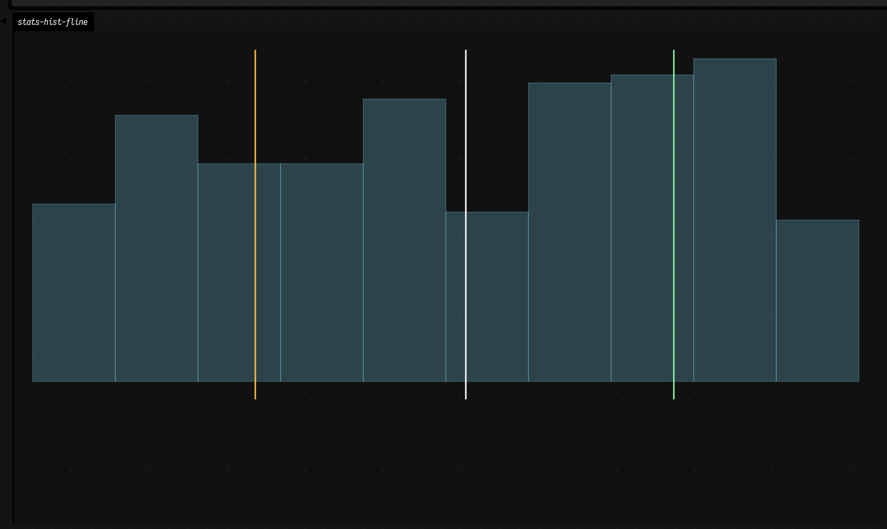
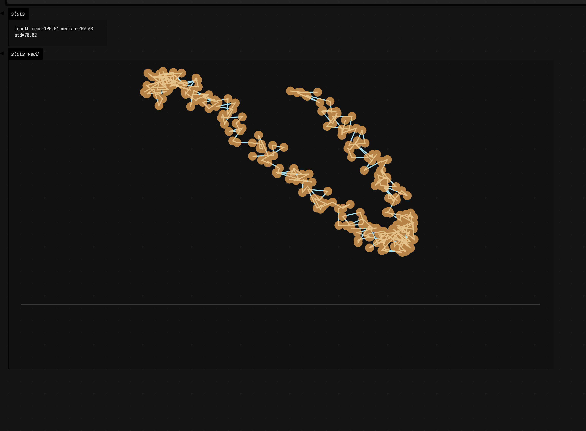

# Stats to FLine examples

A mean without a distribution is often little more than a rumor. The same is true of quartiles, standard deviations, and vector summaries: useful, certainly, but far more trustworthy when they stay attached to the thing they summarize. These examples make the statistics answer to the picture.

## Windowed histogram as bars + quartile markers

Why draw a histogram if the buffer can already tell you the median and quartiles? Because those numbers mean much more once you can see the shape they came from. In data science this is basic honesty; in creative coding it is how you stop "interesting noise" from becoming numerology; in music it is how you decide whether a gesture stream is truly varied or merely twitchy.

```diffstatic_runner {data-lang=kotlin screenshot="assets/stats_examples/histogram_fline.png" wait="1.0" capture="window" open-outputs="true"}
:::static
import afield.graphics.FLine
import afield.stdlib.*
import kotlin.math.PI
import kotlin.math.sin

val buffer = SummaryStatsBuffer(maxSize = 300)
for (i in 0 until 520) {
    val t = i / 90.0
    val x = sin(t * PI * 0.75) * 0.55 + (-0.15 + random() * 0.30)
    buffer.add(x)
}

val hist = buffer.histogram()
val stats = buffer.snapshot()

fun bar(bin: HistogramBin, maxCount: Int, idx: Int, total: Int): FLine {
    val x0 = 60.0 + idx.toDouble() / total.toDouble() * 920.0
    val x1 = 60.0 + (idx + 1).toDouble() / total.toDouble() * 920.0
    val h = if (maxCount <= 0) 0.0 else 360.0 * (bin.count.toDouble() / maxCount.toDouble())
    return fline {
        moveTo(x0, 520.0)
        lineTo(x0, 520.0 - h)
        lineTo(x1, 520.0 - h)
        lineTo(x1, 520.0)
        close()
        filled = true
        stroked = true
        color = vec(0.52, 0.88, 1.0, 0.24)
        thickness = 1.2
    }
}

val maxCount = hist.bins.maxOfOrNull { it.count } ?: 1
val bars = hist.bins.mapIndexed { i, b -> bar(b, maxCount, i, hist.bins.size) }

fun vMark(x: Double, c: Vec4): FLine = fline {
    val nx = 60.0 + ((x - hist.min) / (hist.max - hist.min + 1e-9)).coerceIn(0.0, 1.0) * 920.0
    moveTo(nx, 150.0)
    lineTo(nx, 540.0)
    color = c
    thickness = 2.0
}

val marks = listOf(
    vMark(stats.q1, vec(1.0, 0.76, 0.28, 0.9)),
    vMark(stats.median, vec(1.0, 1.0, 1.0, 0.95)),
    vMark(stats.q3, vec(0.56, 1.0, 0.64, 0.9))
)

lines(bars + marks, channel = "stats-hist-fline", w = 1100.0, h = 620.0, fitToSize = true)
```

So the example forces the stats buffer to show its work. We feed it a noisy scalar signal, ask for both a histogram and a snapshot, and then draw the bars and quartile markers in the same space. The markers are not the story; they are annotations on the story.



That is why the image reads so much better than a printed table. First you see the distribution, then you see where the summary lands inside it. A median that sits in the thick of the mass feels different from a median perched beside a lopsided tail, and the eye catches that instantly. For statistics that evolve frame by frame, continue with [Timeseries examples](timeseries_examples.md) and [Visualizers](visualizers.md).

## Vec2 cloud trajectory + length envelope

A scalar distribution is only half the story. Plenty of live systems produce points, trajectories, and clouds: cursor motion, body tracking, controller input, particle studies. How do you summarize *that* without losing the motion itself?

```diffstatic_runner {data-lang=kotlin screenshot="assets/stats_examples/vec2_stats_fline.png" wait="1.0" capture="box"}
:::static
import afield.graphics.FLine
import afield.stdlib.*
import kotlin.math.PI
import kotlin.math.cos
import kotlin.math.sin

val vbuf = Vec2SummaryStatsBuffer(maxSize = 260)
for (i in 0 until 420) {
    val t = i / 60.0
    val p = vec(
        cos(t * PI * 0.35) * 240 + (-26.0 + random() * 52.0),
        sin(t * PI * 0.47) * 160 + (-20.0 + random() * 40.0)
    )
    vbuf.add(p)
}

val pts = vbuf.values()
val lenStats = vbuf.snapshot().length

val trail = fline {
    pts.forEachIndexed { i, p ->
        val x = 540.0 + p.x
        val y = 280.0 + p.y
        if (i == 0) moveTo(x, y) else lineTo(x, y)
    }
    color = vec(0.68, 0.92, 1.0, 0.95)
    thickness = 2.2
}

val dots = fline {
    pts.forEach { p -> moveTo(540.0 + p.x, 280.0 + p.y) }
    pointed = true
    pointSize = 3.0
    stroked = false
    color = vec(1.0, 0.7, 0.36, 0.7)
}

val lenBand = fline {
    moveTo(40, 560)
    lineTo(1040, 560)
    color = vec(1,1,1,0.18)
    thickness = 1.0
}

val lenText = "<div style='padding:8px'>length mean=${"%.2f".format(lenStats.mean)} median=${"%.2f".format(lenStats.median)} std=${"%.2f".format(lenStats.sampleStdDev)}</div>"
display("stats", lenText)

lines(listOf(trail, dots, lenBand), channel = "stats-vec2", w = 1100.0, h = 620.0, fitToSize = true)
```

Here the geometry stays on stage. We collect a rolling stream of 2D points, draw the orbit it traces, and only then add a short textual summary of path length. The text is not trying to replace the drawing; it is there to sharpen what the drawing already suggests.



The result is the combination you usually want in practice: geometric intuition and a compact numeric report in the same place. You can see the orbit, and you can also say something precise about how far it tends to wander. For neighborhood and connectivity structure on similar point clouds, see [Smile neighbors examples](smile_neighbors_examples.md) and [Graph connectivity examples](graph_connectivity_examples.md).
