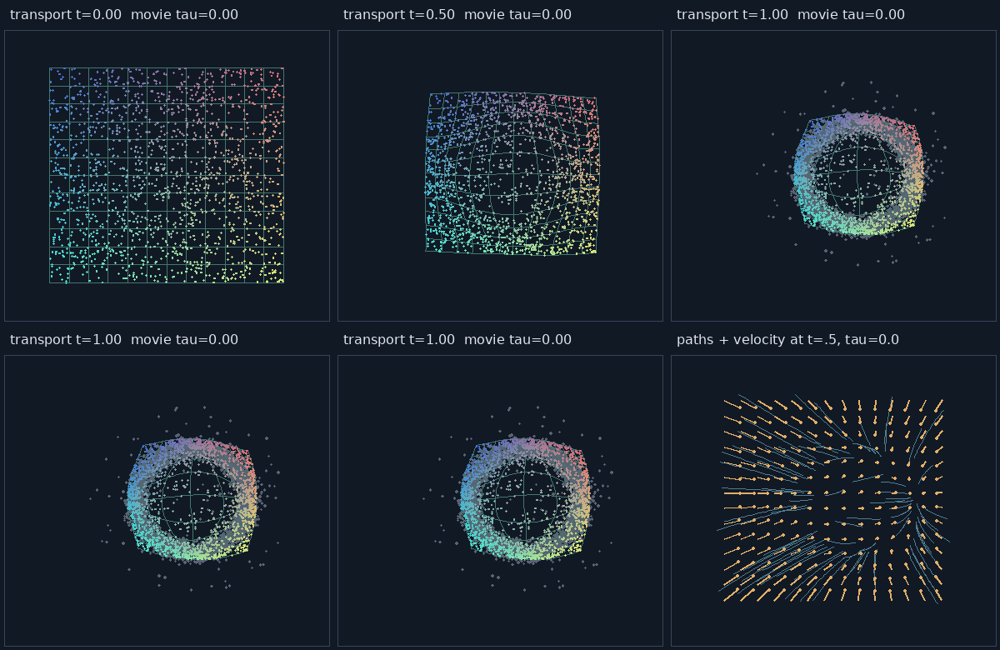
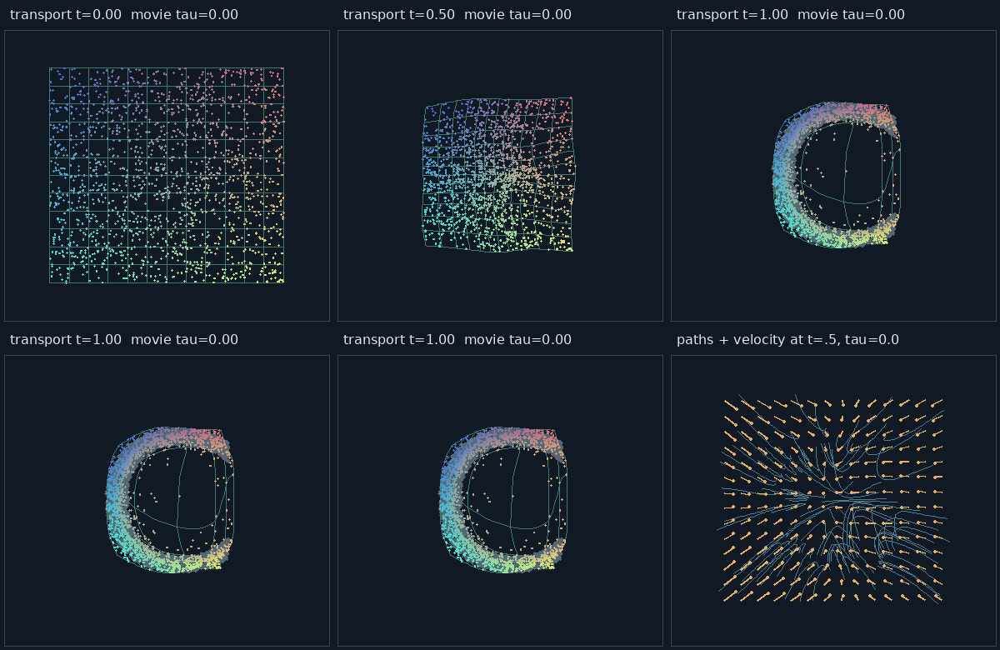
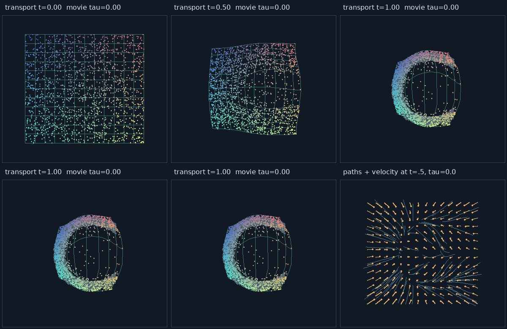
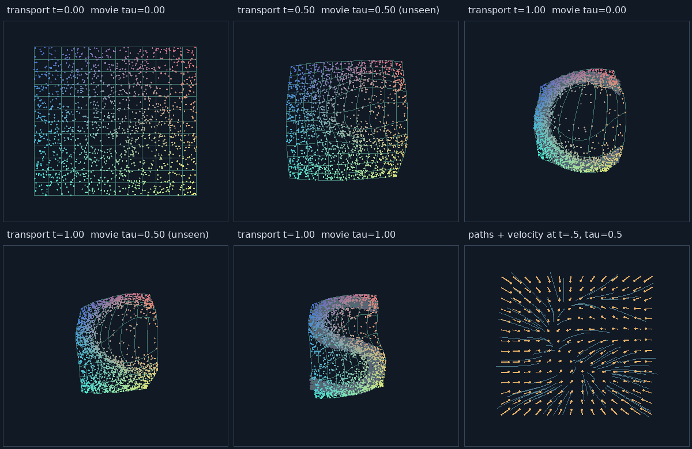
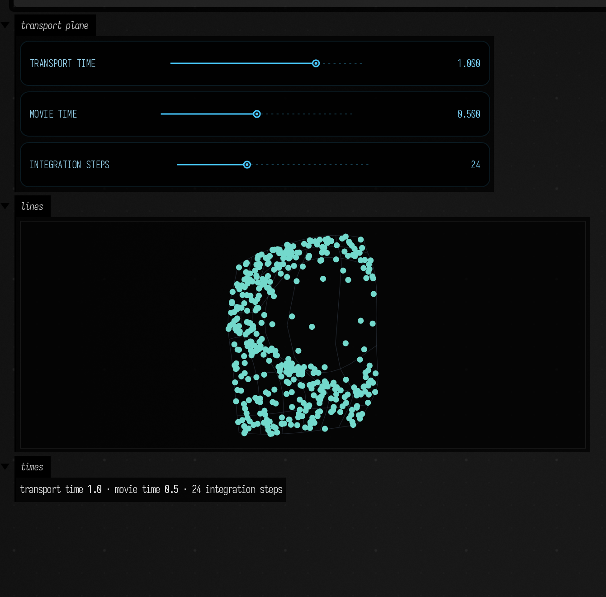
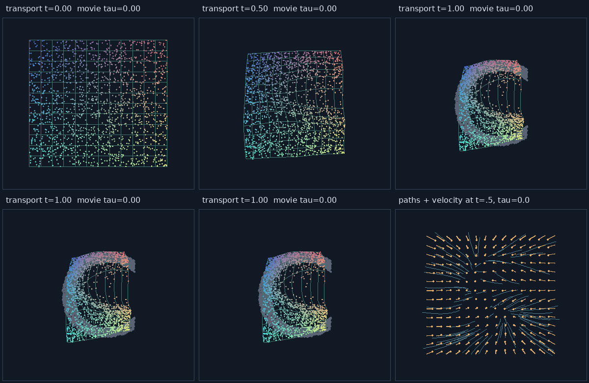
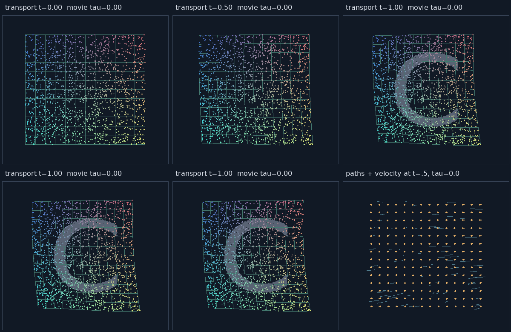

# Stipple Transport & Transport-Space Video

A stippled image can be represented as a deformation that redistributes a uniform particle sheet.
The useful result is the learned velocity field and its flow map: particles, coordinate lattices,
curves and sampling coordinates can all pass through the same field.

This page extends [Field's static flow matching](flow_matching.md) with an optional PyTorch
trainer and a portable CPU model loader. A movie uses one network:

<p style="font-size:1.3em"><i>v</i><sub>θ</sub>(x, y, t, τ) → (<i>v</i><sub>x</sub>, <i>v</i><sub>y</sub>)</p>

Here `t` is **transport time**, the variable integrated by the ODE; `tau` is **movie time**, held
fixed during each solve. A particle sheet is chosen once. Each movie frame recomputes the deformation
of those canonical coordinates, so each particle keeps its identity from frame to frame (it does
not follow a physical object). Velocity queries return transport velocity, the speed along `t`;
they say nothing about motion from one movie frame to the next.

## Transporting one image

Target image pixels contribute mass proportional to darkness. Stochastic stipples sample that mass,
then training adds Gaussian target jitter with standard deviation `sigma`. The stipples represent
small blobs rather than literal delta functions. Image coordinates are normalized, y points down,
and the longest image dimension spans `[-1,1]`; other dimensions preserve aspect ratio. The default
source is the full `[-1,1]²` uniform rectangle.

Training samples source and target points, draws transport time uniformly, and regresses
`v((1-t)*x0+t*x1,t,tau)` toward `x1-x0`. Static models omit the movie-time input. Temporal models
sample one target frame per batch at its discrete movie time. No interpolated targets supervise
the intermediate movie conditions.

The figures below come from offline PyTorch evaluation. Colored dots retain their canonical
colors; the thin lattice is arbitrary geometry that was never training data. Grey dots mark known
endpoint targets. The last panel shows trajectories and transport-velocity vectors.



The ring's sliced distribution distance falls from **0.233** for the uniform source to **0.014**
after transport, and a filled letter C reduces by a similar amount. These small models illustrate
the idea; they are not tuned density fits.

## Coupling changes the deformation

Random pairing is enough to learn density. Recursive spatial matching (BSP) splits each minibatch
into equal-mass halves along the widest combined axis, then pairs matching leaves. It preserves
both empirical marginals and avoids an assignment cost matrix, though it only approximates optimal
transport.





Same architecture, seed, training budget, target jitter and canonical evaluation particles:

| Metric | Random | BSP |
| --- | ---: | ---: |
| Sliced W1 to target | 0.0141 | 0.0136 |
| Mean transport path length | 0.545 | 0.357 |
| Mean total turning, radians | 2.819 | 0.308 |
| 8-step midpoint error against 128-step RK4 | 0.00453 | 0.00035 |

The path and integration improvements matter more here than the small density difference.
Sliced W1 compares projected quantiles, so it notices density proportions that a shape-only
nearest-neighbor score may miss. Turning is the sum of discrete direction changes along a
trajectory, a rough diagnostic with no units.

## Two images, including unseen movie time

This network trains only at `tau=0` (C) and `tau=1` (S). Both movie time and transport depth remain
available at evaluation. The middle movie condition was never a training frame.



<video controls muted loop playsinline preload="metadata" width="960" poster="../assets/stipple_transport/two-images.png">
  <source src="../assets/stipple_transport/two-images.mp4" type="video/mp4">
</video>

The video's four panels traverse the same canonical particles: `t=1`, `t=.5`, `t=tau`, and a fixed
`tau=.5` while transport time rises and falls. The intermediate shape comes from the network
itself; nothing blends the two letters' points or two networks' weights. There is no correct
intermediate letter to score it against, so judge it by eye.

## A short density movie

Sixteen grayscale target frames describe a moving ring changing into two blobs and back. A shared
conditioned field deforms the same 1,600 particles and coordinate lattice through that sequence.
The movie is a synthetic density; the model knows nothing about optical flow or objects.

The first video is the 16 grayscale frames used to generate the training
stipples, played at four frames per second. Darkness supplies the target probability mass.

<video controls muted loop playsinline preload="metadata" width="480" poster="../assets/stipple_transport/source-density.png">
  <source src="../assets/stipple_transport/source-density.mp4" type="video/mp4">
</video>

The second shows the learned transport: the same source particle identities and lattice pass through four slices
of transport and movie time:

<video controls muted loop playsinline preload="metadata" width="960" poster="../assets/stipple_transport/short-video.png">
  <source src="../assets/stipple_transport/short-video.mp4" type="video/mp4">
</video>

The small default model underfits this sequence at 3,500 training steps. Longer fitting and optional
temporal regularization improve it, but smooth conditioning still does not guarantee smooth or
semantically meaningful particle trajectories. Loop playback is convenient for inspection; endpoint
particle correspondence is not constrained to be periodic.

Two equal-budget 8,000-step fine-tunes from the same longer-trained checkpoint show the tradeoff:

| Metric | No regularization | Temporal strength .002 |
| --- | ---: | ---: |
| Mean sliced W1, 16 trained movie conditions | 0.0212 | 0.0290 |
| Mean sliced W1, 15 held-out inter-frame conditions | 0.0212 | 0.0284 |
| Mean particle second difference over 17 movie samples | 0.0803 | 0.0519 |
| Largest per-particle movie step | 0.3779 | 0.2472 |

Regularization makes the movie motion smoother and the density less accurate. The movie above uses
the regularized model. Its penalty approximates `∂v/∂tau` at fixed `(x,y,t)`; it is distinct from
the trajectory measures above. Held-out targets are freshly stippled samples of the known
procedural density movie, which makes an interpolation check possible for this example.
The [measurement record](assets/stipple_transport/measurements.json) includes per-frame results,
integration convergence, path diagnostics and the training/device options.

## Use the trained warp in Field

The portable loader is CPU-only and requires no Python or Torch at runtime. The supplied model has
8,770 parameters, three width-64 SiLU hidden layers, raw `(x,y,t,tau)` inputs and a linear
two-component velocity output. All inputs and velocities are normalized; scale geometry after
transport if working in ordinary Field coordinates. A point's z coordinate is preserved.

```diffstatic {data-lang=kotlin}
:::static
import afield.stdlib.loadStippleTransport

val field = loadStippleTransport("public/docs/assets/stipple_transport/two-images.json")
val canonical = field.sourceParticles(400, seed = 44) // retain once
val formed = field.transport(canonical, transportTime = .65, movieTime = .35, steps = 32)
val velocity = field.velocity(vec(.2, -.1, 0), transportTime = .65, movieTime = .35)
val point = field.flowMap(vec(.2, -.1, 0), transportTime = .65, movieTime = .35)
val trails = field.pathsFrom(canonical.take(40), movieTime = .35)

// Reverse integration at a fixed movie condition.
val back = field.transport(formed, transportTime = 0.0, movieTime = .35,
                          fromTransportTime = .65, steps = 32)
```

The editable [stipple sheet example](assets/stipple_transport/stipple_sheet.kt) publishes ordinary
Field sliders for independent transport/movie time and integration steps, and deforms both particles
and a coordinate lattice. Run its contents in a Field box from the repository checkout.



The [changed-control capture](assets/stipple_transport/field-controls.png) shows the same Field
example after browser callbacks set `t=.5` and `tau=.75`.

Neither time is clamped in the query API. Freeze, scrub, reverse and extrapolate by changing these
arguments; negative times and overshoot are extrapolation experiments. Different geometry can use
different transport depths at the same movie condition. Curves and outlines must be sampled finely
enough to resolve deformation between their vertices. CPU evaluation is useful for moderate geometry
counts; large particle sets at frame rate would need a GPU evaluator, which does not exist yet.

## Train your own

From the repository root, using the separate optional uv project:

```diffstatic {data-lang=bash}
:::static
uv run --project optional/transport-flow python optional/transport-flow/run.py train \
  --images drawing.png --count 4096 --sigma .025 --coupling bsp --out build/my-transport

uv run --project optional/transport-flow python optional/transport-flow/run.py train \
  --images frame-000.png frame-001.png frame-002.png --movie --temporal-strength .002

uv run --project optional/transport-flow python optional/transport-flow/run.py train \
  --video clip.mp4 --target-frames 16 --movie

uv run --project optional/transport-flow python optional/transport-flow/run.py demo --movie
```

Video decoding and MP4 export require FFmpeg. `--points` accepts normalized `.npy` point arrays.
Controls include source rectangle, stipple count, target jitter, random/BSP coupling, network width
and depth, training budget, integration steps, temporal regularization, random/grid source layout,
playback direction and overshoot. `--device cpu` supports machines without CUDA.

Outputs include reloadable `.pt` checkpoints, portable JSON models, figures, optional videos and
measurements. Temporal models can also bake velocities onto a spatial/transport/movie lattice in
NPZ format, ready for a shader to read; nothing in Field reads it on the GPU yet.

Library examples, format layout and the full control reference are in the repository's
`optional/transport-flow/README.md`, and `run.py --help` lists the command-line controls.

## Blending network weights

Blending the weights of two trained networks is a tempting shortcut to an in-between shape, and
usually a poor one. `demo --unsafe-weights` trains S by fine-tuning C, and compares its checkpoint midpoint against
a blend with an independently initialized S model. These are separate static networks, not the
movie-conditioned architecture. Field exposes `unsafeBlendWeights` for the same experiment.





The grey reference in these figures is C, shown for comparison. Neither blend is reliably useful. Shared training ancestry can help align internal
representations; independent models can permute hidden units while representing similar functions.
For animation, use the movie-conditioned field above.
