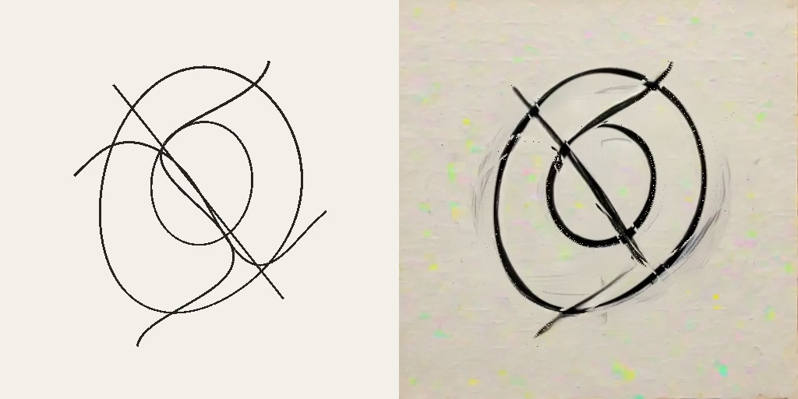

# Streaming diffusion

Restyle a rendered texture with a text prompt using StreamDiffusionV2.
Describe the appearance you want; charcoal, ink and barbed wire are example prompts. The source and returned image stay on the GPU, and the result
is a normal Field render-to-texture target (RTT) that you can sample in another
shader or composite into a scene.

[Open the streaming diffusion starting point ↗](offline.html?file=assets/agent_transcripts/streaming_diffusion/metadata.edn)



The example draws five rotating curves at 512 × 512. The left panel shows the
current source; the right shows stylized output. The model processes groups of
frames and introduces a causal delay; the motion controls can reproject that
output onto current geometry between results. While it starts, the right panel
shows the source. The example starts with charcoal at strength `0.85` and enables the motion controls.

## Open the example

Search for `streaming_diffusion` under **Starting points** on Field's welcome
screen, then open an editable copy in your workspace. Run **2 · renderer**,
then **3 · spinning curves**. Start with the charcoal preset or enter any text in
**Prompt override**. A blank override uses the selected material preset. Press
Enter or leave the text field to apply your prompt. The controls also let you
adjust strength, pause rotation, and reset the model's state.

For white marks on black paper, set `whiteOnBlack = true` in the curves box and
run it again. **Adapt prompt for white marks on black** switches between the
original material prompt and its white-on-black version. A custom prompt takes
precedence over this switch. The input geometry stays the same across prompts.
The model can invent detail and change the shapes; strength controls how much
freedom it has.

Lower strength retains more of the input; higher strength gives the model more
room to add texture, smudges and splatter. Start at `0.45` for restrained marks,
`0.60` for texture, and try `0.85–0.90` for expressive ink or charcoal. These are
styling controls, not a guarantee of exact geometry. For narrower marks, use
`StreamDiffusionPresets.FINE_INK` or `FINE_CHARCOAL` in the box.

!!! note "Optional local backend"

    Local inference currently requires Linux with an NVIDIA CUDA GPU and a
    Vulkan driver that exports GPU memory and timeline semaphores. The starting
    point opens on Macs and other platforms; its curves box shows an availability
    message before attempting any CUDA or Unix-handle setup. Ordinary Field
    startup and builds do not require Python, TensorRT or model downloads.

## Install the backend

Run the following from your Field checkout on Linux. Replace `/path/to/sd2` with
an installation directory. This uses the compatible upstream snapshot and Field's
adapter patch; the Python environment is separate from Field's own dependencies.

```diffstatic {data-lang=bash}
git clone https://github.com/chenfengxu714/StreamDiffusionV2.git /path/to/sd2
git -C /path/to/sd2 checkout 6961a5cf2045d1dda05a04ef229698bdc04e873a
git -C /path/to/sd2 apply "$PWD/optional/streamdiffusion/upstream/field.patch"
cp optional/streamdiffusion/upstream/local_rtx4090.yaml /path/to/sd2/configs/
uv venv --python 3.10 /path/to/sd2/.venv
uv pip install --python /path/to/sd2/.venv/bin/python torch==2.6.0 torchvision==0.21.0 --index-url https://download.pytorch.org/whl/cu124
uv pip install --python /path/to/sd2/.venv/bin/python -e /path/to/sd2
uv pip install --python /path/to/sd2/.venv/bin/python -r optional/streamdiffusion/upstream/requirements-local.txt -r optional/streamdiffusion/requirements.txt
cp optional/streamdiffusion/upstream/download-models.py /path/to/sd2/
/path/to/sd2/.venv/bin/python /path/to/sd2/download-models.py
```

The model download includes the Wan encoder, T5 text encoder, distilled causal
checkpoint and TAEHV decoder. The recorded setup uses Python 3.10, Torch 2.6 with
CUDA 12.4, FlashAttention 2.7.4 and TensorRT 10.9 on Linux x86_64. Allow space for
these weights and the TensorRT engine cache. Wan and distilled weights use pinned
revisions; the TAEHV download follows its upstream main branch.

Build the small native handle-sharing helper with a JDK containing JNI headers,
then set the backend path in the environment used to start Field:

```diffstatic {data-lang=bash}
cmake -S native/field-fdpass -B native/field-fdpass/build -DJAVA_HOME=/path/to/jdk
cmake --build native/field-fdpass/build
export FIELD_STREAMDIFFUSION_ROOT=/path/to/sd2
```

Run Field from its checkout. An existing compatible backend can be reused: install
`optional/streamdiffusion/requirements.txt` into its environment and set the same
variable. If Field is already running, replace the curves box's `root` expression
with `java.io.File("/path/to/sd2")` and run the box again. Nothing is downloaded
merely by opening the document.

TAEHV is the decoder for this integration. `useTensorRT = true` is the default;
the first run may build engines. To use the Torch decoder path instead, set
`useTensorRT = false` in the configuration. Check
`view.session.capabilities.optBoolean("tensorrt_active")` to see whether an engine
actually executed; requesting TensorRT does not establish that it is active.

## Process your own rendered texture

Create a single-layer, single-sample RGBA8 or BGRA8 target, with
`colorTransferSrc = true`. UNORM and sRGB are both accepted. The source dimensions
must be multiples of 32; start with 512 × 512 and 16 input frames per second.
See [Render to texture](afield_four_graphics.md#render-to-texture) for creating and displaying targets.

In a box connected beneath your renderer, this wraps an existing `source` RTT.
The processor schedules the source render and supplies a sampled output target:

```diffstatic {data-lang=kotlin}
import afield.media.video.diffusion.*

val root = StreamDiffusionSupport.configuredRoot()
val config = root?.let {
    StreamDiffusionConfig(it, prompt = StreamDiffusionPresets.CHARCOAL,
        strength = .45, fps = 16, useTensorRT = true)
}
val support = StreamDiffusionSupport.probe(renderer, config)
if (support.available) {
    prop<StreamDiffusionView>(diffusion)
    diffusion = StreamDiffusionView(renderer, source, checkNotNull(config))
    prop<RenderToTexture>(stylized) = diffusion.output
} else {
    markdown(support.reason)
}
```

Sample `stylized` through the same image and sampler bindings as any other RTT.
Remove the source's separate render-list registration when the processor schedules
it. If your graph already renders it earlier in the same frame, pass
`renderSource = false`. The caller owns the source; `diffusion.close()` releases
the worker, shared buffers and output. Construct and close between graphics frames.
The starting point shows how to retain the object in a box property and close it
when its frame loop ends or the box is run again.

Once the session is ready, change material or strength without replacing the RTT:

```diffstatic {data-lang=kotlin}
if (diffusion.session.ready) {
    diffusion.reset(prompt = StreamDiffusionPresets.INK, strength = .85, seed = 0)
}
print(diffusion.session.status)
print(diffusion.session.lastStats)
```

Reset clears causal history and holds the last valid image during warm-up.
`session.status` reports loading and errors; `session.logFile` contains the worker
log. `StreamDiffusionSupport.probe` checks the platform, selected Vulkan device,
export features, native helper and installation files. The worker then checks
CUDA device matching, packages and model loading. A startup or inference failure
leaves the source or last completed output visible.

## Use motion from your renderer

The starting point enables all three motion controls. It generates correspondence
from the same ribbon geometry that draws the source, retaining earlier transforms
and checking reference object IDs at crossings. **Reproject output** updates the
right panel between model results. **History blend** mixes preceding stylized
results into each new result. **Noise advection** anchors some of the model's
randomness to moving surfaces; changing it resets the model.

The following clips are native Field RTT captures at 512 × 512 with active
TAEHV/TensorRT and the charcoal prompt at strength `0.85`. Each has the current source on the left
and processed output on the right. They show successive eight-second intervals of the same rotating
scene; their source poses are not identical. Clip playback is 10 FPS; diffusion requests 16 FPS.

**All three enabled** — display reprojection, history blend `.35`, noise advection
`.8`:

<video controls muted loop playsinline preload="metadata" src="assets/streaming_diffusion/charcoal-085-all.mp4" poster="../assets/streaming_diffusion/charcoal-085-poster.png" width="1024" height="512" style="max-width:100%;height:auto;aspect-ratio:2/1"></video>

**All three disabled after reset** — the model's delayed output is held between
updates:

<video controls muted loop playsinline preload="metadata" src="assets/streaming_diffusion/charcoal-085-baseline.mp4" width="1024" height="512" style="max-width:100%;height:auto;aspect-ratio:2/1"></video>

The enabled run fills rejected pixels with paper reconstructed from nearby
output, so old curve positions do not leave a pale outline. Generated marks
beyond the supplied correspondence can still leave trails. The clips show the
controls working together; they do not measure how much each one improves
temporal stability. With the controls enabled the run presented about 16 FPS
once steady; the [run data](assets/streaming_diffusion/charcoal-085-run.json)
and [worker log](assets/streaming_diffusion/charcoal-085-worker.txt) record the
settings, resets, engine loads and chunk timings.

For your own scene, pass a `StreamDiffusionMotionProvider` to the processor and
opt into the controls. The provider records a GPU correspondence target in the
supplied command buffer:

```diffstatic {data-lang=kotlin}
import afield.media.video.diffusion.*
import afield.graphics.vulkan.device.CommandBuffer

val config = StreamDiffusionConfig(checkNotNull(root),
    displayReprojection = true, historyBlend = .35, noiseAdvection = .8)
val motion = object : StreamDiffusionMotionProvider {
    override fun onFrame(frame: StreamDiffusionFrame) {
        // Retain transforms / camera / object state keyed by frame.id and generation.
    }
    override fun record(command: CommandBuffer,
        request: StreamDiffusionMotionRequest): RenderToTexture? {
        // Render current pixels into reference-frame UV coordinates.
        // Return null if this pair's retained geometry is unavailable.
        return renderCorrespondence(command, request.current, request.reference)
    }
}
val diffusion = StreamDiffusionView(renderer, source, config, motion = motion)
```

`renderCorrespondence` here stands for your renderer's pass. It must return a
single-layer, single-sample **RGBA32F** RTT at the source resolution, with a
sampler and `colorSampled = true`, `colorTransferSrc = true`. You own that target
and its retained geometry; close them after the processor. The same target can
be reused across calls: each consumer records its work before the next request.

| Channel | Meaning |
| --- | --- |
| R, G | Absolute normalized UV in the requested **reference** frame |
| B | Confidence, 0 to 1; zero rejects history |
| A | Reactive rejection, 0 to 1; one rejects history |

Use texture-row coordinates: X right, Y down, pixel centres
`((x + .5) / width, (y + .5) / height)`. Field's negative-height viewport puts
NDC Y = +1 at texture row zero. A backward displacement `(dx, dy)` in pixels
becomes `referenceUV = currentUV + (dx / width, dy / height)`. Forward flow needs
to be converted into backward correspondence with holes and visibility handled.
The alpha channel is a reactive mask, rather than opacity; ordinary geometry can
use confidence one and reactive zero.

### Match the requested frames

`onFrame` runs after every source draw, including draws that are not accepted by
the model. Retain renderer state under its frame ID; timestamps and generation
are provided too. `record` can be called several times in one graphics frame,
with different frame pairs:

| Request use | Current → reference |
| --- | --- |
| `DISPLAY` | Current source → source frame of the latest resolved result |
| `HISTORY` | Source frame of a new result → preceding resolved result's source frame |
| `NOISE` | Newly accepted source → previous accepted source |

A single previous-frame vector buffer usually cannot cover the model's delay.
Re-render previous surface positions using retained transforms, or compose
backward flow with confidence checks across the requested interval. Match the
actual IDs, including skipped input captures. Use depth, object IDs or your
G-buffer to reject occlusion, newly revealed surfaces, topology changes and
unreliable pixels. Return null for missing retained state; write confidence zero
for individual pixels that cannot be matched.

The demo retains 512 display-frame transforms, about 8.5 seconds at 60 FPS. Your
retention window should cover your actual model lag. It extends correspondence to a
wider ribbon around each curve to carry stylized edges. Its static paper mapping
feathers rejection around old ribbons and fills revealed paper using nearby
generated paper. This local fill can soften paper texture, and generated mark
trails remain possible: it cannot identify every generated splatter pixel as
part of a moving surface.

### What each control does

Display reprojection samples the delayed stylized result at reference UVs on
every Field draw. Rejected pixels show the current source unless your provider
supplies a fallback image. Missing correspondence holds the latest resolved result. It improves geometric responsiveness; model
inference still has the same causal delay.

A provider can override `recordFallback(command, request, source, referenceImage)`
to render an image used where confidence or reactivity rejects display history.
It is called immediately after a successful `DISPLAY` request, with the resolved
stylized reference image borrowed for that call. Return a sampled, single-layer,
single-sample RTT matching the source's dimensions and colour format; you own it.
Return null for the default source fallback. This leaves noise and history
blending unchanged. The demo uses this hook to reconstruct paper from nearby
reference pixels outside old ribbons, so the flat source paper does not show
through as a brighter patch. It is a local approximation and does not predict
new stylized content.

History blending warps the previous resolved result into the new result's frame,
clamps its colours to the fresh result's 3 × 3 neighbourhood, and blends using
`historyBlend × confidence × (1 − reactive)`. Missing or invalid history uses the
fresh result. High blending can soften marks or leave trails; begin near `.35`.

Noise advection warps a CUDA noise field between accepted source frames and mixes
it with fresh noise. Nearest sampling and square-root weights preserve marginal
noise variance. The encoder compresses four RGB frames into one temporal latent;
the adapter uses the group's ending noise field. This is an **experimental spatial
approximation**, not exact flow through the video VAE. The model has no new learned
flow or depth conditioning, and generated marks can move independently of the
source geometry.

API defaults are `false`, `0`, `0`; supplying no provider retains the original
RGB processing path. Display reprojection and history blending can be changed
live through `diffusion.displayReprojection` and `diffusion.historyBlend`.
Change noise through `diffusion.reset(noiseAdvection = .8)`; reset clears noise
history and prevents history blending across model generations. During reset,
the last valid image can still be reprojected while new results warm up.

### GPU cost and diagnostics

Display/history passes run on Vulkan. Motion for noise is copied into an
additional RGBA32F plane in each shared input slot and imported directly as a
CUDA tensor; RGB and motion do not pass through CPU memory. Six float planes add
24 MiB at 512 × 512. Resolved history, display and the invalid-map target add
another 7 MiB for RGBA8 output; your motion targets, fallback target, CUDA
copies for the current four/five-frame group and retained scene state are additional. Larger resolutions scale these allocations with pixel count.

`displayReprojectionRequests`, `historyBlendRequests` and `noiseMotionFrames`
report requests/maps sent by Field. The worker's `noise_motion_frames` reports
maps actually consumed by noise advection, and `noise_advection` reports its
active setting. These are counts only; they say nothing about how good the
correspondence was or how much of the image it covered.

## Resolution

Width and height must each be multiples of 32. Rectangular images are accepted;
there is no square-image requirement. Resolution is fixed when the processor is
created. To resize, close it and create a new processor for the resized source.

The worker accepts dimensions up to 4096 × 4096, but the model has only been
run at 512 × 512, on an RTX 4090. Larger images increase GPU memory and computation. Doubling both
width and height gives four times the pixels and can cost more than four times
the computation. A new resolution may require new TensorRT engines.

## Duration, FPS and latency

There is no fixed clip-duration limit. The adapter streams with bounded buffers
and a rolling model cache rather than storing the whole video. It has not been
tested over runs lasting hours.

`fps` accepts 1–60 and controls capture and output pacing. It is a requested
sampling rate; available GPU throughput determines whether it can be sustained.
Changing it requires recreating the processor. Field can render at 60 FPS while
diffusion updates at 16 FPS, holding the latest completed image between updates.

The worker collects five frames initially, then processes groups of four. At
16 FPS, four input frames span 250 ms; measured computation takes approximately
186 ms per group at 512 × 512. Collection, the two-step causal pipeline and
output pacing add delay, so end-to-end latency is longer than the 62.5 ms
a 16 FPS frame interval suggests; it has not been measured exactly. Model startup takes tens
of seconds on the recorded machine; initial TensorRT engine building can take
longer. `startupTimeoutSeconds` defaults to 240 and can be increased.

The model advances through accepted frames. Supplied timestamps identify the
source frame; they do not condition the model on elapsed time. Changing the
sampling rate, or skipping captures under load, therefore changes the motion
seen by the model. The input scene can use its own animation clock independently
of diffusion sampling.

## Timing and memory

Field captures on an independent FPS grid. When the bounded input queue is full,
it skips captures rather than growing a queue. The worker processes accepted frames
in order; Field keeps displaying the last completed output while it is busy.
`capturedFrames`, `skippedCaptures`, `presentedFrames`, `droppedOutputs`,
`lastSourceFrameId` and `lastSourceTimeNanos` describe that behavior.

The native ink run on an RTX 4090 sustained **16.00 presented FPS at 512 × 512**
over an 18-second steady interval. The median four-frame worker chunk took
186 ms. In an earlier run, total GPU memory use (including Field and the rest
of the desktop) was about 12.3 GiB. Scene complexity, other GPU workloads and resolution
change the available throughput and memory headroom.

The text encoder moves to CPU after initial prompt encoding by default. Later
prompt changes can therefore take longer. Per-frame image processing and image
transport stay on CUDA and Vulkan. Renderer correspondence can drive the three
motion controls above. Depth and other G-buffer data can help your provider
construct visibility and confidence; the model does not consume them directly.

??? aside "Source and recorded run"

    The editable source is the [operation transcript](https://github.com/OpenEndedGroup/Field4/blob/main/dev_docs/agents/transcripts/streaming_diffusion.yaml).
    The charcoal image and comparison clips are native Field RTT captures, with
    TAEHV and active TensorRT. [Run data](assets/streaming_diffusion/charcoal-085-run.json) and the
    [worker log](assets/streaming_diffusion/charcoal-085-worker.txt) retain settings and engine loads.
    The capture uses the starting point's geometry and prompt controls with strict
    checkpoint loading. The [ink clip](assets/streaming_diffusion/motion-all.mp4)
    was recorded without the display fill and shows the pale paper outline it
    removes. The backend's setup and architecture are in
    [`optional/streamdiffusion/README.md`](https://github.com/OpenEndedGroup/Field4/blob/main/optional/streamdiffusion/README.md).

See also [the graphics starting point](afield_four_graphics.md) and
[render to texture](afield_four_graphics.md#render-to-texture).
