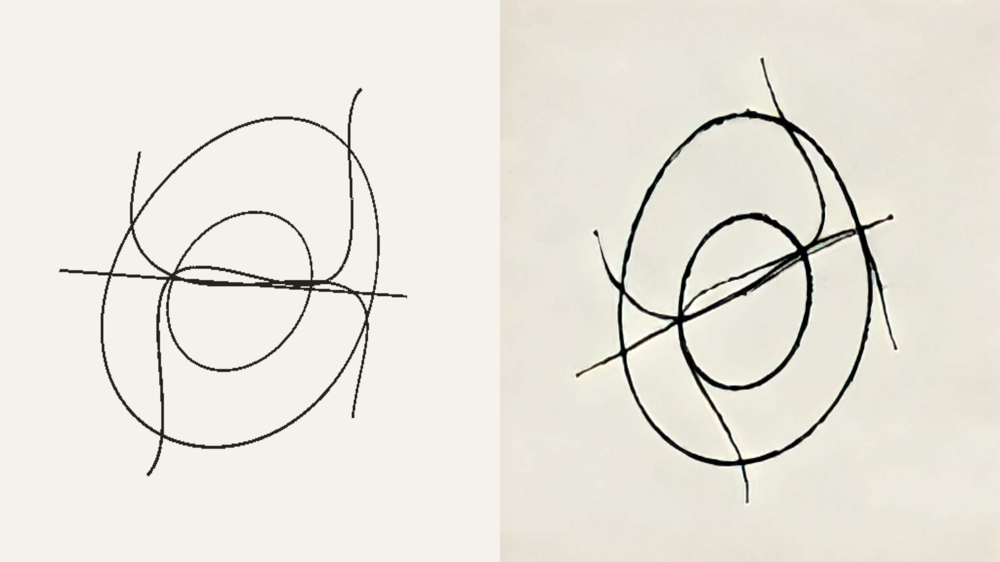

# Streaming diffusion

Turn a rendered texture into moving ink, charcoal or barbed wire with
StreamDiffusionV2. The source and returned image stay on the GPU, and the result
is a normal Field render-to-texture target (RTT) that you can sample in another
shader or composite into a scene.

[Open the streaming diffusion starting point ↗](offline.html?file=assets/agent_transcripts/streaming_diffusion/metadata.edn)



The example draws five rotating curves at 512 × 512. The left panel shows the
current source; the right shows the latest completed diffusion output. These
are different moments: the model processes groups of frames and introduces a
causal delay. While it starts, the right panel shows the source.

## Open the example

Search for `streaming_diffusion` under **Starting points** on Field's welcome
screen, then open an editable copy in your workspace. Run **2 · renderer**,
then **3 · spinning curves**. Its diffusion controls let you choose ink,
charcoal or wire, adjust strength, pause rotation, and reset the model's state.

For white marks on black paper, set `whiteOnBlack = true` in the curves box and
run it again. **Adapt prompt for white marks on black** switches between the
original material prompt and its white-on-black version. Edit `selectedPrompt()`
to supply your own words. The input geometry stays the same across materials.

Lower strength retains more of the input; higher strength gives the model more
room to add texture, smudges and splatter. Start at `0.45` for restrained marks,
`0.60` for texture, and try `0.85–0.90` for expressive ink or charcoal. These are
styling controls, not a guarantee of exact geometry. For narrower marks, use
`StreamDiffusionPresets.FINE_INK` or `FINE_CHARCOAL` in the box.

!!! note "Optional local backend"

    Local inference currently requires Linux with an NVIDIA CUDA GPU and a
    Vulkan driver that exports GPU memory and timeline semaphores. The starting
    point opens on Macs and other platforms; its curves box shows an availability
    message before attempting any CUDA or Unix-handle setup. Ordinary Field
    startup and builds do not require Python, TensorRT or model downloads.

## Install the backend

Run the following from your Field checkout on Linux. Replace `/path/to/sd2` with
an installation directory. This uses the compatible upstream snapshot and Field's
adapter patch; the Python environment is separate from Field's own dependencies.

```diffstatic {data-lang=bash}
git clone https://github.com/chenfengxu714/StreamDiffusionV2.git /path/to/sd2
git -C /path/to/sd2 checkout 6961a5cf2045d1dda05a04ef229698bdc04e873a
git -C /path/to/sd2 apply "$PWD/optional/streamdiffusion/upstream/field.patch"
cp optional/streamdiffusion/upstream/local_rtx4090.yaml /path/to/sd2/configs/
uv venv --python 3.10 /path/to/sd2/.venv
uv pip install --python /path/to/sd2/.venv/bin/python torch==2.6.0 torchvision==0.21.0 --index-url https://download.pytorch.org/whl/cu124
uv pip install --python /path/to/sd2/.venv/bin/python -e /path/to/sd2
uv pip install --python /path/to/sd2/.venv/bin/python -r optional/streamdiffusion/upstream/requirements-local.txt -r optional/streamdiffusion/requirements.txt
cp optional/streamdiffusion/upstream/download-models.py /path/to/sd2/
/path/to/sd2/.venv/bin/python /path/to/sd2/download-models.py
```

The model download includes the Wan encoder, T5 text encoder, distilled causal
checkpoint and TAEHV decoder. The recorded setup uses Python 3.10, Torch 2.6 with
CUDA 12.4, FlashAttention 2.7.4 and TensorRT 10.9 on Linux x86_64. Allow space for
these weights and the TensorRT engine cache. Wan and distilled weights use pinned
revisions; the TAEHV download follows its upstream main branch.

Build the small native handle-sharing helper with a JDK containing JNI headers,
then set the backend path in the environment used to start Field:

```diffstatic {data-lang=bash}
cmake -S native/field-fdpass -B native/field-fdpass/build -DJAVA_HOME=/path/to/jdk
cmake --build native/field-fdpass/build
export FIELD_STREAMDIFFUSION_ROOT=/path/to/sd2
```

Run Field from its checkout. An existing compatible backend can be reused: install
`optional/streamdiffusion/requirements.txt` into its environment and set the same
variable. If Field is already running, replace the curves box's `root` expression
with `java.io.File("/path/to/sd2")` and run the box again. Nothing is downloaded
merely by opening the document.

TAEHV is the decoder for this integration. `useTensorRT = true` is the default;
the first run may build engines. To use the Torch decoder path instead, set
`useTensorRT = false` in the configuration. Check
`view.session.capabilities.optBoolean("tensorrt_active")` to see whether an engine
actually executed; requesting TensorRT does not establish that it is active.

## Process your own rendered texture

Create a single-layer, single-sample RGBA8 or BGRA8 target, with
`colorTransferSrc = true`. UNORM and sRGB are both accepted. The source dimensions
must be multiples of 32; start with 512 × 512 and 16 input frames per second.
See [Render to texture](afield_four_graphics.md#render-to-texture) for creating and displaying targets.

In a box connected beneath your renderer, this wraps an existing `source` RTT.
The processor schedules the source render and supplies a sampled output target:

```diffstatic {data-lang=kotlin}
import afield.four.diffusion.*

val root = StreamDiffusionSupport.configuredRoot()
val config = root?.let {
    StreamDiffusionConfig(it, prompt = StreamDiffusionPresets.CHARCOAL,
        strength = .45, fps = 16, useTensorRT = true)
}
val support = StreamDiffusionSupport.probe(renderer, config)
if (support.available) {
    prop<StreamDiffusionView>(diffusion)
    diffusion = StreamDiffusionView(renderer, source, checkNotNull(config))
    prop<RenderToTexture>(stylized) = diffusion.output
} else {
    markdown(support.reason)
}
```

Sample `stylized` through the same image and sampler bindings as any other RTT.
Remove the source's separate render-list registration when the processor schedules
it. If your graph already renders it earlier in the same frame, pass
`renderSource = false`. The caller owns the source; `diffusion.close()` releases
the worker, shared buffers and output. Construct and close between graphics frames.
The starting point shows how to retain the object in a box property and close it
when its frame loop ends or the box is run again.

Once the session is ready, change material or strength without replacing the RTT:

```diffstatic {data-lang=kotlin}
if (diffusion.session.ready) {
    diffusion.reset(prompt = StreamDiffusionPresets.INK, strength = .85, seed = 0)
}
print(diffusion.session.status)
print(diffusion.session.lastStats)
```

Reset clears causal history and holds the last valid image during warm-up.
`session.status` reports loading and errors; `session.logFile` contains the worker
log. `StreamDiffusionSupport.probe` checks the platform, selected Vulkan device,
export features, native helper and installation files. The worker then checks
CUDA device matching, packages and model loading. A startup or inference failure
leaves the source or last completed output visible.

## Resolution

Width and height must each be multiples of 32. Rectangular images are accepted;
there is no square-image requirement. Resolution is fixed when the processor is
created. To resize, close it and create a new processor for the resized source.

The worker accepts dimensions up to 4096 × 4096. This is a protocol ceiling,
not a demonstrated usable model resolution. **512 × 512 is verified on an RTX
4090.** Larger images increase GPU memory and computation. Doubling both
width and height gives four times the pixels and can cost more than four times
the computation. A new resolution may require new TensorRT engines.

## Duration, FPS and latency

There is no fixed clip-duration limit. The adapter streams with bounded buffers
and a rolling model cache rather than storing the whole video. Continuous runs
lasting hours have not been established.

`fps` accepts 1–60 and controls capture and output pacing. It is a requested
sampling rate; available GPU throughput determines whether it can be sustained.
Changing it requires recreating the processor. Field can render at 60 FPS while
diffusion updates at 16 FPS, holding the latest completed image between updates.

The worker collects five frames initially, then processes groups of four. At
16 FPS, four input frames span 250 ms; measured computation takes approximately
186 ms per group at 512 × 512. Collection, the two-step causal pipeline and
output pacing add delay. **16 FPS does not mean 62.5 ms end-to-end latency.**
Exact source-to-display latency has not been measured. Model startup takes tens
of seconds on the recorded machine; initial TensorRT engine building can take
longer. `startupTimeoutSeconds` defaults to 240 and can be increased.

The model advances through accepted frames. Supplied timestamps identify the
source frame; they do not condition the model on elapsed time. Changing the
sampling rate, or skipping captures under load, therefore changes the motion
seen by the model. The input scene can use its own animation clock independently
of diffusion sampling.

## Timing and memory

Field captures on an independent FPS grid. When the bounded input queue is full,
it skips captures rather than growing a queue. The worker processes accepted frames
in order; Field keeps displaying the last completed output while it is busy.
`capturedFrames`, `skippedCaptures`, `presentedFrames`, `droppedOutputs`,
`lastSourceFrameId` and `lastSourceTimeNanos` describe that behavior.

The native ink run on an RTX 4090 sustained **16.00 presented FPS at 512 × 512**
over an 18-second steady interval. The median four-frame worker chunk took
186 ms. An earlier run used approximately 12.3 GiB of total GPU memory,
including Field and other desktop allocations. Scene complexity, other GPU workloads and resolution
change the available throughput and memory headroom.

The text encoder moves to CPU after initial prompt encoding by default. Later
prompt changes can therefore take longer. Per-frame image processing and image
transport stay on CUDA and Vulkan. Optical flow, depth and other G-buffer inputs
are not accepted by this adapter yet.

??? aside "Source and recorded run"

    The editable source is the [operation transcript](https://github.com/OpenEndedGroup/Field4/blob/main/dev_docs/agents/transcripts/streaming_diffusion.yaml).
    The image above is a native Field capture from 2 October 2026, with TAEHV and
    active TensorRT. [Run data](assets/streaming_diffusion/run.json) and the
    [worker log](assets/streaming_diffusion/ink-worker.txt) retain settings and engine loads.
    The capture runs the gated starting-point transcript, including strict checkpoint
    loading and the final lifecycle guards. Missing-backend behavior was also run
    on Linux; macOS was not run on that host. The backend's setup and architecture
    are in `optional/streamdiffusion/README.md` in the Field checkout.

See also [the graphics starting point](afield_four_graphics.md) and
[render to texture](afield_four_graphics.md#render-to-texture).
