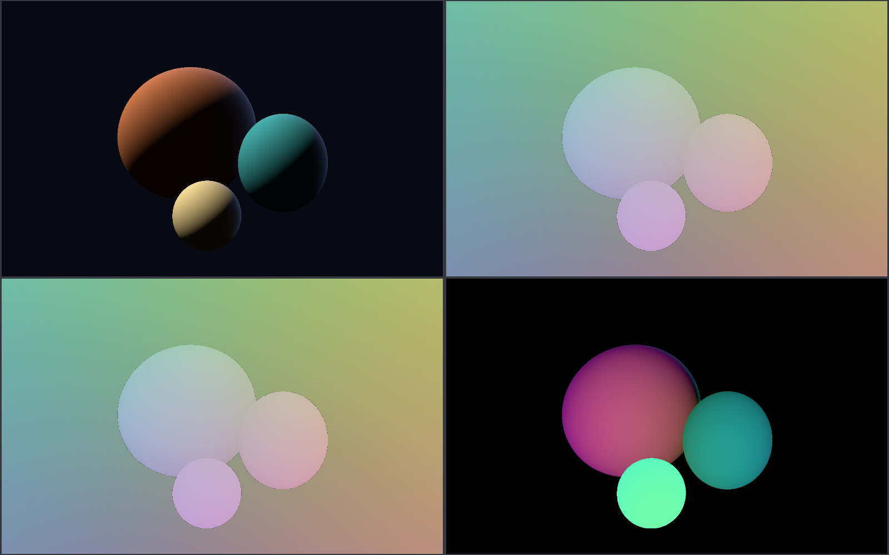
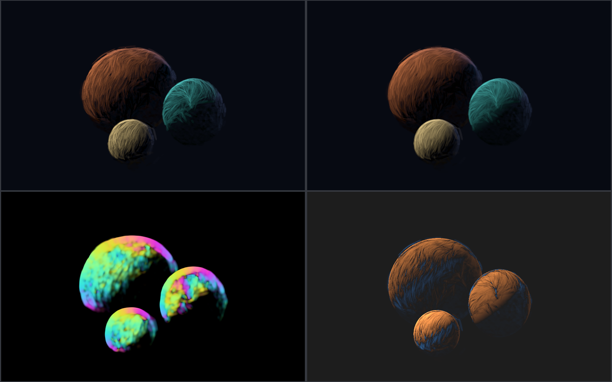
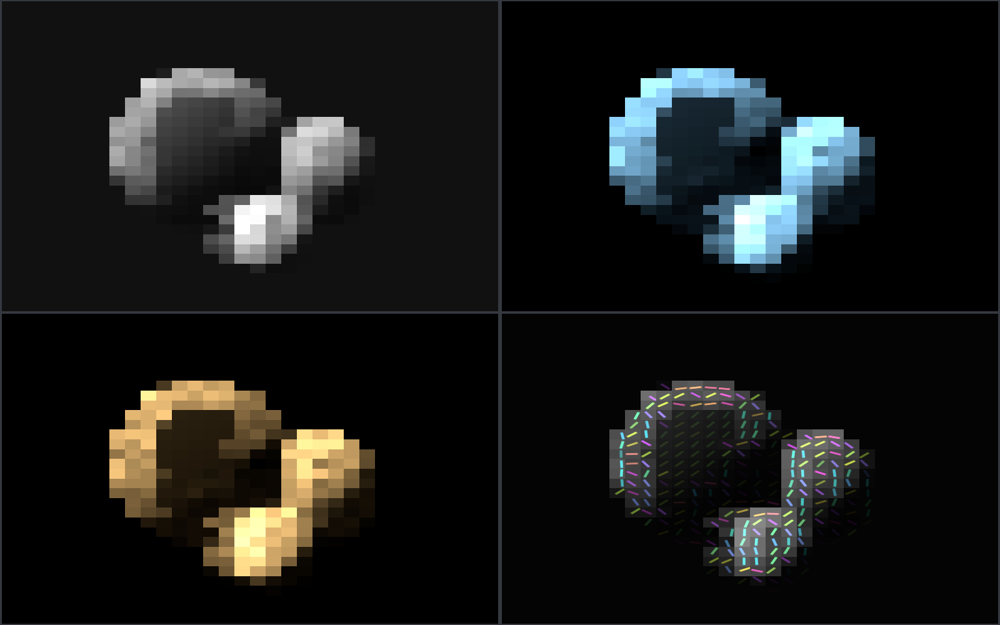
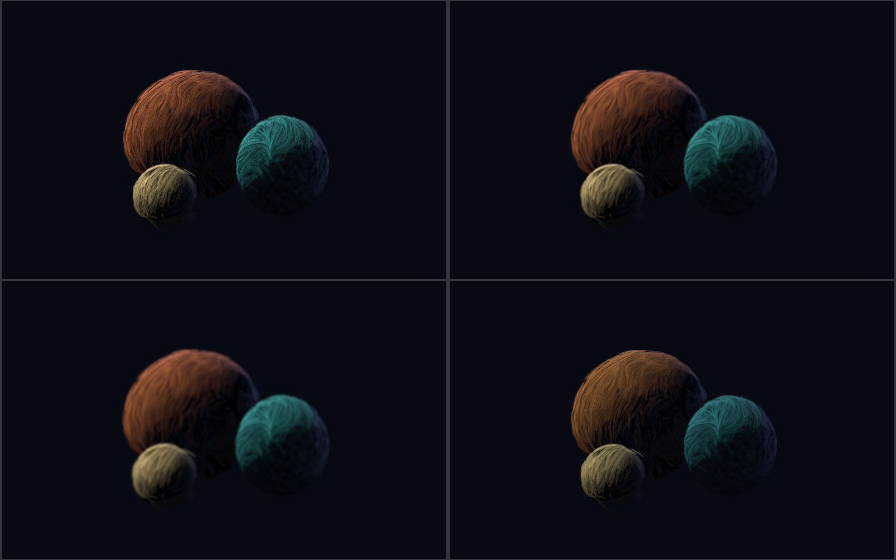

# Stroke Studio

Three untextured balls move slowly inside a nearly black, blue-tinted canvas. The picture
begins at the silhouettes. Short marks accumulate into longer runs, paint advances into the
interiors, and ribbons spill past the edges. Every visible mark belongs to a stroke that was
born, has a shape in world space, and will eventually disappear.

Explore the boxes and shader properties in the viewer below, or open the document in Field to
run the drawing and change it.

<iframe
  src="offline.html?zip=assets/stroke_studio/stroke_studio.zip"
  title="Stroke Studio document in the offline viewer"
  style="width:100%; height:560px; border:1px solid #444; border-radius:8px; background:#111;"
  loading="lazy"
  allowfullscreen>
</iframe>

To render the drawing, [download the editable Field document](assets/stroke_studio/stroke_studio.zip). Unzip
`stroke_studio` into your Field workspace and open it in Field. Run **Stroke types**,
launch **Stroke renderer**, then launch **Stroke studio**. The document uses a Vulkan device
with task and mesh shader support. In the render window, **C** clears the strokes, **Space**
pauses the balls, and **O** pauses the camera. The **View** control in the studio box exposes
the buffers pictured below. The document renders paint and the composite at 3840 × 2400,
with a 1792 × 1120 analysis grid. The desktop preview and these recordings are smaller.
This example uses a single camera.

## Give the brush a moving surface

The scene pass produces three images. Lit RGB gives the brushes the color they are trying to
paint. Two position attachments record the visible surface point at the current and
previous scene times, with the surface ID in alpha. The previous position belongs to the
**same surface point**. Transform the hit into the ball’s local coordinates at the current time, then transform it
back with the previous center and rotation. Rays that miss the balls hit the inside of an
opaque sphere, giving even the clear canvas a world position.


```diffstatic_runner {data-lang=kotlin capture="native-window" capture-profile="linux-nvidia" screenshot="assets/stroke_studio/scene.png" macro-file="../../dev_docs/agents/transcripts/docs_capture/stroke_studio.yaml" document="stroke_studio" run-box="stroke_capture_scene" capture-box="12a8511d-32fd-4006-a3fb-67fe7fc7f3c6" wait="5" native-wait-frames="5" hidden=true embed=false timeout="150" name="stroke-studio-scene"}
// Capture the packaged renderer through the Stroke Studio transcript.
```

<figure class="field-captioned-figure" markdown>

<figcaption>Top left and clockwise. Lit color, current world position, projected velocity, previous world position. The position panels encode XYZ as RGB. In the velocity panel, hue represents heading and brightness represents speed.</figcaption>
</figure>

Project the two positions through the **current** camera, take the difference, and divide
by the frame interval. The result is in analysis pixels per second. A moving camera can
reframe every stroke, while this velocity field describes the motion of the balls. It
also supplies a sign for the first step of a trace. When the tensor offers two equivalent
headings along an edge, start with the one that agrees with motion.

```diffstatic {data-lang=glsl}
vec2 pixelsPerSecond =
    (worldPixel(current.xyz) - worldPixel(previous.xyz)) / pc.deltaSeconds;
velocity = vec4(pixelsPerSecond, 1.0, length(pixelsPerSecond));
```

The seed uses that sign to order the reveal along the ribbon. Once a path is traced, its
knots are stored in world space. Each frame, the updater projects
a knot into the current view and looks nearby for a matching previous-world sample on its
surface. The matching current position moves the knot. Lost or stretched runs can enter an
early release. Projecting the updated knots for drawing handles camera motion, which is also
the basis for drawing the same strokes from two eye cameras.

## Use the canvas to decide where to draw

On a clean canvas, the lit scene provides a thin guide at the silhouette. Once marks appear,
their edges guide the next ones. By default the analysis image mixes 82% painted canvas with
18% lit color. Each candidate seed has to find a silhouette or a nearby paint front on the
same surface. At a paint front, the candidate sits on the lower-coverage side. A trace must
make at least four steps and cover a minimum span before taking a slot. These rules turn
isolated births into a drawing that works its way inward from the boundary.

The edge pass blurs the color, computes Sobel derivatives across RGB, and forms the structure
tensor. The dot products combine gradients across channels, preserving boundaries between
colors of similar luminance. It blurs the tensor before estimating the tangent, so nearby derivatives can vote on
the same direction. Direction strength combines coherence with contrast. A GPU percentile
sketch samples the field every twelfth frame and supplies an adaptive birth threshold.
The direction texture stores the unsigned tangent at twice its angle so that filtering
preserves the agreement between opposite headings. See [Field Probes](field_probes.md)
for more on the statistics.


```diffstatic_runner {data-lang=kotlin capture="native-window" capture-profile="linux-nvidia" screenshot="assets/stroke_studio/feedback.png" macro-file="../../dev_docs/agents/transcripts/docs_capture/stroke_studio.yaml" document="stroke_studio" run-box="stroke_capture_feedback" capture-box="12a8511d-32fd-4006-a3fb-67fe7fc7f3c6" wait="5" native-wait-frames="5" hidden=true embed=false timeout="150" name="stroke-studio-feedback"}
// Capture the packaged renderer through the Stroke Studio transcript.
```

<figure class="field-captioned-figure" markdown>

<figcaption>Top left and clockwise. Sharp paint, the mixed analysis image, signed luminance error, and direction strength. Orange marks a deficit and blue marks excess. In the direction panel, hue encodes the unsigned tangent and brightness encodes its strength.</figcaption>
</figure>

Birth traces a few midpoint integration steps in both directions, choosing the sign of
each new tangent to agree with the current heading. **Velocity integration** steers those
steps toward the projected or authored velocity field. Coherent edges can support
longer runs. Where coherence is low, a strong enough color error can lay down shorter
marks, subject to the same front and span checks.

The direction field guides each mark; the signed color error determines what it deposits. The birth pass averages `lit - canvas - feedbackGain * paint` along the
accepted path. The default **Pigment fraction** deposits 55% of that signed residual.
Negative components remove excess pigment as the ribbon draws. Both the feedback and
the draw target retain signed RGB, so neighboring strokes can respond to that correction
on the next frame.

## Look at a neighborhood before committing

A strong tangent is a local measurement. The quadtree pyramid gives the brush another
scale at which to decide. Its leaves summarize the analysis image on a 128 × 128 grid.
Each parent pools four children, including the variance between their means.
`FabricatePassLibrary.summaryPyramid` supplies the passes, and the studio samples depth
5, a 32 × 32 level.


```diffstatic_runner {data-lang=kotlin capture="native-window" capture-profile="linux-nvidia" screenshot="assets/stroke_studio/summary.png" macro-file="../../dev_docs/agents/transcripts/docs_capture/stroke_studio.yaml" document="stroke_studio" run-box="stroke_capture_summary" capture-box="12a8511d-32fd-4006-a3fb-67fe7fc7f3c6" wait="5" native-wait-frames="5" hidden=true embed=false timeout="150" name="stroke-studio-summary"}
// Capture the packaged renderer through the Stroke Studio transcript.
```

<figure class="field-captioned-figure" markdown>

<figcaption>Top left and clockwise. Mean luminance, min-to-max range, principal spatial axes, and luminance standard deviation. The axes are reconstructed from the stored spatial moments. Their brightness is weighted by local luminance variation.</figcaption>
</figure>

**Variance targeting** makes births more likely in cells with more luminance variation.
**Variance thickness** can widen or narrow the brush in those cells, depending on its sign.
The reference is in standard-deviation units. Both controls start at zero so the default
look comes from the local field and paint fronts. A child box can sample the summary
regardless of those controls. The [summary pyramid starting place](agent_transcripts.md#four_summary_pyramid)
explains the three planes and shows how to reuse the pass independently.

## Give each mark a life

The pool has 10,240 slots and room for up to nine knots in each. Drawing in and fading have
separate clocks. The default attack scale is 0.18 s and the normal fade runs on an 8 s scale.
Position tracking continues during the fade, with a shorter release for interrupted marks.
A stroke's 1.2× scale expands it about its center. The width, weight, displacement, and
silhouette spill controls let it remain legible outside the surface that located it.

The task shader checks 32 slots at a time, compacts the live indices, and launches one mesh
workgroup per surviving stroke. The mesh shader emits two vertices per knot and two triangles
per segment. Fragment coverage shapes the ribbon across its width and its ends. It adds
signed pigment and coverage into an RGBA16F attachment with `ONE + ONE` blending and
depth testing disabled. A second attachment records the lifecycle phases and erasers
for inspection. The next frame redraws the current pool, so marks fade through their own
envelopes even when no new marks are born.

### Change the brush in StackSL

Open **StackSL** on the studio box. Each hook consumes a four-lane value and returns one.
This replacement for `brushStyle` tapers the stroke. Its input lanes are path fraction,
age in seconds, stable seed, and direction class. The output lanes are width, weight,
scale, and lateral shift in half-widths.

```diffstatic {data-lang=stacksl}
: brushStyle
    >stroke
    <stroke .x 3.141593 * sin 0.75 * 0.45 +
    1 1 0 vec4
;
```

To draw along an authored field, replace `guideVelocity` with the vortex below, set
**Velocity integration** to one, and clear the pool. The input is UV, frame delta, and
scene time. The result is velocity XY in analysis pixels per second, confidence, and an
optional speed. Restore `sample0-abs` as the body to use scene motion again.

```diffstatic {data-lang=stacksl}
: guideVelocity
    >where
    0.5 <where .y - 180 *
    <where .x 0.5 - 180 *
    1 0 vec4
;
```

The document includes commented hooks for world offset, the life envelope, pigment,
regional birth and shape, edge tone, and the final composite. From a child box,
`strokeSettings` is an atomic settings value. This change can run while the drawing does.

```diffstatic {data-lang=kotlin}
strokeSettings.updateAndGet {
    it.copy(velocityMix = 0.85f, varianceTarget = 0.7f, varianceThickness = 0.45f)
}
```

## Resolve the paint into the image

The final pass borrows a compositing technique from `dust_six`. Green in the medium
Gaussian image routes between sharp, medium, and broad paint. A separate control mixes
some of that routed result back into the sharp image. The **Green reconstruction** control
brings green toward an average of red and green, with an option to steer the second input
toward blue.


```diffstatic_runner {data-lang=kotlin capture="native-window" capture-profile="linux-nvidia" screenshot="assets/stroke_studio/composite.png" macro-file="../../dev_docs/agents/transcripts/docs_capture/stroke_studio.yaml" document="stroke_studio" run-box="stroke_capture_composite" capture-box="12a8511d-32fd-4006-a3fb-67fe7fc7f3c6" wait="5" native-wait-frames="5" hidden=true embed=false timeout="150" name="stroke-studio-composite"}
// Capture the packaged renderer through the Stroke Studio transcript.
```

<figure class="field-captioned-figure" markdown>

<figcaption>Top left and clockwise. Sharp paint, medium Gaussian, final composite, broad Gaussian. The blur views show the pigment before the final coverage weighting and green reconstruction.</figcaption>
</figure>

The same marks can read as light or paint. Thin overlaps can add their full contribution.
With **Light to paint** turned up, dense overlaps above **Paint crossover alpha** move
toward a coverage-weighted average. The weighted branch divides the signed sum by its accumulated alpha, then multiplies by
`1 - exp(-alpha)`. That retains a coverage response while letting dense overlaps share
color. The clear color is added at the end and a gamut mapping step compresses outlying
chroma from signed pigment before the image goes to sRGB. The next birth pass still reads
the signed paint, so these display controls can change the look of the same stroke pool.


```diffstatic_runner {data-lang=kotlin capture="native-window" capture-profile="linux-nvidia" screenshot="assets/stroke_studio/strokes.png" macro-file="../../dev_docs/agents/transcripts/docs_capture/stroke_studio.yaml" document="stroke_studio" run-box="stroke_capture_poster" capture-box="12a8511d-32fd-4006-a3fb-67fe7fc7f3c6" wait="5" native-wait-frames="5" hidden=true embed=false timeout="150" name="stroke-studio-poster"}
// Capture the packaged renderer through the Stroke Studio transcript.
```


```diffstatic_runner {data-lang=kotlin capture="native-window" capture-profile="linux-nvidia" video="assets/stroke_studio/emergence.mp4" macro-file="../../dev_docs/agents/transcripts/docs_capture/stroke_studio.yaml" document="stroke_studio" run-box="stroke_capture_film" capture-box="12a8511d-32fd-4006-a3fb-67fe7fc7f3c6" execution="launch" duration="12" wait="0" hidden=true embed=false timeout="150" name="stroke-studio-film"}
// Capture the packaged renderer through the Stroke Studio transcript.
```

<figure class="field-captioned-figure" markdown>
<video src="assets/stroke_studio/emergence.mp4" controls playsinline preload="metadata" width="1280" poster="../assets/stroke_studio/strokes.png" aria-label="Stroke Studio animation. Three moving balls emerge from a dark blue canvas as strokes accumulate and spill beyond their silhouettes.">
</video>
<figcaption>From a clear canvas, the silhouettes build into three moving volumes. Watch the thin marks on the dark side and the ribbons that reach past the bright edges.</figcaption>
</figure>

## Take a buffer into another box

Connect a box beneath **Stroke studio**. It can inherit the resources below and sample them
after the producing pass. Launch **Read the layers** for a worked readback of the live
targets. The download also includes the StackSL lane contracts and the full resource and
frame-order reference.

| Inherited property | What it gives you |
| --- | --- |
| `strokeGBuffer`, `strokeLitColor`, `strokeWorld`, `strokePreviousWorld` | Three scene attachments and their image views. Lit is RGBA16F, and positions and surface IDs are RGBA32F. |
| `strokeVelocity` | Velocity XY in analysis px/s, confidence, and speed. |
| `strokeEdgeInput`, `strokeBlur`, `strokeTensor`, `strokeSoftTensor`, `strokeDirection` | The mixed image and signed feedback, color prefilter, raw and soft tensors, and direction field. |
| `strokeSummary`, `strokeSummaryValue`, `strokeSummaryMoment`, `strokeSummaryExtent` | All levels of the RGBA32F quadtree and the three planes at the active depth. |
| `strokePaint`, `strokePaintColor`, `strokePaintPhases` | Signed full-resolution paint and its two attachment views. |
| `strokeMediumPaint`, `strokeBroadPaint`, `strokeComposite` | Gaussian sums at half and quarter paint resolution, and the full-resolution sRGB result. |
| `strokeResolution`, `strokeFrame`, `strokeSettings`, `strokeClear` | Allocation dimensions, the latest camera and clock, live settings, and an atomic clear request. |
| `strokeSlots`, `strokeCapacity`, `strokeCalibration` | The GPU stroke pool, its capacity, and the latest direction calibration. |

??? aside "Recapturing the figures"
    The native captures use the packaged document and select its live inspection views. For a
    recapture, unzip the document into a temporary workspace, point `FIELD_DOCS_RUNNER_WORKSPACE`
    at that workspace, and run the page with `FIELD_DOCS_CAPTURE_PROFILES=linux-nvidia`,
    `FIELD_DOCS_RUNNER_SESSION=0`, and `FIELD_DOCS_RUNNER_MODE=always`.
