# Subharmonic Synthesis: an Octave Below

A subharmonic synthesizer listens to a line that is already playing and adds a new tone underneath
it, at half its pitch, or a third, or any fraction you like. Octave-divider pedals do this for bass
guitar, and dub engineers use it to put weight under a kick drum. It also produces the giant voice
in every film trailer.

Field has three of these trackers in [`Subharmonic.kt`](https://github.com/OpenEndedGroup/field4/blob/main/src/jvmMain/kotlin/afield/four/synth/Subharmonic.kt).
This page runs them on a synth bassline, on a kick drum and a pluck from the
[Dirt-Samples](sound.md#getting-real-drums-in-your-own-box) library, and on fourteen seconds of
dialogue from *Night of the Living Dead* (George A. Romero, 1968), which is in the public domain.
Every clip is rendered from the code shown next to it.

---

## An octave under a bassline

The smallest useful example has three lines. Take a signal, follow its pitch, and mix the result
back in underneath. `subBassline()` is the bassline every bass example here uses: a sawtooth
stepping through E, A, G, D and B in the second octave, one plucked note every 375 ms.

The tracker listens to a lowpassed copy of the bass, so the fundamental is all it hears. The sub
comes in after three seconds. The first half of the clip is the bass on its own.

```diffstatic_runner {data-lang=kotlin screenshot="assets/subharmonic_sound/bass-octave.png" wait="1.5" capture="box" open-outputs="true" name="subharmonic-bass-octave"}
:::static
val bass = subBassline()
val tracker = SubharmonicQuadPLL()
val sub = bass.lowpass(150f).through(Subharmonic(tracker))
val out = bass + sub * subBetween(3f, 6f) * 1.5f
:::fold render six seconds offline and plot what the tracker heard against the notes played
val run = subRender(out, seconds = 6f, tracker)
showSignals(
    "note played" to run.times.map { subBassNoteAt(it) },
    "tracked" to run.hz[0],
    "generated (÷ 2)" to run.subHz[0],
    x = run.times, channel = "main", title = "An octave under a bassline",
    xTitle = "seconds", yTitle = "Hz",
)
:::endfold
```

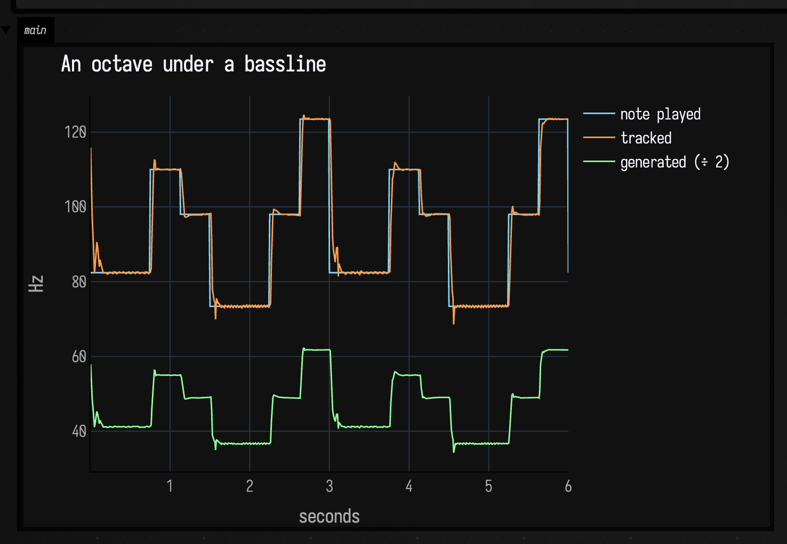

```diffstatic_runner {data-lang=kotlin audio="assets/subharmonic_sound/bass-octave.wav" audio-spec="bass-octave" audio-renderer="afield.four.synth.SubharmonicSoundDocs" embed=true hidden=true name="subharmonic-bass-octave-audio"}
// offline-rendered by SubharmonicSoundDocs — listen below
```

A spectrogram of the same clip shows what a laptop speaker hides. Time runs left to right, frequency up to 400 Hz bottom to top, and brighter is louder. The bass and its harmonics are the stacked steps; from three seconds a new step appears under the lowest one, at half its height:

```diffstatic_runner {data-lang=kotlin screenshot="assets/subharmonic_sound/bass-octave-spectrum.png" wait="1.5" capture="box" open-outputs="true" name="subharmonic-bass-octave-spectrum"}
showSpectrogram(SubharmonicSoundDocs.render("bass-octave"), maxHz = 400.0, channel = "main", title = "An octave under a bassline")
```

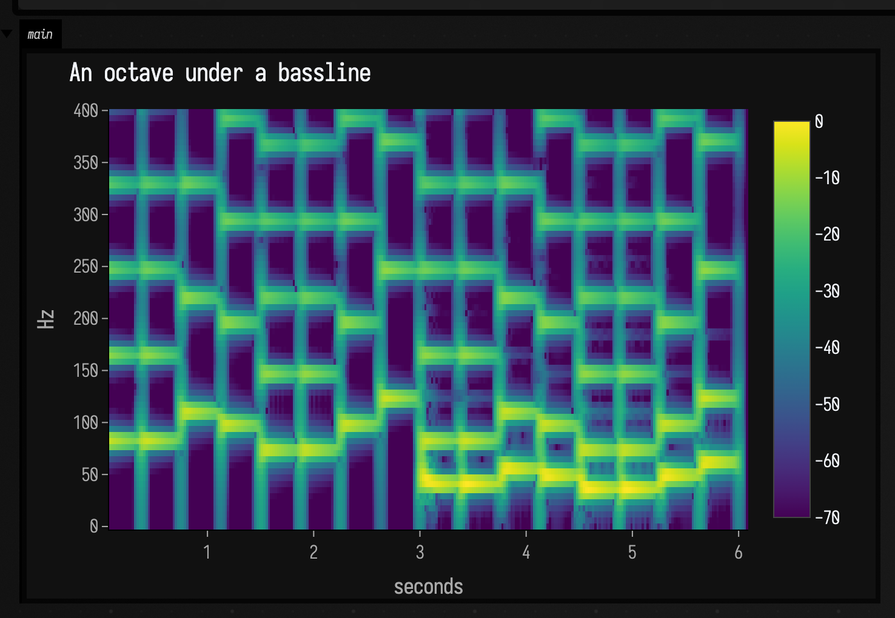

The tracked line sits on top of the played notes. After each step it takes the tracker a few tens
of milliseconds to settle on the new pitch, which on a plucked bass falls under the attack. The
generated tone is the tracked frequency divided by two, from 37 Hz on the low D up to 62 Hz on the
B. That is low enough that laptop speakers will mostly give you the change in weight rather than
the pitch. Headphones help. [Under a kick drum](#under-a-kick-drum) below shows what to do when the
sub is too low to hear.

`Subharmonic(tracker)` is a node like any other filter, so it goes anywhere in a signal graph. The
same tracker also works one sample at a time, outside a graph:

```diffstatic {data-lang=kotlin}
val sub = SubharmonicPLL(division = 2.0, minHz = 40.0, maxHz = 250.0, bandwidthHz = 6.0)
for (i in input.indices) output[i] = input[i] + 0.8f * sub.process(lowPassed[i])
```

---

## How it follows the pitch

Each tracker does two jobs. It estimates the frequency of whatever it hears, and it runs its own
sine oscillator at that frequency divided by `division`. The oscillator has to be separate.
Halving the input's phase directly, as in `sin(phase / 2)`, jumps by half a cycle every time the
phase wraps round. A separate oscillator advancing at half the estimated rate has no wrap to
stumble over, and it lets `division` be any number, changed every sample.

The three trackers differ in how they estimate the frequency:

| tracker | how it measures pitch | good at | gets wrong |
| --- | --- | --- | --- |
| `SubharmonicZeroCross` | times the gap between upward zero crossings | instant, cheap, exact on a clean tone | every extra crossing from a harmonic or noise reads as a new, higher pitch |
| `SubharmonicPLL` | a phase-locked loop: multiply the input by its own cosine, steer on the result | glides instead of jumping | its loop gain rises and falls with the input level, and its error carries a ripple at twice the input frequency |
| `SubharmonicQuadPLL` | the same loop, fed the phase error directly from an in-phase/quadrature pair | the same at every level, no ripple, quick to find a new note | needs a band-limited input, like the others |

A phase-locked loop keeps a running estimate of where the input is in its cycle, compares it with
the input every sample, and nudges both its phase and its frequency toward the input. `bandwidthHz`
sets how hard it nudges. A wide loop follows fast pitch changes, and a narrow one holds steady
through noise.

---

## Three trackers on one bassline

To compare them, the next graph runs all four tracker setups on the same lowpassed bassline at once,
and lets you hear each one for three seconds in turn:

1. the zero-crossing tracker,
2. the plain PLL at a 30 Hz bandwidth,
3. the same PLL fed the bass at a quarter of the level (−12 dB),
4. the quadrature PLL.

```diffstatic_runner {data-lang=kotlin screenshot="assets/subharmonic_sound/bass-trackers.png" wait="1.5" capture="box" open-outputs="true" name="subharmonic-bass-trackers"}
:::static
val bass = subBassline()
val clean = bass.lowpass(150f)
val zero = SubharmonicZeroCross()
val pll = SubharmonicPLL(bandwidthHz = 30.0)
val quiet = SubharmonicPLL(bandwidthHz = 30.0)
val quad = SubharmonicQuadPLL()
val subs = clean.through(Subharmonic(zero)) * subBetween(0f, 3f) +
    clean.through(Subharmonic(pll)) * subBetween(3f, 6f) +
    (clean * 0.25f).through(Subharmonic(quiet)) * subBetween(6f, 9f) * 4f +
    clean.through(Subharmonic(quad)) * subBetween(9f, 12f)
val out = bass * 0.3f + subs * 1.5f
:::fold render twelve seconds and plot every tracker's estimate against the notes
val run = subRender(out, seconds = 12f, zero, pll, quiet, quad)
val skip = 10   // the first 100 ms, before the zero-crossing tracker has seen a crossing
showSignals(
    "note played" to run.times.drop(skip).map { subBassNoteAt(it) },
    "zero-crossing" to run.hz[0].drop(skip),
    "PLL, 30 Hz" to run.hz[1].drop(skip),
    "PLL, 30 Hz, −12 dB" to run.hz[2].drop(skip),
    "quadrature PLL" to run.hz[3].drop(skip),
    x = run.times.drop(skip), channel = "main", title = "Four trackers, one bassline",
    xTitle = "seconds", yTitle = "Hz",
)
:::endfold
```

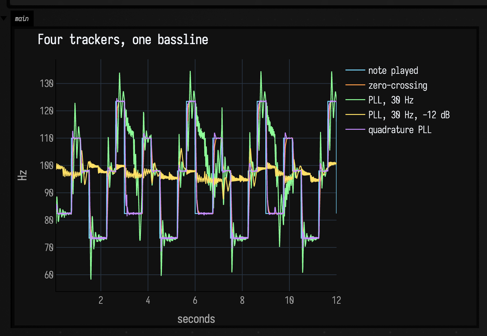

```diffstatic_runner {data-lang=kotlin audio="assets/subharmonic_sound/bass-trackers.wav" audio-spec="bass-trackers" audio-renderer="afield.four.synth.SubharmonicSoundDocs" embed=true hidden=true name="subharmonic-bass-trackers-audio"}
// offline-rendered by SubharmonicSoundDocs — listen below
```

In the spectrogram the sub is the lowest line. Look at how cleanly it steps in each three-second section:

```diffstatic_runner {data-lang=kotlin screenshot="assets/subharmonic_sound/bass-trackers-spectrum.png" wait="1.5" capture="box" open-outputs="true" name="subharmonic-bass-trackers-spectrum"}
showSpectrogram(SubharmonicSoundDocs.render("bass-trackers"), maxHz = 400.0, channel = "main", title = "Four trackers, one bassline")
```

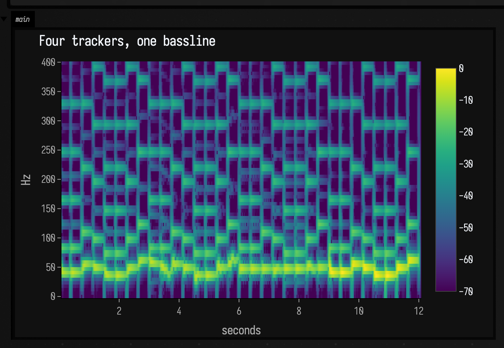

A lowpassed sawtooth crosses zero upward exactly once per cycle, so the zero-crossing tracker sits
within a tenth of a hertz of every note. It averages over 30 ms of crossings, which is why it
arrives a little later than the quadrature PLL. On this input it is the right tool. The film voice
below shows where it breaks.

The plain PLL locks, but listen to the second three seconds: each note change makes it overshoot
and ring before it settles, and the sub audibly swoops into every note. Narrowing the bandwidth to
calm it does not work. At 8 Hz it never pulls in from its 100 Hz starting guess to the bass at all.

The third segment is the same loop with the input turned down by 12 dB. Its phase error is the
input times a cosine, so a quarter of the input is a quarter of the correction, and the loop never
finds the line at all. It sits near its 100 Hz starting guess, wobbling, while the notes step
around it.

The quadrature PLL measures the phase error itself, so its error, and with it the loop's behaviour,
are the same at any level. It lands within half a hertz of each note and settles in well under
80 ms.

---

## Choosing the division

`division` can be any number and can change on every sample. `Subharmonic` takes a second argument,
a signal that sets the division as it plays. The next graph runs one tracker through six settings,
three seconds each:

| seconds | division | what you hear |
| --- | --- | --- |
| 0–3 | `2.0` | the octave below |
| 3–6 | `3.0` | an octave and a fifth below |
| 6–9 | `1.5` | a fifth below |
| 9–12 | `2.03` | just off the octave, so the sub slowly drifts against the bass and beats with it |
| 12–15 | `2.0 + 0.07 · sin(3 Hz)` | an octave that sways around its pitch |
| 15–18 | `2`, `3` and `4` at once | three subharmonics mixed 0.7 : 0.2 : 0.1 |

This bassline is an octave higher than before. At a division of 3 the original's low D would make a
24 Hz tone, below what most speakers can play.

```diffstatic_runner {data-lang=kotlin screenshot="assets/subharmonic_sound/divisions.png" wait="1.5" capture="box" open-outputs="true" name="subharmonic-divisions"}
:::static
val bass = subBassline(octave = 2f)
val clean = bass.lowpass(300f)
val steps = Param(2f).apply {
    supplier = { when { time < 3f -> 2f; time < 6f -> 3f; time < 9f -> 1.5f; time < 12f -> 2.03f; else -> 2f } }
}
val wobble = SineOsc(Param(3f)) * 0.07f * subBetween(12f, 15f)
val single = SubharmonicQuadPLL()
val stack = SubharmonicQuadPLL().apply { voices = listOf(SubVoice(2.0, 0.7), SubVoice(3.0, 0.2), SubVoice(4.0, 0.1)) }
val sub = clean.through(Subharmonic(single, division = steps + wobble)) * subBetween(0f, 15f) +
    clean.through(Subharmonic(stack)) * subBetween(15f, 18f)
val out = bass * 0.25f + sub * 1.5f
:::fold render eighteen seconds and plot the tracked and generated frequencies
val run = subRender(out, seconds = 18f, single)
showSignals(
    "tracked" to run.hz[0],
    "generated" to run.subHz[0],
    x = run.times, channel = "main", title = "One tracker, six divisions",
    xTitle = "seconds", yTitle = "Hz",
)
:::endfold
```

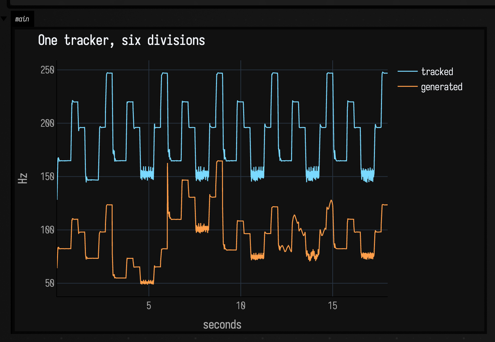

```diffstatic_runner {data-lang=kotlin audio="assets/subharmonic_sound/divisions.wav" audio-spec="divisions" audio-renderer="afield.four.synth.SubharmonicSoundDocs" embed=true hidden=true name="subharmonic-divisions-audio"}
// offline-rendered by SubharmonicSoundDocs — listen below
```

The spectrogram shows the division changing under a bassline that does not:

```diffstatic_runner {data-lang=kotlin screenshot="assets/subharmonic_sound/divisions-spectrum.png" wait="1.5" capture="box" open-outputs="true" name="subharmonic-divisions-spectrum"}
showSpectrogram(SubharmonicSoundDocs.render("divisions"), maxHz = 600.0, channel = "main", title = "One tracker, six divisions")
```

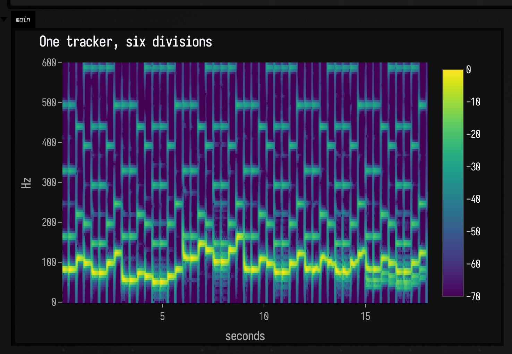

The tracked line is the same all the way through. Only the oscillator under it changes. In the
`2.03` section the sub stays locked to the bass's pitch but not to its phase, so the two slide past
each other a little over once a second, and you hear that as a slow beating. Swaying the division
by ±0.07 at 3 Hz makes the bass wobble without the bass itself changing at all. The last section
uses `voices` instead of `division`: each `SubVoice` is its own oscillator with its own gain, all
driven by one tracked frequency.

---

## Under a kick drum

`bd:3` from Dirt-Samples is a classic drum-machine kick. It starts with a click and a pitch drop
from about 160 Hz and settles to a body at 49 Hz that rings for half a second. A tracker follows
that drop. Half of 49 Hz is 24.6 Hz, which you can feel on a subwoofer but cannot hear from a laptop
or most headphones.

The fix is post-processing. Driving the sub into a [`Saturator`](reference/synthesis.md) flattens
its peaks, and a flattened sine contains odd harmonics at three, five and seven times its frequency
(74, 123 and 172 Hz). Small speakers can play those, and the ear fills in the missing fundamental
from the pattern of harmonics.

The clip plays the beat three ways for four seconds each: dry, with the raw sub, and with the
saturated sub.

```diffstatic_runner {data-lang=kotlin screenshot="assets/subharmonic_sound/kick.png" wait="1.5" capture="box" open-outputs="true" name="subharmonic-kick"}
:::static
val kick = subDirt("bd:3")
val beat = SamplesSignal(subSequence(12.0, (0 until 24).map { it * 0.5 to kick }))
val tracker = SubharmonicQuadPLL()
val sub = beat.lowpass(200f).through(Subharmonic(tracker))
val audible = sub.through(Saturator(Param(20f))).lowpass(400f)
val out = beat + sub * subBetween(4f, 8f) * 2f + audible * subBetween(8f, 12f) * 0.5f
:::fold render twelve seconds and plot the first two kicks' tracked and generated pitch
val run = subRender(out, seconds = 12f, tracker, everySeconds = 0.002)
val first = run.times.indices.filter { run.times[it] < 1.0 }
showSignals(
    "tracked" to first.map { run.hz[0][it] },
    "generated (÷ 2)" to first.map { run.subHz[0][it] },
    x = first.map { run.times[it] }, channel = "main", title = "Following a kick's pitch drop",
    xTitle = "seconds", yTitle = "Hz",
)
:::endfold
```

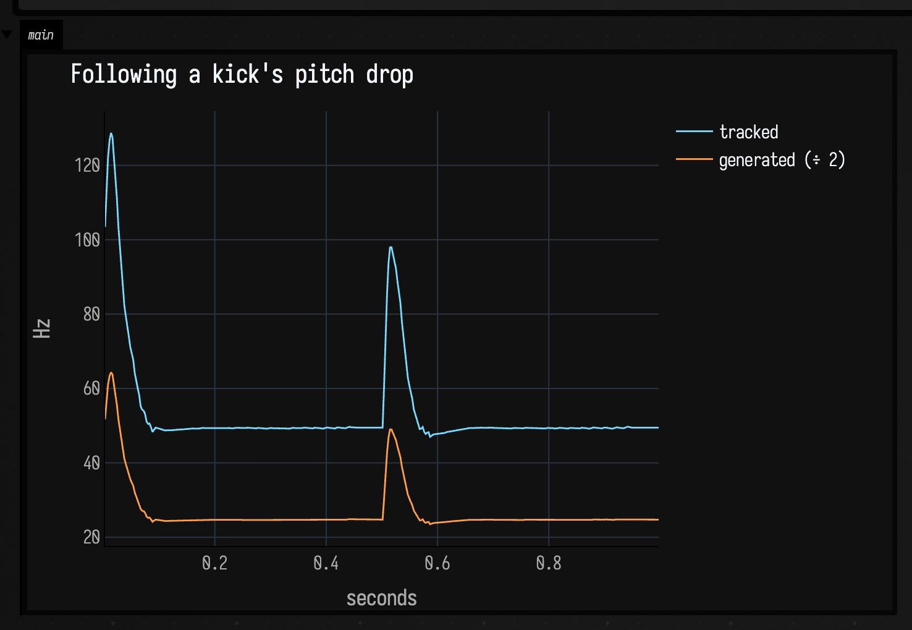

```diffstatic_runner {data-lang=kotlin audio="assets/subharmonic_sound/kick.wav" audio-spec="kick" audio-renderer="afield.four.synth.SubharmonicSoundDocs" embed=true hidden=true name="subharmonic-kick-audio"}
// offline-rendered by SubharmonicSoundDocs — listen below
```

Here the spectrogram shows what the speaker cannot. The raw sub in the middle section is a line near 25 Hz; the saturated one in the last section adds harmonics above it:

```diffstatic_runner {data-lang=kotlin screenshot="assets/subharmonic_sound/kick-spectrum.png" wait="1.5" capture="box" open-outputs="true" name="subharmonic-kick-spectrum"}
showSpectrogram(SubharmonicSoundDocs.render("kick"), maxHz = 400.0, channel = "main", title = "Raw and saturated sub under a kick")
```

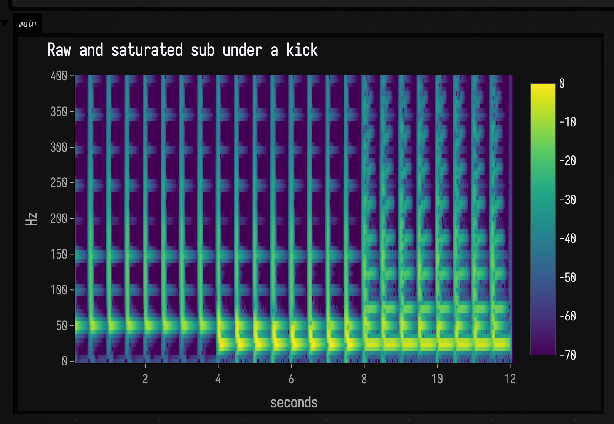

On a laptop, the middle four seconds may sound almost like the first four. The sub is there, and a spectrum shows it, but it sits below the speaker. In the last four seconds
the saturated version carries about fourteen times as much of its energy above 100 Hz, and the beat
gets heavier. The tracker's own level follows the kick's decay, so each sub dies away with the drum
that made it and does not drone between hits.

---

## Rebuilding the bass of a sample

`arpy` is a set of short plucked notes, `arpy:0` to `arpy:4` running C, D, F, G and A above middle
C. Played at half speed, a melody built from them drops an octave into the tenor range, and it is
thin there: a pluck with no low end. The next graph plays that line for four seconds, then
highpasses it at 400 Hz so almost none of its own low end is left, and lets the tracker put a body
back underneath.

Two lowpasses in a row before the tracker give a steeper slope. The pluck's second harmonic is only
an octave above the note, and one 12 dB-per-octave filter leaves enough of it to confuse the
tracker on the attack.

```diffstatic_runner {data-lang=kotlin screenshot="assets/subharmonic_sound/arpy.png" wait="1.5" capture="box" open-outputs="true" name="subharmonic-arpy"}
:::static
val notes = listOf(0, 2, 4, 3, 0, 1, 4, 2)
val hits = (0 until 16).map { k -> k * 0.5 to subDirt("arpy:${notes[k % 8]}", rate = 0.5) }
val arpy = SamplesSignal(subSequence(8.0, hits))
val tracker = SubharmonicQuadPLL()
val sub = arpy.lowpass(300f).lowpass(300f)
    .through(Subharmonic(tracker))
val thin = arpy.highpass(400f)
val out = arpy * subBetween(0f, 4f) + (thin + sub * 1.5f) * subBetween(4f, 8f)
:::fold render eight seconds and plot the tracked melody and the sub under it
val run = subRender(out, seconds = 8f, tracker)
showSignals(
    "tracked" to run.hz[0],
    "generated (÷ 2)" to run.subHz[0],
    x = run.times, channel = "main", title = "A plucked melody and the bass it never had",
    xTitle = "seconds", yTitle = "Hz",
)
:::endfold
```

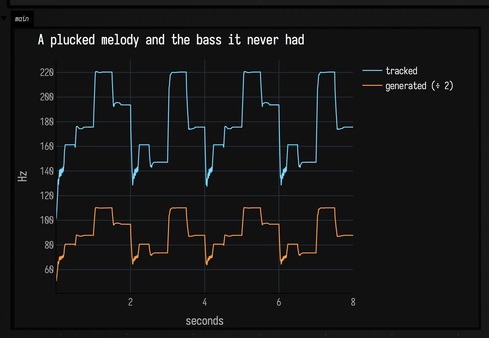

```diffstatic_runner {data-lang=kotlin audio="assets/subharmonic_sound/arpy.wav" audio-spec="arpy" audio-renderer="afield.four.synth.SubharmonicSoundDocs" embed=true hidden=true name="subharmonic-arpy-audio"}
// offline-rendered by SubharmonicSoundDocs — listen below
```

In the spectrogram the second half loses the arpy's lowest partials to the highpass, and gains a new line an octave beneath where they were:

```diffstatic_runner {data-lang=kotlin screenshot="assets/subharmonic_sound/arpy-spectrum.png" wait="1.5" capture="box" open-outputs="true" name="subharmonic-arpy-spectrum"}
showSpectrogram(SubharmonicSoundDocs.render("arpy"), maxHz = 600.0, channel = "main", title = "A plucked melody and the bass it never had")
```

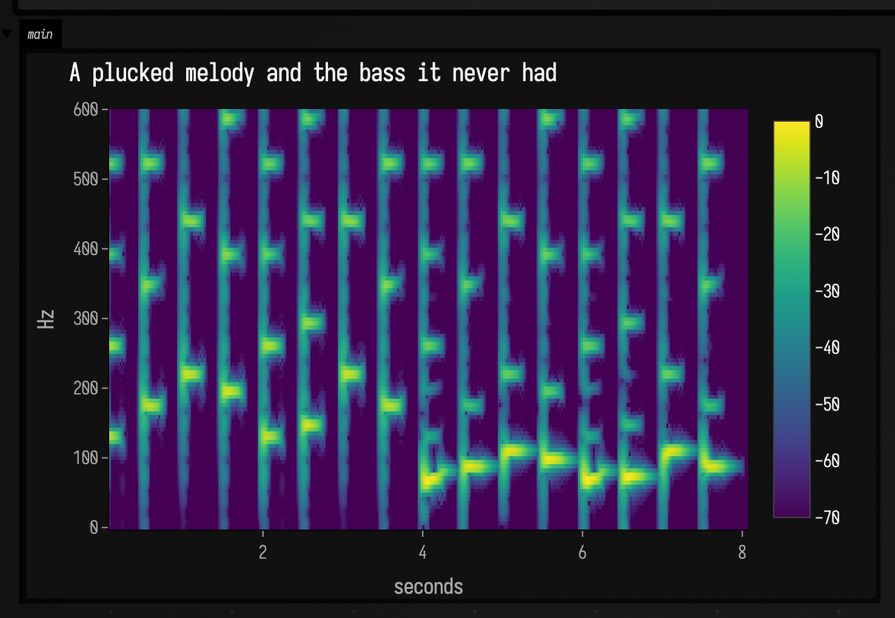

Each pluck lasts about a quarter of a second at half speed, with silence until the next. The
quadrature PLL's gate holds the last pitch through the silence, and its frequency discriminator
(see [Inside the quadrature PLL](#inside-the-quadrature-pll)) carries it to the next note within a
few milliseconds of the attack. The tracked melody lands within 2% of each note. The second half
sounds like a different instrument from the first: a bass synth doubling a bell, made from a bell
alone.

---

## A voice from 1968

Speech is the hardest input on this page. The pitch moves continuously, consonants are noise,
there are gaps between words, and a voice has more energy in its formants, the resonances that make
vowels sound different, than in its fundamental. This is the source: Johnny teasing his sister in
the cemetery at the start of the film, with Barbara answering.

<audio controls preload="metadata" src="assets/subharmonic_sound/notld-barbara-source.wav"></audio>

Johnny speaks at about 120 to 200 Hz and Barbara mostly between 200 and 370 Hz, so an octave down
lands both in the range a speaker can play.

### Without preprocessing

Fed the raw dialogue, the zero-crossing tracker hears the formants. They add crossings, so most of
the time it reports a pitch well above the voice. The sub that comes out is a gargle that changes
pitch with the vowels rather than the voice.

```diffstatic_runner {data-lang=kotlin screenshot="assets/subharmonic_sound/film-naive.png" wait="1.5" capture="box" open-outputs="true" name="subharmonic-film-naive"}
:::fold imports
import afield.darkMode
import space.kscience.plotly.*
import space.kscience.plotly.models.ScatterMode
:::endfold
:::static
val voice = SamplesSignal(subFilmClip())
val tracker = SubharmonicZeroCross(minInputHz = 60.0)
val sub = voice.through(Subharmonic(tracker))
val out = voice + sub * 1.5f
:::fold render 7.5 s and plot the tracker against a YIN pitch analysis of the same clip
val run = subRender(out, seconds = 7.5f, tracker)
val voiced = patF0Frames(subFilmClip(), 48_000, minHz = 60.0, maxHz = 400.0)
    .filter { it.voiced && it.centerSample < 7.5 * 48_000 }
display("main", Plotly.plot {
    scatter { name = "voice pitch (YIN)"; mode = ScatterMode.markers; x.set(voiced.map { it.centerSample / 48_000.0 }); y.set(voiced.map { it.hz }); marker { size = 5 } }
    scatter { name = "zero-crossing, raw input"; mode = ScatterMode.markers; x.set(run.times); y.set(run.hz[0]); marker { size = 2 } }
    layout { title = "Raw dialogue: the tracker follows the formants"; xaxis { title = "seconds" }; yaxis { title = "Hz" } }
}.darkMode())
:::endfold
```

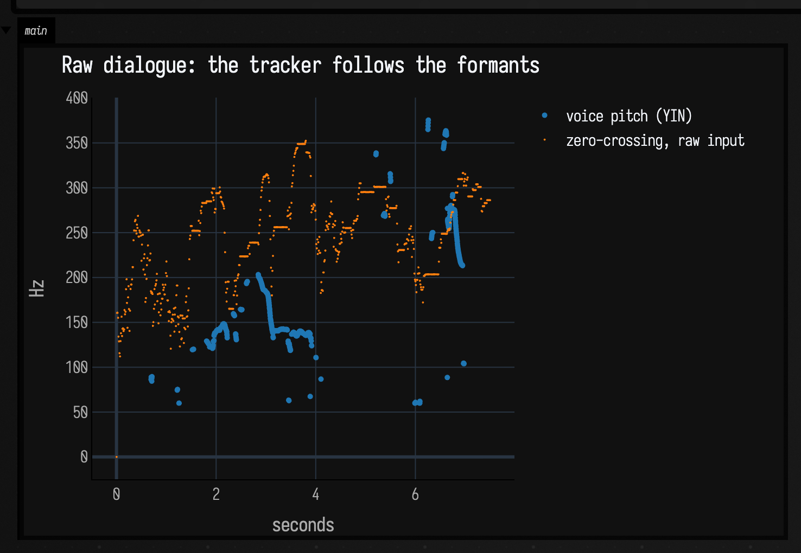

```diffstatic_runner {data-lang=kotlin audio="assets/subharmonic_sound/film-naive.wav" audio-spec="film-naive" audio-renderer="afield.four.synth.SubharmonicSoundDocs" embed=true hidden=true name="subharmonic-film-naive-audio"}
// offline-rendered by SubharmonicSoundDocs — listen below
```

The spectrogram makes the gargle visible: the sub's line jumps around well above the voice's lowest harmonic rather than below it:

```diffstatic_runner {data-lang=kotlin screenshot="assets/subharmonic_sound/film-naive-spectrum.png" wait="1.5" capture="box" open-outputs="true" name="subharmonic-film-naive-spectrum"}
showSpectrogram(SubharmonicSoundDocs.render("film-naive"), maxHz = 600.0, channel = "main", title = "Raw dialogue with a zero-crossing sub")
```

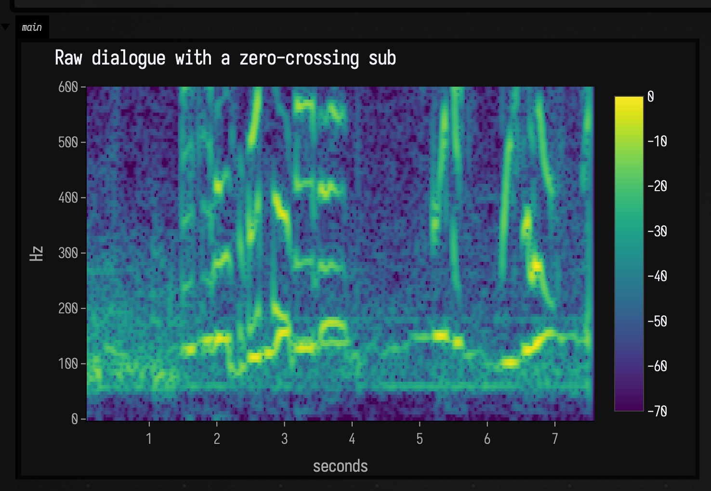

The plot compares the tracker with [YIN](reference/patterns.md), a slower, more careful pitch
analysis that looks at whole frames at once. The tracker agrees with it on only about one voiced
frame in ten.

### With preprocessing

Four steps before the tracker and two after it turn this into a usable voice effect:

1. **Band-limit.** A highpass at 70 Hz removes rumble. Two lowpasses at 280 Hz leave the fundamental
   of both voices and little above it.
2. **Square it up.** A `Saturator` with a drive of 20 clips the band-limited voice into something
   close to a square wave of the same pitch, and a third lowpass rounds it back toward a sine. A
   quiet syllable and a loud one now reach the tracker at the same level.
3. **Track.** A quadrature PLL with a 20 Hz bandwidth, wider than the default 8, because speech
   glides faster than a bassline.
4. **Take the level from before the clipping.** The squared signal has no dynamics left, so an
   `EnvelopeFollower` on the band-limited voice sets the sub's level instead.
5. **Smooth the sub** with a lowpass at 160 Hz, and mix it under the original.

```diffstatic_runner {data-lang=kotlin screenshot="assets/subharmonic_sound/film-shaped.png" wait="1.5" capture="box" open-outputs="true" name="subharmonic-film-shaped"}
:::fold imports
import afield.darkMode
import space.kscience.plotly.*
import space.kscience.plotly.models.ScatterMode
:::endfold
:::static
val voice = SamplesSignal(subFilmClip())
val band = voice.highpass(70f)
    .lowpass(280f)
    .lowpass(280f)
val squared = band.through(Saturator(Param(20f))).lowpass(280f)
val tracker = SubharmonicQuadPLL(bandwidthHz = 20.0, gateLevel = 0.05)
val level = EnvelopeFollower(band, attackTime = Param(0.01f), releaseTime = Param(0.08f))
val sub = squared.through(Subharmonic(tracker)).lowpass(160f) * level
val out = voice + sub * 3f
:::fold render the whole clip and plot the tracker against the YIN analysis
val run = subRender(out, seconds = 13.5f, tracker)
val voiced = patF0Frames(subFilmClip(), 48_000, minHz = 60.0, maxHz = 400.0).filter { it.voiced }
display("main", Plotly.plot {
    scatter { name = "voice pitch (YIN)"; mode = ScatterMode.markers; x.set(voiced.map { it.centerSample / 48_000.0 }); y.set(voiced.map { it.hz }); marker { size = 5 } }
    scatter { name = "quadrature PLL, shaped input"; mode = ScatterMode.markers; x.set(run.times); y.set(run.hz[0]); marker { size = 2 } }
    layout { title = "Shaped dialogue: the tracker follows the voice"; xaxis { title = "seconds" }; yaxis { title = "Hz" } }
}.darkMode())
:::endfold
```

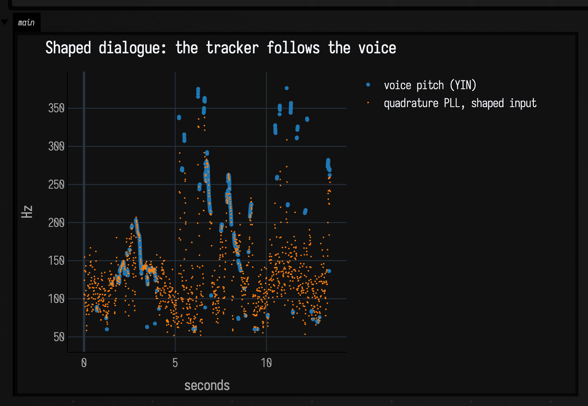

```diffstatic_runner {data-lang=kotlin audio="assets/subharmonic_sound/film-shaped.wav" audio-spec="film-shaped" audio-renderer="afield.four.synth.SubharmonicSoundDocs" embed=true hidden=true name="subharmonic-film-shaped-audio"}
// offline-rendered by SubharmonicSoundDocs — listen below
```

In the spectrogram the sub follows the shape of each phrase an octave below the voice's lowest harmonic, and turns to a broad smear where the wind comes in:

```diffstatic_runner {data-lang=kotlin screenshot="assets/subharmonic_sound/film-shaped-spectrum.png" wait="1.5" capture="box" open-outputs="true" name="subharmonic-film-shaped-spectrum"}
showSpectrogram(SubharmonicSoundDocs.render("film-shaped"), maxHz = 600.0, channel = "main", title = "Shaped dialogue with a quadrature-PLL sub")
```

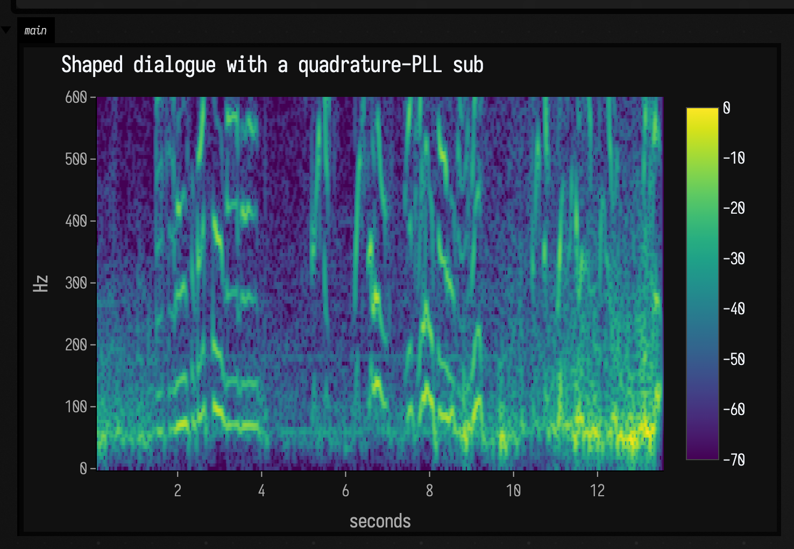

Now the tracker agrees with YIN on nearly three voiced frames in four, and Johnny's "They're coming
to get you, Barbara" has a second, larger voice under it that follows his intonation. Between
phrases the PLL keeps running on the background sound. From about nine seconds the recording has
wind rumble under the dialogue, and the tracker follows that as readily as a voice, so the sub turns
to a low growl there. A tracker can only follow one pitch at a time, and it has no way of knowing
which of the sounds in the band is the one you wanted. Barbara's highest phrases, around ten to
twelve seconds, are above the 280 Hz band altogether, and the tracker misses them; raise the
lowpasses if your voice sits higher.

The saturation step matters most. It works as automatic gain control, and it helps every tracker,
not just this one. With the same preprocessing, even the plain PLL, which could not follow the raw
voice at all, agrees with YIN on more than half the voiced frames.

---

## Inside the quadrature PLL

The plain PLL's phase detector multiplies the input `A·sin θ` by the cosine of its own phase
estimate `φ̂`:

`A·sin θ · cos φ̂ = ½A·sin(θ − φ̂) + ½A·sin(θ + φ̂)`

The first term is the phase error the loop wants, scaled by the input level `A`. The second is a
ripple at twice the input frequency, which the loop only partly averages away.

The quadrature PLL starts by splitting the input into two copies that stay 90° apart, `i ≈ A·sin θ`
and `q ≈ A·cos θ`. `HilbertPair` does this with two chains of four allpass filters, which keep the
two outputs within a degree of 90° from 30 Hz to 5 kHz at 48 kHz. From the pair:

- `(i·cos φ̂ − q·sin φ̂) / A = sin(θ − φ̂)`, the phase error with no ripple term and no `A`, because
  `A = √(i² + q²)` is known and divided out;
- the same `A` is a level that does not ripple, so the generated tone is not amplitude-modulated at
  the input frequency, as a rectified follower would make it;
- the phase advance from one `(i, q)` sample to the next is the input's instantaneous frequency.

That last measurement is the frequency discriminator. While the loop is out of phase, it pulls the
frequency estimate straight to what it measures, with a time constant of `acquisitionTimeSeconds`
(20 ms by default). Once the smoothed `cos(θ − φ̂)` passes 0.9, the loop counts as locked and the
discriminator stops: any harmonics left in the input bias the instantaneous frequency, and the
phase loop holds the pitch more accurately on its own. Set `acquisitionTimeSeconds = 0.0` to hear
the loop without it. On the bassline it then takes over twice as long to reach each note.

Below `gateLevel` the loop stops correcting and keeps its last frequency, and the level falls away
over `releaseTimeSeconds`. That is what carries the arpy melody across its gaps.

The zero-crossing tracker's smoothing is applied once per crossing, so its coefficient is computed
from each period's length. `trackingTimeSeconds` is then a time in seconds whatever the pitch.

---

See also: [DoughDSP Sound Examples](dough_dsp_sound.md) for the filters and saturator used here on
simpler signals, and [Sound: the Pattern → Audio Path](sound.md) for how Field renders audio and
where the Dirt-Samples come from.

??? aside "Where the film clip comes from"
    The excerpt runs from 6:05 to 6:19 of the public-domain print of *Night of the Living Dead* on
    the Internet Archive (`night-of-the-living-dead_202309`), cut to mono at 48 kHz with 50 ms fades.
    It is committed as `assets/subharmonic_sound/notld-barbara-source.wav` and read by
    `subFilmClip()`. Every number this page gives about the trackers is checked by the
    `synth.subharmonic.sound` smoke test, which renders each clip and measures it.
