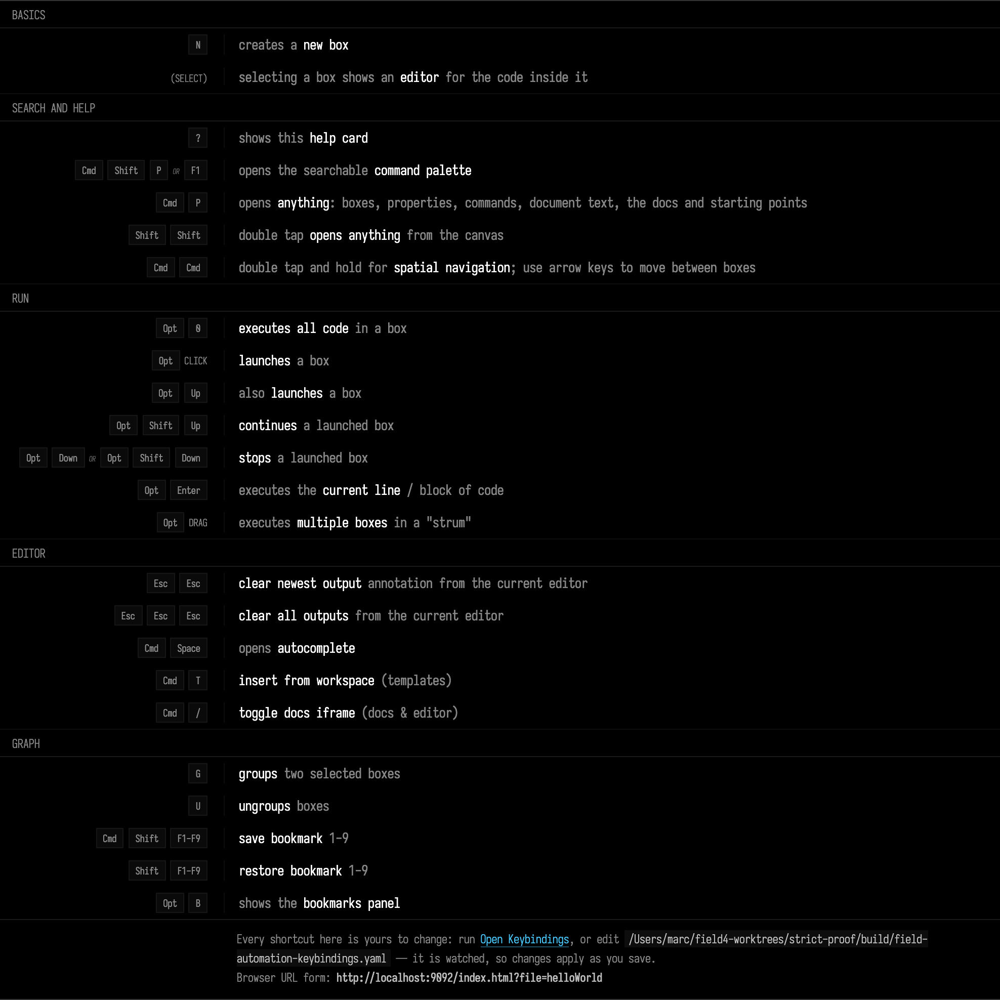

# Survival Guide

_Field·4_ is a place for writing, running, debugging, understanding code — quickly. It's also a place for experimentation, making mistakes, getting frustrated, and delighting in discovery. This guide should help you get to the point where you have some muscle memory.

The cheat-sheet can be accessed by pressing the '?' key. Every shortcut on it is yours to change, and
the card shows whatever you have bound rather than these defaults — [Keyboard
Shortcuts](keybindings.md) is the whole story. Right now it looks like this:



Using these keyboard shortcuts, you should be able to write and execute some code in Field:

```diffstatic_runner {data-lang=kotlin capture="ui" region="window" viewport="760x560" clip="0,0,760,380" video="assets/survival_intro.mp4" fps="20" padding="0" wait="0" timeout="180" embed=true hidden=true name="survival-intro" alt="The mouse moves onto the empty canvas and n makes a new box there; a click selects it and opens its empty editor. A println of hello world is typed one key at a time and Alt-Enter runs that line, printing hello world underneath it. Two more lines are typed, val total = (1..10).sum() and println(total), and Alt-0 runs the whole box, printing 55 under the last line and hello world a second time (marked x2)."}
// Lay the editor pane out for this window, as a user's browser would: screenshot prep pins it
// to a fixed size and place, which at this window size would cover the canvas. The clip stops
// above the notification stack in the bottom-left corner.
ui.eval("""
    const c = document.querySelector(".monaco-editor-container")
    if (!c) throw new Error("no editor container")
    for (const k of ["width", "height", "top", "right", "left", "bottom", "transform"]) c.style[k] = ""
    if (window.globalEditor && window.globalEditor.layout) window.globalEditor.layout()
    return c.getBoundingClientRect().left
""".trimIndent())
ui.pause(1000)
ui.moveMouse(170.0, 130.0, 12)
ui.pause(500)
ui.press("n")
ui.pause(900)
ui.moveMouse(180.0, 140.0, 4)
ui.clickAt(180.0, 140.0)
ui.pause(900)
ui.clickSelector(".monaco-editor")
ui.pause(400)
ui.typeSlowly("println(\"hello world\")", 70)
ui.press("Escape")
ui.pause(500)
ui.press("Alt+Enter")
ui.pause(1800)
ui.press("End")
ui.press("Enter")
ui.typeSlowly("val total = (1..10).sum()", 70)
ui.press("Escape")
ui.press("Enter")
ui.typeSlowly("println(total)", 70)
ui.press("Escape")
ui.pause(500)
ui.press("Alt+0")
ui.pause(2500)
val text = ui.eval("return document.querySelector('.monaco-editor-container').innerText").toString()
check("hello world" in text && "55" in text) { "the intro's runs did not print hello world and 55: " + text.take(400) }
```

There are a large number of other ways of executing code, since executing code is very important in a live-coding environment. Here the 'f1' palette inside the text editor is your discovery engine for many of these ways. 

Note that Field differentiates between running a piece of code (a line or two or the whole contents of a box) and _launching_ code (giving the code at least an opportunity to inject something into the main animation loop and keep going).

[Running code in a box](running_code.md) is what happens behind that distinction: what Field does
to your text before the compiler sees it, how a child box sees its parent's values, and where a
launched box hands over to the animation loop. You do not need it to start writing boxes.

# Three things you'll want to know

## Saving and Loading

Field saves regularly (around every 5 seconds or so if there's something that's changed). It's important to note that reloading the webpage refreshes your connection to Field, but it doesn't reboot it — what ever you launched is still running. If you want to restart Field, press `ctrl-c` in the terminal you launched it from and start it again (or select quit from the welcome page). Since the front end is just a webpage, if you can figure out how to connect remotely to you machine you can run the front end (the web-browser) on any other machine you like.

To change what document you are looking at, go back to the welcome tab — the `+` at the end of the tab strip opens one if you've closed it.

Documents are created on demand and saved in `~/Documents/AFieldWorkspace/`

## The command palette

For anything advanced pressing `f1` reveals a searchable command palette. This works both inside the editor and outside the editor — although you'll get a different set of commands in different situations. All kinds of things hide there — changing editor tabs, applying AI to code and error messages...

```diffstatic_runner {data-lang=kotlin capture="ui" region="window" clip-selector=".afield-palette-shell" screenshot="assets/command-palette.png" padding="6" wait="0" timeout="90" embed=true hidden=true name="command-palette"}
ui.openEditor(id)
ui.pause(700)
ui.waitForSelector(".monaco-editor", 15000.0)
ui.clickSelector(".monaco-editor")
ui.pause(300)
ui.press("F1")
ui.pause(1600)
```

For it's main code-writing experience _Field·4_ wraps the [Monaco text editor](https://microsoft.github.io/monaco-editor/) — just like everyone else is doing these days — so there's a pretty rich set of ways of interacting with code built-in. But there some advanced features to discover — inline printing, AI-chat (if you have an OpenAI Platform Key), number increment and decrement shortcuts, configurable code blocks.

## Autocomplete

One of the most useful keyboard shortcuts of all is autocomplete — `ctrl-space`. Use it to provide ideas about what you might type, and documentation about those things:

```diffstatic_runner {data-lang=kotlin capture="ui" region="editor" warm-completion=true screenshot="assets/autocomplete.png" wait="0" timeout="90" embed=true hidden=true name="autocomplete"}
ui.eval("window.localStorage.removeItem('field.suggest.recency.v1'); var s=document.createElement('style');s.textContent='.tick_text.ok{display:none !important}';document.head.appendChild(s);return 'setup';")
ui.openEditor(id)
ui.pause(700)
ui.waitForSelector(".monaco-editor", 15000.0)
ui.clickSelector(".monaco-editor")
ui.pause(300)
ui.press("Control+A")
ui.type("val axis = vec")
ui.pause(300)
ui.press("Control+Space")
// warm-completion=true built the completion engine up front, so the enriched RPC
// result — the type-based completions and their KDoc — arrives promptly. Wait for
// the documentation itself (not just the item) so the capture shows the doc panel.
ui.waitForSelector("text=Creates a mutable", 15000.0)
ui.pause(1000)
```

With AI support enabled, this will include up to 3 AI generated suggests of what you might type next. These are more likely to be incorrect (in the sense that completions generated by type-based are generally very, very good); but also more likely to be ambitious and lengthy. Our GLSL completions are, in particular, often exactly what you want.

Autocomplete answers "what can I write *here*". For the other question — what could I do here? — see [what's already in the box](reference/index.md), a browsable index of every public declaration in Field's standard library, generated from the same source and the same KDoc the completion panel reads.

## Next

Take [a Tour](funFeatures.md); if you're new to Kotlin, read the [Kotlin guide](kotlin_overview.md); learn what happens
when you [run code in a box](running_code.md); understand the [AI features](aiFeatures.md).
