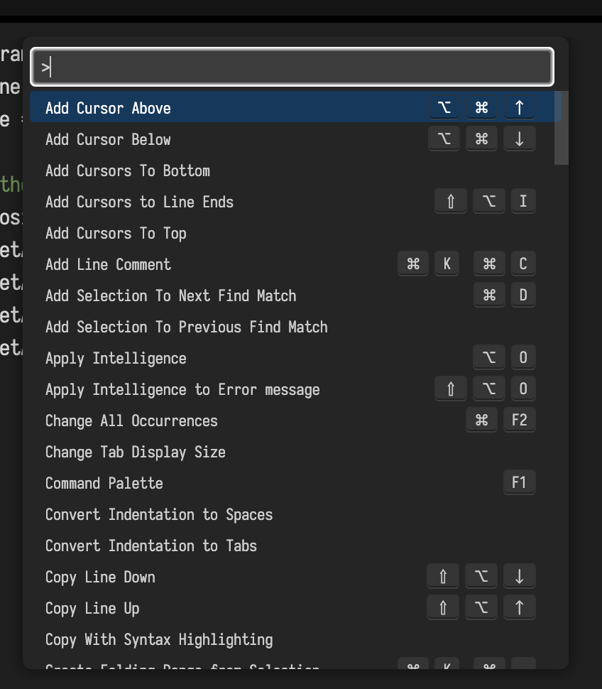
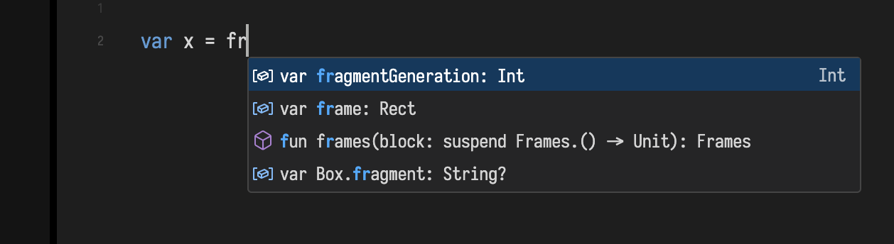

# Survival Guide

_Field·4_ is a place for writing, running, debugging, understanding code — quickly. It's also a place for experimentation, making mistakes, getting frustrated, and delighting in discovery. This guide should help you get to the point where you have some muscle memory.

The cheat-sheet can be accessed by pressing the '?' key. Right now it looks like this:
<hr>
<span class="leftKey">n</span> <span class="rightKey">creates a <b>new box</b></span><br>
<span class="leftKey">(select)</span> <span class="rightKey">selecting a box shows an <b>editor</b> for the code inside it</span><br><br>
<span class="leftKey">F1</span> <span class="rightKey">opens a searchable <b>command menu</b> for <i>everything else</i></span><br><br>
<span class="leftKey">alt-0</span> <span class="rightKey"><b>executes all code</b> in a box</span><br>
<span class="leftKey">alt-click</span> <span class="rightKey"><b>launches</b> a box</span><br>
<span class="leftKey">alt-up</span> <span class="rightKey">also <b>launches</b> a box</span><br>
<span class="leftKey">alt-down</span> <span class="rightKey"><b>stops</b> a launched box</span><br>
<span class="leftKey">alt-return</span> <span class="rightKey">executes the <b>current line</b> / block of code</span><br>
<span class="leftKey">alt-drag</span> <span class="rightKey">executes <b>multiple boxes</b> in a "strum"</span><br><br>
<span class="leftKey">esc-esc</span> <span class="rightKey"><b>clear output</b> annotations from the editor</span><br><br>
<span class="leftKey">command-space</span> <span class="rightKey">opens <b>autocomplete</b></span><br><br>
<span class="leftKey">g</span> <span class="rightKey"><b>groups</b> two selected boxes</span><br>
<span class="leftKey">u</span> <span class="rightKey"><b>ungroups</b> boxes</span><br>
<hr>
Using these keyboard shortcuts, you should be able to write and execute some code in Field:


There are a large number of other ways of executing code, since executing code is very important in a live-coding environment. Here the 'f1' palette inside the text editor is your discovery engine for many of these ways. 

Note that Field differentiates between running a piece of code (a line or two or the whole contents of a box) and _launching_ code (giving the code at least an opportunity to inject something into the main animation loop and keep going).

## Saving and Loading

Field saves regularly (around every 5 seconds or so if there's something that's changed). It's important to note that reloading the webpage refreshes your connection to Field, but it doesn't reboot it — what ever you launched is still running. If you want to restart Field, press `ctrl-c` in the terminal you launched it from and start it again. If you can figure out how to connect remotely to you machine you can run the front end (the web-browser) on any other machine you like.

To change what document you are looking at in the browser, edit that url at the top:

```diffstatic {data-lang=text}
https://localhost:9092/?file=editThisNameHereToLoadSomethingElse
```

Documents are created on demand and saved in `~/Documents/AFieldWorkspace/`

## The command palette

For anything advanced pressing `f1` reveals a searchable command palette. This works both inside the editor and outside the editor — although you'll get a different set of commands in different situations. All kinds of things hide there — changing editor tabs, applying AI to code and error messages...



For it's main code-writing experience _Field·4_ wraps the [Monaco text editor](https://microsoft.github.io/monaco-editor/) — just like everyone else is doing these days — so there's a pretty rich set of ways of interacting with code built-in. But there some advanced features to discover — inline printing, AI-chat (if you have an OpenAI Platform Key), number increment and decrement shortcuts, configurable code blocks.

## Autocomplete

One of the most useful keyboard shortcuts of all is autocomplete — `ctrl-space`. Use it to provide ideas about what you might type, and documentation about those things:



With AI support enabled, this will include up to 3 AI generated suggests of what you might type next. These are more likely to be incorrect (in the sense that completions generated by type-based are generally very, very good); but also more likely to be ambitious and lengthy. Our GLSL completions are, in particular, often exactly what you want.


