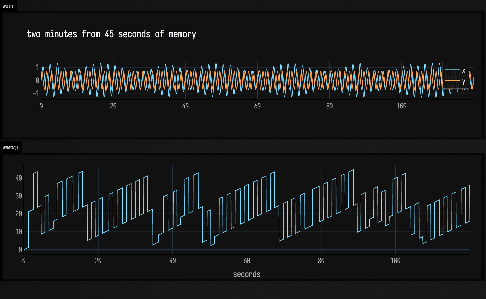
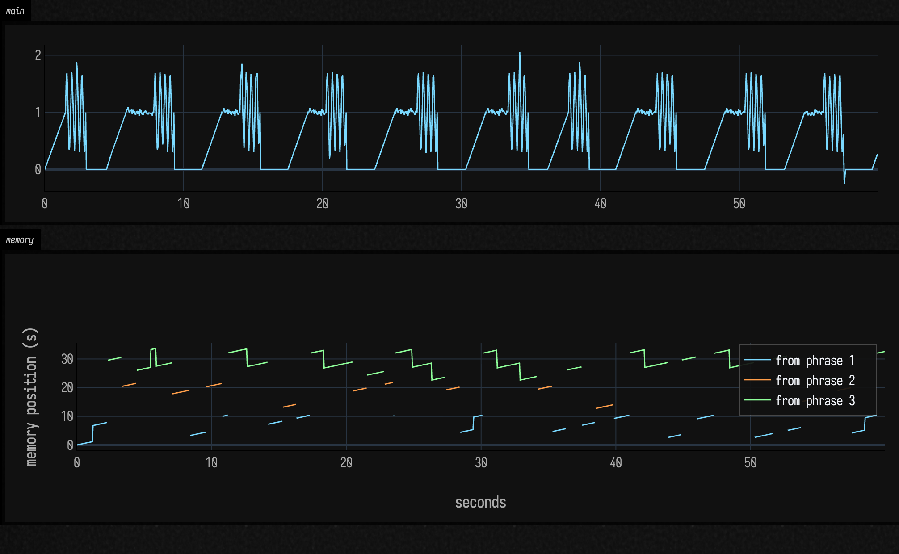
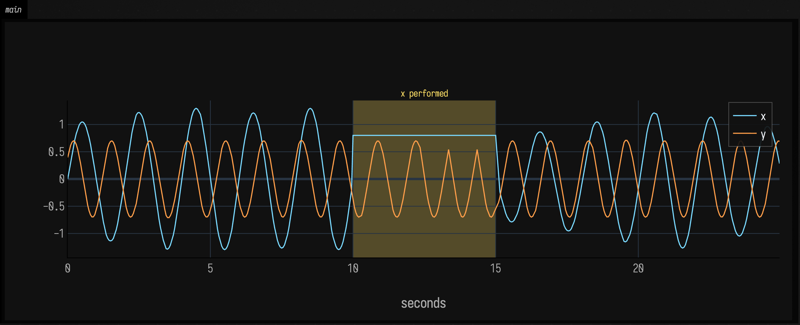
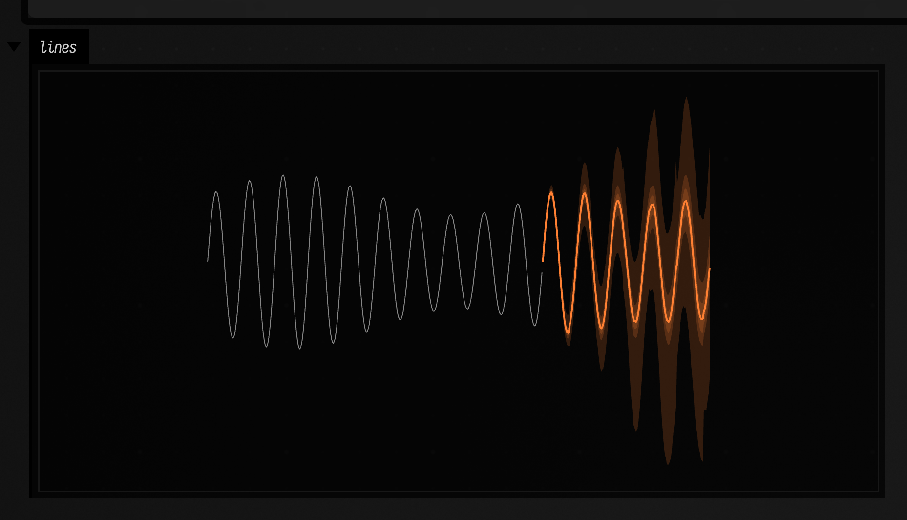
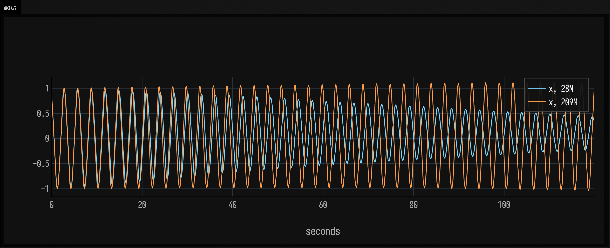
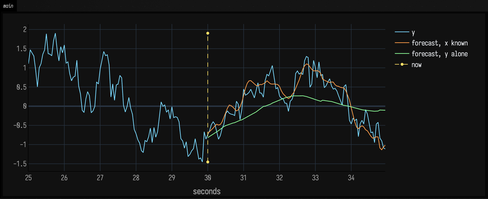

# Continuing a Gesture: Sequence Memory and Forecasting

Record a few seconds of a performed gesture: a mouse trace, two sliders moved together, the
envelope of a phrase. Then ask Field to keep going: continue it in the same style, for as long
as you like, while you take over one channel and give it back. This page covers two ways of
doing that, with no training step:

- **A Variable Markov Oracle** (Wang and Dubnov) remembers the recording itself and recombines it. Every
  sample it plays comes from somewhere in what you gave it, and it can say where.
- **Timestral**, Mistral's pretrained forecasting model, has never seen your recording and does
  not need to. It reads the recent history and predicts what comes next, with an uncertainty
  band. It runs in an optional Python worker.

Both sit behind the same player, so a box that drives one can drive the other. Everything is in
two packages:

```diffstatic {data-lang=kotlin}
import afield.math.oracle.* // Trajectory, VariableMarkovOracle, Improviser
import afield.math.temporal.* // RecedingHorizon, OracleSession, TimestralSession
```

## Recordings

A `Trajectory` is a uniformly sampled multichannel recording: named channels, one sample rate,
and a list of where each separate demonstration (an *episode*) begins. `Trajectory.of` builds one
from named lists, and `Trajectory.join` puts several episodes end to end without ever treating
the last sample of one as leading into the first sample of the next.

Choose the sample rate for the gesture, not for the screen: 10–30 Hz resolves most hand
movements, giving 600–1,800 samples per minute at those rates. `resample(rate)` converts a
recording made at frame rate.

## Remembering and recombining

The box below records two coupled oscillators (one at 0.5 Hz with a slow swell, one at 0.75 Hz),
45 seconds at 20 Hz, builds the oracle, and lets an `Improviser` play two minutes from it.

<!--
FIELD_TEST
id: docs.temporal-memory.improvise
runner: backdoor-box
tags: [docs, oracle]
timeoutSec: 90
expect:
  outputContains:
    - "segments"
-->
```diffstatic_runner {data-lang=kotlin screenshot="assets/temporal_memory/improvise.png" alt="two plots over two minutes: above, x and y keep oscillating with their recorded shapes; below, the memory position climbs in straight runs and jumps between places in the recording" wait-output=true wait-output-kind=display wait-output-channel="main" capture="box" open-outputs="true" padding="0" name="tm-improvise"}
:::static
import afield.math.oracle.*

val rate = 20.0
val n = (45 * rate).toInt()
val demo = Trajectory.of(
    rate,
    "x" to
        n {
            val t = it / rate
            sin(2 * PI * 0.5 * t) * (1 + 0.3 * sin(2 * PI * 0.05 * t))
        },
    "y" to
        n {
            val t = it / rate
            0.7 * sin(2 * PI * 0.75 * t + 0.6)
        },
)

val memory = VariableMarkovOracle.build(demo)
val played = Improviser(memory, seed = 1).take(120.0)

print("$memory\n$played: ${played.segments.size} segments")
val seconds = List(played.output.length) { it / rate }
showSignals(
    *played.output.series(),
    x = seconds,
    title = "two minutes from 45 seconds of memory",
    channel = "main",
    width = 1000,
    height = 260,
    floatingLegend = true,
)
showSignals(
    "memory position (s)" to played.sourceSeconds(),
    x = seconds,
    xTitle = "seconds",
    channel = "memory",
    width = 1000,
    height = 260,
)
```



The staircase is the memory position: which second of the recording each output sample came
from. A straight run is the improviser following the recording; a jump is a recombination. The
oscillators keep their shape and their phase relationship across every jump, because a jump is
only taken between places where the recent past matches in both channels, in position *and*
velocity.

### How the oracle decides what matches

`VariableMarkovOracle.build` turns each sample into a feature frame: every channel, centred and
scaled by its spread, followed by its first difference, scaled the same way. Two frames closer than a
threshold count as the same symbol, and the oracle (a Factor Oracle built over those symbols)
links each moment to the earlier moment that ends the longest repeat of what led up to it.
`lrs[i]` is the length of that shared past, and `sfx[i]` is where it is.

The threshold matters. Too small, and nothing ever repeats. Too large, and everything is the
same symbol, so a match says nothing. `build` tries a range of thresholds and keeps the one with
the highest *information rate*, the measure from the reference implementation of how much the
past tells you about the present. `VariableMarkovOracle.thresholdScan` returns every candidate if
you want to see the choice:

```diffstatic {data-lang=kotlin}
val scan = VariableMarkovOracle.thresholdScan(demo)
showSignals("information rate" to scan.map { it.second }, x = scan.map { it.first.threshold }, xTitle = "threshold")
```

Matching uses velocity as well as position, so a path that crosses itself is not confused with
itself going the other way. `GestureFeatures.fit(demo, velocityWeight = …, channelWeights = …)`
changes the balance; `shapeOnly = true` matches motion wherever it happens.

### What the improviser does

`Improviser` plays the memory forward one sample at a time:

- It follows the current passage for at least `minPhrase` seconds (default 1), then, with
  probability `jumpProbability` per sample, considers a jump.
- Candidates are the oracle's suffix links from where it is. Each is scored by how much context it
  shares, how far its preceding sample is from where the output is now, and how recently its
  passage was played. One is drawn with a seeded softmax (`temperature`), so a seed replays the
  same performance.
- A candidate further than `maxJoin` thresholds from the current position is rejected, not
  smoothed over. The small correction that is applied fades over `joinTime` seconds, and its size
  is recorded per sample in `Performance.correction`.
- At the end of an episode a jump is compulsory. If no suffix link is acceptable it looks for the
  best match for the last `cueWindow` seconds anywhere in memory; if nothing is closer than
  `declineDistance`, it holds rather than pretend.

`Performance.segments` records every jump: where in memory it went, which episode, why
(`SuffixLink`, `EpisodeEnd`, `Cue`, `Takeover`, `Hold`), the join distance and the shared
context. `reuse()` and `coverage()` say how much of the output repeats itself and how much of the
memory gets used.

## Several demonstrations

Separate recordings stay separate. The box below gives the oracle three short phrases built from
the same gestures (a rise, a hesitation, a burst, a pause) in different orders, and colours the
memory position by episode.

<!--
FIELD_TEST
id: docs.temporal-memory.episodes
runner: backdoor-box
tags: [docs, oracle]
timeoutSec: 90
expect:
  outputContains:
    - "episodes"
-->
```diffstatic_runner {data-lang=kotlin screenshot="assets/temporal_memory/episodes.png" alt="above, a one-channel performance of rises, hesitations, bursts and pauses; below, short coloured runs showing which of the three recorded phrases each part of it was played from" wait-output=true wait-output-kind=display wait-output-channel="main" capture="box" open-outputs="true" padding="0" name="tm-episodes"}
:::static
import afield.math.oracle.*

val rate = 20.0
val r = java.util.Random(11)
fun rise() = 30 { it / 29.0 }
fun hesitate() = 25 { 1.0 + 0.03 * r.nextGaussian() }
fun burst() = 30 { 1.0 + 0.7 * sin(it * 8 * PI / 29) }
fun pause() = (20 + r.nextInt(20)) { 0.0 }

val phrases = [
    rise() + hesitate() + burst() + pause() + rise() + burst() + pause(),
    rise() + burst() + pause() + rise() + hesitate() + hesitate() + burst() + pause(),
    hesitate() + burst() + pause() + rise() + hesitate() + burst() + pause() + rise(),
]
val demo = Trajectory.join(phrases.map { Trajectory.of(rate, "v" to it) })

val played = Improviser(VariableMarkovOracle.build(demo), seed = 4, jumpProbability = 0.3).take(60.0)
val byEpisode =
    demo.episodeStarts.indices.map { e ->
        "from phrase ${e + 1}" to
            played.source.map { if (it >= 0 && demo.episodeOf(it) == e) it / rate else Double.NaN }
    }
print("${demo.episodeStarts.size} episodes, ${played.segments.size} segments")
val seconds = List(played.output.length) { it / rate }
showSignals(
    "performance" to played.output.values[0].toList(),
    x = seconds,
    channel = "main",
    width = 1000,
    height = 220,
)
showSignals(
    *byEpisode.toTypedArray(),
    x = seconds,
    xTitle = "seconds",
    yTitle = "memory position (s)",
    channel = "memory",
    width = 1000,
    height = 300,
    floatingLegend = true,
)
```



The performance moves between all three phrases, but only where a gesture in one matches a
gesture in another. A continuation never runs off the end of one recording into the start of the
next, and the oracle's shared-context lengths never reach back across a boundary.

## Taking over a channel

A performer can drive any channel while the rest keep going. `perform(channel, value)` makes the
improviser play your value on that channel, and every `cueInterval` seconds it re-aligns the
other channels with the memory by matching only the channels you are driving.
`release(channel)` gives it back, with a fade from your last value. The script below holds `x` still for five
seconds, then lets go.

<!--
FIELD_TEST
id: docs.temporal-memory.takeover
runner: backdoor-box
tags: [docs, oracle]
timeoutSec: 90
expect:
  outputContains:
    - "takeover"
-->
```diffstatic_runner {data-lang=kotlin screenshot="assets/temporal_memory/takeover.png" alt="x and y oscillating; inside a shaded five-second band x is held flat by the performer while y carries on, and after the band x fades back into the oscillation" wait-output=true wait-output-kind=display wait-output-channel="main" capture="box" open-outputs="true" padding="0" name="tm-takeover"}
:::static
import afield.math.oracle.*

val rate = 20.0
val n = (45 * rate).toInt()
val demo = Trajectory.of(
    rate,
    "x" to
        n {
            val t = it / rate
            sin(2 * PI * 0.5 * t) * (1 + 0.3 * sin(2 * PI * 0.05 * t))
        },
    "y" to
        n {
            val t = it / rate
            0.7 * sin(2 * PI * 0.75 * t + 0.6)
        },
)

val from = (10 * rate).toInt()
val to = (15 * rate).toInt()
val played =
    Improviser(VariableMarkovOracle.build(demo), seed = 2).take(25.0) { i ->
        if (i in from until to) perform("x", 0.8)
        if (i == to) release("x")
    }
val reasons = played.segments.groupingBy { it.reason }.eachCount()
print("takeover: $reasons, largest join correction ${played.correction.max().f2}")
showSignals(
    *played.output.series(),
    x = List(played.output.length) { it / rate },
    xTitle = "seconds",
    regions = [SignalRegion("x performed", from / rate, to / rate)],
    channel = "main",
    width = 1000,
    height = 380,
    floatingLegend = true,
)
```



While `x` is held, `y` keeps going. Holding still at 0.8 is something the recording never does, so no
place in memory matches it well, and the improviser stays on its current passage rather than jumping
around looking for one. It re-checks once a phrase (`minPhrase`, one second here), and moves only to a match clearly better
than where it is (`takeoverMargin`). The short peaks in `y` are those moves.

## Playing live

`Improviser.step()` returns one frame and does no waiting and almost no allocation, so it can run
directly in a frame loop. For anything slower — a forecaster, or a memory you want cued by
recent history on every replan — use `RecedingHorizon`, which never waits:

- It keeps a buffer of planned samples and returns the next one on every `step()`.
- After `commit` seconds of a plan have played, it asks the session for a new plan from the
  history that actually played, including your interventions. One request is in flight at a time.
- `perform` and `release` bump a revision number. A reply computed from the old history is
  thrown away when it arrives (`staleReplies`), so a slow plan can never undo a takeover.
- If the buffer runs dry, it holds the last frame (or, with `Underflow.Stop`, stops) and counts
  the underrun rather than extrapolating.

`OracleSession(memory)` puts the oracle behind this player; `TimestralSession()` puts the
forecaster there. `RecedingHorizon(..., lockstep = true)` waits for every reply instead, which is
what the offline renders on this page use so that they do not depend on machine speed.

## Forecasting with Timestral

Timestral is a family of transformer forecasting models (5M to 209M parameters) trained by
Mistral on a large collection of time series. Given up to 32 768 steps of multichannel history,
it predicts the future as 21 quantiles per step, without being shown any examples of your
signal. Field runs it in a separate Python process so that PyTorch never loads into Field.

!!! note "Installing Timestral"
    It needs [uv](https://docs.astral.sh/uv/) and a download. In a box:

    ```diffstatic {data-lang=kotlin}
    import afield.math.temporal.*
    print(TimestralSession.status())                       // Missing(... not downloaded ...)
    print(TimestralSession.install("mistralai/Timestral-28M"))
    ```

    `install` builds the worker's own Python environment from the pinned versions in
    [`python/fieldtemporal/timestral_worker.py`](https://github.com/OpenEndedGroup/Field4/blob/main/python/fieldtemporal/timestral_worker.py)
    and downloads the checkpoint (5M: 21 MB, 28M: 111 MB, 123M: 490 MB, 209M: 837 MB). After
    that, sessions start without the network, and with `AFIELD_OFFLINE=1` they never use it. The code is Apache-2.0;
    the weights are under Mistral's Modified MIT license, linked from each model page on
    Hugging Face.

### A forecast and its uncertainty

`TimestralSession()` starts a worker for the 28M model (pass `model = "mistralai/Timestral-209M"`
for the largest). `propose` sends the recent history and returns two things: a median forecast,
which is the proposal, and 21 quantiles per step, from 1% to 99%. `bandFLine`, `quantileFLine`
and `medianFLine` turn these into lines in the same style as
[the Gaussian process pages](gaussian_processes.md). The box below forecasts ten seconds of one
oscillator from twenty seconds of history, and draws the 1–99%, 10–90% and 25–75% bands as a fan
around the median.

```diffstatic_runner {data-lang=kotlin screenshot="assets/temporal_memory/forecast.png" alt="twenty seconds of an oscillating channel in white, then ten seconds of forecast: a thick orange median that keeps oscillating at full size, inside three nested translucent orange bands that grow wider and more ragged with the horizon" wait-output=true wait-output-kind=display wait-output-channel="lines" capture="box" open-outputs="true" padding="20" name="tm-forecast"}
:::static
import afield.math.oracle.*
import afield.math.temporal.*

val rate = 20.0
val n = (20 * rate).toInt()
val history = Trajectory.of(
    rate,
    "x" to
        n {
            val t = it / rate
            sin(2 * PI * 0.5 * t) * (1 + 0.3 * sin(2 * PI * 0.05 * t))
        },
)
val forecast = TimestralSession().use { it.propose(ContinuationRequest(0, history, horizon = 200)).get() }

// seconds across, values up; the SVG is y-down, so flip and scale into pixels
fun plot(line: FLine) = line.transform { vec(it.x * 30, -it.y * 120, 0) }
val ahead = DoubleArray(forecast.horizon) { (n + it) / rate }

val past =
    plot(
            FLine().apply {
                for (t in 0 until n) if (t == 0) moveTo(0.0, history.values[0][0])
                else lineTo(t / rate, history.values[0][t])
            },
        )
        .apply {
            color = vec(1, 1, 1, 0.9)
            thickness = 1.5
        }
val fan =
    [0.01 to 0.99, 0.1 to 0.9, 0.25 to 0.75].map { (lo, hi) ->
        plot(forecast.bandFLine(0, lo, hi, ahead)).apply {
            filled = true
            stroked = false
            color = vec(1, 0.5, 0.2, 0.18)
        }
    }
val median = plot(forecast.medianFLine(0, ahead)).apply {
    color = vec(1, 0.5, 0.2, 1)
    thickness = 3.0
}

print("forecast in ${(forecast.diagnostics["roundTripSeconds"] as Double * 1000).f0} ms")
lines(fan + past + median, w = 900.0, h = 320.0, fitToSize = true)
```



The [Gaussian process page](gaussian_processes.md#three-different-things-to-draw) separates
three things to draw: the mean, the pointwise uncertainty, and a sample, one entire possible
function. A forecast gives you the first two. The median is the thick line. Each band is
*pointwise*: at every step, the model expects the true value to be inside the 10–90% band 80% of
the time. No single future is expected to stay inside it, and the bands widen with the horizon
because the model is less sure further out.

What Timestral does not give is the third thing. A Gaussian process has a covariance between
every pair of positions, and that is what makes its samples smooth curves. Timestral's quantiles
are separate for every step and channel: they say nothing about whether a high value now goes
with a high value a second later. Drawing each step from its own quantiles produces jagged noise
the model never predicted, so `TimestralSession` does not offer samples. Play the median, and
use the fan to see how sure the model is. For alternatives that really are possible performances,
use the oracle, whose every output is a passage that happened.

### Feeding the forecast back

A forecast one block ahead is not a performance. To keep going, `RecedingHorizon` plays the
first second of each forecast, then forecasts again from what was actually played, generated
samples included. The box below does that for two minutes of the figure-eight path, with the 28M
and the 209M model.

```diffstatic_runner {data-lang=kotlin screenshot="assets/temporal_memory/receding.png" alt="two minutes of the x channel of a figure-eight continued by two models: the 28M model's oscillation shrinks steadily towards zero, the 209M model's keeps its full amplitude to the end" wait-output=true wait-output-kind=display wait-output-channel="main" capture="box" open-outputs="true" padding="0" name="tm-receding"}
:::static
import afield.math.oracle.*
import afield.math.temporal.*

val rate = 20.0
val demo = Trajectory.of(rate, "x" to 800 { sin(4 * PI * it / 120.0) }, "y" to 800 { sin(2 * PI * it / 120.0) })

val runs =
    ["28M", "209M"].map { size ->
        RecedingHorizon(
                TimestralSession("mistralai/Timestral-$size"),
                demo,
                history = 20.0,
                horizon = 4.0,
                commit = 1.0,
                lockstep = true,
            )
            .use { size to it.take(120.0) }
    }
for ((size, p) in runs) print(
    "$size: replanning p50 ${(p.latency(50.0) * 1000).f0} ms, p95 ${(p.latency(95.0) * 1000).f0} ms\n",
)
showSignals(
    *runs.map { (size, p) -> "x, $size" to p.output.values[0].toList() }.toTypedArray(),
    x = List(2400) { it / rate },
    xTitle = "seconds",
    channel = "main",
    width = 1000,
    height = 380,
    floatingLegend = true,
)
```



Fed its own output, a forecaster tends to drift towards the average. The small models drift
fastest: over five minutes of this loop the 28M model's figure-eight shrinks to about a tenth of
its size, while the 209M model's holds its size and frequency. Material made of bursts and
silences fares worse than smooth periodic motion: on a recording of rises, bursts and pauses, both
sizes settle into the pause within the first minute. The oracle has no such drift, because it
only ever plays back what it was given.

On a laptop CPU, replanning four seconds ahead from twenty seconds of two channels takes a few tens of
milliseconds with the 28M model and a few hundred with the 209M model. The printed numbers
above are from the machine that built this page. Set `commit` (how much of each plan is played)
comfortably above the slowest replan, or the player will run dry and hold.

### Steering with a known future

A covariate is a channel the model reads but does not forecast. If you know where one channel
is going (because you are about to play it, or it follows a score), pass its history and
future as `known`, and the forecast of the other channels can follow it. In the box below, `y`
is `x` one second late. The forecast of `y` with `x`'s future given is compared with the
forecast from `y`'s own history alone.

```diffstatic_runner {data-lang=kotlin screenshot="assets/temporal_memory/covariate.png" alt="ten seconds of an irregular signal y with a mark at now; after it, the forecast given the leading signal x follows the true y closely, while the forecast from y alone drifts smoothly and misses its turns" wait-output=true wait-output-kind=display wait-output-channel="main" capture="box" open-outputs="true" padding="0" name="tm-covariate"}
:::static
import afield.math.oracle.*
import afield.math.temporal.*

// an irregular control signal x, and y following it one second (20 samples) late
val r = java.util.Random(3)
var level = 0.0
val x = 720 {
    level = 0.9 * level + 0.1 * r.nextGaussian()
    3 * level
}
val lead = x.drop(20) // x, known over history and future
val y = x.take(700) // y[t] = x[t - 20]
val n = 600
val h = 100

val history = Trajectory.of(20.0, "y" to y.take(n))
val (steered, alone) =
    TimestralSession().use { s ->
        s.propose(ContinuationRequest(0, history, h, known = arrayOf(lead.toDoubleArray()))).get().proposal[0] to
            s.propose(ContinuationRequest(0, history, h)).get().proposal[0]
    }
fun error(p: DoubleArray) = (0 until h).sumOf { abs(p[it] - y[n + it]) } / h
print("mean error with x known ${error(steered).f2}, without ${error(alone).f2}")

// the last five seconds of history and the five-second horizon
val from = n - 100
val gap = 100 { Double.NaN }
showSignals(
    "y" to y.drop(from),
    "forecast, x known" to gap + steered.toList(),
    "forecast, y alone" to gap + alone.toList(),
    x = List(200) { (from + it) / 20.0 },
    xTitle = "seconds",
    marks = ["now" to n / 20.0],
    channel = "main",
    width = 1000,
    height = 380,
)
```



The model learns the one-second lag from the history alone, without any training, and uses it
over the horizon. This only works where the history shows the relationship: a covariate called
"energy" with no visible effect on the other channels gives the model nothing to go on.

A known value is a hint, not a constraint: the forecast is not forced to pass through it.


## Choosing between them

| | Oracle | Timestral |
|---|---|---|
| What it needs | the recording | the recent history, and the optional worker |
| What it plays | passages of the recording, recombined | new values predicted from the history |
| Over long performances | keeps the recording's character indefinitely | drifts towards the average; less with the larger models |
| After a takeover | finds the place in memory that matches what you played | forecasts from what you played |
| Uncertainty | match distances and the join corrections | a quantile band per step |
| Says where it came from | yes: `segments`, `source` | no |
| Speed | microseconds per sample, in the frame loop | tens to hundreds of milliseconds per replan, in the background |

Use the oracle when the material is the point: phrases, gestures, a particular way of moving.
Use Timestral when the dynamics are the point (a smooth continuation of whatever is happening
now, or a forecast steered by a channel whose future you know), and to see how predictable a
signal is from its band.


## See also

- [Motifs, Discords and Contrast](matrix_profile.md): finding what repeats in a signal, rather than continuing it.
- [Signal Examples](spectral_examples.md): filters and spectra for the signals you record.
- Wang, C. and Dubnov, S. (2014), *Variable Markov Oracle: A Novel Sequential Data Points
  Clustering Algorithm with Application to 3D Gesture Query-Matching*. The oracle here is a Kotlin
  port of [the reference implementation](https://github.com/wangsix/vmo), checked against it
  by `VmoReferenceTest`.
- [Timestral](https://github.com/mistralai/timestral), Mistral's inference code and model cards.
