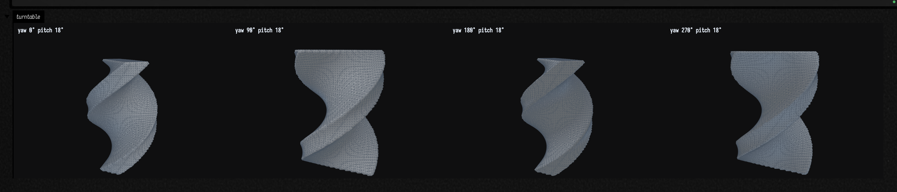

# Field's 3D output

*Everything below carries its own KDoc — start from `Box.three`, `ThreeSceneBuilder` and
`toThreeDrawable` in `afield.graphics` (`Three.kt`, `ThreeScene.kt`). The FLine half of the same
viewer is documented in [FLine examples](fline_examples.md#3d-output-threelines).*

Field has had a 3D output area for a while, and until very recently it could only draw one kind of
thing. `FLine`s went to a Three.js viewer you could orbit, click, section and explode. A `TriMesh`
went somewhere else entirely — a CPU z-buffer rasterizer that handed back a **still picture at a
fixed camera**. So a solid and the lines that measured it could not share a scene, and every feature
the viewer grew stopped dead at the mesh boundary.

`Box.three { … }` is the output that took both. It is `threeLines(...)` grown a vocabulary: it draws
meshes as well as FLines, in one orbitable scene, and lays several views out side by side when you
ask for a contact sheet.

```kotlin
three(channel = "car", height = 460) {
    mesh(car, wireframe = false)
    lines(measurements)                       // annotations in the same space as the solid
    camera(yaw = 34.0, pitch = 26.0, distance = 2.4)
    title("ToyCar.glb — 108,936 triangles")
}
```

This page is for someone who has a mesh and wants to look at it. It also answers the question that
follows immediately afterwards and has never had an answer anywhere: **Field has several renderers —
which one is drawing this, and why is the old one still here?**

## A scene, not a picture

The block is a scene description, not a sequence of draw calls, and `three` returns the live
`ThreeGeometryViewState` — so the scene stays drivable after it is on screen, exactly as
`threeLines(...)` does.

| in the block | what it does |
|---|---|
| `mesh(m, label, wireframe, cullBackFaces, flatShading, opacity, panel)` | add a solid |
| `lines(…)` — a `Collection<FLine>` or a vararg | add FLines, with every behaviour they have in `threeLines`: picking, hover, fills, click callbacks |
| `camera(yaw, pitch, distance, fieldOfView)` | where the camera starts. Setting it turns auto-framing off — you picked an angle, keep it |
| `camera(view: MeshView)` | the same, from a `MeshView` you already have. The migration path for an existing figure |
| `panel(title, caption, facts, camera, bounds)` | one titled viewport. Call it once per panel, in order |
| `columns(n)` | panels per row |
| `title(text)` / `caption(text)` | shorthand for a one-panel scene |
| `background(css)` | scene background as a CSS colour |
| `helpers(on)` | the reference grid and the axis tripod |

`helpers` is the one default worth knowing, because it is content-dependent rather than fixed: the
grid and the tripod are **on for an FLine-only scene** — which is what the viewer has always done —
and **off as soon as there is a mesh**. Both helpers are a fixed world size, a 10-unit grid and a
0.9-unit tripod, and a mesh is whatever size its file says it is. The toy car in
[Geometry from disk](geometry_from_disk.md) is 7 cm across, so the grid would be 140 times its width
and the tripod would swallow it whole.

### One scene, two kinds of thing

Here is the figure that could not be made at all a week ago. A gyroid marched inside a finite box is
an **open** surface: it runs out of the sampling window rather than closing inside it, and every
place it does that is a boundary loop. A shaded surface hides exactly that — the rim reads as a
silhouette and nothing more. `toFLines(MeshLines.BOUNDARY)` returns one closed ring per hole, and
those rings go into the *same* scene as the solid.

```diffstatic_runner {data-lang=kotlin screenshot="assets/three_output/scene.png" wait="6.0" capture="box" open-outputs="true" padding="20"}
:::static
// FIELD_DOCS_EXPECT_SVG: false — the docs runner reads a bare `lines(` as Box.lines's 2D SVG path
// and then demands an <svg>. The `lines(rims)` below is the scene builder's and emits an iframe.
//
// A gyroid is a triply-periodic minimal surface. Marched inside a finite box it is OPEN: the
// surface leaves the sampling window rather than closing inside it, and every place it does that
// is a boundary loop. `open(20)` in the printed summary is the claim; the picture is the evidence.
val surface = marchingCubes(sdfGyroid(4.0, 0.3), boundsAround(radius = 1.0), 72)
println(surface.summary())

// The rim, as FLines, in the mesh's own coordinates. One closed ring per hole.
val rims = surface.toFLines(MeshLines.BOUNDARY).map { ring ->
    ring.color = vec(1.0, 0.45, 0.12, 1.0)
    ring.thickness = 2.6
    ring
}
println("open boundary loops: " + rims.size)

three(channel = "gyroid", height = 470, width = 760) {
    mesh(surface, wireframe = false)
    lines(rims)
    camera(yaw = 32.0, pitch = 20.0, distance = 2.05)
    title("marched gyroid, with its " + rims.size + " open boundary loops drawn in the same scene")
    caption("the solid and the annotation are one scene in model space, so orbiting moves both")
}
```


The HUD in the top right counts the **whole** scene — `3576 ln | 165368 tri | 0 p` — because the
drawables' triangles are added to whatever the FLine half contributed rather than replacing it. The
mesh and the lines are one figure, and the counts say so.

Two things are worth noticing about how little work that took. The FLine half is not reimplemented:
`three { lines(…) }` delegates wholesale to the builder `threeLines(...)` already used, so the two
cannot disagree about what an FLine is — including its interactive objects, its topology strings and
its click callbacks. And the mesh half is a lowering, not a renderer: `TriMesh.toThreeDrawable()`
turns a mesh into a `ThreeDrawable`, which is *geometry plus how to draw it*, and the viewer draws
drawables without knowing that meshes exist.

## The camera is four numbers, and they are the rasterizer's four numbers

`ThreeCameraSpec` deliberately mirrors `MeshView` and `VisionGeometryPreview.Camera` one for one:

- **`yawDegrees`** — orbit around `+y`. `0` looks straight down `−z`.
- **`pitchDegrees`** — lift above the horizon. Positive looks down on the geometry.
- **`distance`** — in multiples of the bounding-sphere radius, so one spec frames a 2 cm mesh and a
  2 m one.
- **`fieldOfViewDegrees`** — vertical. Smaller is a longer lens and less perspective.

The same names and the same meanings are the point: a docs figure written against `MeshView` has to
survive the switch of renderer. The viewer reimplements the yaw/pitch/distance → eye-position
conversion in JavaScript, which is a second implementation of something with a sign convention in
it; it is marked `// [viewer-region camera-preset]` in `threejs_viewer.html` and held against the
Kotlin original by `ThreeCameraPresetParityTest`.

!!! warning "`distance` does not mean the same thing in the viewer, and this is not written down anywhere else"

    The preset supplies the camera's **direction**. It does not supply its **distance**. Having
    placed the eye, the viewer runs a zoom-to-fit (`fitCameraToBounds`) that slides the eye along the
    view direction until the geometry's own sampled points fit the frame the viewer was actually
    given — because a box output is as wide as its column and a figure written for a 560 × 420 canvas
    arrives in a much wider band.

    So in the viewer `distance` is a **padding factor**, not an eye distance:
    `max(1.02, distance / 2.7 × 1.06)`. Two consequences you will meet:

    * **Below about 2.6 it saturates.** `distance = 1.0` and `distance = 2.0` frame identically,
      because both clamp to the 1.02 floor. Measured: a `torusMesh(48, 24, 0.62, 0.24)` in a
      420 × 320 frame spans the same width at both.
    * **Above it, the mesh shrinks.** The same torus at `distance = 4.0` fills about two thirds of
      the width it does at `distance = 1.0` — the ratio 1.57 ⁄ 1.02 the formula predicts.

    This is also why a mesh figure re-captured onto the viewer is **not** the same composition as its
    rasterized predecessor: the viewpoint is identical and the subject is noticeably larger. Compare
    the toy car in [Geometry from disk](geometry_from_disk.md#a-real-glb-in-a-real-output-area)
    against the same figure before the change and the car has grown, because the rasterizer framed
    the bounding *sphere* in a canvas it chose and the viewer fits the real points to the frame it
    was handed. Neither is wrong. They are answers to different questions.

## Contact sheets

### Why a panel is a viewport and not an iframe

A contact sheet is N views of geometry side by side. The obvious translation is N viewers, and it is
wrong: each iframe is its own WebGL context, Chrome caps live contexts at around sixteen and
silently evicts the oldest, and a gallery of nine panels next to another gallery of nine is already
over budget. The evicted context comes back as a blank panel with **nothing in the console**.

So a `ThreePanel` is a *viewport*, not a document: one context, `setScissorTest` and a per-panel
`setViewport` in the render loop. It also happens to be much faster.

### `threeGrid` — several meshes, each framing its own bounds

```diffstatic_runner {data-lang=kotlin screenshot="assets/three_output/grid.png" wait="6.0" capture="box" open-outputs="true" padding="20"}
:::static
// Four unrelated shapes. Each panel frames its OWN bounds, so the small one is not lost beside the
// large one — that is the difference between a grid and a turntable, and only the Kotlin side knows
// which of the two it is building.
val ball = marchingCubes(sdfSphere(1.0), boundsAround(radius = 1.3), 40)
val drilled = marchingCubes(sdfSubtract(sdfSphere(1.0), sdfCylinder(0.34, 4.0)), boundsAround(radius = 1.3), 64)
val twisted = marchingCubes(sdfBox(vec(1.2, 1.8, 0.4)).twisted(0.35), boundsAround(radius = 1.2), 72)
val ring = torusMesh(64, 32, 0.62, 0.24)

threeGrid(
    "marched sphere, resolution 40" to ball,
    "…drilled through: the drill added a handle" to drilled,
    "sdfBox(…).twisted(0.35)" to twisted,
    "torusMesh(64, 32) — genus 1 by construction" to ring,
    columns = 2,
    facts = true,
    cellWidth = 430,
    height = 760,
    channel = "grid",
    view = MeshView(pitchDegrees = 44.0),
)
```


Four panels, four cameras, **one** WebGL context. Each panel carries the fact line
`TriMesh.threeFacts()` computes — the same sentence `toFigureHtml` writes under a rasterized figure,
shared rather than reimplemented so that the two renderers cannot report a different genus for the
same mesh.

`facts = true` is worth knowing about because it is **off by default**, and `showMeshGrid` does not
turn it on. If you want the numbers under each panel, either call `threeGrid` directly as above, or
use the `List<ThreeMeshPanel>` overload, which exists precisely because a gallery usually has
something specific to say about each cell that the generic sentence is not:

```kotlin
threeGrid(
    listOf(
        ThreeMeshPanel("cuboctahedron", solid, facts = "12 vertices · 24 edges · 14 faces (8 triangles, 6 squares)"),
        ThreeMeshPanel("…kis'd", kissed, facts = "38 vertices · 84 edges · 48 faces (all triangles)"),
    ),
    columns = 2,
)
```

### `threeTurntable` — one mesh, several angles, one upload

```diffstatic_runner {data-lang=kotlin screenshot="assets/three_output/turntable.png" wait="6.0" capture="box" open-outputs="true" padding="20"}
:::static
// One mesh, four angles, ONE upload and ONE WebGL context. Every panel frames the SAME bounds, so
// the shape does not appear to breathe as it turns.
val twisted = marchingCubes(sdfBox(vec(1.2, 1.8, 0.4)).twisted(0.35), boundsAround(radius = 1.2), 80)
println(twisted.summary())
threeTurntable(twisted, channel = "turntable", height = 290)
```



Four viewpoints is usually the difference between "that looks plausible" and "yes, that is the
shape". This solid is a good advertisement for it: at yaw 0° and 180° it is a narrow crescent and at
90° and 270° it is a broad S, and a single view of either would leave you guessing.

Two details make the turntable cheap and stable, and they are opposites of what the grid wants:

* the mesh is added once with `panel = -1`, which means **every** panel — one upload of a
  100k-triangle mesh drawn from four angles rather than the same buffer sent four times;
* every panel is given the *same* `bounds`, so the shape does not appear to breathe as it rotates. A
  grid wants the opposite — each panel frames its own — and only the Kotlin side knows which of the
  two shapes it is building, which is why `ThreePanel.bounds` is computed here and not in the viewer.

## `showMesh` after the change

The `showMesh` family kept its signatures and gained a `renderer` parameter. Nothing moved; the
default moved.

| you call | you get |
|---|---|
| `showMesh(mesh)` | `three(subject = mesh)` — the Three.js viewer, orbitable |
| `showMesh(mesh, renderer = MeshRenderer.CPU)` | the static rasterized figure this used to produce |
| `showMeshGrid(…)` | `threeGrid(…)` |
| `showMeshTurntable(…)` | `threeTurntable(…)` |
| `showMeshDiagnosis(mesh)` | **always** the CPU rasterizer — it has no `renderer` parameter |
| `mesh` as the last expression in a box (the inline card) | **always** the CPU rasterizer |

Two size knobs that are easy to confuse, because they used to be one:

* `MeshView.width` / `MeshView.height` size the **raster** on the CPU path, and on the GPU path
  `view.width` becomes the iframe's width in pixels;
* `showMesh`'s own `height` parameter — default `430` — sizes the **iframe**, and `MeshView.height`
  is ignored on that path. If you want a GPU figure the same shape as its CPU predecessor, pass
  `height = view.height` explicitly.

The pixel width matters more than it looks. `field.css` says
`.disclosure-content iframe { width: 100% !important }`, which reads as though an inline size is
ignored — it is not. `outputareas2.js` *measures* the output panel from `iframe.style.width` and
sizes the disclosure to the result, and only then does the CSS stretch the iframe to fill the panel
it just caused. A percentage measures as "no intrinsic width", which is right for an FLine viewer
filling its column and wrong for a migrated figure: it silently collapsed 1520- and 2040-pixel-wide
galleries to a uniform 1136 and lost a third of every picture.

## Which renderer draws this

Field has more ways to put geometry on a screen than anyone expects, and the honest list is longer
than "the viewer and the rasterizer". Establishing it means reading the source rather than trusting
a summary, so here is what is actually in the tree.

| path | what it draws | where the pixels are made | reach for it when |
|---|---|---|---|
| `three`, `threeGrid`, `threeTurntable`, `threeLines`, `threeInspect` — `afield/graphics/Three.kt`, `ThreeJsViewer.kt` | FLines and `TriMesh`es together, in 3D | **WebGL** (three.js r184, vendored) in a `/threejs` iframe inside the box output | you want to turn it; you want a solid and its annotations in one scene. The default for the whole `showMesh` family |
| `renderPng`, `renderPixels`, `toFigureHtml`, `toHTML`, `showMeshDiagnosis`, `MeshRenderer.CPU` — `afield/graphics/VisionGeometryPreview.kt` | one `TriMesh`, fixed camera, still | **CPU z-buffer in the JVM**, AWT-free, encoded by `PngEncoder` | you need the same pixels twice (see below); there is no WebGL context to spare; you want a pixel buffer to composite by hand |
| `lines`, `l`, `drawToSVG`, `inspect` — `afield/graphics/someSkiko.kt` | FLines, **2D only** | **SVG text** emitted by a Skia recording canvas; the browser rasterizes it | 2D figures: crisp at any zoom, tiny payload, headless-safe |
| `lines(editable = true)`, and the automatic upgrade when an FLine has `onClick` or `hoverColor` — `FLineEditableSvg.kt` | the same, plus click / hover / drag / freehand | SVG in the browser, plus a server-side edit session | direct manipulation of control points; a figure you can click to name |
| `moduleHere`, `Renderer`, `RenderToTexture`, and `StandardRenderer` / Fabricate on top of them — `afield/four/` | arbitrary real-time scenes, Gaussian splats, hardware ray tracing | **Vulkan on the desktop GPU**, in a GLFW window (offscreen targets still need the window) | real-time work, hot-reloaded shaders, hundreds of thousands of primitives, OpenXR |
| `visionMetal` — `afield/graphics/VisionMetal.kt` | your live Metal shader plus its geometry | **Metal, on the Vision Pro** | headset live-coding. Its desktop stand-in is `previewVisionGeometry`, which is the CPU rasterizer again |
| the visionOS native FLine viewer — `native/field-visionos/Field4Vision/FLine/` | whatever `threeLines` / `three` published | **RealityKit / Metal on the headset** | you want an existing 3D figure in the volume. It subscribes to the same `__threejs__` channel; there is no second API |
| `remoteAr` — `afield/outputs.kt`, `RemoteArKotlinJs.kt` | *your Kotlin, compiled to JS*, in a WebXR page | **WebGL in the browser or headset** | AR/VR where the code runs in the head rather than on the desktop |
| `rasterizeFLines`, `Img`, `showImg`, `rasterizeText`, `heatmapImage`, `RectSLFitFigure` | 2D marks into a pixel buffer, no projection and no depth | **CPU in the JVM**, `PngEncoder` | measurement rasters, image pipelines, figures that have to be identical in a test |

Two entries deserve a correction of a common assumption:

**`Box.lines(...)` does not project.** It flattens. `computeFitTransform` is three numbers — a scale
and two offsets — with no eye, no field of view and no near plane, and `applyFit` copies `z` through
untouched. Every draw path then reads `x` and `y` only. A 3D FLine handed to `lines(...)` is an
orthographic projection down `−z` with no depth sorting and no hidden-line removal. `z` survives only
as *metadata for picking*, so a click can report the 3D coordinate of the thing you hit. If you want
perspective, either project first with `FLine.byPerspectiveProjecting(...)` or reach for
`threeLines`.

**The ray tracer is not a separate renderer.** [Ray tracing examples](ray_tracing_examples.md) is
`VK_KHR_ray_tracing_pipeline` inside `afield.four`, and Fabricate's `StandardRenderer` is a deferred
g-buffer / shadow / AO / composite stack built on the same primitives. One Vulkan renderer, three
front ends.

### Why the CPU rasterizer is still here

It is not deprecated, and "it is the old one" is the wrong summary. Three reasons, in order of how
hard they are to work around:

**It is deterministic, and a GPU is not.** This is the load-bearing one. The pixel-exact proofs
compare against it, and a GPU capture cannot play that role — driver, vendor and antialiasing all
move under you. Six test classes assert on its output today:
`MeshDefectRenderTest`, `SolidSLRenderProofTest`, `MeshIoTest`, `MeshFromDiskTest`,
`AssimpSceneBridgeTest` and `MeshVisualizerPixelTest`. They are pixel *statistics* — counts of red
defect-overlay pixels, coverage fractions, painted-area bounds, outward-versus-flipped diffs — rather
than golden images, but every one of them needs the same input to produce the same number twice.

**It needs no WebGL context.** The inline value-visualizer card that appears when a box ends on a
`TriMesh` uses it, because an iframe per mesh in a list of values is a bad trade — and it is exactly
the ~16-context ceiling that `ThreePanel` exists to dodge.

**It renders into a pixel buffer.** `TriMesh.renderPixels` hands you ARGB ints and a size, which is
what you want when compositing several meshes into one figure yourself.

There is also a fourth, quieter reason: it is *AWT-free on purpose*. Touching `java.awt` inside
Field's server JVM on macOS initialises AppKit in a process whose main thread belongs to GLFW, and
the process dies silently. So `VisionGeometryPreview` writes its own PNGs.

### The same mesh, both ways

```diffstatic_runner {data-lang=kotlin screenshot="assets/three_output/renderers.png" wait="7.0" capture="box" open-outputs="true" padding="20"}
:::static
// The same mesh, the same MeshView, the same frame size — both renderers. The only honest way to
// say what changed is to put them next to each other and look.
val solid = marchingCubes(
    sdfSmoothUnion(sdfSphere(0.78), sdfBox(vec(2.1, 0.32, 0.32)), k = 0.28),
    boundsAround(radius = 1.35), 64,
)
val view = MeshView(width = 520, height = 400, wireframe = true)

showMesh(solid, channel = "three.js — the default", view = view, height = view.height,
         renderer = MeshRenderer.GPU, title = "MeshRenderer.GPU — MeshStandardMaterial, orbitable")
showMesh(solid, channel = "the CPU rasterizer", view = view,
         renderer = MeshRenderer.CPU, title = "MeshRenderer.CPU — two-light lambert, deterministic, still")
```


Same mesh, same `MeshView`, same 520 × 400 frame, two pictures that are obviously not the same
picture. What differs, and what does not:

- **Shading differs, and is not meant to match.** The rasterizer is a two-light Lambert stand-in over
  the vertex colours. The viewer is three.js's `MeshStandardMaterial` under an ambient / key / rim
  rig. Nobody is going to reconcile those, and pretending otherwise would mean crippling one of them.
- **Framing differs** — see the warning above. The viewer zoom-to-fits; the rasterizer places the eye
  literally.
- **The input is held identical**, deliberately. `toThreeDrawable` mirrors `toCapturedMesh`'s
  preparation step for step: a mesh with no normals is run through `shadedNormals` at the *same* 35°
  crease angle the rasterizer uses (leaning on three.js's `computeVertexNormals()` instead would be
  an unconditional smooth average and would round every hard edge off a cube); colours come from
  `TriMesh.colors` or from the rasterizer's own `DEFAULT_SURFACE` constant, read rather than copied
  so the two cannot drift into two different greys; alpha is a flat 1. A difference between the two
  outputs is a difference in shading model, never a difference in input.
- **Back-face culling is held identical too**, and this is the one that matters diagnostically —
  asserted rather than claimed, in the next section.
- **The fact line is the same sentence**, from `TriMesh.threeFacts()` and `toFigureHtml` sharing one
  implementation.

### The diagnostic that had to survive the switch

A face wound the wrong way is *missing* in the rasterizer — not dark, **gone** — and the
[polytope](polytope_examples.md) and [typography](typography_examples.md) pages both teach that as a
winding test. `ThreeDrawStyle.surface(cullBackFaces = true)` is the default so it must be missing in
the viewer too. Switching renderers is not allowed to quietly switch a diagnostic off, and that is
the sort of claim that should be a picture rather than a sentence.

```diffstatic_runner {data-lang=kotlin screenshot="assets/three_output/winding.png" wait="7.0" capture="box" open-outputs="true" padding="20"}
:::static
// Take a sphere and reverse the winding of one band of triangles. Not one vertex moves.
val ball = icosphereMesh(3, 0.8)
val idx = ball.indices.copyOf()
var reversed = 0
for (t in 0 until ball.triangleCount) {
    val cy = (ball.position(ball.ia(t)).y + ball.position(ball.ib(t)).y + ball.position(ball.ic(t)).y) / 3.0
    if (cy > 0.30) {
        val b = idx[t * 3 + 1]; idx[t * 3 + 1] = idx[t * 3 + 2]; idx[t * 3 + 2] = b
        reversed++
    }
}
val holed = TriMesh(ball.positions.copyOf(), idx)

println("reversed %d of %d triangles; not one vertex moved".format(reversed, ball.triangleCount))
println("volume  %.4f  ->  %.4f".format(ball.signedVolume(), holed.signedVolume()))
println("consistently oriented: " + holed.topology().isConsistentlyOriented)

val view = MeshView(width = 460, height = 380, yawDegrees = 18.0, pitchDegrees = 38.0, wireframe = true)
showMesh(holed, channel = "three.js", view = view, height = view.height, renderer = MeshRenderer.GPU,
         title = "the band is GONE, not dark")
showMesh(holed, channel = "the CPU rasterizer", view = view,
         renderer = MeshRenderer.CPU, title = "…and gone here too, which is the whole point")
```


**394 of 1280 triangles reversed, no vertex moved, and both renderers punch the same hole.** Look at
what the numbers say while the picture says "hole", because this is the failure mode the whole
apparatus exists to catch:

* `signedVolume()` goes **2.1262 → 0.8112**. Quietly, catastrophically wrong.
* the fact line still reads **`χ=2 genus 0 · watertight`** — χ is a *count* of vertices, edges and
  faces, and reversing a triangle changes none of them. Topology is not orientation.
* the only thing that says so out loud is `topology().isConsistentlyOriented`, which is **false**.
  `fixWinding()` is the repair.

One honest divergence the figure shows and nothing else records: in the Three.js panel the
**wireframe overlay is not back-face culled**, so you can still see the reversed triangles' edges
drawn across the hole. The rasterizer's depth-tested wireframe is culled with its surface, so its
hole is bare. The *surfaces* agree, which is the diagnostic; the overlays do not.

<!-- INSPECTOR-MESH-LIMITATION: this section describes the viewer at 90230b1f4, where mesh drawables
     are not registered as interactive objects. If mesh picking lands in the viewer, this whole
     section is what needs rewriting — nothing else on this page depends on it. -->

## What the viewer will not do for a mesh, yet

The Three.js output area is also an **instrument**: `threeInspect(...)` adds a measurement tool, a
section plane with a real cut outline, and an explode scrubber. That is documented, with figures, in
[FLine examples](fline_examples.md#the-3d-output-area-as-an-instrument-threeinspect).

All three of them are, today, **FLine-only**. A mesh drawable is drawn and nothing else. Reading
`threejs_viewer.html` as it stands:

- `addPayloadDrawables` builds each drawable's slot and pushes it to `payloadGeometrySlots.drawables`.
  It never pushes to `interactiveObjects`, and `interactiveObjects` is the only array the raycast
  looks at — so **a mesh cannot be hovered, clicked or measured.** Only FLines can.
- `inspectorMovableSlots` returns the three batched FLine buffers and nothing else, so **the explode
  scrubber does not move a mesh.**
- `inspectorClippableMaterials` likewise, so **a section plane does not cut a mesh** — it clips the
  FLines around it and the solid stays whole.

None of that is a bug so much as a boundary: `ThreeDrawable` already carries `callbackId`,
`hoverColor`, `topology` and `group` fields with exactly the meanings their `ThreeInteractiveObject`
counterparts have, so the format is ready and the viewer has not been taught to use them yet. Until
it is, put a `TriMesh` you want to *interrogate* through `toFLines(...)` and hand the lines to
`threeInspect`, or keep it on the CPU path and use `showMeshDiagnosis`.

## What is deliberately unchanged

`ThreeGeometryPayload`'s `lines` / `fills` / `points` are untouched, and a payload with an empty
`drawables` list serialises byte for byte as it did before any of this existed. Two tests in
`ThreeSceneTest` hold it there — *an FLine payload carries none of the new keys* and *a mesh scene
does carry them*. (`Three.kt` and `ThreeJsViewer.kt` both name a `ThreeScenePayloadCompatibilityTest`
for this; no such class exists in the tree at the time of writing, and those two tests are what the
KDoc means.) That is what lets the editable path, the
inspector and the tests that pin the current payload carry on without a second thought, and it
is why no FLine capture in the docs moved when the mesh path landed.

Three.js itself is **vendored**, not fetched: `src/commonMain/resources/vendor/three/0.184.0/`. A
viewer works offline and a docs capture does not depend on a CDN.

## Play with it

`public/docs/assets/three_output_gallery/metadata.edn` is a loadable Field document with the four
boxes on this page, laid out top to bottom. Open it in a fresh Field 4 and run the boxes; then orbit
the gyroid, change `facts = true` to `false`, or set the grid's `columns` to `4` and watch one WebGL
context re-tile itself.

<iframe
    src="/offline.html?file=/field4/assets/three_output_gallery/metadata.edn"
    title="Field's 3D Output — offline viewer"
    style="width:100%; height:560px; border:1px solid #444; border-radius:8px; background:#111;"
    loading="lazy"
    allowfullscreen>
</iframe>

## Where the pictures come from

All four figures on this page are `diffstatic_runner` fences: the docs build runs that exact Kotlin
in a real Field box and the image underneath is that box's own output, captured from the browser.
Nothing here is drawn by hand, and nothing here is a mock-up of an output area.

`tools/docs_capture_audit.py --page three_output.md --repeat 2` re-derives all four from the code
twice and compares per pixel: **four identical, no failures.** That is worth two sentences of nuance
rather than a boast. It says these captures are deterministic *on one machine, one GPU, one driver,
run to run* — which is the useful property for a docs build. It does not say they are reproducible
*across* machines, and a WebGL capture is not: that is the whole reason the CPU half of the
renderer-comparison figure exists, and the whole reason the rasterizer is still in the tree.

One wrinkle worth knowing if you write a fence like these. The runner's output validator treats a
bare `lines(` in the code as a call to `Box.lines(...)`, the 2D SVG path, and then fails the capture
because no `<svg>` appeared. Inside `three { }`, `lines(…)` is the scene builder's and emits an
iframe. `// FIELD_DOCS_EXPECT_SVG: false` in the fence is the documented escape hatch, and the first
figure on this page carries it.
