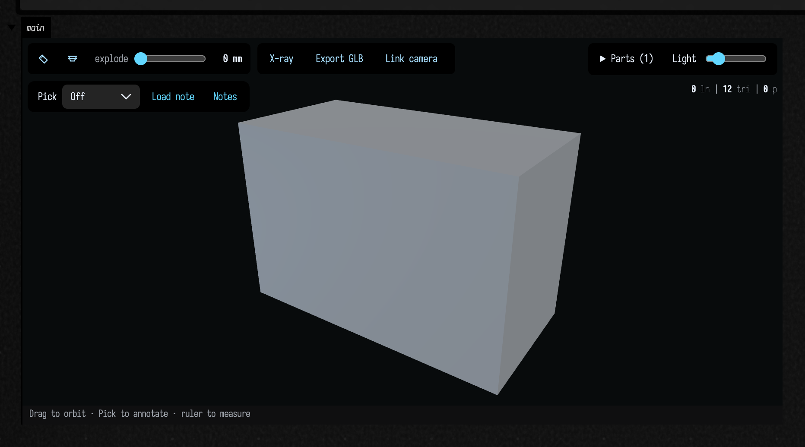
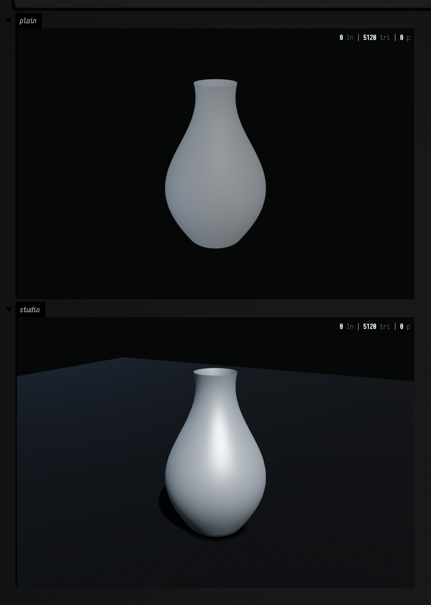
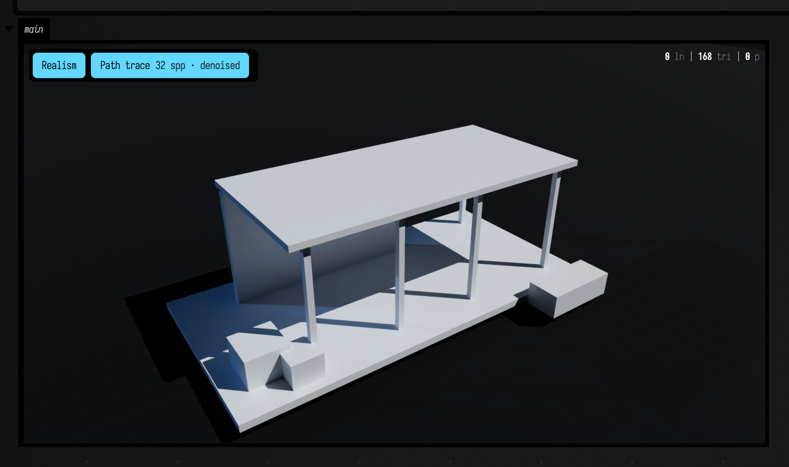
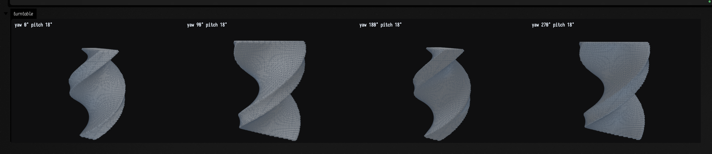

# Three.js scenes with `three { … }`

Put meshes and `FLine`s in a `three { … }` scene and you can orbit them together, pick features,
measure them, or look inside with a section. You can also arrange several views as a contact sheet.
The scene uses Field's Three.js viewer; for lines alone, see
[FLine examples](fline_examples.md#3d-output-threelines).

To make a still image from a fixed camera, Field also has a CPU rasterizer. [Which renderer draws
this](#which-renderer-draws-this) helps you choose.

## Your first `three` scene

Run this complete example in a Field box. Drag to orbit, scroll to zoom, or choose **Pick** to
select a surface feature and leave a note. The ruler measures the geometry in millimetres because
that is the unit used for this block's dimensions.

```diffstatic_runner {data-lang=kotlin screenshot="assets/three_output/first-scene.png" wait="4" capture="box" open-outputs="true" padding="20"}
:::static
val block = boxMesh(120, 80, 60)

val view = three(name = "foo", width = 760, height = 440) {
    mesh(block, id = "block", wireframe = false, pickable = true, group = 0)
    camera(yaw = 34.0, pitch = 24.0)
    background("#080b0c")
    caption("Drag to orbit · Pick to annotate · ruler to measure")
    inspect(units = "mm", groups = ["Block"])
}
```



`three` is a function on the current Field box. The block has a `ThreeSceneBuilder` receiver:
`mesh`, `lines`, `camera` and the other operations below describe the scene. The graphics and
mesh APIs are imported in ordinary Field boxes; in Kotlin source, import `afield.graphics.three.*`
and `afield.geometry.mesh.*` and call `three` on a `Box`.

### Viewer name, channel and size

These are the arguments `three` itself takes:

| Argument to `three` | Meaning |
| --- | --- |
| `name = "foo"` | A stable viewer name within this box. The view ID is the box ID followed by `_foo`. Defaults to `"three"`. |
| `channel = "main"` | The output disclosure in Field. Use distinct channels to keep two outputs visible at once. |
| `width = 760`, `height = 440` | Frame size in pixels. Width is optional; height defaults to 430. |
| `samplesPerCubic = 48` | How finely to sample FLine cubic curves. Does not change mesh triangles. |

Running the same box with the same `name` updates the same viewer. To keep two independent
scenes, give them different **names and channels**. `channel` alone does not give a scene a new
identity. A viewer's ID belongs to its document, so a box copied into another document gets a
scene of its own. The value returned by `three` is the live `ThreeGeometryViewState`; `view.uid`
is the ID the standalone viewer and the agent tools use. Take it from there rather than building
one from a box ID and name.

## A scene, not a picture

The block describes what belongs in the scene. `three` returns a live `ThreeGeometryViewState`,
so you can keep changing the view after it appears. Here are the operations you can use in the
block:

| in the block | what it does |
|---|---|
| `mesh(m, …)` | add a `TriMesh`; open surfaces are supported too. Appearance and interaction options are listed below |
| `lines(…)` — a `Collection<FLine>` or a vararg | add FLines, with every behaviour they have in `threeLines`: picking, hover, fills, click callbacks |
| `camera(yaw, pitch, distance, fieldOfView)` | where the camera starts. Setting it turns auto-framing off — you picked an angle, keep it |
| `camera(view: MeshView)` | the same, from a `MeshView` you already have. The migration path for an existing figure |
| `panel(title, caption, facts, camera, bounds)` | one titled viewport. Call it once per panel, in order |
| `columns(n)` | panels per row |
| `title(text)` / `caption(text)` | shorthand for a one-panel scene |
| `background(css)` | scene background as a CSS colour |
| `helpers(on)` | the reference grid and the axis tripod |
| `inspect(units, decimals, …)` | enable measurement, section and explode controls; optionally supply groups, dimensions and assembly motions |

`helpers` is the one default that depends on what is in the scene: the grid and the tripod are **on
for an FLine-only scene** and **off as soon as there is a mesh**. Both are a fixed world size, a
10-unit grid and a 0.9-unit tripod, and a mesh is whatever size its file says it is. The toy car in
[Geometry from disk](geometry_from_disk.md) is 7 cm across, so the grid would be 140 times its width
and the tripod would swallow it whole.

### Mesh appearance and interaction

Each call to `mesh` adds one mesh to the scene. Position it by transforming the `TriMesh` before
adding it, for example `mesh(boxMesh().translated(2.0, 0.0, 0.0))`.

| `mesh` argument | Default | What it controls |
| --- | --- | --- |
| `label` | none | A readable label for the mesh. |
| `wireframe` | `true` | Draw every triangle edge over the shaded surface. Use `false` for an uncluttered surface. |
| `cullBackFaces` | `true` | Hide the back of each triangle. Set `false` to see both sides of an open surface. |
| `flatShading` | `false` | Use individual face normals for faceted shading. |
| `opacity` | `1.0` | Surface opacity, from transparent to opaque. |
| `panel` | `0` | Zero-based viewport index, or `-1` to draw in every viewport. |
| `id` | empty | A stable name returned with mesh hits and geometry review references. Give distinct meshes distinct IDs. |
| `pickable` | `false` | Allow the ruler to measure the mesh. Also enabled by a click callback or hover colour. |
| `onClick` | none | A Kotlin callback receiving a `ThreeSurfaceHit` with mesh ID and hit coordinates/indices. |
| `hoverColor` | none | A `Vec4` highlight colour while the pointer is over the mesh. |
| `group` | `-1` | Index into the inspector's `groups`; `-1` leaves it outside assembly groups. |

The **Pick** annotation tool works without `pickable = true`. That flag controls the ruler and
ordinary mesh interaction; annotation selection is a separate, visible-surface operation.

### Lines and points

`lines` accepts FLines in the same coordinates as the meshes. An FLine can carry strokes, fills
and points; there is no separate `points(...)` operation inside this builder. For a point cloud,
set `pointed = true` and turn strokes off:

```diffstatic {data-lang=kotlin}
val samples = fline {
    moveTo(-1, 0, 0)
    moveTo(0, 1, 0)
    moveTo(1, 0, 0)
    pointed = true
    stroked = false
    pointSize = 7.0
    color = vec(1.0, 1.0, 1.0, 1.0)
}
three(name = "samples", channel = "samples") {
    lines(samples)
    helpers(false)
}
```

See [FLine styling](fline_examples.md) for stroke, fill, point and callback properties. To make a
group of lines one entry in the Parts list, give the call an `id`
([Parts by id](#parts-by-id-layers-metadata-and-styles)).

### Drag handles

`handle` puts a marker in the scene that you can pick up and move. Its callback hears the drag as it
happens, so the box can redraw whatever depends on the point. Here a line runs from the slab to a
point you drag:

```diffstatic_runner {data-lang=kotlin screenshot="assets/three_output/handles.png" alt="an orange slab seen from above and to one side, with a thin white line rising from its centre to a yellow dot labelled tip, up and to the right of the slab" wait="4" capture="box" open-outputs="true" padding="20" name="three-handles" embed=true}
var tip = vec(30, 50, 0)
fun draw() {
    three(name = "tip") {
        mesh(boxMesh(120, 20, 60), id = "slab")
        lines(
            fline {
                moveTo(0, 10, 0)
                lineTo(tip.x, tip.y, tip.z)
            },
        )
        handle("tip", at = tip, label = "tip") { drag ->
            tip = drag.position
            draw()
        }
    }
}
draw()
```

The viewer moves a held marker itself, so the drag stays smooth however long the box takes to answer.
The callback receives a `ThreeHandleDrag` for the press (`START`), the moves (`MOVE`), and the release
(`END`). If moves arrive faster than the callback finishes, only the newest one is delivered, so a slow
callback never falls behind your hand. Handle `END` alone if the work is expensive.

| `handle` argument | Default | What it controls |
| --- | --- | --- |
| `id` | required | Names the handle within the scene; two handles cannot share one. |
| `at` | required | Where the marker is, in scene coordinates. |
| `label` | none | A name drawn beside the marker. |
| `color` | yellow | The marker's colour, as a CSS colour. |
| `axis` | none | Hold the handle to the line along this direction through `at`. |
| `normal` | none | Hold the handle to the plane through `at` with this normal. |

`axis` and `normal` give a handle a rail. Here the blue handle only moves up and down, and sets the
slab's height; the orange one slides across the slab's top, whatever height that is:

```diffstatic {data-lang=kotlin}
var height = 20.0
var post = vec(20, 0, 10)

fun draw() {
    three(name = "slab") {
        mesh(boxMesh(120, height, 60).translated(0.0, height / 2, 0.0), id = "slab", wireframe = false)
        mesh(
            boxMesh(6, 40, 6).translated(post.x.toDouble(), height + 20, post.z.toDouble()),
            id = "post",
            wireframe = false,
        )
        handle("height", at = vec(-60.0, height, 30.0), axis = vec(0, 1, 0), color = "#4fc3f7") { drag ->
            height = maxOf(2.0, drag.position.y.toDouble())
            draw()
        }
        handle(
            "post",
            at = vec(post.x.toDouble(), height, post.z.toDouble()),
            normal = vec(0, 1, 0),
            color = "#ff8a65",
        ) { drag ->
            post = drag.position
            draw()
        }
    }
}
draw()
```

With neither `axis` nor `normal`, the browser moves a handle on the plane facing the camera. The
visionOS viewer draws the same handles, and there you pinch a marker and move it anywhere in 3D.
Both viewers send the same drag, and Field applies `axis` or `normal` before your callback sees the
position. While one viewer drags a handle, the others show the marker moving.

A handle's callback can hand the position to a constraint solver instead of using it directly.
[Shapes from constraints](ceres.md) drags the corners of a cube whose faces must stay flat, and of
boxes whose edges run toward vanishing points, with Ceres re-solving the shape on every move.

### Toolbar controls

A view starts with no toolbar controls, so it is a picture you can orbit. Ask for the ones you
want with `controls(...)`:

```diffstatic {data-lang=kotlin}
three {
    mesh(boxMesh(120, 60, 40), wireframe = false)
    controls(xray = true, export = true)
}
```

`xray` is the **X-ray** button, `export` is **Export GLB**, `linkCamera` is **Link camera**,
`review` is **Pick** with its notes, `parts` is the **Parts** list, `light` is the **Light**
slider, `realism` is **Realism** and `pathTrace` is **Path trace**
([below](#realism-and-path-tracing)). `controls(ThreeControls.ALL)` asks for every one.
`threeLines(...)` and `threeInspect(...)` take the same choice as a `controls = ThreeControls(...)`
argument.

Press **E** in any view to show all the controls it did not ask for; press it again to put them
away. That way you can still pick a feature or export a file from a figure that was made only to
look at. `hud(false)` hides every control, even from **E**.

Some calls bring their own control: `linkCamera()` shows **Link camera**, and `inspect(...)`
shows **Parts** along with measure, section and explode. **Parts** appears only when a scene has
at least two parts.

### Measurements, parts and notes

`inspect(units = "mm", decimals = 1)` adds the measurement, section and explode controls. Units
label the coordinates you supplied; they do not rescale geometry. Set `pickable = true` on meshes
you want to measure. `measurements` supplies initial `ThreeMeasurement` dimensions, `section`
supplies a `ThreeSection`, and `explode` supplies a `ThreeExplode`.

For a grouped assembly, pass `groups = listOf("base", "lid")` to `inspect` and assign `group = 0`
or `group = 1` to each mesh. The [FLine inspector examples](fline_examples.md#the-3d-output-area-as-an-instrument-threeinspect)
show the measurement and section types.

Any single-view scene can have **Pick** and **Save note**, including scenes without `inspect`:
ask for them with `controls(review = true)`, or press **E** in the view. After a manual selection or saved note arrives, `view.reviews()` reads it from Field. From another
box or an agent, `threeGeometryReviews(viewId)` reads the same inbox by ID. Notes retain the
geometry revision and camera; [selecting and annotating geometry](geometry_review.md) explains
points, faces, edges, vertices and visible-only rectangles.

### Compare views with linked cameras

Choose **Link camera** in each viewer you want to compare. It is on the toolbar of a view that
asks for `controls(linkCamera = true)` or calls `linkCamera()`, and on any view after **E**. The newly linked view adopts the
camera of an already linked view in the same Field document. Orbiting, panning and zooming either
view then moves both, including when they are embedded in different boxes. Click **Camera linked**
to return that view to independent movement.

Only the camera is shared. Visible parts, X-ray, explode, sections and selections remain local,
so a detailed error view can sit beside its surrounding assembly. Linking accounts for each
scene's render origin and up axis, and converts millimetres, centimetres, metres, inches and feet.
Other unit labels link only to the same label. Geometry must use a shared model coordinate frame.

Linking is off when a viewer opens unless its box asks for it, and linking one view does not opt
other views in. It is available for ordinary single-view scenes; contact sheets with several
viewports keep their own cameras.

### Turning views for a display

`turntable()` turns a view slowly about its up axis, for a page that people look at rather than
use. On a contact sheet every panel turns together, each about its own centre, as they do when you
drag. This sheet shows six shapes in a three-by-two grid and turns them at 15° a second:

```diffstatic {data-lang=kotlin}
val shapes = [
    "block" to boxMesh(1.2, 0.8, 0.6),
    "tower" to boxMesh(0.5, 1.6, 0.5),
    "slab" to boxMesh(1.6, 0.3, 0.9),
    "cone" to coneMesh(segments = 7, radius = 0.6, height = 1.2),
    "can" to cylinderMesh(segments = 6, radius = 0.5, height = 1.0),
    "ring" to torusMesh(majorSegments = 12, minorSegments = 6),
]
three(name = "sheet", width = 900, height = 560) {
    columns(3)
    shapes.forEachIndexed { i, (label, shape) ->
        mesh(shape, label = label, panel = i)
        panel(
            title = label,
            camera = ThreeCameraSpec(yawDegrees = 30.0, pitchDegrees = 20.0),
            bounds = shape.toThreeBounds(),
        )
    }
    turntable(degreesPerSecond = 15.0)
}
```

A positive rate turns the models counter-clockwise seen from above; the default is 6° a second.
Pressing, scrolling or typing in the view pauses the turn, and it resumes `resumeAfterSeconds`
(2 by default) after the last interaction, from wherever you left it. A view turns only while it is
on screen and the page is visible, and draws no frames while it is still. Each panel is framed for
every angle of the turn, so nothing swings out of its cell, and a turning sheet sits a little
further back than a still one.

Views in separate outputs or boxes can turn together too. `linkCamera()` opens a view with
**Link camera** already on, so this box's two outputs share one camera and one turn:

```diffstatic {data-lang=kotlin}
val buildings = mapOf(
    "tower" to boxMesh(60, 140, 60),
    "barn" to boxMesh(140, 70, 90),
)
buildings.forEach { (name, building) ->
    three(channel = name, name = name, width = 360, height = 300) {
        mesh(building, wireframe = false)
        camera(yaw = 30.0, pitch = 20.0)
        linkCamera()
        turntable(degreesPerSecond = 12.0)
    }
}
```

`linkCamera()` joins the same link as the button, so a view linked from code moves with one linked
by hand, and the button still unlinks it. Running the box again does not relink a view somebody
unlinked. `linkCamera(group = "north")` links only with views that name the same group, so one
document can hold several separate linked sets. Moving any linked view pauses the turn in all of
them. When several linked views ask to turn, one of them drives and the link carries its camera to
the others; if that view scrolls away or closes, another takes over. A contact sheet cannot join a
link, because its panels already share one camera.

### See through surfaces

Press **X-ray** in the viewer toolbar to reveal geometry behind filled surfaces. Put the button
there with `controls(xray = true)`, or press **E**. The
**Surface** slider sets their opacity. Edges draw after the translucent faces, with
slightly stronger stroke opacity, so the structure stays legible. Points keep their original contrast.
This works in ordinary `three { … }` scenes without `inspect`. Turn it off to restore
the original surface appearance. It changes the view only: no geometry is cut or moved.

Picking still stops at the nearest surface, including in X-ray mode. Hide a part or
use a section cut when you want to select geometry behind it. Saved notes and their
images retain the X-ray setting and opacity, so a reviewer sees the same context.

### Export a GLB

Press **Export GLB** to download the visible geometry as a binary glTF file. Put the button
there with `controls(export = true)`, or press **E**. The export
keeps colors, part names, hidden-part choices and the current exploded or insertion
positions. With **X-ray** enabled, surfaces carry the selected opacity in their materials;
strokes retain their stronger opacity. Turn X-ray off before exporting an opaque model.
Section cuts are baked into the exported surfaces and lines, without adding caps.

Meshes, lines and points all travel in the file. Viewer controls, selection markers,
measurement labels and the helper grid do not. This is a snapshot of the displayed
geometry, rather than a fabrication solid or an animation. Other applications choose
their own lighting and transparency sorting; line widths and point sizes also depend on
the receiving viewer. Inspector units `mm`, `cm`, `m`, `in` and `ft` convert to glTF metres.
An unspecified or other unit label leaves coordinates unchanged, with the label retained
in the scene metadata.

With gltfpack installed, **Export GLB** compresses the file before it downloads, and the status
line shows both sizes. gltfpack quantizes the buffers and meshopt-compresses them, keeping node and
material names. It is optional: pick **gltfpack** in `./field.sh --setup`, or run
`./gradlew prepareGltfpack`, which fetches a pinned, checksummed build. Without it the export stays
uncompressed. Box code can use the same tool through `Gltfpack.compress(bytes)`. A compressed file
uses `EXT_meshopt_compression`, which three.js, Blender 4.2 and later, and most web viewers read.

### A studio look

`studio()` gives a model a more atmospheric presentation: ACES tone mapping, a soft-shadowed key
light, sky fill, a cool rim light, ambient occlusion and a dark ground with a faint grid. Give the
mesh a material to go with it:

```diffstatic_runner {data-lang=kotlin screenshot="assets/three_output/studio.png" alt="the same grey vase twice. Above, plain: flat grey shading on black. Below, with studio(): a bright specular highlight down its belly, a soft shadow on a dark ground plane that recedes to a horizon" wait="6.0" capture="box" open-outputs="true" padding="20" name="three-studio-look"}
:::fold a revolved vase
// A vase: a profile of radius against height, revolved around y.
val vase = revolveMesh(
    (0..40).map { i ->
        val y = -1.25 + i / 40.0 * 2.5
        vec(0.45 + 0.3 * sin(i / 40.0 * 5.0) + 0.15 * (i / 40.0), y)
    },
    RevolveAxis.Y,
    segments = 64,
)

:::endfold

// The same vase with no look, then with studio().
three(name = "plain", channel = "plain", width = 560, height = 420) {
    mesh(vase, wireframe = false, cullBackFaces = false)
    camera(pitch = 22.0, padding = 1.6)
    background("#060807")
}
three(name = "studio", channel = "studio", width = 560, height = 420) {
    mesh(
        vase,
        wireframe = false,
        cullBackFaces = false,
        material = ThreeSurfaceMaterial(roughness = 0.4f, metalness = 0.6f),
    )
    studio(groundY = -1.25)
    camera(pitch = 22.0, padding = 1.6)
    background("#060807")
}
```



`studio()` switches off the reference grid and axis tripod. Ambient occlusion draws in a single
view. A contact sheet and X-ray draw without it, and `studio(ambientOcclusion = false)` turns it off.
`geometry { }` uses this look for its models; see the `madp_geometry` starting point.

### Realism and path tracing

`controls(realism = true)` puts a **Realism** button on the toolbar that turns the studio look on
and off from the view, so you can compare a model plain and lit without editing the box. It works
in Y-up and Z-up views. A view that calls `studio()` starts with it pressed and uses that
call's settings. Any other view gets soft shadows, ambient occlusion and the light of a neutral
room, which keeps faces the key light misses from going flat. The button keeps its last setting
when the box runs again.

`controls(pathTrace = true)` adds **Path trace**, which traces the same scene on the GPU with
[three-gpu-pathtracer](https://github.com/gkjohnson/three-gpu-pathtracer). Light bounces between
surfaces, so the underside of a roof picks up light reflected off the floor below it. Lines,
points and handles are drawn over the traced image and hidden where a surface is in front of them.

Where the browser offers WebGPU, the tracer runs as compute
shaders. It stops at 32 samples per pixel and runs
[Open Image Denoise](https://www.openimagedenoise.org/) over the result, which turns that still-grainy
image into a clean one, usually within a few seconds. The button shows the count and then
**denoised**. While you orbit, the view drops to a coarse traced preview and sharpens when you
stop; a part that moves is updated in place. The first trace after opening a view takes a few
seconds longer while the tracer compiles, and the Realism view draws meanwhile.

Without WebGPU the same button traces on WebGL: slower, with no denoising, the image clearing as
samples accumulate up to 512 per pixel, and the Realism view drawing whenever anything moves.

To start a view traced, pass `pathTrace = true` to `studio()`. The view opens with **Realism** and
**Path trace** both pressed, so a reader can turn tracing off. This pavilion's roof overhangs the
slab: look under it, and at the back wall, for light bounced up off the floor.

```diffstatic_runner {data-lang=kotlin screenshot="assets/three_output/path-trace.png" alt="a white pavilion of a roof on eight posts, a back wall and three blocks on a slab, path traced: the posts cast long soft shadows across the slab, and the wall and the roof's underside are lit by light bounced off the floor" wait="2.0" capture="box" open-outputs="true" padding="20" name="three-path-trace"}
// A slab, a roof on eight posts, a wall and some blocks: enough overhang for light to bounce.
val slab = boxMesh(8.0, 4.0, 0.15).translated(0.0, 0.0, 0.075)
val roof = boxMesh(6.5, 3.2, 0.12).translated(0.5, 0.0, 2.6)
val posts =
    [-2.4, -0.6, 1.2, 3.4].flatMap { x -> [-1.4, 1.4].map { y -> boxMesh(0.12, 0.12, 2.4).translated(x, y, 1.35) } }
val wall = boxMesh(4.0, 0.15, 2.4).translated(-0.8, 1.2, 1.35)
val blocks = [
    boxMesh(0.8, 0.8, 0.6).translated(-3.2, -1.0, 0.45),
    boxMesh(0.6, 0.6, 0.5).translated(-2.7, -1.5, 0.4),
    boxMesh(1.6, 0.7, 0.5).translated(3.0, -2.4, 0.25),
]

three(name = "pavilion", width = 760, height = 440) {
    for (part in [slab, roof, wall] + posts + blocks) mesh(part, wireframe = false)
    camera(yaw = -35.0, pitch = 28.0, distance = 1.6, upAxis = ThreeUpAxis.Z)
    studio(pathTrace = true)
}
```



In a box of your own, `controls(realism = true, pathTrace = true)` shows both buttons without
starting either.

The traced image sets its own exposure: once it has settled, the viewer measures it and brightens
or darkens it until the brightest faces sit just below white, without tracing it again.
`studio(autoExposure = false)` traces at the `exposure` you give instead.

!!! note
    Path tracing traces surfaces with a standard material that are not close to fully transparent;
    other surfaces are drawn over the traced image. It draws in a single view, not in a contact
    sheet, X-ray, or a published page. It is heavy on the GPU, so it stays off unless the box starts
    it or you press the button.

### One scene, two kinds of thing

A gyroid marched inside a finite box is an **open** surface. Where it reaches the edge of the
sampling window, it leaves boundary loops. Those loops can be hard to see on a shaded surface, so
this example draws them as lines over the mesh using `toFLines(MeshLines.BOUNDARY)`.

```diffstatic_runner {data-lang=kotlin screenshot="assets/three_output/scene.png" wait="6.0" capture="box" open-outputs="true" padding="20"}
:::static
/*
A gyroid is a triply-periodic minimal surface. Marched inside a finite box it is OPEN: the
surface leaves the sampling window rather than closing inside it, and every place it does that
is a boundary loop. `open(20)` in the printed summary is the claim; the picture is the evidence.
*/
val surface = marchingCubes(sdfGyroid(4.0, 0.3), boundsAround(radius = 1.0), 72)
println(surface.summary())

// The rim, as FLines, in the mesh's own coordinates. One closed ring per hole.
val rims =
    surface.toFLines(MeshLines.BOUNDARY).map { ring ->
        ring.color = vec(1.0, 0.45, 0.12, 1.0)
        ring.thickness = 2.6
        ring
    }
println("open boundary loops: " + rims.size)

three(channel = "gyroid", height = 470, width = 760) {
    mesh(surface, wireframe = false)
    lines(rims)
    camera(yaw = 32.0, pitch = 20.0, padding = 1.02)
    title("marched gyroid, with its " + rims.size + " open boundary loops drawn in the same scene")
    caption("the solid and the annotation are one scene in model space, so orbiting moves both")
}
```


The HUD in the top right counts the whole scene, lines and triangles together:
`3576 ln | 165368 tri | 0 p`.

`three { lines(…) }` uses the same builder as `threeLines(...)`, so FLines behave identically in
both, including picking and click callbacks. A mesh reaches the viewer through
`TriMesh.toThreeDrawable()`, which turns it into a `ThreeDrawable`: geometry plus how to draw it.

A wide viewer can keep its controls compact with `controlGroup("controls", columns = 2) { ... }`.
The control surface uses up to two columns and collapses to one in a narrow output. The ordinary
`controlGroup("controls") { ... }` retains its single column; changing layout preserves control
identities, cached values and callbacks.

When the geometry updates and the camera preset has not changed, the view keeps whatever orbit,
pan and zoom you had. Changing the preset starts a new view. Resizing a view also keeps your
position.

## The camera

`ThreeCameraSpec` has the same fields as `MeshView` and `VisionGeometryPreview.Camera`, the
CPU rasterizer's camera:

- **`yawDegrees`** — orbit around `+y`. `0` looks straight down \( -z \).
- **`pitchDegrees`** — lift above the horizon. Positive looks down on the geometry.
- **`distance`** — in multiples of the bounding-sphere radius, so one spec frames a 2 cm mesh and a
  2 m one. The rasterizer uses it; the viewer zooms to fit instead.
- **`padding`** — the viewer's margin around the shape's outline when it zooms to fit: `1.0`
  touches the frame's edges, the default `1.06` leaves a little air. The rasterizer ignores it.
- **`fieldOfViewDegrees`** — vertical. Smaller is a longer lens and less perspective.

The names and meanings match, so one camera can be handed to either renderer.

From the page, a script or a film reads and sets the view's camera directly: `FieldViewer.cameraPose()` returns
`{eye, target, up, zoom, fov}` in the scene's units, and `FieldViewer.setCamera(pose)` puts the camera there and
draws at once (`up`, `fov` and `zoom` are optional). A pose set this way holds across the box's redraws, as an orbit
by hand does, until the box asks for a different `camera(...)`.

## Contact sheets

For a custom contact sheet, `panel(...)` declares viewports in order, and a `mesh(...)` goes into
the panel declared most recently, or the one `panel = n` names. FLine content is shared between viewports. This example builds a sheet by
hand:

```diffstatic {data-lang=kotlin}
val cube = boxMesh()
three(name = "comparison", channel = "comparison", width = 760, height = 320) {
    columns(2)
    mesh(cube, panel = 0, wireframe = true)
    mesh(cube, panel = 1, wireframe = false)
    panel(title = "Triangles", bounds = cube.toThreeBounds())
    panel(title = "Surface", bounds = cube.toThreeBounds())
}
```

`threeGrid` and `threeTurntable` below build common layouts for you. Pick and Save note work on a
sheet: a pick uses the panel under the pointer, and the note remembers that panel, so loading it
selects the feature there again and its images are of that panel. Rectangle needs a single viewport.

### One WebGL context, several panels

Drag to orbit; use the mouse wheel, trackpad scroll, or middle-button drag to dolly in and out.
Multi-panel views retain your orbit and dolly across geometry and selection updates.
Dolly moves the camera relative to its fitted starting view, so close inspection can crop the object.

All the panels of a contact sheet share one viewer and one WebGL context. Separate viewers would
each need their own context, and Chrome keeps only around sixteen alive, silently blanking the
oldest with nothing in the console. Two galleries of nine would already be too many. A
`ThreePanel` is a viewport within the one viewer, which is also much faster.

### `threeGrid` — several meshes, each framing its own bounds

This example lays four unrelated shapes out in a two-by-two sheet, with a fact line under each:

```diffstatic_runner {data-lang=kotlin screenshot="assets/three_output/grid.png" wait="6.0" capture="box" open-outputs="true" padding="20"}
:::static
/*
Four unrelated shapes. Each panel frames its OWN bounds, so the small one is not lost beside the
large one — that is the difference between a grid and a turntable, and only the Kotlin side knows
which of the two it is building.
*/
val ball = marchingCubes(sdfSphere(1.0), boundsAround(radius = 1.3), 40)
val drilled = marchingCubes(sdfSubtract(sdfSphere(1.0), sdfCylinder(0.34, 4.0)), boundsAround(radius = 1.3), 64)
val twisted = marchingCubes(sdfBox(vec(1.2, 1.8, 0.4)).twisted(0.35), boundsAround(radius = 1.2), 72)
val ring = torusMesh(64, 32, 0.62, 0.24)

threeGrid(
    "marched sphere, resolution 40" to ball,
    "…drilled through: the drill added a handle" to drilled,
    "sdfBox(…).twisted(0.35)" to twisted,
    "torusMesh(64, 32) — genus 1 by construction" to ring,
    columns = 2,
    facts = true,
    cellWidth = 430,
    height = 760,
    channel = "grid",
    view = MeshView(pitchDegrees = 44.0),
)
```


Each panel has its own camera, and carries the fact line `TriMesh.threeFacts()` computes, the
same line `toFigureHtml` writes under a rasterized figure.

`showMeshGrid` prints the fact line by default and forwards `facts` to `threeGrid`; `threeGrid`
called directly leaves it off unless asked, as above. For a gallery that has something specific to
say about each cell, use the `List<ThreeMeshPanel>` overload:

```diffstatic {data-lang=kotlin}
threeGrid(
    [
        ThreeMeshPanel("cuboctahedron", solid, facts = "12 vertices · 24 edges · 14 faces (8 triangles, 6 squares)"),
        ThreeMeshPanel("…kis'd", kissed, facts = "38 vertices · 84 edges · 48 faces (all triangles)"),
    ],
    columns = 2,
)
```

### `threeTurntable` — one mesh, several angles, one upload

This example shows one twisted box from four angles in a row:

```diffstatic_runner {data-lang=kotlin screenshot="assets/three_output/turntable.png" wait="6.0" capture="box" open-outputs="true" padding="20"}
:::static
// One mesh, four angles, ONE upload and ONE WebGL context. Every panel frames the SAME bounds, so
// the shape does not appear to breathe as it turns.
val twisted = marchingCubes(sdfBox(vec(1.2, 1.8, 0.4)).twisted(0.35), boundsAround(radius = 1.2), 80)
println(twisted.summary())
threeTurntable(twisted, channel = "turntable", height = 290)
```



At yaw 0° and 180° this solid is a narrow crescent, and at 90° and 270° it is a broad S; any single
view would leave you guessing at its shape.

Unlike a grid, the turntable:

* adds the mesh once with `panel = -1`, meaning every panel, so a large mesh is uploaded once and
  drawn from each angle;
* gives every panel the same `bounds`, so the shape does not appear to grow and shrink as it
  rotates. A grid frames each panel on its own bounds.

## `showMesh` and the `renderer` parameter

Every entry in the `showMesh` family takes a `renderer`, and the default is the Three.js viewer.

<div class="field-reference" data-code-lang="kotlin" markdown>

| you call | you get |
| --- | --- |
| `showMesh(mesh)` | Opens the orbitable Three.js viewer, equivalent to `three(subject = mesh)`. This is the default for mesh display. |
| `showMesh(mesh, renderer = MeshRenderer.CPU)` | Produces a static CPU-rasterized figure at a fixed camera. Use it when you need a deterministic image without WebGL. |
| `showMeshGrid(…)` | Delegates to `threeGrid` to compare meshes in interactive viewports. Each subject retains a distinct panel. |
| `showMeshTurntable(…)` | Delegates to `threeTurntable` for views around a subject. It helps reveal shape hidden from a single angle. |
| `showMeshDiagnosis(mesh)` | Always uses the CPU rasterizer for its diagnostic figure. It has no renderer-selection parameter. |
| `mesh` as the last expression in a box (the inline card) | Uses the CPU rasterizer for the inline value card. Call `showMesh` explicitly when you want an orbitable view. |

</div>

`MeshView.width` and `MeshView.height` size the figure on both paths: the raster on the CPU path,
the iframe on the GPU path. Pass `height` to `showMesh` only to make the Three.js iframe a different
height from the view.

Give the width in pixels. The output panel sizes itself from the iframe's pixel width, and a
percentage leaves the panel at whatever width it already had. That suits an FLine viewer filling
its column, but a wide gallery collapses to the panel's width and loses the right-hand part of
every picture. [Output panel sizing](output_panel_sizing.md) explains the rules.

## Which renderer draws this

Field has more ways to put geometry on a screen than the viewer and the rasterizer. This table
lists them all, and what each is for:

| path | what it draws | where the pixels are made | reach for it when |
|---|---|---|---|
| `three`, `threeGrid`, `threeTurntable`, `threeLines`, `threeInspect` — `afield/graphics/three/Three.kt`, `ThreeJsViewer.kt` | FLines and `TriMesh`es together, in 3D | **WebGL** (three.js r187, vendored) in a `/threejs` iframe inside the box output | you want to turn it; you want a solid and its annotations in one scene. The default for the whole `showMesh` family |
| `renderPng`, `renderPixels`, `toFigureHtml`, `toHTML`, `showMeshDiagnosis`, `MeshRenderer.CPU` — `afield/graphics/visionos/VisionGeometryPreview.kt` | one `TriMesh`, fixed camera, still | **CPU z-buffer in the JVM**, AWT-free, encoded by `PngEncoder` | you need the same pixels twice (see below); there is no WebGL context to spare; you want a pixel buffer to composite by hand |
| `lines`, `l`, `drawToSVG`, `inspect` — `afield/ui/visualization/someSkiko.kt` | FLines, **2D only** | **SVG text** emitted by a Skia recording canvas; the browser rasterizes it | 2D figures: crisp at any zoom, tiny payload, headless-safe |
| `lines(editable = true)`, and the automatic upgrade when an FLine has `onClick` or `hoverColor` — `FLineEditableSvg.kt` | the same, plus click / hover / drag / freehand | SVG in the browser, plus a server-side edit session | direct manipulation of control points; a figure you can click to name |
| `moduleHere`, `Renderer`, `RenderToTexture`, and `StandardRenderer` / Fabricate on top of them — `afield/four/` | arbitrary real-time scenes, Gaussian splats, hardware ray tracing | **Vulkan on the desktop GPU**, in a GLFW window (offscreen targets still need the window) | real-time work, hot-reloaded shaders, hundreds of thousands of primitives, OpenXR |
| `visionMetal` — `afield/graphics/visionos/VisionMetal.kt` | your live Metal shader plus its geometry | **Metal, on the Vision Pro** | headset live-coding ([Apple Vision Pro](vision.md), [geometry in the headset](vision_geometry.md)). Its desktop stand-in is `previewVisionGeometry`, which is the CPU rasterizer again |
| the visionOS native FLine viewer — `native/field-visionos/Field4Vision/FLine/` | whatever `threeLines` / `three` published | **RealityKit / Metal on the headset** | you want an existing 3D figure in the volume ([Apple Vision Pro](vision.md)). It subscribes to the same `__threejs__` channel; there is no second API |
| `remoteAr` — `afield/ui/output/outputs.kt`, `afield/lang/remotejs/RemoteArKotlinJs.kt` | *your Kotlin, compiled to JS*, in a WebXR page | **WebGL in the browser or headset** | AR/VR where the code runs in the head rather than on the desktop ([RemoteJS and WebXR](ar_reference.md)) |
| `rasterizeFLines`, `Img`, `showImg`, `rasterizeText`, `heatmapImage`, `RectSLFitFigure` | 2D marks into a pixel buffer, no projection and no depth | **CPU in the JVM**, `PngEncoder` | measurement rasters, image pipelines, figures that have to be identical in a test |

Two entries in that table are commonly misread:

**`Box.lines(...)` draws in 2D.** Given a 3D FLine, it uses `x` and `y` for an orthographic view
down \( -z \), with no depth sorting or hidden-line removal. The `z` coordinate is retained for
picking, so a click can still report the 3D position. For perspective, project first with
`FLine.byPerspectiveProjecting(...)` or use `threeLines`.

**The ray tracer is not a separate renderer.** [Ray tracing examples](ray_tracing_examples.md) is
`VK_KHR_ray_tracing_pipeline` inside Field 4, and Fabricate's `StandardRenderer` is a deferred
g-buffer / shadow / AO / composite stack built on the same primitives. One Vulkan renderer, three
front ends.

### What the CPU rasterizer is for

The CPU rasterizer is useful in a few situations:

**It is deterministic.** The same input gives the same pixels every time, whatever the GPU, driver
or antialiasing. Use it when a test or a comparison needs the same number twice.

**It needs no WebGL context.** The inline card that appears when a box ends on a `TriMesh` uses it,
so a list of meshes does not run into the browser's limit on WebGL contexts.

**It renders into a pixel buffer.** `TriMesh.renderPixels` hands you ARGB ints and a size, for
compositing several meshes into one figure yourself.

It is a z-buffered scanline rasterizer, and it smooths edges by supersampling (2 × 2 samples per
pixel by default). When you need the exact fraction of a pixel a triangle covers instead, use
[exact triangle coverage](afield_four_graphics.md#exact-triangle-coverage); the
[comparison of Field's coverage code](afield_four_graphics.md#which-coverage-to-use) lists the
others.

??? aside "Why it writes its own PNGs"
    `VisionGeometryPreview` avoids `java.awt`: touching AWT inside Field's server JVM on macOS
    initialises AppKit in a process whose main thread belongs to GLFW, and the process dies
    silently.

### The same mesh, both ways

This example draws one marched solid twice, with the same `MeshView`, once on each renderer:

```diffstatic_runner {data-lang=kotlin screenshot="assets/three_output/renderers.png" wait="7.0" capture="box" open-outputs="true" padding="20"}
:::static
// The same mesh, the same MeshView, the same frame size — both renderers. What changed is easiest
// to see with the two side by side.
val solid = marchingCubes(
    sdfSmoothUnion(sdfSphere(0.78), sdfBox(vec(2.1, 0.32, 0.32)), k = 0.28),
    boundsAround(radius = 1.35),
    64,
)
val view = MeshView(width = 520, height = 400, wireframe = true)

showMesh(
    solid,
    channel = "three.js — the default",
    view = view,
    height = view.height,
    renderer = MeshRenderer.GPU,
    title = "MeshRenderer.GPU — MeshStandardMaterial, orbitable",
)
showMesh(
    solid,
    channel = "the CPU rasterizer",
    view = view,
    renderer = MeshRenderer.CPU,
    title = "MeshRenderer.CPU — two-light lambert, deterministic, still",
)
```


The same mesh, `MeshView` and 520 × 400 frame give two visibly different pictures:

- **Shading differs, and is not meant to match.** The rasterizer is a simple two-light Lambert
  model over the vertex colours. The viewer is three.js's `MeshStandardMaterial` under an ambient,
  key and rim light.
- **Framing differs**: the rasterizer places the eye at `distance`; the viewer zooms to fit with
  `padding`.
- **The input is the same.** Both renderers compute missing normals with `shadedNormals` at a 35°
  crease angle, so hard edges stay hard, and both use `TriMesh.colors` or the same default grey.
- **Back-face culling is the same**, which matters for diagnosis; the next section shows it.
- **The fact line is the same.**

### Back-face culling, on both renderers

A face wound the wrong way is missing in the rasterizer, not dark, and the
[polytope](polytope_examples.md) and [typography](typography_examples.md) pages both use that as a
winding test. `ThreeDrawStyle.surface(cullBackFaces = true)` is the default in the viewer as well,
so it is missing there too. This example reverses a band of a sphere's triangles:

```diffstatic_runner {data-lang=kotlin screenshot="assets/three_output/winding.png" wait="7.0" capture="box" open-outputs="true" padding="20"}
:::static
// Take a sphere and reverse the winding of one band of triangles. Not one vertex moves.
val ball = icosphereMesh(3, 0.8)
val idx = ball.indices.copyOf()
var reversed = 0
for (t in 0 until ball.triangleCount) {
    val cy = (ball.position(ball.ia(t)).y + ball.position(ball.ib(t)).y + ball.position(ball.ic(t)).y) / 3.0
    if (cy > 0.30) {
        val b = idx[t * 3 + 1]
        idx[t * 3 + 1] = idx[t * 3 + 2]
        idx[t * 3 + 2] = b
        reversed++
    }
}
val holed = TriMesh(ball.positions.copyOf(), idx)

println("reversed %d of %d triangles; not one vertex moved".format(reversed, ball.triangleCount))
println("volume  %.4f  ->  %.4f".format(ball.signedVolume(), holed.signedVolume()))
println("consistently oriented: " + holed.topology().isConsistentlyOriented)

val view = MeshView(width = 460, height = 380, yawDegrees = 18.0, pitchDegrees = 38.0, wireframe = true)
showMesh(
    holed,
    channel = "three.js",
    view = view,
    height = view.height,
    renderer = MeshRenderer.GPU,
    title = "the band is GONE, not dark",
)
showMesh(
    holed,
    channel = "the CPU rasterizer",
    view = view,
    renderer = MeshRenderer.CPU,
    title = "…and gone here too, which is the whole point",
)
```


394 of 1280 triangles are reversed and no vertex has moved, and both renderers show the same hole.
The numbers:

* `signedVolume()` goes from 2.1262 to 0.8112, which is wrong, with nothing to flag it.
* the fact line still reads `χ=2 genus 0 · watertight`: χ counts vertices, edges and faces, and
  reversing a triangle changes none of them.
* `topology().isConsistentlyOriented` is `false`, and is the check to use. `fixWinding()` repairs
  the mesh.

The overlays differ: in the Three.js panel the
**wireframe overlay is not back-face culled**, so you can still see the reversed triangles' edges
drawn across the hole. The rasterizer's depth-tested wireframe is culled with its surface, so its
hole is bare. The surfaces agree.

## Measuring and sectioning a solid

`inspect(...)` inside a `three { }` scene, and
`Box.threeInspect(...)` for lines alone, add a measurement tool, a section plane with a real cut
outline, and an explode scrubber; the tools themselves are documented, with figures, in
[FLine examples](fline_examples.md#the-3d-output-area-as-an-instrument-threeinspect).

A mesh is not pickable by default, because a solid filling the frame would sit in front of every
annotation it was drawn to explain. Ask for it with `mesh(car, pickable = true)`, or let an
`onClick` or a `hoverColor` imply it, and pair that with `inspect(...)` on the same scene: the flag
is what lets the ray find the solid and the toolbar is what draws the dimension. A hit arrives as a
`ThreeSurfaceHit`, resolved to a vertex, an edge or a triangle, so a dimension can run from a corner
of the solid to an annotation beside it, as in this example:

```diffstatic_runner {data-lang=kotlin screenshot="assets/three_output/section.png" wait="6.0" capture="box" open-outputs="true" padding="20"}
:::static
// A block with a bore drilled down through it, and a datum line standing beside it.
val part = marchingCubes(
    sdfSubtract(sdfBox(vec(2.0, 1.2, 1.2)), sdfCylinder(0.35, 2.0)),
    boundsAround(radius = 1.3),
    72,
)
val datum = fline {
    moveTo(1.4, -0.6, 0.0)
    lineTo(1.4, 0.6, 0.0)
    color = vec(1.0, 0.55, 0.2, 1.0)
    thickness = 2.5
}

three(name = "section", channel = "section", width = 760, height = 460) {
    mesh(part, id = "part", wireframe = false, pickable = true)
    lines(datum)
    camera(yaw = 30.0, pitch = 24.0)
    inspect(
        // Cut halfway through along z, so the plane runs straight down the bore, and keep the far
        // half so the cut faces the camera.
        section = ThreeSection(enabled = true, normal = floatArrayOf(0f, 0f, 1f), fraction = 0.5, flip = true),
        // From the block's +x face, on the cut plane, to the datum beside it: 1.4 - 1.0 = 0.4.
        measurements = [
            ThreeMeasurement(
                ThreeMeasureElement.point(1.0, 0.0, 0.0),
                ThreeMeasureElement.segment(1.4, -0.6, 0.0, 1.4, 0.6, 0.0),
                "clear ",
            ),
        ],
    )
}
```


What you aim at is decided by true perpendicular distance in the hit triangle's plane, within a snap
radius of 0.14 of that triangle's own longest edge, and a corner is tested before an edge. So
a sliver has no clickable interior: every point of a triangle ten long and half a unit tall
falls inside its own snap radius of an edge or a corner.

The section plane cuts a mesh, wireframe overlay included, and fills the cut with a cap: a flat
face in the plane, in the colour of the part it cuts, so material reads as material instead of
showing the inside of the shell. A part embedded in another, such as a conduit cast into a wall,
caps in its own colour on top of the wall's cap. A hole stays open, as the bore does here, and so
does a cavity: an inner shell whose faces point inward. Parts laid against each other cap side by
side. The readout gives the section's area. A cut through a surface that is not closed, such as a
single wall panel or a mesh with a gap, gets an outline but no cap, and the readout counts those as
open cuts. Pass `ThreeSection(capColor = "#222222")` for one poché colour across every part, or
`cap = false` to show the outline alone.

Beside the section slider, **X**, **Y** and **Z** cut across that axis of the model, and the arrows
keep the other half. **face** aligns the cut to a surface: click it, and the plane lies just inside
that face, turned toward you. Drag the slider to move it deeper into the model. **⊥** squares the
cut to the last dimension, whether you picked it with the measure tool or the box supplied it: the
plane runs perpendicular to the dimension through its middle, facing you. Click **⊥** again to see
the other side of the same plane, and drag the slider to move the cut along the measured line toward
either end. Measure across a wall and **⊥** shows you what is inside it.

A section works under **Path trace** as well. The tracer is given the cut geometry itself, and the
caps as lit surfaces in each part's colour and finish, so light falls into the cut and the cut faces
shade and cast shadows like any other surface. Moving the plane starts a fresh trace.

The explode scrubber moves
meshes and their outlines by inspection group, along with grouped FLine geometry.
Give related objects the same group to keep them together; `solidParts` sets this up
for native solids. X-ray can be combined with either control.

## Show a part or a group

Open **Parts** to browse the scene as a tree. It is on the toolbar of a scene with `inspect(...)`
or `controls(parts = true)` that has at least two parts. A mesh and its outline share one checkbox
when they have the same assembly group or drawable ID. Folder checkboxes show a dash when
only some children are visible. **Select all** shows or hides the entire scene.

++shift++-click a part or folder checkbox to solo it. ++shift++-click it again to restore the
previous visibility; ++shift++-click a different part to move the solo without losing that
previous view. An ordinary click ends solo mode and edits the current visibility.

Use `inspect(partPaths = …)` to organise a large scene. Keys are stable mesh IDs, assembly
group names, or review feature IDs; values are lists of folder names. The final row retains
its part name. Folder labels do not change geometry IDs or invalidate annotations. For example:

```diffstatic {data-lang=kotlin}
three(name = "vehicle") {
    mesh(boxMesh(120, 60, 40), id = "body", wireframe = false)
    mesh(boxMesh(20, 20, 20), id = "wheel", wireframe = false)
    inspect(
        partPaths = mapOf(
            "body" to ["Vehicle", "Bodywork"],
            "wheel" to ["Vehicle", "Running gear"],
        ),
    )
}
```

Uncategorised meshes, interactive FLines, and batched guides have their own folders.
A batched guide buffer is one selectable entry: it does not claim per-line visibility.
Hidden geometry is excluded from picking and visible-scene exports, including X-ray views.

## Parts by id: layers, metadata and styles

A mesh's `id` names a part in the viewer. Give it a `layer` path to group it in the **Parts** list,
or attach `metadata` for a viewer tool or page script to find by id. A part can also start `hidden`.

```diffstatic {data-lang=kotlin}
three(name = "house") {
    mesh(walls, id = "walls", layer = ["Ground floor"], wireframe = false)
    mesh(
        door,
        id = "door-1",
        layer = ["Ground floor", "Doors"],
        wireframe = false,
        metadata = mapOf("hinge" to listOf(3.8, 0.0, 0.0), "swing" to 90),
    )
    mesh(roof, id = "roof", layer = ["Roof"], hidden = true, wireframe = false)
    metadata("datum", 2.4) // scene-level, for tools: ctx.metadata()
    controls(parts = true)
}
```

When the box redraws, the viewer remembers which parts you hid and which part you selected, by id,
even if their geometry has changed. `hidden = true` applies only the first time the view sees that id.
From the page, `FieldViewer.parts()` lists the parts with their layers, metadata and visibility, and
`FieldViewer.hidePart(id)` hides one; a viewer tool has the same through `ctx.parts()`, `ctx.part(id)`,
`ctx.metadata()` and `ctx.hidePart(id)`, with each part's three.js objects.

FLines can be a part too. Give `lines` an `id` and the FLines in that call become one entry in the
**Parts** list, with the same `layer`, `metadata`, `hidden` and `style` a mesh takes. The strokes keep
their own colours unless a style sets one. Here each edge colour of a network is its own part, so the
reader can switch off one family of lines at a time:

```diffstatic {data-lang=kotlin}
three(name = "network") {
    for ((name, family) in edgesByColour) lines(family, id = "edges-$name", layer = ["Edges"])
    lines(outline, id = "outline", layer = ["Edges"], hidden = true)
    mesh(faces, id = "faces", layer = ["Polygons"], wireframe = false, opacity = 0.3)
    controls(parts = true)
}
```

Lines in a named group cannot be clicked or hovered, so the call refuses an FLine with `onClick` or
`hoverColor`. Keep those in a `lines(...)` call without an `id`.

`style(id, ThreePartStyle)` sets a part's colour, opacity and emphasis (`ThreePartStyle.highlight()`,
`ThreePartStyle.muted()`). The viewer draws a style as a material on the geometry it already has, so a box
that only restyles parts sends no geometry. In a contact sheet each `panel(styles = …)` styles parts for that
panel alone, so close-ups of one assembly can each show their own pair in red:

```diffstatic {data-lang=kotlin}
three(name = "contacts", width = 760, height = 320) {
    for ((id, m) in pipes) mesh(m, id = id, panel = -1, wireframe = false)
    columns(2)
    panel(
        title = "a meets b",
        styles =
            mapOf("a" to ThreePartStyle.highlight(), "b" to ThreePartStyle.highlight(), "c" to ThreePartStyle.muted()),
    )
    panel(
        title = "b meets c",
        styles =
            mapOf("b" to ThreePartStyle.highlight(), "c" to ThreePartStyle.highlight(), "a" to ThreePartStyle.muted()),
    )
}
```

A colour a reviewer set on the stored part appearance wins over the box's style. None of layers, metadata or
styles changes a part's review identity.

## Parts that move

A part can carry a declared motion — an `afield.geometry.kinematics.RigidMotion`, a rotation about an axis or
a slide along a direction, with a range — and the viewer plays it. The toolbar gets **Play**, a scrubber and
**At rest**; playing runs every motion from its `from` to its `to` and back on one timeline. A
`ThreeMotionTrack` gives a value at each step of the motion, a clearance gap say, with the bands that colour
it: the part glows in its band's colour while it is there, the readout names the worst part and by how much,
and **Tracks** draws the paths of the track's points coloured step by step.

```diffstatic {data-lang=kotlin}
val swing = RigidMotion.rotation(vec(0.0, 0.0, 0.0), vec(0.0, 0.0, 1.0), 0.0, 90.0)
val values = (0..18).map { it * 5.0 }
val gaps = values.map { 1.1 - 0.9 * Math.cos(Math.toRadians(it)) }
three(name = "door") {
    mesh(door, id = "door", wireframe = false)
    mesh(wall, id = "wall", wireframe = false)
    motion(
        "door",
        motion = swing,
        track = ThreeMotionTrack(
            values,
            gaps,
            unit = "m",
            bands = [ThreeTintBand.under(0.3, "under 0.3 m"), ThreeTintBand.near(0.5, "near")],
            points = ThreeMotionTrack.points(vec(0.9, 0.0, 0.05)),
        ),
    )
    timeline(periodSeconds = 6.0)
}
```

A track straight from a clearance check is `ThreeMotionTrack.of(sweptClearance(part, swing, obstacles), bands)`
([Swept clearance](swept_clearance.md)): its steps' values, gaps and nearest obstacles, so the part turns red
exactly where the check found it too close. Track points are in the part's rest coordinates, where the motion's
value 0 puts it.

`motion(...)` names the part ids that move together (a leaf and its glass), and `at` the motion value the
geometry is drawn at, which **At rest** shows. The motion goes to the viewer as its own JSON, so the viewer
plays the motion a clearance check walked; the track is plain numbers. From a page, `FieldViewer.motion` has
`play()`, `at(t)`, `rest()`, `tracks()` and `status()`. A redraw keeps the timeline where it was.

## Redrawing a scene as it changes

Call `three { … }` again with the same name to update the view on screen. Field sends only what
changed: each part's arrays have a content hash, so the viewer fetches arrays it does not already
have and keeps the drawn objects whose geometry is unchanged. In particular:

* an unchanged part costs a few hundred bytes of description;
* a part that only **moved** (turned and moved as a whole, with the same mesh) is found by the server and sent
  as a `transform` on the geometry the viewer already has, so nothing is fetched for it;
* a change of `style`, `metadata`, a label or the camera sends no geometry at all.

So a slider that reshapes a few parts of a large assembly redraws in the time those few parts take. A drag on a
200-part scene that reshapes three parts and moves five each step redraws in about 35 ms from the slider to the
next frame, where re-sending the whole scene took about 215 ms; `tools/ui_regressions/three-drag-bench.kt` is
the measurement (`run_ui_regressions.py --id three-drag-bench`). The viewer reports what the last
update cost in its window's `fieldThreeWireStats` (bytes fetched, objects built and kept, milliseconds), and the
server's `lastUpdate` on the view returned by `three` says how many parts went out as transforms.

A part is matched to its previous self by its `id`, so give moving parts ids.

When the box knows a part only moved, it can say so: pass the **same** mesh each redraw with
`mesh(m, id = "carriage", transform = translation(x, 0.0, 0.0))` (or any column-major 4×4 matrix). The mesh is
prepared once, nothing about it is hashed or compared again, and the viewer only moves its object. A `TriMesh`
is a value whose arrays are never changed, so a mesh object handed over again is known to be the same mesh. On a
large assembly whose parts mostly ride along with a few that reshape, keeping the riding parts as unchanged meshes
placed by transforms, and the reshaping ones as small meshes of their own, is what keeps a drag step short.

## Editing a curve before an expensive operation

`threeLines(curves, editable = true, width = 1000, onEditCommitted = { edited -> … })`
provides the existing 3D anchor and Bézier-handle editor with a callback when a drag
finishes. The callback receives detached copies of all the displayed FLines, after
the drag's position updates. Camera movements do not call it. Select the pencil
tool to edit and the camera tool to orbit or dolly.

Keep the callback short: queue the snapshot, then validate it or rebuild dependent
geometry on your own worker. The callback does not supply undo, persistence,
constraints, or a solver; those belong to the application using the curves. Pass
the accepted curves back to `threeLines` under the same viewer name to display any
constraints you applied. `width` is optional and otherwise fills the output area.

## The payload both kinds of scene share

`ThreeGeometryPayload`'s `lines` / `fills` / `points` hold the FLines, and a payload with an empty
`drawables` list carries no mesh keys, so the editable path, the inspector and the mesh scenes above
all share one format.

A scene reaches the viewer in two parts: a small description over the websocket, and its
geometry (FLine and mesh buffers, and a solid's exact boundary) as one binary download that the
viewer fetches when it needs it. A scene's geometry may be up to 512 MB; set `AFIELD_THREE_PAYLOAD_LIMIT_MB` to
change that. A scene over the limit is not sent: the call that built it throws
`ThreePayloadTooLargeException`, which gives the size and the largest drawables, and the view keeps
what it was showing. Restyling parts with `styleParts` sends only the new styles, however large the
scene is.

Redrawing a scene whose meshes keep their shape is cheap. Each array in the download carries a hash
of its contents, so when a slider relights a mesh and only its colours change, the viewer keeps the
positions, normals and triangles it already has, downloads only the colours and writes them into the
mesh on screen instead of rebuilding it. A 10,000-vertex sphere relit this way downloads 123 kB per
redraw instead of 533 kB.

Three.js ships with Field (`src/commonMain/resources/vendor/three/0.187.0/`), so the viewer works
offline.

## Play with it

[Open the gallery](offline.html?file=assets/three_output_gallery/metadata.edn), with six boxes
from this page and their captured outputs. Drag a 3D view to orbit it; use **Parts** and **X-ray**
to explore its geometry. Click a box to read its code. To change `facts = true` to `false`, or
set the grid's `columns` to `4`, use **Open in Field·4** and run the edited box. Box 6 is the
path-traced pavilion; it traces only once it is open in Field.

<iframe
    src="offline.html?file=assets/three_output_gallery/metadata.edn&amp;focus=outputs"
    title="Field's 3D Output — offline viewer"
    style="width:100%; height:560px; border:1px solid #444; border-radius:8px; background:#111;"
    loading="lazy"
    allowfullscreen>
</iframe>

## Optional viewer tools

Measure, section and explode ([above](#measuring-and-sectioning-a-solid)), **X-ray**
([See through surfaces](#see-through-surfaces)) and **Export GLB**
([Export a GLB](#export-a-glb)) are built into the viewer, and none of them is a tool in
this sense. A tool is for anything else.

A scene can opt into a tool without making that tool part of Field. Tools are trusted
ES modules served by the same Field server. The default viewer loads none.
This small example adds a reference-axis toggle:

```diffstatic {data-lang=kotlin}
three(name = "tools-example") {
    tools("/threejs_tools_demo.js")
    lines(
        fline {
            moveTo(0.0, 0.0, 0.0)
            lineTo(2.0, 1.0, 0.0)
        },
    )
    helpers(false) // so the grid's own tripod is not mistaken for the tool's axes
}
```

```diffstatic_runner {data-lang=kotlin capture="ui" region="box" capture-box="three_tools" screenshot="assets/three_output/tools.png" transcript="assets/transcripts/three_output_tools_setup.yaml" padding="20" wait="0" timeout="240" embed=true hidden=true name="three-output-tools" alt="The Three.js viewer after pressing the tool's Reference axes button: the straight line, and at the origin the red, green and blue axes the tool adds, with the button shown pressed in the toolbar."}
// Press the tool's own button inside the viewer's frame, then let it render.
var pressed = "waiting"
for (i in 0 until 120) {
    ui.pause(250)
    pressed =
        ui.eval(
                """
                for (const f of document.querySelectorAll("iframe")) {
                    const d = f.contentDocument
                    const b = d && [...d.querySelectorAll("button")].find(e => e.textContent === "Reference axes")
                    if (!b) continue
                    if (b.getAttribute("aria-pressed") !== "true") b.click()
                    return b.getAttribute("aria-pressed")
                }
                return "waiting"
                """.trimIndent(),
            )
            .toString()
    if (pressed.contains("true")) break
}
check(pressed.contains("true")) { "Reference axes button never appeared: " + pressed }
ui.pause(1500)
```

### Serving your own tools

A tool that belongs to your project rather than to Field goes in a web folder that Field serves
at `/extension-web/`. Field looks in these places in order and serves the first match:

- `src/personal/web/` in the Field checkout;
- `web/` in each [extension directory](installation.md#project-owned-kotlin-extensions) named by
  `AFIELD_EXTENSION_DIRS` (or `-PfieldExtensionDirs`), next to its `kotlin/` and `resources/`;
- each folder listed in `AFIELD_WEB_DIRS`, separated by `:` (`;` on Windows), served as it is.

Name the tool by its path under the folder. `tools` appends a hash of the file's contents, so
after you edit the file, the next run of the box loads the new version. Field sends these
files with `Cache-Control: no-store`, so reloading the page fetches them again too. There is
nothing to copy into `build/`.

```diffstatic {data-lang=kotlin}
three(name = "my-scene") {
    tools("/extension-web/my_motion_tool.js") // my_motion_tool.js in a web folder
    mesh(icosphereMesh())
}
```

The hash covers only the module `tools` names. If that module imports other files, a reload
picks up changes to them, but a redraw without a reload does not.

Each module exports a default factory returning a descriptor with a unique `id`.
`mount(context)` receives a toolbar element, `THREE`, the camera and controls,
`overlays`, the inspector API, `sources()` and `requestRender()`. `surface` is the
viewer canvas for pointer input; `interactionBusy()` tells an editing tool when
picking or measurement already owns the interaction. Reuse the inspector for
visible-surface picking and leave its camera controls enabled outside a drag.
Tool overlays stay
out of GLB exports. `dispose()` releases the tool's own GPU resources and listeners;
Field removes its toolbar and overlay group. `refresh()` runs after the viewer applies
its base pose, rather than on an animation timer. Compute transformations from retained
source coordinates, never by repeatedly transforming the previous result.

If a tool needs asynchronous initialization, return its promise from `mount(context)`.
Field waits for it before restoring tool state or capturing the viewer. A rejected promise
removes the incomplete tool and makes capture report its error. The initial saved state is
recorded after initialization finishes; release listeners and pending work in `dispose()`.

For stateful tools, implement all three methods: `snapshot()`, `validate(state)` and
`restore(state)`. State must be finite JSON of at most 32 KB per tool. Views and notes
retain that state. Loading a view that needs an unavailable tool reports an error;
it never imports a module from the note. Older views reset tools to their initial state.
Validation must reject invalid input without mutation; restoration should not fail
once validation has accepted it.

??? aside "Agents: loading tools in a capture browser"
    Use `FieldViewer.tools.register(descriptor)` or
    `await FieldViewer.tools.load("/path/to/tool.js")` in a capture browser. Both return
    an idempotent disposal function. `FieldViewer.tools.ids()` lists installed tools.
    After direct registration, `await FieldViewer.tools.ready()` waits for initialization.
    `FieldViewer.captureStatus()` reports readiness, the geometry revision and any startup error;
    readiness includes the tools and a rendered frame, not just a loaded HTML document.
    Use the same source geometry revision when restoring a note. An application owns its
    modules and their behavior; registration does not validate geometry produced by a tool.

## Data colours and late viewers

In a tiled `three` scene, surface picking uses the camera and viewport of the panel
under the pointer. Click callbacks and hover highlights apply to that panel's objects
(plus objects assigned to every panel); title bands do not pick geometry underneath.

Use `mesh(mesh, unlit = true)` for force bands or other scalar data: the mesh's vertex
colours are displayed without lighting or tone mapping. The default remains a lit surface. This
example shows the same torus both ways:

```diffstatic_runner {data-lang=kotlin screenshot="assets/three_output/lit-unlit.png" wait="6.0" capture="box" open-outputs="true" padding="20"}
:::static
// One torus coloured by its Gaussian curvature, drawn twice: lit on the left, unlit on the right.
val ring = torusMesh(96, 48, 0.62, 0.24)
val curvature = ring.coloredByScalar(ring.gaussianCurvature(), "coolwarm")

three(name = "lit-unlit", channel = "lit-unlit", width = 760, height = 340) {
    columns(2)
    mesh(curvature, panel = 0, wireframe = false)
    mesh(curvature, panel = 1, wireframe = false, unlit = true)
    panel(title = "lit (the default)", bounds = curvature.toThreeBounds())
    panel(title = "unlit = true", bounds = curvature.toThreeBounds())
}
```


For a smooth surface with per-element colours, compute normals on the connected geometry
before duplicating vertices for discontinuous colours; colour boundaries are not creases.

Kotlin `display` panels are retained by the live box and replayed when a new browser finishes
loading its document. This does not re-run code. The latest panel per channel, explicit
open/close state, and current control values are replayed; cleared panels stay cleared.
Retention is in memory (up to 128 panels and eight million HTML characters per box), not
saved output across a server restart. Older panels are evicted when that budget is exceeded.

## Where to go next

- [Shapes from constraints](ceres.md) puts drag handles on a Ceres model: a cube held only by
  flat faces, and boxes in one- and two-point perspective, re-solved as you drag.
- [Solids & Booleans (Manifold)](manifold.md) builds the closed solids these viewers often show.
- [Meshes and 3D geometry](mesh_examples.md) covers `triMesh`, `boxMesh` and the other mesh
  builders used above.
- [Exact triangle coverage](afield_four_graphics.md#exact-triangle-coverage) computes the exact
  pixel area a triangle covers, beside a list of Field's other coverage code.

