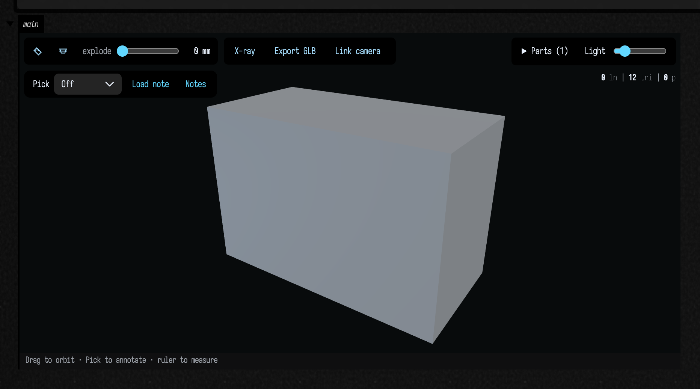
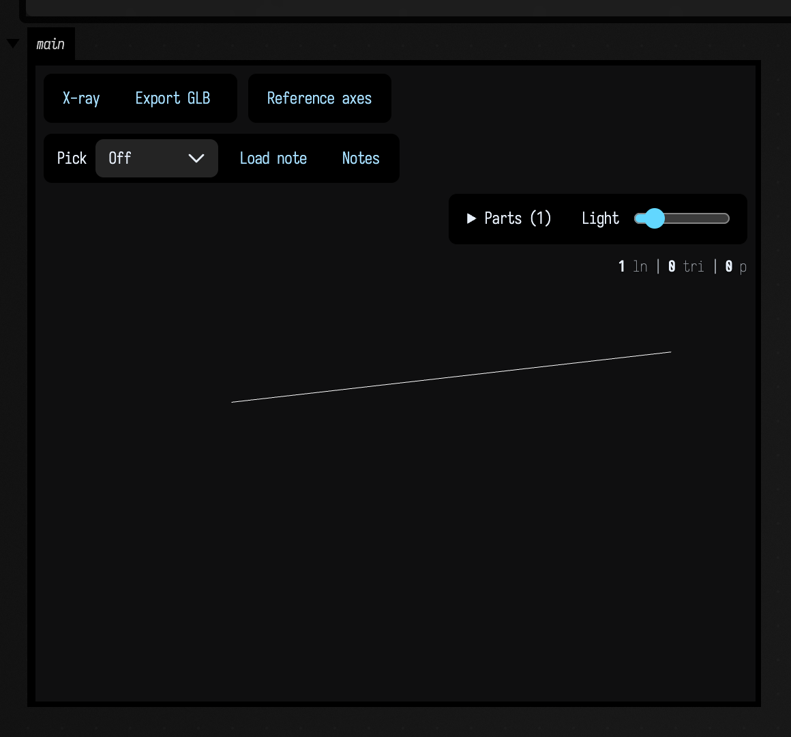

# Three.js scenes with `three { … }`

*Everything below carries its own KDoc — start from `Box.three`, `ThreeSceneBuilder` and
`toThreeDrawable` in `afield.graphics` (`Three.kt`, `ThreeScene.kt`). The FLine half of the same
viewer is documented in [FLine examples](fline_examples.md#3d-output-threelines).*

`Box.three { … }` draws meshes and `FLine`s together in one orbitable scene, and lays several views
out side by side when you ask for a contact sheet. It is `threeLines(...)` grown a vocabulary: the
same Three.js viewer you can orbit, click, section and explode, taking solids as well as lines.

Field's other way of drawing a `TriMesh` is a CPU z-buffer rasterizer that hands back a **still
picture at a fixed camera**. [Which renderer draws this](#which-renderer-draws-this) covers when you
want each.

## Your first `three` scene

Run this complete example in a Field box. Drag to orbit, scroll to zoom, or choose **Pick** to
select a surface feature and leave a note. The ruler measures the geometry in millimetres because
that is the unit used for this block's dimensions.

```diffstatic_runner {data-lang=kotlin screenshot="assets/three_output/first-scene.png" wait="4" capture="box" open-outputs="true" padding="20"}
:::static
val block = boxMesh(120, 80, 60)

val view = three(name = "foo", width = 760, height = 440) {
    mesh(block, id = "block", wireframe = false, pickable = true, group = 0)
    camera(yaw = 34.0, pitch = 24.0)
    background("#080b0c")
    caption("Drag to orbit · Pick to annotate · ruler to measure")
    inspect(units = "mm", groups = listOf("Block"))
}
```



`three` is a function on the current Field box. The block has a `ThreeSceneBuilder` receiver:
`mesh`, `lines`, `camera` and the other operations below describe the scene. The graphics and
mesh APIs are imported in ordinary Field boxes; in Kotlin source, import `afield.graphics.*`
and `afield.stdlib.*` and call `three` on a `Box`.

### `name` identifies the viewer; `channel` places its output

| Argument to `three` | Meaning |
| --- | --- |
| `name = "foo"` | A stable viewer name within this box. The view ID is the box ID followed by `_foo`. Defaults to `"three"`. |
| `channel = "main"` | The output disclosure in Field. Use distinct channels to keep two outputs visible at once. |
| `width = 760`, `height = 440` | Frame size in pixels. Width is optional; height defaults to 430. |
| `samplesPerCubic = 48` | How finely to sample FLine cubic curves. Does not change mesh triangles. |

Running the same box with the same `name` updates the same viewer. To keep two independent
scenes, give them different **names and channels**. `channel` alone does not give a scene a new
identity. The value returned by `three` is the live `ThreeGeometryViewState`; `view.uid` is the
ID used by the standalone viewer and agent inspection tools.

## A scene, not a picture

The block is a scene description, not a sequence of draw calls, and `three` returns the live
`ThreeGeometryViewState`, so the scene stays drivable after it is on screen, exactly as
`threeLines(...)` does.

| in the block | what it does |
|---|---|
| `mesh(m, …)` | add a `TriMesh`; open surfaces are supported too. Appearance and interaction options are listed below |
| `lines(…)` — a `Collection<FLine>` or a vararg | add FLines, with every behaviour they have in `threeLines`: picking, hover, fills, click callbacks |
| `camera(yaw, pitch, distance, fieldOfView)` | where the camera starts. Setting it turns auto-framing off — you picked an angle, keep it |
| `camera(view: MeshView)` | the same, from a `MeshView` you already have. The migration path for an existing figure |
| `panel(title, caption, facts, camera, bounds)` | one titled viewport. Call it once per panel, in order |
| `columns(n)` | panels per row |
| `title(text)` / `caption(text)` | shorthand for a one-panel scene |
| `background(css)` | scene background as a CSS colour |
| `helpers(on)` | the reference grid and the axis tripod |
| `inspect(units, decimals, …)` | enable measurement, section and explode controls; optionally supply groups, dimensions and assembly motions |

`helpers` is the one default that depends on what is in the scene: the grid and the tripod are **on
for an FLine-only scene** and **off as soon as there is a mesh**. Both are a fixed world size, a
10-unit grid and a 0.9-unit tripod, and a mesh is whatever size its file says it is. The toy car in
[Geometry from disk](geometry_from_disk.md) is 7 cm across, so the grid would be 140 times its width
and the tripod would swallow it whole.

### Mesh appearance and interaction

Each call to `mesh` adds one mesh to the scene. Position it by transforming the `TriMesh` before
adding it, for example `mesh(boxMesh().translated(2.0, 0.0, 0.0))`.

| `mesh` argument | Default | What it controls |
| --- | --- | --- |
| `label` | none | A readable label for the mesh. |
| `wireframe` | `true` | Draw every triangle edge over the shaded surface. Use `false` for an uncluttered surface. |
| `cullBackFaces` | `true` | Hide the back of each triangle. Set `false` to see both sides of an open surface. |
| `flatShading` | `false` | Use individual face normals for faceted shading. |
| `opacity` | `1.0` | Surface opacity, from transparent to opaque. |
| `panel` | `0` | Zero-based viewport index, or `-1` to draw in every viewport. |
| `id` | empty | A stable name returned with mesh hits and geometry review references. Give distinct meshes distinct IDs. |
| `pickable` | `false` | Allow the ruler to measure the mesh. Also enabled by a click callback or hover colour. |
| `onClick` | none | A Kotlin callback receiving a `ThreeSurfaceHit` with mesh ID and hit coordinates/indices. |
| `hoverColor` | none | A `Vec4` highlight colour while the pointer is over the mesh. |
| `group` | `-1` | Index into the inspector's `groups`; `-1` leaves it outside assembly groups. |

The **Pick** annotation tool works without `pickable = true`. That flag controls the ruler and
ordinary mesh interaction; annotation selection is a separate, visible-surface operation.

### Lines and points

`lines` accepts FLines in the same coordinates as the meshes. An FLine can carry strokes, fills
and points; there is no separate `points(...)` operation inside this builder. For a point cloud,
set `pointed = true` and turn strokes off:

```diffstatic {data-lang=kotlin}
val samples = fline {
    moveTo(-1, 0, 0)
    moveTo(0, 1, 0)
    moveTo(1, 0, 0)
    pointed = true
    stroked = false
    pointSize = 7.0
    color = vec(1.0, 1.0, 1.0, 1.0)
}
three(name = "samples", channel = "samples") {
    lines(samples)
    helpers(false)
}
```

See [FLine styling](fline_examples.md) for stroke, fill, point and callback properties.

### Measurements, parts and notes

`inspect(units = "mm", decimals = 1)` adds the measurement, section and explode controls. Units
label the coordinates you supplied; they do not rescale geometry. Set `pickable = true` on meshes
you want to measure. `measurements` supplies initial `ThreeMeasurement` dimensions, `section`
supplies a `ThreeSection`, and `explode` supplies a `ThreeExplode`.

For a grouped assembly, pass `groups = listOf("base", "lid")` to `inspect` and assign `group = 0`
or `group = 1` to each mesh. The [FLine inspector examples](fline_examples.md#the-3d-output-area-as-an-instrument-threeinspect)
show the measurement and section types.

Every single-view scene also has **Pick** and **Save note**, including scenes without `inspect`.
After a manual selection or saved note arrives, `view.reviews()` reads it from Field. From another
box or an agent, `threeGeometryReviews(viewId)` reads the same inbox by ID. Notes retain the
geometry revision and camera; [selecting and annotating geometry](geometry_review.md) explains
points, faces, edges, vertices and visible-only rectangles.

### See through surfaces

Press **X-ray** in the viewer toolbar to reveal geometry behind filled surfaces. The
**Surface** slider sets their opacity. Edges draw after the translucent faces, with
slightly stronger stroke opacity, so the structure stays legible. Points keep their original contrast.
This works in ordinary `three { … }` scenes without `inspect`. Turn it off to restore
the original surface appearance. It changes the view only: no geometry is cut or moved.

Picking still stops at the nearest surface, including in X-ray mode. Hide a part or
use a section cut when you want to select geometry behind it. Saved notes and their
images retain the X-ray setting and opacity, so a reviewer sees the same context.

### Export a GLB

Press **Export GLB** to download the visible geometry as a binary glTF file. The export
keeps colors, part names, hidden-part choices and the current exploded or insertion
positions. With **X-ray** enabled, surfaces carry the selected opacity in their materials;
strokes retain their stronger opacity. Turn X-ray off before exporting an opaque model.
Section cuts are baked into the exported surfaces and lines, without adding caps.

Meshes, lines and points all travel in the file. Viewer controls, selection markers,
measurement labels and the helper grid do not. This is a snapshot of the displayed
geometry, rather than a fabrication solid or an animation. Other applications choose
their own lighting and transparency sorting; line widths and point sizes also depend on
the receiving viewer. Inspector units `mm`, `cm`, `m`, `in` and `ft` convert to glTF metres.
An unspecified or other unit label leaves coordinates unchanged, with the label retained
in the scene metadata.

### One scene, two kinds of thing

A gyroid marched inside a finite box is an **open** surface: it runs out of the sampling window
rather than closing inside it, and every place it does that is a boundary loop. A shaded surface
hides exactly that, since the rim reads as a silhouette and nothing more. `toFLines(MeshLines.BOUNDARY)` returns one closed ring per hole, and
those rings go into the *same* scene as the solid.

```diffstatic_runner {data-lang=kotlin screenshot="assets/three_output/scene.png" wait="6.0" capture="box" open-outputs="true" padding="20"}
:::static
// FIELD_DOCS_EXPECT_SVG: false — the docs runner reads a bare `lines(` as Box.lines's 2D SVG path
// and then demands an <svg>. The `lines(rims)` below is the scene builder's and emits an iframe.
//
// A gyroid is a triply-periodic minimal surface. Marched inside a finite box it is OPEN: the
// surface leaves the sampling window rather than closing inside it, and every place it does that
// is a boundary loop. `open(20)` in the printed summary is the claim; the picture is the evidence.
val surface = marchingCubes(sdfGyroid(4.0, 0.3), boundsAround(radius = 1.0), 72)
println(surface.summary())

// The rim, as FLines, in the mesh's own coordinates. One closed ring per hole.
val rims = surface.toFLines(MeshLines.BOUNDARY).map { ring ->
    ring.color = vec(1.0, 0.45, 0.12, 1.0)
    ring.thickness = 2.6
    ring
}
println("open boundary loops: " + rims.size)

three(channel = "gyroid", height = 470, width = 760) {
    mesh(surface, wireframe = false)
    lines(rims)
    camera(yaw = 32.0, pitch = 20.0, distance = 2.05)
    title("marched gyroid, with its " + rims.size + " open boundary loops drawn in the same scene")
    caption("the solid and the annotation are one scene in model space, so orbiting moves both")
}
```


The HUD in the top right counts the **whole** scene — `3576 ln | 165368 tri | 0 p` — because the
drawables' triangles are added to whatever the FLine half contributed rather than replacing it. The
mesh and the lines are one figure, and the counts say so.

Neither half of that scene is a second implementation. `three { lines(…) }` delegates wholesale to
the builder `threeLines(...)` uses, so the two cannot disagree about what an FLine is, down to its
interactive objects, its topology strings and its click callbacks. And the mesh side is a lowering:
`TriMesh.toThreeDrawable()` turns a mesh into a `ThreeDrawable`, which is *geometry plus how to draw
it*, and the viewer draws drawables without knowing that meshes exist.

A wide viewer can keep its controls compact with `controlGroup("controls", columns = 2) { ... }`.
The control surface uses up to two columns and collapses to one in a narrow output. The ordinary
`controlGroup("controls") { ... }` retains its single column; changing layout preserves control
identities, cached values and callbacks.

## The camera is four numbers, and they are the rasterizer's four numbers

`ThreeCameraSpec` mirrors `MeshView` and `VisionGeometryPreview.Camera` one for one:

- **`yawDegrees`** — orbit around `+y`. `0` looks straight down `−z`.
- **`pitchDegrees`** — lift above the horizon. Positive looks down on the geometry.
- **`distance`** — in multiples of the bounding-sphere radius, so one spec frames a 2 cm mesh and a
  2 m one.
- **`fieldOfViewDegrees`** — vertical. Smaller is a longer lens and less perspective.

The names and the meanings match so that one figure can be handed to either renderer. The viewer
does reimplement the yaw/pitch/distance → eye-position conversion in JavaScript, which is a second
implementation of something with a sign convention in it; it is marked
`// [viewer-region camera-preset]` in `threejs_viewer.html`, and the build holds the two to each
other.

??? aside "In the viewer, `distance` is a padding factor"
    The preset supplies the camera's **direction**; the viewer supplies its own distance. Having
    placed the eye, it runs a zoom-to-fit (`fitCameraToBounds`) that slides the eye along the view
    direction until the geometry's sampled points fit the frame the viewer was actually given — a box
    output is as wide as its column, and a figure written for a 560 × 420 canvas arrives in a much
    wider band.

    So `distance` reaches the viewer as `max(1.02, distance / 2.7 × 1.06)`. Below about 2.6 that
    clamps to the floor and every value frames identically; above it, raising `distance` shrinks the
    mesh in the frame.

    It is also why one figure is a different composition on the two renderers at an identical
    viewpoint: the rasterizer frames the bounding *sphere* in a canvas it chose, the viewer fits the
    real points to the frame it was handed, so the subject comes out noticeably larger. The toy car
    in [Geometry from disk](geometry_from_disk.md#a-real-glb-in-a-real-output-area) is the case to
    look at.

## Contact sheets

For a custom contact sheet, `panel(...)` declares viewports in order and `mesh(..., panel = n)`
assigns geometry to them. Calling `panel` does not change which viewport the next mesh goes into:
the default stays `0`. FLine content is shared between viewports.

```diffstatic {data-lang=kotlin}
val cube = boxMesh()
three(name = "comparison", channel = "comparison", width = 760, height = 320) {
    columns(2)
    mesh(cube, panel = 0, wireframe = true)
    mesh(cube, panel = 1, wireframe = false)
    panel(title = "Triangles", bounds = cube.toThreeBounds())
    panel(title = "Surface", bounds = cube.toThreeBounds())
}
```

`threeGrid` and `threeTurntable` below build common layouts for you. Feature annotation currently
requires a single viewport, so use a separate single-view scene to review a mesh from a sheet.

### One WebGL context, several panels

Drag to orbit; use the mouse wheel, trackpad scroll, or middle-button drag to dolly in and out.
Multi-panel views retain your orbit and dolly across geometry and selection updates.
Dolly moves the camera relative to its fitted starting view, so close inspection can crop the object.

A contact sheet is N views of geometry side by side. The obvious translation is N viewers, and it is
wrong: each iframe is its own WebGL context, Chrome caps live contexts at around sixteen and
silently evicts the oldest, and a gallery of nine panels next to another gallery of nine is already
over budget. The evicted context comes back as a blank panel with **nothing in the console**.

So a `ThreePanel` is a *viewport*, not a document: one context, `setScissorTest` and a per-panel
`setViewport` in the render loop. It is also much faster.

### `threeGrid` — several meshes, each framing its own bounds

```diffstatic_runner {data-lang=kotlin screenshot="assets/three_output/grid.png" wait="6.0" capture="box" open-outputs="true" padding="20"}
:::static
// Four unrelated shapes. Each panel frames its OWN bounds, so the small one is not lost beside the
// large one — that is the difference between a grid and a turntable, and only the Kotlin side knows
// which of the two it is building.
val ball = marchingCubes(sdfSphere(1.0), boundsAround(radius = 1.3), 40)
val drilled = marchingCubes(sdfSubtract(sdfSphere(1.0), sdfCylinder(0.34, 4.0)), boundsAround(radius = 1.3), 64)
val twisted = marchingCubes(sdfBox(vec(1.2, 1.8, 0.4)).twisted(0.35), boundsAround(radius = 1.2), 72)
val ring = torusMesh(64, 32, 0.62, 0.24)

threeGrid(
    "marched sphere, resolution 40" to ball,
    "…drilled through: the drill added a handle" to drilled,
    "sdfBox(…).twisted(0.35)" to twisted,
    "torusMesh(64, 32) — genus 1 by construction" to ring,
    columns = 2,
    facts = true,
    cellWidth = 430,
    height = 760,
    channel = "grid",
    view = MeshView(pitchDegrees = 44.0),
)
```


Four panels, four cameras, **one** WebGL context. Each panel carries the fact line
`TriMesh.threeFacts()` computes, which is the same sentence `toFigureHtml` writes under a rasterized
figure, from one implementation, so the two renderers cannot report a different genus for the same
mesh.

`facts = true` is **off by default**, and `showMeshGrid` does not turn it on. If you want the numbers
under each panel, either call `threeGrid` directly as above, or use the `List<ThreeMeshPanel>`
overload, for a gallery that has something specific to say about each cell:

```diffstatic {data-lang=kotlin}
threeGrid(
    listOf(
        ThreeMeshPanel("cuboctahedron", solid, facts = "12 vertices · 24 edges · 14 faces (8 triangles, 6 squares)"),
        ThreeMeshPanel("…kis'd", kissed, facts = "38 vertices · 84 edges · 48 faces (all triangles)"),
    ),
    columns = 2,
)
```

### `threeTurntable` — one mesh, several angles, one upload

```diffstatic_runner {data-lang=kotlin screenshot="assets/three_output/turntable.png" wait="6.0" capture="box" open-outputs="true" padding="20"}
:::static
// One mesh, four angles, ONE upload and ONE WebGL context. Every panel frames the SAME bounds, so
// the shape does not appear to breathe as it turns.
val twisted = marchingCubes(sdfBox(vec(1.2, 1.8, 0.4)).twisted(0.35), boundsAround(radius = 1.2), 80)
println(twisted.summary())
threeTurntable(twisted, channel = "turntable", height = 290)
```


Four viewpoints is usually the difference between "that looks plausible" and "yes, that is the
shape". This solid is a good advertisement for it: at yaw 0° and 180° it is a narrow crescent and at
90° and 270° it is a broad S, and a single view of either would leave you guessing.

Two details make the turntable cheap and stable, and both are the opposite of what the grid wants:

* the mesh is added once with `panel = -1`, meaning **every** panel: one upload of a 100k-triangle
  mesh drawn from four angles, not the same buffer sent four times;
* every panel is given the *same* `bounds`, so the shape does not appear to breathe as it rotates. A
  grid frames each panel on its own bounds instead, and only the Kotlin side knows which of the two
  it is building, which is why `ThreePanel.bounds` is computed there and not in the viewer.

## `showMesh` and the `renderer` parameter

Every entry in the `showMesh` family takes a `renderer`, and the default is the Three.js viewer.

<div class="field-reference" data-code-lang="kotlin" markdown>

| you call | you get |
| --- | --- |
| `showMesh(mesh)` | Opens the orbitable Three.js viewer, equivalent to `three(subject = mesh)`. This is the default for mesh display. |
| `showMesh(mesh, renderer = MeshRenderer.CPU)` | Produces a static CPU-rasterized figure at a fixed camera. Use it when you need a deterministic image without WebGL. |
| `showMeshGrid(…)` | Delegates to `threeGrid` to compare meshes in interactive viewports. Each subject retains a distinct panel. |
| `showMeshTurntable(…)` | Delegates to `threeTurntable` for views around a subject. It helps reveal shape hidden from a single angle. |
| `showMeshDiagnosis(mesh)` | Always uses the CPU rasterizer for its diagnostic figure. It has no renderer-selection parameter. |
| `mesh` as the last expression in a box (the inline card) | Uses the CPU rasterizer for the inline value card. Call `showMesh` explicitly when you want an orbitable view. |

</div>

Two size knobs that are easy to confuse:

* `MeshView.width` / `MeshView.height` size the **raster** on the CPU path, and on the GPU path
  `view.width` becomes the iframe's width in pixels;
* `showMesh`'s own `height` parameter, default `430`, sizes the **iframe**, and `MeshView.height` is
  ignored on that path. To get a GPU figure the same shape as a CPU one, pass `height = view.height`
  explicitly.

Give the width in pixels. `field.css` says
`.disclosure-content iframe { width: 100% !important }`, which reads as though an inline size is
ignored, and it is not: `outputareas2.js` *measures* the output panel from `iframe.style.width` and
sizes the disclosure to the result, and only then does the CSS stretch the iframe to fill the panel
it just caused. A percentage claims a meaningless size rather than no size, because `parsePixels` is
`parseFloat` and `"100%"` reports one hundred pixels, which loses to the header's floor and leaves
the panel at whatever width it already had. That is right for an FLine viewer filling its column and
wrong for a wide gallery, which collapses to the panel's existing width and loses the right-hand part
of every picture. [Output panel sizing](output_panel_sizing.md) sets out the measurement rules in
full.

## Which renderer draws this

Field has more ways to put geometry on a screen than the viewer and the rasterizer. All of them, and
what each is for:

| path | what it draws | where the pixels are made | reach for it when |
|---|---|---|---|
| `three`, `threeGrid`, `threeTurntable`, `threeLines`, `threeInspect` — `afield/graphics/Three.kt`, `ThreeJsViewer.kt` | FLines and `TriMesh`es together, in 3D | **WebGL** (three.js r184, vendored) in a `/threejs` iframe inside the box output | you want to turn it; you want a solid and its annotations in one scene. The default for the whole `showMesh` family |
| `renderPng`, `renderPixels`, `toFigureHtml`, `toHTML`, `showMeshDiagnosis`, `MeshRenderer.CPU` — `afield/graphics/VisionGeometryPreview.kt` | one `TriMesh`, fixed camera, still | **CPU z-buffer in the JVM**, AWT-free, encoded by `PngEncoder` | you need the same pixels twice (see below); there is no WebGL context to spare; you want a pixel buffer to composite by hand |
| `lines`, `l`, `drawToSVG`, `inspect` — `afield/graphics/someSkiko.kt` | FLines, **2D only** | **SVG text** emitted by a Skia recording canvas; the browser rasterizes it | 2D figures: crisp at any zoom, tiny payload, headless-safe |
| `lines(editable = true)`, and the automatic upgrade when an FLine has `onClick` or `hoverColor` — `FLineEditableSvg.kt` | the same, plus click / hover / drag / freehand | SVG in the browser, plus a server-side edit session | direct manipulation of control points; a figure you can click to name |
| `moduleHere`, `Renderer`, `RenderToTexture`, and `StandardRenderer` / Fabricate on top of them — `afield/four/` | arbitrary real-time scenes, Gaussian splats, hardware ray tracing | **Vulkan on the desktop GPU**, in a GLFW window (offscreen targets still need the window) | real-time work, hot-reloaded shaders, hundreds of thousands of primitives, OpenXR |
| `visionMetal` — `afield/graphics/VisionMetal.kt` | your live Metal shader plus its geometry | **Metal, on the Vision Pro** | headset live-coding ([Apple Vision Pro](vision.md), [geometry in the headset](vision_geometry.md)). Its desktop stand-in is `previewVisionGeometry`, which is the CPU rasterizer again |
| the visionOS native FLine viewer — `native/field-visionos/Field4Vision/FLine/` | whatever `threeLines` / `three` published | **RealityKit / Metal on the headset** | you want an existing 3D figure in the volume ([Apple Vision Pro](vision.md)). It subscribes to the same `__threejs__` channel; there is no second API |
| `remoteAr` — `afield/outputs.kt`, `RemoteArKotlinJs.kt` | *your Kotlin, compiled to JS*, in a WebXR page | **WebGL in the browser or headset** | AR/VR where the code runs in the head rather than on the desktop ([RemoteJS and WebXR](ar_reference.md)) |
| `rasterizeFLines`, `Img`, `showImg`, `rasterizeText`, `heatmapImage`, `RectSLFitFigure` | 2D marks into a pixel buffer, no projection and no depth | **CPU in the JVM**, `PngEncoder` | measurement rasters, image pipelines, figures that have to be identical in a test |

Two entries in that table are commonly misread:

**`Box.lines(...)` does not project.** It flattens. `computeFitTransform` is three numbers — a scale
and two offsets — with no eye, no field of view and no near plane, and `applyFit` copies `z` through
untouched. Every draw path then reads `x` and `y` only. A 3D FLine handed to `lines(...)` is an
orthographic projection down `−z` with no depth sorting and no hidden-line removal. `z` survives only
as *metadata for picking*, so a click can report the 3D coordinate of the thing you hit. If you want
perspective, either project first with `FLine.byPerspectiveProjecting(...)` or reach for
`threeLines`.

**The ray tracer is not a separate renderer.** [Ray tracing examples](ray_tracing_examples.md) is
`VK_KHR_ray_tracing_pipeline` inside `afield.four`, and Fabricate's `StandardRenderer` is a deferred
g-buffer / shadow / AO / composite stack built on the same primitives. One Vulkan renderer, three
front ends.

### What the CPU rasterizer is for

Three things the viewer cannot do, in order of how hard they are to work around.

**It is deterministic, and a GPU is not.** The pixel-exact proofs compare against it, and a GPU
capture cannot play that role: driver, vendor and antialiasing all move under you. The tests that
read its output assert pixel *statistics* rather than golden images — counts of red defect-overlay
pixels, coverage fractions, painted-area bounds, outward-versus-flipped diffs — and every one of them
needs the same input to produce the same number twice.

**It needs no WebGL context.** The inline value-visualizer card that appears when a box ends on a
`TriMesh` uses it: an iframe per mesh in a list of values would run straight into the ~16-context
ceiling that `ThreePanel` exists to dodge.

**It renders into a pixel buffer.** `TriMesh.renderPixels` hands you ARGB ints and a size, which is
what you want when compositing several meshes into one figure yourself.

A fourth reason: it is *AWT-free*, and has to be. Touching `java.awt` inside
Field's server JVM on macOS initialises AppKit in a process whose main thread belongs to GLFW, and
the process dies silently. So `VisionGeometryPreview` writes its own PNGs.

### The same mesh, both ways

```diffstatic_runner {data-lang=kotlin screenshot="assets/three_output/renderers.png" wait="7.0" capture="box" open-outputs="true" padding="20"}
:::static
// The same mesh, the same MeshView, the same frame size — both renderers. What changed is easiest
// to see with the two side by side.
val solid = marchingCubes(
    sdfSmoothUnion(sdfSphere(0.78), sdfBox(vec(2.1, 0.32, 0.32)), k = 0.28),
    boundsAround(radius = 1.35), 64,
)
val view = MeshView(width = 520, height = 400, wireframe = true)

showMesh(solid, channel = "three.js — the default", view = view, height = view.height,
         renderer = MeshRenderer.GPU, title = "MeshRenderer.GPU — MeshStandardMaterial, orbitable")
showMesh(solid, channel = "the CPU rasterizer", view = view,
         renderer = MeshRenderer.CPU, title = "MeshRenderer.CPU — two-light lambert, deterministic, still")
```


Same mesh, same `MeshView`, same 520 × 400 frame, two pictures that are obviously not the same
picture. What differs, and what does not:

- **Shading differs, and is not meant to match.** The rasterizer is a two-light Lambert stand-in over
  the vertex colours. The viewer is three.js's `MeshStandardMaterial` under an ambient / key / rim
  rig. Reconciling those would mean crippling one of them.
- **Framing differs**, as the warning above sets out. The viewer zoom-to-fits; the rasterizer places
  the eye literally.
- **The input is held identical.** `toThreeDrawable` mirrors `toCapturedMesh`'s
  preparation step for step: a mesh with no normals is run through `shadedNormals` at the *same* 35°
  crease angle the rasterizer uses (leaning on three.js's `computeVertexNormals()` instead would be
  an unconditional smooth average and would round every hard edge off a cube); colours come from
  `TriMesh.colors` or from the rasterizer's own `DEFAULT_SURFACE` constant, read rather than copied
  so the two cannot drift into two different greys; alpha is a flat 1. A difference between the two
  outputs is a difference in shading model, never a difference in input.
- **Back-face culling is held identical too**, which is the one with diagnostic consequences; the
  next section shows it.
- **The fact line is the same sentence**, from `TriMesh.threeFacts()` and `toFigureHtml` sharing one
  implementation.

### Back-face culling, on both renderers

A face wound the wrong way is *missing* in the rasterizer, not dark but **gone**, and the
[polytope](polytope_examples.md) and [typography](typography_examples.md) pages both teach that as a
winding test. `ThreeDrawStyle.surface(cullBackFaces = true)` is the default in the viewer as well, so
it is missing there too:

```diffstatic_runner {data-lang=kotlin screenshot="assets/three_output/winding.png" wait="7.0" capture="box" open-outputs="true" padding="20"}
:::static
// Take a sphere and reverse the winding of one band of triangles. Not one vertex moves.
val ball = icosphereMesh(3, 0.8)
val idx = ball.indices.copyOf()
var reversed = 0
for (t in 0 until ball.triangleCount) {
    val cy = (ball.position(ball.ia(t)).y + ball.position(ball.ib(t)).y + ball.position(ball.ic(t)).y) / 3.0
    if (cy > 0.30) {
        val b = idx[t * 3 + 1]; idx[t * 3 + 1] = idx[t * 3 + 2]; idx[t * 3 + 2] = b
        reversed++
    }
}
val holed = TriMesh(ball.positions.copyOf(), idx)

println("reversed %d of %d triangles; not one vertex moved".format(reversed, ball.triangleCount))
println("volume  %.4f  ->  %.4f".format(ball.signedVolume(), holed.signedVolume()))
println("consistently oriented: " + holed.topology().isConsistentlyOriented)

val view = MeshView(width = 460, height = 380, yawDegrees = 18.0, pitchDegrees = 38.0, wireframe = true)
showMesh(holed, channel = "three.js", view = view, height = view.height, renderer = MeshRenderer.GPU,
         title = "the band is GONE, not dark")
showMesh(holed, channel = "the CPU rasterizer", view = view,
         renderer = MeshRenderer.CPU, title = "…and gone here too, which is the whole point")
```


**394 of 1280 triangles reversed, no vertex moved, and both renderers punch the same hole.** Read
what the numbers say while the picture says "hole":

* `signedVolume()` goes **2.1262 → 0.8112** — catastrophically wrong, with nothing to flag it.
* the fact line still reads **`χ=2 genus 0 · watertight`** — χ is a *count* of vertices, edges and
  faces, and reversing a triangle changes none of them. Topology is not orientation.
* the only thing that says so out loud is `topology().isConsistentlyOriented`, which is **false**.
  `fixWinding()` is the repair.

One divergence the figure shows and nothing else records: in the Three.js panel the
**wireframe overlay is not back-face culled**, so you can still see the reversed triangles' edges
drawn across the hole. The rasterizer's depth-tested wireframe is culled with its surface, so its
hole is bare. The *surfaces* agree, which is the diagnostic; the overlays do not.

## Measuring and sectioning a solid

The Three.js output area is also an **instrument**. `inspect(...)` inside a `three { }` scene, and
`Box.threeInspect(...)` for lines alone, add a measurement tool, a section plane with a real cut
outline, and an explode scrubber; the tools themselves are documented, with figures, in
[FLine examples](fline_examples.md#the-3d-output-area-as-an-instrument-threeinspect).

A mesh is not pickable by default, because a solid filling the frame would sit in front of every
annotation it was drawn to explain. Ask for it with `mesh(car, pickable = true)`, or let an
`onClick` or a `hoverColor` imply it, and pair that with `inspect(...)` on the same scene: the flag
is what lets the ray find the solid and the toolbar is what draws the dimension. A hit arrives as a
`ThreeSurfaceHit`, resolved to a vertex, an edge or a triangle, so a dimension runs from a corner of
the solid to an annotation beside it — which is the scene `three` exists for.

```diffstatic_runner {data-lang=kotlin screenshot="assets/three_output/section.png" wait="6.0" capture="box" open-outputs="true" padding="20"}
:::static
// FIELD_DOCS_EXPECT_SVG: false — `lines(datum)` below is the scene builder's, not Box.lines.
//
// A block with a bore drilled down through it, and a datum line standing beside it.
val part = marchingCubes(
    sdfSubtract(sdfBox(vec(2.0, 1.2, 1.2)), sdfCylinder(0.35, 2.0)),
    boundsAround(radius = 1.3), 72,
)
val datum = fline {
    moveTo(1.4, -0.6, 0.0)
    lineTo(1.4, 0.6, 0.0)
    color = vec(1.0, 0.55, 0.2, 1.0)
    thickness = 2.5
}

three(name = "section", channel = "section", width = 760, height = 460) {
    mesh(part, id = "part", wireframe = false, pickable = true)
    lines(datum)
    camera(yaw = 30.0, pitch = 24.0)
    inspect(
        // Cut halfway through along z, so the plane runs straight down the bore.
        section = ThreeSection(enabled = true, normal = floatArrayOf(0f, 0f, 1f), fraction = 0.5),
        // From the block's +x face, on the cut plane, to the datum beside it: 1.4 - 1.0 = 0.4.
        measurements = listOf(
            ThreeMeasurement(
                ThreeMeasureElement.point(1.0, 0.0, 0.0),
                ThreeMeasureElement.segment(1.4, -0.6, 0.0, 1.4, 0.6, 0.0),
                "clear "
            )
        )
    )
}
```


What you aim at is decided by true perpendicular distance in the hit triangle's plane, within a snap
radius of 0.14 of that triangle's own longest edge, and a corner is tested before an edge. So
**a sliver has no clickable interior**: every point of a triangle ten long and half a unit tall
falls inside its own snap radius of an edge or a corner.

The section plane cuts a mesh, wireframe overlay included. The explode scrubber moves
meshes and their outlines by inspection group, along with grouped FLine geometry.
Give related objects the same group to keep them together; `solidParts` sets this up
for native solids. X-ray can be combined with either control.

## Show a part or a group

Open **Parts** to browse the scene as a tree. A mesh and its outline share one checkbox
when they have the same assembly group or drawable ID. Folder checkboxes show a dash when
only some children are visible. **Select all** shows or hides the entire scene.

**Shift-click** a part or folder checkbox to solo it. Shift-click it again to restore the
previous visibility; shift-click a different part to move the solo without losing that
previous view. An ordinary click ends solo mode and edits the current visibility.

Use `inspect(partPaths = …)` to organise a large scene. Keys are stable mesh IDs, assembly
group names, or review feature IDs; values are lists of folder names. The final row retains
its part name. Folder labels do not change geometry IDs or invalidate annotations.

```diffstatic {data-lang=kotlin}
three(name = "vehicle") {
    mesh(boxMesh(120, 60, 40), id = "body", wireframe = false)
    mesh(boxMesh(20, 20, 20), id = "wheel", wireframe = false)
    inspect(partPaths = mapOf(
        "body" to listOf("Vehicle", "Bodywork"),
        "wheel" to listOf("Vehicle", "Running gear")
    ))
}
```

Uncategorised meshes, interactive FLines, and batched guides have their own folders.
A batched guide buffer is one selectable entry: it does not claim per-line visibility.
Hidden geometry is excluded from picking and visible-scene exports, including X-ray views.

## Editing a curve before an expensive operation

`threeLines(curves, editable = true, width = 1000, onEditCommitted = { edited -> … })`
provides the existing 3D anchor and Bézier-handle editor with a callback when a drag
finishes. The callback receives detached copies of all the displayed FLines, after
the drag's position updates. Camera movements do not call it. Select the pencil
tool to edit and the camera tool to orbit or dolly.

Keep the callback short: queue the snapshot, then validate it or rebuild dependent
geometry on your own worker. The callback does not supply undo, persistence,
constraints, or a solver; those belong to the application using the curves. Pass
the accepted curves back to `threeLines` under the same viewer name to display any
constraints you applied. `width` is optional and otherwise fills the output area.

## The payload both kinds of scene share

`ThreeGeometryPayload`'s `lines` / `fills` / `points` are the FLine half, and a payload with an empty
`drawables` list carries none of the mesh keys at all, so nothing reading an FLine-only scene has to
know meshes exist. That is what lets the editable path, the inspector and the mesh scenes above share
one format.

Three.js itself is **vendored**, not fetched: `src/commonMain/resources/vendor/three/0.184.0/`. A
viewer works offline and a docs capture does not depend on a CDN.

## Play with it

[Open the gallery](offline.html?file=assets/three_output_gallery/metadata.edn), a loadable Field document with the five
boxes on this page, laid out top to bottom. Open it in a fresh Field 4 and run the boxes; then orbit
the gyroid, change `facts = true` to `false`, or set the grid's `columns` to `4` and watch one WebGL
context re-tile itself.

<iframe
    src="offline.html?file=assets/three_output_gallery/metadata.edn"
    title="Field's 3D Output — offline viewer"
    style="width:100%; height:560px; border:1px solid #444; border-radius:8px; background:#111;"
    loading="lazy"
    allowfullscreen>
</iframe>

## Optional viewer tools

Measure, section and explode ([above](#measuring-and-sectioning-a-solid)), **X-ray**
([See through surfaces](#see-through-surfaces)) and **Export GLB**
([Export a GLB](#export-a-glb)) are built into the viewer, and none of them is a tool in
this sense. A tool is for anything else.

A scene can opt into a tool without making that tool part of Field. Tools are trusted
ES modules served by the same Field server. The default viewer loads none.
This small example adds a reference-axis toggle:

```diffstatic_runner {data-lang=kotlin screenshot="assets/three_output/tools.png" wait="6.0" capture="box" open-outputs="true" padding="20"}
:::static
// FIELD_DOCS_EXPECT_SVG: false — `lines(...)` below is the scene builder's, not Box.lines.
three(name = "tools-example") {
    tools("/threejs_tools_demo.js")
    lines(fline { moveTo(0.0, 0.0, 0.0); lineTo(2.0, 1.0, 0.0) })
    helpers(false)  // so the grid's own tripod is not mistaken for the tool's axes
}
```



Each module exports a default factory returning a descriptor with a unique `id`.
`mount(context)` receives a toolbar element, `THREE`, the camera and controls,
`overlays`, the inspector API, `sources()` and `requestRender()`. Tool overlays stay
out of GLB exports. `dispose()` releases the tool's own GPU resources and listeners;
Field removes its toolbar and overlay group. `refresh()` runs after the viewer applies
its base pose, rather than on an animation timer. Compute transformations from retained
source coordinates, never by repeatedly transforming the previous result.

For stateful tools, implement all three methods: `snapshot()`, `validate(state)` and
`restore(state)`. State must be finite JSON of at most 32 KB per tool. Views and notes
retain that state. Loading a view that needs an unavailable tool reports an error;
it never imports a module from the note. Older views reset tools to their initial state.
Validation must reject invalid input without mutation; restoration should not fail
once validation has accepted it.

Agents can use `FieldViewer.tools.register(descriptor)` or
`await FieldViewer.tools.load("/path/to/tool.js")` in their capture browser. Both return
an idempotent disposal function. `FieldViewer.tools.ids()` lists installed tools.
Use the same source geometry revision when restoring a note. An application owns its
modules and their behavior; registration does not validate geometry produced by a tool.

??? aside "If you write a fence like these"
    The runner's output validator treats a bare `lines(` in the code as a call to `Box.lines(...)`, the 2D
    SVG path, and then fails the capture because no `<svg>` appeared. Inside `three { }`, `lines(…)` is the
    scene builder's and emits an iframe — `// FIELD_DOCS_EXPECT_SVG: false` in the fence is the escape
    hatch, and the first figure on this page carries it.

## Data colours and late viewers

In a tiled `three` scene, surface picking uses the camera and viewport of the panel
under the pointer. Click callbacks and hover highlights apply to that panel's objects
(plus objects assigned to every panel); title bands do not pick geometry underneath.

Use `mesh(mesh, unlit = true)` for force bands or other scalar data: the mesh's vertex
colours are displayed without lighting or tone mapping. The default remains a lit surface.

```diffstatic_runner {data-lang=kotlin screenshot="assets/three_output/lit-unlit.png" wait="6.0" capture="box" open-outputs="true" padding="20"}
:::static
// One torus coloured by its Gaussian curvature, drawn twice: lit on the left, unlit on the right.
val ring = torusMesh(96, 48, 0.62, 0.24)
val curvature = ring.coloredByScalar(ring.gaussianCurvature(), "coolwarm")

three(name = "lit-unlit", channel = "lit-unlit", width = 760, height = 340) {
    columns(2)
    mesh(curvature, panel = 0, wireframe = false)
    mesh(curvature, panel = 1, wireframe = false, unlit = true)
    panel(title = "lit (the default)", bounds = curvature.toThreeBounds())
    panel(title = "unlit = true", bounds = curvature.toThreeBounds())
}
```


For a smooth surface with per-element colours, compute normals on the connected geometry
before duplicating vertices for discontinuous colours; colour boundaries are not creases.

Kotlin `display` panels are retained by the live box and replayed when a new browser finishes
loading its document. This does not re-run code. The latest panel per channel, explicit
open/close state, and current control values are replayed; cleared panels stay cleared.
Retention is in memory (up to 128 panels and eight million HTML characters per box), not
saved output across a server restart. Older panels are evicted when that budget is exceeded.
