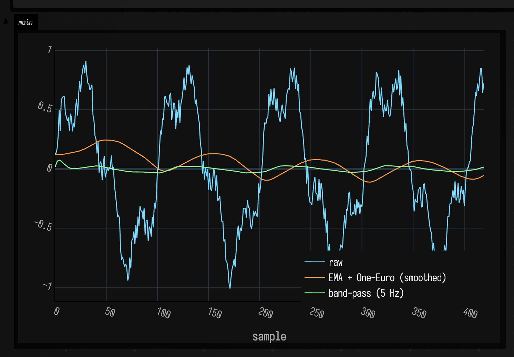
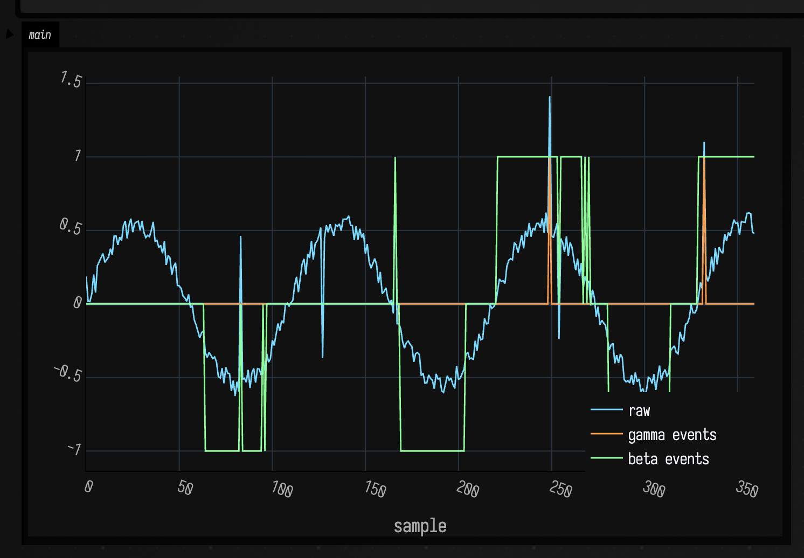

# Timeseries examples

Signal processing needs pictures. A filter can reveal structure or erase the detail you cared about. An event detector can catch a gesture or promote a random spike. These examples keep the raw stream and the processed stream in the same frame.

## Filter chains as layered curves

The question is not whether three filters can be stacked. The question is whether the stack helped. This comes up with motion capture, sensor cleanup, musical control signals, and exploratory analysis: less junk, same gesture.

```diffstatic_runner {data-lang=kotlin screenshot="assets/timeseries_examples/filter_chains.png" wait="1.5" capture="box" open-outputs="true" padding="20"}
:::static
val raw = mutableListOf<Float>()
val smooth = mutableListOf<Float>()
val filtered = mutableListOf<Float>()

val ema = EMAFilter(alpha = 0.08f)
val oneEuro = OneEuroFilter(minCutoff = 1.0f, beta = 0.02f)
val band = BandPassFilter(frequency = 5f, sampleRate = 120f, q = 0.8f)

for (i in 0 until 420) {
    val t = i / 120f
    val signal = (
        sin(2.0 * PI * 1.2 * t).toFloat() * 0.7f +
        sin(2.0 * PI * 4.7 * t + 0.3).toFloat() * 0.22f +
        (-0.12f + random().toFloat() * 0.24f)
    )
    raw += signal
    val s = oneEuro(ema(signal))
    smooth += s
    filtered += band(s)
}

// One call puts all three streams on one axis — raw, the smoothed chain, and the band-passed
// component each get their own trace (dark theme + cyan/orange palette applied).
showSignals(
    "raw" to raw,
    "EMA + One-Euro (smoothed)" to smooth,
    "band-pass (5 Hz)" to filtered,
    channel = "main",
    xTitle = "sample",
)
```

The drawing stays consistent and the signal chain makes the difference. `showSignals` puts all three streams on one axis, while `EMAFilter`, `OneEuroFilter`, and `BandPassFilter` each get their own trace.



Now the tradeoffs are visible. The raw line still contains everything, the smoothed line becomes legible, and the band-passed trace isolates a narrower component that might matter musically or physically.

## Distribution-aware event flags

Cleaning is only one job. Event detectors answer a different question: did something noteworthy happen? They matter for onsets, anomalies, attacks, impacts, threshold crossings, and rare deviations in a stream that mostly behaves itself.

```diffstatic_runner {data-lang=kotlin screenshot="assets/timeseries_examples/distribution_events.png" wait="1.5" capture="box" open-outputs="true" padding="20"}
:::static
val gammaEvents = GammaEventDetector(windowSize = 64, tailProbabilityThreshold = 0.03f, influence = 0.15f)
val betaEvents = BetaEventDetector(windowSize = 64, supportMin = -1f, supportMax = 1f, lowerTailThreshold = 0.04f, upperTailThreshold = 0.04f)

val raw = mutableListOf<Float>()
val eg = mutableListOf<Float>()
val eb = mutableListOf<Float>()

for (i in 0 until 360) {
    val t = i / 120f
    var x = (sin(2.0 * PI * 1.1 * t) * 0.55 + (-0.08 + random() * 0.16)).toFloat()
    if (i % 83 == 0) x += 0.95f
    if (i % 127 == 0) x -= 0.8f
    raw += x
    eg += gammaEvents(kotlin.math.abs(x))
    eb += betaEvents(x)
}

// The raw stream and both detectors' verdicts on one axis — the event traces flag their tail
// crossings (beta fires either way, ±1) over the raw motion, so which departures triggered is clear.
showSignals(
    "raw" to raw,
    "gamma events" to eg,
    "beta events" to eb,
    channel = "main",
    xTitle = "sample",
)
```

The stream gets a handful of deliberate disturbances, and both detectors report their verdict as traces rather than log messages.



The raw motion remains visible, and each detector shows which departures became events. That is useful for onset detection, anomaly marking, interaction thresholds, and any signal that needs a little memory before it speaks. For inline diagnostics of similar live values, continue with [Visualizers](visualizers.md). When the value you care about is *hidden* behind the noise rather than merely buried in it — a state you can only measure indirectly — reach for [State estimation](state_estimation_examples.md).

These filters all work in the time domain. When the question is which *frequencies* a signal is made of — brightness, timbre, a chirp's trajectory — cross over to the frequency-domain companion: [Spectral examples](spectral_examples.md) (FFT, STFT / spectrograms, and streaming spectral features that compose with the same `then` chain).
