# Typography as geometry — a string becomes contours

*Every public declaration used below is listed, with its KDoc, in the codebase reference:
[Graphics](reference/graphics.md).*

Field could draw, mesh, filter, cluster, contour and evolve geometry, and it could not turn *a
string* into any of it. There was no text-as-geometry layer at all: every `java.awt.Font` in the tree
painted a label into a raster and none of them produced a value you could extrude, march, sample or
animate. For a live-coding tool for new-media art, that is a strange hole — kinetic typography is a
headline capability, not a footnote.

Two files fill it, and they add no dependency. `GlyphVector.getOutline()` hands back the font's real
Bézier outlines, and everything after that is arithmetic.

| what you want | where it is |
|---|---|
| a font at a size; a glyph's rings; a laid-out string with per-glyph handles | `typography.kt` — `Typeface`, `Glyph`, `GlyphContour`, `TextLayout`, `PlacedGlyph` |
| text on a curve, word wrap, measuring | `typography.kt` — `TextLayout.onCurve`, `textCircle`, `wrapText`, `textWidth` |
| letters → `FLine`, `TriMesh`, `ScalarField3D`, `Img`, point clouds | `typography_field.kt` |
| a figure in a box output | `typography_field.kt` — `Box.showText`, `Box.showTextGrid`, `TextLayout.metricsFLines` |

## Hello, legibility

```kotlin
val face = typeface("SansSerif", 140.0)
val word = layoutText("Handgloves", face)
showImgGrid("Handgloves" to rasterizeText(word, 1600, 380), columns = 1, cellSide = 860)
```

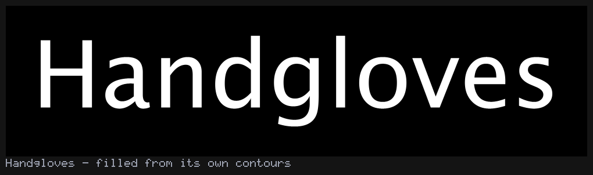

That raster is worth being precise about, because it is the whole argument for the page. It was **not
drawn by AWT**. `rasterizeText` is a scanline fill over the contours this family extracted — so a
legible picture is evidence about the extraction, the winding and the layout, and not about
`Graphics2D.drawString`. (There is a second reason: `imaging_field.kt` forbids in-process AWT text
rendering outright, which is why `montage` captions with a 5×7 bitmap table.)

## The winding convention, and what happens without it

A counter — the hole in `o`, `e`, `a`, `B` — is only a hole if something says so. `isoContourFLines`
in `contours.kt` leaves its winding arbitrary and every consumer downstream has to cope; this family
decides instead:

> A ring's signed area is `½Σ(xᵢyᵢ₊₁ − xᵢ₊₁yᵢ)` in text space. **Outer contours are positive; holes
> are negative.** Nesting depth — how many other rings of the same glyph contain this one — is
> authoritative: even depth is an outer ring, odd depth is a hole. A ring whose area sign disagrees
> with its depth is reversed on the way out.

That is not housekeeping. Skia and Java2D both fill **non-zero**, so a counter survives exactly
because its ring runs the other way and cancels its bowl. Take the convention away and the letters
fill in:

```kotlin
val layout = layoutText("open", typeface("SansSerif", 220.0))
val window = layout.bounds
showImgGrid(
    "convention on"  to rasterizeText(layout, 900, 460, window = window, rings = layout.toContours(honourHoles = true)),
    "convention off" to rasterizeText(layout, 900, 460, window = window, rings = layout.toContours(honourHoles = false)),
    columns = 2, cellSide = 420
)
```

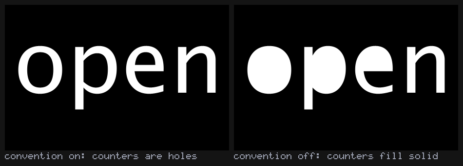

Same filler, same fill rule, same rings — only their direction differs. Measured: 11.9% of the frame
inked with the convention, 17.1% without. The `e` survives in both because its aperture is open to
the outside and so was never a closed ring at all.

The cross-check is that two independent fill rules agree when the winding is right. `EVEN_ODD`
ignores direction and depends on nesting parity instead, so it should produce the *identical* raster:

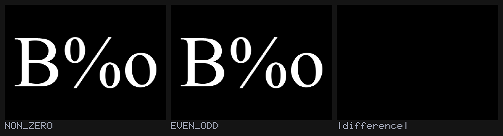

Worst per-pixel difference: `0.00000`. Reverse the hole rings and the two rules diverge — which is
why both are in the API rather than only the one this code happens to use.

You can see the ring structure directly:

```kotlin
val rings = layoutText("aeg", typeface("Serif", 240.0)).toContours()
rings.forEach { println("depth ${it.depth} ${if (it.isHole) "HOLE" else "outer"} area ${it.signedArea}") }
```

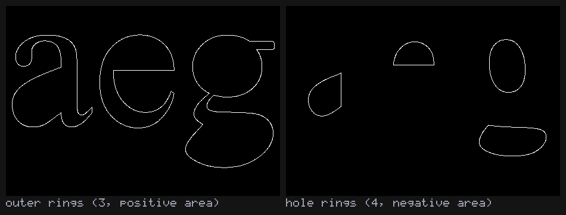

Seven rings for `aeg`: three outer, four holes (the double-storey `g` contributes two), and the
signs run `+ − + − + − −`.

## What layout decided

`layoutText` takes AWT's advances and kerning pairs and adds the things AWT does not do: `\n`,
letter-spacing, alignment, and a mutable transform handle per glyph. Two identities are worth
printing, because they are how you find out that something silently rounded:

```kotlin
val plain = layoutText("minimum", face.withKerning(false))
println(plain.advanceWidth)                                // == the sum of the glyph advances
println(plain.glyphs.sumOf { it.glyph.advance })

val t = 0.16 * face.size
val loose = layoutText("TYPE", face, tracking = t)
val tight = layoutText("TYPE", face)
println(loose.advanceWidth - tight.advanceWidth)           // == (glyphs - 1) * t, exactly
```

Tracking adds one gap per *inter-glyph* space and not one per glyph — the trailing gap nobody asked
for is the classic off-by-one here. Draw the advance boxes and the extra space is visibly *between*
the letters:

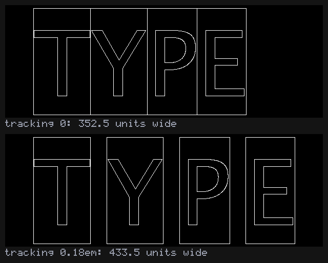

`metricsFLines()` and `advanceBoxFLines()` give you the diagram of the decisions rather than of the
letters. The advance boxes exist for a space too, which is exactly why they are useful:

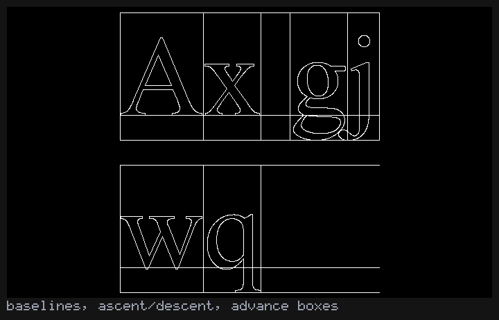

Word wrap measures with the real layout, so it is correct for the tracking and kerning you are going
to use, and all three alignments come off the same wrapped string:

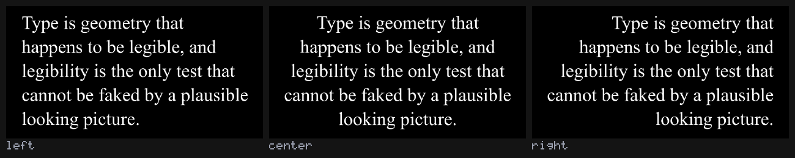

## Text on a curve

`onCurve` does not distort a glyph. It looks the glyph's advance-box centre up at that **distance**
along the path — `FLine.cursor()`'s arc-length table, the same machinery `sampleByDistance` and
`byDashing` use — and then sets that glyph's `rotation` and `pivot`. So the letters stay letters, the
spacing is even in distance rather than in curve parameter, and a multi-line layout follows the curve
in bands instead of collapsing onto it.

```kotlin
val ring = layoutText("AROUND AND AROUND", typeface("SansSerif", 78.0), tracking = 7.0)
// size the circle to the text, not the text to the circle, and the string closes exactly
val onCircle = ring.onCurve(textCircle(radius = ring.advanceWidth / (2 * Math.PI)), align = TextAlign.CENTER)
```

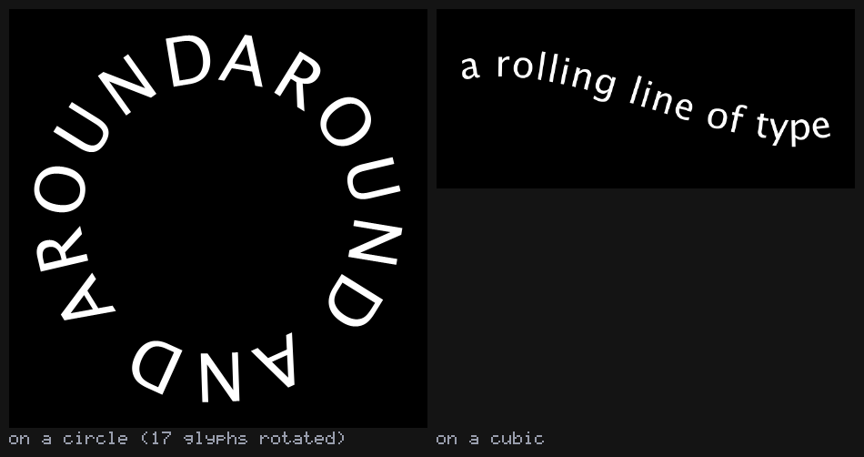

Circumference 937.2 units against a layout width of 937.4. `onCurve` returns a **copy**, so the
straight layout is still straight and can be bent along something else.

## Kinetic typography

The handles are the point of the whole design, not a convenience bolted on afterwards. Every
`PlacedGlyph` carries `offset`, `rotation`, `scale` and `pivot`, and the pivot defaults to the
glyph's own visual centre — so a bare `rotation = 0.3` spins each letter about itself and looks like
what you meant. One layout, computed once, and a function of elapsed seconds written into it:

```kotlin
val layout = layoutText("KINETIC", typeface("SansSerif", 150.0), tracking = 16.0)
val started = System.nanoTime()
animate {
    val t = (System.nanoTime() - started) / 1e9
    layout.eachGlyph { i ->
        val w = 1.7 * t + i * 0.7
        rotation = 0.42 * sin(w)
        scale = vec(1 + 0.22 * cos(w), 1 + 0.22 * cos(w))
        offset = vec(0.0, 30.0 * sin(w * 1.3))
    }
    showImgGrid("t = %.1fs".format(t) to rasterizeText(layout, 1100, 420, window = window), columns = 1)
}
```

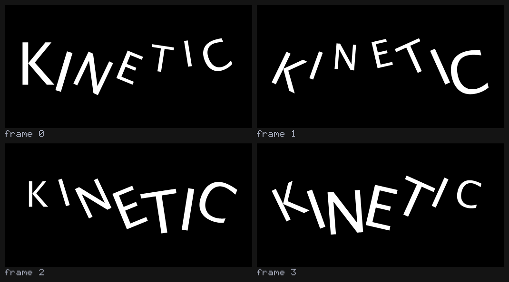

Note the fixed `window`: without it the frame rescales to whatever the letters are doing and no
motion is legible. That is the same lesson `rasterizeFLinesFramed` in `alife_animate.kt` records.

## Extrusion, counters and all

`extrudeMesh` and `triangulatePolygon` in `mesh_generate.kt` say outright that they cannot do holes,
and a letter is a ring *system*. So `toMesh` triangulates the caps with `FloatEarcut` and hole
indices, and builds the walls from the **same flattened vertices the caps used** — which is what
makes the result watertight, and what makes `genus()` a meaningful question about a letter.

```kotlin
val o = layoutText("o", typeface("SansSerif", 170.0)).toMesh(depth = 46.0, centre = true)
println("${o.isWatertight()}, chi ${o.eulerCharacteristic()}, genus ${o.genus()}")   // true, chi 0, genus 1
showMesh(o)                                                                         // shades for you
```

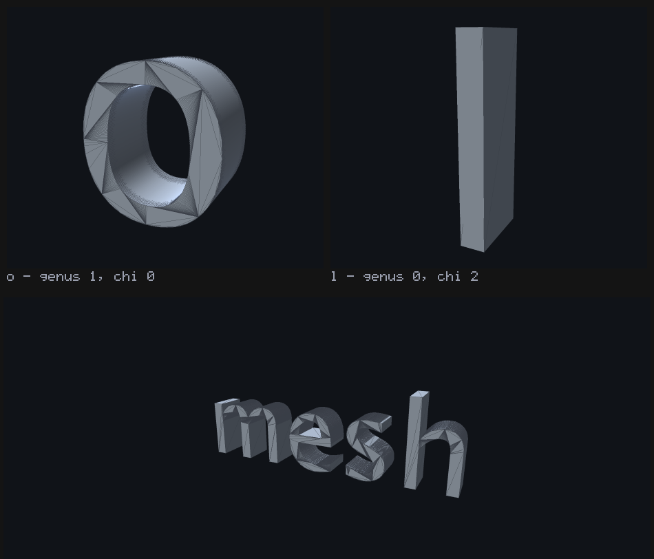

Two claims are being checked there rather than illustrated. **Genus 1 for `o` and 0 for `l`** is a 2D
count (rings nested at odd depth) agreeing with a 3D one (Euler characteristic over the mesh's edges
and faces). And the volume matches the ink area times the depth to within `1e-4` relative — a
shoelace sum against the divergence theorem. A dropped cap triangle, a wall wound the wrong way or an
unpunched counter all break one of those.

Back-face culling is on in `MeshView`, so an inside-out wall would be a *missing* wall in that render
rather than merely odd shading — the same failure a GPU would show you.

Don't reach for `flatShaded()` here, tempting as it looks. It un-welds every triangle into its own
three vertices, so the copy is no longer topologically anything — and `showMesh` computes
`topology()` on whatever you hand it and prints the answer *as fact* in the figure caption
(`mesh_field.kt:383-393`). Pass it a flat-shaded `o` and the caption reads `open (N boundary loop(s))`
directly underneath a line proving the mesh is closed. You don't need it either way: `showMesh`
renders through `toCapturedMesh`, which already applies `shadedNormals` to a mesh that arrives
without normals (`mesh_field.kt:246`), and an extrusion is all creases so that comes out faceted
anyway. Measure and render the welded mesh; keep `flatShaded()` for something that genuinely needs
one vertex per corner.

## Letters in the SDF family

`toSdf` builds a 2D signed-distance grid over the layout, samples it bilinearly and extrudes it in z.
From there a word is just another `ScalarField3D`, which is the entire point:

```kotlin
val sdf = layoutText("SDF", typeface("SansSerif", 170.0)).toSdf(depth = 0.24, gridResolution = 340)
showImg(sdf.distanceField.toImg())
showMeshGrid(
    "marched"  to sdf.march(resolution = 130),
    "+ sphere" to marchingCubes(sdfSmoothUnion(sdf.field, sdfSphere(0.6), 0.18), sdf.bounds, 130),
    "shelled"  to marchingCubes(sdf.field.shell(0.02), sdf.bounds, 150),
    "twisted"  to marchingCubes(sdf.field.twisted(0.5), sdf.bounds, 130),
)
```

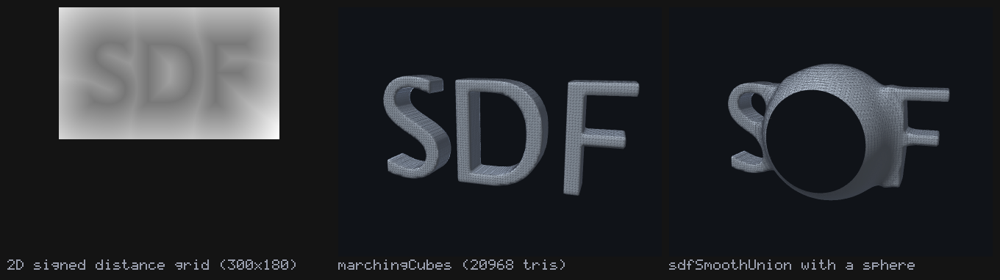

The grid is what limits how crisp a serif can be, not the marching resolution. The sign convention is
`mesh_sdf.kt`'s — **negative inside** — which is the opposite of `GlyphContour.signedArea`'s, and
deliberately so: an area's sign says which way a ring runs, a distance's sign says which side of the
ink you are on.

## Letters as point clouds

The plainest bridge, and the one that opens the most doors: even-by-arc-length samples along the
outlines. Once a word is points, every point-consuming family in the stdlib works on letters.

```kotlin
val layout = layoutText("field", typeface("SansSerif", 200.0))
val points = layout.samplePoints(spacing = 18.0)
val graph = vec2DelaunayGraph(points)
val km = vec2KMedoids(points, k = 6, options = KMedoidsOptions(randomSeed = 11L))
```

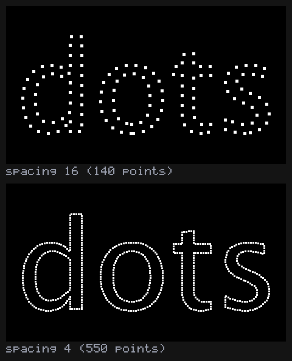

Halving the spacing twice roughly quadruples the count (140 → 550 for 4× finer), which is the honest
check that the resampler is walking arc length rather than emitting one point per stored vertex. From
here: `kMedoids` finds the strokes, `vec2DelaunayGraph` triangulates a word, and the agents in
[Spatial Artificial Life](alife_examples.md) will happily eat a headline.

## Loading a font

```kotlin
typeface("SansSerif", 64.0)                              // logical family: always resolves
Typefaces.named("Futura", 64.0, strict = true)           // throws instead of substituting silently
Typefaces.firstAvailable("Futura", "Avenir", size = 64)  // the first one this machine actually has
Typefaces.fromFile("/path/to/Whatever.ttf", 64.0)        // Font.createFont, not registered globally
```

`Typefaces.available()` lists the installed families, and is held apart from the rest on purpose:
enumerating families needs a `GraphicsEnvironment` and loading a face **by name** does not.

### One platform caveat, and its symptom

A JVM that reads glyph outlines and passes `-XstartOnFirstThread` must also pass
`-Djava.awt.headless=true`, set before any AWT class initialises. On macOS
`sun.font.CFontManager.loadFonts` dispatches to the process's first thread and waits, and under
`-XstartOnFirstThread` — which GLFW requires — that thread only services the dispatch if something is
pumping its run loop. `Typefaces.warm()` detects this in four seconds and throws with the flag in the
message rather than hanging, and every jvm-main gallery in the tree already sets the property in the
first line of `main`.

## Run it yourself

| what | how |
|---|---|
| the eight boxes on this page, in a fresh Field | replay `dev_docs/agents/transcripts/typography_worked_example.yaml` with the agent backdoor (`field_run_transcript`), or open the materialised document at `public/docs/assets/agent_transcripts/typography_worked_example/` |
| `assets/typography_gallery/*.png` (twelve figures) | **committed captures** from the `stdlib.typography.gallery` FIELD_TEST: `python3 tools/run_field_tests.py --id stdlib.typography.gallery --port 9700`, then pass the output dir as `args[0]` to regenerate them here |
| the structural assertions | `./gradlew jvmTest --tests afield.stdlib.TypographyTest` (38 tests) |
| the demo, replayed through the real engine | `python3 tools/run_field_tests.py --id examples.demo-transcript.exec --port 9700` |

Every figure above is a real render of this code. The gallery asserts before it writes — ink fraction
in range, the control arm actually differing, genus and watertightness, the resampler scaling with
spacing — so a panel that produced a plausible blank fails the test rather than shipping.
