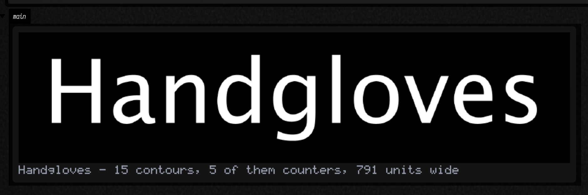
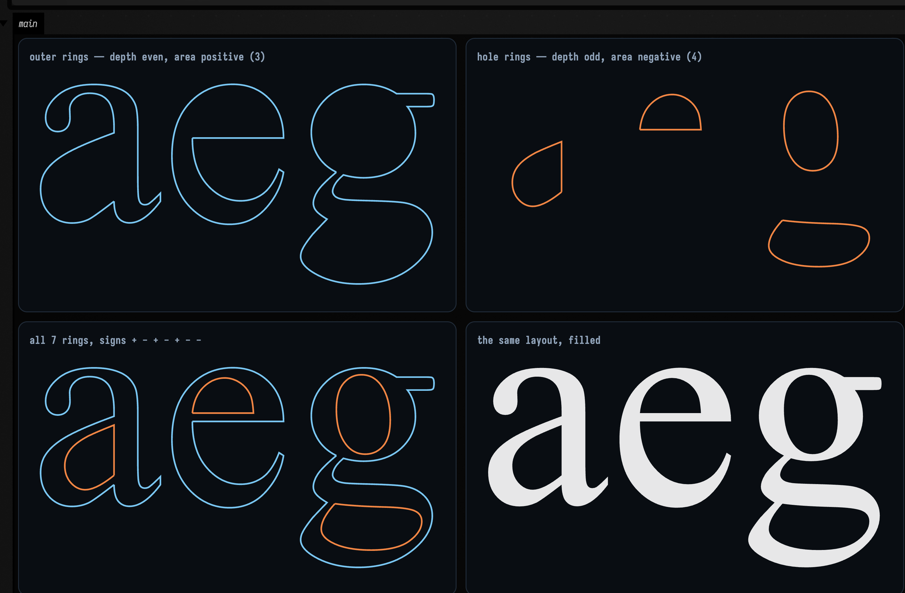
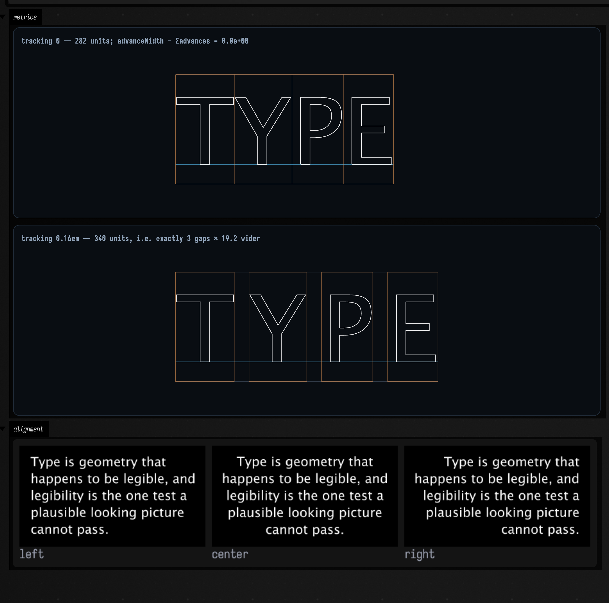
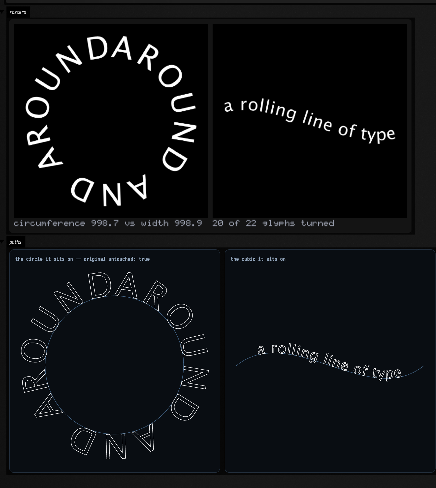
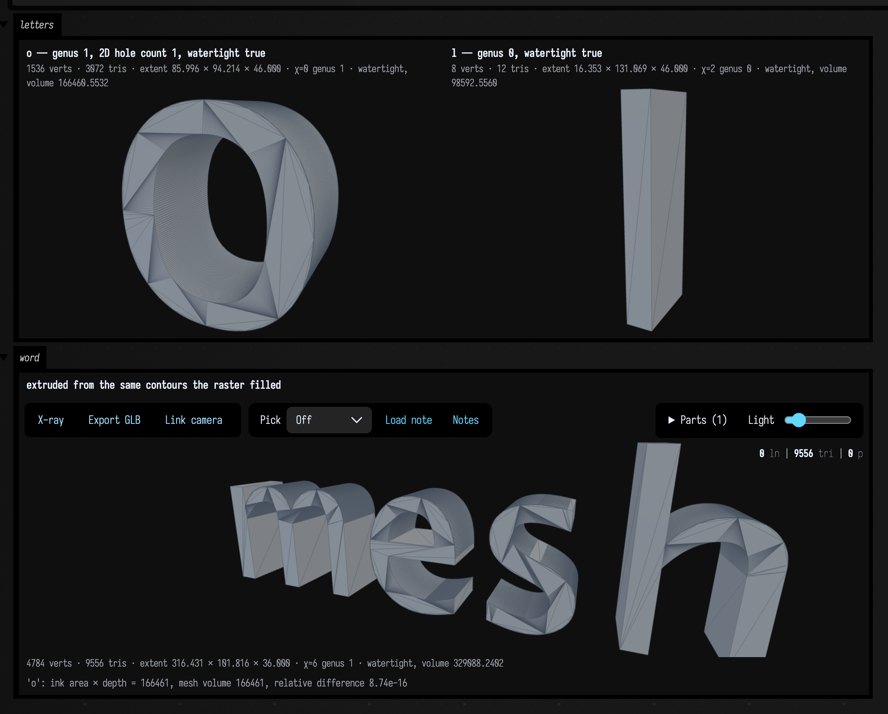
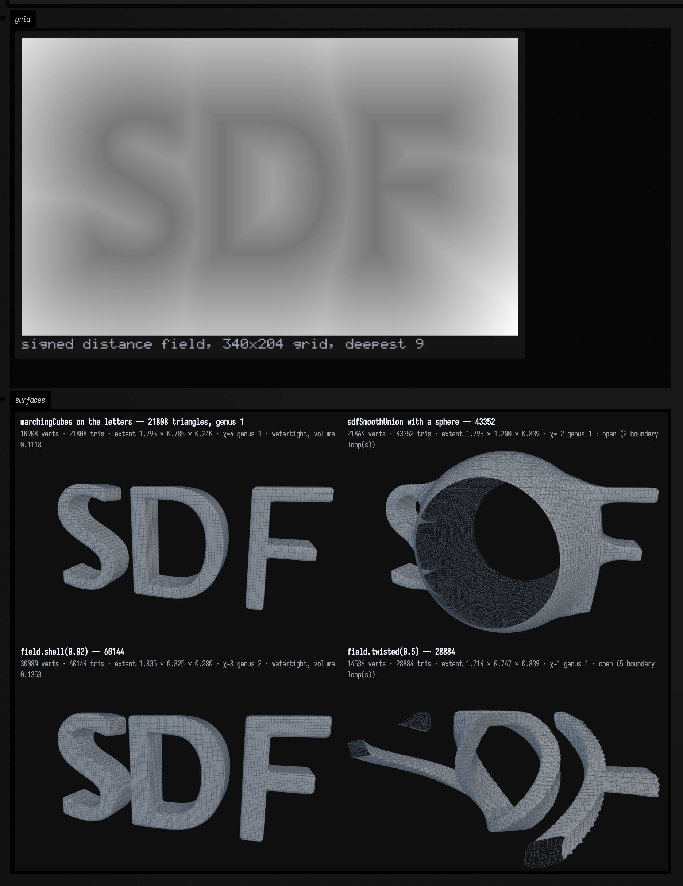
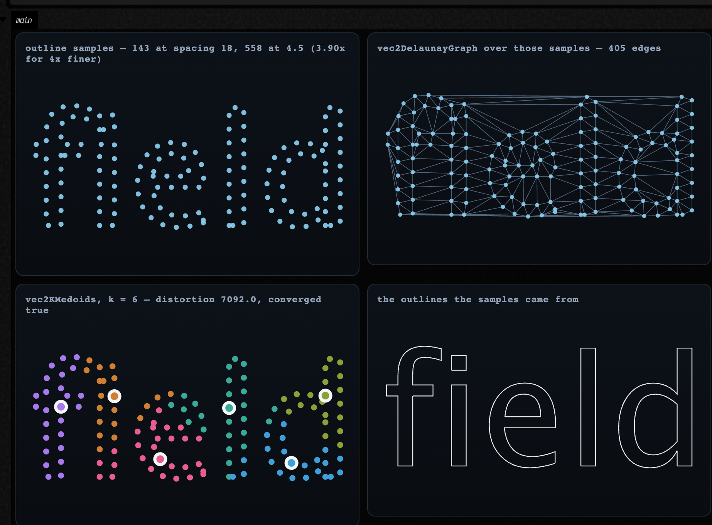

# Typography as geometry — a string becomes contours

*Every public declaration used below is listed, with its KDoc, in the codebase reference:
[Graphics](reference/graphics.md).*

A string in Field is geometry. `GlyphVector.getOutline()` hands back the font's real Bézier outlines,
and everything after that is arithmetic, so a word can be extruded, marched, sampled, clustered or
animated like any other value. Two files do it and they add no dependency.

<div class="field-data-table" markdown>

| what you want | where it is |
|---|---|
| a font at a size; a glyph's rings; a laid-out string with per-glyph handles | `typography.kt` — `Typeface`, `Glyph`, `GlyphContour`, `TextLayout`, `PlacedGlyph` |
| text on a curve, word wrap, measuring | `typography.kt` — `TextLayout.onCurve`, `textCircle`, `wrapText`, `textWidth` |
| letters → `FLine`, `TriMesh`, `ScalarField3D`, `Img`, point clouds | `typography_field.kt` |
| a figure in a box output | `typography_field.kt` — `Box.showText`, `Box.showTextGrid`, `TextLayout.metricsFLines` |

</div>

## Hello, legibility

```diffstatic_runner {data-lang=kotlin screenshot="assets/typography_examples/word.png" wait="3.0" capture="box" open-outputs="true" w="1000" h="640" padding="14"}
:::static
val face = typeface("SansSerif", 140.0)
val word = layoutText("Handgloves", face)

// rasterizeText is a scanline fill over the contours this family extracted. Not drawString.
showImgGrid(
    "Handgloves — %d contours, %d of them counters, %.0f units wide"
        .format(word.contourCount, word.holeCount, word.advanceWidth) to
        rasterizeText(word, 1600, 380),
    columns = 1, cellSide = 900,
)
```



AWT did not draw that raster. `rasterizeText` is a scanline fill over the contours *this family*
extracted, so a legible picture is evidence about the extraction, the winding and the layout rather
than about `Graphics2D.drawString`. It has to work that way in any case: `imaging_field.kt` will not
touch AWT text in-process, which is why `montage` burns its captions in with a 5×7 bitmap table.

## The winding convention, and the control arm

A counter (the hole in `o`, `e`, `a`, `B`) is only a hole if something says so. `isoContourFLines`
in `contours.kt` leaves its winding arbitrary and every consumer downstream has to cope. This family
decides instead:

> A ring's signed area is `½Σ(xᵢyᵢ₊₁ − xᵢ₊₁yᵢ)` in text space. **Outer contours are positive; holes
> are negative.** Nesting depth, how many other rings of the same glyph contain this one, is
> authoritative: even depth is an outer ring, odd depth is a hole. A ring whose area sign disagrees
> with its depth is reversed on the way out.

Skia and Java2D both fill **non-zero**, so a counter survives exactly because its ring runs the
other way and cancels its bowl. Take the convention away and the letters fill in. Below: identical
filler, identical fill rule, identical rings, with the hole rings reversed in the middle cell.

```diffstatic_runner {data-lang=kotlin screenshot="assets/typography_examples/winding.png" wait="3.0" capture="box" open-outputs="true" w="1180" h="620" padding="14"}
:::static
:::fold one face, one window, so the three cells are strictly comparable
val face = typeface("SansSerif", 220.0)
val layout = layoutText("open", face)
val window = layout.bounds
:::endfold

// The control arm is one argument. Same filler, same NON_ZERO rule, same rings — only their
// direction differs, and NON_ZERO cancels a +1 outer against a −1 hole to leave a counter.
val withConvention = rasterizeText(
    layout, 900, 460, window = window,
    fillRule = TextFillRule.NON_ZERO, rings = layout.toContours(honourHoles = true),
)
val withoutConvention = rasterizeText(
    layout, 900, 460, window = window,
    fillRule = TextFillRule.NON_ZERO, rings = layout.toContours(honourHoles = false),
)

// EVEN_ODD counts crossings and ignores direction, depending on nesting parity instead. Over
// correct rings it must produce the IDENTICAL raster — two independent rules agreeing.
val evenOdd = rasterizeText(layout, 900, 460, window = window, fillRule = TextFillRule.EVEN_ODD)

:::fold measure the ink and the worst per-pixel disagreement, then draw the three cells
var worst = 0.0
for (y in 0 until withConvention.height) for (x in 0 until withConvention.width) {
    worst = maxOf(worst, kotlin.math.abs(withConvention.at(x, y, 0) - evenOdd.at(x, y, 0)).toDouble())
}
// Captions are drawn by montage's own 5x7 bitmap table and are clipped to the cell, so keep
// them short enough to survive.
showImgGrid(
    "convention on — %.1f%% ink".format(100 * withConvention.inkFraction()) to withConvention,
    "convention off — %.1f%% ink".format(100 * withoutConvention.inkFraction()) to withoutConvention,
    "EVEN_ODD: max diff %.5f".format(worst) to evenOdd,
    columns = 3, cellSide = 380,
)
:::endfold
```


The counters of `o` and `p` close up in the middle cell and the ink fraction rises to prove it. The
`e` survives in **both**, because its aperture is open to the outside: it was never a closed ring, so
there is nothing for a winding rule to get wrong.

The third cell is the cross-check. `EVEN_ODD` ignores direction entirely, so over correct rings it
must produce the *identical* raster, and the worst per-pixel difference printed in its caption is
`0.00000`. Reverse the hole rings and the two rules diverge. Both fill rules are in the API for that
reason, not only the one this code happens to use.

## The rings themselves

```diffstatic_runner {data-lang=kotlin screenshot="assets/typography_examples/rings.png" wait="3.0" capture="box" open-outputs="true" w="1080" h="640" padding="14"}
:::static
val layout = layoutText("aeg", typeface("Serif", 240.0))

// Every ring of the layout, still classified: depth is containment, isHole is depth parity,
// signedArea is the direction that classification forced.
val rings = layout.toContours()

:::fold one closed FLine per ring, tinted by classification
val lines = rings.map { ring ->
    fline {
        ring.points.forEachIndexed { i, p -> if (i == 0) moveTo(p.x, p.y) else lineTo(p.x, p.y) }
        lineTo(ring.points[0].x, ring.points[0].y)
        color = if (ring.isHole) vec(1.0, 0.55, 0.28, 0.95) else vec(0.5, 0.82, 1.0, 0.95)
        thickness = 1.8
    } to ring.isHole
}
val signs = rings.joinToString(" ") { if (it.signedArea > 0) "+" else "−" }
showPlaneGrid(
    "outer rings — depth even, area positive (${rings.count { !it.isHole }})" to lines.filter { !it.second }.map { it.first },
    "hole rings — depth odd, area negative (${rings.count { it.isHole }})" to lines.filter { it.second }.map { it.first },
    "all ${rings.size} rings, signs $signs" to lines.map { it.first },
    "the same layout, filled" to layout.toFLines(filled = true, stroked = false, thickness = 1.0),
    columns = 2, cellWidth = 460, cellHeight = 250, window = layout.bounds,
)
:::endfold
```



Seven rings for `aeg`: three outer and four holes, because the double-storey `g` contributes two. In
the hole panel those four little loops float in space exactly where the counters are. A letter is a
ring *system*, and that panel is the system with its outer rings taken away.

## What layout decided

`layoutText` takes AWT's advances and kerning pairs and adds the things AWT does not do: `\n`,
letter-spacing, alignment, and a mutable transform handle per glyph.

```diffstatic_runner {data-lang=kotlin screenshot="assets/typography_examples/layout.png" wait="3.5" capture="box" open-outputs="true" w="1000" h="1160" padding="14"}
:::static
:::fold one face, and prose to wrap
val face = typeface("SansSerif", 120.0)
val prose = wrapText(
    "Type is geometry that happens to be legible, and legibility is the one test " +
        "a plausible looking picture cannot pass.",
    face.atSize(44.0), maxWidth = 620.0,
)
:::endfold

// Identity one: kerning off, no tracking — the line is the sum of its advances. Two different
// AWT paths (accumulated pen positions vs per-glyph metrics) that have to agree.
val plain = layoutText("minimum", face.withKerning(false))
val drift = plain.advanceWidth - plain.glyphs.sumOf { it.glyph.advance }

// Identity two: tracking adds one gap per INTER-GLYPH space, not one per glyph. The trailing gap
// nobody asked for is the classic off-by-one, and the advance boxes below show where it went.
val t = 0.16 * face.size
val tight = layoutText("TYPE", face)
val loose = layoutText("TYPE", face, tracking = t)

:::fold draw the metrics diagram, then the same wrapped paragraph in all three alignments
// Two figures, so two CHANNELS: a second display on the same channel replaces the first.
showPlaneGrid(
    "tracking 0 — %.0f units; advanceWidth − Σadvances = %.1e".format(tight.advanceWidth, drift) to
        (tight.metricsFLines() + tight.advanceBoxFLines() + tight.toFLines(thickness = 1.0)),
    "tracking 0.16em — %.0f units, i.e. exactly %d gaps × %.1f wider"
        .format(loose.advanceWidth, tight.glyphs.size - 1, t) to
        (loose.metricsFLines() + loose.advanceBoxFLines() + loose.toFLines(thickness = 1.0)),
    channel = "metrics", columns = 1, cellWidth = 880, cellHeight = 240,
    window = afield.Rect(-20.0, -face.ascent - 20, loose.advanceWidth + 40, face.lineHeight + 40),
)
showImgGrid(
    *TextAlign.entries.map { a ->
        a.name.lowercase() to rasterizeText(layoutText(prose, face.atSize(44.0), align = a, lineSpacing = 1.12), 700, 380)
    }.toTypedArray(),
    channel = "alignment", columns = 3, cellSide = 290,
)
:::endfold
```



The first two panels diagram the *decisions* rather than the letters: `metricsFLines()` draws
baseline, ascent and descent, and `advanceBoxFLines()` draws one box per glyph, including for a
space, which has no glyph to draw and is why the boxes are useful. Compare the two rows and the
extra space is visibly *between* the letters and not after the last one.

Word wrap measures with the real layout, so it is correct for the tracking and kerning you are
actually going to use, and all three alignments come off the same wrapped string.

## Text on a curve

`onCurve` does not distort a glyph. It looks the glyph's advance-box centre up at that **distance**
along the path, using `FLine.cursor()`'s arc-length table (the same machinery `sampleByDistance` and
`byDashing` use), and then sets that glyph's `rotation` and `pivot`. So the letters stay letters, the
spacing is even in distance rather than in curve parameter, and a multi-line layout follows the curve
in bands instead of collapsing onto it.

```diffstatic_runner {data-lang=kotlin screenshot="assets/typography_examples/on_a_curve.png" wait="3.0" capture="box" open-outputs="true" w="940" h="1080" padding="14"}
:::static
:::fold a face, a string, and a cubic to bend the second one along
val face = typeface("SansSerif", 78.0)
val ring = layoutText("AROUND AND AROUND", face, tracking = 7.0)
val wave = fline {
    moveTo(0.0, 0.0)
    cubicTo(300.0, -240.0, 720.0, 240.0, 1020.0, 0.0)
}
:::endfold

// Size the circle to the text rather than the text to the circle: a circumference equal to the
// layout's width means the string closes exactly, with no gap and no overlap at the seam.
val circle = textCircle(radius = ring.advanceWidth / (2 * Math.PI))
val onCircle = ring.onCurve(circle, align = TextAlign.CENTER)
val onWave = layoutText("a rolling line of type", face, tracking = 2.0).onCurve(wave, align = TextAlign.CENTER)

:::fold the filled rasters, then the paths they sit on
// Two figures, two CHANNELS: a second display on one channel replaces the first.
showImgGrid(
    "circumference %.1f vs width %.1f".format(circle.arcLength(), ring.advanceWidth) to
        rasterizeText(onCircle, 620, 620),
    "%d of %d glyphs turned".format(onWave.glyphs.count { kotlin.math.abs(it.rotation) > 0.05 }, onWave.glyphs.size) to
        rasterizeText(onWave, 620, 620),
    channel = "rasters", columns = 2, cellSide = 420,
)
showPlaneGrid(
    "the circle it sits on — original untouched: ${ring.glyphs.all { it.isUntransformed }}" to
        (listOf(circle.copy { color = vec(0.4, 0.6, 0.8, 0.6); thickness = 1.0 }) + onCircle.toFLines(thickness = 1.0)),
    "the cubic it sits on" to
        (listOf(wave.copy { color = vec(0.4, 0.6, 0.8, 0.6); thickness = 1.0 }) + onWave.toFLines(thickness = 1.0)),
    channel = "paths", columns = 2, cellWidth = 430, cellHeight = 430,
)
:::endfold
```



The first caption gives **998.7** of circumference against **998.9** of layout width. Two tenths of a
unit over a thousand is what "closes exactly" costs, and it is the reason to size the circle from the
text rather than the other way round. The lower row is the paths themselves with the letters as
outlines on them, and its caption records that `onCurve` returned a **copy**, so the straight layout
is still straight and can be bent along something else.

## Kinetic typography

Every `PlacedGlyph` carries `offset`, `rotation`, `scale` and `pivot`, and the pivot defaults to the
glyph's own visual centre, so a bare `rotation = 0.3` spins each letter about itself and looks like
what you meant. One layout, computed once, and a function of elapsed seconds written into it.

(`animate { }` and the `AnimationClock` it reads are Field's frame model; if you want to know what a
frame actually is, and what stops one, see [Frames and the animation loop](animation_time_model.md).)

```diffstatic_runner {data-lang=kotlin video="assets/typography_examples/kinetic.mp4" capture="box" open-outputs="true" wait-output="true" wait-output-kind="display" execution="launch" duration="8" fps="20" timeout="300" w="900" embed=true name="typography-kinetic" alt="the word KINETIC with a travelling wave of rotation, scale and vertical lift running left to right through the letters, each letter turning about its own centre inside a frame that never moves"}
:::static
:::fold the face, the layout, and a window fixed from the widest the wave will ever get
val face = typeface("SansSerif", 150.0)
val layout = layoutText("KINETIC", face, tracking = 16.0)
// A FIXED frame, not fit-to-contents: left to rescale to each frame's own bounds the letters would
// move and the picture would stand still. Probe both extremes of the wave and union them.
val window = run {
    val probe = layoutText("KINETIC", face, tracking = 16.0)
    probe.eachGlyph { i -> rotation = 0.5; scale = vec(1.3, 1.3); offset = vec(0.0, 34.0) }
    val a = probe.bounds
    probe.eachGlyph { i -> rotation = -0.5; scale = vec(1.3, 1.3); offset = vec(0.0, -34.0) }
    a.union(probe.bounds)
}
val started = AnimationClock.nowSeconds()
:::endfold

// The line you would change: elapsed seconds and a glyph index in, a travelling wave out. During
// offline capture AnimationClock derives elapsed time exactly from frame index / fps.
fun waveAt(elapsed: Double, i: Int): Double = 1.7 * elapsed + i * 0.7

animate {
    val elapsed = AnimationClock.nowSeconds() - started
    layout.eachGlyph { i ->
        val w = waveAt(elapsed, i)
        rotation = 0.42 * kotlin.math.sin(w)
        val s = 1.0 + 0.22 * kotlin.math.cos(w)
        scale = vec(s, s)
        offset = vec(0.0, 30.0 * kotlin.math.sin(w * 1.3))
    }
    showImgGrid(
        "t = %.1fs".format(elapsed) to rasterizeText(layout, 1100, 420, window = window),
        columns = 1, cellSide = 820,
    )
}
```

Three handles per letter and one wave function is the whole animation. Note the fixed `window`:
without it the frame rescales to whatever the letters are doing and no motion is legible.
`rasterizeFLinesFramed` in `alife_animate.kt` records the same constraint.

## Extrusion, counters and all

`triangulatePolygon` in `mesh_generate.kt` says outright that holes are not supported, and
`extrudeMesh` caps with it, so neither can build a letter: a letter is a ring *system*. `toMesh`
triangulates the caps with `FloatEarcut` and hole indices instead, and builds the walls from the
**same flattened vertices the caps used**, so every wall meets a cap on a shared edge and the
surface closes. `genus()` is then a meaningful question to ask about a letter.

```diffstatic_runner {data-lang=kotlin screenshot="assets/typography_examples/mesh.png" wait="4.0" capture="box" open-outputs="true" w="960" h="1140" padding="14"}
:::static
:::fold three extrusions off the same contour extractor
val face = typeface("SansSerif", 170.0)
val o = layoutText("o", face).toMesh(depth = 46.0, centre = true)
val l = layoutText("l", face).toMesh(depth = 46.0, centre = true)
val word = layoutText("mesh", typeface("SansSerif", 130.0)).toMesh(depth = 36.0, centre = true)
:::endfold

// A 2D count against a 3D one. The hole count comes from ring nesting in the plane; the genus comes
// from counting the mesh's vertices, edges and faces. They have no reason to agree unless the
// extruder is right.
val holesIn2D = layoutText("o", face).holeCount

// A 2D area against a 3D volume: a shoelace sum times the depth, against the divergence theorem
// over the triangles. A dropped cap triangle or a wall wound the wrong way breaks it.
val expected = layoutText("o", face).glyphs.sumOf { it.glyph.inkArea } * 46.0
val measured = layoutText("o", face).toMesh(depth = 46.0, yUp = false).volume()

:::fold draw them — note what is NOT here: flatShaded()
// flatShaded() un-welds every triangle, and the genus in these labels is topology() over whatever
// you hand it — so a flat-shaded copy would label itself "genus null, watertight false" while
// looking identical. The `word` panel below goes further: single-mesh showMesh writes its own fact
// line, and that line would read "open (N boundary loop(s))". Unnecessary as well: both renderers
// apply shadedNormals to a mesh that arrives without normals for you.
showMeshGrid(
    "o — genus ${o.genus()}, 2D hole count $holesIn2D, watertight ${o.isWatertight()}" to o,
    "l — genus ${l.genus()}, watertight ${l.isWatertight()}" to l,
    channel = "letters", columns = 2, cellWidth = 420,
    view = MeshView(yawDegrees = 26.0, pitchDegrees = 16.0, distance = 3.2),
)
showMesh(
    word,
    channel = "word",
    view = MeshView(yawDegrees = 22.0, pitchDegrees = 14.0, distance = 2.6, width = 820, height = 340),
    title = "extruded from the same contours the raster filled",
    caption = "'o': ink area × depth = %.0f, mesh volume %.0f, relative difference %.2e"
        .format(expected, measured, kotlin.math.abs(expected - measured) / expected),
)
:::endfold
```



The two panel labels are composed by the box, calling `genus()` and `isWatertight()` on the mesh it
is about to draw, so they cannot describe some other mesh. **Genus 1 for `o` and 0 for `l`** is a 2D
count (rings nested at odd depth) agreeing with a 3D one (χ over the mesh's vertices, edges and
faces), and the volume matches the ink area times the depth to `8.7e-16` relative, a shoelace sum
agreeing with the divergence theorem to the last bit of a double. A dropped cap triangle, a wall
wound the wrong way or an unpunched counter breaks one of the two. (The fact line under the `word`
panel is the *renderer's* own, computed by `showMesh` from what it was handed; a `showMeshGrid` sheet
does not carry one, and [Field's 3D output](three_output.md#showmesh-and-the-renderer-parameter) says
why.)

Back-face culling is on in `MeshView`, so an inside-out wall would be a *missing* wall in that render
rather than merely odd shading. A GPU fails it the same way.

!!! warning "Don't reach for `flatShaded()` here"

    It un-welds every triangle into its own three vertices, so the copy is no longer topologically
    anything, and the single-mesh `showMesh` computes `topology()` on whatever you hand it and
    prints the answer *as fact* in the figure's fact line (`TriMesh.threeFacts()` on the viewer path,
    `TriMesh.toFigureHtml` on the CPU one, one shared sentence). Pass it a flat-shaded `o` and that
    line reads `open (N boundary loop(s))` right beside a title stating the mesh is closed.
    You don't need it either way: both renderers prepare the mesh through the same step, which
    already applies `shadedNormals` to one that arrives without normals, and an extrusion is
    all creases so it comes out faceted anyway.

## Letters in the SDF family

`toSdf` builds a 2D signed-distance grid over the layout, samples it bilinearly and extrudes it in z.
From there a word is just another `ScalarField3D`.

```diffstatic_runner {data-lang=kotlin screenshot="assets/typography_examples/sdf.png" wait="5.0" capture="box" open-outputs="true" w="980" h="1420" padding="14"}
:::static
val layout = layoutText("SDF", typeface("SansSerif", 170.0))
val sdf = layout.toSdf(depth = 0.24, gridResolution = 340)

// Once the letters are a field, the whole SDF family applies to them unchanged — which is the
// entire reason for this bridge existing.
val marched = sdf.march(resolution = 130)
val melted = marchingCubes(sdfSmoothUnion(sdf.field, sdfSphere(0.6, vec(0.0, 0.0, 0.0)), 0.18), sdf.bounds, 130)
val hollow = marchingCubes(sdf.field.shell(0.02), sdf.bounds, 150)
val wrung = marchingCubes(sdf.field.twisted(0.5), sdf.bounds, 130)

:::fold draw the grid and the four surfaces
val grid = sdf.distanceField
// showImgGrid rather than showImg: showImg sends its caption as a separate output message,
// which the image then replaces, so the caption never survives to the page. montage only ever
// scales a tile DOWN, so upscale the grid first or it lands as a 340px thumbnail.
showImgGrid(
    "signed distance field, %dx%d grid, deepest %.0f".format(grid.nx, grid.ny, grid.deepestInside()) to
        grid.toImg().upscaleNearest(2),
    channel = "grid", columns = 1, cellSide = 880,
)
showMeshGrid(
    "marchingCubes on the letters — ${marched.triangleCount} triangles, genus ${marched.genus()}" to marched,
    "sdfSmoothUnion with a sphere — ${melted.triangleCount}" to melted,
    "field.shell(0.02) — ${hollow.triangleCount}" to hollow,
    "field.twisted(0.5) — ${wrung.triangleCount}" to wrung,
    channel = "surfaces", columns = 2, cellWidth = 420,
    view = MeshView(yawDegrees = 18.0, pitchDegrees = 12.0, distance = 2.6),
)
:::endfold
```



The **grid** is what limits how crisp a serif can be, rather than the marching resolution. The sign
convention is `mesh_sdf.kt`'s, **negative inside**, the opposite of `GlyphContour.signedArea`'s: an
area's sign says which way a ring runs, a distance's sign says which side of the ink you are on.

## Letters as point clouds

The plainest bridge is even-by-arc-length samples along the outlines. Once a word is points, every
point-consuming family in the stdlib works on letters.

```diffstatic_runner {data-lang=kotlin screenshot="assets/typography_examples/points.png" wait="3.0" capture="box" open-outputs="true" w="1000" h="700" padding="14"}
:::static
val layout = layoutText("field", typeface("SansSerif", 200.0))

// Even by ARC LENGTH, so halving the spacing twice roughly quadruples the count. That ratio is the
// a real check that the resampler walks the curve rather than emitting one point per stored vertex.
val coarse = layout.samplePoints(spacing = 18.0)
val fine = layout.samplePoints(spacing = 4.5)

// And now every point-consuming family in the stdlib eats a word.
val graph = vec2DelaunayGraph(coarse)
val km = vec2KMedoids(coarse, k = 6, options = KMedoidsOptions(randomSeed = 11L))

:::fold four views of the same word, all sharing one window
val layer = ClusterLayer("outline strokes", km.labels)
showPlaneGrid(
    "outline samples — ${coarse.size} at spacing 18, ${fine.size} at 4.5 (%.2fx for 4x finer)"
        .format(fine.size.toDouble() / coarse.size) to listOf(layout.toPointFLine(spacing = 18.0, pointSize = 1.1)),
    "vec2DelaunayGraph over those samples — ${graph.edges.size} edges" to
        listOf(graph.toFLine(coarse, thickness = 0.8), layout.toPointFLine(spacing = 18.0, pointSize = 0.9)),
    "vec2KMedoids, k = 6 — distortion %.1f, converged ${km.converged}".format(km.distortion) to
        layer.toFLines(coarse, centers = km.medoids, drawSpokes = false),
    "the outlines the samples came from" to layout.toFLines(thickness = 1.2),
    columns = 2, cellWidth = 420, cellHeight = 250, window = layout.bounds,
)
:::endfold
```



**143** points at spacing 18 and **558** at 4.5: a `3.90×` rise for a 4× finer spacing, near enough
to linear that the resampler is walking arc length and not emitting one point per stored vertex. From
here `vec2KMedoids` finds the strokes, `vec2DelaunayGraph` triangulates a word, and the agents in
[Spatial Artificial Life](alife_examples.md) will happily eat a headline.

## Loading a font

```diffstatic {data-lang=kotlin}
typeface("SansSerif", 64.0)                              // logical family: always resolves
Typefaces.named("Futura", 64.0, strict = true)           // throws instead of substituting silently
Typefaces.firstAvailable("Futura", "Avenir", size = 64)  // the first one this machine actually has
Typefaces.fromFile("/path/to/Whatever.ttf", 64.0)        // Font.createFont, not registered globally
```

`Typefaces.available()` lists the installed families, and is held apart from the rest:
enumerating families needs a `GraphicsEnvironment` and loading a face **by name** does not.

Because the figures above are rendered on whatever machine builds these docs, they are set in that
machine's logical `SansSerif` and `Serif`. Build them somewhere else and the pictures look different
and are equally correct. Every claim on this page is therefore about a *structural* property rather
than a particular curve.

### One platform caveat, and its symptom

A JVM that reads glyph outlines and passes `-XstartOnFirstThread` must also pass
`-Djava.awt.headless=true`, set before any AWT class initialises. On macOS
`sun.font.CFontManager.loadFonts` dispatches to the process's first thread and waits, and under
`-XstartOnFirstThread`, which GLFW requires, that thread only services the dispatch if something is
pumping its run loop. `Typefaces.warm()` detects this in four seconds and throws with the flag in the
message rather than hanging. Field's own desktop JVM sets it (`build.gradle.kts`, `requiredRunJvmArgs`),
so you only meet this in a JVM you launched yourself.

## Run it yourself

<div class="field-data-table" markdown>

| what | how |
|---|---|
| every figure on this page | it *is* the docs build: `uv run --group docs python tools/build_zensical_docs.py --page typography_examples.md`. Each fence's code runs in a live Field and the image is what came out |
| the eight boxes as a document you can edit | replay `dev_docs/agents/transcripts/typography_worked_example.yaml` with the agent backdoor (`field_run_transcript`), or open the materialised document at `public/docs/assets/agent_transcripts/typography_worked_example/` |
| the structural assertions | `./gradlew jvmTest --tests afield.stdlib.TypographyTest` (38 tests) |
| the demo, replayed through the real engine | `python3 tools/run_field_tests.py --id examples.demo-transcript.exec --port 9700` |

</div>
