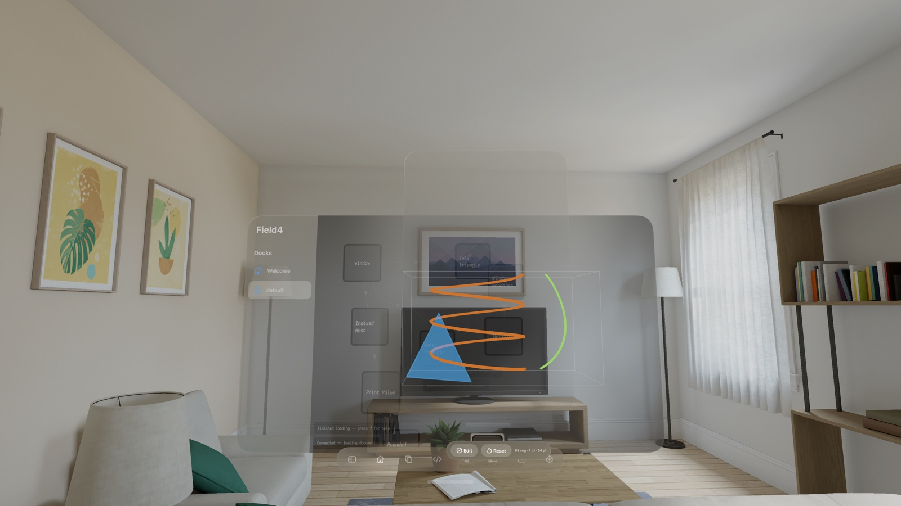
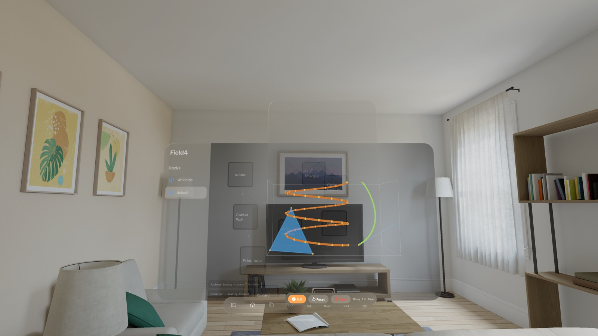

# Field on Apple Vision Pro — work in progress

!!! warning "Work in progress"
    This is an early snapshot of Field's native **visionOS** front end. Some pieces are
    solid and verified; others are half-built and named as such. Expect it to move.

Field's front end and its Vulkan renderer already talk to each other over JSON — the browser is
just one client of the Field server. That decoupling is what makes a spatial front end tractable:
instead of trying to cram a desktop UI into a headset, we give each half of Field a native home on
visionOS and let them float in the room.

- **Docks** — the existing Field web UI (editor, canvas, welcome) rendered in `WKWebView`s the
  system composites and drives. HTML stays HTML; we never texture it.
- **Islands** — native **RealityKit** geometry for the things that want to be genuinely 3D.
- **Streams** — the GPU renderer's output carried to the headset as native video.
- **Poses** — and, since the head-tracking work below, one channel running the *other* way: where the
  wearer is looking, back up to the Mac, so the renderer can draw the frame the headset is about to
  show rather than a surface hanging in the room.

All four are scoped projections of the *same* server-authoritative document, so nothing here forks
Field: the visionOS app is a third client alongside the browser, speaking the protocols Field
already has.

The web docks also behave as one workspace rather than isolated browser windows: selection follows
between a canvas and its floating editor, and canvas-owned panels are routed to the right surface.
For example, choosing **Show Document History** from the editor opens the full-width History panel
over the paired canvas instead of covering Monaco.

---

## Native 3D FLine viewer — working

The first native island: a RealityKit viewer for **FLines** (Field's line/geometry primitive), the
native equivalent of the in-browser three.js viewer. It subscribes to every live FLine view on the
Field server — the same views you get from `threeLines(...)` in a box — and renders them fully in 3D.


*A live `threeLines(...)` view in the native viewer: strokes as swept 3D tubes, a translucent filled
triangle, a cubic curve, inside a light wireframe bounding cage.*

What it does today:

- **Real 3D geometry.** Strokes become swept **tubes** (with genuine thickness — a step up from the
  browser's flat 1px lines), fills become triangle meshes, and nodes become spheres. Colour and
  transparency come straight from the FLine.
- **Manipulation.** Drag to orbit, pinch to scale, one tap to reset the framing. The model
  auto-frames itself into its window when it arrives or changes.
- **A bounding cage.** A light wireframe cuboid tracks the model as you rotate and scale it, then
  crossfades to sit upright and window-aligned when you let go — a quiet spatial reference frame.
- **Interactivity.** Tapping an interactive FLine fires its server-side `onClick` callback with the
  nearest vertex, exactly as the browser viewer does.

### Editing

When a view is opened editable (`threeLines(..., editable = true)`), the viewer becomes a spatial
editor:


*Edit mode. Amber spheres are node anchors; cyan spheres are cubic **Bézier control points** (with
faint control-polygon lines back to their anchors). Drag any of them to reshape the curve.*

- Drag an **anchor** to move a node; drag a **control point** to bend a Bézier tangent.
- Edits apply optimistically in the headset and are sent back to the server, so the authoritative
  FLine stays in sync.

It lives in a movable, resizable **volumetric window** — grab its bar to reposition it, drag its
corners to resize.

---

## Live Metal — programmable native graphics

The second native surface, and a different bargain from the FLine viewer: instead of Field sending
geometry to be displayed, the headset runs a **program** of yours. A box opens a mixed-immersion
Compositor Services scene with its own Metal render thread, and you live-code against it.

A program has three explicit parts, in three places:

| Part | Where you write it |
|---|---|
| **shader** | the box's `msl` property — Metal Shading Language, both entry points |
| **geometry** | `geometry { … }` in the box's Kotlin, which runs *in the headset* |
| **uniforms** | the `uniforms=` list on the box's `// {{ visionmetal }}` marker |

```diffstatic {data-lang=kotlin}
// {{ visionmetal uniforms=phase,amount,tint }}
onStart {
    geometry {
        color(1.0, 0.35, 0.15)
        cube(0.18, cx = 0.45, cz = -1.2, tintFaces = true)
    }
    uniform("amount", 0.025)
    onFrame { frame -> uniform("phase", frame.time * 3.0) }
}
```

The Kotlin compiles to JavaScript and runs in a small JavaScriptCore context *on the render thread* —
not in a web view, and not in the animation path over the network. `geometry { … }` builds an indexed
triangle mesh in the headset and hands the whole thing to Metal in one call, so nothing per-vertex
crosses the wire at frame rate. Alongside a raw `vertex`/`triangle`/`quad` builder there are `cube`,
`plane`, `sphere`, and `tube` — which sweeps a polygon along a polyline, the same real-thickness
treatment the FLine viewer gives a stroke. **[Building geometry in the headset](vision_geometry.md)**
covers the builder in full, with runnable starting points.

Each part reloads on its own. Editing the shader and pressing **Reload MSL** recompiles the pipeline
on the headset while your Kotlin, your geometry, and the frame clock all keep running — and a failed
compile leaves the last working shader on screen and reports the Metal error back into Field at your
own line number. The shader reads its uniforms by name (`u_phase`), because the head generates the
`#define`s from the declared list.

Field's Kotlin side sees MSL as a real language: `msl` is a box property with its own syntax
highlighting and completion (the ABI structs, the `u_NAME` uniforms *that box* declares, and snippets
for both entry points), and it saves beside the box as a `.metal` file.

**What's verified where.** The earlier proof-of-concept — one shader, one built-in cube, uniforms on
the compositor clock — runs on a physical Vision Pro, and the round trip from a Kotlin edit to a
changed image is immediate rather than laggy.

The three-part structure described above is newer, and most of it turns out to be checkable without a
headset, because it is orthogonal to the things a simulator can't do. A script drives the real app in
the **visionOS simulator** and asserts on the status messages the head sends back over the wire: that
Apple's Metal compiler accepts the generated shader preamble, that Kotlin-built geometry arrives as
the mesh the builder's arithmetic predicts, that a shader-only reload leaves the script and geometry
running, and that a broken shader reports the author's own line number. All of that passes. What the
simulator cannot judge — per-eye separation, spatial input, display timing — is device work, and this
particular slice barely touches it.

---

## RTT streaming — working (mono)

For everything that isn't lines — the full Vulkan-rendered scene — Field streams the render target
to the headset as native video. On macOS the Vulkan RTT is backed directly by an IOSurface that
VideoToolbox can wrap; on Linux the sender imports an exported Vulkan allocation through CUDA.
The encoded HEVC/H.264 access units travel over a small UDP protocol. The visionOS client
reassembles and decodes them, converts the decoded NV12 buffer into a RealityKit texture, and
presents it on a screen you can place in the room.

This spine is **verified end-to-end**: Field renders → encodes → streams → the visionOS app
reassembles, decodes, and displays it, with correct colour, and it survives the sender restarting.
The stream can be shown either on a world-locked "cinema" screen or in an ordinary movable/resizable
window.

---

## RTT + stereo — working

Stereoscopic output was the headline we were building toward, and it works. The capture and encode
path produces **side-by-side stereo frames**, and a Camera Index Switch ShaderGraph material samples
the left half of the frame for the left eye and the right half for the right.

This needed a real Vision Pro to confirm, because the simulator renders a single mono view — true
per-eye separation, the thing that makes stereo *stereo*, is invisible there. It is confirmed on
hardware.

Getting it smooth turned out to be a separate hunt from getting it correct, and worth recording: the
visible hiccup was **Wi-Fi contention from screen-sharing the Mac into the headset**, not the
pipeline. Every in-app counter stayed clean throughout, because contention delays datagrams rather
than losing them — so the metrics all looked fine while the image did not. Check what else is on the
link before you distrust the code. The hunt did surface real defects, all fixed: a frame pacer that
discarded the remainder on a late tick (29.56fps against a 30fps target — fatal on a 90Hz display,
where 30.00fps is exactly three refreshes and any deficit accumulates into a held frame), a
presentation timestamp taken from the wall clock at emit time rather than derived from the sequence
number, and the absence of a receiver-side buffer. The receiver now runs a depth-servoed presentation
clock, which contradicts the present-on-arrival rule the wire format started with — that
was the wrong trade for a 90Hz display.

---

## Head tracking — the pose comes back up

Everything above runs one way. The RTT stream carries pixels down, `__visionmetal__` carries a
program down, and nothing tells the Mac where the wearer is looking. That ceiling is why the stereo
stream in the previous section can only ever be a *surface* placed in the room: correct,
stereoscopic, world-locked. A renderer that does not know the head pose has nothing else to draw.

`__visionpose__` (`VisionPose.kt:82#const val VISION_POSE_CHANNEL`) is the one channel in Field that
runs device to host. It is JSON on the same `/ws` bus the browser uses: a `visionpose/hello`, then a
`visionpose/frame` per compositor frame, then a `visionpose/bye`. A frame carries the head transform,
and each eye's transform and projection, as 16-float column-major arrays, plus the head's predicted
display time in its own clock.

It is sent from the one point in the Compositor Services renderer that already holds both the
drawable and the device anchor (`PoseUplink.swift:164#func record(drawable: LayerRenderer.Drawable`),
so the pose that travels is the pose that drawable was rendered from rather than a pose sampled
nearby. The sender is latest-wins and never queues — a pose is only useful while it is the newest
one, and a queue here would turn network jitter into accumulating pose delay.

**One thing measured rather than assumed, because it does not present as what it is.** Field's `/ws`
reader dispatches each raw message in its own coroutine, so poses decode concurrently and finish out
of order — 9–10% of them, reproduced across three runs against the simulator (123/1382, 181/1962,
230/2400). Publication is therefore monotonic under a lock
(`VisionPose.kt:418#private fun publish(frame: VisionPoseFrame)`). Without that guard `latest` walks
backwards several times a second, and what a wearer sees is not lag — it is the world *swimming*.

---

## Rendering from the head's own pose

`StereoPoseSource` is the third pose source on `SideBySideStereoTarget`, beside an attached OpenXR
headset and the desktop mock, and it wins over both when set. What makes it a separate interface
rather than one more branch is a single property: a remote pose arrives asynchronously, so it has to
be **latched** (`StereoPoseSource.kt:36#fun latch(): Boolean`) once per frame, before both eye
passes.

Read it per eye instead and the head moves between the left and right pass. That is worth dwelling on
because of *how* it fails: it does not look like latency. It looks like the two eyes disagreeing,
which is close to impossible to recognise from inside a headset — you feel unwell without being able
to say why.

Three further decisions that change behaviour rather than tidy it:

- **The projection is rebuilt, not forwarded.** The head's matrix carries its own compositor's
  near/far and depth range; Field's pipelines want `Options.zNear`/`zFar` over a 0..1 range. So only
  the convention-free part crosses over — the frustum tangents
  (`VisionPose.kt:545#internal fun tangentsFromProjection`) — and Field builds its own matrix from
  them. The view matrix *is* forwarded untouched, because the wire already carries world-to-eye.
- **Losing tracking freezes the view rather than snapping it to the origin.** A frozen image reads as
  "tracking dropped"; a snap to the origin reads as a broken scene.
- **The target records which pose it drew from** (`StereoPoseSource.kt:39#val latchedFrameId: Long`,
  `StereoPoseSource.kt:45#val latchedDisplayTime: Double`) — which is what the next section needs.

Tracked accessories — a PSVR2 Sense controller — ride the *same* message as the pose, so input and
the image it acts on describe one instant, and they report into the same `ControllerState` the OpenXR
path already fills. Field's interaction code cannot tell which backend it is running on.

**Not verified, and not claimed:** no controller has ever been read. `AccessoryTrackingProvider`
reports `isSupported` as false on the simulator, so the button and axis mapping is a best guess that
degrades to "not pressed". That is a device-only item and it is open.

---

## Carrying the pose back down: media wire v2

For the head to *reproject* a frame it has received, it must know which pose that frame was drawn
from. So the media header grew a 16-byte **pose tail** — `poseFrameId` and `poseDisplayTimeNanos`
(`WIRE_FORMAT.md:57#poseDisplayTimeNanos u64`) — gated by a `POSE_VALID` flag rather than a sentinel,
because compositor frame index 0 is perfectly legitimate. `FieldRTTStreamer.tagPosesFrom`
(`FieldRTTStreamer.kt:106#fun tagPosesFrom`) wires a stereo target's latched pose into the stream, on
the tick that rendered the surface rather than in the deferred submit block where a newer pose could
silently substitute itself.

The interesting part is what was *not* reused. `ptsMicros` looks like the obvious home for a
timestamp and is not one: it is stamped on the ideal cadence grid (`seq * interval`)
precisely so the receiver has something regular to schedule against. A real clock reading there would
bake render-tick quantisation into the stream, and a receiver pacing off it would faithfully
reproduce that irregularity. `poseDisplayTimeNanos` is in the **head's** clock, not the sender's,
because the head is the only consumer — it hands the value straight back to
`queryDeviceAnchor(atTimestamp:)`.

**Versions 1 and 2 are both permanent**, which is a decision and not a migration left half-done. The
macOS sender emits v2 because its head is a Vision Pro reporting its pose back up; the Linux/NVENC
sender emits v1 because its host tracks locally through OpenXR and has *nothing* to put in the tail.
A receiver parses both, keyed on the version byte.

**Nothing on the head consumes the pose tail yet.** Frames carry it and the receiver parses it, but
reprojection needs the present path moved off RealityKit onto Compositor Services. That is the same
change the next section is waiting for, and it has not been made.

---

## Where the latency goes

Before optimising any of this there is one call to make
(`VisionPose.kt:666#fun visionPoseLatencyReport(`):

```diffstatic {data-lang=kotlin}
import afield.graphics.visionPoseLatencyReport
println(visionPoseLatencyReport())
```

The point is **attribution** rather than a single number, because the plausible explanations for "it
feels laggy" are spread across two machines and at least two of the stages are meant to be there.
Folding them into one total invites someone to "fix" them.

The headline figure needs no clock agreement at all, which is exactly what makes it trustworthy: a
pose's `predictedDisplayTime` is in the head's clock, the media wire carries it back down as
`poseDisplayTimeNanos`, and the device subtracts two of its *own* timestamps. The ping/pong clock
offset (`VisionPoseLatency.kt:147#fun headToHostNanos`) exists only to split the remainder into our
side and theirs, and it keeps the **minimum**-RTT sample — averaging round trips on a contended link
estimates the contention, not the offset.

Read the spans, not the total. Two of them are deliberate:

- the receiver's **jitter buffer** holds frames, so that network jitter becomes smoothness
  instead of dropped frames (`RTTStream.swift:77#static let bufferFrames`; set `FIELD4_RTT_BUFFER=0`
  for the unbuffered comparison);
- **`submit to encoded` includes the render fence**
  (`VisionPoseLatency.kt:60#const val SUBMIT_TO_ENCODED`), so scene complexity lands there rather
  than somewhere misleading.

And the limit. The last moment observable on the device is the decoded frame reaching the
display texture; actual presentation is up to one refresh later, and RealityKit exposes no hook for
it. So the motion-to-photon figure is a **lower bound, and says so in its own name**
(`PoseLatency.swift:32#static let poseToTexture` is spelled
`head: POSE to texture (motion-to-photon lower bound)`). That closes when the present path moves to
Compositor Services — the same change reprojection needs. Faking it before then would produce a
number nobody could trust.

Here is the report with **no headset attached**, run through a live Field box on the machine that
built this page:

```diffstatic {data-lang=text}
heads attached = 0
latest pose = null
vision pose/stream latency
  clock offset UNKNOWN — no pong yet; host/device spans cannot be compared
  --- this machine ---
  pose uplink transit                    (no samples)
  pose age when latched                  (no samples)
  latch to frame submit                  (no samples)
  submit to encoded (incl. render fence) (no samples)
  --- the head ---
  (no report from the head yet)
  note: the head's last observable moment is the texture upload, so any motion-to-photon figure above is short by up to one compositor frame.
```

Showing the empty one first is deliberate. The four<!--count:visionPoseHostSpans--> spans this machine
can time on its own clock are named whether or not they hold samples, "no pong yet" stays
distinguishable from "the offset is zero", and the lower-bound caveat is printed by the code rather
than remembered by a reader.

But an empty table only teaches you the shape of the table. Here is the same readout with the stages
populated, printed by the `visionpose.latency` smoke test — which drives a **synthetic head** with a
known clock offset and known one-way delays, and needs no hardware:

```diffstatic {data-lang=text}
vision pose/stream latency
  head clock = host clock +1234567.547 ms (best RTT 10.69 ms, 7 pongs)
  --- this machine ---
  pose uplink transit                    (no samples)
  pose age when latched                  (no samples)
  latch to frame submit                  p50    4.00  p95    4.00  max    8.00  n=2
  submit to encoded (incl. render fence) p50   11.00  p95   11.00  max   11.00  n=1
  --- the head ---
  head: jitter buffer hold (deliberate)  p50   33.40  p95   50.10  max   66.80  n=900
  head: POSE to texture (motion-to-photon lower bound) p50   72.50  p95   98.20  max  140.00  n=900
  note: the head's last observable moment is the texture upload, so any motion-to-photon figure above is short by up to one compositor frame.
```

**Read that for its structure, not its magnitudes** — and it is worth being exact about which is
which, because a table like this invites being quoted as a benchmark:

- The **span values are fixtures.** `33.40`, `72.50`, `n=900`, the `4`/`8`/`11` ms host samples: the
  test writes those in, so they say nothing about how fast anything is. What they demonstrate is that
  a device-reported span survives the wire intact, that percentiles and counts land in the right
  columns, and that a *negative* span is dropped rather than counted as zero — `submit to encoded`
  shows `n=1` from two recorded samples, one of which was negative, and counting it would have
  pulled every percentile down with nothing to show why.
- The **clock offset is genuinely recovered, not written in.** The synthetic head is built at an
  offset of `+1234567.890 ms`; the estimator recovered `+1234567.547 ms` from seven round trips on
  this machine without ever being told the answer. That is the one figure here measured rather than
  fixtured, and it is the one worth checking, because a wrong offset does not fail — it produces a
  *plausible* latency, which is the kind of wrong nobody re-checks. The smoke's own bound is a
  loose 20 ms: a sign slip would be out by twice the offset and a missing halving by the
  offset itself, and what fits inside that window is host scheduling noise on a shared machine.
- The **`best RTT 10.69 ms`** is against a synthetic path of two 5 ms crossings, with the head's own
  2 ms hold correctly excluded rather than charged to the network.

So the arithmetic is checked and nothing else is. **No span in either table has ever been measured
against real hardware.** The head defines five<!--count:visionPoseDeviceSpans--> spans of its own and
the fixture above exercises two of them; on the visionOS simulator the device's spans stay empty
regardless, because there is no video stream there to time.

---

## Hand tracking — on OpenXR, and a pinch can now point

Worth stating plainly, because its absence from the rest of this page could be read as an oversight.
Field gained `XR_EXT_hand_tracking` on the **OpenXR** path: 26 per-joint poses per hand and a
geometric `pinchStrength` interpolated from thumb-tip to index-tip distance, 50 mm to 10 mm
(`OpenXRHmdTarget.kt:292#fun handState(hand: Hand)`). Confirmed against WiVRn on a Quest 3.

It is still **not part of the visionOS story at all** — on visionOS hands remain a separate concept and
are not implemented, and `StereoPoseSource` carries controllers, not hands.

What changed on 2026-08-26 is that it acquired its first reader. `pinchPointer`
(`pointing_pointer.kt:228#fun pinchPointer`) turns a `HandTrackingState` into a ray plus a select
value, and `OpenXRHmdTarget.pinchPointer` binds it to `handState(hand)` directly
(`pointing_pointer.kt:299`), so a pinched hand drives the same picking layer as a mouse or a
controller. Two cautions, both from the branch that wrote it. The ray's **default** convention
(wrist through pinch point) is a design choice with no in-tree precedent — pass `eye` for
gaze-through-pinch instead, which is the better convention where a head pose is available. And every
test constructs the `HandTrackingState` the function was designed around, so **the binding to a real
device is untested**: what is pinned is the arithmetic and the tracking-loss branches, not that a Quest
or an Index fills those fields the way the code assumes.

---

## Status at a glance

Read the third column first. It is the one that decays, and this page has been behind the code
before.

| Capability | State | How that is known |
|---|---|---|
| Native 3D FLine viewer — render, orbit/scale, auto-frame, bounding cage | **Working** | On device |
| FLine interactivity (tap → server callback) | **Working** | On device |
| FLine editing — node + Bézier control-point drag | **Working** | On device |
| Web UI as spatial docks (editor / canvas / welcome) | **Working** | On device |
| Shared dock selection + editor-to-canvas History panel routing | **Working** | Browser regression tests |
| Live Metal — live shader + uniforms on the compositor clock | **Working** | On device |
| Live Metal — headset-built geometry, per-part reload, `msl` as a property | **Built and smoke-tested** | Simulator script asserts on the head's own status messages; device check pending |
| RTT video streaming (mono), world-locked + windowed | **Working** | Verified end-to-end on device |
| RTT stereo (per-eye present) | **Working** | Confirmed on device — the simulator renders one mono view and cannot judge it |
| Frame pacing + receiver presentation clock | **Fixed** | On device; the residual hiccup was Wi-Fi contention, not the pipeline |
| Pose uplink `__visionpose__` (device → host) | **Working** | `visionpose.uplink` pins the wire decode and composition; `vision_pose_simulator_smoke.sh` takes it end to end in the simulator |
| Head-tracked stereo rendering from an uplinked pose | **Built, arithmetic verified** | `visionpose.stereo-source` checks the rebuilt frustum *geometrically*. **Real head motion and true per-eye separation are device-only and unverified** |
| Media wire v2 pose tail (`poseFrameId`, `poseDisplayTimeNanos`) | **Working** | `tools/rtt_wire_check.py` drives the real helper and reads real datagrams |
| Reprojection on the head from the pose tail | **Not built** | Needs the present path moved off RealityKit onto Compositor Services |
| Latency attribution — `visionPoseLatencyReport()` | **Built, arithmetic verified** | `visionpose.latency` recovers a known offset from a synthetic head. **No span has ever been measured against real hardware** |
| Tracked accessories (PSVR2 Sense) over the pose channel | **Written, never read** | `AccessoryTrackingProvider.isSupported` is false on the simulator; the button/axis mapping is a guess that degrades to "not pressed" |
| Hand tracking (26 joints, `pinchStrength`) | **OpenXR only; read by the pointer layer** | WiVRn + Quest 3. `pinchPointer` consumes `handState` as of 2026-08-26, tested against constructed hand states only — never a device. Nothing on visionOS |

Three<!--count:visionPoseSmokeTests--> of those rows lean on smoke tests that run without a headset,
and they are named in the reference below so you can run them yourself.

---

## Reference — where this actually lives

Cross-checked against source on every `docsGates` run, so a rename here breaks the build rather than
rotting unnoticed. The Swift rows are here because this is a two-machine protocol, and a page citing
only the Kotlin end would be describing one side of it.

**How this list was chosen, and where it is blind.** Not by hand. The Kotlin half is the closure over
the `import afield.*` symbols of every `FIELD_TEST` tagged `visionos`, resolved to declaring files;
the wire half comes from the channel set `ServerSurfaceLedgerTest` scrapes out of Kotlin source and
set-equality-matches against `dev_docs/server_surface_inventory.md`; the Swift half is every `.swift`
file the Xcode project compiles — which is *every* file under `Field4Vision/`, because the project
uses a filesystem-synchronized group and `project.pbxproj` contains no `.swift` strings at all, so
anyone reading sources out of that file gets an empty list.

Worth saying plainly, because it is the sort of gap a hand-written list hides: **the tag enumerator
does not see the OpenXR side-by-side path at all.** `ImGuiVrPanelSmokeTest` is the only `FIELD_TEST`
in the tree that constructs a `SideBySideStereoTarget`, and it carries no `tags:` line — so `tags:
[…visionos…]` is a *visionOS* census, not an XR one, and `OpenXRHmdTarget` and
`SideBySideStereoTarget` reach this table only through the import closure. Two things sit outside
every census here: `SimpleSpatialAudio.setListenerFromSideBySide` drives spatial audio off the stereo
target and nothing classifies it as XR, and `src/jsVision/` is two tracked files in no Gradle
compilation, so it is not a client and has no rows below.

| What | Where | Anchor |
|---|---|---|
| The device→host channel name | `VisionPose.kt:82` | `const val VISION_POSE_CHANNEL` |
| The newest-pose holder, and its counters | `VisionPose.kt:273` | `object VisionPoseStream` |
| Monotonic publication under a lock | `VisionPose.kt:418` | `private fun publish(frame: VisionPoseFrame)` |
| Frustum tangents out of the compositor's projection | `VisionPose.kt:545` | `internal fun tangentsFromProjection` |
| The one call to make on device | `VisionPose.kt:666` | `fun visionPoseLatencyReport(` |
| Clock-offset conversion, head → host | `VisionPoseLatency.kt:147` | `fun headToHostNanos` |
| The deliberate render-fence span | `VisionPoseLatency.kt:60` | `const val SUBMIT_TO_ENCODED` |
| Latch-once-per-frame contract | `StereoPoseSource.kt:36` | `fun latch(): Boolean` |
| Which pose a frame was drawn from | `StereoPoseSource.kt:39` | `val latchedFrameId: Long` |
| The head's own display time for that pose | `StereoPoseSource.kt:45` | `val latchedDisplayTime: Double` |
| The implementation over the pose stream | `VisionPoseStereoSource.kt:33` | `class VisionPoseStereoSource` |
| Poses latched twice because none arrived | `VisionPoseStereoSource.kt:45` | `var staleLatchCount` |
| The target this plugs into | `SideBySideStereoTarget.kt:41` | `class SideBySideStereoTarget` |
| Where a remote pose overrides OpenXR and the mock | `SideBySideStereoTarget.kt:96` | `var poseSource` |
| What the target recorded it drew from | `SideBySideStereoTarget.kt:105` | `var renderedPoseFrameId` |
| …and that pose's display time | `SideBySideStereoTarget.kt:109` | `var renderedPoseDisplayTime` |
| The multiview sibling, with no pose source | `SideBySideStereoTarget.kt:498` | `class MultiviewSideBySideStereoTarget` |
| The desktop mock a remote pose replaces | `SideBySideStereoTarget.kt:880` | `class StereoCamera` |
| …and the eye separation it invents | `SideBySideStereoTarget.kt:881` | `var ipd` |
| Tagging a stream's frames with the latched pose | `FieldRTTStreamer.kt:106` | `fun tagPosesFrom` |
| The pair a frame carries, or neither | `FieldRTTStreamer.kt:341` | `class StreamPose` |
| Hand tracking on the OpenXR path | `OpenXRHmdTarget.kt:292` | `fun handState(hand: Hand)` |
| …the per-hand state it returns | `OpenXRHmdTarget.kt:208` | `class HandTrackingState` |
| …and the 26 joints it is keyed by | `OpenXRHmdTarget.kt:198` | `class HandJoint` |
| Spatial audio driven off the stereo target | `SimpleSpatialAudio.kt:638` | `fun setListenerFromSideBySide` |
| The pose tail in the media header | `WIRE_FORMAT.md:57` | `poseDisplayTimeNanos u64` |
| Where the pose is captured on the head | `PoseUplink.swift:164` | `func record(drawable: LayerRenderer.Drawable` |
| The lower-bound span, named as one | `PoseLatency.swift:32` | `static let poseToTexture` |
| The deliberate jitter buffer | `RTTStream.swift:77` | `static let bufferFrames` |
| The one clock all three Swift files share | `CompositorClock.swift:16` | `var timeInterval: TimeInterval` |
| The uplink sender on the head | `PoseUplink.swift:18` | `class PoseUplink` |
| Where ARKit and GameController are joined | `ControllerTracker.swift:21` | `class ControllerTracker` |
| The header parser, both versions | `RTTWireFormat.swift:14` | `enum RTTWire` |
| The parser's only execution coverage | `RTTWireSelfCheck.swift:21` | `enum RTTWireSelfCheck` |

Runnable without a headset, through the canonical runner
(`python3 tools/run_field_tests.py --id <id>`):

- **`visionpose.uplink`** — the wire decode, the world-to-eye composition and the tangent extraction
  against hand-computed values. This is the half a headset cannot check for you: a transposed matrix
  or a swapped eye reads as "the world is wrong somehow" and looks perfectly correct in a screenshot.
- **`visionpose.stereo-source`** — the rebuilt frustum, checked *geometrically*: a point on each
  frustum edge must land on the matching clip boundary and the near plane at NDC z 0. Comparing matrix
  entries against a literal would pass just as happily with the depth range inverted, which renders a
  plausible image with the wrong things in front.
- **`visionpose.latency`** — recovers a known clock offset from a synthetic head, and pins that a
  congested sample cannot displace a clean one. A wrong offset yields a *plausible* latency rather
  than a failure, which is the one kind of wrong nobody re-checks.

Those three are the pose tests. Four more carry the same `visionos` tag and cover the Live Metal half:
`visionmetal.kotlinjs-externals` (the Kotlin→JS geometry externals), `visionmetal.msl-language` (the
MSL editor language, driven under Node), `vision.geometry-preview` (the CPU preview gallery), and
`remotejs.kotlinjs-head-profiles`. Run them the same way.

Two things none of them reach, stated rather than implied: `tools/rtt_wire_check.py` covers the real
datagram bytes but not the head, and `tools/vision_pose_simulator_smoke.sh` reaches a real compositor
pose in the visionOS simulator but the simulator reports **one** view where hardware reports two.

The architecture note behind this page — seams, decisions and the full verification map — is
`dev_docs/vision_frontend.md`. Related pages: **[Building geometry in the
headset](vision_geometry.md)**, **[Kotlin in the head](kotlin_in_the_head.md)**, **[RemoteJS and
WebXR](ar_reference.md)** for the browser-based sibling, **[ImGui as a VR
panel](imgui_vr_panel.md)** for the same side-by-side stereo path on the desktop, and
**[afield.four Graphics](afield_four_graphics.md)** for `FieldRTTStreamer`, the producer half of the
streaming spine.

---

## Trying it

The visionOS app is a standalone Xcode project (visionOS 26 SDK) that points at a running Field
server. In short:

1. Start a Field server and build/run the visionOS app against it.
2. In Field, run a box with `threeLines(myLines, editable = true)`.
3. In the headset, open the **FLine 3D** viewer — it discovers the live view and renders it. Toggle
   **Edit** to grab the handles.
4. With a head attached, `println(visionPoseLatencyReport())` from any box prints the whole chain.
   With no head attached it prints the same table empty, which is a useful thing to see first.

The screenshots above are from the visionOS simulator. Spatial-input feel and video smoothness are
best judged on real hardware — the simulator can't drive spatial gestures and throttles the immersive
scene — so those remain the active on-device verification items, alongside real head motion, true
per-eye separation, controller input, and every latency span on this page.
