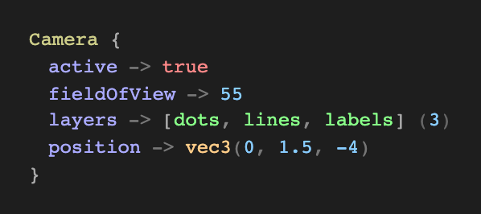
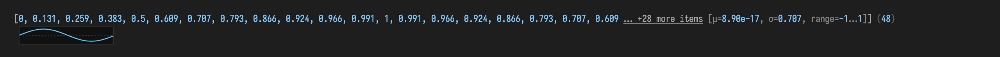
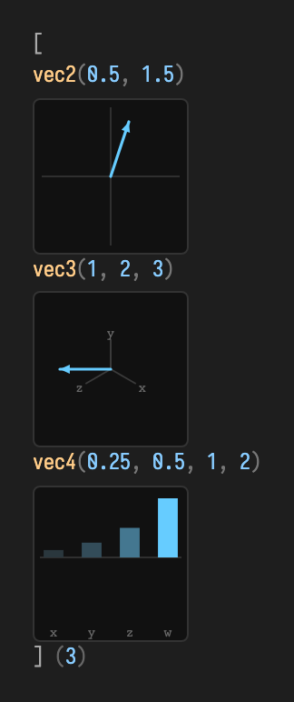
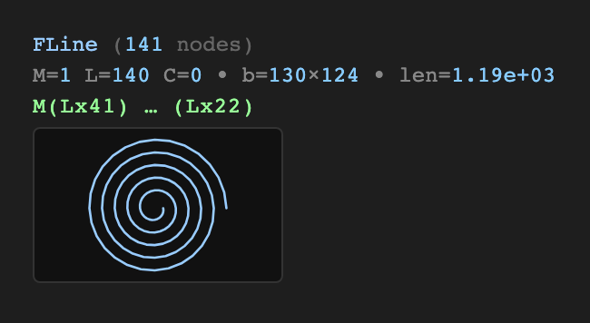
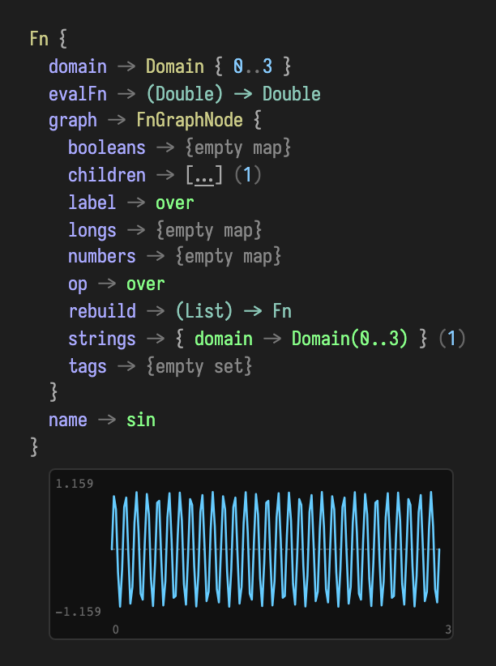

# Visualizers, Displays, and Little Instruments

*Every public declaration used below is listed, with its KDoc, in the codebase reference: [`ValueVisualizer.kt`](reference/visualization.md#valuevisualizer-kt), [`plotly.kt`](reference/visualization.md#plotly-kt). Start from [what's already in the box](reference/index.md).*

Field has a surprisingly rich vocabulary for showing values, not just computing them.

Some visuals live **inline in the editor** next to a line of code. Some live in **output areas** under a box. Some turn output areas into **inspectors** or **little control panels**. And some helpers, like `.h` and `.h2`, are really about turning arbitrary Kotlin values into usefully formatted things that are easy to read.

This page is a tour of the whole family.

## The value visualizer: what `.h` draws

Before the instruments, the substrate. Most environments answer "what is this
value?" with a line of `toString()`. Field answers with a *picture*: whenever you
ask Field to show a value, the **value visualizer** turns it into a compact HTML
view — a reflective tree for arbitrary objects, and, for the types Field draws
with, a little inline graphic that reads at a glance. You reach it three ways, all
of which call the same renderer (`ValueVisualizer.visualize(...)`, in
`src/jvmMain/kotlin/afield/visualization/ValueVisualizer.kt`):

```diffstatic {data-lang=kotlin}
:::static
value.h                       // the .h extension: value -> pretty HTML
display("inspect", value.h)   // drop that HTML into a named output channel
box.viz(value = value)        // convenience: visualize into the box's "viz" channel
```

`.h` is the lightweight view used throughout Field; its heavier sibling `.h2`
opens a paged browser for large structures. The built-in and reflective paths are
deliberately forgiving: they track recursion by reference, cap depth and preview
sizes, catch reflective getter failures, and guard optional plots and thumbnails
(including a throwing `Fn.evalFn`). Objects implementing `ToHTML` and callbacks
registered with `registerValuePrinter` are extension points whose returned HTML is
trusted. Every image in this section was captured straight from the real renderer
— nothing here is a mock-up.

### The reflective tree

Give the visualizer an ordinary object — a data class, a map, anything with
readable properties — and it walks the members into an indented tree. Numbers,
booleans, strings, and nested values are each rendered by the same rules,
recursively.

```diffstatic {data-lang=kotlin}
:::static
data class Camera(
    val position: Vector3f,
    val fieldOfView: Double,
    val active: Boolean,
    val layers: List<String>
)

val cam = Camera(Vector3f(0f, 1.5f, -4f), 55.0, true, listOf("dots", "lines", "labels"))
cam.h
```



Notice that the tree is not flat text: the nested `position` is itself rendered as
a `vec3`, and `layers` collapses to a list with a size count. The renderer keeps
only a handful of fields inline (with a "… +N more fields" expander for the rest)
so a large object never floods the output.

### Numeric collections, with stats

Arrays and lists of numbers get a preview plus a one-line statistical summary —
mean, standard deviation, and range — so you can judge a buffer without scrolling
through it. Long collections elide the middle:

```diffstatic {data-lang=kotlin}
:::static
val samples = DoubleArray(48) { i -> sin(i / 48.0 * 2.0 * Math.PI) }
samples.h
```



The tail reads `… +28 more items [μ=8.90e-17, σ=0.707, range=−1…1] (48)`: the
sampled sine averages to ~0, has the expected 0.707 RMS spread, and spans −1…1 —
visible immediately, without a plot. The same treatment applies to `IntArray`,
`FloatArray`, and numeric `List`s.

### Vectors, matrices, and quaternions

Field's generated linear-algebra types render as compact, colour-coded tokens
rather than as reflective trees — the point of a `vec3` is its three numbers, not
its class internals:

```diffstatic {data-lang=kotlin}
:::static
listOf(vec(0.5, 1.5), vec(1.0, 2.0, 3.0), vec(0.25, 0.5, 1.0, 2.0)).h
```



Matrices summarise rather than dump every cell: a `mat3` shows its determinant, a
`mat4` shows determinant plus extracted translation, and a quaternion shows its
four components. Here they are keyed by a map, which the visualizer renders as a
tree — a good way to label several related values at once:

```diffstatic {data-lang=kotlin}
:::static
linkedMapOf(
    "scale (mat3)"     to Matrix3f().set(2f,0f,0f, 0f,3f,0f, 0f,0f,1f),
    "translate (mat4)" to Matrix4f().identity().apply { set(3,0,5f); set(3,1,-2f); set(3,2,1f) },
    "spin (quat)"      to Quaternionf().rotateY(0.6f)
).h
```


The `mat3` reports `det=6` (2 × 3 × 1), the `mat4` reports `det=1, t=(5, -2, 1)`,
and the quaternion shows its normalized components. For the algebra behind these
types, see [Linear Algebra](linear_algebra.md).

### An `FLine`, drawn

An [`FLine`](fline_examples.md) — Field's core drawable path — is where the
renderer stops summarising and starts *drawing*. Alongside its node counts,
bounding box, length, and a compressed path signature, it appends a small inline
SVG thumbnail of the actual geometry:

```diffstatic {data-lang=kotlin}
:::static
val spiral = FLine()
val steps = 140
for (i in 0..steps) {
    val t = i.toDouble() / steps
    val a = t * 5.0 * 2.0 * Math.PI
    val r = 8.0 + t * 60.0
    val x = 80.0 + Math.cos(a) * r
    val y = 80.0 + Math.sin(a) * r
    if (i == 0) spiral.moveTo(x, y) else spiral.lineTo(x, y)
}
spiral.h
```



The header reads `FLine (141 nodes)`, then `M=1 L=140 C=0 · b=130×124 ·
len=1.19e+03`, then the run-compressed signature `M(Lx41) … (Lx22)`, and finally
the thumbnail. The thumbnail is normalised into its box and only rendered for
paths under a complexity budget, so pasting a huge path into a value view never
becomes a rendering hazard.

### An `Fn`, plotted

The richest case is a [`Functions.Fn`](functions_examples.md). Field keeps the
full reflective tree — its `domain`, `evalFn`, `graph`, and `name` — because that
graph is the function's rebuildable structure. Then, below it, it appends a safe
SVG line plot of the function sampled over a finite window of its domain:

```diffstatic {data-lang=kotlin}
:::static
with(Functions) {
    val fn = sin(10) over (0.0..3.0)
    fn.h
}
```



The plot mirrors `Fn`'s own sampling rules: an unbounded domain falls back to a
preview window, non-finite samples become gaps in the curve rather than spikes, a
zero-straddling range draws a dashed baseline, and faint labels mark the value and
domain extents (here `1.159 / −1.159` over `0 … 3`). If a function is non-finite
everywhere, or its `evalFn` throws, the plot is simply omitted and the tree stands
on its own — the value display is never allowed to fail.

The rest of this page is the *instruments* built on top of this renderer: inline
probes that live next to a line of code, display channels, control surfaces, and
synth scopes.

## Inline editor visualizers

These are the ones that make the editor itself feel alive.

The core pattern is:

```diffstatic {data-lang=kotlin}
:::static
val m = __m("some-marker")
m.histogram(0.42)
```

The marker remembers a little state and renders HTML back into the editor gutter / inline output location for that line.

### Histogram, history, and summary stats

Histograms answer “what values have I seen?”, history answers “how did the value move?”, and stats gives you the quick executive summary.

<!--
FIELD_TEST
id: docs.visualizers.inline-metrics
runner: backdoor-box
tags: [docs, visualizers, inline, histogram, history, stats]
timeoutSec: 120
waitSec: 2.0
expect:
  outputContains:
    - "inline metrics ready"
  eventKinds:
    - output
  screenshot:
    kind: editor
    padding: 10
-->
```diffstatic_runner {data-lang=kotlin video="assets/visualizers-inline-metrics.mp4" wait="1.0" capture="editor" padding="10" execution="launch" duration="3" fps="12" timeout="120" embed=true name="inline-metrics"}
:::static
var tick = 0.0
var visualizerFrame = 0

println("inline metrics ready")

loop {
    tick += 0.4
    visualizerFrame += 1

    if (visualizerFrame % 12 == 0) {
        val value = sin(tick * 0.22) * 0.7 +
            cos(tick * 0.11) * 0.2 +
            tick * 0.01

        __m("histogram").histogram(value, dur = 120)
        __m("trail").history(value, dur = 48)
        __m("summary").stats(value, dur = 48)
    }
    frame()
}
```

Those three calls all share the same basic idea:

- `ᛟ.histogram(value)` keeps a rolling distribution.
- `ᛟ.history(value)` keeps a rolling time series.
- `ᛟ.stats(value)` gives a compact summary panel.

In the editor you can add a marker rune (ᛟ), with f1, "Insert Stack Mark", or shift+command period:

```diffstatic_runner {data-lang=kotlin capture="ui" region="window" clip-selector=".afield-palette-shell" screenshot="assets/insert-stack-mark.png" alt="Insert stack mark command" padding="6" wait="0" timeout="90" embed=true hidden=true name="insert-stack-mark"}
ui.openEditor(id)
ui.pause(700)
ui.clickSelector(".monaco-editor")
ui.pause(300)
ui.press("F1")
ui.waitForSelector(".afield-palette-shell", 8000.0)
ui.pause(400)
ui.type("stack")
ui.pause(1200)
```

These functions are **passthroughs**. They return the value they were given, so you can drop them into a chain when you want to inspect the value flowing through a wire without changing the computation:

```diffstatic {data-lang=kotlin}
:::static
val filtered = __m("cutoff").history(rawCutoff)
```

That makes them excellent debugging instruments: tiny scopes for values, not transformations of values.

If you want a **live** feed rather than a one-shot summary, write a loop and **launch** the box:

<!--
FIELD_TEST
id: docs.visualizers.inline-live-history
runner: backdoor-box
tags: [docs, visualizers, inline, history, live]
timeoutSec: 120
execution: launch
waitSec: 5.0
expect:
  screenshot:
    kind: editor
    padding: 10
-->
```diffstatic_runner {data-lang=kotlin video="assets/visualizers-inline-live-history.mp4" wait="2.0" capture="editor" padding="10" execution="launch" duration="3" fps="12" timeout="120" embed=true name="inline-live-history"}
:::static
println("live history launched")

var phase = 0.0
var visualizerFrame = 0

loop {
    visualizerFrame += 1
    if (visualizerFrame % 12 == 0) {
        val y = sin(phase * 0.8) + 0.2 * sin(phase * 7.0)
        __m("live").history(y, dur = 120)
    }
    phase += 0.07
    frame()
}
```

```diffstatic {data-lang=kotlin}
:::static
loop {
    val t = time
    val y = sin(t * 0.8) + 0.2 * sin(t * 7.0)
    __m("live").history(y, dur = 120)
    frame()
}
```

Run that as a launch, not a plain execute. When motion is not part of the behavior being taught,
finite deterministic input is easier to reproduce while still exercising the real visualizer.

### Piano rolls in the editor

The piano-roll visualizer is the same idea, but for scheduled notes rather than scalar values.

<!--
FIELD_TEST
id: docs.visualizers.inline-pianoroll
runner: backdoor-box
tags: [docs, visualizers, inline, synth, pianoroll]
timeoutSec: 120
execution: launch
waitSec: 5.0
expect:
  # The box's println lands on process stdout, not on a collectable "output" event,
  # and the pianoRoll() visualizer draws to the editor rather than emitting output
  # events — so neither outputContains (which scans events) nor eventKinds:[output]
  # can see it. The editor screenshot is the reliable signal the visualizer rendered.
  allowMissingOutput: true
  screenshot:
    kind: editor
    padding: 10
-->
```diffstatic_runner {data-lang=kotlin video="assets/visualizers-inline-pianoroll.mp4" wait="2.0" capture="editor" padding="10" execution="launch" duration="3" fps="12" timeout="120" embed=true name="inline-pianoroll"}
:::static
val arp = noteProcess {
    val chord = listOf(48, 55, 60, 64)
    var step = 0
    while (true) {
        note(
            pitch = chord[step % chord.size],
            duration = 0.18,
            velocity = 0.85,
            label = "n$step"
        )
        rest(0.25)
        step++
    }
}

println("inline piano roll launched")

var playhead = 0.0
var visualizerFrame = 0

loop {
    visualizerFrame += 1
    if (visualizerFrame % 12 == 0) {
        __m("arp").pianoRoll(arp.at(playhead))
    }
    playhead += 0.08
    frame()
}
```

This is wonderful for sequencers, generative rhythm systems, or anything where you want to see future note structure without leaving the code.

## Display channels: the big canvas under the box

Inline visuals are intimate. `display(...)` is theatrical.

Anything you pass to `display("channel", thing)` becomes HTML in a named output area. That HTML can be handwritten, auto-generated, interactive, or even an embedded browser/inspector.

### Raw HTML, pretty HTML, and heavy HTML

- `display("channel", "<div>...</div>")` is the raw escape hatch.
- `.h` turns a value into a lightweight pretty HTML view.
- `.h2` turns a heavier structure into a paged browser / explorer.

<!--
FIELD_TEST
id: docs.visualizers.display-html
runner: backdoor-box
tags: [docs, visualizers, display, html, h, h2]
timeoutSec: 45
waitSec: 2.5
expect:
  outputContains:
    - "display helpers ready"
  eventKinds:
    - set-output
  screenshot:
    kind: box
    padding: 16
-->
```diffstatic_runner {data-lang=kotlin screenshot="assets/visualizers-display-html.png" wait="4.0" capture="box" open-outputs="true" embed=true name="display-html"}
:::static
val tiny = linkedMapOf(
    "tempo" to 122,
    "mode" to "mixolydian",
    "active" to true,
    "notes" to listOf("C", "E", "G", "Bb")
)

val big = (0 until 18).associate { row ->
    "row-$row" to (0 until 10).associate { col ->
        "c$col" to row * col
    }
}

display(
    "hello",
    "<div style=\"padding:18px;background:#101820;color:#f2aa4c;border:1px solid #2d4a5d\">" +
        "<b>display(...)</b> can show any HTML you like." +
        "</div>"
)
display("pretty", tiny.h)
display("heavy", big.h2)

println("display helpers ready")
```

Use `.h` when the structure is small enough that you want a pleasant, immediate rendering. Use `.h2` when you want to browse a large map, list, array, or buffer without turning the output area into soup.

### Markdown, when the figure is captions and tables

The escape hatch above has a way of taking over. A figure that wants a heading, a key/value table and a block of computed text ends up as a hundred lines of string concatenation, with a hand-picked font stack, a `<tr><td style=…>` builder and a local `fun esc(s: String)` — reliably longer than the code it was meant to illustrate, and reaching for a different shade of grey each time.

`markdown("channel", "…")` says the same thing in markdown, and picks up Field's own `--field-*` tokens instead of re-inventing them:

<!--
FIELD_TEST
id: docs.visualizers.markdown
runner: backdoor-box
tags: [docs, visualizers, display, markdown]
timeoutSec: 45
waitSec: 2.0
expect:
  outputContains:
    - "markdown figure ready"
  eventKinds:
    - set-output
  screenshot:
    kind: box
    padding: 16
-->
```diffstatic_runner {data-lang=kotlin screenshot="assets/visualizers-markdown.png" wait="2.0" capture="box" open-outputs="true" w="900" embed=true name="display-markdown"}
:::static
val readings = linkedMapOf("tempo" to 122, "drift" to -0.004, "voice" to "saw 110 *")
val rows = readings.entries.joinToString("\n") { (k, v) -> "| ${mdEscape(k)} | ${mdEscape(v)} |" }
val report = "converged in 41 steps\nresidual 3.2e-7"

markdown("figure", """
    ### what the run settled on

    | reading | value |
    |---------|-------|
    $rows

    status: {ok:**stable**} · budget: {warn:83% used} · {muted:no retries}

    :::row
    #### before
    ${mapOf("gain" to 0.2).h}
    ---
    #### after
    ${mapOf("gain" to 0.9).h}
    :::end

    #### solver output
    ~~~
$report
    ~~~
""", width = 820)

println("markdown figure ready")
```

Three things make this work on real figures rather than just on prose:

- **HTML passes through, inline and block.** `.h`, `diffHtml()`, `graphSvg()` and friends already return HTML; interpolate them directly and they land verbatim, table cells included. Only text you actually wrote as markdown gets escaped.
- **`mdEscape(value)` for computed values.** Runtime values are not markdown — a `|` splits the row it lands in, a pair of `*` becomes emphasis, a `<b>` is read as a tag and vanishes. Wrap anything you did not write yourself.
- **Fenced bodies are interpolated at column zero**, hard left, the way `$report` is above. Inside a fence whitespace is the content, and splicing at the surrounding indentation would indent only the value's first line.

Beyond GitHub-flavoured markdown there are two additions: `:::row … :::end`, splitting columns on a `---` line, for the before/after shape markdown cannot spell; and `{role:text}` spans — `accent`, `muted`, `dim`, `ok`, `warn`, `bad` — so a callout never needs a hex literal. Neither applies inside code, so a `:::row` or a `{warn:…}` shown *as* an example stays as written.

Close a row with `:::end`, not a bare `:::`. Both work in a live box, but on a docs page the runner treats a line that is exactly `:::` as one of its own fence-section markers — the same family as the `:::static` at the top of every runnable example — and strips it out of the code before running it. The row then never closes and quietly swallows the rest of the card, in the built page only.

You do not need `trimIndent()`; the text is dedented for you, and unlike `trimIndent` it survives having a multi-line value interpolated into it. `width` pins the card, which matters for a docs `capture="box"` screenshot: that clips to the output card, so an unpinned card sized by its widest unbreakable line loses everything past the clip.

### Trees and columns

Sometimes the right answer is not “render this as a card”, it is “let me inspect this like a little filesystem”.

<!--
FIELD_TEST
id: docs.visualizers.display-browsers
runner: backdoor-box
tags: [docs, visualizers, display, tree, column, browser]
timeoutSec: 45
waitSec: 2.5
expect:
  outputContains:
    - "inspector panes ready"
  eventKinds:
    - set-output
  screenshot:
    kind: box
    padding: 16
-->
```diffstatic_runner {data-lang=kotlin screenshot="assets/visualizers-display-browsers.png" wait="3.0" capture="box" open-outputs="true" w="1200" h="260" embed=true name="display-browsers"}
:::static
val scene = linkedMapOf(
    "camera" to linkedMapOf(
        "x" to 10,
        "y" to 20,
        "zoom" to 1.5,
        "active" to true
    ),
    "layers" to listOf(
        linkedMapOf(
            "name" to "dots",
            "visible" to true,
            "points" to listOf(2, 4, 8, 16)
        ),
        linkedMapOf(
            "name" to "lines",
            "visible" to false,
            "style" to linkedMapOf("width" to 2, "color" to "#f2aa4c")
        )
    ),
    "palette" to linkedMapOf(
        "background" to "#101820",
        "accent" to "#f2aa4c"
    )
)

tree("outline", scene)
column("columns", scene)

println("inspector panes ready")
```

- `tree("channel", value)` gives you an outline / tree browser.
- `column("channel", value)` gives you a column-style browser.

These are especially good for nested maps, scene graphs, structured JSON-like data, or anything you want to poke around in rather than summarize.

And while it is not a “visualizer” in the chart sense, `logs(...)` belongs in the same family:

```diffstatic {data-lang=kotlin}
:::static
logs("warnings", latestOnly = true) {
    cat = "warning"
}
```

It gives you a live log iframe inside an output channel, which is often exactly what you want while instrumenting a system.

### Keeping output areas tidy

You can manage channels directly:

```diffstatic {data-lang=kotlin}
:::static
displayOpen("preview")
displayClear("preview")
displayClearAll()
```

This is useful for demos, guided tutorials, and boxes that are meant to be rerun frequently.

## Controls: sliders, toggles, colors, text, and XY pads

Some outputs are not there to be looked at. They are there to be touched.

Field can build small, pleasant control surfaces directly into output areas.

<!--
FIELD_TEST
id: docs.visualizers.controls
runner: backdoor-box
tags: [docs, visualizers, controls, slider, vec2, color]
timeoutSec: 45
waitSec: 0.5
expect:
  outputContains:
    - "controls ready"
  eventKinds:
    - set-output
  screenshot:
    kind: box
    padding: 16
-->
```diffstatic_runner {data-lang=kotlin screenshot="assets/visualizers-controls.png" wait="1.0" capture="box" open-outputs="true" w="1200" h="180" embed=true name="controls"}
:::static
import afield.stdlib.linalg.Vector2f
import afield.stdlib.linalg.Vector4f

controlGroup("controls") {
    slider("gain", min = 0.0, max = 1.0, step = 0.01, initialValue = 0.35) { }
    vec2Control("orbit", initialValue = Vector2f(0.35f, -0.2f)) { }
    checkbox("armed", initialValue = true) { }
    stringInput("name", initialValue = "Field") { }
    colorPicker("accent", initialValue = Vector4f(0.95f, 0.45f, 0.15f, 0.85f)) { }
}

println("controls ready")
```

Available pieces include:

- `slider(...)`
- `sliders(...)`
- `vec2Control(...)`
- `checkbox(...)`
- `stringInput(...)`
- `colorPicker(...)`
- `controlGroup(...) { ... }`

The `vec2Control(...)` is the “xy thing” in the nicest sense: an XY pad with a vector line, magnitude, and angle readout.

### Build one surface with mixed control types

`controlGroup(...)` is the easiest way to build a compact surface for one box. Pair it with a normal display channel when the controls need a readable status or preview panel.

<!--
FIELD_TEST
id: docs.visualizers.controls.mixed-surface
runner: backdoor-box
tags: [docs, visualizers, controls, vec2, checkbox, string, color]
timeoutSec: 45
waitSec: 0.5
expect:
  outputContains:
    - "mixed controls ready"
  eventKinds:
    - set-output
  screenshot:
    kind: box
    padding: 16
-->
```diffstatic_runner {data-lang=kotlin screenshot="assets/visualizers-mixed-controls.png" wait="1.0" capture="box" open-outputs="true" w="1200" h="180" embed=true name="mixed-controls"}
:::static
import afield.stdlib.linalg.Vector2f
import afield.stdlib.linalg.Vector4f

var wind = Vector2f(-0.45f, 0.32f)
var bloom = 0.62
var trails = true
var label = "wake field"
var tint = Vector4f(0.25f, 0.75f, 1.0f, 0.9f)

controlGroup("surface") {
    slider("bloom", min = 0.0, max = 1.0, step = 0.01, initialValue = bloom) {
        bloom = it
    }
    vec2Control("wind", initialValue = wind, xRange = -1.0 to 1.0, yRange = -1.0 to 1.0, step = 0.05) {
        wind = it
    }
    checkbox("trails", initialValue = trails) {
        trails = it
    }
    stringInput("label", initialValue = label) {
        label = it
    }
    colorPicker("tint", initialValue = tint) {
        tint = it
    }
}

// The gradient swatch is the bespoke part and stays as HTML; the card around it does not
// have to be hand-built any more.
markdown("preview", """
    #### ${mdEscape(label)}

    <div style="height:96px;background:
      radial-gradient(circle at 35% 45%, rgba(64,190,255,0.65), transparent 22%),
      linear-gradient(135deg, rgba(255,120,40,0.18), rgba(40,210,255,0.20));
      border:1px solid rgba(131,230,255,0.35)"></div>

    wind=({accent:${wind.x}}, {accent:${wind.y}}) · bloom={accent:$bloom} · trails={accent:$trails}
""", width = 620)

println("mixed controls ready")
```

This pattern is good for surfaces that combine parameter editing with a compact readout:

- small simulation controls
- animation parameters
- quick scene presets
- reusable demo boxes

### Choosing the right control

- Use `slider(...)` for one bounded numeric value.
- Use `vec2Control(...)` for direction, position, velocity, or any paired numeric parameter.
- Use `checkbox(...)` for feature toggles and gates.
- Use `stringInput(...)` for names, labels, prompts, and small text parameters.
- Use `colorPicker(...)` for RGBA values stored as normalized `Vector4f` data.

The `vec2Control(...)` includes an XY pad, a vector line, and magnitude readout, so it works well for motion and layout values where two sliders would hide the relationship between axes.

## Signal and synth visualizers

Field's synth layer also comes with ready-made HTML and SVG visualizers for audio patches, scopes, envelopes, compressors, and related objects.

These are display-based rather than inline, which is usually the right choice because they want a bit more space.

<!--
FIELD_TEST
id: docs.visualizers.signal-panels
runner: backdoor-box
tags: [docs, visualizers, synth, signal, scope]
timeoutSec: 45
waitSec: 1.5
expect:
  outputContains:
    - "signal visualizers ready"
  eventKinds:
    - set-output
  screenshot:
    kind: box
    padding: 16
-->
```diffstatic_runner {data-lang=kotlin screenshot="assets/visualizers-signal-panels.png" wait="1.5" capture="box" open-outputs="true" padding="8" w="1200" h="350" embed=true name="signal-panels"}
:::static
import afield.four.synth.*

val sampleRate = 48_000f
val frames = 512
val cycles = 16
val out = FloatArray(frames)

fun renderSignal(signal: Signal) {
    repeat(cycles) {
        signal.render(out, frames, SynthContext(sampleRate, frames))
    }
}

val audioScope = (saw / FreeVerb()).scope()
renderSignal(audioScope)

val monoScope = (saw / MoogLadder(cutoff = 900.p)).scope()
renderSignal(monoScope)

val g = Gate().also { it.open() }
val env = ADSR(gate = g, release = 0.4.p)
renderSignal(env)
g.close()
renderSignal(env)

val comp = Compressor(threshold = (-18).p, ratio = 6.p)
comp.input = saw * 0.35
renderSignal(comp)

println("signal visualizers ready")
display("audio", audioScope.summaryHtml(widthPx = 560, waveformHeightPx = 72, spectrumHeightPx = 72))
display("scope", monoScope.summaryHtml(widthPx = 560, waveformHeightPx = 72, spectrumHeightPx = 72))
display("env", env.stateSvg())
display("comp", comp.stateSvg())
```

Good things to know here:

- `patch.summaryHtml()` gives you a panel view of an audio patch.
- `patch.liveSummary(...)` and `scope.liveSummary(...)` keep those panels moving while audio is running.
- `scope.summaryHtml()` and `stereoScope.summaryHtml()` render wave/spectrum-style panels when you want a snapshot instead.
- `env.stateSvg()` and `comp.stateSvg()` are compact SVG views for modulators / processors.
- `noteProcess.pianoRollSvg()` is great when you want the piano roll in an output area instead of inline in the editor.

So the choice is mostly about **where you want the visual to live**, not whether the visual exists.

## Choosing between inline and display

Here is the practical rule of thumb:

- If the visual explains one line of code, put it inline with `__m("...")`.
- If the visual explains a whole box or deserves interaction, put it in `display(...)`.
- If the thing is large and structural, use `tree(...)`, `column(...)`, or `.h2`.
- If the thing is tiny and human-readable, `.h` is often perfect.

And if you are documenting or testing it:

- use an **editor screenshot** for inline visuals
- use a **box screenshot** for output channels and controls
- remember that `histogram(...)` and `history(...)` are **passthrough probes** for debugging live values
- prefer **finite deterministic input** when the visualizer does not need motion
- save `loop {}` + launch for genuinely live examples

The nice part is that all of these tools compose. One box can have a little inline history, a piano roll, a browser in one output channel, and a control surface in another. Field is very happy when code is also an interface.
