# Visualizers, Displays, and Little Instruments

*Every public declaration used below is listed, with its KDoc, in the codebase reference: [`ValueVisualizer.kt`](reference/visualization.md#valuevisualizer-kt), [`ImagingVisualizer.kt`](reference/visualization.md#imagingvisualizer-kt), [`plotly.kt`](reference/visualization.md#plotly-kt). Start from [what's already in the box](reference/index.md).*

Field has many ways to show a value, and the quickest takes two keystrokes: put `.h` on the end of an expression and run the line.

What comes back can land in several places. Some visuals appear **inline in the editor**, beside the line you ran. Some fill an **output area** under the box. Some output areas become **inspectors**, or **little control panels** whose sliders you drag while the code around them keeps running. And helpers like `.h` and `.h2` are about turning an arbitrary Kotlin value into something formatted well enough to read.

This page is a tour of the whole family.

## The value visualizer: what `.h` draws

Most environments answer "what is this
value?" with a line of `toString()`. Field answers with a *picture*: whenever you
ask Field to show a value, the **value visualizer** turns it into a compact HTML
view — a reflective tree for arbitrary objects, and, for the types Field draws
with, a little inline graphic. You reach it three ways, all
of which call the same renderer (`ValueVisualizer.visualize(...)`, in
`src/jvmMain/kotlin/afield/ui/visualization/ValueVisualizer.kt`):

```diffstatic {data-lang=kotlin}
:::static
value.h                       // the .h extension: value -> pretty HTML
display("inspect", value.h)   // drop that HTML into a named output channel
box.viz(value = value)        // convenience: visualize into the box's "viz" channel
```

`.h` is the lightweight view used throughout Field; its heavier sibling `.h2`
opens a paged browser for large structures. The built-in and reflective paths are
forgiving: they track recursion by reference, cap depth and preview sizes, catch
reflective getter failures, and guard optional plots and thumbnails (including a
throwing `Fn.evalFn`). Objects implementing `ToHTML` and callbacks registered with
`registerValuePrinter` are extension points whose returned HTML is trusted.

`registerValuePrinter` is how a **third-party** type joins in without knowing Field
exists, and the worked example is a Kotlin DataFrame: a frame, a column, a row and a
`GroupBy` all render as ordinary Field tables, and `.h2` pages a million-row frame
through the same offset machinery this page's `.h2` uses everywhere else. See
[DataFrames in a Box](dataframe.md#looking-at-a-frame).

### The reflective tree

Give the visualizer an ordinary object — a data class, a map, anything with
readable properties — and it walks the members into an indented tree. Numbers,
booleans, strings, and nested values are each rendered by the same rules,
recursively.

```diffstatic {data-lang=kotlin}
:::static
data class Camera(
    val position: Vector3f,
    val fieldOfView: Double,
    val active: Boolean,
    val layers: List<String>
)

val cam = Camera(Vector3f(0f, 1.5f, -4f), 55.0, true, listOf("dots", "lines", "labels"))
cam.h
```

{ width="516" }

Notice that the tree is not flat text: the nested `position` is itself rendered as
a `vec3`, and `layers` collapses to a list with a size count. The renderer keeps
only a handful of fields inline (with a "… +N more fields" expander for the rest)
so a large object never floods the output.

### Numeric collections, with stats

Arrays and lists of numbers get a preview plus a one-line statistical summary —
mean, standard deviation, and range — so you can judge a buffer without scrolling
through it. Long collections elide the middle:

```diffstatic {data-lang=kotlin}
:::static
val samples = DoubleArray(48) { i -> sin(i / 48.0 * 2.0 * Math.PI) }
samples.h
```


The tail reads `… +28 more items [μ=8.90e-17, σ=0.707, range=−1…1] (48)`: the
sampled sine averages to ~0, has the expected 0.707 RMS spread, and spans −1…1 —
visible immediately, without a plot. The same treatment applies to `IntArray`,
`FloatArray`, and numeric `List`s.

### Vectors, matrices, and quaternions

Field's generated linear-algebra types render as compact, colour-coded tokens
rather than as reflective trees — the point of a `vec3` is its three numbers, not
its class internals:

```diffstatic {data-lang=kotlin}
:::static
listOf(vec(0.5, 1.5), vec(1.0, 2.0, 3.0), vec(0.25, 0.5, 1.0, 2.0)).h
```

{ width="324" }

Matrices summarise rather than dump every cell: a `mat3` shows its determinant, a
`mat4` shows determinant plus extracted translation, and a quaternion shows its
four components. Here they are keyed by a map, which the visualizer renders as a
tree — a good way to label several related values at once:

```diffstatic {data-lang=kotlin}
:::static
linkedMapOf(
    "scale (mat3)"     to Matrix3f().set(2f,0f,0f, 0f,3f,0f, 0f,0f,1f),
    "translate (mat4)" to Matrix4f().identity().apply { set(3,0,5f); set(3,1,-2f); set(3,2,1f) },
    "spin (quat)"      to Quaternionf().rotateY(0.6f)
).h
```

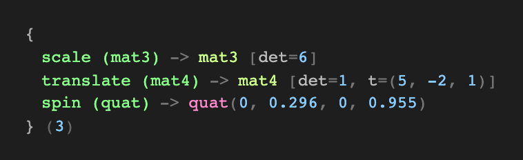{ width="564" }

The `mat3` reports `det=6` (2 × 3 × 1), the `mat4` reports `det=1, t=(5, -2, 1)`,
and the quaternion shows its normalized components. For the algebra behind these
types, see [Linear Algebra](linear_algebra.md).

### An `FLine`, drawn

An [`FLine`](fline_examples.md) — Field's core drawable path — is where the
renderer stops summarising and starts *drawing*. Alongside its node counts,
bounding box, length, and a compressed path signature, it appends a small inline
SVG thumbnail of the actual geometry:

```diffstatic {data-lang=kotlin}
:::static
val spiral = FLine()
val steps = 140
for (i in 0..steps) {
    val t = i.toDouble() / steps
    val a = t * 5.0 * 2.0 * Math.PI
    val r = 8.0 + t * 60.0
    val x = 80.0 + Math.cos(a) * r
    val y = 80.0 + Math.sin(a) * r
    if (i == 0) spiral.moveTo(x, y) else spiral.lineTo(x, y)
}
spiral.h
```

{ width="552" }

The header reads `FLine (141 nodes)`, then `M=1 L=140 C=0 · b=130×124 ·
len=1.19e+03`, then the run-compressed signature `M(Lx41) … (Lx22)`, and finally
the thumbnail. The thumbnail is normalised into its box and only rendered for
paths under a complexity budget, so pasting a huge path into a value view never
becomes a rendering hazard.

### An `Fn`, plotted

The richest case is a [`Functions.Fn`](functions_examples.md). Field keeps the
full reflective tree — its `domain`, `evalFn`, `graph`, and `name` — because that
graph is the function's rebuildable structure. Then, below it, it appends a safe
SVG line plot of the function sampled over a finite window of its domain:

```diffstatic {data-lang=kotlin}
:::static
with(Functions) {
    val fn = sin(10) over (0.0..3.0)
    fn.h
}
```

{ width="612" }

The plot mirrors `Fn`'s own sampling rules: an unbounded domain falls back to a
preview window, non-finite samples become gaps in the curve rather than spikes, a
zero-straddling range draws a dashed baseline, and faint labels mark the value and
domain extents (here `1.159 / −1.159` over `0 … 3`). If a function is non-finite
everywhere, or its `evalFn` throws, the plot is simply omitted and the tree stands
on its own — the value display is never allowed to fail.

### Images, edges, corners and flow

The [imaging / computer-vision family](imaging_examples.md) gets the same
treatment, and it is the case where the picture most obviously beats the text: an
`Img` is a `FloatArray` you cannot read, a `List<Corner>` is forty records of
three doubles each, and a `GaussianPyramid` is `GaussianPyramid@3f1a2b`. Every
imaging value below is rendered by
`src/jvmMain/kotlin/afield/ui/visualization/ImagingVisualizer.kt`, reached through the
same `.h` you have been using all along.

Evaluate an `Img` and you get the actual pixels, aspect-correct, plus a `<details>`
disclosure holding the per-channel strip, a per-channel histogram computed over the
*full-resolution* samples, and the numbers:

```diffstatic {data-lang=kotlin}
:::static
val scene = Img.generateRGB(240, 180) { x, y -> /* … */ }
scene.h
```

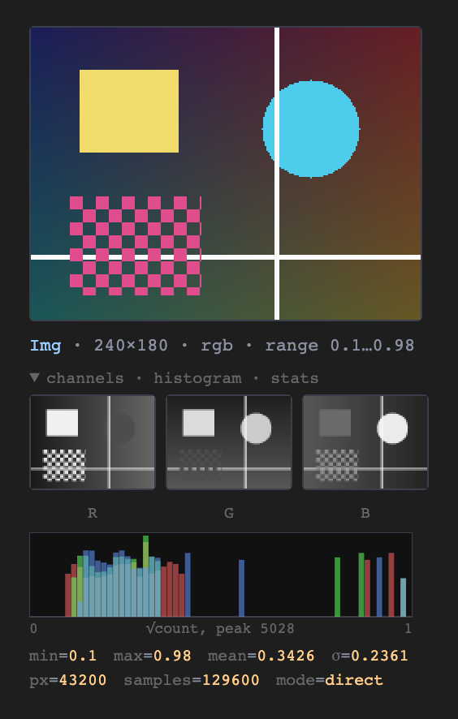{ width="564" }

#### The range policy

This family is **float-channel and unbounded**. A Sobel `dx` is signed. An unnormalised response exceeds 1. An upstream division produces a NaN. A
visualizer that just clamps everything to `0…1` answers all three questions with a
flat white rectangle. So the renderer picks one of three modes and **always names
the one it picked**:

`direct` — every finite sample is already in `0…1`. Nothing is rescaled, and the
caption says `direct`. That is the picture above.

`signed ±m` — some sample is negative. The range is made symmetric about zero, so
that *zero is a fixed, recognisable colour* rather than wherever `min…max` happened
to put it, and a 1-channel image is run through the `coolwarm` diverging ramp from
[`Colormaps`](rectsl_cheatsheet.md) — blue negative, pale zero, red positive.
Grey simply cannot carry a sign:

```diffstatic {data-lang=kotlin}
:::static
scene.luma().sobel().dx.h
```

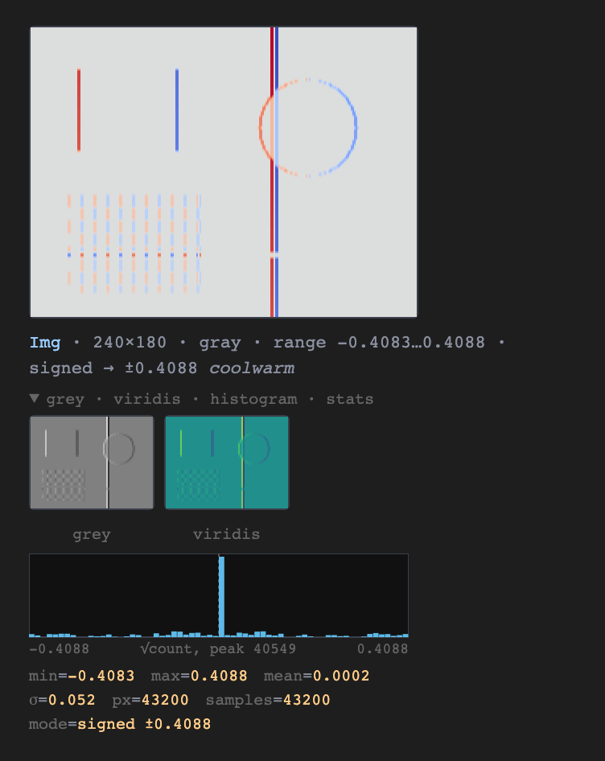{ width="752" }

Read it: the rectangle's left edge is red (dark→bright going right, so `dx > 0`)
and its right edge is blue; the disc is warm on its left limb and cool on its
right. `mean = 0.0002` and `σ = 0.052`, with the histogram spiking at zero, is what
a gradient of a mostly-flat image should look like. The disclosure offers the same
data read two more ways — plain `grey` and `viridis` — so you get three readings of
one response image.

`auto-ranged` — non-negative, but the maximum is above 1. Rescaled for display
with the **true range printed**, so a bright pixel is never mistaken for 1.0:

```diffstatic {data-lang=kotlin}
:::static
(scene.luma().sobelMagnitude() * 25f).h
```

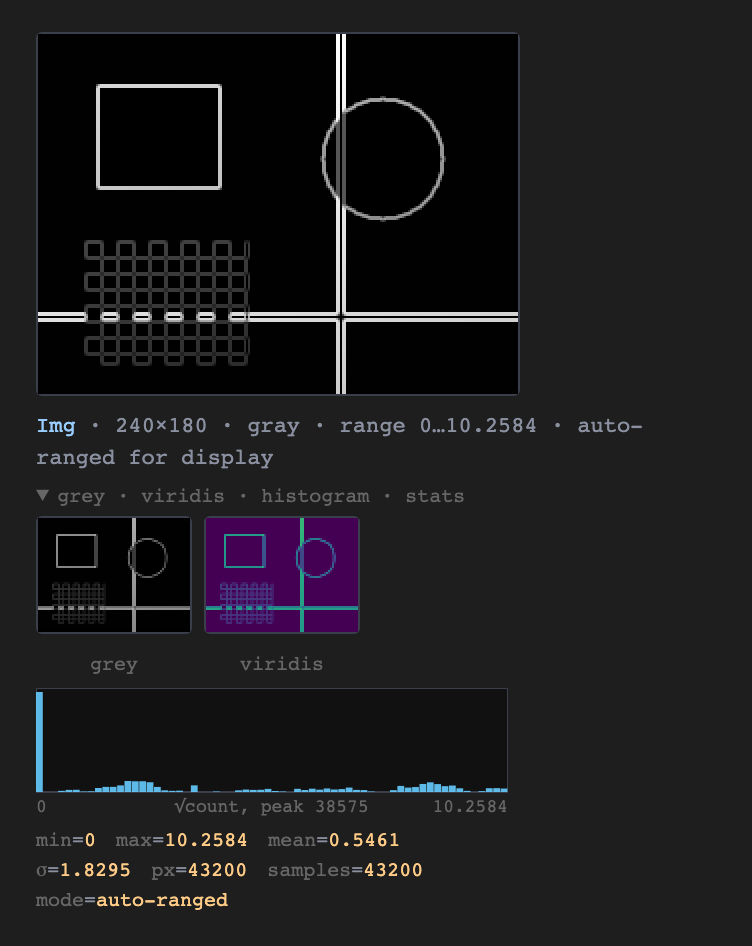{ width="752" }

And non-finite samples — NaN, ±∞ — are counted, excluded from every statistic, and
painted **magenta**:

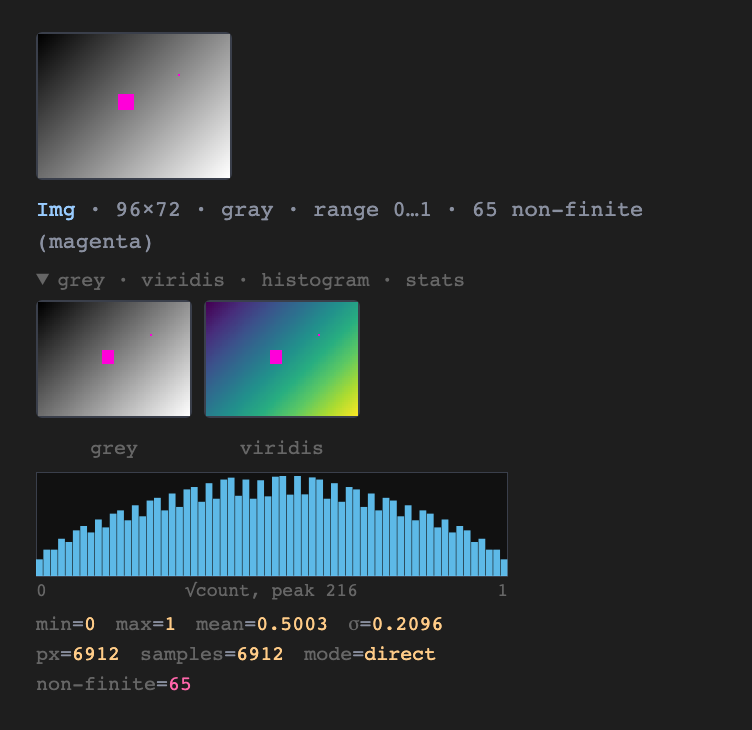{ width="752" }

Magenta because the alternative is silence: one NaN poisons `min()`/`max()`,
`normalized()` returns an all-NaN image, and the PNG quantiser turns NaN into
`0`, so a broken image comes back as an **all-black** thumbnail captioned
`range NaN…NaN`. An image that is wrong should look wrong.

Four-channel images sit on a checkerboard, so transparent black and opaque black
are different pictures:

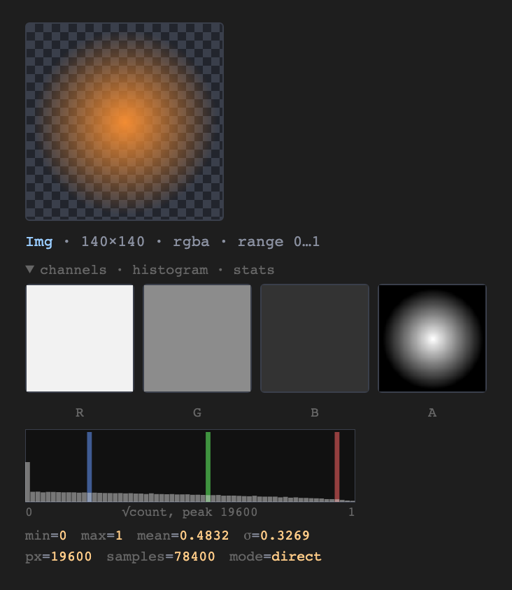{ width="732" }

#### Gradients and pyramids

A `Gradient` is two signed images and a direction, so it shows all of it — `dx`,
`dy`, the magnitude, and the hue-by-direction image the type already knows how to
build:

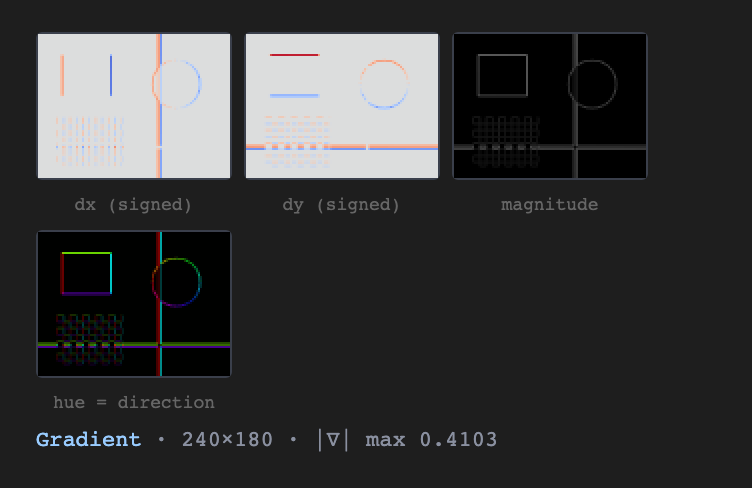{ width="752" }

A pyramid is drawn as a **ladder of rungs at true relative scale**, bottom-aligned,
so the halving is the visible fact rather than a number in a caption:

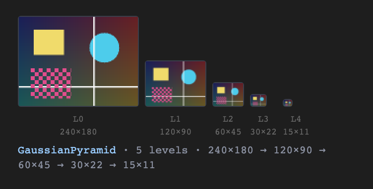{ width="752" }

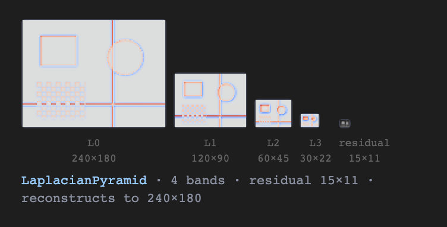{ width="752" }

The Laplacian bands are signed, so they get the diverging treatment, and the one
rung that is *not* a band is labelled `residual`.

#### Detector output

A `List<Corner>` becomes a scatter with detector strength as both radius and
`viridis` colour. A corner list carries no image extent, so the canvas is the
points' own bounding box unioned with the origin — image coordinates start at
`(0, 0)`, and including it keeps the points where they actually sit in the frame.
The caption states the inferred extent:

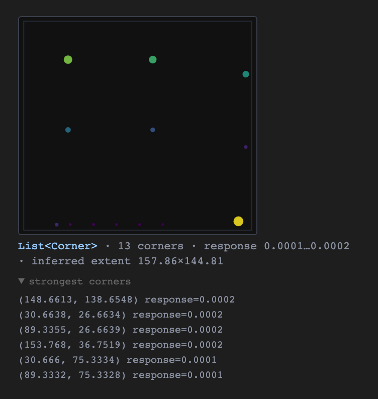{ width="752" }

The four strongest here read back as `(30.7, 26.7)`, `(89.3, 26.7)`,
`(30.7, 75.3)`, `(89.3, 75.3)` — the four corners of a rectangle planted at
`x 30…90, y 26…76` — and the single strongest is where the two rulings cross.

A `HoughLine` is `(rho, theta)`: an **infinite** line with no extent of its own,
which is why `toFLine` insists on being handed the image dimensions. With no image
in reach the left panel clips each line into the smallest square every peak can
still cross, says which square that was, and points at `linesToFLines` for the
in-place version. The right panel needs no extent at all and is therefore exact:
ρ against θ, sized by votes.

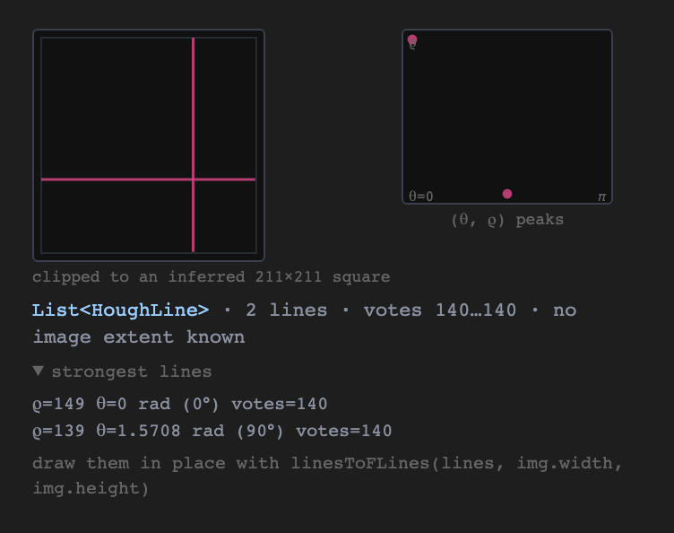{ width="752" }

A circle *does* have an extent, so no assumption is needed:

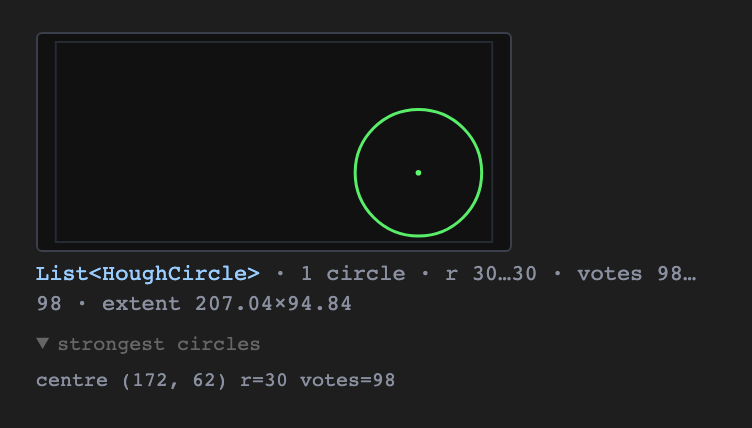{ width="752" }

A `FlowField` is a quiver — one arrow per converged track, hue by direction, and
**failed tracks drawn as grey crosses** rather than dropped. A tracker that never
reports failure is lying, and so is a picture that hides the failures.
Displacements are drawn at true pixel scale unless the median motion is too small
to see, in which case an integer exaggeration factor is applied and named:

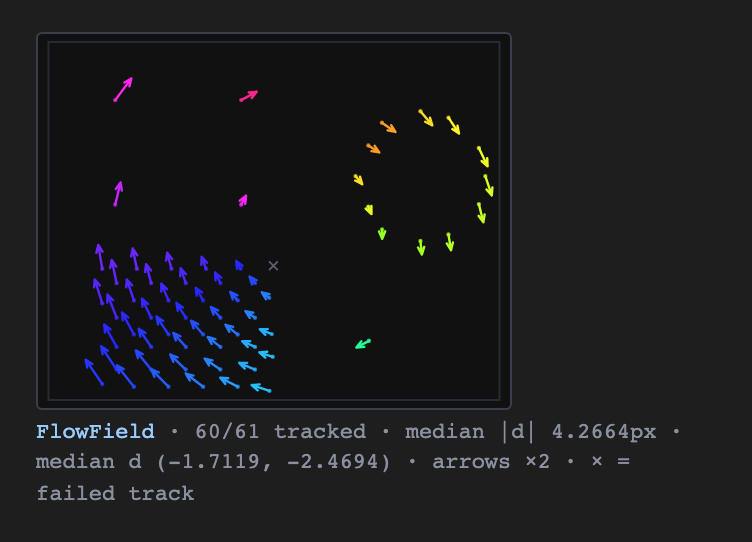{ width="752" }

The frames here differ by a 0.06 rad rotation about the centre, and that is exactly
what the arrows trace: little motion near the middle, tangential motion at the
edges, the hue rotating smoothly with the direction.

Finally, a `ComponentLabelling` shows the label map under a golden-ratio hue
rotation — adjacent label ids get unrelated colours, which is what makes two
touching blobs distinguishable at thumbnail size — with the per-blob areas and
centroids behind the disclosure:

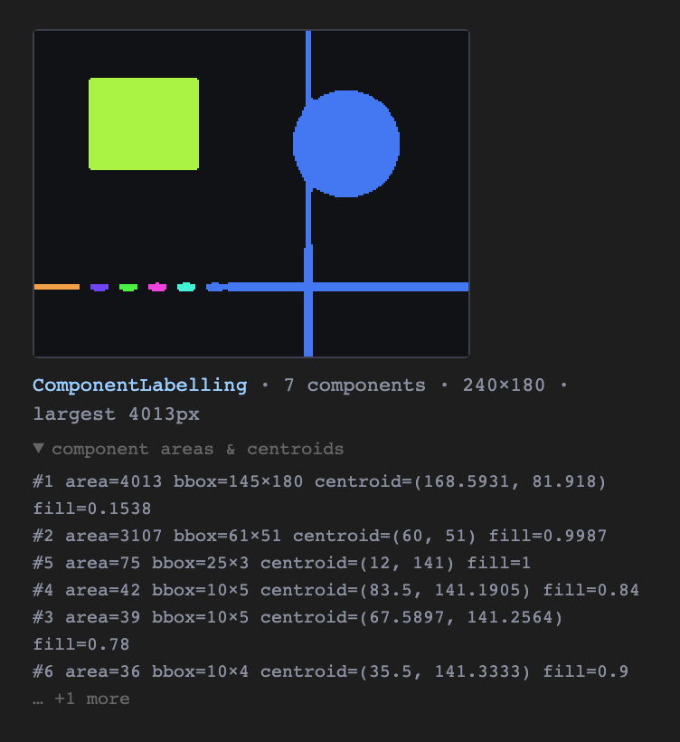{ width="752" }

A plain `List` becomes a filmstrip, which is the shape a frame sequence or a
parameter sweep already has:

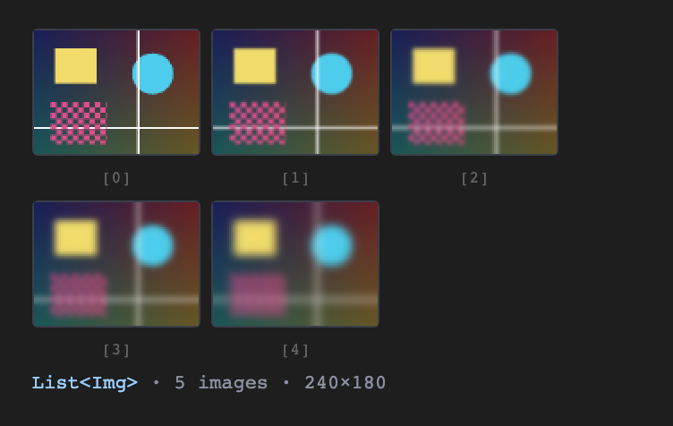{ width="752" }

#### All of it, in a real box

Everything above is a fragment rendered on its own. Here is the same renderer
inside an actual Field box, in Field's own output areas: a whole pipeline, with
`.h` doing all the work.

<!--
FIELD_TEST
id: docs.visualizers.imaging-panels
runner: backdoor-box
tags: [docs, visualizers, imaging, cv]
timeoutSec: 90
waitSec: 1.5
# Measured, not guessed: the captured output pane sizes itself to its CONTENT, not to the
# box frame — setting w/h here moved the box but not the pane. `showRow` lays the panels out
# with `:::row`, which is a grid of equal-width columns (grid-auto-flow:column, 1fr) and
# never wraps, so the wrap-collapse the hand-rolled flex row had to avoid cannot happen here.
# The columns still share the width, so four panels is the count that stays readable, and
# ComponentLabelling has its own figure above.
w: 1120
h: 420
expect:
  outputContains:
    - "imaging visualizers ready"
  eventKinds:
    - set-output
  screenshot:
    kind: box
    padding: 16
-->
```diffstatic_runner {data-lang=kotlin screenshot="assets/visualizers-imaging-panels.png" alt="four imaging panels in a row, each a thumbnail over a line of metadata and a row of disclosure links. An RGB image of a yellow rectangle and a cyan disc on a four-way colour gradient, labelled 180x132, rgb, range 0.1 to 0.98; a signed Sobel response of the same scene painted in the blue-white-red coolwarm map, labelled range -0.4083 to 0.4089, signed; a GaussianPyramid as four rungs at true relative scale, 180x132 down to 22x16; and a List of 9 Corners as coloured dots on black, labelled with its response range and an inferred extent of 118.23 by 106.17" wait="1.5" capture="box" open-outputs="true" padding="8" w="1200" h="700" embed=true name="imaging-panels"}
:::static
val scene = Img.generateRGB(180, 132) { x, y ->
    var r = 0.10f + 0.30f * (x / 179f)
    var g = 0.12f + 0.22f * (y / 131f)
    var b = 0.34f - 0.20f * (x / 179f)
    if (x in 24..68 && y in 20..56) { r = 0.94f; g = 0.86f; b = 0.42f }
    if (hypot(x - 128.0, y - 46.0) <= 22.0) { r = 0.30f; g = 0.80f; b = 0.92f }
    if (x in 112..113 || y in 104..105) { r = 0.98f; g = 0.98f; b = 0.98f }
    Triple(r, g, b)
}
val gray = scene.luma()

// Four stages of one pipeline, four different value types, one `.h` each. showRow keeps
// them in a single output channel instead of four tall ones.
val panels = listOf(
    scene.h,                                                // direct mode, 3 channels
    gray.sobel().dx.h,                                      // signed -> coolwarm diverging
    gray.gaussianPyramid(4).h,                              // rungs at true relative scale
    gray.harrisCorners(minDistance = 6, maxCount = 20).h    // scatter, strength-coded
)
showRow("panels", panels)

println("imaging visualizers ready")
```

Note what is *not* in that code: no `showImg`, no PNG encoding, no colour-map
choice, no normalisation, no per-type branching. `.h` is the whole interface, and
the renderer decides per value whether it is looking at colour data, a signed
response, a pyramid, or a list of detections.

!!! tip "Open the demo document"
    The [imaging_visualizers_demo](agent_transcripts.md#imaging_visualizers_demo)
    starting point has one box per visualizer on this page. Open it from the
    welcome screen, run the boxes and look at each one's output area — every box evaluates one imaging value as its last expression, so
    there is no `showImg`, no `display(...)` and no explicit call at all. Then
    change a sigma or a threshold and re-run a box.

The rest of this page is the *instruments* built on top of this renderer: inline
probes that live next to a line of code, display channels, control surfaces, and
synth scopes.

## Inline editor visualizers

These draw next to the line of code that produced the value. The core pattern is:

```diffstatic {data-lang=kotlin}
:::static
val m = __m("some-marker")
m.histogram(0.42)
```

The marker remembers a little state and renders HTML back into the editor gutter / inline output location for that line.

### Histogram, history, and summary stats

Histograms answer “what values have I seen?”, history answers “how did the value move?”, and stats gives you a one-line summary.

The live examples below are all `loop { }` bodies, which is Field's frame loop: the body runs, then
the frame advances, once per Runloop tick. What that tick is, and what stops one of these, is
[Frames and the animation loop](animation_time_model.md).

<!--
FIELD_TEST
id: docs.visualizers.inline-metrics
runner: backdoor-box
tags: [docs, visualizers, inline, histogram, history, stats]
timeoutSec: 120
waitSec: 2.0
expect:
  outputContains:
    - "inline metrics ready"
  eventKinds:
    - output
  screenshot:
    kind: editor
    padding: 10
-->
```diffstatic_runner {data-lang=kotlin video="assets/visualizers-inline-metrics.mp4" wait="1.0" capture="editor" outputs="inline" padding="10" execution="launch" duration="3" fps="12" timeout="120" embed=true name="inline-metrics"}
:::static
var tick = 0.0
var visualizerFrame = 0

println("inline metrics ready")

loop {
    tick += 0.4
    visualizerFrame += 1

    if (visualizerFrame % 2 == 0) {
        val value = sin(tick * 0.22) * 0.7 +
            cos(tick * 0.11) * 0.2 +
            tick * 0.01

        __m("histogram").histogram(value, dur = 120)
        __m("trail").history(value, dur = 48)
        __m("summary").stats(value, dur = 48)
    }
    frame()
}
```

Those three calls all share the same basic idea:

- `ᛟ.histogram(value)` keeps a rolling distribution.
- `ᛟ.history(value)` keeps a rolling time series.
- `ᛟ.stats(value)` gives a compact summary panel.

In the editor you can add a marker rune (ᛟ), with f1, "Insert Stack Mark", or shift+command period:

```diffstatic_runner {data-lang=kotlin capture="ui" region="window" clip-selector=".afield-palette-shell" screenshot="assets/insert-stack-mark.png" alt="Insert stack mark command" padding="6" wait="0" timeout="90" embed=true hidden=true name="insert-stack-mark"}
ui.openEditor(id)
ui.pause(700)
ui.waitForSelector(".monaco-editor", 15000.0)
ui.clickSelector(".monaco-editor")
ui.pause(300)
ui.press("F1")
ui.waitForSelector(".afield-palette-shell", 8000.0)
ui.pause(400)
ui.type("stack")
ui.pause(1200)
```

These functions are **passthroughs**. They return the value they were given, so you can drop them into a chain when you want to inspect the value flowing through a wire without changing the computation:

```diffstatic {data-lang=kotlin}
:::static
val filtered = __m("cutoff").history(rawCutoff)
```

That makes them excellent debugging instruments: tiny scopes for values, not transformations of values.

If you want a **live** feed rather than a one-shot summary, write a loop and **launch** the box:

<!--
FIELD_TEST
id: docs.visualizers.inline-live-history
runner: backdoor-box
tags: [docs, visualizers, inline, history, live]
timeoutSec: 120
execution: launch
waitSec: 5.0
expect:
  screenshot:
    kind: editor
    padding: 10
-->
```diffstatic_runner {data-lang=kotlin video="assets/visualizers-inline-live-history.mp4" wait="2.0" capture="editor" outputs="inline" padding="10" execution="launch" duration="3" fps="12" timeout="120" embed=true name="inline-live-history"}
:::static
println("live history launched")

var phase = 0.0
var visualizerFrame = 0

loop {
    visualizerFrame += 1
    if (visualizerFrame % 2 == 0) {
        val y = sin(phase * 0.8) + 0.2 * sin(phase * 7.0)
        __m("live").history(y, dur = 120)
    }
    phase += 0.07
    frame()
}
```

The same loop is shorter written against the box's `time` instead of a phase it advances itself:

```diffstatic {data-lang=kotlin}
:::static
loop {
    val t = time
    val y = sin(t * 0.8) + 0.2 * sin(t * 7.0)
    __m("live").history(y, dur = 120)
    frame()
}
```

Run either as a launch, not a plain execute.

### Piano rolls in the editor

The piano-roll visualizer is the same idea, but for scheduled notes rather than scalar values.

<!--
FIELD_TEST
id: docs.visualizers.inline-pianoroll
runner: backdoor-box
tags: [docs, visualizers, inline, synth, pianoroll]
timeoutSec: 120
execution: launch
waitSec: 5.0
expect:
  # The box's println lands on process stdout, not on a collectable "output" event,
  # and the pianoRoll() visualizer draws to the editor rather than emitting output
  # events — so neither outputContains (which scans events) nor eventKinds:[output]
  # can see it. The editor screenshot is the reliable signal the visualizer rendered.
  allowMissingOutput: true
  screenshot:
    kind: editor
    padding: 10
-->
```diffstatic_runner {data-lang=kotlin video="assets/visualizers-inline-pianoroll.mp4" wait="2.0" capture="editor" outputs="inline" padding="10" execution="launch" duration="3" fps="12" timeout="120" embed=true name="inline-pianoroll"}
:::static
val arp = noteProcess {
    val chord = listOf(48, 55, 60, 64)
    var step = 0
    while (true) {
        note(
            pitch = chord[step % chord.size],
            duration = 0.18,
            velocity = 0.85,
            label = "n$step"
        )
        rest(0.25)
        step++
    }
}

println("inline piano roll launched")

var playhead = 0.0
var visualizerFrame = 0

loop {
    visualizerFrame += 1
    if (visualizerFrame % 2 == 0) {
        __m("arp").pianoRoll(arp.at(playhead))
    }
    playhead += 0.35
    frame()
}
```

Use it for sequencers, generative rhythm systems, or anything where you want to see future note structure without leaving the code.

## Display channels: the big canvas under the box

Inline visuals sit beside one line of code. `display(...)` has the whole area under the box.

Anything you pass to `display("channel", thing)` becomes HTML in a named output area. That HTML can be handwritten, auto-generated, interactive, or even an embedded browser/inspector.

### Raw HTML, pretty HTML, and heavy HTML

- `display("channel", "<div>...</div>")` is the raw escape hatch.
- `.h` turns a value into a lightweight pretty HTML view.
- `.h2` turns a heavier structure into a paged browser / explorer.

<!--
FIELD_TEST
id: docs.visualizers.display-html
runner: backdoor-box
tags: [docs, visualizers, display, html, h, h2]
timeoutSec: 45
waitSec: 2.5
expect:
  outputContains:
    - "display helpers ready"
  eventKinds:
    - set-output
  screenshot:
    kind: box
    padding: 16
-->
```diffstatic_runner {data-lang=kotlin screenshot="assets/visualizers-display-html.png" alt="three output channels stacked in one box. 'hello' holds a small blue-bordered card reading 'display(...) can show any HTML you like.'; 'pretty' holds a syntax-coloured dump of a four-entry map with tempo 122, mode mixolydian, active true and notes [C, E, G, Bb]; 'heavy' holds a LinkedHashMap of 18 rows rendered as a scrollable two-column table of key against value, its rows named row-0 upward and every value a Map of size 10" wait="4.0" capture="box" open-outputs="true" embed=true name="display-html"}
:::static
val tiny = linkedMapOf(
    "tempo" to 122,
    "mode" to "mixolydian",
    "active" to true,
    "notes" to listOf("C", "E", "G", "Bb")
)

val big = (0 until 18).associate { row ->
    "row-$row" to (0 until 10).associate { col ->
        "c$col" to row * col
    }
}

display(
    "hello",
    "<div style=\"padding:18px;background:#101820;color:#f2aa4c;border:1px solid #2d4a5d\">" +
        "<b>display(...)</b> can show any HTML you like." +
        "</div>"
)
display("pretty", tiny.h)
display("heavy", big.h2)

println("display helpers ready")
```

Use `.h` when the structure is small enough that you want a pleasant, immediate rendering. Use `.h2` when you want to browse instead of read. That covers a large map, list, array or buffer without turning the output area into soup, and it covers your own data classes and Field's own types too.

`.h2` on a plain object gives you its properties as a scrollable table: one row per property, with its declared type and its value. Above the table sit `outliner` and `columns` links, which open the same value in the full tree and column browsers. There is nothing to register; it reflects. If a property's getter throws, the row is still there, marked, with the exception text in its value cell.

Four things are special-cased, because their fields are not where the interesting content is. A `Box` shows its name, frame, code size, run state, its whole property bag, and a table of its `parents`, `children`, `nested` and `nestedIn` edges. An `Fn` shows a sampled table of `x` and `f(x)` across its domain, because a function is its values and its one substantive field is a private closure. An `FLine` shows its node table: instruction kind, control-point count and endpoint per row. An exception shows its message, its cause chain and its stack.

Some values `.h2` hands straight back to `.h`, because the compact rendering already *is* the value: numbers, strings, enums, a `Pair`, a vector, a matrix (which `.h` draws as a heatmap), and a `Quantity`, whose whole point is a number next to a unit.

To see all of it at once, insert the **h2 Explorer Examples** template and run its boxes top to bottom.

### Markdown for captions and tables

The escape hatch above has a way of taking over. A figure that wants a heading, a key/value table and a block of computed text ends up as a hundred lines of string concatenation, with a hand-picked font stack, a `<tr><td style=…>` builder and a local `fun esc(s: String)`, often longer than the code it illustrates.

`markdown("channel", "…")` says the same thing in markdown, and picks up Field's own `--field-*` tokens instead of re-inventing them:

<!--
FIELD_TEST
id: docs.visualizers.markdown
runner: backdoor-box
tags: [docs, visualizers, display, markdown]
timeoutSec: 45
waitSec: 2.0
expect:
  outputContains:
    - "markdown figure ready"
  eventKinds:
    - set-output
  screenshot:
    kind: box
    padding: 16
-->
```diffstatic_runner {data-lang=kotlin screenshot="assets/visualizers-markdown.png" alt="one markdown card headed 'what the run settled on'. A two-column reading/value table gives tempo 122, drift -0.004 and voice 'saw 110 *'. Under it a status line reads stable, budget 83% used in amber, no retries. Then a two-column row labelled BEFORE and AFTER, holding gain 0.2 on the left and gain 0.9 on the right, and a quoted solver-output block reading 'converged in 41 steps, residual 3.2e-7'" wait="2.0" capture="box" open-outputs="true" w="900" embed=true name="display-markdown"}
:::static
val readings = linkedMapOf("tempo" to 122, "drift" to -0.004, "voice" to "saw 110 *")
val rows = readings.entries.joinToString("\n") { (k, v) -> "| ${k.md} | ${v.md} |" }
val report = "converged in 41 steps\nresidual 3.2e-7"

markdown("figure", """
    ### what the run settled on

    | reading | value |
    |---------|-------|
    $rows

    status: {ok:**stable**} · budget: {warn:83% used} · {muted:no retries}

    :::row
    #### before
    ${mapOf("gain" to 0.2).h}
    ---
    #### after
    ${mapOf("gain" to 0.9).h}
    :::end

    #### solver output
    ~~~
$report
    ~~~
""", width = 820)

println("markdown figure ready")
```

Three rules matter once a figure mixes computed values into the prose:

- **HTML passes through, inline and block.** `.h`, `diffHtml()`, `graphSvg()` and friends already return HTML; interpolate them directly and they land verbatim, table cells included. Only text you actually wrote as markdown gets escaped.
- **`value.md` for computed values.** Runtime values are not markdown — a `|` splits the row it lands in, a pair of `*` becomes emphasis, a `<b>` is read as a tag and vanishes. Escape anything you did not write yourself. `mdEscape(value)` is the same function, written as a call.
- **Fenced bodies are interpolated at column zero**, hard left, the way `$report` is above. Inside a fence whitespace is the content, and splicing at the surrounding indentation would indent only the value's first line.

Beyond GitHub-flavoured markdown there are two additions: `:::row … :::end`, splitting columns on a `---` line, for the before/after shape markdown cannot spell; and `{role:text}` spans — `accent`, `muted`, `dim`, `ok`, `warn`, `bad` — so a callout never needs a hex literal. Neither applies inside code, so a `:::row` or a `{warn:…}` shown *as* an example stays as written. The figure above uses both: the before/after row, and the `ok`, `warn` and `muted` spans on its status line.

??? aside "Why the example closes its row with `:::end`"
    A bare `:::` also closes a row in a live box, but on a docs page the runner treats a line that is exactly `:::` as one of its own fence-section markers — the same family as the `:::static` at the top of every runnable example — and strips it out of the code before running it. The row then never closes, and swallows the rest of the card in the built page only.

You do not need `trimIndent()`; the text is dedented for you, and unlike `trimIndent` it survives having a multi-line value interpolated into it. `width` pins the card's width; without it the card is as wide as its widest unbreakable line.

### Trees and columns

For a value you want to browse like a little filesystem, open it in a tree or column browser.

<!--
FIELD_TEST
id: docs.visualizers.display-browsers
runner: backdoor-box
tags: [docs, visualizers, display, tree, column, browser]
timeoutSec: 45
waitSec: 2.5
expect:
  outputContains:
    - "inspector panes ready"
  eventKinds:
    - set-output
  screenshot:
    kind: box
    padding: 16
-->
```diffstatic_runner {data-lang=kotlin screenshot="assets/visualizers-display-browsers.png" alt="two inspector channels over the same nested scene map. 'outline' is a tree browser with camera expanded to show x, y, zoom and active, and layers and palette still folded. 'columns' is a column browser, its root column listing camera, layers and palette with a scrollbar down the right of the pane" wait="3.0" capture="box" open-outputs="true" w="1200" h="260" embed=true name="display-browsers"}
:::static
val scene = linkedMapOf(
    "camera" to linkedMapOf(
        "x" to 10,
        "y" to 20,
        "zoom" to 1.5,
        "active" to true
    ),
    "layers" to listOf(
        linkedMapOf(
            "name" to "dots",
            "visible" to true,
            "points" to listOf(2, 4, 8, 16)
        ),
        linkedMapOf(
            "name" to "lines",
            "visible" to false,
            "style" to linkedMapOf("width" to 2, "color" to "#f2aa4c")
        )
    ),
    "palette" to linkedMapOf(
        "background" to "#101820",
        "accent" to "#f2aa4c"
    )
)

tree("outline", scene)
column("columns", scene)

println("inspector panes ready")
```

- `tree("channel", value)` gives you an outline / tree browser.
- `column("channel", value)` gives you a column-style browser.

These are especially good for nested maps, scene graphs, structured JSON-like data, or anything you want to poke around in rather than summarize.

Both take any value, not only maps and lists. A data class or one of your own classes opens to its public properties, an `IntArray` or `DoubleArray` opens to its elements, and a map whose keys are objects opens each entry to its key and its value. Every row shows its name, its type and a one-line summary (`5000 items`, `"label"`, `Point(x=1.0, y=2.5, label=p)`), so you can read most of a structure without opening anything:

```diffstatic_runner {data-lang=kotlin screenshot="assets/visualizers-tree-values.png" alt="A tree embed titled LinkedHashMap, 4 entries, with a filter box. Four folded rows, each a name, its type and the start of its summary: particle (Particle), weights (DoubleArray), many (ArrayList, 5000 items) and ring (Node, listing its fields). The selected row shows its path and copy buttons." wait="3.0" capture="box" open-outputs="true" w="900" h="200" embed=true name="tree-values"}
data class Particle(val position: Vec3, val age: Double, val tag: String)
class Node(val name: String) { var next: Node? = null }

val ring = Node("a")
ring.next = Node("b").also { it.next = ring }

val scene = linkedMapOf(
    "particle" to Particle(Vec3(1f, 2f, 0.5f), 0.25, "spark"),
    "weights" to doubleArrayOf(0.1, 0.4, 0.5),
    "many" to List(5000) { it * it },
    "ring" to ring,
)
tree("scene", scene)
```

A long collection arrives 200 rows at a time; the last row says how many there are and loads the next 200. Open rows follow the value: if code that keeps running (a `frames { }` loop, say) adds to `particles`, the tree shows the new size within about a second, without re-running the box. An object that contains itself is marked with `↺` instead of being opened forever.

Keys, once you have clicked into the embed: the arrow keys move and open (in `column`, `←` and `→` move between columns), `/` filters the rows, `c` copies the selected value as text, `p` copies the row's path, and `r` reloads. The header stays put while the rows scroll. The embed grows with its content up to a height and then scrolls; pass `maxHeight = 800` to `tree` or `column` to change that height.

The rows are the same edges [`graphPaths`](graph_query.md) walks, so every row has a path from the value you passed in, such as `particle/position` or `many/250`. Press `p` (or the **path** button on a row) and paste it into box code:

```diffstatic {data-lang=kotlin}
:::static
val age = scene.graphPath("particle/age")?.get()
```

Type a pattern containing `/`, `*` or `|` into the filter and it runs `graphPaths` on the whole value instead of filtering one level: `**/tag` lists every `tag` at any depth, labelled by path. Choose one (Enter, or double-click) and the tree or columns open to it. Plain text still just filters the rows in view.

This recording types `**/name` into the filter of a tree over a small scene of groups and layers. Every `name` at any depth is listed by its path; the arrow keys pick `groups/1/layers/1/name`, and Enter opens the tree down to it.

```diffstatic_runner {data-lang=kotlin capture="ui" region="window" viewport="1000x900" clip-selector="iframe.field-inspector" video="assets/visualizers-inspector-search.mp4" fps="10" transcript="../../dev_docs/agents/transcripts/docs_capture/inspector_search.yaml" padding="6" wait="0" timeout="240" embed=true hidden=true name="inspector-search" alt="A tree embed over a scene with a title and two groups. The pointer clicks the filter and **/name is typed; the rows give way to five matches listed by path, groups/0/name through groups/1/layers/1/name. The arrow keys move down to groups/1/layers/1/name, Enter is pressed, and the tree opens groups, then [1], layers and [1], with the hatching layer's name row selected."}
val frame = "document.querySelector('iframe.field-inspector')"
ui.waitForSelector("iframe.field-inspector", 8000.0)
ui.eval("document.body.classList.add('mode-no-editor'); return true")
ui.pause(600)
fun tree(js: String) = ui.eval("return $frame.contentWindow.$js").toString()
check("LinkedHashMap" in tree("inspectorTreeState().root"))
val at = ui.eval("""
    const f = $frame, r = f.getBoundingClientRect();
    const i = f.contentDocument.getElementById('filter').getBoundingClientRect();
    return [r.left + i.left + i.width / 2, r.top + i.top + i.height / 2].join(',');
""").toString().trim('"').split(',').map { it.toDouble() }
ui.moveMouse(at[0], at[1], 6)
ui.clickAt(at[0], at[1])
ui.typeSlowly("**/name", 220)
ui.pause(500)
check("groups/1/layers/1/name" in tree("inspectorTreeState().query")) { tree("JSON.stringify(inspectorTreeState())") + " at " + at }
for (i in 1..5) { ui.press("ArrowDown"); ui.pause(200) }
ui.press("Enter")
ui.pause(900)
check(tree("inspectorTreeState().selected") == "\"groups/1/layers/1/name\"") { tree("inspectorTreeState().selected") }
ui.pause(300)
```

Private properties are left out, as `graphPaths` leaves them out by default. Pass `includePrivate = true` to `tree` or `column` to list them; their paths then need `graphPaths(pattern, GraphWalkOptions(includePrivate = true))`. A row has no path when nothing reaches it by name: an element of a primitive array, a map key that is an object, the second of two map keys that print alike.

And while it is not a “visualizer” in the chart sense, `logs(...)` belongs in the same family. This box shows only the `demo` channel and logs a small job into it; rows that share a block id are grouped under the block's first line:

```diffstatic_runner {data-lang=kotlin screenshot="assets/visualizers-logs.png" alt="A logs embed with a channels: demo chip, a find box and a clear button. Below, one grouped block in the demo channel, each row with its time: starting a job, then step 1 of 3, step 2 of 3 and step 3 of 3, the block running on below the bottom of the panel." wait="3.0" capture="box" open-outputs="true" w="900" h="200" embed=true name="logs-demo"}
logs("logs") { channel("demo") }

val log = afield.ai.diagnostics.LogDispatcher
log.log(afield.ai.diagnostics.LogEvent("demo", "starting a job", blockId = "job", boundary = afield.ai.diagnostics.BlockBoundary.BEGIN))
for (i in 1..3) log.log(afield.ai.diagnostics.LogEvent("demo", "step $i of 3", blockId = "job"))
log.log(afield.ai.diagnostics.LogEvent("demo", "done", blockId = "job", boundary = afield.ai.diagnostics.BlockBoundary.END))
```

It gives you a live log iframe inside an output channel, which is often exactly what you want while instrumenting a system.

The embed has a find box (`/`) that hides rows not containing its text, a **clear** button (or `k`), and, when you have scrolled up to read something, a `↓ N new` button instead of jumping away from what you were reading. If Field restarts, the embed reconnects by itself.

### Keeping output areas tidy

You can manage channels directly:

```diffstatic {data-lang=kotlin}
:::static
displayOpen("preview")
displayClear("preview")
displayClearAll()
```

This is useful for demos, guided tutorials, and boxes that are meant to be rerun frequently.
`displayClear` removes the panel rather than emptying it; [Box Output](box_output.md) covers all
four calls and the mouse gestures that do the same.

## Controls: sliders, toggles, colors, text, and XY pads

Field can build small control surfaces directly into output areas: sliders and pads you drag while the box runs.

They also reach a phone. Open `/controllers?file=<document>` on it and the **Group** tab redraws the selected box's `controlGroup(...)` at thumb size, while **Outputs** shows its output areas with their controls still live. See [Field from your phone](mobile_controllers.md#the-six-tabs).

<!--
FIELD_TEST
id: docs.visualizers.controls
runner: backdoor-box
tags: [docs, visualizers, controls, slider, vec2, color]
timeoutSec: 45
waitSec: 0.5
expect:
  outputContains:
    - "controls ready"
  eventKinds:
    - set-output
  screenshot:
    kind: box
    padding: 16
-->
```diffstatic_runner {data-lang=kotlin screenshot="assets/visualizers-controls.png" alt="five stacked control widgets in one output channel, all drawn in cyan on black. GAIN, a horizontal slider a third of the way along, reading 0.35. ORBIT, a square vec2 pad with crosshairs and a handle pulled down and right of centre, annotated theta -30 degrees, magnitude 0.40, X 0.35, Y -0.20. ARMED, a checked checkbox. NAME, a text field holding 'Field'. ACCENT, an orange swatch beside an alpha slider at 0.85, with rgba(0.95, 0.45, 0.15, 0.85) printed above it" wait="1.0" capture="box" open-outputs="true" w="1200" h="180" embed=true name="controls"}
:::static
controlGroup("controls") {
    slider("gain", min = 0.0, max = 1.0, step = 0.01, initialValue = 0.35) { }
    vec2Control("orbit", initialValue = Vector2f(0.35f, -0.2f)) { }
    checkbox("armed", initialValue = true) { }
    stringInput("name", initialValue = "Field") { }
    colorPicker("accent", initialValue = Vector4f(0.95f, 0.45f, 0.15f, 0.85f)) { }
}

println("controls ready")
```

Available pieces include:

- `slider(...)`
- `sliders(...)`
- `vec2Control(...)`
- `checkbox(...)`
- `stringInput(...)`
- `colorPicker(...)`
- `controlGroup(...) { ... }`

The `vec2Control(...)` is the “xy thing” in the nicest sense: an XY pad with a vector line, magnitude, and angle readout.

### Handling a slider

Every slider, standalone, in `sliders(...)`, or in a `controlGroup`, answers the same hand:

This recording drags a live `controlGroup` slider, nudges it with the arrow key, then double-clicks
the track to return to its starting value. The large bar is updated by the slider's callback, so it
shows the value Field receives while the pointer moves.

```diffstatic_runner {data-lang=kotlin capture="ui" region="window" viewport="1000x900" clip="65,205,560,350" video="assets/visualizers-slider-gestures.mp4" fps="20" transcript="../../dev_docs/agents/transcripts/docs_capture/slider_gestures.yaml" padding="0" wait="0" timeout="240" embed=true hidden=true name="slider-gestures" alt="A live GAIN slider starts at 0.35. The pointer drags its thumb to the right and the readout and large cyan bar follow, the right arrow nudges it once, then a double-click returns the thumb, readout and bar to 0.35."}
ui.waitForSelector(".field-slider-visual", 8000.0)
ui.eval("document.body.classList.add('mode-no-editor'); return true")
check("true" in ui.eval("return document.body.classList.contains('mode-no-editor')").toString())
ui.pause(300)

fun point(fraction: Double): Pair<Double, Double> {
    val coords = ui.eval("""
        const r = document.querySelector('.field-slider-visual').getBoundingClientRect();
        return [r.left + r.width * $fraction, r.top + r.height / 2].join(',');
    """).toString().trim('"').split(',').map { it.toDouble() }
    return coords[0] to coords[1]
}
fun value(): Double = ui.eval("return document.querySelector('.field-slider').dataset.value")
    .toString().trim('"').toDouble()

check(kotlin.math.abs(value() - 0.35) < 0.001)
val from = point(0.35)
val to = point(0.75)
val firstHit = ui.eval("""
    const e = document.elementFromPoint(${from.first}, ${from.second});
    return [e?.tagName, e?.className?.baseVal || e?.className,
        !!e?.closest('.field-slider-visual')].join(' / ');
""").toString()
check("true" in firstHit) { "slider start is covered at $from: $firstHit" }
ui.moveMouse(from.first, from.second, 12)
ui.pause(100)
ui.mouseDown()
for (step in 1..30) {
    ui.moveMouse(from.first + (to.first - from.first) * step / 30,
        from.second, 1)
    ui.pause(100)
}
ui.mouseUp()
ui.pause(150)
val dragged = value()
check(dragged > 0.70) { "drag did not move the live slider: $dragged" }

ui.press("ArrowRight")
ui.pause(150)
check(value() > dragged) { "arrow key did not nudge the focused slider" }

val reset = point(0.5)
val hit = ui.eval("""
    const e = document.elementFromPoint(${reset.first}, ${reset.second});
    return [!!e?.closest('.field-slider-visual'), e?.tagName, e?.className?.baseVal || e?.className,
        e?.closest('.field-control')?.className].join(' / ');
""").toString()
check("true" in hit) { "slider track occluded at $reset: $hit" }
ui.doubleClickAt(reset.first, reset.second)
ui.pause(200)
check(kotlin.math.abs(value() - 0.35) < 0.001) {
    "double-click did not restore the starting value: value=${value()}, default=${ui.eval("return document.querySelector('.field-slider').dataset.default")}"
}
ui.moveMouse(790.0, 420.0, 8)
ui.pause(100)
```

| Do this | To get |
| --- | --- |
| press and drag | the thumb jumps to the pointer and follows it |
| hold **shift** while dragging | a relative drag, ten times finer, from wherever the value already is; pressing shift mid-drag does not make the thumb leap |
| double-click the track | the slider's `initialValue` again |
| click the number | type an exact value; **Enter** keeps it, **Esc** abandons it |
| arrow keys (after a click) | one `step` per press; **shift** ×10, **alt** ÷10. A `law =` slider moves 1% of its travel instead |
| **PageUp** / **PageDown**, **Home** / **End** | 10% of travel, or the ends |
| **Backspace** | back to `initialValue` |

The other controls' readouts take typing too. On a `vec2Control`, click **X** or **Y** to set one coordinate, the `(x, y)` pair to set both, `|v|` to change the length and keep the direction, or `θ` (degrees) to turn it and keep the length. On a `colorPicker`, click the `rgba(...)` readout and type four numbers from 0 to 1, or a `#rrggbb` hex colour; click the alpha number to type the alpha alone. Typed values are clamped and snapped like a drag.

The track carries guides: ticks at the quarters, thirds and middle of its travel (the ends and middle drawn taller), a small notch under the `initialValue` that double-click returns to, and a mark at zero when the range runs from negative to positive. On a `law =` slider the ticks sit at fractions of the travel, not of the value. The `vec2Control` pad has the same quarter and third gridlines, plus rings around the centre at a quarter, half, three quarters and the full half-width of the pad, so a vector's length reads at a glance.

A typed or nudged value is snapped to `step` and clamped to the range, the same as a drag, so the callback never sees a number the slider could not have produced.

A `controlGroup` slider keeps its value across re-runs and in the saved document. A standalone `slider(...)` starts from `initialValue` every run. When the value should belong to the box, bind it to a property:

```diffstatic {data-lang=kotlin}
syncToProperty("gain", 0.5, min = 0.0, max = 2.0)

val gain = getPropertyRaw("gain") as Double
```

`syncToProperty` starts from the property's current value when it has one, so re-running the box keeps whatever you last dialled in, and the property is saved with the document.

### Build one surface with mixed control types

`controlGroup(...)` is the easiest way to build a compact surface for one box. Pair it with a normal display channel when the controls need a readable status or preview panel.

<!--
FIELD_TEST
id: docs.visualizers.controls.mixed-surface
runner: backdoor-box
tags: [docs, visualizers, controls, vec2, checkbox, string, color]
timeoutSec: 45
waitSec: 0.5
expect:
  outputContains:
    - "mixed controls ready"
  eventKinds:
    - set-output
  screenshot:
    kind: box
    padding: 16
-->
```diffstatic_runner {data-lang=kotlin screenshot="assets/visualizers-mixed-controls.png" alt="two channels. 'surface' holds the same five widgets under different names: BLOOM at 0.62, a WIND pad with its handle up and left at theta 146 degrees and magnitude 0.54, TRAILS checked, LABEL reading 'wake field', and a cyan TINT swatch at alpha 0.90. 'preview' below it holds a wide rendered strip, warm brown at the left and a soft blue bloom left of centre, with the line wind=(-0.45, 0.32), bloom=0.62, trails=true underneath, so the preview and the widgets agree" wait="1.0" capture="box" open-outputs="true" w="1200" h="180" embed=true name="mixed-controls"}
:::static
var wind = Vector2f(-0.45f, 0.32f)
var bloom = 0.62
var trails = true
var label = "wake field"
var tint = Vector4f(0.25f, 0.75f, 1.0f, 0.9f)

controlGroup("surface") {
    slider("bloom", min = 0.0, max = 1.0, step = 0.01, initialValue = bloom) {
        bloom = it
    }
    vec2Control("wind", initialValue = wind, xRange = -1.0 to 1.0, yRange = -1.0 to 1.0, step = 0.05) {
        wind = it
    }
    checkbox("trails", initialValue = trails) {
        trails = it
    }
    stringInput("label", initialValue = label) {
        label = it
    }
    colorPicker("tint", initialValue = tint) {
        tint = it
    }
}

// The gradient swatch is the bespoke part and stays as HTML; the card around it does not
// have to be hand-built any more.
markdown("preview", """
    #### ${label.md}

    <div style="height:96px;background:
      radial-gradient(circle at 35% 45%, rgba(64,190,255,0.65), transparent 22%),
      linear-gradient(135deg, rgba(255,120,40,0.18), rgba(40,210,255,0.20));
      border:1px solid rgba(131,230,255,0.35)"></div>

    wind=({accent:${wind.x}}, {accent:${wind.y}}) · bloom={accent:$bloom} · trails={accent:$trails}
""", width = 620)

println("mixed controls ready")
```

This pattern is good for surfaces that combine parameter editing with a compact readout:

- small simulation controls
- animation parameters
- quick scene presets
- reusable demo boxes

### Sequencer controls: multisliders, grids, ranges and menus

Four controls hold more than one number, after the Max objects they borrow from:

- `multiSlider(...)` is a bank of bars you draw by sweeping across them, like Max's `multislider`. A fast sweep fills every bar it passes.
- `matrix(...)` is a grid of cells, like `matrixctrl`. A press advances a cell to its next state, and dragging paints that state across every cell you cross. Cells are on or off by default; pass `states = 4` and each cell cycles through 0 to 3. State 0 is black and the others are equally spaced colours.
- `rangeSlider(...)` picks an interval, like `rslider`. Drag a thumb to move one end, or drag between the thumbs to move both.
- `menu(...)` picks one of a list of strings, like `umenu`.

The first three return a handle with a **playhead**: a position the box writes and you only see. It never calls your callback and is never saved, so you can set it on every frame. Here a `loop` reads the step off the clock each frame, so it never drifts:

<!--
FIELD_TEST
id: docs.visualizers.controls.sequencer
runner: backdoor-box
tags: [docs, visualizers, controls, multislider, matrix, range, menu]
timeoutSec: 45
waitSec: 0.5
expect:
  eventKinds:
    - set-output
  screenshot:
    kind: box
    padding: 16
-->
```diffstatic_runner {data-lang=kotlin video="assets/visualizers-sequencer.mp4" capture="box" open-outputs="true" wait-output="true" wait-output-kind="display" execution="launch" duration="4" fps="20" timeout="180" w="900" embed=true name="sequencer" alt="a sequencer surface in one output channel. VELOCITY is a bank of sixteen cyan bars in a sine-shaped curve; PATTERN is a four-by-sixteen grid with cells in red, green and blue on black; BAND is a two-thumb range slider from 200 to 900; WAVE is a drop-down reading saw. An orange playhead steps left to right across the bars and the grid columns together while an orange tick sweeps along the band track"}
:::static
var velocity = 16 { i -> 0.5 + 0.4 * Math.sin(i * 0.6) }
var pattern = 4 { r -> 16 { c -> if ((c + r * 3) % 8 == 0) 1 + (c / 4) % 3 else 0 } }
var band = 200.0..900.0
var wave = "saw"

lateinit var steps: ArrayControlHandle<List<Double>>
lateinit var grid: ArrayControlHandle<List<List<Int>>>
lateinit var range: ArrayControlHandle<ClosedFloatingPointRange<Double>>

controlGroup("sequencer") {
    steps = multiSlider("velocity", count = 16, initialValues = velocity) { velocity = it }
    grid = matrix("pattern", rows = 4, columns = 16, states = 4, initialValue = pattern) {
        pattern = it
        print(it.h)
    }
    range = rangeSlider("band", min = 20.0, max = 2000.0, initialValue = band) {
        band = it
        print(it.h)
    }
    menu("wave", listOf("sine", "saw", "square", "noise"), initialIndex = 1) { _, name ->
        wave = name
    }
}

// Eight steps a second, read off the clock every frame.
val start = System.nanoTime()
loop {
    val step = ((System.nanoTime() - start) / 125_000_000L).toInt()
    steps.playhead(step % 16)
    grid.playhead(step % 16)
    range.playhead(20.0 + (step % 64) / 63.0 * 1980.0)
}
```

A playhead on a multislider or matrix is a bar or column index, and a negative one hides it. On a range slider it is a value on the track.

### The same controls, on a dial

Pass `polar = true` to draw any of the three around a circle. A step sequence is a loop, and the dial shows that: the last step sits next to the first.

- On a polar `multiSlider`, the angle picks the bar and the distance from the centre sets its value. A sweep across the top goes the short way round.
- On a polar `matrix`, rows are rings (row 0 is the outermost) and columns are sectors running clockwise from twelve o'clock. The playhead lights a whole sector.
- On a polar `rangeSlider`, the track is the whole circle, and `min` and `max` meet at the top. The band runs clockwise from `start` to `endInclusive` and may wrap through the top. Drag inside it to turn the whole band.

A wrapped band has `start > endInclusive`, which Kotlin's own `in` reads as an empty range, so test it with `arcContains`. On a dial a range means an arc, so use it for values that are already circular: a phase, a hue, a window into a loop.

<!--
FIELD_TEST
id: docs.visualizers.controls.sequencer-polar
runner: backdoor-box
tags: [docs, visualizers, controls, multislider, matrix, range, polar]
timeoutSec: 45
waitSec: 0.5
expect:
  eventKinds:
    - set-output
  screenshot:
    kind: box
    padding: 16
-->
```diffstatic_runner {data-lang=kotlin video="assets/visualizers-sequencer-polar.mp4" capture="box" open-outputs="true" wait-output="true" wait-output-kind="display" execution="launch" duration="4" fps="20" timeout="180" w="1200" embed=true name="sequencer-polar" alt="three dials side by side. VELOCITY draws sixteen cyan wedges of different lengths around a hub; PATTERN draws four rings of sixteen sectors with a few cells lit red, green and blue; BAND is a cyan circle whose bright arc runs clockwise from 1700 through the top to 400, with a tick at twelve o'clock labelled 2000 | 20.00. An orange sector sweeps clockwise around the first two dials together while an orange tick travels around the band"}
:::static
var velocity = 16 { i -> 0.5 + 0.4 * Math.sin(i * 0.6) }
var pattern = 4 { r -> 16 { c -> if ((c + r * 3) % 8 == 0) 1 + (c / 4) % 3 else 0 } }
var band = 1700.0..400.0   // wraps through the top

lateinit var steps: ArrayControlHandle<List<Double>>
lateinit var grid: ArrayControlHandle<List<List<Int>>>
lateinit var range: ArrayControlHandle<ClosedFloatingPointRange<Double>>

controlGroup("dial", columns = 3) {
    steps = multiSlider("velocity", count = 16, initialValues = velocity, polar = true) { velocity = it }
    grid = matrix("pattern", rows = 4, columns = 16, states = 4, initialValue = pattern, polar = true) { pattern = it }
    range = rangeSlider("band", min = 20.0, max = 2000.0, initialValue = band, polar = true) {
        band = it
        print(it.arcContains(100.0))
    }
}

val start = System.nanoTime()
loop {
    val step = ((System.nanoTime() - start) / 125_000_000L).toInt()
    steps.playhead(step % 16)
    grid.playhead(step % 16)
    range.playhead(20.0 + (step % 64) / 63.0 * 1980.0)
}
```

### Recording a gesture

`gesture(...)` is an XY pad that remembers what you did with it. A plain drag works like `vec2Control(...)`, and the callback gets each position. **Shift-drag** records a take: the whole stroke and its timing, kept with the box like any other control value. On a phone, tap **rec**, then draw. The trail of the take stays on the pad.

The box replays the take, and the box keeps the time. `at(seconds)` returns where the take is that far into its loop, interpolated between the recorded samples, and `playhead(seconds)` puts a ring on the pad there. Read both off the clock in a `loop`, as the sequencer does, and the replay never drifts and keeps going with the browser closed. `initialTake` gives the pad something to play before you have recorded anything; here it is a figure eight:

<!--
FIELD_TEST
id: docs.visualizers.controls.gesture
runner: backdoor-box
tags: [docs, visualizers, controls, gesture, vec2]
timeoutSec: 45
waitSec: 0.5
expect:
  eventKinds:
    - set-output
  screenshot:
    kind: box
    padding: 16
-->
```diffstatic_runner {data-lang=kotlin video="assets/visualizers-gesture.mp4" capture="box" open-outputs="true" wait-output="true" wait-output-kind="display" execution="launch" duration="4" fps="20" timeout="180" w="600" embed=true name="gesture" alt="an XY pad headed MOVE with the readout 2.0 s take and a rec button. A faint figure-eight trail fills the pad, and an orange ring travels round it, tracing the eight once every two seconds"}
:::static
var p = Vector2f(0f, 0f)
lateinit var pad: GestureHandle

// A figure eight to start from; shift-drag on the pad to record your own.
val eight = 64 { i ->
    val a = i / 63.0 * 2 * Math.PI
    i / 63.0 * 2.0 to Vector2f((0.8 * Math.sin(a)).toFloat(), (0.6 * Math.sin(2 * a)).toFloat())
}

controlGroup("gesture") {
    pad = gesture("move", initialTake = eight) { p = it }
}

val start = System.nanoTime()
loop {
    val t = (System.nanoTime() - start) / 1e9
    pad.at(t)?.let { p = it }
    pad.playhead(t)
}
```

`p` follows your finger while you drag and the take otherwise. Use it for anything with two axes: a camera, a pan and a filter, a point in a preset space.

To edit a take key by key, bake it into keyframe lanes with `bakeGesture(pad)`, and send the edited lanes back with `pad.setTake(x, y)`: see [From a performed gesture](keyframe_editor.md#from-a-performed-gesture).

### Choosing the right control

- Use `slider(...)` for one bounded numeric value.
- Use `vec2Control(...)` for direction, position, velocity, or any paired numeric parameter.
- Use `checkbox(...)` for feature toggles and gates.
- Use `stringInput(...)` for names, labels, prompts, and small text parameters.
- Use `colorPicker(...)` for RGBA values stored as normalized `Vector4f` data.
- Use `multiSlider(...)` for a row of values you want to draw rather than set one at a time: steps, envelopes, partials.
- Use `matrix(...)` for patterns: on/off steps, or several states per cell with `states = n`.
- Use `rangeSlider(...)` for an interval, such as a band, a window or a velocity range. Use `polar = true` when the value wraps around, like a phase or a hue.
- Use `menu(...)` for choosing one of a few named options.
- Use `gesture(...)` for a two-axis movement you want to perform once and loop.
- For a curve over time you shape by hand, an envelope, use the keyframe editor, `keyframes(...)`: see [Keyframes and timelines](funFeatures.md#keyframes-and-timelines).

The `vec2Control(...)` includes an XY pad, a vector line, and magnitude readout, so it works well for motion and layout values where two sliders would hide the relationship between axes.

## Recorded audio: waveform, player, playhead, and navigation

`AudioVisualizer` is the general-purpose recorded-sound view. It combines a waveform and native
browser audio controls, keeps an optional vertical playhead synchronized with playback, and uses
the waveform itself as a navigator:

- click to seek;
- drag to pan;
- use the mouse wheel or `+` / `−` to zoom while keeping the visible playhead fixed on screen;
- shift-wheel to pan;
- double-click or press **all** to restore the complete clip.

If the playhead is outside the visible interval, wheel zoom falls back to the pointer and button or
keyboard zoom falls back to the center. Near the start or end of a recording, boundary clamping may
move the playhead on screen. A completion-style spinner remains over the waveform while a newly
zoomed or panned min/max envelope is loading, so the old waveform cannot be mistaken for the new
view. During playback, crossing the right edge advances the visible interval and places the playhead
slightly inside the new window; crossing the left edge after a backward seek mirrors that behavior.
Set `followPlayhead = false` in `AudioVisualizerOptions` to keep a zoomed interval stationary.
Waveform-envelope requests have a 15-second browser deadline; a stalled service clears the spinner
and reports a timeout instead of leaving the view permanently busy. Any subsequent pan, zoom, or
resize retries normally.

Short sample arrays can be embedded in the page. This example opens zoomed in, with the playhead
parked inside the visible window.

<!--
FIELD_TEST
id: docs.visualizers.recorded-audio
runner: backdoor-box
tags: [docs, visualizers, audio, waveform, player, playhead]
timeoutSec: 45
waitSec: 2.5
expect:
  outputContains:
    - "recorded audio visualizer ready"
  # The inline WAV makes the set-output payload large enough that its acknowledgement can arrive
  # after the backdoor command collector closes. The rendered box capture is the reliable signal.
  allowMissingOutput: true
  screenshot:
    kind: box
    padding: 16
-->
```diffstatic_runner {data-lang=kotlin screenshot="assets/visualizers-recorded-audio.png" alt="an audio channel headed 'five-second synthetic recording'. A wide cyan waveform block fills the pane, with one vertical amber band about a fifth of the way in marking the playhead. Beneath it: plus, minus and 'all' zoom buttons, the window 0:00.80 to 0:03.50 of 0:05.00, the hint 'wheel zoom at playhead, drag pan, click seek', and a browser audio transport parked at 0:01 of 0:05" wait="2.5" capture="box" open-outputs="true" padding="12" w="1200" h="310" embed=true name="recorded-audio"}
:::static
val sampleRate = 8_000
val seconds = 5.0
val recording = FloatArray((sampleRate * seconds).toInt()) { i ->
    val t = i / sampleRate.toDouble()
    val chirp = sin(2.0 * PI * (105.0 * t + 72.0 * t * t))
    val low = 0.34 * sin(2.0 * PI * 47.0 * t)
    val pulse = if ((t * 2.0).toInt() % 2 == 0) 0.16 * exp(-8.0 * (t % 0.5)) else 0.0
    (0.54 * chirp + low + pulse).toFloat()
}

displayAudioSamples(
    samples = recording,
    sampleRate = sampleRate,
    options = AudioVisualizerOptions(
        width = 1050,
        waveformHeight = 150,
        showPlayhead = true,
        initialStartSeconds = 0.8,
        initialDurationSeconds = 2.7,
        initialPositionSeconds = 1.45,
    ),
    label = "five-second synthetic recording",
)

println("recorded audio visualizer ready")
```

There are three general entry points from a Field box:

```diffstatic {data-lang=kotlin}
// A browser-accessible recording. Add waveformUrl for range-aware server summaries.
displayAudio(AudioVisualizerSource(
    audioUrl = "/recordings/long-take.wav",
    waveformUrl = "/analysis/long-take/waveform",
    durationSeconds = 183.4,
    label = "long take",
))

// Generated or transformed mono samples; encoded as a self-contained PCM16 WAV.
displayAudioSamples(samples, sampleRate = 48_000, label = "synthesis result")

// Short existing recordings. Long files should use URLs instead of inflating box output.
displayAudioBytes(mp3Bytes, mediaType = "audio/mpeg", label = "short field recording")
```

All three return the generated HTML as well as displaying it, so it can be composed into a larger
instrument panel. `AudioVisualizer.renderHtml(...)`, `renderSamplesHtml(...)`, and
`renderBytesHtml(...)` are the receiver-free forms when no implicit Field box is available.

For a Field Audio service representation, use the same component without transferring or decoding
the complete recording just to draw it:

```diffstatic {data-lang=kotlin}
val representation: AssetRepresentation = candidate.proxyRepresentation!!
display("audio", representation.audioVisualizerHtml(
    options = AudioVisualizerOptions(showPlayhead = true)
))
```

That adapter asks the service for a bounded min/max envelope of only the visible interval. Each
source frame contributes to a pixel's minimum or maximum, preserving short transients that simple
sample decimation would miss. Zooming and panning request a new envelope with at most 4096 points;
the audio itself continues to stream from the immutable representation. Set `showPlayhead = false`
for a waveform-only inspection surface.

### Shared time cursors and transport

Audio players and arbitrary time-based views can share a loose, browser-side timeline. Give them
the same `syncGroup`. A component whose local zero is later on the source timeline also gets an
offset; shared time is always `localSeconds + syncOffsetSeconds`.

```diffstatic {data-lang=kotlin}
val group = "nancy-analysis"

display("source", representation.audioVisualizerHtml(
    options = AudioVisualizerOptions(
        initialStartSeconds = 18.0,
        initialDurationSeconds = 24.0,
        initialPositionSeconds = 18.0,
        syncGroup = group,
    )
))

// Analysis-local 0 s corresponds to source 18 s.
display("analysis", analysisDashboardHtml(
    listOf(beats, mono, poly),
    syncGroup = group,
    timeOffsetSeconds = 18.0,
))
```

This synchronizes across separate `display(...)` output documents. Playback publishes a gold
playhead to every joined view; hover publishes a temporary cursor; click publishes a seek; and zoom
or pan publishes a visible time window. The callback protocol is small, and is also available
to handwritten HTML, gesture views and future timeline widgets through parent-window
`CustomEvent`s:

```diffstatic {data-lang=javascript}
const bus = window.parent === window ? window : window.parent

bus.addEventListener("field-time-cursor", event => {
    const { group, time, kind, active } = event.detail
    // kind is "hover" or "playhead"
})

bus.dispatchEvent(new bus.CustomEvent("field-time-seek", {
    detail: { group: "nancy-analysis", source: "my-view", time: 23.75 }
}))
```

`field-time-window` carries `{group, source, start, duration}` and `field-time-transport` reports
`play` / `pause`. Receivers ignore their own `source`, so callbacks can adapt or republish events
without a feedback loop.

### One viewer for functions, sounds and signals

`Fn.plot`, the audio player, `displaySignal` and the analysis views are the same component. They
differ in where the data comes from: samples embedded in the page, an audio envelope, or a
server query per visible window. Give them one `syncGroup` and they share a timeline. Zoom one
and the others follow, hover shows a cursor in all three, and a click in any of them seeks the
audio.

```diffstatic_runner {data-lang=kotlin screenshot="assets/visualizers-one-viewer.png" alt="Three stacked output panes headed envelope, audio and signal, all spanning 0 to 2 seconds. The envelope pane plots exp(-2.5 t) as a blue curve falling from 1 to near zero, its header chip reading 1024/1024 samples. The audio pane draws the decaying 220 Hz ping as a cyan waveform above a browser transport parked at 0:00 of 0:02, its chip reading click seek, wheel zoom at playhead, drag pan. The signal pane draws the same ping evaluated per window in white, its chip reading envelope and a delta t of 1.25e-4 s" wait="2" capture="box" open-outputs="true" padding="12" w="1200" embed=true name="one-viewer"}
:::static
import kotlin.math.*

// One viewer, three sources, one timeline: a decaying 220 Hz ping.
val sync = "one-viewer"
val rate = 8_000
val ping = { t: Double -> sin(2 * PI * 220 * t) * exp(-2.5 * t) }

// 1. Fn.plot: the envelope, samples embedded in the page (resampled live when you zoom in).
with(Functions) { fn(0.0..2.0, "envelope  exp(-2.5 t)") { t -> exp(-2.5 * t) }.plot("envelope", syncGroup = sync, xLabel = "seconds") }

// 2. displayAudioSamples: the ping itself, playable; click to seek.
displayAudioSamples(FloatArray(2 * rate) { ping(it / rate.toDouble()).toFloat() }, rate,
    channel = "audio", label = "the ping, as audio", options = AudioVisualizerOptions(width = 760, syncGroup = sync))

// 3. displaySignal: the same ping evaluated per visible window on the server.
displaySignal(SignalViewer(listOf(SignalChannel("ping", ping, -1.0, 1.0)), 0.0, 2.0, sampleStep = 1.0 / rate),
    "signal", SignalViewerOptions(width = 760, label = "the ping, evaluated per window", syncGroup = sync, viewKey = "one-viewer:signal"))
```

The chip in each header says what you are looking at. For the function it is `1024/1024 samples`
until you zoom inside the domain, and then `live · Δx …`, because `Fn.plot` resamples the function
as you zoom. For the signal it is the sampling grid, `envelope · Δt …` or `waveform · Δt …`. The
strip under each plot is the whole domain. It stays dim until you zoom, then marks the visible
window; click or drag it to move. The ripple in the white band is the signal's sampling grid
showing through: at this zoom each bin holds about ten samples, roughly a third of a 220 Hz cycle,
so a bin's min and max rarely land on a peak. Zoom in and it becomes the waveform.

### Beat and pitch analysis views

The Field Audio integration keeps full-resolution analysis tensors as immutable NPZ assets and sends
only bounded preview trajectories to the browser. `analysisVisualizationHtml(...)` presents three
different operations in the same zoomable, pannable timeline:

- multi-scale tempo curves, onset strength, and beat markers;
- monophonic pYIN pitch and voicing confidence;
- Basic Pitch polyphonic note rectangles and activity summaries.

The [beat and pitch analysis walkthrough](audio_ai_analysis.md#running-all-three-from-one-box) runs
all three jobs on a recording and draws the board.

```diffstatic {data-lang=kotlin}
val client = FieldAudioClient()
client.assetByFilename("*Nancy*").thenCompose { asset ->
    val region = AssetRegion(asset.id, startSeconds = 0.0, durationSeconds = 30.0)
    client.submit(multiScaleBeatAnalysis(region, scalesSeconds = listOf(2.0, 4.0, 8.0, 16.0)))
}.thenCompose(client::awaitAnalysis).thenAccept { result ->
    display("analysis", analysisVisualizationHtml(result))
}
```

Replace the request with `monophonicPitchAnalysis(region)` or
`polyphonicPitchAnalysis(region)` without changing the job/result path. The returned
`AnalysisResult` exposes the complete NPZ representation and, for Basic Pitch, a MIDI artifact.
The visualization endpoint caps previews at 4096 points; zoom and pan never turn the full activation
tensor into a large JSON response.

For comparative inspection, `analysisDashboardHtml(listOf(beats, mono, poly))` aligns all three
results and synchronizes zoom, pan, hover, seeking and playback time. `analysisPreviewVisualizationHtml(...)` and
`analysisPreviewDashboardHtml(...)` use the identical renderer with an already-fetched or synthetic
`AnalysisPreview`, which is useful for offline documents and small reproducible fixtures. Per-job
progress can replace a named output with `fieldAudioJobStatusHtml(accepted, event)`, while
`fieldAudioJobMonitor()` embeds the complete durable queue.

The public [beat and pitch analysis walkthrough](audio_ai_analysis.md) and loadable
`audio_ai_analysis` operation transcript contain the full source → submit → monitor → await →
visualize path.

### Speech embedding phase portraits

The emotion2vec and WavLM views from the [speech walkthrough](audio_ai_speech_embeddings.md):

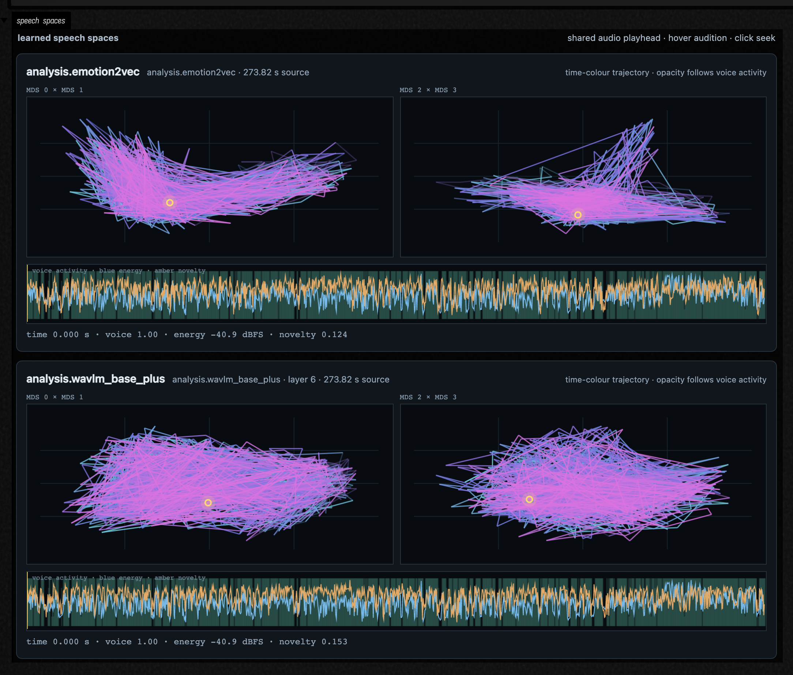

`speechEmbeddingVisualizationHtml(result)` turns the worker's cached learned-frame preview into two phase
portraits: MDS axes 0×1 and 2×3. The complete 768-dimensional embedding remains in the immutable
NPZ; only a bounded preview crosses into the browser. A strip underneath shows WebRTC voice
activity, dBFS energy, and embedding novelty.

Give the source `AudioVisualizer` and the speech view the same `syncGroup`. Audio playback moves a
marker through both portraits; hovering either portrait publishes the nearest frame time; clicking
seeks the player. The view also listens to `field-time-window`, so the waveform's visible interval
stays saturated while the rest of the embedding path recedes. These are the same general
`field-time-cursor`, `field-time-seek`, and `field-time-window` callbacks used by the timeline
analysis views.

```diffstatic {data-lang=kotlin}
val sync = "field-recording-speech"
display("source", audio.audioVisualizerHtml(
    options = AudioVisualizerOptions(syncGroup = sync),
))

client.submit(wavlmBasePlusEmbeddingAnalysis(region, layer = 6))
    .thenCompose(client::awaitAnalysis)
    .thenAccept { result ->
        display("WavLM", speechEmbeddingVisualizationHtml(result, syncGroup = sync))
    }
```

Use `speechEmbeddingDashboardHtml(listOf(emotion2vec, wavlm), syncGroup = sync)` to compare both
models on one playhead. `speechEmbeddingPreviewVisualizationHtml(...)` and
`speechEmbeddingPreviewDashboardHtml(...)` are the no-fetch counterparts. The complete
[speech-reactive embedding walkthrough](audio_ai_speech_embeddings.md) and
`audio_ai_speech_embeddings` transcript show import → submit → monitor → await → audition.

For a programmable local-neighbourhood projection, prefer
`client.speechEmbeddingSmileTsnePreview(result, poolMillis = 500.0, hopMillis = 40.0)`. It downloads
the result's binary MessagePack tensor, selects the requested time range before float16 expansion,
mean-pools 500 ms of evidence around each point, and runs fixed-seed t-SNE inside Field using Smile.
The independent 40 ms hop produces 25<!--derive: 1000/40--> points per second, just above a 24 fps display. Both values
round to the model's native 20 ms grid; omit them to retain the original 50 Hz vectors. Pooling occurs
before `maxFrames` sampling, and the visualizer header reports the effective pool, hop, distance, and
projected frame count. The returned `AnalysisPreview` goes directly into the no-fetch visualizers.
Exact classical MDS remains available through
`speechEmbeddingSmilePreview`; both paths support cosine and Euclidean distance without rerunning
the neural analysis.

### Short-time spectral phase portraits

Three distance spaces from the [spectral walkthrough](audio_ai_spectral_embeddings.md):

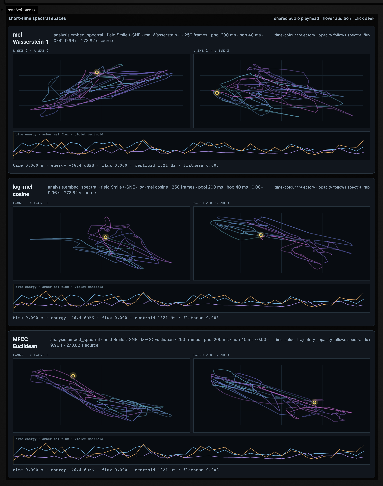

`spectralEmbeddingPreviewVisualizationHtml(preview)` uses the same two phase portraits and shared
time bus for a Field-owned MDS or t-SNE projection of mel, log-mel, or MFCC frames. The lower strip
shows energy, mel-distribution flux, and spectral centroid; path opacity follows normalized flux.
Hovering reports time, energy, flux, centroid, and flatness, and clicking seeks any linked audio
visualizer.

One `analysis.embed_spectral` result contains all three representations, so decode once and create
several views without another job:

```diffstatic {data-lang=kotlin}
client.analysisPreview(result.id).thenCombineAsync(
    client.spectralEmbeddingFrames(
        result, durationSeconds = 10.0, poolMillis = 200.0, hopMillis = 40.0,
    )
) { preview, frames ->
    listOf(
        SpectralEmbeddingDistance.MEL_WASSERSTEIN,
        SpectralEmbeddingDistance.LOG_MEL_COSINE,
        SpectralEmbeddingDistance.MFCC_EUCLIDEAN,
    ).map { distance ->
        preview.withSpectralProjection(frames.tsne(distance = distance, dimensions = 4))
    }
}.thenAccept { previews ->
    display("spaces", spectralEmbeddingPreviewDashboardHtml(previews, syncGroup = "recording"))
}
```

The complete [short-time spectral walkthrough](audio_ai_spectral_embeddings.md) and
`audio_ai_spectral_embeddings` transcript show source lookup/import → durable job → progress →
binary artifact → temporal pooling → three Field Smile spaces → bidirectional audition.

### Instrument-labelled transcription

A recording and its recovered notes from the [MuScriptor walkthrough](audio_ai_muscriptor.md):

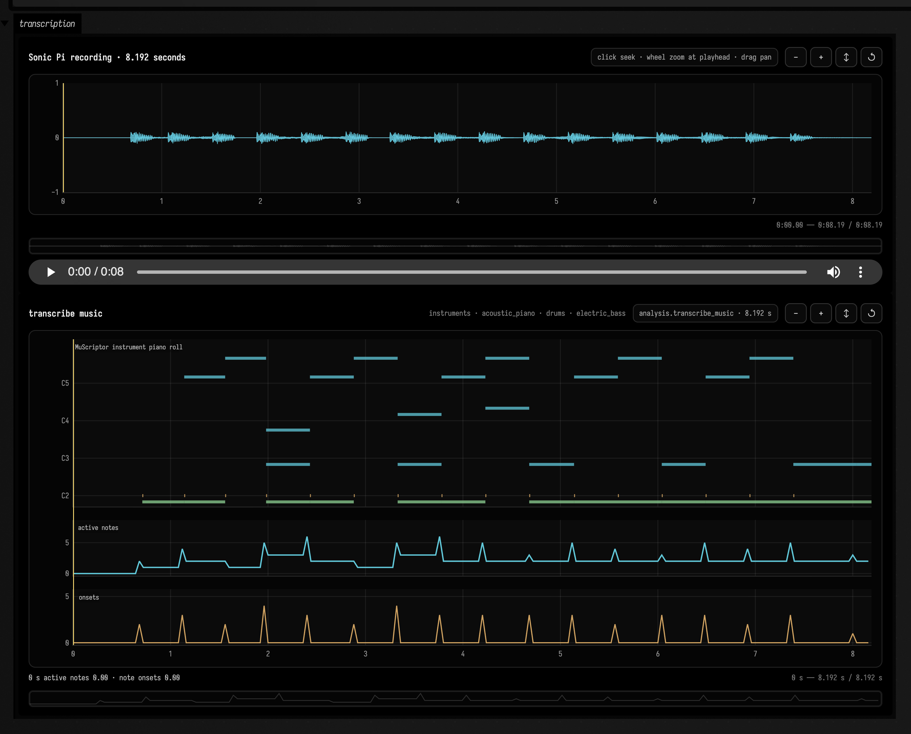

The same `analysisVisualizationHtml` viewer recognizes `analysis.transcribe_music` results as a
MuScriptor piano roll. Note colour follows the recovered instrument group; the two lower lanes show
active polyphony and onset count. It uses the same `syncGroup` time bus as the waveform, beat,
pitch, speech-space, and spectral-space views, so playback, hover, seek, zoom, and pan stay aligned.

```diffstatic {data-lang=kotlin}
val sync = "recording-to-score"
display("source", audio.audioVisualizerHtml(
    options = AudioVisualizerOptions(syncGroup = sync),
))
display("score", analysisVisualizationHtml(
    transcription, syncGroup = sync,
))
```

The complete [MuScriptor walkthrough](audio_ai_muscriptor.md) and `audio_ai_muscriptor` transcript
show the source lookup, typed request, durable job monitoring, synchronized result, typed MessagePack
note access, and MIDI export.

The same visualizer can begin with sound generated inside Field. `renderPatWav`, `renderDirtWav`,
`renderDoughWav`, `renderFaustWavAsync`, and `recordSonicPiWav` all produce a
`RenderedAudioFile`; `client.analyzeRenderedAudio(render)` imports it and returns a
`RenderedAudioAnalysis` whose `visualizationHtml()` joins the playable waveform and every analysis
lane on one sync group. The [render-to-analysis walkthrough](audio_render_analysis.md) and
`audio_render_analysis` transcript show all five paths through submission and progress monitoring.

### Corpus neighbour microscope

Retrieved neighbour windows from the [corpus walkthrough](audio_ai_corpus_microscope.md):

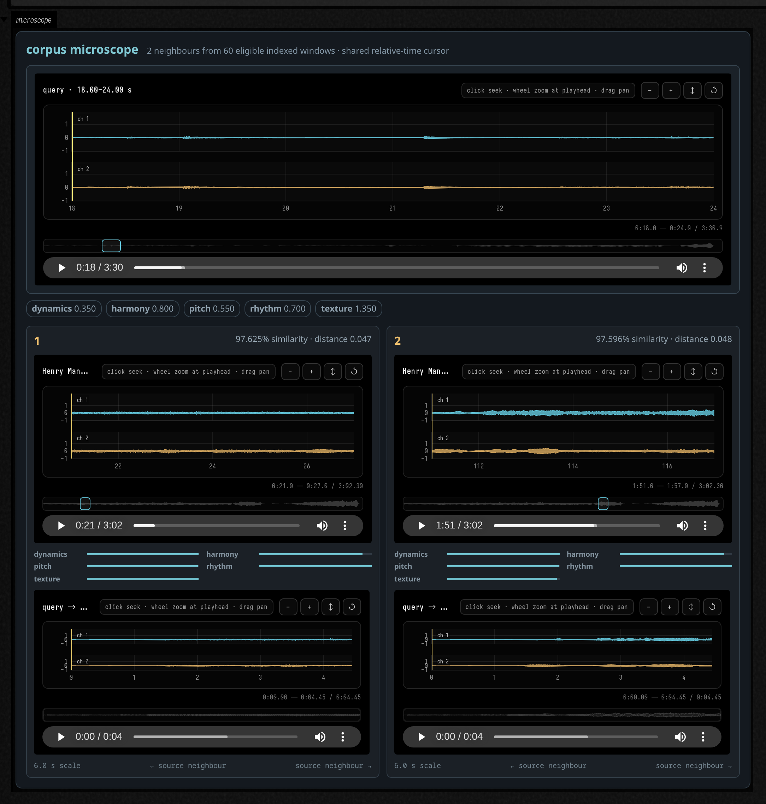

`corpusMicroscopeHtml(preview, queryAudio)` composes the same general `AudioVisualizer` into a
source-relative A/B board. Each neighbour retains its real asset and source timestamp, but every
player uses `syncOffsetSeconds = -segment.startSeconds`; shared time zero is therefore the start of
the selected window even when two windows come from different recordings. Hover, zoom, seek and
playhead callbacks remain ordinary `field-time-*` events.

The board adds no waveform transport of its own. It supplies exact ranges, grouped distance bars,
and the immutable query-to-neighbour splice preview returned by Field Audio. That makes it useful as
a general pattern for comparing aligned excerpts: produce a `CorpusPreview`, choose the query WAV
representation, and let the range-aware player request only the visible envelopes.

The [corpus microscope walkthrough](audio_ai_corpus_microscope.md) and
`audio_ai_corpus_microscope` transcript show the complete index → submit → monitor → query →
visualize path.

### Waveform-summary endpoint contract

This player fetches its envelopes from the live Field Audio waveform endpoint.

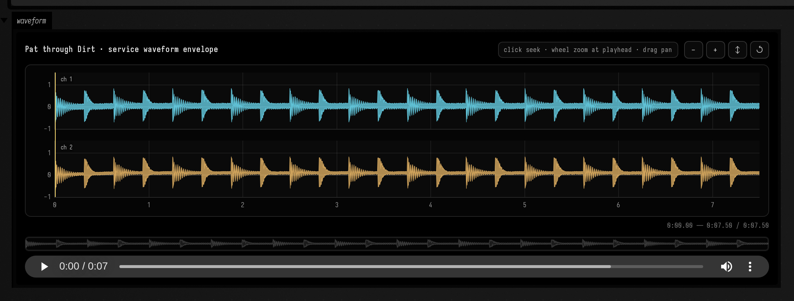

`AudioVisualizer` is not coupled to Field Audio. Any HTTP service can provide `waveformUrl`. The
visualizer adds these query parameters whenever its visible interval changes:

```diffstatic {data-lang=text}
start_seconds=12.5&duration_seconds=4.0&points=960
```

The endpoint returns one min/max envelope per channel:

```diffstatic {data-lang=json}
{
  "start_seconds": 12.5,
  "duration_seconds": 4.0,
  "sample_rate": 48000,
  "channels": 2,
  "point_count": 960,
  "minimum": [[-0.4, -0.2], [-0.3, -0.1]],
  "maximum": [[0.5, 0.3], [0.4, 0.2]]
}
```

Each channel array must contain `point_count` values. The two-value arrays above are
abbreviated. Keep the response cacheable: the component aborts stale requests while
the user pans and asks for a fresh, pixel-sized envelope after zooming or resizing.

## Signal and synth visualizers

Field's synth layer also comes with ready-made HTML and SVG visualizers for audio patches, scopes, envelopes, compressors, and related objects.

These are display-based rather than inline, which is usually the right choice because they want a bit more space.

<!--
FIELD_TEST
id: docs.visualizers.signal-panels
runner: backdoor-box
tags: [docs, visualizers, synth, signal, scope]
timeoutSec: 45
waitSec: 1.5
expect:
  outputContains:
    - "signal visualizers ready"
  eventKinds:
    - set-output
  screenshot:
    kind: box
    padding: 16
-->
```diffstatic_runner {data-lang=kotlin screenshot="assets/visualizers-signal-panels.png" alt="four synth panels in amber and blue on black. 'audio' pairs a dense stereo waveform at peak 0.858, rms 0.382 with a spectrum whose harmonics march up to a broad shelf past 5 kHz. 'scope' shows the same pair after filtering: a smaller waveform at peak 0.355 and a spectrum whose partials die away by 5 kHz. 'env' draws an ADSR, the orange gate dropping partway across and the blue level decaying after it, tagged RELEASE, lvl 0.401. 'comp' overlays an amber signal swelling into a compressor's blue gain-reduction curve, tagged GR 18.5 dB, threshold -18.0 dB, ratio 6.00:1" wait="1.5" capture="box" open-outputs="true" padding="8" w="1200" h="350" trim=true embed=true name="signal-panels"}
:::static
import afield.audio.synth.*

val sampleRate = 48_000f
val frames = 512
val cycles = 16
val out = FloatArray(frames)

fun renderSignal(signal: Signal) {
    repeat(cycles) {
        signal.render(out, frames, SynthContext(sampleRate, frames))
    }
}

val audioScope = (saw / FreeVerb()).scope()
renderSignal(audioScope)

val monoScope = (saw / MoogLadder(cutoff = 900.p)).scope()
renderSignal(monoScope)

val g = Gate().also { it.open() }
val env = ADSR(gate = g, release = 0.4.p)
renderSignal(env)
g.close()
renderSignal(env)

val comp = Compressor(threshold = (-18).p, ratio = 6.p)
comp.input = saw * 0.35
renderSignal(comp)

println("signal visualizers ready")
display("audio", audioScope.summaryHtml(widthPx = 560, waveformHeightPx = 72, spectrumHeightPx = 72))
display("scope", monoScope.summaryHtml(widthPx = 560, waveformHeightPx = 72, spectrumHeightPx = 72))
display("env", env.stateSvg())
display("comp", comp.stateSvg())
```

Good things to know here:

- `patch.summaryHtml()` gives you a panel view of an audio patch.
- `patch.liveSummary(...)` and `scope.liveSummary(...)` keep those panels moving while audio is running.
- `scope.summaryHtml()` and `stereoScope.summaryHtml()` render wave/spectrum-style panels when you want a snapshot instead.
- `env.stateSvg()` and `comp.stateSvg()` are compact SVG views for modulators / processors.
- `noteProcess.pianoRollSvg()` is great when you want the piano roll in an output area instead of inline in the editor.

So the choice is mostly about **where you want the visual to live**.

## Choosing between inline and display

Here is the practical rule of thumb:

- If the visual explains one line of code, put it inline on a stack mark (ᛟ, **Insert Stack Mark**).
- If the visual explains a whole box or deserves interaction, put it in `display(...)`.
- If the thing is large and structural, use `tree(...)`, `column(...)`, or `.h2`.
- If the thing is tiny and human-readable, `.h` is often perfect.

`histogram(...)` and `history(...)` return the value they were given, so you can leave them in a computation while you debug it.

All of these tools compose. One box can have a little inline history, a piano roll, a browser in one output channel, and a control surface in another. Field is very happy when code is also an interface.
