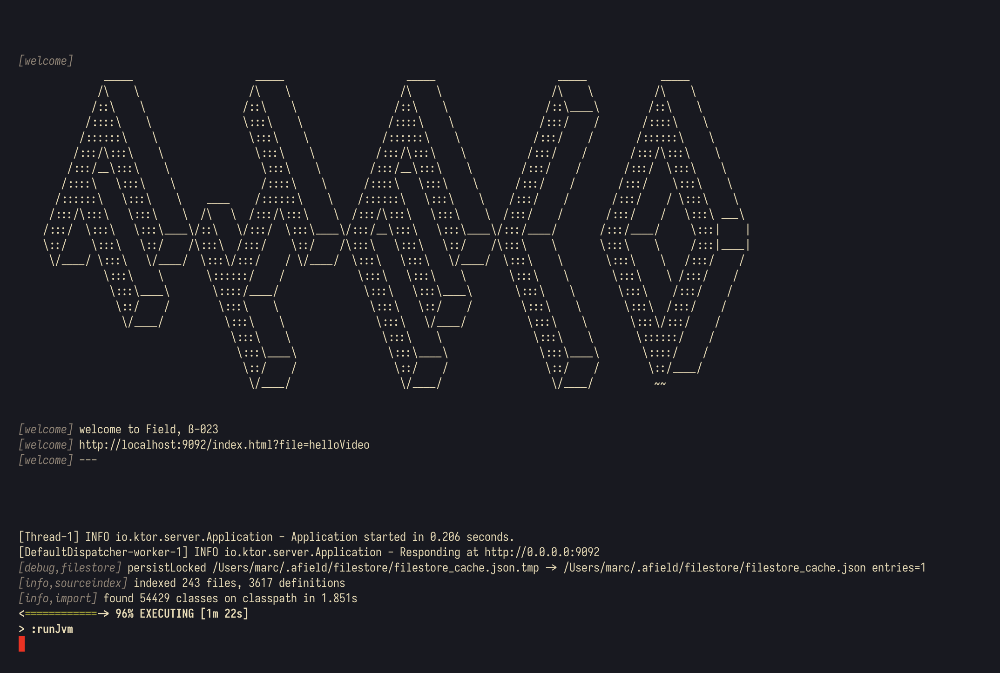
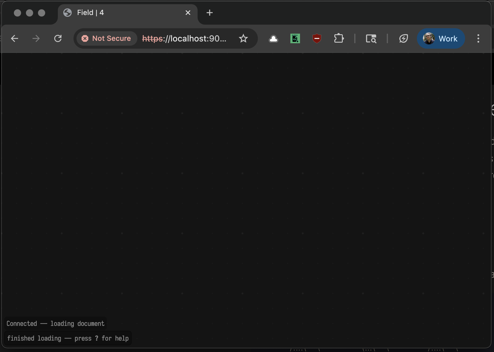

# VR Production Sketch 2, in Field·4

This page will take you into making your first steps in Field·4's XR graphics system for drawing — with a basic template for getting OpenXR working with Field's graphics system to the point that you'll be able to draw with the VR controller. This is part step-by-step (hopefully) boredom-inducing tutorial, and part introductory cook-book to a fabulously new kitchen.

## Getting to XR "hello world"

The first step is to [run field](survivalGuide.md). Field's prompt will suggest that you open whatever file was last opened:



You can click on that link to open that document, or you can start afresh with any URL of the form:

```diffstatic {data-lang=text}
https://localhost:9092/index.html?file=MY_AWESOME_NEW_FILE
```

If you start afresh you'll be greeted with an empty screen:



To open the sketch2 template, you'll want to press `F1` to bring up the menu and start typing:


The template you want for Sketch2 is called `field.sketch2` and, once you insert it you'll see something _very_ like this read-only preview of the document.

<iframe
  src="/offline.html?file=/field.sketch2.edn"
  title="Offline Viewer"
  style="width:100%; height:720px; border:1px solid #444; border-radius:8px; background:#111;"
  loading="lazy"
  allowfullscreen>
</iframe>

In fact, like all of these live previews, _if_ you are running field and click that "open in Field4" button, you'll get taken to a fresh document, with that template inserted. 

## Running it

Once you have that document loaded you are two steps away from having something on "the screen". Firstly, run the box that's called "run me!". You can do that by alt/option-clicking on the box and holding. It will go stripey green to let you know that it's working. Give it a good 10 seconds or so — it's opening a lot of VR and graphics resources.

Then the real action is going to be in that box "YOUR CODE". That's where your code goes. 

This starting place, with line-by-line documentation, looks like:

```diffstatic {data-lang=kotlin}
:::static
lines.clear() // clear the list of lines to draw

loop { // do this forever (or until we stop this box)
    
  var f = FLine()    // make a new line for our drawing

  while(stereo.controllerState().triggerValue > 0.0) { // while the trigger is down
    
    var at = stereo.controllerState().position // get its position

    f.lineTo(at) // extend the drawing to this position

    _print(at) // print out the position (so we know what's going on)

    lines["ourLine"] = f // put this line onto the screen under the name "ourLine"

    frame() // WAIT for a frame to come out of the screen
  }

  while(stereo.controllerState().triggerValue <= 0.0) { // while the trigger isn't down
    frame() // WAIT for a frame to come out of the screen
    _print("waiting...") // and print waiting so we know what's going on
  }
}
```

You'll see in the [survival guide](survivalGuide.md) you can "launch" this code — start it running and let it loop forever — with `alt-up` in the text editor or an `alt-swipe-up` with the mouse. You can stop the code with `alt-down`. 

# Sketch 2, then:

The assignment here is to understand what's happening in the code above and to make an intervention in it — extend it in some way, add something to it. Ideas that have come up during lab time, in order of increasing complexity, include:

* Multiple lines — can we draw more than one line ?

* Color — can we set the color of a line, can we set the color of _part_ of a line.

* Place — can we draw somewhere else? can we draw a mirror image?

* Texture — can we draw something that's got more texture than a thin line

* Drawing dynamics — can we smooth the line as we draw it? can we make it spiky?

* Animation dynamics — can the lines animate after we've finished drawing them?

Each of these things (except perhaps for the first) is *parametric* — that is they need a 'number' or two to make some aspect of the idea concrete. A Color needs, say, 4 numbers — the amount of red, green, blue light and it's opacity; Spikiness needs a number — how smooth? Texture might need a number (how 'tangled'). So another, almost independent axis of question is: where can we get these numbers from? Two broad classes:

* Other, direct sensed things. We already have 3 coordinates for the position sensing of the controller. We also have a single number (the squeeze of the trigger). 3 more: the orientation of the controller, and then a full 7 more: the _other_ controller. And then, finally, 6 more still — the position and orientation of the head.

* Things computed from direct sensed properties: velocity of the hand, distance between the hands, the hand and the head and so on. Is one hand pointing at another? etc.

So, a fully fleshed out "idea" might be — can change opacity from speed and have lines fall to the ground while I'm not drawing them, but also still move in the direction and speed I drew them? Can I mirror a drawing along an axis between the hands? Can the speed of one hand control the thickness of the other? etc. An input, and an output.

The cookbook then, looks like this document here:

<iframe
  src="/offline.html?file=/field.sketch2_cooked.edn"
  title="Offline Viewer"
  style="width:100%; height:720px; border:1px solid #444; border-radius:8px; background:#111;"
  loading="lazy"
  allowfullscreen>
</iframe>

Which has 6 examples (of outputs) and examples of computing speed, and accessing the other hand and head.

