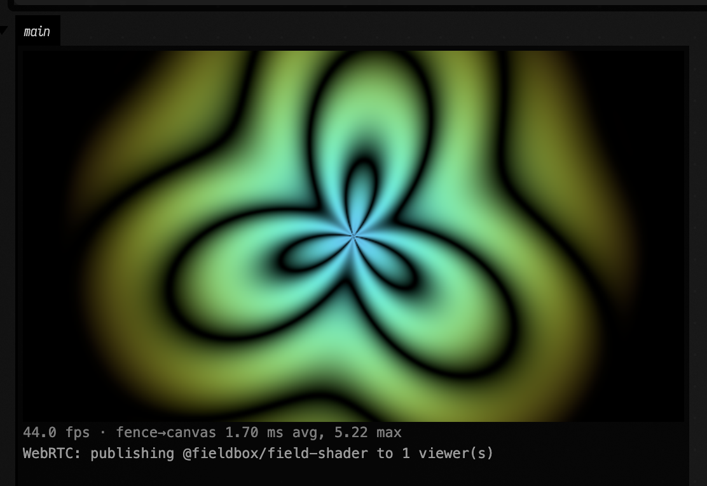
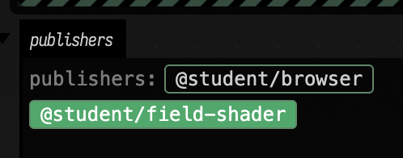

# WebRTC Streams

A box can publish what it renders as a live video stream, and sample anyone else's stream as a
texture. The streams use aaaframe's ShaderTrinket network, so in a class a Field box appears in
every browser ShaderTrinket's list of publishers, and any student's ShaderTrinket can be pulled
into a Field shader. With no aaaframe server, Field instances on one network can stream to each
other through Field's own relay.

!!! note "Field desktop app required"
    Publishing needs Field's Electron app on macOS, or on Linux under native Wayland: the stream is
    captured from a [graphics view in an output area](four_in_output_areas.md), which a web browser
    cannot show. Receiving needs Electron installed (it is, if the app runs), and on Linux it
    copies frames through the CPU. Video only; there is no sound.

## Publish a shader

This box draws a fragment shader into a 640×360 render target and publishes it as
`field-shader`. It sits under a renderer box, like any Field 4 graphics box, and its `vertex` and
`fragment` properties hold the shaders (the `webrtc_shader_jam` starting point has all three).

```diffstatic {data-lang=kotlin}
import afield.media.webrtc.webrtcSink

@exported val sink = webrtcSink("field-shader", 640, 360)

val module = moduleHere { sink.rtt.apply() }
val quad = Mesh()
module += "quad" to quad
sink.rtt += "content" to module

quad.clock = { vec(System.nanoTime() / 1e9, 0.0, 0.0, 0.0) }
quad.set(4, 2) {
    pos.add(-1, -1, 0)
    pos.add(1, -1, 0)
    pos.add(1, 1, 0)
    pos.add(-1, 1, 0)
    tri.add(0, 1, 2)
    tri.add(0, 2, 3)
}

display("main", sink.html())
```

`sink.rtt` is an ordinary `RenderToTexture`: attach modules to it as you would to any texture
you render into. `sink.html()` shows the frames in the output panel and publishes them. The line
under the view names the stream and counts its viewers:



The stream's full name is your login and the name you gave, `alice/field-shader`. That is what a
classmate types into ShaderTrinket's Receive box. Re-running the box replaces the stream, and
deleting the box stops it.

## Receive a stream as a texture

`webrtcSource("alice")` is a texture showing `@alice`'s stream, and `webrtcPublishers()` is the
live list of who is publishing. This box shows the list as buttons, switches to whichever one you
click, and draws the stream on a quad in the renderer's window:

```diffstatic {data-lang=kotlin}
import afield.media.webrtc.webrtcPublishers
import afield.media.webrtc.webrtcSource

val publishers = webrtcPublishers()
val source = webrtcSource(publishers.names.firstOrNull() ?: "nobody", 640, 360)
publishers.onChange { names ->
    if (source.target == "nobody" && names.isNotEmpty()) source.watch(names.first())
}
publishers.onPick { name -> source.watch(name) }
display("publishers", publishers.html { source.target })

val material = moduleHere { textures("remote" to source) }
val screen = Mesh()
material += "screen" to screen
renderer += "webrtc-remote" to material

screen.set(4, 2) {
    pos.add(-0.9, -0.9, 0.0)
    pos.add(0.9, -0.9, 0.0)
    pos.add(0.9, 0.9, 0.0)
    pos.add(-0.9, 0.9, 0.0)
    tc.add(0, 0, 1, 0, 1, 1, 0, 1)
    tri.add(0, 1, 2, 0, 2, 3)
}
```

In the fragment shader the stream is an ordinary sampler, `uniform sampler2D remote`. The video
is letterboxed to keep its shape (`fit = "cover"` or `"fill"` change that). Until the publisher
is online the texture shows a line of text saying what it is waiting for, and when a publisher
stops and starts again the texture picks it up by itself. `source.status` is that same line.



Re-running the receiving box keeps the stream connected and only changes what it watches, so you
can edit the shader that uses it without reconnecting.

## In a class with aaaframe

Join the class once, by running this in any box with your class's aaaframe address:

```diffstatic {data-lang=kotlin}
import afield.media.webrtc.WebRTCNetwork

WebRTCNetwork.join("https://aaaframe.example.edu")
```

From then on every `webrtcSink`, `webrtcSource` and `webrtcPublishers` uses that class, in this
run of Field and the next ones. The first box that needs it opens a small Field window on
aaaframe's GitHub sign-in. Sign in as you would in the browser; the window closes by itself, and
the panels connect as `@you`. If you have already authorised aaaframe on GitHub, the window opens
and closes without asking anything.

Field remembers the class and your aaaframe login in `~/.afield/webrtc/aaaframe-sign-ins.json`,
a file only your user account can read. It belongs to you, not to a document, so a document you
share does not carry your login. When the login expires or the class server is restarted with a
new key, aaaframe refuses it, and Field opens the sign-in window again. The publisher list and the
line under a publishing view also have a **Sign in to aaaframe** button, which starts a fresh
sign-in.

Signing in needs the Field desktop app; a web browser shows "signing in to aaaframe needs the
Field Electron app" instead. A server run in aaaframe's local mode (`AAAFRAME_LOCAL_AUTH=1`) needs
no sign-in at all: everyone on it shares one login, and the names after the slash tell the streams
apart.

!!! note "Choosing the class without remembering it"
    `AFIELD_WEBRTC_SERVER` names the class for one launch of Field, and
    `WebRTCNetwork.default = WebRTCNetwork.aaaframe(url)` for one run. To use a login you already
    have instead of signing in, set `AFIELD_AAAFRAME_SESSION` to the value of aaaframe's `session`
    cookie, or pass `session = "…"` to `aaaframe`; either wins over the remembered one.

Here a browser ShaderTrinket on a local aaaframe received `@student/field-shader` into
`iChannel0` and published its own canvas, and the Field box above picked `@student/browser` from
its list. Because the browser's shader mixes the Field stream into its own picture, each shows
the other's petals:


!!! note "A still shader publishes nothing"
    A browser canvas only produces video frames when it changes, so a ShaderTrinket whose shader
    does not use `iTime` (its default does not) publishes an empty stream, and Field shows the
    waiting line. Field's own views redraw every frame and are not affected.

## Without aaaframe

With no server named, everything uses Field's own relay, and the publishers are the other Field
boxes connected to the same Field. Your login there is the computer's user name, or
`AFIELD_WEBRTC_LOGIN`. The two boxes above work on their own this way: the receiving box shows the
publishing box's stream.

## Networks and limits

Streams travel directly between the two machines; the server only introduces them. That works
on one local network, and through most home routers, using the public STUN servers aaaframe
lists. It does not work between two networks that both block direct connections (some campus
and corporate networks do), because Field has no relay server (TURN) for the video itself.

## How fast it is

On one Apple silicon Mac, through a local aaaframe server, the time from Field rendering a frame
to the receiving page presenting it was 46 ms at the median, 63 ms at the 90th percentile and
71 ms at the 99th, while the machine was moderately busy. Under heavy load it rose to 59 ms
median and 106 ms at the 90th percentile. The stream is captured at up to 30 frames a second, so
a frame can wait up to 33 ms for its turn before it is encoded at all.

??? aside "Agents: how this works and how it was measured"
    The JVM never touches WebRTC. The sink's page script calls `canvas.captureStream(30)` on the
    output-area canvas `ElectronRTTView` draws into; the source is a hidden puppet Electron page
    (`webrtc-source.html`) playing the remote track in a `<video>`, whose paints become the texture
    through `FieldUiBrowserTexture`. Pages talk only to Field's `/ws/webrtc-signaling`, which relays
    itself or copies frames to aaaframe's `/ws/shadertrinket-signaling` with the session cookie,
    which `electron/aaaframe-sign-in.js` reads from its sign-in window's cookie jar; the
    reasons (Lax cookie, separate Electron profile) are in `dev_docs/WEBRTC_SOURCES_SINKS.md`.
    The latency figure comes from `dev_docs/webrtc_latency/`: a sink draws its wall clock as a
    24-bit bar code, and a source with `measure = true` decodes every presented frame with
    `requestVideoFrameCallback` and compares clocks. The browser end was driven with
    `dev_docs/webrtc_latency/shadertrinket_driver.py`. The figures on this page are screenshots
    of those runs, not docs-runner captures, because they need two running peers.
