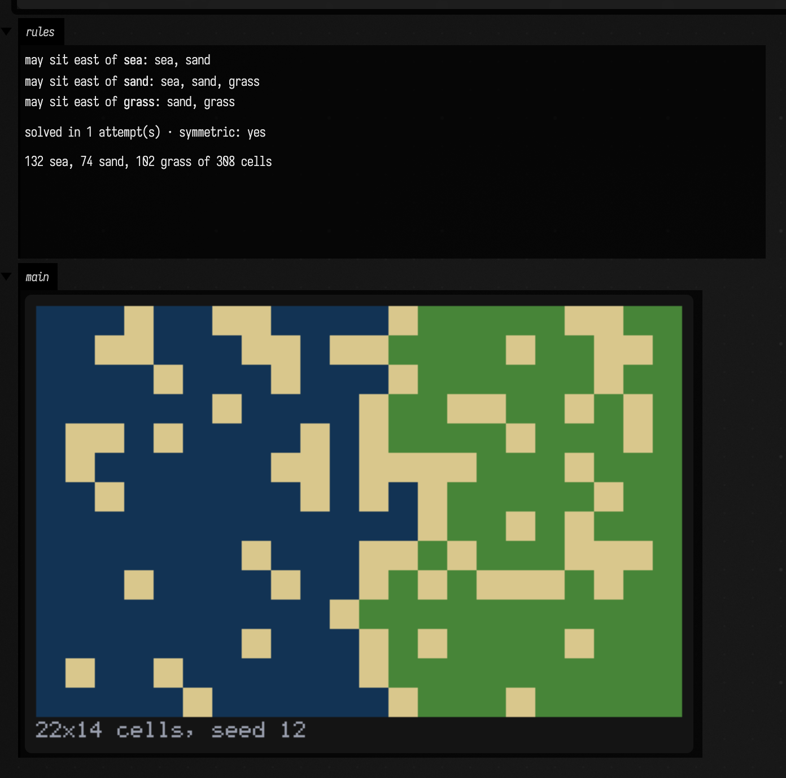
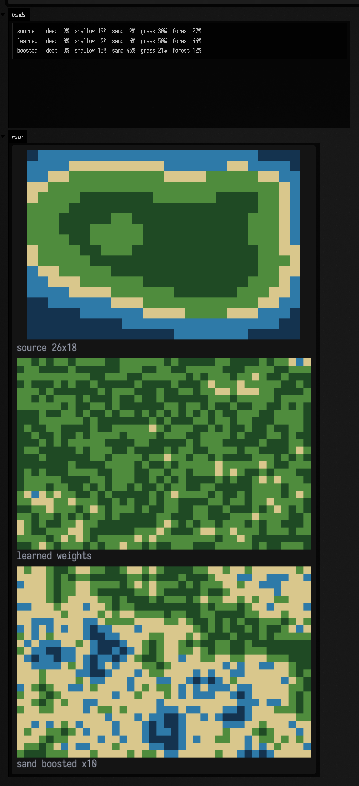
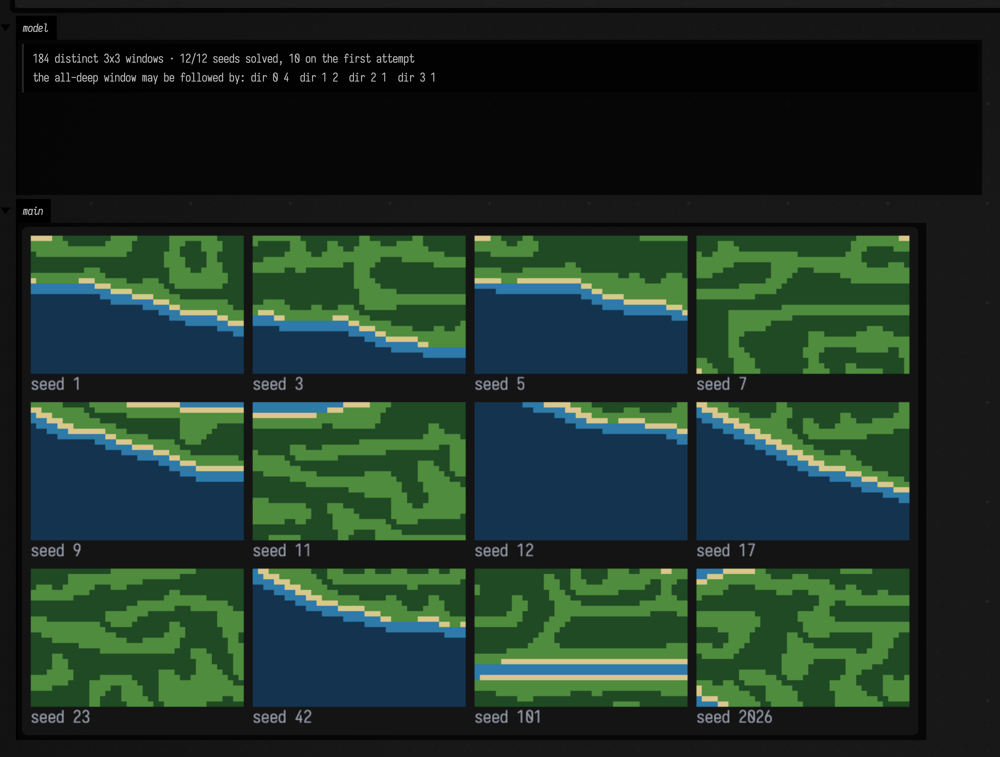
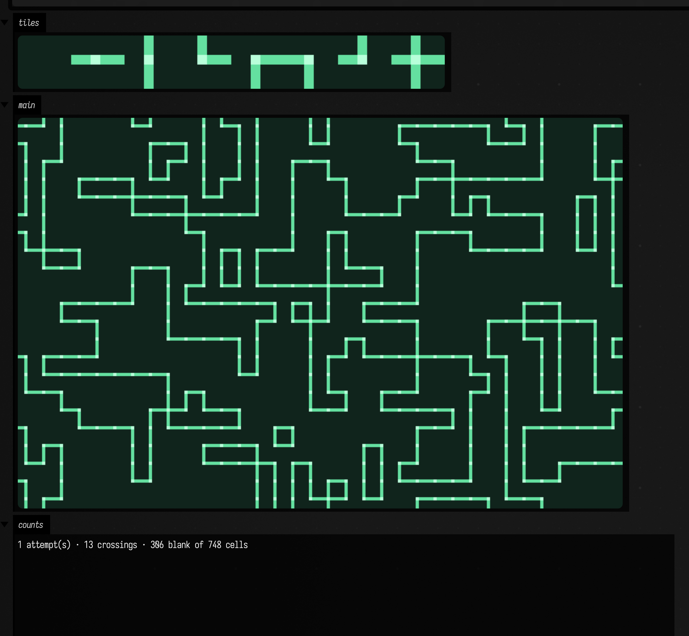
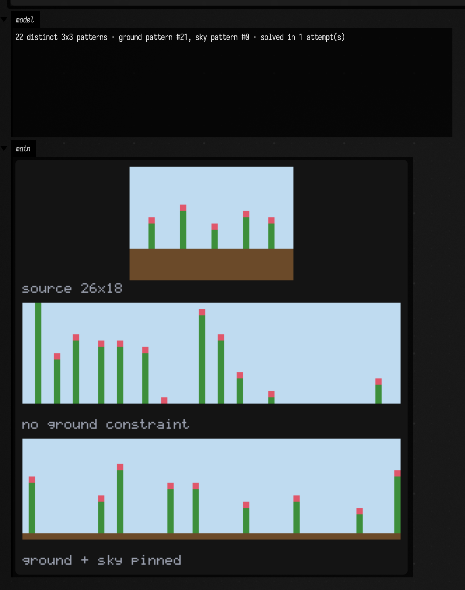
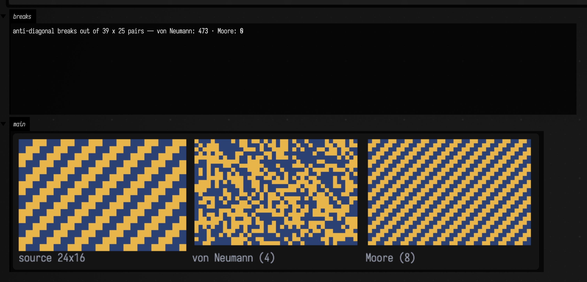
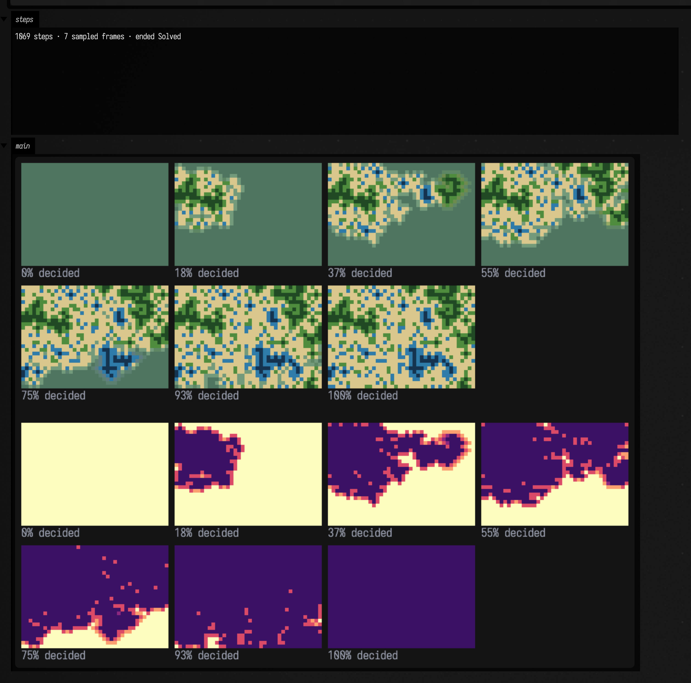
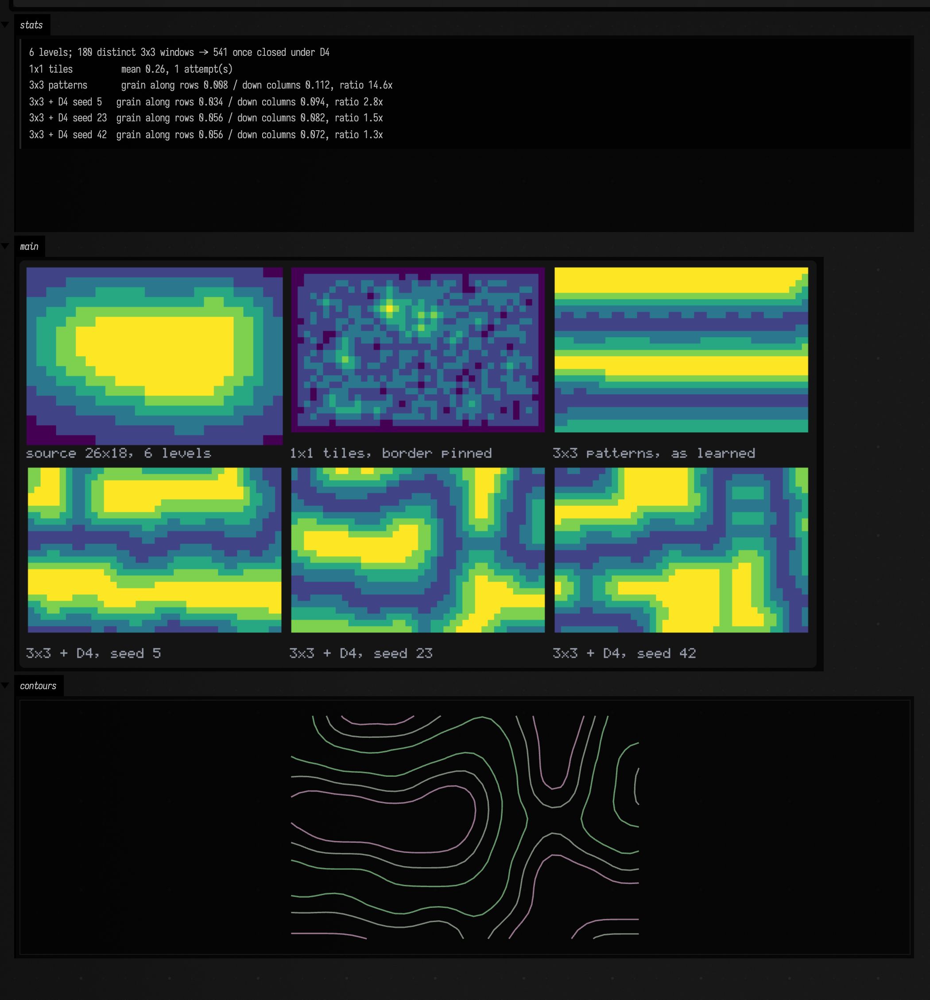
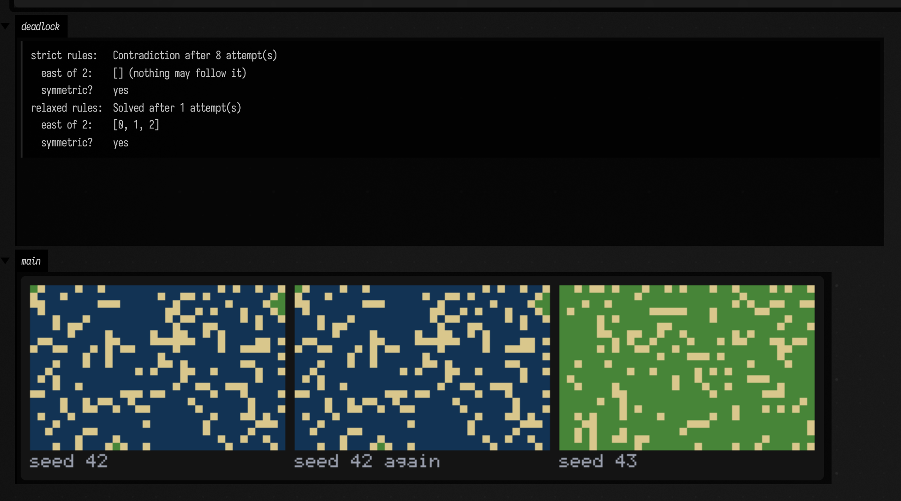
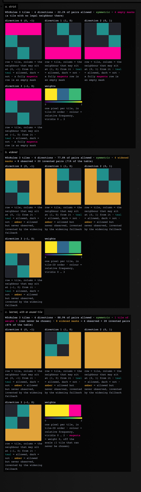

# Wave Function Collapse examples

*Every public declaration used below is listed, with its KDoc, in the codebase reference:
[`wfc.kt`](reference/data.md#wfc-kt) and [`wfc_field.kt`](reference/data.md#wfc-field-kt). Start from
[what's already in the box](reference/index.md).*

Wave Function Collapse is a constraint solver wearing the costume of a texture synthesiser. Give it a
grid, a set of tiles, and a table of which tiles may sit next to which, and it fills the grid: every
cell starts holding *every* tile as a possibility, and the solver repeatedly picks the cell with the
fewest options left, commits it to one tile chosen by weight, and then propagates the consequences
outward until nothing else can be narrowed. Repeat until every cell is decided. The name is borrowed
from quantum mechanics by analogy and nothing more — there is no physics here, just arc consistency
and a random number generator. What makes it interesting for generative work is that the constraints
are usually *learned*: you draw one small example of the thing you want, and the solver extracts the
adjacency table from it and produces more.

The reason it feels different from noise or an L-system is where the authorship sits. You do not
describe the output, and you do not describe a process that makes the output — you describe what is
*locally legal*, and then a search finds a global arrangement that never breaks a local rule. That
is a genuinely different handle to hold, and it is why WFC output tends to look designed rather than
generated. It also means the failure modes are constraint-solver failure modes: over-constrain it and
it deadlocks, under-constrain it and you get correct mush, and the interesting work is almost always
in the rules rather than in the solver.

## What this implementation does, and does not do

`afield.stdlib.wfc` is a single file with no dependencies beyond `java.awt.image` and `ImageIO`. It
covers:

- **The core solver** on integer tile IDs — [`WfcSolver`](reference/data.md#wfc-kt-wfcsolver), with
  weighted Shannon-entropy cell selection, weighted collapse, and bitset propagation that reuses
  `LongArray` scratch rather than allocating per neighbour.
- **Rules from a sample grid** (the *simple-tiled* model) and **rules from overlapping N×M patterns**
  (the *overlapping* model), learned from a PNG, a `BufferedImage` or a 2-D `FloatArray`.
- **Rules by hand**, via `wfcRules { … }`.
- **Configurable symmetric neighborhoods** — [`WfcNeighborhood`](reference/data.md#wfc-kt-wfcneighborhood)
  is not hardwired to von Neumann; `Moore`, `chebyshev(r)`, `manhattan(r)` and arbitrary offset sets
  all work, for learning *and* propagation.
- **An explicit `step()`**, so the collapse is observable rather than a black box. That is what the
  animation further down is made of.

Things it deliberately does not do, so you are not surprised:

- **No backtracking.** A contradiction is terminal. The remedy is to start the attempt again, which
  is what `solveWithRetries` does — see [§8](#8-contradictions-seeds-and-reproducibility).
- **Symmetry expansion for *patterns*, not for hand-authored tiles.**
  [`expandSymmetry`](reference/data.md#wfc-kt) closes a learned overlapping pattern set under the
  rotations and reflections of the square, which is what stops a model from believing in whichever
  orientation its source happened to contain most of ([§7](#7-not-pixels-wfc-on-a-scalar-field)).
  It does *not* exist for the simple-tiled model: most tileset formats let you declare a tile and ask
  for its four rotations, and here a rotated tile is still a different tile that you supply and
  constrain yourself, because rotating tile *art* is a question about your pixels rather than about
  adjacency.
- **2-D only**, and the *output* never wraps. `wrapX` / `wrapY` on `fromSampleGrid` affect how the
  sample is *read*, not how the result is generated.
- **No absolute position.** The rules are translation-invariant, so "sky belongs at the top" is not
  something WFC can know. You pin it yourself with `forceTile` — see [§4](#4-the-overlapping-model-and-absolute-position).

## 1. The model, by hand

Before any image loading, the smallest thing that is recognisably WFC: three tile IDs and a table.
The tiles form a chain — sea, sand, grass — and sand is the only thing allowed to touch both sea and
grass. Nothing here is learned; every constraint is stated.

Note that `allow` is **directional and symmetric**: `allow(WFC_EAST, a, b)` says "`b` may sit east of
`a`", and therefore also "`a` may sit west of `b`". It does *not* say `a` may sit east of `b`. An
undirected "these two may touch" is that call in both orders, which is a two-line helper rather than
a built-in, because the directional form is the one you need the moment tiles stop being symmetric.

```diffstatic_runner {data-lang=kotlin screenshot="assets/wfc_examples/by-hand.png" wait="1.5" capture="box" open-outputs="true" w="1200" name="wfc-by-hand"}
:::static
val SEA = 0
val SAND = 1
val GRASS = 2
val names = listOf("sea", "sand", "grass")

// The primitive is directional. "May touch", for tiles that have no orientation, is that
// primitive applied both ways round in both authored directions.
fun WfcRulesBuilder.mayTouch(a: Int, b: Int) {
    for (d in listOf(WFC_EAST, WFC_SOUTH)) {
        allow(d, a, b)
        allow(d, b, a)
    }
}

val rules = wfcRules(tileCount = 3) {
    weights(3.0, 1.0, 3.0)      // sea and grass equally likely; sand rare, so it stays an interface
    mayTouch(SEA, SEA)
    mayTouch(SEA, SAND)
    mayTouch(SAND, SAND)
    mayTouch(SAND, GRASS)
    mayTouch(GRASS, GRASS)
    // Deliberately absent: mayTouch(SEA, GRASS). That single omission is the whole model.
}

val solver = WfcSolver(width = 22, height = 14, rules = rules, seed = 12L)

// Seed both phases: sea pinned down the left edge, grass down the right. Without this the field
// simply phase-separates — with only a one-cell-wide legal interface between them, whichever of
// the two nucleates first tends to fill the whole grid. (Section 7 shows that happening.)
val outcome = solver.solveWithRetries {
    for (row in 0 until 14) {
        forceTile(0, row, SEA)
        forceTile(21, row, GRASS)
    }
}
val grid = solver.resolvedTileGridOrNull()!!

// Read the table back out of the model rather than restating it from the source above.
val table = (0..2).joinToString("<br>") { a ->
    "may sit east of <b>${names[a]}</b>: " +
        (0..2).filter { rules.allows(WFC_EAST, a, it) }.joinToString(", ") { names[it] }
}
:::fold render the rule table and the tallies
// One display() per channel: a second display() on the same channel REPLACES the first.
markdown("rules", """
    $table

    solved in ${outcome.attempts} attempt(s) · symmetric: ${rules.findAsymmetry() ?: "yes"}

    ${grid.count { it == SEA }} sea, ${grid.count { it == SAND }} sand, ${grid.count { it == GRASS }} grass of ${grid.size} cells
""")
:::endfold

:::fold render one flat colour per cell, big enough to count them
val palette = listOf(
    Triple(0.07f, 0.20f, 0.33f),
    Triple(0.85f, 0.78f, 0.55f),
    Triple(0.28f, 0.52f, 0.22f)
)
val img = Img.generateRGB(22, 14) { x, y -> palette[grid[x + y * 22]] }
showImgGrid("22x14 cells, seed 12" to img.upscaleNearest(26), columns = 1, cellSide = 700)
:::endfold
```



Sand appears exactly where it has to: as a one-cell-wide coastline wherever sea meets grass, because
that is the only arrangement the table permits. Nowhere does sea touch grass. The solver was not told
to draw coastlines — it was told that a sea-grass edge is illegal, and coastlines are what is left.

That is also the first thing worth checking on any WFC result, and it is checkable rather than a
matter of taste: **every adjacent pair in the output must be a pair the rules allow.** `allows` is
there so you can assert it. The figure gallery behind this page
(`afield.examples.stdlib.WfcGallery`) asserts it for every grid on it, along with the invariant the
solver itself depends on — that adjacency is *symmetric*, i.e.
`allows(d, a, b) == allows(opposite(d), b, a)`. Propagation only ever pushes constraints outward from
a cell that changed, one direction per arc, so an asymmetric rule set has arcs the solver
structurally cannot check and it will emit pairs its own rules forbid. `findAsymmetry()` is that
check; it found a real bug in this file's own mask-widening while this page was being written.

## 2. Learning from an image: the simple-tiled model

Now the usual way round. `sliceIntoUniqueTiles` cuts a source image into fixed-size tiles, dedupes
them, and hands back both the tile atlas and the grid of IDs it came from; `toRules()` then reads the
adjacency table straight off that grid — every pair of neighbours it saw becomes a legal pair, and
how often each tile occurred becomes its weight.

The tile size can be `1 × 1`, which is the clearest way to meet the model: a tile is then just a
colour, and "learning the rules" is literally "note which colours were seen touching".

```diffstatic_runner {data-lang=kotlin screenshot="assets/wfc_examples/simple-tiled.png" wait="1.5" capture="box" open-outputs="true" w="1200" name="wfc-simple-tiled"}
:::static
:::fold build the source: three gaussian bumps minus a lake, quantised into five terrain bands
fun bump(u: Double, v: Double, cx: Double, cy: Double, r: Double): Double {
    val dx = u - cx
    val dy = v - cy
    return exp(-(dx * dx + dy * dy) / (2.0 * r * r))
}

val palette = listOf(
    Triple(0.08f, 0.20f, 0.31f),   // deep water
    Triple(0.18f, 0.48f, 0.66f),   // shallow water
    Triple(0.85f, 0.78f, 0.55f),   // sand
    Triple(0.31f, 0.55f, 0.24f),   // grass
    Triple(0.12f, 0.29f, 0.14f)    // forest
)

val sw = 26
val sh = 18

// Keep the band index per cell as well as the picture: it is what lets the histogram below talk
// about terrain instead of about opaque tile IDs.
val bands = IntArray(sw * sh)
for (cy in 0 until sh) for (cx in 0 until sw) {
    val u = cx / (sw - 1.0)
    val v = cy / (sh - 1.0)
    val e = bump(u, v, 0.30, 0.40, 0.25) +
        0.90 * bump(u, v, 0.70, 0.62, 0.21) +
        0.55 * bump(u, v, 0.82, 0.22, 0.13) -
        0.62 * bump(u, v, 0.34, 0.44, 0.085)
    bands[cx + cy * sw] = if (e < 0.16) 0 else if (e < 0.32) 1 else if (e < 0.44) 2 else if (e < 0.74) 3 else 4
}
val source = Img.generateRGB(sw, sh) { x, y -> palette[bands[x + y * sw]] }
:::endfold

// One pixel per tile. Five bands in, five unique tiles out.
val tiles = source.toBufferedImage().sliceIntoUniqueTiles(1, 1)
val rules = tiles.toRules()

// Tile IDs are discovery order, not band order. sampleIds is row-major over the same grid the
// source was drawn on, so one pass recovers the correspondence both ways.
val bandOfTile = IntArray(tiles.tileCount)
val tileOfBand = IntArray(palette.size)
for (cy in 0 until sh) for (cx in 0 until sw) {
    val i = cx + cy * sw
    bandOfTile[tiles.sampleIds[i]] = bands[i]
    tileOfBand[bands[i]] = tiles.sampleIds[i]
}

val outW = 40
val outH = 26

fun solveWith(model: WfcRules): IntArray {
    val solver = WfcSolver(outW, outH, model, seed = 12L)
    solver.solveWithRetries(maxAttempts = 30)
    return solver.resolvedTileGridOrNull()!!
}

val learned = solveWith(rules)

// The learned weights are just a DoubleArray, and the solver reads it live — so a learned model is
// editable. Boost the rare bands, and above all the *interface* band, sand.
val reweighted = tiles.toRules()
reweighted.weights[tileOfBand[0]] *= 2.0     // deep water
reweighted.weights[tileOfBand[1]] *= 1.5     // shallow water
reweighted.weights[tileOfBand[2]] *= 10.0    // sand, the only band that may touch both sides
val boosted = solveWith(reweighted)

val bandNames = listOf("deep", "shallow", "sand", "grass", "forest")
fun histogram(cells: IntArray, bandOf: (Int) -> Int): String =
    palette.indices.joinToString("  ") { b ->
        bandNames[b] + " " + (cells.count { bandOf(it) == b } * 100 / cells.size).toString().padStart(2) + "%"
    }

:::fold render the three band histograms as text
val bandReport =
    "source    ${histogram(bands) { it }}\n" +
    "learned   ${histogram(learned) { bandOfTile[it] }}\n" +
    "boosted   ${histogram(boosted) { bandOfTile[it] }}"
markdown("bands", """
    ~~~
$bandReport
    ~~~
""")
:::endfold

// Scale factors chosen so every panel is 360px tall: montage gives each cell the height of the
// tallest one, so mismatched panels leave a big empty band.
showImgGrid(
    "source 26x18" to source.upscaleNearest(20),
    "learned weights" to tiles.toImg(learned, outW, outH).upscaleNearest(14),
    "sand boosted x10" to tiles.toImg(boosted, outW, outH).upscaleNearest(14),
    columns = 1,
    cellSide = 620
)
```



This is the result most WFC introductions quietly skip, and it is worth reading carefully.

The middle panel is **correct**. Every adjacent pair in it is a pair present in the source, and the
set of band-to-band edges it contains is a subset of the set the source contains — `WfcGallery`
asserts both. It is also nothing like the source: a speckle of grass and forest with a little sand,
and — look at the histogram — **no water at all**, where the source was 29% water.

That is not bad luck with the seed. Every seed does this; the model is *bistable*. Grass and forest
are the source's majority bands and they may touch each other, so they form a mutually reinforcing
phase; water is a minority band reachable only across a one-cell sand interface, and once the first
few cells commit to land there is no path back. Whichever phase nucleates first fills the grid.

The bottom panel is the same rules with three weights multiplied — `rules.weights` is a plain
`DoubleArray` that the solver reads live, so a learned model is editable. Boosting *sand*, the only
band allowed to touch both sides, is what matters: interface cells are what let the two phases sit
near each other, so making them cheap lets all five bands coexist. It does not, however, reproduce
the source's proportions — sand is now far more common than it ever was in the source.

The honest conclusion is that this model cannot reproduce global proportions, because it does not
represent them. It is a table of which colours may touch plus a marginal frequency per colour; "water
covers about a quarter of the map in large connected regions" is not expressible in that language, so
no amount of weight tuning will produce it.

### The same source, with context

The diagnosis points somewhere specific. A cell that holds one colour can only ever learn which
colours touch, and the source's structure — a coast is water, then a *one-cell* sand fringe, then
land — is a statement about a run of three cells, which is not a thing a one-cell alphabet can hold.
So give each cell more to hold.

That is the **overlapping model**, and it is worth meeting here rather than waiting for
[§4](#4-the-overlapping-model-and-absolute-position), because it is the answer to the figure above.
Instead of cutting the source into disjoint tiles, slide an N×N window over every position and keep
the distinct windows you find; each solver cell now stands for one whole window, and two cells may
be neighbours only if their windows *agree where they overlap*. Nothing else changes — same solver,
same four directions, same learned weights. Each cell simply knows nine pixels instead of one.

```diffstatic_runner {data-lang=kotlin screenshot="assets/wfc_examples/terrain-overlapping.png" wait="4.0" timeout="180" capture="box" open-outputs="true" w="1200" name="wfc-terrain-overlapping"}
:::static
:::fold section 2's terrain source, unchanged — one pixel per cell
fun bump(u: Double, v: Double, cx: Double, cy: Double, r: Double): Double {
    val dx = u - cx
    val dy = v - cy
    return exp(-(dx * dx + dy * dy) / (2.0 * r * r))
}

val palette = listOf(
    Triple(0.08f, 0.20f, 0.31f),   // deep water
    Triple(0.18f, 0.48f, 0.66f),   // shallow water
    Triple(0.85f, 0.78f, 0.55f),   // sand
    Triple(0.31f, 0.55f, 0.24f),   // grass
    Triple(0.12f, 0.29f, 0.14f)    // forest
)

val sw = 26
val sh = 18
val bands = IntArray(sw * sh)
for (cy in 0 until sh) for (cx in 0 until sw) {
    val u = cx / (sw - 1.0)
    val v = cy / (sh - 1.0)
    val e = bump(u, v, 0.30, 0.40, 0.25) +
        0.90 * bump(u, v, 0.70, 0.62, 0.21) +
        0.55 * bump(u, v, 0.82, 0.22, 0.13) -
        0.62 * bump(u, v, 0.34, 0.44, 0.085)
    bands[cx + cy * sw] = if (e < 0.16) 0 else if (e < 0.32) 1 else if (e < 0.44) 2 else if (e < 0.74) 3 else 4
}
val source = Img.generateRGB(sw, sh) { x, y -> palette[bands[x + y * sw]] }
:::endfold

// The one changed line: 3x3 windows of the source instead of its five colours. wrapY = false so
// the model never learns that the top of the map sits above the bottom of it.
val patterns = source.toBufferedImage().sliceIntoOverlappingPatterns(3, 3, wrapX = false, wrapY = false)
val rules = patterns.toRules()

val outW = 40
val outH = 26

// Twelve seeds, because one picture of a stochastic process is an anecdote. No pinning, no
// re-weighting: this is the learned model exactly as `toRules()` handed it over.
val seeds = listOf(1L, 3L, 5L, 7L, 9L, 11L, 12L, 17L, 23L, 42L, 101L, 2026L)
val panels = mutableListOf<Pair<String, Img>>()
var firstAttempt = 0
for (seed in seeds) {
    val solver = WfcSolver(outW, outH, rules, seed = seed)
    val outcome = solver.solveWithRetries(maxAttempts = 30)
    if (outcome.attempts == 1) firstAttempt++
    val grid = solver.resolvedTileGridOrNull() ?: continue
    panels.add("seed $seed" to patterns.toImg(grid, outW, outH).upscaleNearest(6))
}

// Why this figure has no ground constraint, read out of the model rather than asserted. The source's
// corner is deep water, so that pixel identifies the band without re-deriving the palette's rounding.
//
// An explicit loop with a typed `px`, not `.first { ... .all { it == deepArgb } }`: a box's scope is
// crowded enough that `all` inside a nested lambda whose receiver has no written-down type resolves
// to something else entirely, and the error surfaces on a later line.
val deepArgb: Int = source.toBufferedImage().getRGB(0, 0)
var uniformDeep: Int = -1
for (id in 0 until patterns.tileCount) {
    val px: IntArray = patterns.patterns[id]
    if (px.all { v -> v == deepArgb }) {
        uniformDeep = id
        break
    }
}

val successors: String = (0..3).joinToString("  ") { d -> "dir " + d + " " + rules.allowedCount(d, uniformDeep) }
:::fold render the model summary
val modelReport =
    "${patterns.tileCount} distinct 3x3 windows · ${panels.size}/${seeds.size} seeds solved, " +
    "$firstAttempt on the first attempt\n" +
    "the all-deep window may be followed by: " + successors
markdown("model", """
    ~~~
$modelReport
    ~~~
""")
:::endfold

display("main", montage(panels, columns = 4, cellSide = 300).toPngBytes())
```



Twelve for twelve, ten of them on the first attempt, and every adjacent pair in every one of them is
a pair the source contained — `WfcGallery` checks that for all twelve, along with the band-edge
subset property.

**They are coastlines, and they are not islands.** That distinction is the whole lesson, and it is
worth being precise rather than apologetic about it. What the model reproduces is the source's local
*grammar*: the bands appear in chain order, every land-water boundary carries a one-cell sand fringe,
forest sits inside grass and never touches water. What it does not reproduce is the source's
*composition* — the fact that all of this was arranged into one closed ring. Composition is global,
and an adjacency table is definitionally local, so this is not a shortfall to be tuned away. It is
the model working. A 40 × 26 output is a crop of a much larger world, and a coast running across a
crop of a world is the correct answer.

Measured against the source, the local statistics land where they should: mean coherence — the
fraction of adjacent cell pairs holding the same band — is **0.850** across the twelve, against the
source's 0.713 and the one-colour model's 0.468. It is *more* coherent than its own source, which is
what you would expect from a model that has learned the interiors are large and the boundaries are
thin, and is under no obligation to also put a shoreline in any particular place.

The figure is deliberately unpinned, and the readout in the box says why:

```diffstatic {data-lang=text}
the all-deep window may be followed by: dir 0 4  dir 1 2  dir 2 1  dir 3 1
```

South and west, the all-deep-water 3 × 3 window has **exactly one** legal successor — itself. For a
window to sit south of it, that window's top two rows must be entirely deep, and this source's water
band is mostly thinner than three cells, so no such window exists except the uniform one. Pin a
single cell to it and propagation paints the entire grid deep; add a second pin anywhere on land and
you get an instant contradiction, on every seed and every retry. A uniform window of a band thinner
than the window is a trap, and `allowedCount` is how you find one before it costs you an afternoon.
The 2 × 2 model has no such trap (its all-deep window has 2–4 successors per direction) but produces
visibly shattered, one-cell-speckled coastlines, so 3 × 3 is the pick here.

### Why 3 × 3 *windows* rather than 2 × 2 *tiles*?

Both give a cell more context, and `sliceIntoUniqueTiles(2, 2)` looks like the cheaper way to get it
— 36 tiles against 184 patterns. Do not, on a source like this one, and the reason is a trap worth
knowing about in general.

Bigger disjoint tiles mean most tiles are seen exactly once, at a sample edge, which leaves their
mask in some direction empty. `fromSampleGrid` then widens each empty mask to "any tile may sit
there" — and because adjacency has to stay symmetric, filling one mask must *also* tell every other
tile that this one may sit on its far side. One empty mask therefore injects `2 × tileCount` pairs.
That is not a flaw in the symmetric closure; it is the closure correctly revealing that "anything may
sit east of `t`" is an enormous claim.

On this source, 10 empty masks out of 144 produce a table of **282 observed pairs plus 704 invented
ones** — 71% of the model is fallback rather than evidence, and outputs then contain band pairs the
source never contained. At `1 × 1` nothing is empty and nothing is invented, which is exactly why the
speckled figure above is still trustworthy as *evidence about the model* and a `2 × 2` version of it
would not be.

So: ask. `widenedMaskCount` says whether the fallback fired at all, `wasWidened(direction, tile)`
says where, and `observedAllows` is `allows` restricted to what the sample actually showed — the
predicate to assert a learned model against, since `allows` on a widened table permits a great deal
it never saw. The inline rules view in [§8](#8-contradictions-seeds-and-reproducibility) paints
invented pairs amber for the same reason, and `WfcGallery` pins both ends of this so the numbers
above cannot quietly rot.

## 3. Tiles with structure: the circuit set

Context is one way to give the model more to work with. The other is to put the structure in the
tiles themselves. When each tile carries internal art whose *edges* have to line up, the tile set
encodes structure that a flat colour cannot, and the same solver produces something that looks
constructed rather than grown.

Nothing here is learned. This is an eight-tile set of circuit traces with rules derived from edge
sockets — `b` may sit east of `a` exactly when `a`'s east socket matches `b`'s west socket. That is
the original "simple tiled model", and it is about ten lines once the sockets are written down.

```diffstatic_runner {data-lang=kotlin screenshot="assets/wfc_examples/circuit.png" wait="1.5" capture="box" open-outputs="true" w="1200" name="wfc-circuit"}
:::static
// Sockets per tile, in WFC_NORTH, WFC_EAST, WFC_SOUTH, WFC_WEST order. 1 = a trace leaves this edge.
val sockets = listOf(
    intArrayOf(0, 0, 0, 0),   // blank
    intArrayOf(0, 1, 0, 1),   // horizontal
    intArrayOf(1, 0, 1, 0),   // vertical
    intArrayOf(1, 1, 0, 0),   // elbow N-E
    intArrayOf(0, 1, 1, 0),   // elbow E-S
    intArrayOf(0, 0, 1, 1),   // elbow S-W
    intArrayOf(1, 0, 0, 1),   // elbow W-N
    intArrayOf(1, 1, 1, 1)    // cross
)

// Edge matching, stated once. Everything else about the picture follows from it.
val rules = wfcRules(tileCount = sockets.size) {
    weights(6.0, 2.0, 2.0, 1.0, 1.0, 1.0, 1.0, 0.35)
    for (a in sockets.indices) for (b in sockets.indices) {
        if (sockets[a][WFC_EAST] == sockets[b][WFC_WEST]) allow(WFC_EAST, a, b)
        if (sockets[a][WFC_SOUTH] == sockets[b][WFC_NORTH]) allow(WFC_SOUTH, a, b)
    }
}

:::fold draw 11x11 tile art from the same socket table: a centre pad plus a trace to each live edge
val side = 11
val c = side / 2
val bg = 0xFF10241C.toInt()
val trace = 0xFF64E0A0.toInt()
val pad = 0xFFB8FFDA.toInt()

// A top-level fun, not one nested inside the Array(...) lambda below: a local fun declared inside
// a lambda in a Field box trips a K2 codegen assertion ("has no callableId").
fun traceArt(s: IntArray): IntArray {
    val px = IntArray(side * side) { bg }
    if (s[WFC_NORTH] == 1) for (y in 0..c) { px[c + y * side] = trace; px[(c - 1) + y * side] = trace }
    if (s[WFC_SOUTH] == 1) for (y in c until side) { px[c + y * side] = trace; px[(c - 1) + y * side] = trace }
    if (s[WFC_WEST] == 1) for (x in 0..c) { px[x + c * side] = trace; px[x + (c - 1) * side] = trace }
    if (s[WFC_EAST] == 1) for (x in c until side) { px[x + c * side] = trace; px[x + (c - 1) * side] = trace }
    if (s.any { it == 1 }) for (y in (c - 1)..c) for (x in (c - 1)..c) px[x + y * side] = pad
    return px
}

// A PngTileSet can be assembled from hand-drawn art; sampleIds is just the atlas row here,
// because nothing is being learned from it.
val tiles = PngTileSet(side, side, Array(sockets.size) { traceArt(sockets[it]) }, IntArray(sockets.size) { it }, sockets.size, 1)
:::endfold

val solver = WfcSolver(34, 22, rules, seed = 20260728L)
val outcome = solver.solveWithRetries()
val grid = solver.resolvedTileGridOrNull()!!

// Separate channels rather than one montage: the atlas strip and the output have wildly different
// aspect ratios, and a uniform grid would give the strip a cell 5 times taller than it needs.
display("tiles", tiles.sampleToImg().upscaleNearest(6).toPngBytes())
display("main", tiles.toImg(grid, 34, 22).upscaleNearest(2).toPngBytes())
:::fold render the cell tallies
markdown("counts",
    "${outcome.attempts} attempt(s) · ${grid.count { it == 7 }} crossings · " +
        "${grid.count { it == 0 }} blank of ${grid.size} cells")
:::endfold
```



Every trace connects. There are no dangling ends anywhere in the output, and there cannot be: a live
socket on one tile is only ever adjacent to a live socket on the next, so "wires join up" is a
consequence of edge matching rather than something the generator tries to achieve. The weights are
doing the aesthetic work — blank is weighted 6 and the four-way cross 0.35, which is why the result
reads as sparse circuitry rather than a dense maze.

## 4. The overlapping model and absolute position

[§2](#2-learning-from-an-image-the-simple-tiled-model) used the overlapping model to fix a texture
problem and left the mechanism at one paragraph. Here is the rest of it, and the limit that no amount
of context removes.

First the trade, which is combinatorial. A 3×3 window over a 26×18 source can yield hundreds of
distinct patterns where the simple-tiled model had five tiles, and both the rule-learning cost (it
compares every pattern against every other) and the per-step entropy scan grow with that count.
Larger windows are not free and are not automatically better: they buy coherence and they cost
variety, because a window big enough to contain a whole feature can only ever reproduce that feature
verbatim.

And then the limit. §2's coastlines were a success at reproducing local grammar and made no attempt
at global composition, because WFC's rules are **translation-invariant** — they say what may sit next
to what, and cannot say where anything belongs. That is not a texture problem and context does not
touch it. The only cure is to supply position yourself, from outside the model, with `forceTile`.

This source is built to make that visible: sky over soil, with flowers rooted in the soil. Every 3×3
window of it *says* something — "stem continues upward", "blossom sits on a stem", "stem meets soil" —
so the model has plenty to preserve, and it will still cheerfully put the soil nowhere at all.

```diffstatic_runner {data-lang=kotlin screenshot="assets/wfc_examples/overlapping.png" wait="2.0" capture="box" open-outputs="true" w="1200" name="wfc-overlapping"}
:::static
val SKY = Triple(0.75f, 0.86f, 0.94f)
val SOIL = Triple(0.42f, 0.29f, 0.16f)
val STEM = Triple(0.24f, 0.56f, 0.23f)
val BLOSSOM = Triple(0.88f, 0.34f, 0.42f)

val sw = 26
val sh = 18
val soilTop = 13
val flowers = listOf(3 to 4, 8 to 6, 13 to 3, 18 to 5, 22 to 4)   // column to stem height

val source = Img.generateRGB(sw, sh) { x, y ->
    val flower = flowers.firstOrNull { it.first == x }
    when {
        y >= soilTop -> SOIL
        flower != null && y == soilTop - flower.second - 1 -> BLOSSOM
        flower != null && y >= soilTop - flower.second -> STEM
        else -> SKY
    }
}

// Every 3x3 window, deduped. wrapY = false: wrapping vertically would teach it that soil sits
// above sky, which is the one thing this source is trying to say is untrue.
val patterns = source.toBufferedImage().sliceIntoOverlappingPatterns(3, 3, wrapX = true, wrapY = false)
val rules = patterns.toRules()

// Named outW/outH, not w/h: inside a lambda that has its own receiver (solveWithRetries' prepare
// block below), a bare `h` resolves to the Box's own frame height rather than to this local.
val outW = 60
val outH = 16

// WFC has no notion of absolute position. Left alone it will happily satisfy every rule with
// "soil everywhere", which is a perfectly legal tiling of this pattern set.
val free = WfcSolver(outW, outH, rules, seed = 9L)
free.solveWithRetries(maxAttempts = 30)
val freeOut = patterns.toImg(free.resolvedTileGridOrNull()!!, outW, outH)

// So pin the boundary: the classic WFC "ground" constraint. Note that reset() clears forced cells
// too, so the pinning goes in solveWithRetries' prepare block to be re-applied on every attempt.
// (Named groundPattern/skyPattern because a bare `sky` is already taken in a Field box's scope.)
// The all-soil and all-sky 3x3 patterns, found by looking for a flat window and testing its blue.
var groundPattern: Int = -1
var skyPattern: Int = -1
for (id in 0 until patterns.tileCount) {
    val px: IntArray = patterns.patterns[id]
    if (!px.all { v -> v == px[0] }) continue
    val blue: Int = px[0] and 0xff
    if (blue < 0x60) groundPattern = id
    if (blue > 0xC0) skyPattern = id
}

val solver = WfcSolver(outW, outH, rules, seed = 4L)
val outcome = solver.solveWithRetries(maxAttempts = 30) {
    for (x in 0 until outW) {
        forceTile(x, outH - 1, groundPattern)
        forceTile(x, 0, skyPattern)
    }
}
val out = patterns.toImg(solver.resolvedTileGridOrNull()!!, outW, outH)

:::fold render the pattern summary
markdown("model",
    "${patterns.tileCount} distinct 3x3 patterns · ground pattern \\#$groundPattern, " +
        "sky pattern \\#$skyPattern · solved in ${outcome.attempts} attempt(s)")
:::endfold
showImgGrid(
    "source 26x18" to source.upscaleNearest(9),
    "no ground constraint" to freeOut.upscaleNearest(9),
    "ground + sky pinned" to out.upscaleNearest(9),
    columns = 1,
    cellSide = 620
)
```



Three things in one picture.

The middle panel is what translation invariance costs. It is a correct answer — every 3×3 window in
it appears in the source and every neighbouring pair agrees on its overlap — and it has **no ground at
all**: a sky full of flowers whose stems run off the bottom edge with nothing to grow out of. Nothing
in an adjacency table can say where anything belongs, so "the soil goes at the bottom" is not a fact
this model has access to. Pinning the top and bottom rows with `forceTile` supplies it, and the
bottom panel is what the same rules produce once they have it.

And the bottom panel is genuinely new. The flowers are not the source's flowers: different columns,
different heights, more of them than the source had. But every blossom sits on a stem, and the soil
runs unbroken along the bottom, because those are 3×3-local facts and the model enforces them. `WfcGallery` asserts exactly that — zero floating blossoms — which is a much better
test than looking at it, since a floating blossom is precisely the artefact a broken pattern model
produces.

One API note visible above: `reset()` clears the whole wave, forced cells included. Boundary
conditions therefore have to be re-applied on every retry, which is what `solveWithRetries`'
`prepare` block is for.

## 5. Neighborhoods beyond von Neumann

`WfcNeighborhood` is a set of relative offsets plus the guarantee that every offset has its opposite
in the set. `VonNeumann` is four offsets; `Moore` is eight; `chebyshev(r)` and `manhattan(r)` generate
the obvious families, and `WfcNeighborhood.of(WfcOffset(2, 0), WfcOffset(-2, 0))` is as legitimate as
either. The neighborhood is used for *both* learning and propagation, so widening it means the model
observes more relations in the source and then enforces more of them in the output.

Whether that matters depends entirely on whether the source has structure along the new offsets. Both
halves of the following figure are the same code with one argument changed.

```diffstatic_runner {data-lang=kotlin screenshot="assets/wfc_examples/neighborhoods.png" wait="2.0" capture="box" open-outputs="true" w="1200" name="wfc-neighborhoods"}
:::static
// Diagonal stripes two cells wide. Colour depends on (x + y) mod 4, so along the anti-diagonal
// offset (1, -1) the colour never changes, while east and south change only half the time.
val stripeA = Triple(0.17f, 0.25f, 0.45f)
val stripeB = Triple(0.91f, 0.71f, 0.29f)
val source = Img.generateRGB(24, 16) { x, y -> if ((x + y) % 4 < 2) stripeA else stripeB }
val tiles = source.toBufferedImage().sliceIntoUniqueTiles(1, 1)

fun solveStripes(neighborhood: WfcNeighborhood): Pair {
    val rules = tiles.toRules(neighborhood = neighborhood)
    val solver = WfcSolver(40, 26, rules, seed = 5L)
    solver.solveWithRetries(maxAttempts = 30)
    val grid = solver.resolvedTileGridOrNull()!!
    // How many cells disagree with their anti-diagonal neighbour: 0 means the stripes survived.
    var breaks = 0
    for (y in 1 until 26) for (x in 0 until 39) {
        if (grid[x + y * 40] != grid[(x + 1) + (y - 1) * 40]) breaks++
    }
    return tiles.toImg(grid, 40, 26) to breaks
}

val (vn, vnBreaks) = solveStripes(WfcNeighborhood.VonNeumann)
val (moore, mooreBreaks) = solveStripes(WfcNeighborhood.Moore)

:::fold render the break counts
markdown("breaks",
    "anti-diagonal breaks out of 39 x 25 pairs — " +
        "von Neumann: **$vnBreaks** · Moore: **$mooreBreaks**")
:::endfold
showImgGrid(
    "source 24x16" to source.upscaleNearest(12),
    "von Neumann (4)" to vn.upscaleNearest(7),
    "Moore (8)" to moore.upscaleNearest(7),
    columns = 3,
    cellSide = 340
)
```



The von Neumann model learns nothing at all from this source. Sweeping east it observes every
possible pair — `A-A`, `A-B`, `B-B`, `B-A` — because a two-wide stripe means the colour changes on
half the steps and stays on the other half. So the adjacency table ends up completely permissive, and
the output is exactly what a completely permissive table produces: correct, and noise.

Moore additionally observes the `(1, -1)` offset, where the colour is *constant* — and that one extra
relation is enough to pin the stripes exactly. 473 anti-diagonal breaks out of 975 pairs become
exactly 0. Same tiles, same source, same seed, one argument.

The lesson is that the neighborhood is a real modelling decision rather than a performance knob, and
it is not "bigger is better": on the five-band terrain of §2 the diagonals are almost implied by the
cardinals, and moving to Moore changes the mean branching factor from 2.80 to 2.90 and the picture
barely at all. A wider neighborhood costs `directionCount` bitset intersections per propagation step
and buys you nothing unless the source has something to say along those offsets.

## 6. Watching the collapse

`step()` is public and does exactly one WFC iteration: choose the lowest-entropy undecided cell,
collapse it, propagate to a fixed point, return the new status. Everything the solver knows is
readable between steps — `possibilityCountAt`, `possibilitiesAt`, `resolvedTileAt`, `lastObservation`
— which means the collapse can be drawn.

`wfc_field.kt` provides the two views worth drawing. `waveToImg` renders a partially collapsed solver
by averaging each cell's remaining possibilities, so an undecided cell is a blur of what it might
become and a decided one is itself; `possibilityCountImg` gives the remaining option count per cell
as a scalar field to colour-map.

```diffstatic_runner {data-lang=kotlin screenshot="assets/wfc_examples/collapse-frames.png" wait="3.0" capture="box" open-outputs="true" w="1200" name="wfc-collapse-frames"}
:::static
:::fold section 2's terrain source, with section 2's re-weighted model
fun bump(u: Double, v: Double, cx: Double, cy: Double, r: Double): Double {
    val dx = u - cx
    val dy = v - cy
    return exp(-(dx * dx + dy * dy) / (2.0 * r * r))
}
val palette = listOf(
    Triple(0.08f, 0.20f, 0.31f),
    Triple(0.18f, 0.48f, 0.66f),
    Triple(0.85f, 0.78f, 0.55f),
    Triple(0.31f, 0.55f, 0.24f),
    Triple(0.12f, 0.29f, 0.14f)
)
val bands = IntArray(26 * 18)
for (cy in 0 until 18) for (cx in 0 until 26) {
    val u = cx / 25.0
    val v = cy / 17.0
    val e = bump(u, v, 0.30, 0.40, 0.25) +
        0.90 * bump(u, v, 0.70, 0.62, 0.21) +
        0.55 * bump(u, v, 0.82, 0.22, 0.13) -
        0.62 * bump(u, v, 0.34, 0.44, 0.085)
    bands[cx + cy * 26] = if (e < 0.16) 0 else if (e < 0.32) 1 else if (e < 0.44) 2 else if (e < 0.74) 3 else 4
}
val source = Img.generateRGB(26, 18) { x, y -> palette[bands[x + y * 26]] }
val tiles = source.toBufferedImage().sliceIntoUniqueTiles(1, 1)
val rules = tiles.toRules()

// Section 2's boost, so the collapse has all five bands in it and is worth watching.
val tileOfBand = IntArray(palette.size)
for (i in bands.indices) tileOfBand[bands[i]] = tiles.sampleIds[i]
rules.weights[tileOfBand[0]] *= 2.0
rules.weights[tileOfBand[1]] *= 1.5
rules.weights[tileOfBand[2]] *= 10.0
:::endfold

val solver = WfcSolver(40, 28, rules, seed = 3L)

// Sample the wave every N steps. A solved cell has exactly one possibility, so the last frame of
// this sequence IS the finished output — the same picture, by construction rather than coincidence.
val waves = mutableListOf<Pair<String, Img>>()
val entropy = mutableListOf<Pair<String, Img>>()
fun sample() {
    val pct = (solver.resolvedFraction() * 100).toInt()
    waves += "$pct% decided" to tiles.waveToImg(solver).upscaleNearest(6)
    entropy += "$pct% decided" to
        solver.possibilityCountImg().colormap("magma", lo = 0f, hi = rules.tileCount.toFloat()).upscaleNearest(6)
}

sample()
var steps = 0
while (solver.step() == WfcStatus.Running) {
    steps++
    if (steps % 200 == 0) sample()
}
sample()

markdown("steps", "$steps steps · ${waves.size} sampled frames · ended ${solver.status}")

// display() the raster directly rather than via showImg: showImg clamps to maxSide with an
// area-averaging resize, and area-averaging a pixel grid is exactly what upscaleNearest avoided.
display("main", vstack(
    montage(waves, columns = 4, cellSide = 260),
    montage(entropy, columns = 4, cellSide = 260),
    gap = 14
).toPngBytes())
```



The top row is the wave; the bottom row is the possibility count on the same frames, `magma`-mapped
with an explicit `lo = 0f, hi = tileCount` so the colours mean the same thing in every frame. (Left
to the default, the range would rescale per frame and an animation of the collapse would appear to go
nowhere.)

Read either row and the algorithm is legible. It nucleates — the first collapse creates an island of
certainty — and then decisions spread outward from what has already been decided, because
lowest-entropy always means "next to something known". The bright rim in the entropy row is the
frontier: cells that have been constrained but not yet decided. Interior cells stay at the full
option count, untouched, until the front reaches them. That is also why WFC is fast in practice
despite being a constraint solver on a large grid: almost all of the work is local to a moving
boundary.

Here is the same run recorded live, one frame per handful of steps.

```diffstatic_runner {data-lang=kotlin video="assets/wfc_examples/collapse.mp4" capture="box" open-outputs="true" wait-output="true" wait-output-kind="display" execution="launch" duration="7" fps="20" timeout="180" w="1200" embed=true name="wfc-collapse-video" alt="the WFC wave collapsing, animated"}
:::static
:::fold section 2's terrain source, with section 2's re-weighted model
fun bump(u: Double, v: Double, cx: Double, cy: Double, r: Double): Double {
    val dx = u - cx
    val dy = v - cy
    return exp(-(dx * dx + dy * dy) / (2.0 * r * r))
}
val palette = listOf(
    Triple(0.08f, 0.20f, 0.31f),
    Triple(0.18f, 0.48f, 0.66f),
    Triple(0.85f, 0.78f, 0.55f),
    Triple(0.31f, 0.55f, 0.24f),
    Triple(0.12f, 0.29f, 0.14f)
)
val bands = IntArray(26 * 18)
for (cy in 0 until 18) for (cx in 0 until 26) {
    val u = cx / 25.0
    val v = cy / 17.0
    val e = bump(u, v, 0.30, 0.40, 0.25) +
        0.90 * bump(u, v, 0.70, 0.62, 0.21) +
        0.55 * bump(u, v, 0.82, 0.22, 0.13) -
        0.62 * bump(u, v, 0.34, 0.44, 0.085)
    bands[cx + cy * 26] = if (e < 0.16) 0 else if (e < 0.32) 1 else if (e < 0.44) 2 else if (e < 0.74) 3 else 4
}
val source = Img.generateRGB(26, 18) { x, y -> palette[bands[x + y * 26]] }
val tiles = source.toBufferedImage().sliceIntoUniqueTiles(1, 1)
val rules = tiles.toRules()

// Section 2's boost, so the collapse has all five bands in it and is worth watching.
val tileOfBand = IntArray(palette.size)
for (i in bands.indices) tileOfBand[bands[i]] = tiles.sampleIds[i]
rules.weights[tileOfBand[0]] *= 2.0
rules.weights[tileOfBand[1]] *= 1.5
rules.weights[tileOfBand[2]] *= 10.0
:::endfold

val solver = WfcSolver(44, 30, rules, seed = 3L)
println("wfc collapse animation ready")

// A few step()s per displayed frame, then push the wave to the box's output channel.
//
// One display() per frame, with the label drawn INTO the raster by montage(). showImg(caption = …)
// would also be a single payload, but it is an HTML figure the browser re-parses every frame; baked
// pixels keep a 20fps recording cheap, and the label cannot lag the picture it describes.
loop {
    if (solver.status == WfcStatus.Running) solver.step()   // one WFC iteration per displayed frame
    val label = "${(solver.resolvedFraction() * 100).toInt()}% decided — ${solver.status}"
    display("main", montage(
        listOf(label to tiles.waveToImg(solver).upscaleNearest(8)),
        columns = 1,
        cellSide = 460
    ).toPngBytes())
    frame()
}
```

### The solver's own inline view

Everything above had to be *arranged*: pick a view, colour-map it, choose a range, montage it, push
it to a channel. That is the right amount of work for a figure on a page and far too much for the
thing you actually do a hundred times an hour while live coding, which is: look at the object.

So `WfcSolver` implements `ToHTML`. Evaluating a solver — as a box's last expression, or via `.h`
anywhere — draws its state instead of a reflective property tree. No tile set is needed, because none
of these panels claims to show the tileset's colours:

| panel | colour means | scale |
| --- | --- | --- |
| possibilities left | how many tiles are still possible in that cell | `viridis`, fixed `1` (decided) … `tileCount` (untouched) |
| entropy | weighted Shannon entropy, in nats — the quantity the solver actually minimises | `magma`, fixed `0` … `rules.fullSetEntropy()` |
| decided tiles | which tile a cell settled on, as a stable hue per id | dark grey where still undecided |

The two heatmaps' domains are fixed by *meaning* rather than per frame, so successive looks at a
running solver are comparable; auto-ranging is what makes an animated collapse appear to stand still.
Values with nowhere to sit on a scale are taken off it and marked rather than clamped: a cell with
**zero** possibilities is magenta in the count panel, because clamping 0 onto a `1..n` ramp would
paint the one failure you need to see at the *decided* end and read as success. Entropy has a second
such case — `fromSampleGrid` gives weight 0 to a tile the sample never contained, and a cell whose
only survivor is such a tile has genuinely undefined entropy — drawn cyan, counted in the caption,
and excluded from the range. Each caption names its colour scale and both endpoints in units, so a
panel is never a picture whose meaning you have to guess.

The two ramps are not interchangeable, and the reason is worth stating because only looking at the
picture found it. A marker colour is only a marker if it is *outside* the ramp it sits on. The count
panel was drawn in `magma` first — whose middle is pink, a shade away from the contradiction magenta —
and a perfectly healthy collapse frontier read as a field of contradictions. Counts are therefore
viridis (purple → teal → yellow, no pink) with a magenta marker, and entropy is magma (black → pink →
cream, no cyan) with a cyan one.

```diffstatic_runner {data-lang=kotlin screenshot="assets/wfc_examples/inline-view.png" wait="2.0" capture="box" open-outputs="true" w="1200" name="wfc-inline-view"}
:::static
:::fold section 2's terrain source, with section 2's re-weighted model
fun bump(u: Double, v: Double, cx: Double, cy: Double, r: Double): Double {
    val dx = u - cx
    val dy = v - cy
    return exp(-(dx * dx + dy * dy) / (2.0 * r * r))
}
val palette = listOf(
    Triple(0.08f, 0.20f, 0.31f),
    Triple(0.18f, 0.48f, 0.66f),
    Triple(0.85f, 0.78f, 0.55f),
    Triple(0.31f, 0.55f, 0.24f),
    Triple(0.12f, 0.29f, 0.14f)
)
val bands = IntArray(26 * 18)
for (cy in 0 until 18) for (cx in 0 until 26) {
    val u = cx / 25.0
    val v = cy / 17.0
    val e = bump(u, v, 0.30, 0.40, 0.25) +
        0.90 * bump(u, v, 0.70, 0.62, 0.21) +
        0.55 * bump(u, v, 0.82, 0.22, 0.13) -
        0.62 * bump(u, v, 0.34, 0.44, 0.085)
    bands[cx + cy * 26] = if (e < 0.16) 0 else if (e < 0.32) 1 else if (e < 0.44) 2 else if (e < 0.74) 3 else 4
}
val source = Img.generateRGB(26, 18) { x, y -> palette[bands[x + y * 26]] }
val tiles = source.toBufferedImage().sliceIntoUniqueTiles(1, 1)
val rules = tiles.toRules()
val tileOfBand = IntArray(palette.size)
for (i in bands.indices) tileOfBand[bands[i]] = tiles.sampleIds[i]
rules.weights[tileOfBand[0]] *= 2.0
rules.weights[tileOfBand[1]] *= 1.5
rules.weights[tileOfBand[2]] *= 10.0
:::endfold

// Halfway through a collapse. `.h` is the fragment ToHTML returns, so this is exactly what the box
// shows when its last expression is `solver` — nothing here is a special-purpose figure.
val solver = WfcSolver(34, 24, rules, seed = 5L)
while (solver.resolvedFraction() < 0.45 && solver.step() == WfcStatus.Running) { }
display("a. mid-collapse", solver.h)

// The same view of a failure. Section 7's over-constrained chain: nothing may sit east of tile 2, so
// a 6x6 grid cannot be filled, and propagation empties a cell.
val strict = wfcRules(tileCount = 3) {
    allow(WFC_EAST, 0, 1)
    allow(WFC_EAST, 1, 2)
    allow(WFC_SOUTH, 0, 1)
    allow(WFC_SOUTH, 1, 2)
}
val stuck = WfcSolver(6, 6, strict, seed = 1L)
stuck.run()
display("b. contradicted", stuck.h)

:::fold render the numbers behind the two panels
// And the numbers the panels are drawn from, so the picture can be checked against them.
val readBack =
    "mid-collapse: ${solver}\n" +
    "  entropy range drawn: 0 .. ${"%.3f".format(rules.fullSetEntropy())} nats" +
    " (${solver.entropyHeatmap().nonFiniteCount} cells undefined)\n" +
    "contradicted: ${stuck}\n" +
    "  cells with no possibilities left: ${stuck.possibilityCountGrid().count { it == 0 }}"
markdown("c. read back", """
    ~~~
$readBack
    ~~~
""")
:::endfold
```


The mid-collapse row shows the same story as the montage above, without having built one: the decided
mass is dark in both heatmaps, the untouched region is bright, and the speckled band between them is
the frontier — cells propagation has narrowed without deciding. The count and entropy panels are *not*
redundant — a cell with three heavy options and a cell with three nearly-impossible ones have the
same count and very different entropy, and it is entropy the solver sorts on, so the entropy panel is
the one that predicts where it will work next. The decided-tiles panel is the answer to "on what?".

The contradicted row is the case this view exists for. One cell is magenta in the count panel and
cyan in the entropy panel — no possibilities left, and therefore no entropy — which localises the
failure to a coordinate immediately. Reading `WfcStatus.Contradiction` off a `println` tells you only
that something went wrong somewhere.

## 7. Not pixels: WFC on a scalar field

Nothing in the solver knows what a pixel is. It works on integer tile IDs, and the image helpers are
a convenience layered on top — so the same machinery runs on a row-major `FloatArray` via
`sliceIntoUniqueTiles2D` and `sliceIntoOverlappingPatterns2D`, and produces numbers rather than
colours. That is the interesting direction in Field, because a scalar field is geometry waiting to
happen: colour-map it, contour it, and the result is [`FLine`s](fline_examples.md) that go into the
same drawing and export machinery as anything hand-drawn.

The catch is that `sliceIntoUniqueTiles2D` dedupes on **exact float equality**, so a continuous field
would yield one unique tile per distinct value. Quantise first; here to six levels, which is what
makes "level *n* may only touch level *n±1*" a learnable rule.

```diffstatic_runner {data-lang=kotlin screenshot="assets/wfc_examples/scalar-field.png" wait="2.0" timeout="180" capture="box" open-outputs="true" w="1200" name="wfc-scalar-field"}
:::static
import afield.graphics.FLine

:::fold build the source field: a sum of bumps quantised to six levels
fun bump(u: Double, v: Double, cx: Double, cy: Double, r: Double): Double {
    val dx = u - cx
    val dy = v - cy
    return exp(-(dx * dx + dy * dy) / (2.0 * r * r))
}

val sw = 26
val sh = 18
val levels = 6
val source = FloatArray(sw * sh)
for (cy in 0 until sh) for (cx in 0 until sw) {
    val u = cx / (sw - 1.0)
    val v = cy / (sh - 1.0)
    val e = (bump(u, v, 0.32, 0.42, 0.26) +
        0.85 * bump(u, v, 0.70, 0.60, 0.22) +
        0.50 * bump(u, v, 0.80, 0.24, 0.14)).coerceIn(0.0, 1.0)
    // Quantise, or exact-float dedup gives one tile per distinct value instead of six.
    source[cx + cy * sw] = (Math.round(e * (levels - 1)).toDouble() / (levels - 1)).toFloat()
}
:::endfold

// Both float paths, on the same source. sliceIntoUniqueTiles2D is the FloatArray counterpart of
// sliceIntoUniqueTiles(1, 1): one value per tile. sliceIntoOverlappingPatterns2D takes 3x3 windows
// of *values* instead of colours.
val tiles = source.sliceIntoUniqueTiles2D(sw, sh, tileWidth = 1, tileHeight = 1)
val patterns = source.sliceIntoOverlappingPatterns2D(sw, sh, 3, 3, wrapX = false, wrapY = false)

val outW = 40
val outH = 26

// The lowest level, found by value rather than by ID: IDs are discovery order. For the overlapping
// set the equivalent is the 3x3 window that is uniformly at that level.
var lowestTile = 0
for (id in 0 until tiles.tileCount) {
    if (tiles.tiles[id][0] < tiles.tiles[lowestTile][0]) lowestTile = id
}
// Not "the uniformly-lowest window": this source has no 3x3 block entirely at level 0, because the
// lowest level only occupies a corner or two. The lowest window *on average* always exists.
var lowestPattern = 0
var lowestSum = Float.MAX_VALUE
for (id in 0 until patterns.tileCount) {
    var sum = 0f
    for (v in patterns.patterns[id]) sum += v
    if (sum < lowestSum) {
        lowestSum = sum
        lowestPattern = id
    }
}

// Pin the border to the lowest level in both. Without it the field settles on whichever level
// nucleates first, for exactly the reason section 2's terrain did; with it, the field has to rise
// inward through the chain.
val tiledSolver = WfcSolver(outW, outH, tiles.toRules(), seed = 5L)
val tiledOutcome = tiledSolver.solveWithRetries(maxAttempts = 30) {
    for (x in 0 until outW) { forceTile(x, 0, lowestTile); forceTile(x, outH - 1, lowestTile) }
    for (y in 0 until outH) { forceTile(0, y, lowestTile); forceTile(outW - 1, y, lowestTile) }
}
// render() on a FloatTileSet gives back a FloatArray, not an image.
// `throw`, not `error(...)`: a Field box has its own `error` in scope, and it does not return
// Nothing, so the elvis would widen this to Any.
val tiledGrid: IntArray = tiledSolver.resolvedTileGridOrNull()
    ?: throw IllegalStateException("tiled model ended " + tiledSolver.status)
val tiledHeights: FloatArray = tiles.render(tiledGrid, outW, outH)

// The pattern model gets no pinning at all. Pinning the whole border to one window over-constrains
// it into a contradiction (a corner has to satisfy the ring in both directions at once) -- and it
// does not need the help: a 3x3 window of values already encodes what a slope looks like.
val patternSolver = WfcSolver(outW, outH, patterns.toRules(), seed = 5L)
val patternOutcome = patternSolver.solveWithRetries(maxAttempts = 30)
val patternGrid: IntArray = patternSolver.resolvedTileGridOrNull()
    ?: throw IllegalStateException("pattern model ended " + patternSolver.status)
val patternHeights: FloatArray = patterns.render(patternGrid, outW, outH)

// And the same pattern set closed under the symmetries of the square. A heightfield has no up, so
// a rotated legal arrangement is also legal -- expandSymmetry says exactly that, and it is the one
// line that turns the banded result below into terrain.
//
// Three seeds rather than one, because the claim is about the ensemble: each field keeps a grain,
// and what symmetry closure removes is every field having the SAME grain. One panel cannot show that.
val symmetric = patterns.expandSymmetry(WfcSymmetry.All)
val symSeeds = listOf(5L, 23L, 42L)
val symFields = mutableListOf<Pair<Long, FloatArray>>()
for (seed in symSeeds) {
    val solver = WfcSolver(outW, outH, symmetric.toRules(), seed = seed)
    solver.solveWithRetries(maxAttempts = 30)
    val grid: IntArray = solver.resolvedTileGridOrNull()
        ?: throw IllegalStateException("symmetric model, seed " + seed + ", ended " + solver.status)
    symFields.add(seed to symmetric.render(grid, outW, outH))
}
val symHeights: FloatArray = symFields[0].second

val tiledField = floatsToImg(tiledHeights, outW, outH)
val patternField = floatsToImg(patternHeights, outW, outH)
// The contour panel is taken from seed 23, the middle one below, so it can be matched to its field.
val symField = floatsToImg(symFields[1].second, outW, outH)

// Mean |difference| between neighbours along rows vs down columns. One number per axis is all it
// takes to say "banded" out loud instead of pointing at the picture.
fun grain(v: FloatArray, w: Int, h: Int): Pair<Double, Double> {
    var hs = 0.0
    var vs = 0.0
    var hn = 0
    var vn = 0
    for (y in 0 until h) for (x in 0 until w) {
        if (x + 1 < w) { hs += kotlin.math.abs(v[x + y * w] - v[x + 1 + y * w]); hn++ }
        if (y + 1 < h) { vs += kotlin.math.abs(v[x + y * w] - v[x + (y + 1) * w]); vn++ }
    }
    return (hs / hn) to (vs / vn)
}

val plainGrain = grain(patternHeights, outW, outH)
val symLines = symFields.joinToString("\n") { entry ->
    val g = grain(entry.second, outW, outH)
    "3x3 + D4 seed " + entry.first.toString().padEnd(3) +
        " grain along rows ${"%.3f".format(g.first)} / down columns ${"%.3f".format(g.second)}" +
        ", ratio ${"%.1f".format(maxOf(g.first, g.second) / maxOf(1e-6, minOf(g.first, g.second)))}x"
}

:::fold render the grain statistics
val statsReport =
    "${tiles.tileCount} levels; ${patterns.tileCount} distinct 3x3 windows -> " +
    "${symmetric.tileCount} once closed under D4\n" +
    "1x1 tiles          mean ${"%.2f".format(tiledHeights.average())}, " +
    "${tiledOutcome.attempts} attempt(s)\n" +
    "3x3 patterns       grain along rows ${"%.3f".format(plainGrain.first)} / down columns " +
    "${"%.3f".format(plainGrain.second)}" +
    ", ratio ${"%.1f".format(maxOf(plainGrain.first, plainGrain.second) / maxOf(1e-6, minOf(plainGrain.first, plainGrain.second)))}x\n" +
    symLines
markdown("stats", """
    ~~~
$statsReport
    ~~~
""")
:::endfold

// Terraced levels contour into blocky steps, so smooth before extracting geometry. This is the whole
// point of ending up in a FloatArray rather than in pixels: iso-contours are FLines. Contour the D4
// field -- the banded one has nothing worth contouring.
val smooth = symField.gaussianBlur(1.2)
val contours = ArrayList<FLine>()
for (iso in listOf(0.15, 0.35, 0.55, 0.75)) {
    for (line in smooth.isoContourFLines(iso)) {
        line.color = vec(0.30 + iso * 0.65, 0.95 - iso * 0.45, 0.40 + iso * 0.45, 0.95)
        line.thickness = 1.6
        contours.add(line)
    }
}

val panels = mutableListOf(
    "source 26x18, 6 levels" to floatsToImg(source, sw, sh).colormap("viridis", lo = 0f, hi = 1f).upscaleNearest(14),
    "1x1 tiles, border pinned" to tiledField.colormap("viridis", lo = 0f, hi = 1f).upscaleNearest(9),
    "3x3 patterns, as learned" to patternField.colormap("viridis", lo = 0f, hi = 1f).upscaleNearest(9)
)
for (entry in symFields) {
    panels.add("3x3 + D4, seed ${entry.first}" to
        floatsToImg(entry.second, outW, outH).colormap("viridis", lo = 0f, hi = 1f).upscaleNearest(9))
}
showImgGrid(*panels.toTypedArray(), columns = 3, cellSide = 400)
lines(contours, channel = "contours", w = 900.0, h = 560.0, fitToSize = true)
```



Same solver, same rules machinery, no pixels anywhere — and the two float paths fail in
characteristically different ways, which is the useful part.

The `1 × 1` tile model does what §2's terrain did: correct, and speckle. Pinning the border to the
lowest level keeps it from plateauing, but a single value per cell carries no information about slope,
so the interior is high-frequency noise with a mean of 0.26 against the source's smooth ramp.

The `3 × 3` pattern model has context, and it clearly used it — the result is *smooth*, with coherent
bands and a mean of 0.61. But they are **horizontal** bands, where the source was a concentric island.
That is not a bug either: over most of a concentric source, a 3 × 3 window says "the level changes
vertically and is constant horizontally", because the wide top and bottom of the island contribute far
more windows than its curved left and right edges do. The mean absolute difference between adjacent
values makes it precise — the `1 × 1` result is isotropic (0.100 along rows, 0.112 down them) while the
`3 × 3` result is anisotropic by a factor of fourteen (0.008 along rows, 0.112 down them). The model
reproduced the statistically dominant local arrangement and tiled the plane with it.

### Taking the orientation out of the model

That diagnosis contains its own fix, and it is the bottom row of the figure. If the banding is there
because the model learned *which way up the source was*, then take orientation out of the model.

`expandSymmetry` closes a pattern set under the symmetry group of the square: every window plus its
three rotations, each with its mirror, deduplicated, with each pattern's observed weight shared out
across its orbit so the expansion does not change how likely any arrangement is. One line, applied to
the pattern set rather than the solver:

```diffstatic {data-lang=kotlin}
val symmetric = patterns.expandSymmetry(WfcSymmetry.All)
```

The stripes become plateaus, basins and ridges — something you would accept as a heightfield. On this
source it takes 180 distinct windows to 541, and both the rule-learning cost (every pattern compared
against every other) and the per-step entropy scan grow with that count. It is not `×8`: variants that
coincide are deduplicated, and an already-symmetric window contributes nothing new.

Three seeds are shown rather than one, and the per-seed numbers in the box are the reason. The banded
model sits at 14.6× on every seed; the D4 model comes out at 2.8×, 1.5× and 1.3×, and — the part a
single panel cannot show — the direction of what grain is left is different each time.

Two numbers, because they measure different things and only one of them is the headline:

| | ensemble anisotropy | per-output median | 
| --- | --- | --- |
| `3 × 3` as learned | **8.1×** | 14.6× |
| `3 × 3` closed under D4 | **1.4×** | 1.9× |
| the source itself | — | 2.1× |

*Ensemble* anisotropy averages row-grain and column-grain across eight seeds and then divides: it
asks whether the model has a systematic preferred direction. That is what D4 removes, and it removes
nearly all of it. *Per-output* anisotropy takes the ratio within each field and then takes the median:
it asks whether any single field is directionless. That lands at 1.9×, right at the source's own
2.1× — which is the correct outcome rather than a shortfall. Terrain has ridges, and ridges have
directions; what was wrong before was not that each field had a grain but that *every* field had the
*same* grain. Worth separating deliberately, because averaging the two roughnesses before dividing
reports a flattering `1.0×` for a model whose every individual output is still strongly banded, and
that is a mistake this page made before the gallery caught it.

Reach for `WfcSymmetry.None` — the default — whenever up is real: §4's flowers grow upward, and a
model free to rotate them would grow them sideways out of the soil. Reach for `All` for heightfields,
masks, noise and terrain. `Rotations` and `Reflections` are the in-between cases; a source with a
left-right symmetry but a genuine up wants `Reflections` alone.

More context buys coherence, symmetry closure buys isotropy, and neither buys global composition —
the same limit as §2, two levels up.

The `contours` channel is the payoff, and the reason to end up in a `FloatArray` at all: four
iso-levels of the blurred seed-23 field, extracted with `isoContourFLines` and drawn as
[`FLine`s](fline_examples.md). Those are not a picture of geometry, they are geometry — the same
values `fitInto`, transform, animate and export like anything drawn by hand. A WFC-synthesised
`FloatArray` is equally a heightfield, a mask, a weight map or a displacement.

It is also the clearest argument for the symmetry pass. Contour the banded field and you get a stack
of near-parallel horizontal lines; contour this one and you get closed loops, saddles and a ridge
running between two basins — a topographic map, from a constraint solver that has never been told
what a hill is.

Four practical notes. Quantising is not optional, because `sliceIntoUniqueTiles2D` dedupes on exact
float equality; the number of levels is your tile alphabet and therefore your cost knob. Pinning the
whole border of the *pattern* model over-constrains it into a contradiction — a corner would have to
satisfy the ring in both directions at once — which is why only the tiled model is pinned here.
`sliceIntoOverlappingPatterns2D` grows fast: six levels over a 26 × 18 source already gives 180
distinct 3 × 3 windows, and rule learning compares every pattern against every other. And
`expandSymmetry` multiplies exactly that number, so it is the one knob here that can turn a
comfortable model into a slow one — measure before reaching for `All` on a large pattern set.

This is the section to steal from if you want WFC to produce something other than pictures. The
output is a `FloatArray`, and nothing downstream cares that a constraint solver made it: it is
equally a heightfield to displace geometry with, a mask to composite through, a weight map to drive a
particle system, or — as here — a thing to contour into `FLine`s and then draw, animate and export
like anything you laid out by hand.

## 8. Contradictions, seeds and reproducibility

Propagation can empty a cell's possibility set. When that happens the solver sets
`WfcStatus.Contradiction` and stops, and there is no undo stack to unwind to the choice that doomed
it — this implementation does not backtrack. The standard remedy, and the original WFC's, is to throw
the attempt away and start again: contradictions are usually the product of one unlucky early choice,
so a fresh attempt on the same rules very often succeeds.

That works because of a deliberate asymmetry in `reset()`: it clears the wave but **does not reset the
random stream**. The solver's `SplittableRandom` is built once from `seed` and keeps going across
resets, so attempt two explores different choices rather than replaying the one that just failed.

The consequence for reproducibility is worth being precise about. The same `seed` and the same
sequence of calls give byte-identical output — that part is guaranteed, and the gallery asserts it.
But reproducibility is a property of the whole *session*, not of each attempt: the third attempt after
two contradictions is not the same as a fresh solver's first attempt.

```diffstatic_runner {data-lang=kotlin screenshot="assets/wfc_examples/contradiction.png" wait="1.5" capture="box" open-outputs="true" w="1200" name="wfc-contradiction"}
:::static
// Over-constrained on purpose: a strict 0 -> 1 -> 2 chain and nothing else. Hand-authored rules do
// NOT get the widening that fromSampleGrid applies, so "nothing may sit east of tile 2" stands.
// The longest fillable row is therefore three cells, and a 6x6 grid cannot be filled at all.
val strict = wfcRules(tileCount = 3) {
    allow(WFC_EAST, 0, 1)
    allow(WFC_EAST, 1, 2)
    allow(WFC_SOUTH, 0, 1)
    allow(WFC_SOUTH, 1, 2)
}
val stuck = WfcSolver(6, 6, strict, seed = 1L)
val stuckOutcome = stuck.solveWithRetries(maxAttempts = 8)

// The same rules plus the fallback: every mask that was empty becomes "anything", symmetrically.
val relaxed = wfcRules(tileCount = 3) {
    allow(WFC_EAST, 0, 1)
    allow(WFC_EAST, 1, 2)
    allow(WFC_SOUTH, 0, 1)
    allow(WFC_SOUTH, 1, 2)
    allowMissingAnything()
}
val relaxedOutcome = WfcSolver(6, 6, relaxed, seed = 1L).solveWithRetries()

val report = listOf(
    "strict rules:   ${stuckOutcome.status} after ${stuckOutcome.attempts} attempt(s)",
    "  east of 2:    ${(0..2).filter { strict.allows(WFC_EAST, 2, it) }} (nothing may follow it)",
    "  symmetric?    ${strict.findAsymmetry() ?: "yes"}",
    "relaxed rules:  ${relaxedOutcome.status} after ${relaxedOutcome.attempts} attempt(s)",
    "  east of 2:    ${(0..2).filter { relaxed.allows(WFC_EAST, 2, it) }}",
    "  symmetric?    ${relaxed.findAsymmetry() ?: "yes"}"
).joinToString("<br>")
:::fold render the deadlock report
markdown("deadlock", """
    ~~~
$report
    ~~~
""")
:::endfold

:::fold same rules, two seeds, side by side
val chain = wfcRules(tileCount = 3) {
    weights(3.0, 1.0, 4.0)
    for (d in listOf(WFC_EAST, WFC_SOUTH)) {
        allow(d, 0, 0); allow(d, 0, 1); allow(d, 1, 0)
        allow(d, 1, 1); allow(d, 1, 2); allow(d, 2, 1)
        allow(d, 2, 2)
    }
}
val shades = listOf(Triple(0.07f, 0.20f, 0.33f), Triple(0.85f, 0.78f, 0.55f), Triple(0.28f, 0.52f, 0.22f))
fun draw(seed: Long): Img {
    val s = WfcSolver(34, 22, chain, seed = seed)
    s.solveWithRetries()
    val g = s.resolvedTileGridOrNull()!!
    return Img.generateRGB(34, 22) { x, y -> shades[g[x + y * 34]] }.upscaleNearest(8)
}
showImgGrid(
    "seed 42" to draw(42L),
    "seed 42 again" to draw(42L),
    "seed 43" to draw(43L),
    columns = 3,
    cellSide = 300
)
:::endfold
```



The two seed-42 panels are identical and seed 43 is not, which is the whole of the reproducibility
contract. The text panel is the more useful half: it shows *why* the strict rules deadlock — nothing
may sit east of tile 2, so no row longer than three cells can ever be completed — and that
`allowMissingAnything()` fixes it while keeping the relation symmetric.

That symmetry line is not decoration. Widening a mask in one direction only is how you get a rule set
the solver cannot enforce, and it is a bug this file used to have: `fromSampleGrid`'s fallback for
edge-only tiles widened `allowed[d][t]` without telling the tiles on the other side, so the solver
could emit adjacent pairs its own rules forbade when read the other way. `findAsymmetry()` is what
caught it; the fallback now widens both directions at once.

### Looking at the rules

`WfcRules` implements `ToHTML` for the same reason `WfcSolver` does, but the failures it exists to
show are different — and they are four that a `println` cannot show you at all:

- an **empty mask**: a `(direction, tile)` pair with no legal neighbour whatsoever. That is not a
  strict rule, it is an unsatisfiable one the moment the tile is placed off an edge.
- an **asymmetry**: `allows(d, a, b)` without `allows(opposite(d), b, a)`. Propagation pushes
  constraints one arc at a time and can only check arcs that exist both ways round, so an asymmetric
  table lets the solver emit a pair its own rules forbid — the bug above.
- a **zero weight**: a tile that is in the model and can never be chosen. `fromSampleGrid` hands one
  out, silently, to every tile ID its sample never contained.
- an **invented pair**: adjacency that exists only because the widening fallback filled an empty
  mask. Legal, enforced, and not evidence of anything — the distinction §2 measured.

Each is marked in the picture and stated in the header, so the before and after of
`allowMissingAnything()` is visible rather than inferred.

```diffstatic_runner {data-lang=kotlin screenshot="assets/wfc_examples/inline-rules.png" wait="1.5" capture="box" open-outputs="true" w="1200" name="wfc-inline-rules"}
:::static
// The same two rule sets as the figure above, this time just looked at. One adjacency matrix per
// direction: row = tile, column = the neighbour that may sit at that offset from it.
val strict = wfcRules(tileCount = 3) {
    weights(3.0, 1.0, 2.0)
    allow(WFC_EAST, 0, 1)
    allow(WFC_EAST, 1, 2)
    allow(WFC_SOUTH, 0, 1)
    allow(WFC_SOUTH, 1, 2)
}
display("a. strict", strict.h)

val relaxed = wfcRules(tileCount = 3) {
    weights(3.0, 1.0, 2.0)
    allow(WFC_EAST, 0, 1)
    allow(WFC_EAST, 1, 2)
    allow(WFC_SOUTH, 0, 1)
    allow(WFC_SOUTH, 1, 2)
    allowMissingAnything()
}
display("b. widened", relaxed.h)

// And a learned model, for the zero-weight case: tile 2 never appears in the sample.
val learned = WfcRules.fromSampleGrid(
    sampleTileIds = intArrayOf(0, 1, 0, 1),
    sampleWidth = 4,
    sampleHeight = 1,
    tileCount = 3,
    wrapX = true
)
display("c. learned, with an unused tile", learned.h)

println("strict:  " + strict)
println("relaxed: " + relaxed + ", empty masks: " +
    (0 until 4).sumOf { d -> (0 until 3).count { relaxed.allowedCount(d, it) == 0 } })
println("learned: " + learned + ", weights " + learned.weights.toList())
```



The strict set's magenta rows are the whole story of why it deadlocks, in the place where that
information actually lives — one row per tile with nowhere to go, in each direction. After
`allowMissingAnything()` the same matrices have no magenta at all and the header still says
`symmetric`: every previously empty mask became "anything", *and* every tile it now admits was told in
turn that it may sit on the other side.

They do not, however, turn **teal**. They turn amber, and the header says why: `4 widened masks → 8
observed + 20 invented pairs (71% of the table)`. Four authored constraints went in and the finished
model is mostly not them. That is the same 71% §2 measured on a real source, from the same cause and
at a much smaller scale, and it is the honest reading of what the fallback did — it did not repair
the rules, it replaced most of them. Reach for it when an unplaceable edge tile is the actual
problem, and read the header afterwards.

The learned set is the last two cases at once. Its fault is in the weights strip, where tile 2 sits
off the ramp because the sample never contained it and it can therefore never be chosen — and
because it never appeared, all four of its masks were empty, so widening them leaves that model 87%
invented. A tile the sample never showed does not merely fail to contribute; it dilutes everything
the sample did show.

## Recipes

**Reach for the simple-tiled model** when you have, or can draw, a tile set whose edges are the
interface — dungeon corridors, pipes, roads, circuitry, Wang tiles. Author the rules from edge sockets
with `wfcRules { }` rather than learning them; it is fewer lines than drawing a sample layout that
happens to contain every legal pair, and far easier to debug.

**Reach for the overlapping model** when you have a small picture whose *look* you want more of and
no natural tile decomposition. Start at `3 × 3` and only go up if the output loses structure you care
about; pattern count, and therefore rule-learning cost, grows fast. This is also the first thing to
try when a learned model gives you correct speckle, as in §2 — more context per cell is what turns
speckle into shape.

**Prefer overlapping windows to bigger disjoint tiles** when you want that context. Both work in
principle; only one of them keeps the model honest. Disjoint tiles above `1 × 1` are mostly seen once
each, at a sample edge, and the widening fallback then invents the majority of the adjacency table —
71% of it on §2's terrain source. Check `widenedMaskCount` before trusting a learned model, and
assert against `observedAllows` rather than `allows` when what you want to know is "did this reuse
the source's structure".

**Reach for `expandSymmetry` whenever the thing you are generating has no up.** Heightfields, masks,
noise, terrain, cave systems. WFC learns orientation along with content, so on a source with any
directional bias at all it will find that bias and tile the plane with it — the horizontal stripes in
§7 are what that looks like. `WfcSymmetry.All` costs pattern count (180 → 541 there) and buys you a
model that has no opinion about which way up you are. Leave it at `None` when up is real.

**Reach for a wider neighborhood** only when you can name the offset that carries the structure you
are losing. Diagonal features need `Moore`; a two-cell rhythm needs `chebyshev(2)` or a bespoke
offset set. If you cannot name it, widening will cost time and change nothing — and on a source with
a majority phase it is actively counterproductive, because the extra constraints reinforce whichever
phase nucleates first rather than teaching the model anything new.

**Do not expect global composition from any of it.** Band ordering, fringe widths, "this never
touches that" — all local, all learnable. "Water covers a quarter of the map, in one connected
region" is not, at any window size or neighborhood radius. Supply it with `forceTile` or accept that
you are generating a crop of a larger world.

**Before pinning a cell in an overlapping model, check what that pattern can be followed by.** A
uniform window — all one colour — is a trap when the band it came from is thinner than the window:
`allowedCount` will show it has itself as its only successor in some direction, so pinning one cell
to it floods the whole grid and any second pin contradicts. Pin a window that contains a boundary
instead, or use a smaller window.

**When it deadlocks**, do not reach for more retries first. Print the branching factor
(`allowedCount`) and look for a mask with one entry or none, check `findAsymmetry()`, and ask whether
the output is simply larger than the sample can consistently tile. `solveWithRetries` needing 20
attempts is a statement about the rules, not the seed.

**When the output is correct but boring**, the model is too weak rather than the solver too dumb: add
context (overlapping, larger patterns), add structure to the tiles themselves (edge sockets), or add
offsets to the neighborhood. Changing the seed will not help.

**To make it a picture**, `toImg` and then `upscaleNearest` — never `resize` or `scaleBy`, which
filter, and whose first casualty is the pixel-scale structure the whole exercise was about.

**To debug rules, watch the wave.** `waveToImg` in a `step()` loop shows you where the solver ran out
of room, and `possibilityCountImg` shows you which cells were over-constrained from the start.
Magenta in a wave frame is a cell whose possibility set has been emptied.

**Names and shapes that bite inside a Field box.** Every snippet on this page runs in one, and these
four cost real time while it was being written — none of them are WFC-specific:

- A **local `fun` nested inside a lambda** trips a K2 codegen assertion
  (`IrFunctionImpl has no callableId`). Declare helpers at the top level of the box.
- A **named function that touches the box's implicit `Box` receiver** — and `println` does — cannot be
  code-generated either (`No mapping for symbol: SCRIPT_IMPLICIT_RECEIVER`). Keep helpers pure and
  return a value, or declare them as `fun Box.foo()`.
- **A box's scope is crowded.** `h`, `sky` and `error` all resolve to something Field already defines
  ahead of a script-local `val` of the same name once you are inside a lambda with its own receiver.
  `outW`/`outH`/`skyPattern` are not paranoia, and `throw` beats `error(...)`.
- **`display(channel, x)` replaces that channel's contents; it does not append.** Text and a picture
  need two channels, or one payload that contains both. `showImg(img, caption = …)` is the latter —
  a single `<figure>` — but in an *animation* prefer drawing the label into the raster with `montage`
  and pushing the bytes: one `display` per frame, and nothing for the browser to re-parse.

## The loadable demo

Everything above as a Field document you can open and edit:
[**wfc_worked_example**](/offline.html?file=/field4/assets/agent_transcripts/wfc_worked_example/metadata.edn)
— six connected boxes, one per section, each of which runs on its own. The transcript that builds it,
`dev_docs/agents/transcripts/wfc_worked_example.yaml`, is executed on every build, so the boxes in it
are known to compile and run rather than merely to have been typed.

The figures on this page are rendered and *verified* by
`afield.examples.stdlib.WfcGallery` (`stdlib.wfc.gallery`), which asserts for every grid that every
adjacent pair is an allowed pair, that the adjacency relation is symmetric, that the output is not
degenerate, and — for the terrain figures — that the set of terrain edges in the output is a subset
of the set in the source.

Three of its checks exist because of claims made in prose above, and would otherwise be the kind of
sentence that quietly stops being true. §2's twelve coastlines must all solve, must use only pairs
the source contained (`observedAllows`, not merely `allows`), and must come out more coherent than
both the one-colour model and the source itself; the all-deep window must still have exactly one
southward successor, or the paragraph explaining why that figure is unpinned is wrong; and the
widening audit pins 1 × 1 at zero invented pairs and 2 × 2 at more invented than observed, which is
the note in §2 stated as a test.
